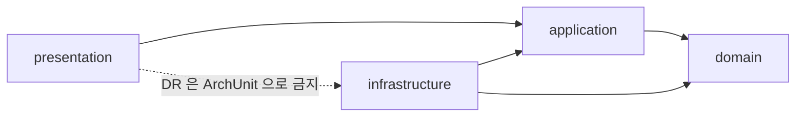
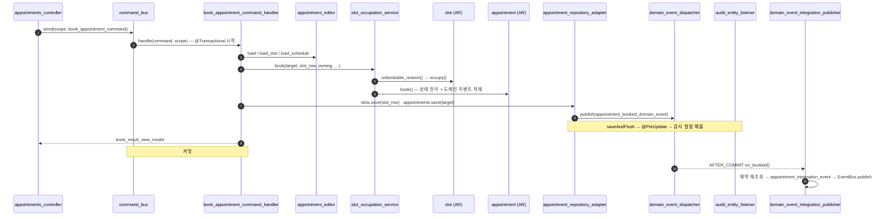
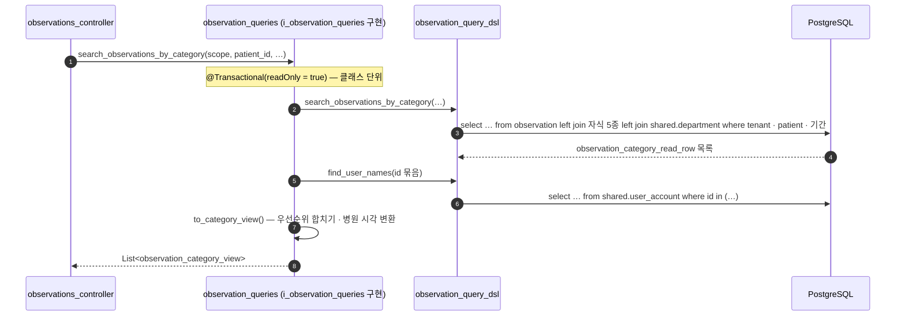
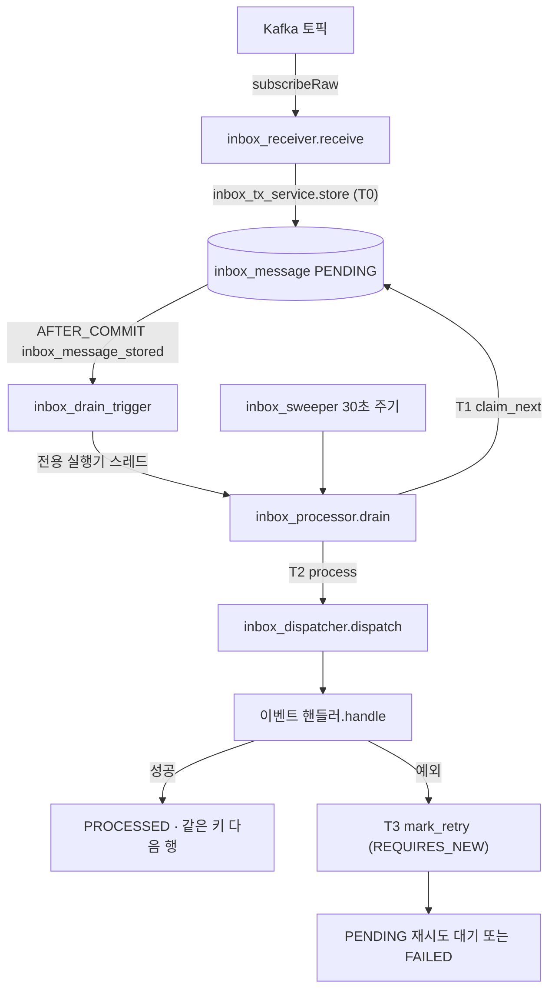

# 백엔드 패턴 학습서 — Kotlin · Spring Boot (세 BC 공통 패턴과 차이)

> 대상 독자: Kotlin · Spring 기초는 있지만 이 코드베이스는 처음인 신입 개발자.
> 이 문서는 **세 Bounded Context 의 백엔드가 공통으로 쓰는 패턴**과 **BC 마다 다르게 구현된 지점**을 실제 소스로 설명한다.
> 한 BC 를 깊게 파는 해설은 [x-diagnostic-result 로 배우는 Kotlin · React](../x-diagnostic-result-kotlin-react-guide.md) 가 따로 있다 — 이 문서를 먼저 읽고 그 문서로 넘어가면 된다.

## 다루는 세 MicroService

| 줄임 | 레포(BC) | MS 모듈 | 패키지 루트 | 포트 | 성격 |
|---|---|---|---|---|---|
| **DR** | `x-diagnostic-result` | `diagnostic-result` | `com.projectx.diagnosticresult` | 5351 | 다른 BC 의 검사결과를 Kafka 로 **받아 쌓고 보여 주는** 조회 중심 MS |
| **PA** | `x-patient-appointment` | `patient-appointment` | `com.projectx.patientappointment` | 5352 | 슬롯 · 예약을 **직접 만들고 바꾸는** 쓰기 중심 MS(수신 · 발행 모두 있음) |
| **FS** | `x-nutrition` | `foodservice` | `com.projectx.foodservice` | 5343 | 식이처방 · 세부오더 · 배식 준비를 다루는 업무 MS(발행 1건 · 수신 핸들러는 구독 미등록) |

## 경로 표기

- 코드 블록 위의 `레포/경로:시작줄-끝줄` 은 **레포 루트 기준** 상대 경로다.
- 경로 가운데의 `...` 는 패키지 루트 디렉터리 `com/projectx/<mskey>` 를 줄인 것이다.
  예: `x-patient-appointment/backend/patient-appointment/src/main/kotlin/.../presentation/appointments_controller.kt`
  = `.../src/main/kotlin/com/projectx/patientappointment/presentation/appointments_controller.kt`
- 인용 중간을 줄였으면 `// …(생략)…` 으로 표시했다. 줄 번호는 이 문서를 쓴 시점의 소스 기준이라, 코드가 바뀌면 조금씩 어긋날 수 있다 — 그때는 클래스 · 함수 이름으로 찾는다.
- 원본 주석의 경고 기호는 이모지 금지 규칙에 따라 「주의:」로 바꿔 적었다. 그 밖의 글자는 원본 그대로다.
- 끝에 `(가상)` 이 붙은 코드는 실제 레포에 없는 **학습용 샘플**이다(5장).

---

## 목차

- [1장. 한눈에 보는 구조](#1장-한눈에-보는-구조)
- [2장. 요청 한 건의 여정](#2장-요청-한-건의-여정)
  - 2.1 쓰기(Command) — PA `POST /appointments/{appointmentId}/book`
  - 2.2 읽기(Query) — DR `GET /observations`
- [3장. 패턴별 해설](#3장-패턴별-해설)
  - 3.1 seedwork · 3.2 Aggregate Root 와 불변식 · 3.3 도메인 이벤트와 dispatcher · 3.4 command_bus · 3.5 validator
  - 3.6 handler 와 `@Transactional` 경계 · 3.7 Repository IF ↔ JPA 어댑터 · 3.8 QueryDSL Query · 3.9 view_model
  - 3.10 `shared` 스키마 읽기 전용 엔티티 · 3.11 JPA 매핑 · 3.12 예외 → HTTP
  - 3.13 Kafka 수신(inbox) · 3.14 Kafka 발행 · 3.15 외부 HTTP Port & Adapter · 3.16 설정 · 부팅 · 3.17 테스트
- [4장. Kotlin 문법 — 이 코드에 실제로 나오는 것](#4장-kotlin-문법--이-코드에-실제로-나오는-것)
- [5장. 따라 만들기 샘플 — 새 엔드포인트 하나 추가](#5장-따라-만들기-샘플--새-엔드포인트-하나-추가)
- [6장. 세 BC 비교표](#6장-세-bc-비교표)
- [7장. 신입이 헷갈릴 포인트](#7장-신입이-헷갈릴-포인트)
- [8장. 연습 과제](#8장-연습-과제)
- [더 읽을거리](#더-읽을거리)

---

## 1장. 한눈에 보는 구조

### 1.1 처음 나오는 용어

| 용어 | 한 줄 설명 |
|---|---|
| BC (Bounded Context) | 업무 경계 하나. 레포 하나 = BC 하나(`x-patient-appointment` 등). |
| MS (MicroService) | 배포 단위 하나 = gradle 모듈 하나 = Docker 이미지 하나 = DB 스키마 하나. |
| Aggregate · Aggregate Root | 함께 바뀌어야 하는 객체 묶음과 그 묶음의 대표 객체. 바깥은 Root 의 메서드로만 묶음을 바꾼다. |
| Entity · VO(Value Object) | Entity 는 id 로 구별되는 객체, VO 는 값이 같으면 같은 것으로 보는 객체. |
| CQRS | 쓰기(Command)와 읽기(Query)를 다른 길로 처리하는 방식. 여기서는 쓰기=JPA, 읽기=QueryDSL. |
| Command · handler | "무엇을 바꿔라" 는 요청 객체와, 그것을 실제로 처리하는 클래스. |
| view_model | API 응답 전용 데이터 클래스. Entity 를 그대로 JSON 으로 내보내지 않으려고 둔다. |
| `tenant_scope` | (테넌트 id, 병원 코드) 한 쌍. 모든 저장 · 조회가 이 범위 안에서만 일어난다. |
| `shared` 스키마 | 환자 · 수진 · 직원 정보를 담은 프로젝트 공용 DB 스키마. 각 MS 는 **읽기만** 한다. |
| 도메인 이벤트 · 통합 이벤트 | 도메인 이벤트는 MS 안에서만 도는 "이런 일이 있었다" 신호, 통합 이벤트(integration event)는 Kafka 로 다른 BC 에 보내는 메시지. |
| 봉투(`MessageEnvelope`) | `common-eventbus-kt` 가 Kafka 메시지에 씌우는 껍데기. messageId · messageType · userId · tenantId 같은 메타를 갖는다. |
| inbox | 받은 Kafka 메시지를 DB 테이블(`inbox_message`)에 먼저 적재하고 나중에 처리하는 장치. |

### 1.2 레이어 4개

모든 MS 는 gradle 모듈 하나 안에서 **패키지**로 레이어를 나눈다.

| 레이어 | 패키지 | 들어 있는 것 | Spring 사용 |
|---|---|---|---|
| presentation | `presentation/` | Controller, 요청 DTO, 토큰 → `tenant_scope` 변환 | 사용 |
| application | `application/` | Command · handler · validator · command_bus, Query 인터페이스(`i_*_queries`) · view_model, 통합 이벤트 payload · 수신 핸들러, port 인터페이스 | 사용 |
| domain | `domain/` | Aggregate Root · Entity · VO · enum, Repository 인터페이스, 도메인 이벤트 · 예외, seedwork, 도메인 서비스 | **금지**(JPA 애노테이션만 허용) |
| infrastructure | `infrastructure/` | Repository 어댑터(JPA), QueryDSL 조회 구현, eventbus 배선, inbox, 외부 HTTP 어댑터, 설정(`config/`) | 사용 |

### 1.3 의존 방향



- 화살표는 "import 할 수 있다" 는 뜻이다. **domain 은 아무것도 import 하지 않는다**(JPA API 제외).
- infrastructure 는 application · domain 이 정한 인터페이스(`i_appointment_repository`, `i_observation_queries`, `i_analysis_agent_port` …)를 **구현**한다. 그래서 의존이 안쪽(domain)을 향한다 — 흔히 "포트와 어댑터" 라고 부르는 모양이다.
- Spring 은 런타임에 infrastructure 의 구현 빈을 application 의 인터페이스 자리에 주입한다. 컴파일 시점에는 application 이 infrastructure 를 모른다.

### 1.4 ArchUnit 이 지키는 것

모듈이 하나라서 컴파일러는 레이어 경계를 막지 못한다. 그래서 **ArchUnit**(클래스 의존을 검사하는 테스트 라이브러리)으로 경계를 테스트에서 강제한다. 세 MS 모두 `src/test/kotlin/.../architecture/layer_isolation_test.kt` 가 있다.

`x-patient-appointment/backend/patient-appointment/src/test/kotlin/.../architecture/layer_isolation_test.kt:12-44`
```kotlin
@AnalyzeClasses(packages = ["com.projectx.patientappointment"])
class layer_isolation_test {

    @ArchTest
    val domain_must_not_depend_on_spring: ArchRule =
        noClasses()
            .that().resideInAPackage("..domain..")
            .should().dependOnClassesThat().resideInAnyPackage("org.springframework..")

    // …(생략: domain_must_not_depend_on_outer_layers · no_mybatis_anywhere — 21-36)…

    /** presentation 은 도메인 애그리거트를 직렬화하지 않는다 — 응답은 view_model 만. */
    @ArchTest
    val presentation_must_not_depend_on_aggregates: ArchRule =
        noClasses()
            .that().resideInAPackage("..presentation..")
            .should().dependOnClassesThat().resideInAnyPackage("..domain.aggregatesmodel..")
}
```

DR 은 규칙 구성이 조금 다르다 — MyBatis · aggregate 규칙 대신 "application · presentation 은 infrastructure 를 모른다" 를 건다.

`x-diagnostic-result/backend/diagnostic-result/src/test/kotlin/.../architecture/layer_isolation_test.kt:34-47`
```kotlin
    // application 은 계약(port · i_*_queries · i_*_repository)만 갖고 구현을 모른다 —
    // 외부 호출 어댑터는 infrastructure/proxies, 조회 구현은 infrastructure/queries 가 그 계약을 구현한다.
    @ArchTest
    val application_must_not_depend_on_infrastructure: ArchRule =
        noClasses()
            .that().resideInAPackage("..application..")
            .should().dependOnClassesThat().resideInAPackage("..infrastructure..")

    // controller 는 command_bus · i_*_queries · port 만 본다
    @ArchTest
    val presentation_must_not_depend_on_infrastructure: ArchRule =
        noClasses()
            .that().resideInAPackage("..presentation..")
            .should().dependOnClassesThat().resideInAPackage("..infrastructure..")
```

| 규칙 | DR | PA | FS |
|---|:---:|:---:|:---:|
| domain → Spring 금지 | O | O | O |
| domain → 바깥 레이어 금지 | O | O | O |
| MyBatis 금지 | - | O | O |
| presentation → `domain.aggregatesmodel` 금지 | - | O | O |
| application → infrastructure 금지 | O | - | - |
| presentation → infrastructure 금지 | O | - | - |

> (주의) PA · FS 에는 "application → infrastructure 금지" 규칙이 없다. 그렇다고 import 해도 된다는 뜻은 아니다 — 의존 방향(1.3)은 세 BC 모두 같은 기준이다. 새 MS 를 만들면 여섯 규칙을 다 넣는 편이 안전하다.

이 규칙 때문에 생긴 코드 모양이 몇 가지 있다. 미리 알아 두면 낯설지 않다.

- 도메인 서비스(`slot_occupation_service` 등)에 `@Component` 를 달 수 없어서 `infrastructure/config` 에서 `@Bean` 으로 등록한다(3.2).
- 감사 컬럼 리스너를 Entity 에 `@EntityListeners` 로 달 수 없어서 `META-INF/orm.xml` 로 등록한다(3.11).

### 1.5 세 MS 의 패키지 트리 비교

`src/main/kotlin` 의 `.kt` 파일 수(이 문서 작성 시점 · `find … -name '*.kt' | wc -l`).

| 레이어 | DR | PA | FS |
|---|---:|---:|---:|
| (루트 · `*_application.kt`) | 1 | 1 | 1 |
| presentation | 9 | 18 | 9 |
| application | 59 | 91 | 30 |
| domain | 27 | 49 | 33 |
| infrastructure | 64 | 59 | 26 |
| **합계** | **160** | **218** | **99** |
| 총 줄 수 | 약 10,900 | 약 35,400 | 약 16,300 |
| 테스트 파일(`src/test`) | 35 | 74 | 18 |

트리 모양은 거의 같다. 다른 점만 짚는다.

```
<mskey>/
├─ <ms>_application.kt                  ← @SpringBootApplication
├─ presentation/   *_controller.kt · token_principal_scope.kt (· inbox_error_advice.kt — DR · PA)
├─ application/
│  ├─ commands/    command.kt · command_bus.kt · <업무>/*_command(_handler)s.kt
│  ├─ validations/ command_validator.kt (+ 구현 — DR 5개 · FS 10개 · PA 0개)
│  ├─ queries/     i_*_queries.kt · *_view_model(s).kt
│  ├─ integrationevents/ integration_event.kt · events/ · eventhandling/
│  ├─ ports/       외부 연동 인터페이스(DR: AI · 서식 / PA: 배포 테넌트 · inbox 운영 / FS: shared 수진)
│  └─ support/ · analysis/   (PA support 32개 · DR analysis 8개 · FS support 3개)
├─ domain/
│  ├─ aggregatesmodel/<aggregate>/   Root · 자식 Entity · VO · Repository IF
│  ├─ common/ · events/ · exceptions/ · services/(PA · FS)
│  └─ seedwork/    entity · i_aggregate_root · i_repository · domain_event · value_object · tenant_scope …
└─ infrastructure/
   ├─ <ms>_context.kt          Spring Data JpaRepository 인터페이스 모음
   ├─ domain_event_dispatcher.kt
   ├─ repositories/ · queries/ · shared/ · persistence/ · config/ · eventbus/
   └─ inbox/(DR · PA) · proxies/(DR · FS) · ports/(PA) · communication/(DR)
```

- **inbox** 는 Kafka 를 실제로 수신하는 DR · PA 에만 있다. FS 는 수신 핸들러 코드는 있지만 구독이 등록돼 있지 않다(3.13).
- **도메인 서비스**(`domain/services/`)는 Aggregate 둘 이상을 함께 다루는 규칙이 있는 PA(9개) · FS(1개)에만 있다.
- DR 의 Repository 인터페이스는 Aggregate 폴더마다 `i_*_repository.kt` 한 파일씩, PA 는 `domain/aggregatesmodel/appointment_repositories.kt` 한 파일에 전부, FS 는 Aggregate 폴더마다 하나씩이다.

### 이 장에서 기억할 것 3줄

1. 레이어는 패키지 4개(presentation · application · domain · infrastructure)이고, **domain 은 Spring 을 모른다.**
2. 컴파일러 대신 **ArchUnit 테스트**가 레이어 경계를 지키며, BC 마다 규칙 구성이 조금 다르다.
3. 트리 모양은 세 BC 가 같다 — inbox · 도메인 서비스 · 외부 어댑터 폴더가 있고 없음만 업무 성격을 따라 다르다.

---

## 2장. 요청 한 건의 여정

HTTP 요청이 들어와서 응답이 나갈 때까지 **어떤 클래스의 어떤 메서드가 차례로 불리는지**를 따라간다. 쓰기는 PA 의 예약 등록, 읽기는 DR 의 검사결과 목록을 주 예시로 쓴다.

### 2.1 쓰기(Command) — PA `POST /api/v1/patient-appointment/appointments/{appointmentId}/book`

"예약 등록" 은 미예약 상태(`proposed`)의 예약에 슬롯 한 칸을 점유시켜 `booked` 로 바꾸는 요청이다. 두 Aggregate(`appointment` · `slot`)를 함께 바꾸고, 커밋 뒤 Kafka 로 예약 이벤트를 낸다.



#### ① Controller — 입력을 Command 로 바꾸고 bus 에 넘긴다

클래스 머리는 `@RestController` · `@RequireAuth` · `@RequestMapping("/api/v1/patient-appointment")` 이고, 생성자로 `command_bus` 와 조회 인터페이스(`i_slot_queries` · `i_appointment_queries` …)를 받는다(`appointments_controller.kt:86-99`).

`x-patient-appointment/backend/patient-appointment/src/main/kotlin/.../presentation/appointments_controller.kt:330-349`
```kotlin
    @Operation(
        summary = "예약 등록 — `proposed → booked` 한 번에 + 슬롯 점유",
        description = "선점 단계가 없다. 그 사이 다른 사람이 같은 칸을 잡았으면 422 SLOT_FULL 또는 409 OPTIMISTIC_LOCK_CONFLICT 로 전부 되돌아간다",
    )
    @PostMapping("/appointments/{appointmentId}/book")
    fun book(
        @TokenPrincipal principal: AuthPrincipal,
        @RequestHeader(value = "X-Role-Code", required = false) role_code: String?,
        @PathVariable("appointmentId") appointment_id: String,
        @RequestBody request: book_request,
    ): book_result_view_model = bus.send(
        principal.to_tenant_scope(),
        book_appointment_command(
            appointment_id = appointment_id,
            slot_id = request.slotId,
            channel = channel_of(request.ext?.bookingChannel),
            role_code = role_code,
            route = route_of(request.ext?.bookingRoute),
        ),
    )
```

읽을 점:
- `@RequireAuth` · `@TokenPrincipal` 은 사내 JWT 라이브러리(`common-jwt-kt`)다. 토큰이 없거나 틀리면 컨트롤러 본문에 들어오기 전에 401 이 난다.
- API prefix `/api/v1/patient-appointment` 는 **컨트롤러가 소유**한다(`server.servlet.context-path` 를 쓰지 않는다).
- 컨트롤러에는 `@Transactional` 이 없다. 일은 전부 `bus.send` 한 번(= Command 하나)에 맡긴다.

#### ② 토큰 → 테넌트 범위

`x-patient-appointment/backend/patient-appointment/src/main/kotlin/.../presentation/token_principal_scope.kt:6-12`
```kotlin
// 토큰 주체 → 테넌트 범위. HTTP 요청의 tenant_id · hospital_code 는 이 파일에서만 나온다.
// AuthPrincipal 은 presentation 밖으로 내보내지 않는다 — application 이하에는 tenant_scope 만 넘긴다.
// 작업자(직원 id)는 넘기지 않는다 — 감사 컬럼은 audit_entity_listener 가 MDC userId(토큰 sub)로 채우고,
// 비고 이력의 작성자도 그 created_by 다.

// claim 이 비어 있으면 tenant_scope.of 가 INVALID_DATA 로 채운다(라이브러리가 필수 claim 을 검증하므로 정상 토큰에서는 생기지 않는다)
fun AuthPrincipal.to_tenant_scope(): tenant_scope = tenant_scope.of(tenantId, hospitalCode)
```

`AuthPrincipal` 은 라이브러리 타입이라 presentation 밖으로 내보내지 않는다. application 이하에는 도메인 VO `tenant_scope` 만 흐른다.

#### ③ Command 클래스 — 요청을 담는 불변 데이터

`x-patient-appointment/backend/patient-appointment/src/main/kotlin/.../application/commands/appointment/appointment_commands.kt:122-130`
```kotlin
/** 단건 예약 등록 — `proposed → booked` 한 번에 + 슬롯 점유. */
data class book_appointment_command(
    val appointment_id: String,
    val slot_id: String,
    val channel: appointment_booking_channel,
    val role_code: String?,
    /** 예약 경로(원내 · 콜센터 · 모바일 · 인터넷) — 주면 예약 등록 직전에 예약에 남긴다(classdiagram 1.19 · 불변식 44). */
    val route: booking_route? = null,
) : command
```

#### ④ command_bus — 명령 타입으로 핸들러를 찾는다

`x-patient-appointment/backend/patient-appointment/src/main/kotlin/.../application/commands/command_bus.kt:13-38`
```kotlin
@Component
class command_bus(
    handlers: List<command_handler<*, *>>,
    validators: List<command_validator<*>>,
) {
    private val handler_index: Map<Class<*>, command_handler<*, *>> =
        handlers.associateBy { resolve_generic(it.javaClass, command_handler::class.java) }

    private val validator_index: Map<Class<*>, List<command_validator<*>>> =
        validators.groupBy { resolve_generic(it.javaClass, command_validator::class.java) }

    /** [scope] 는 명령의 테넌트 범위 — 검증 뒤 핸들러에 그대로 넘긴다(command_handler 참고). */
    @Suppress("UNCHECKED_CAST")
    fun <TResult> send(scope: tenant_scope, command: command): TResult {
        val type = command.javaClass
        validator_index[type]?.forEach { (it as command_validator<command>).validate(command) }
        val handler = handler_index[type]
            ?: throw IllegalStateException("등록된 핸들러가 없습니다: ${type.name}")
        return (handler as command_handler<command, TResult>).handle(command, scope)
    }

    /** 구현 클래스에서 대상 인터페이스의 첫 번째 제네릭(명령 타입)을 해석한다. */
    private fun resolve_generic(impl: Class<*>, target: Class<*>): Class<*> =
        ResolvableType.forClass(impl).`as`(target).getGeneric(0).resolve()
            ?: throw IllegalStateException("명령 타입을 해석할 수 없습니다: ${impl.name}")
}
```

순서는 **검증기(validator) → 핸들러**다. PA 에는 validator 구현이 없어서(3.5) 바로 핸들러로 간다.

#### ⑤ Handler — 트랜잭션 경계

`x-patient-appointment/backend/patient-appointment/src/main/kotlin/.../application/commands/appointment/appointment_command_handlers.kt:86-125`
```kotlin
@Component
class book_appointment_command_handler(
    private val appointments: i_appointment_repository,
    private val slots: i_slot_repository,
    private val editor: appointment_editor,
    private val occupation: slot_occupation_service,
    private val roles: booking_role_resolver,
    private val planned: planned_encounter_service,
    private val clock: Clock,
) : command_handler<book_appointment_command, book_result_view_model> {

    private val log = LoggerFactory.getLogger(book_appointment_command_handler::class.java)

    @Transactional
    override fun handle(command: book_appointment_command, scope: tenant_scope): book_result_view_model {
        val target = editor.load(scope, command.appointment_id)
        val slot_row = editor.load_slot(scope, command.slot_id)
        val owning = editor.load_schedule(scope, slot_row.schedule_id)
        val now = clock.instant()
        // 경로는 예약 등록 직전에 남긴다 — 원내 · 콜센터는 기록만, 모바일 · 인터넷은 경로 축 판정에도 실린다(불변식 44).
        command.route?.takeIf { target.status == appointment_status.PROPOSED }?.let { target.enter_route(it, now) }
        // 역할 축(불변식 16) — `X-Role-Code` 에서 파생한 booking_role 을 slot.allowed_roles 와 대조한다.
        occupation.book(target, slot_row, owning, command.channel, roles.resolve(command.role_code), now)
        // 접수 요청 id 를 같은 트랜잭션에서 남긴다 — 요청은 커밋 뒤 발행되고 encounter_id 는 원무 회신이 붙인다(불변식 27).
        val issues = planned.attach(scope, listOf(target), now)
        slots.save(slot_row)
        val saved = appointments.save(target)
        log.info("예약을 등록했습니다 — appointment_id={} slot_id={}", saved.appointment_id, command.slot_id)
        return book_result_view_model(
            appointment_id = saved.appointment_id,
            // …(생략: status · slot_id · start_at · booked_at — 116-119)…
            version = saved.version,
            encounter_id = saved.encounter_id?.toString(),
            issue = issues,
        )
    }
}
```

읽을 점:
- `@Transactional` 은 **`handle()` 하나에만** 있다. 이 메서드가 끝나야 커밋된다. 중간에 예외가 나면 슬롯 점유 · 예약 상태 변경 · 접수 요청 모두 롤백된다.
- 시각은 `Instant.now()` 가 아니라 주입받은 `clock.instant()` 로 읽는다 — 테스트에서 시각을 고정할 수 있고, 병원 시간대가 한 곳(`domain_service_config.clock()`)에서 정해진다.
- 핸들러는 판정을 직접 하지 않는다. 판정은 도메인 서비스와 Aggregate 가 하고, 핸들러는 **불러오기 → 도메인 호출 → 저장 → 결과 조립** 순서만 맡는다.

#### ⑥ 로딩 — 테넌트 범위 안에서 읽고, 행 락을 잡지 않는다

`appointment_editor` 의 KDoc 이 핵심을 말한다 — "**행 락(`FOR UPDATE`)은 잡지 않는다.** 같은 칸을 둘이 동시에 저장하면 `slot.version` 낙관적 잠금이 한쪽을 `409 OPTIMISTIC_LOCK_CONFLICT` 로 돌리고 화면이 다시 읽는다"(`appointment_editor.kt:29-35`).

`x-patient-appointment/backend/patient-appointment/src/main/kotlin/.../application/support/appointment_editor.kt:43-49`
```kotlin
    @Transactional(readOnly = true)
    fun load(scope: tenant_scope, appointment_id: String): appointment =
        appointments.find_by_id(scope, appointment_id) ?: throw appointment_missing_exception(appointment_id)

    /** 점유 대상 슬롯 — 보통 조회. 없으면 404. */
    fun load_slot(scope: tenant_scope, slot_id: String): slot =
        slots.find_all_by_ids(scope, listOf(slot_id)).firstOrNull() ?: throw slot_not_found_exception(slot_id)
```

`load()` 에 `readOnly = true` 가 붙어 있지만, 핸들러의 트랜잭션 안에서 불리면 **바깥 트랜잭션에 합류**한다(전파 기본값 REQUIRED). 그래서 읽은 `appointment` 는 같은 영속성 컨텍스트에 붙어 있고, 나중에 고친 값이 저장된다.

#### ⑦ 도메인 서비스 — Aggregate 둘을 함께 바꾸는 유일한 곳

`slot_occupation_service` 는 Spring 의존이 없는 순수 클래스다. KDoc 은 "**애그리게잇 둘을 함께 건드리는 유일한 곳**이다. 다른 곳에서 `slot.occupy()` 를 부르면 예약 상태와 점유 수가 어긋난 채 커밋될 수 있다" 고 못박는다(`slot_occupation_service.kt:18-28`). 트랜잭션은 부르는 핸들러가 잡고, 여기서는 판정과 전이만 한다.

`x-patient-appointment/backend/patient-appointment/src/main/kotlin/.../domain/services/slot_occupation_service.kt:54-74`
```kotlin
    /** `proposed → booked` 한 번에 + 슬롯 점유 — 단건 · 묶음 · 회차가 모두 이 경로다. */
    fun book(
        target: appointment,
        slot_row: slot,
        owning_schedule: schedule,
        caller_channel: appointment_booking_channel,
        role: booking_role?,
        at: Instant,
    ) {
        guard_bookable(target, slot_row, owning_schedule, role, at)
        slot_row.occupy(at)
        target.book(
            schedule_id = owning_schedule.schedule_id,
            actor = snapshot_of(owning_schedule),
            slot_id = slot_row.slot_id,
            start_at = slot_row.start_at,
            end_at = slot_row.end_at,
            channel = caller_channel,
            at = at,
        )
    }
```

#### ⑧ Aggregate ① `slot` — 판정과 점유

`x-patient-appointment/backend/patient-appointment/src/main/kotlin/.../domain/aggregatesmodel/schedule/slot.kt:197-221`
```kotlin
    /** 왜 못 잡는가 — 오류 코드로 내려 화면이 사유를 말하게 한다. `null` 이면 예약 가능. */
    fun unbookable_reason(patient: eligibility, role: booking_role?, at: Instant): String? = when {
        overbook -> "SLOT_OVERBOOK"
        status.is_closed() -> "SLOT_CLOSED"
        !start_at.isAfter(at) -> "SLOT_IN_PAST"
        booked_count >= capacity -> "SLOT_FULL"
        !target.allows(patient) -> "SLOT_NOT_ELIGIBLE"
        !allows_role(role) -> "ROLE_NOT_ALLOWED"
        status != slot_status.FREE -> "SLOT_FULL"
        else -> null
    }
    // …(생략: remaining · is_occupied — 209-214)…

    /** 점유. 여유가 없으면 예외 — 호출자는 `slot_occupation_service` 하나다. */
    fun occupy(at: Instant) {
        if (status.is_closed()) throw bad_state_domain_exception("닫힌 슬롯은 예약할 수 없습니다", status.code)
        if (booked_count >= capacity) throw slot_full_domain_exception(id, capacity)
        booked_count += 1
        refresh_status(at, changed = true)
    }
```

#### ⑨ Aggregate ② `appointment.book()` — 상태 전이 + 도메인 이벤트 적재

`x-patient-appointment/backend/patient-appointment/src/main/kotlin/.../domain/aggregatesmodel/appointment/appointment.kt:290-322`
```kotlin
    fun book(
        schedule_id: String,
        actor: actor_snapshot,
        slot_id: String,
        start_at: Instant,
        end_at: Instant,
        channel: appointment_booking_channel,
        at: Instant,
        overbooked: Boolean = false,
    ) {
        if (status != appointment_status.PROPOSED) {
            throw bad_state_domain_exception("예약 등록은 proposed 예약만 가능합니다", status.code)
        }
        assign_slot(schedule_id, actor, slot_id, start_at, end_at)
        this.overbooked = overbooked
        this.channel = channel
        this.status = appointment_status.BOOKED
        this.booked_at = at
        touch(at)
        add_domain_event(
            appointment_booked_domain_event(
                appointment_id = id,
                patient_id = patient_id.toString(),
                based_on_type = based_on_type_value?.code,
                based_on_id = based_on_id,
                schedule_id = schedule_id,
                slot_ids = occupied_slot_ids(),
                start_at = start_at,
                occurred_at = at,
                scope = tenant(),
            ),
        )
    }
```

`add_domain_event(...)` 는 **아직 아무 데도 보내지 않는다.** Entity 안의 목록에 쌓아 둘 뿐이다(3.3). 진짜 발행은 저장 시점에 Repository 어댑터가 한다.

#### ⑩ Repository 어댑터 — 저장하고 이벤트를 꺼낸다

`x-patient-appointment/backend/patient-appointment/src/main/kotlin/.../infrastructure/repositories/appointment_repositories.kt:61-71`
```kotlin
private inline fun <T : entity> save_with_events(
    aggregate: T,
    dispatcher: domain_event_dispatcher,
    persist: (T) -> T,
): T {
    val events: List<domain_event> = aggregate.domain_events
    val saved = persist(aggregate)
    aggregate.clear_domain_events()
    events.forEach { dispatcher.publish(it) }
    return saved
}
```

`x-patient-appointment/backend/patient-appointment/src/main/kotlin/.../infrastructure/repositories/appointment_repositories.kt:232-244`
```kotlin
@Repository
class appointment_repository_adapter(
    private val jpa: appointment_jpa_repository,
    private val dispatcher: domain_event_dispatcher,
) : i_appointment_repository {

    override fun save(aggregate: appointment): appointment =
        save_with_events(aggregate, dispatcher) { jpa.saveAndFlush(it) }

    override fun save_all(aggregates: List<appointment>): List<appointment> =
        save_all_with_events(aggregates, dispatcher) { jpa.saveAllAndFlush(it) }

    override fun find_by_id(scope: tenant_scope, id: String): appointment? = jpa.findById(id).orElse(null).in_scope(scope)
```

- 이벤트를 **저장 전에 인자 인스턴스에서** 꺼낸다(왜 그런지는 3.3).
- 단건 저장이 `save` 가 아니라 `saveAndFlush` 다. flush 를 바로 해야 `@Version` 이 지금 올라가서, 핸들러가 응답에 넣는 `saved.version` 이 맞는 값이 된다(3.11).

#### ⑪ dispatcher → Spring 이벤트

`x-patient-appointment/backend/patient-appointment/src/main/kotlin/.../infrastructure/domain_event_dispatcher.kt:12-19`
```kotlin
@Component
class domain_event_dispatcher(
    private val publisher: ApplicationEventPublisher,
) {
    fun publish(event: domain_event) {
        publisher.publishEvent(event)
    }
}
```

#### ⑫ flush 시점 — 감사 컬럼이 채워진다

`saveAndFlush` 가 SQL 을 내보내기 직전, JPA 가 `@PrePersist` / `@PreUpdate` 콜백을 부른다. 등록은 `orm.xml` 로 했다(3.11).

`x-patient-appointment/backend/patient-appointment/src/main/kotlin/.../infrastructure/persistence/audit_entity_listener.kt:25-39`
```kotlin
class audit_entity_listener {

    @PrePersist
    fun on_pre_persist(target: Any) {
        (target as? entity)?.record_creation(Instant.now(), current_employee_id())
    }

    @PreUpdate
    fun on_pre_update(target: Any) {
        (target as? entity)?.record_modification(Instant.now(), current_employee_id())
    }

    /** MDC 의 사용자 id — 익명(이벤트 수신) 이거나 UUID 꼴이 아니면 null. */
    private fun current_employee_id(): UUID? = event_actor.current()?.let(UUID::fromString)
}
```

`MDC`(로그용 스레드 저장소)의 `userId` 는 JWT 필터가 토큰 sub 로 넣어 둔다. 도메인 코드는 "누가 바꿨는지" 를 몰라도 된다.

#### ⑬ 커밋 뒤 — 통합 이벤트 발행

핸들러가 정상 반환하면 트랜잭션이 커밋되고, 그다음에야 `@TransactionalEventListener(AFTER_COMMIT)` 리스너가 돈다.

`x-patient-appointment/backend/patient-appointment/src/main/kotlin/.../infrastructure/eventbus/domain_event_integration_publisher.kt:59-89`
```kotlin
    @TransactionalEventListener(phase = TransactionPhase.AFTER_COMMIT)
    fun on_booked(event: appointment_booked_domain_event) =
        publish_appointment(appointment_event_type.BOOKED, event.scope, event.appointment_id)
    // …(생략: on_rescheduled · on_cancelled 도 같은 모양 — 63-74)…

    private fun publish_appointment(type: appointment_event_type, scope: tenant_scope, appointment_id: String) {
        runCatching {
            val view = appointment_queries.find_by_id(scope, appointment_id)
                ?: return log.warn("발행할 예약을 찾지 못했습니다 — appointment_id={} event_type={}", appointment_id, type)
            val payload = appointment_integration_event.of(type, view)
            if (!enabled) {
                log.info("예약 이벤트 조립 완료(발행 꺼짐) — {}", payload)
                return
            }
            event_actor.publish("Appointment") { event_bus.getObject().publish(payload, aggregateId = payload.appointment_id) }
            log.info("예약 이벤트를 발행했습니다 — {}", payload)
        }.onFailure {
            log.warn("예약 이벤트 발행에 실패했습니다(예약은 저장됨 · 다시 보내지 않는다) — appointment_id={} event_type={} 사유={}", appointment_id, type, it.message)
        }
    }
```

- **커밋 전에 보내면** 롤백된 예약이 다른 BC 에 알려진다. 그래서 AFTER_COMMIT 이다.
- payload 는 도메인 이벤트에 든 값이 아니라 **커밋된 예약을 다시 조회(QueryDSL view_model)** 해서 만든다.
- 발행 실패는 `runCatching` 으로 삼키고 WARN 만 남긴다(best-effort). Outbox 가 없으므로 다시 보내지 않는다.

#### ⑭ 응답 · 실패 경로

- 성공: 핸들러가 만든 `book_result_view_model` 이 JSON 으로 나간다.
- 같은 칸을 두 사람이 동시에 저장하면 `slot` 의 `@Version` 이 한쪽에서 `OptimisticLockingFailureException` 을 낸다 → `global_exception_handler` 가 409 로 바꾼다.

`x-patient-appointment/backend/patient-appointment/src/main/kotlin/.../infrastructure/config/global_exception_handler.kt:118-129`
```kotlin
    /**
     * JPA 낙관락(`@Version`) 경합 — 행 락을 쓰지 않으므로 **이것이 유일한 동시성 장치**다.
     * 같은 슬롯 · 같은 스케줄 · 같은 진료시간 기준을 둘이 같은 순간 저장하면 한쪽이 여기로 온다. 화면은 다시 읽고 다시 저장한다.
     */
    @ExceptionHandler(OptimisticLockingFailureException::class)
    fun handle_optimistic_lock(ex: OptimisticLockingFailureException): ResponseEntity<error_response> =
        problem(
            HttpStatus.CONFLICT,
            "conflict",
            "OPTIMISTIC_LOCK_CONFLICT",
            "다른 사용자가 먼저 변경했습니다. 다시 조회 후 시도하세요",
        )
```

#### 다른 BC 의 같은 단계 — 짧게 비교

**DR — 즐겨찾기 세트 생성(`POST /viewer-configurations/me/favorite-sets`).** 컨트롤러는 `command_bus.send(request.to_command(principal.to_tenant_scope(), principal.employee_id()))` 한 줄을 부르고, 응답은 본문 없이 `201 Created` + `Location` 이다(`favorite_sets_controller.kt:39-49`). 핸들러는 다음과 같다.

`x-diagnostic-result/backend/diagnostic-result/src/main/kotlin/.../application/commands/create_favorite_set_command_handler.kt:9-25`
```kotlin
@Service
class create_favorite_set_command_handler(
    private val repository: i_viewer_configuration_repository
) : command_handler<create_favorite_set_command, String> {

    @Transactional
    override fun handle(command: create_favorite_set_command): String {
        val config = repository.find_or_new_viewer_configuration(command.scope, command.user_id)

        val created = config.add_favorite_set(
            set_name = command.set_name,
            first_item = command.observation?.let { favorite_observation(it.observation_type_code, it.observation_code) }
        )
        repository.create_or_update_viewer_configuration(config)
        return created.id
    }
}
```

DR 은 `tenant_scope` 를 **Command 필드로** 싣고(`command.scope`), PA 는 `bus.send(scope, command)` 의 **별도 인자**로 넘긴다. 직원 id 가 업무 키(사용자별 설정)라서 DR 만 `principal.employee_id()` 를 Command 에 넣는다.

**FS — 세부오더 발행(`POST /meal-orders`).** 핸들러는 id 만 돌려주고, 컨트롤러가 **같은 요청 안에서 조회를 한 번 더** 불러 view_model 을 응답한다.

`x-nutrition/backend/foodservice/src/main/kotlin/.../presentation/meal_orders_controller.kt:140-146`
```kotlin
    fun issue(@TokenPrincipal principal: AuthPrincipal, @Valid @RequestBody request: issue_meal_order_request): ResponseEntity<meal_order_view_model> {
        val scope = principal.to_tenant_scope()
        val result: meal_order_command_result = command_bus.send(request.to_command(scope))
        return ResponseEntity
            .created(URI.create("/meal-orders/${result.meal_order_id}"))
            .body(load(scope, result.meal_order_id))
    }
```

`x-nutrition/backend/foodservice/src/main/kotlin/.../presentation/meal_orders_controller.kt:200-202`
```kotlin
    /** Command 응답은 변경된 애그리거트의 현재 view_model 을 돌려준다(화면 재조회 왕복 제거). */
    private fun load(scope: tenant_scope, meal_order_id: UUID): meal_order_view_model =
        meal_order_queries.find_by_id(scope, meal_order_id) ?: throw meal_order_not_found_exception(meal_order_id)
```

`command_bus.send` 의 트랜잭션은 이미 커밋된 뒤라, `load()` 는 별도의 읽기 전용 트랜잭션에서 **커밋된 값**을 본다. "한 엔드포인트 = Command 하나" 규칙은 지킨다 — 조회는 Command 가 아니다.

| 단계 | DR | PA | FS |
|---|---|---|---|
| 테넌트 범위 전달 | Command 필드 `scope` | `send(scope, command)` 인자 | Command 필드 `scope` |
| 쓰기 응답 | `201` + Location / `204` | 핸들러가 만든 view_model | 쓰기 뒤 재조회한 view_model |
| 도메인 이벤트 발행 | 구조만 있음(적재하는 곳 없음) | 있음 → AFTER_COMMIT → Kafka | 있음 → 구독자 1개(식이처방 정의만 Kafka) |

### 2.2 읽기(Query) — DR `GET /api/v1/diagnostic-result/observations?patient_id=…`

환자 한 명의 검사결과를 분류별로 모아 결과일 역순으로 돌려준다. **Repository 와 Aggregate 를 거치지 않는다** — QueryDSL 이 DB 행을 곧바로 read row · view_model 로 옮긴다.



#### ① Controller — 파라미터를 받아 Query 인터페이스를 부른다

`x-diagnostic-result/backend/diagnostic-result/src/main/kotlin/.../presentation/observations_controller.kt:29-66`
```kotlin
@RestController
@RequireAuth
@RequestMapping("/api/v1/diagnostic-result/observations")
@Tag(name = "Observations", description = "환자 검사결과 통합 조회 API (검체진단/영상진단/기능진단/임상관찰/외부연동기록)")
class observations_controller(
    private val queries: i_observation_queries,
    private val record_document_queries: i_record_document_queries,
) {

    @Operation(summary = "환자ID 기준 검사분류별 검사결과 목록 (결과일자 역순)")
    @GetMapping
    fun search_observations_by_category(
        @TokenPrincipal principal: AuthPrincipal,
        @Parameter(description = "환자 ID(shared 환자 uuid) — 필수", required = true)
        @RequestParam patient_id: UUID,
        // …(생략: observation_type_code · category_code · from_date · to_date 파라미터 44-58)…
        @RequestParam(required = false) date_basis: String?,
    ): ResponseEntity<List<observation_category_view>> =
        ResponseEntity.ok(
            queries.search_observations_by_category(
                principal.to_tenant_scope(), patient_id, observation_type_code, category_code, from_date, to_date,
                observation_date_basis.of(date_basis),
            )
        )
```

컨트롤러가 의존하는 것은 `i_observation_queries`(application 의 인터페이스)다. 구현이 infrastructure 에 있다는 사실을 컨트롤러는 모른다.

#### ② Query 인터페이스(application)

`i_observation_queries`(`application/queries/i_observation_queries.kt:7-20`)는 `fun search_observations_by_category(scope: tenant_scope, patient_id: UUID, …): List<observation_category_view>` 같은 시그니처만 갖는다. 모든 메서드의 첫 인자가 `tenant_scope` 다 — "전부 테넌트 범위 안에서만 본다".

#### ③ 조회 서비스(infrastructure) — 읽기 전용 트랜잭션

`x-diagnostic-result/backend/diagnostic-result/src/main/kotlin/.../infrastructure/queries/observation_queries.kt:21-46`
```kotlin
@Service
@Transactional(readOnly = true)
class observation_queries(
    private val query_dsl: observation_query_dsl,
    // 저장은 절대 시각(Instant) — API 로는 병원 현지시각으로 내린다
    private val hospital_clock: Clock,
) : i_observation_queries {

    override fun search_observations_by_category(
        // …(생략: 파라미터 7개 — 30-36)…
    ): List<observation_category_view> =
        query_dsl.search_observations_by_category(
            scope,
            patient_id,
            observation_type_code?.takeIf { it.isNotBlank() },
            category_code?.takeIf { it.isNotBlank() },
            from_date,
            to_date,
            date_basis,
        ).let(::to_category_views)
```

DR 은 조회를 **두 클래스**로 나눴다 — `observation_queries`(트랜잭션 · read row → view_model 변환)와 `observation_query_dsl`(쿼리만). PA · FS 는 `*_query_dsl` 한 클래스가 Query 인터페이스를 직접 구현한다(3.8).

#### ④ QueryDSL — 조건과 조인

`x-diagnostic-result/backend/diagnostic-result/src/main/kotlin/.../infrastructure/queries/observation_query_dsl.kt:143-167`
```kotlin
    ): List<observation_category_read_row> =
        category_query()
            .where(search_where(scope, patient_id, observation_type_code, category_code, from_date, to_date, date_basis))
            .orderBy(o.result_datetime.desc())
            .fetch()

    /** 목록 조건 — 실행 없이 JPQL 해석을 검사하는 테스트도 이 조건을 쓴다. */
    internal fun search_where(
        // …(생략: search_observations_by_category 와 같은 파라미터 7개 — 151-157)…
    ): BooleanBuilder {
        val where = BooleanBuilder()
            .and(tenant_predicate(o.tenant_id, o.hospital_code, scope))
            .and(o.patient_id.eq(patient_id))
            .and(o.is_deleted.isFalse)
        observation_type_code?.let { where.and(o.observation_type_code.eq(it)) }
        category_code?.let { where.and(o.category_code.eq(it)) }
        period_predicate(date_basis, from_date, to_date)?.let { where.and(it) }
        return where
    }
```

`x-diagnostic-result/backend/diagnostic-result/src/main/kotlin/.../infrastructure/queries/observation_query_dsl.kt:383-393`
```kotlin
    /** 검사결과 목록 · 단건 공통 쿼리(실행 전) — 실행 없이 JPQL 해석을 검사하는 테스트도 이 쿼리를 쓴다. */
    internal fun category_query(): JPAQuery<observation_category_read_row> =
        query_factory
            .select(category_projection)
            .from(o)
            .leftJoin(spec).on(spec.id.eq(o.id))
            .leftJoin(img).on(img.id.eq(o.id))
            .leftJoin(func).on(func.id.eq(o.id))
            .leftJoin(record).on(record.id.eq(o.id))
            .leftJoin(ext).on(ext.id.eq(o.id))
            .leftJoin(department).on(department_join)
```

- 테넌트 조건은 항상 맨 앞에 건다(`tenant_predicate`). 빠뜨리면 다른 병원의 데이터가 보인다.
- `?.let { where.and(...) }` — 값이 있을 때만 조건을 붙인다(동적 where).
- `category_query()` · `search_where()` 를 `internal` 로 뺀 이유는, DB 없이 HQL 해석만 검사하는 테스트가 같은 쿼리를 쓰게 하려는 것이다(3.17).

#### ⑤ 이름은 id 묶음으로 따로 읽고, view_model 로 옮긴다

`x-diagnostic-result/backend/diagnostic-result/src/main/kotlin/.../infrastructure/queries/observation_queries.kt:113-117`
```kotlin
    /** 진료의 · 처방의 이름은 행들의 id 를 모아 shared 에서 한 번에 읽는다(조인하지 않는다 — classdiagram §1.6). */
    private fun to_category_views(rows: List<observation_category_read_row>): List<observation_category_view> {
        val names = query_dsl.find_user_names(rows.flatMap { listOfNotNull(it.doctor_id, it.ordering_doctor_id) }.toSet())
        return rows.map { to_category_view(it, names) }
    }
```

행마다 이름을 조회하면 N+1(행 수만큼 쿼리)이 된다. id 를 모아 `in (…)` 한 번으로 읽는 것이 세 BC 공통 습관이다.

#### 다른 BC 의 같은 단계 — 짧게 비교

**FS — 병동 세부오더 보드(`GET /wards/{ward_id}/meal-order-board`).** 엔티티를 그대로 읽어(`selectFrom`) 메모리에서 view_model 로 조립한다. 칸마다 "그 날짜의 리비전" 같은 도메인 조회 함수(`revision_at`)를 써야 해서다.

`x-nutrition/backend/foodservice/src/main/kotlin/.../infrastructure/queries/meal_order_query_dsl.kt:73-99`
```kotlin
    @Transactional(readOnly = true)
    override fun find_board(scope: tenant_scope, ward_id: String, meal_date: LocalDate): meal_order_board_view_model {
        // …(생략: 끼니 열 · 그 병동의 활성 처방(환자별 마지막 1건) 읽기 — 75-85)…
        val diet_order_ids = diet_orders.map { it.diet_order_id }
        val meal_orders = query_factory.selectFrom(m)
            .where(
                in_scope(scope)
                    .and(m.diet_order_id.`in`(diet_order_ids))
                    .and(m.status.eq(meal_order_status.ACTIVE))
                    // 주의: **그 날짜의 적용기간 안**인 것만 발행으로 본다. 기간을 보지 않으면 시작일이
                    //   미래인 오더가 오늘 칸에 "발행" 으로 뜨고, 같은 기간을 보는 달력(Q-21)과 어긋난다.
                    .and(m.effective_start_date.loe(meal_date))
                    .and(m.effective_end_date.isNull.or(m.effective_end_date.goe(meal_date))),
            )
            .fetch()
            .groupBy { it.diet_order_id }
```

엔티티를 읽더라도 **응답은 view_model 로만** 내보낸다. 읽은 엔티티는 바꾸지 않는다(조회 트랜잭션은 readOnly).

**PA — 슬롯 검색(`GET /slots`).** SQL 로 크게 좁힌 뒤, 판정은 Aggregate 의 `is_bookable()` 한 곳에서 메모리로 한다 — 같은 규칙을 SQL 로 두 번 쓰지 않으려는 선택이다.

`x-patient-appointment/backend/patient-appointment/src/main/kotlin/.../infrastructure/queries/slot_query_dsl.kt:117-133`
```kotlin
        // `bookable=true` 는 SQL 로 크게 좁히고(자리 있음 · 미래) 3축만 메모리에서 본다.
        if (filter.bookable == true) {
            where.and(q.status.eq(slot_status.FREE))
            where.and(q.booked_count.lt(q.capacity))
            where.and(q.start_at.gt(at))
        }

        val rows = factory.selectFrom(q)
            .where(where)
            .orderBy(q.start_at.asc(), q.id.asc())
            .fetch()

        if (filter.bookable != true) return rows
        val patient = patient_of(filter)
        // 역할 축(불변식 16) — `slot.allowed_roles` 가 비어 있지 않고 그 역할이 없으면 예약 불가로 걸러진다.
        return rows.filter { it.is_bookable(patient, filter.role, at) }
    }
```

### 2.3 쓰기 · 읽기 길 요약

| | 쓰기(Command) | 읽기(Query) |
|---|---|---|
| 진입 | Controller → `command_bus.send` | Controller → `i_*_queries` |
| 트랜잭션 | 핸들러 `handle()` 의 `@Transactional` | 조회 구현의 `@Transactional(readOnly = true)` |
| 데이터 접근 | domain 의 Repository IF → infrastructure JPA 어댑터 | infrastructure 의 QueryDSL(`JPAQueryFactory`) |
| 다루는 객체 | Aggregate Root(메서드로만 변경) | read row · view_model(또는 읽기만 하는 엔티티) |
| 부수 효과 | 도메인 이벤트 → AFTER_COMMIT 리스너 | 없음 |

### 이 장에서 기억할 것 3줄

1. 쓰기는 **Controller → command_bus → handler(@Transactional) → 도메인 → Repository 어댑터 → (커밋 뒤) 리스너** 순서다.
2. 읽기는 **Controller → Query IF → QueryDSL 구현(readOnly) → view_model** 이고 Repository · Aggregate 를 거치지 않는다.
3. 외부 발행은 커밋 뒤(AFTER_COMMIT)에만 하고, 실패해도 커밋된 쓰기를 되돌리지 않는다.

---
## 3장. 패턴별 해설

각 절은 **무엇 / 왜 / 실제 코드 / 세 BC 비교 / 흔한 실수** 순서로 쓴다. 2장에서 이미 인용한 코드는 다시 싣지 않고 위치만 가리킨다.

### 3.1 seedwork — 모든 Entity 의 바탕

**무엇.** `domain/seedwork/` 에 있는 작은 베이스 타입 묶음이다. MS 끼리 공유하지 않고 **MS 마다 복사**해 둔다.

| 타입 | 역할 |
|---|---|
| `entity` (`@MappedSuperclass`) | id · 테넌트 2컬럼 · 감사 4컬럼 · 도메인 이벤트 목록 · `equals`/`hashCode` |
| `i_aggregate_root` | 마커 인터페이스 — Aggregate Root 만 단다 |
| `i_repository<T : i_aggregate_root>` | Repository 의 공통 계약 |
| `domain_event` | 마커 인터페이스 — 도메인 이벤트 data class 가 단다 |
| `value_object` | 값 동등성 베이스(`get_equality_components()`) |
| `tenant_scope` | (테넌트 id, 병원 코드) VO |
| `uuid7`(PA) · `uuid_format` | id 발급 · UUID 꼴 판정 |

**왜.** 모든 테이블이 「PK → `tenant_id` · `hospital_code` → 업무 컬럼 → 감사 4종」 순서를 지키고, 모든 Entity 가 같은 방식으로 이벤트를 쌓고 같은 기준으로 같음을 판정하게 하려는 것이다. MS 간에 공유하지 않는 이유는 배포 단위가 다르기 때문이다 — 공유 라이브러리를 바꾸면 모든 MS 를 같이 배포해야 한다.

**실제 코드 — `entity`.**

`x-patient-appointment/backend/patient-appointment/src/main/kotlin/.../domain/seedwork/entity.kt:24-93`
```kotlin
@MappedSuperclass
abstract class entity {

    @Id
    open var id: String = ""
        protected set

    @Column(name = "tenant_id", nullable = false, updatable = false, length = 64)
    open var tenant_id: String = tenant_scope.INVALID_DATA
        protected set
    // …(생략: hospital_code · 감사 4컬럼 created_at · created_by · updated_at · updated_by — 34-57)…

    @Transient
    private val _domain_events: MutableList<domain_event> = mutableListOf()

    /** 적재된 도메인 이벤트의 불변 스냅샷. */
    val domain_events: List<domain_event>
        @Transient get() = _domain_events.toList()

    fun add_domain_event(event: domain_event) {
        _domain_events.add(event)
    }
    // …(생략: clear_domain_events · is_transient · tenant — 69-78)…

    /** 이 행이 그 범위에 속하는가 — 리포지토리 어댑터가 id 로 읽은 뒤 범위를 확인할 때 쓴다. */
    fun belongs_to(scope: tenant_scope): Boolean =
        tenant_id == scope.tenant_id && hospital_code == scope.hospital_code
    // …(생략: assign_id · assign_tenant — 84-93, 둘 다 protected)…
```

- 모든 프로퍼티가 `protected set` 이다. 바깥에서 `appointment.status = …` 처럼 바로 바꿀 수 없고, 반드시 도메인 메서드(`book()` 등)를 거친다.
- `_domain_events` 는 `@Transient` — DB 컬럼이 아니라 메모리에만 있는 목록이다.

**실제 코드 — `tenant_scope`.**

`x-patient-appointment/backend/patient-appointment/src/main/kotlin/.../domain/seedwork/tenant_scope.kt:7-27`
```kotlin
data class tenant_scope private constructor(
    val tenant_id: String,
    val hospital_code: String,
) {
    // …(생략: hospital_code_or_null — 11-12)…

    companion object {
        // 테넌트 · 병원을 특정하지 못했을 때 넣는 값
        const val INVALID_DATA = "INVALID_DATA"

        // 빈 값(null · 공백)은 INVALID_DATA 로 바꾼다. 앞뒤 공백은 떼고 대소문자는 받은 그대로 둔다
        fun of(tenant_id: String?, hospital_code: String?): tenant_scope =
            tenant_scope(normalize(tenant_id), normalize(hospital_code))
        // …(생략: INVALID — 22-23)…

        private fun normalize(value: String?): String = value?.trim()?.takeIf { it.isNotEmpty() } ?: INVALID_DATA
    }
}
```

`private constructor` + `companion object { fun of(...) }` — "생성은 `of()` 한 곳에서만" 을 컴파일러가 강제한다. 빈 값을 `INVALID_DATA` 로 바꾸는 규칙이 흩어지지 않는다.

PA 는 id 를 외부 라이브러리 없이 도메인 안에서 만든 **UUID v7**(앞자리가 밀리초 시각이라 발급 순 정렬)로 발급한다(`domain/seedwork/uuid7.kt:20-28`).

**세 BC 비교.**

| 항목 | DR | PA | FS |
|---|---|---|---|
| `entity.id` 타입 | `String`(UUID v4 문자열) | `String`(UUID v7 · 옛 행 ULID 섞임) | **`UUID`**(`NIL_ID` = `UUID(0,0)`) |
| id 발급 | 생성자에서 `UUID.randomUUID().toString()` | 팩토리에서 `assign_id(uuid7.next(at))` | `assign_id()` 기본 인자 `UUID.randomUUID()` |
| `i_repository` 메서드 | 없음(마커) | `save` · `find_by_id(scope, id: String)` | `save` · `find_by_id(scope, id: UUID)` |
| 자식의 테넌트 상속 | `assign_tenant(scope)` 로 Root 값 전달 | `inherit_tenant(owner)` | `assign_tenant(scope)` |
| `value_object` 상속 클래스 | 없음(VO 가 `equals` 직접 구현) | `actor_snapshot` 등 | 없음(VO 는 data class) |
| 범위 확인 | JPQL 에 `tenant_id` 조건 | `belongs_to(scope)` + JPQL | JPQL `find_in_scope` |

**흔한 실수.**
- `tenant_scope("CHABD", "CHABD")` 처럼 생성자를 직접 부르려 한다 → `private` 라 컴파일 오류. `tenant_scope.of(...)` 를 쓴다.
- 감사 컬럼(`created_at` 등)을 도메인 코드에서 채우려 한다 → 리스너가 저장 직전에 덮어쓴다(3.11). PA 의 `touch(at)` 처럼 `updated_at` 에 값을 넣는 곳은 "루트를 dirty 로 만들어 `@Version` 을 올리기" 위한 표시일 뿐이다.
- 규칙 문서(`.claude/docs/rules/domain-model.md`)는 `id: String` 을 계약으로 적어 두었지만 FS 는 `UUID` 다. 실제 코드를 기준으로 본다.

---

### 3.2 Aggregate Root 와 불변식

**무엇.** Aggregate Root 는 "이 묶음을 바꾸려면 반드시 나를 통해라" 를 맡는 Entity 다. 불변식(invariant)은 "어떤 순간에도 깨지면 안 되는 규칙"(예: 점유 수 ≤ 정원)이다. Root 의 메서드 진입부에서 검사하고, 어기면 도메인 예외를 던진다.

**왜.** 규칙을 한 곳에 모아야 화면 · 배치 · 이벤트 수신 등 어느 길로 들어와도 같은 규칙이 적용된다. 핸들러마다 규칙을 흩어 두면 새 경로가 생길 때 빠뜨린다.

**실제 코드 — 생성 팩토리의 불변식(PA).** `protected constructor()`(JPA 용) + `companion object.of(...)` — 바깥은 팩토리로만 만들 수 있고, 팩토리는 검사를 통과한 객체만 내보낸다.

`x-patient-appointment/backend/patient-appointment/src/main/kotlin/.../domain/aggregatesmodel/appointment/appointment.kt:734-772`
```kotlin
        fun of(
            category: service_category,
            based_on_type_value: based_on_type?,
            based_on_id: String?,
            // …(생략: patient_id · order · patient · priority · channel — 738-742)…
            at: Instant,
            scope: tenant_scope,
        ): appointment {
            if (based_on_type_value == null || based_on_id.isNullOrBlank()) {
                throw based_on_required_domain_exception(category.code)
            }
            if (based_on_type_value.category != category) {
                throw based_on_category_mismatch_domain_exception(
                    based_on_type_value.code,
                    based_on_type_value.category.code,
                    category.code,
                )
            }
            return appointment().apply {
                // 예약 id 는 UUID(v7)다 — 이 BC 의 다른 Entity 와 같은 발급기(그 전에 만든 예약은 ULID · UUID v4 그대로).
                assign_id(uuid7.next(at))
                assign_tenant(scope)
                this.status = appointment_status.PROPOSED
                // …(생략: 나머지 필드 채우기 — 761-770)…
            }
        }
```

**실제 코드 — 자식 컬렉션을 Root 가 관리(DR).** 개수 상한 · 이름 중복은 Root 가, 이름 형식은 자식 `favorite_set` 의 정적 함수가 본다.

`x-diagnostic-result/backend/diagnostic-result/src/main/kotlin/.../domain/aggregatesmodel/viewerconfiguration/viewer_configuration.kt:66-79`
```kotlin
    // 세트 추가 — 맨 뒤 순서. 개수 상한·이름 중복 검증
    // first_item 을 주면 새 세트에 바로 넣는다(별표 선택창의 「새 세트」) — 다른 세트의 소속은 건드리지 않는다
    fun add_favorite_set(set_name: String, first_item: favorite_observation? = null): favorite_set {
        if (_favorite_sets.size >= MAX_FAVORITE_SETS) {
            throw diagnostic_result_domain_exception("즐겨찾기 세트는 ${MAX_FAVORITE_SETS}개까지 만들 수 있습니다")
        }
        val name = favorite_set.normalize_set_name(set_name)
        ensure_unique_set_name(name, except_id = null)
        // 자식 세트는 Root 의 테넌트 범위를 그대로 받는다
        val created = favorite_set(name, sort_order = _favorite_sets.size, scope = tenant_scope.of(tenant_id, hospital_code))
        first_item?.let { created.add_item(it) }
        _favorite_sets.add(created)
        return created
    }
```

컬렉션은 `private val _favorite_sets: MutableList` 로 숨기고 바깥에는 `val favorite_sets: List get() = _favorite_sets.toList()` 사본만 보여 준다. 자식 `favorite_set` 의 변경 메서드는 `internal` 이라 Root 를 건너뛸 수 없다.

**멱등도 불변식이다(DR).** 이벤트로 들어오는 데이터는 같은 메시지가 두 번 올 수 있다. `observation.apply_source_event()` · `mark_deleted()` 는 `(source_aggregate_id, source_event_version)` 을 비교해 "이미 반영한 버전 이하면 무시하고 `false`" 를 돌려준다(`domain/aggregatesmodel/observation/observation.kt:176-187 · 226-237`). 핸들러는 `true` 일 때만 저장한다.

**도메인 서비스 — Aggregate 둘 이상에 걸친 규칙.** 2.1 ⑦의 `slot_occupation_service` 처럼 Root 하나에 둘 수 없는 규칙은 `domain/services/` 의 도메인 서비스가 맡는다. Spring 의존이 없으므로 `@Bean` 으로 등록한다.

`x-patient-appointment/backend/patient-appointment/src/main/kotlin/.../infrastructure/config/appointment_configs.kt:41-55`
```kotlin
@Configuration
@EnableConfigurationProperties(com.projectx.patientappointment.application.support.appointment_properties::class)
class domain_service_config {

    /** 병원 로컬 타임존 고정 — `slot_date` · `visit_date` 파생이 여기 의존한다. */
    @Bean
    fun clock(): Clock = Clock.system(clinic_zone)
    // …(생략: appointment_schedule_expansion_policy — 49-51)…

    /** 예약 전이와 슬롯 점유를 한 트랜잭션으로 묶는 곳 — 애그리게잇 둘을 건드리는 유일한 서비스다. */
    @Bean
    fun appointment_slot_occupation_service(): slot_occupation_service = slot_occupation_service()
```

빈 메서드 이름에 `appointment_` 접두를 붙인 이유는 같은 파일 KDoc 에 있다 — "빈 메서드명을 타입명과 같게 두면 본문의 생성자 호출이 자기 자신(빈 메서드)으로 해석돼 StackOverflowError 가 난다"(`:38-39`).

**세 BC 비교.**

| 항목 | DR | PA | FS |
|---|---|---|---|
| 대표 Root | `observation`(JOINED 상속) · `viewer_configuration` · `analysis_review_target` · `observation_analyze_result` | `appointment` · `schedule` · `slot` · `clinic_hours_policy` 외 | `diet_order` · `meal_order` · `meal_preparation` · `diet` · `foodservice_setting` · `meal_change_request` |
| 생성 방식 | 2차 생성자(`constructor(user_id, scope)`) · 팩토리 함수 `new_observation()` | `companion.of(...)` 팩토리 | `companion.issue(...)` 등 동사 팩토리 |
| 도메인 서비스 | 없음 | 9개(`slot_occupation_service` 등) | 1개(`meal_closing_deadline_policy`) |
| 예외 기준 | 예외 메시지만 | 예외 + 사유 코드(`SLOT_FULL` 등) | 예외 + `FS-40xx` 코드 + context |

**흔한 실수.**
- 핸들러에서 `slot.occupy()` 를 직접 부른다 → 예약 상태와 점유 수가 어긋난 채 커밋될 수 있다. Aggregate 둘을 함께 바꾸는 곳은 도메인 서비스 하나로 모은다.
- 불변식 검사를 validator(형식 검사)에 넣는다 → 이벤트 수신 경로는 validator 를 거치지 않을 수 있다. "값 모양" 은 validator, "상태와 규칙" 은 Aggregate 다.

---

### 3.3 도메인 이벤트 적재와 dispatcher

**무엇.** Aggregate 메서드가 `add_domain_event(...)` 로 "이런 일이 있었다" 를 쌓고, Repository 어댑터가 저장할 때 꺼내 `domain_event_dispatcher` → Spring `ApplicationEventPublisher` 로 흘린다. 받는 쪽은 `@TransactionalEventListener(AFTER_COMMIT)` 로 커밋 뒤에 처리한다.

**왜.** 도메인은 Kafka · Spring 을 모른다(ArchUnit). 도메인은 "일어난 일" 만 기록하고, 무엇을 할지(외부 발행 · 후속 처리)는 infrastructure 가 정한다. 커밋 뒤 처리라서 롤백된 변경이 밖으로 새지 않는다.

**인자 인스턴스에서 이벤트를 꺼내는 이유.** Spring Data 의 `save()` 는 엔티티가 "새것" 인지를 id · `@Version` 으로 판단한다. id 를 미리 채운 신규 엔티티에 `@Version` 값이 0 이면 "이미 있는 행" 으로 보고 `merge` 를 부른다. `merge` 는 **넘긴 객체가 아니라 영속성 컨텍스트의 다른 인스턴스**를 돌려준다. 그 사본에는 `@Transient` 인 `_domain_events` 가 비어 있다. 그래서 저장 **전에**, 넘긴 인스턴스에서 꺼내 둬야 한다. FS 어댑터 KDoc 이 이 이유를 그대로 적어 두었다(`foodservice_repositories.kt:43-45`).

`x-nutrition/backend/foodservice/src/main/kotlin/.../infrastructure/repositories/foodservice_repositories.kt:75-87`
```kotlin
@Repository
class meal_order_repository(
    private val jpa: meal_order_jpa_repository,
    private val dispatcher: domain_event_dispatcher,
) : i_meal_order_repository {

    override fun save(aggregate: meal_order): meal_order {
        val events = aggregate.domain_events
        val saved = jpa.save(aggregate)
        aggregate.clear_domain_events()
        events.forEach { dispatcher.publish(it) }
        return saved
    }
```

**DR 은 반대로 쓴다 — 왜 괜찮은가.** DR 의 dispatcher 는 **엔티티를 받아** 반환본(`saved`)에서 이벤트를 꺼낸다.

`x-diagnostic-result/backend/diagnostic-result/src/main/kotlin/.../infrastructure/domain_event_dispatcher.kt:7-18`
```kotlin
// Aggregate 가 누적한 도메인 이벤트를 Spring ApplicationEventPublisher 로 발행
// (본 MS 는 자체 발행 이벤트가 없지만 미래 확장 / 일관성 유지를 위해 표준 구조 유지)
@Component
class domain_event_dispatcher(
    private val publisher: ApplicationEventPublisher
) {
    fun dispatch(entity: entity) {
        val events = entity.domain_events.toList()
        entity.clear_domain_events()
        events.forEach { publisher.publishEvent(it) }
    }
}
```

어댑터는 `val saved = jpa.save(config); dispatcher.dispatch(saved)` 순서다(`infrastructure/repositories/viewer_configuration_repository.kt:18-22`). DR 은 ① main 코드에서 `add_domain_event` 를 부르는 곳이 **한 곳도 없고**, ② `viewer_configuration.version` 을 `Long? = null` 로 둬서 신규 저장이 `persist`(같은 인스턴스 반환)로 간다. 두 조건이 다 바뀌면(이벤트 추가 + `@Version` 0 기본값) 이벤트가 조용히 사라진다. **새 코드는 PA · FS 방식(인자에서 먼저 꺼내기)을 따른다.**

**리스너 쪽 — 프로세스 안 이벤트도 같은 장치를 쓴다.** DR 은 Kafka 발행은 없지만, 결과 적재 커밋 뒤 "AI 재점검 대상" 을 켜는 데 같은 AFTER_COMMIT 리스너를 쓴다(`application/analysis/analysis_review_target_listener.kt:17-20`). KDoc 이 이유를 적어 둔다 — "커밋 전에 켜면, 그 사이 시작한 분석이 대상을 가져가면서도 아직 안 보이는 결과를 놓친다."

**세 BC 비교.**

| 항목 | DR | PA | FS |
|---|---|---|---|
| Aggregate 가 이벤트 적재 | 0곳 | 다수(`book` · `reschedule` · `cancel` …) | 다수(`issue` · `revise` · `revoke` …) |
| dispatcher 시그니처 | `dispatch(entity)` | `publish(event)` | `publish(event)` |
| 꺼내는 시점 | 저장 **뒤** 반환본 | 저장 **전** 인자 | 저장 **전** 인자 |
| AFTER_COMMIT 리스너 | 프로세스 안 3곳(inbox drain · AI 재점검 · 실패 알림) | Kafka 발행(예약 · 접수 요청 · 자동 예약 회신) | Kafka 발행 1곳(식이처방 정의) |
| 핸들러가 이벤트를 직접 발행 | `ApplicationEventPublisher` 직접(`observation_results_changed`) | 접수 요청 어댑터가 dispatcher 로 | 마감 핸들러가 dispatcher 로(배치 결과) |

**흔한 실수.**
- `jpa.save(x)` 의 반환값에서 `domain_events` 를 읽는다 → 이벤트 유실. 에러도 로그도 없다.
- AFTER_COMMIT 리스너 안에서 DB 를 쓴다 → 원래 트랜잭션 자원에 묶여 **커밋되지 않는다.** DR 의 inbox 는 그래서 별도 실행기 스레드로 넘긴다(3.13).
- 도메인 이벤트에 Aggregate 객체를 통째로 싣는다 → 커밋 뒤에는 detached 상태다. id · 범위(`scope`) 같은 값만 싣고, 필요하면 리스너가 다시 읽는다(PA `publish_appointment` 처럼).

---

### 3.4 command_bus — Command 를 핸들러에 연결하는 중개자

**무엇.** 컨트롤러가 핸들러 클래스를 직접 알지 않고 `command_bus.send(command)` 한 줄로 보내면, bus 가 Command 타입에 맞는 validator 와 handler 를 찾아 부른다. 이런 중개자를 **Mediator** 패턴이라 부른다.

**왜.** ① 컨트롤러 의존성이 줄어든다(핸들러가 수십 개여도 bus 하나). ② "검증 → 처리" 순서를 한 곳에서 강제한다. ③ 이벤트 수신 핸들러도 같은 bus 로 Command 를 보내 HTTP 와 같은 길을 탄다.

**두 가지 구현.** PA · FS 는 **부팅 때 한 번 색인**한다 — 핸들러 빈 목록을 주입받아, 각 구현 클래스가 `command_handler<X, …>` 의 X 가 무엇인지 `ResolvableType` 으로 읽어 `Map<Class, handler>` 를 만든다(2.1 ④). DR 은 **처음 보낼 때 찾아서 캐시**한다 — `ApplicationContext` 에서 핸들러 빈을 훑어 `handle` 메서드의 파라미터 타입을 비교한다.

`x-diagnostic-result/backend/diagnostic-result/src/main/kotlin/.../application/commands/command_bus.kt:19-47`
```kotlin
    @Suppress("UNCHECKED_CAST")
    fun <C : command<R>, R> send(command: C): R {
        val command_type = command::class.java

        validators
            .filter { it.command_type().java.isAssignableFrom(command_type) }
            .forEach { validator ->
                logger.debug { "커맨드 검증: ${command_type.simpleName}" }
                (validator as command_validator<C>).validate(command)
            }

        // !it.isBridge 필수 — Kotlin 제네릭 타입 소거 시 bridge method 가 모든 핸들러를 매칭하는 문제 방지
        val handler_bean_name = handler_cache.getOrPut(command_type) {
            application_context.getBeanNamesForType(command_handler::class.java)
                .firstOrNull { bean_name ->
                    val bean = application_context.getBean(bean_name) as command_handler<*, *>
                    val handle_method = bean::class.java.methods
                        .firstOrNull { it.name == "handle" && it.parameterCount == 1 && !it.isBridge }
                    handle_method?.parameterTypes?.firstOrNull()?.isAssignableFrom(command_type) == true
                }
                ?: throw IllegalStateException("핸들러를 찾을 수 없습니다: ${command_type.simpleName}")
        }

        val handler = application_context.getBean(handler_bean_name) as command_handler<C, R>
        logger.debug { "커맨드 처리 시작: ${command_type.simpleName}" }
        val result = handler.handle(command)
        logger.debug { "커맨드 처리 완료: ${command_type.simpleName}" }
        return result
    }
```

DR 의 Command 마커는 `interface command<R>` 이다(`application/commands/command.kt:3-9`). **반환 타입을 Command 가 들고 있어서** `val id = command_bus.send(create_favorite_set_command(...))` 처럼 호출부에 타입을 적지 않아도 된다. PA · FS 의 `command` 는 마커뿐이라 `val result: meal_order_command_result = command_bus.send(...)` 처럼 **받는 쪽에 타입을 적어야** 한다.

**세 BC 비교.**

| 항목 | DR | PA | FS |
|---|---|---|---|
| Command 마커 | `command<R>`(결과 타입 포함) | `command` | `command` |
| 핸들러 시그니처 | `handle(command)` | `handle(command, scope)` | `handle(command)` |
| 핸들러 탐색 | 첫 호출 때 `ApplicationContext` 탐색 + 캐시 | 부팅 때 `ResolvableType` 색인 | 부팅 때 `ResolvableType` 색인 |
| validator 매칭 | `command_type()` 이 `isAssignableFrom` | 제네릭 첫 타입으로 색인 | 제네릭 첫 타입으로 색인 |

**흔한 실수.**
- 핸들러 클래스에 `@Component`/`@Service` 를 빠뜨린다 → 빈이 아니라 색인에 없고, **부팅은 성공**한 뒤 첫 요청에서 "등록된 핸들러가 없습니다" 500 이 난다.
- 한 Command 타입에 핸들러를 둘 만든다 → PA · FS 는 `associateBy` 가 뒤엣것으로 덮어써 조용히 하나만 쓰인다.
- 컨트롤러에서 `bus.send` 를 두 번 부른다 → "한 엔드포인트 = Command 하나" 규칙 위반. 두 동작이 필요하면 묶음 Command(PA `apply_appointment_requests_command` 처럼)를 만든다.

---

### 3.5 validator — 입력 모양 검사

**무엇.** Command 별 검증기. command_bus 가 핸들러 **직전에** 부른다. 실패하면 400 계열 예외를 던진다.

**왜.** 형식 검사(빈 문자열 · 길이 · 음수 · 날짜 순서)를 핸들러 · Aggregate 에서 떼어 내면, 핸들러는 업무 흐름만 남는다. 오류 메시지를 한 번에 여러 개 모아 돌려줄 수도 있다(DR).

**실제 코드 — 오류를 모아 한 번에(DR).**

`x-diagnostic-result/backend/diagnostic-result/src/main/kotlin/.../application/validations/create_favorite_set_command_validator.kt:7-21`
```kotlin
@Component
class create_favorite_set_command_validator : command_validator<create_favorite_set_command> {

    override fun command_type(): KClass<create_favorite_set_command> = create_favorite_set_command::class

    override fun validate(command: create_favorite_set_command) {
        val errors = mutableListOf<String>()
        validate_set_name(command.set_name, errors)
        command.observation?.let { validate_observation_key(it.observation_type_code, it.observation_code, errors) }

        if (errors.isNotEmpty()) {
            throw command_validation_exception("create_favorite_set_command 검증 실패", errors)
        }
    }
}
```

**실제 코드 — 온 값만 검사(FS).** 비운 값은 서버가 기본값으로 채우므로 값이 있을 때만 본다. 파일 머리 KDoc 이 역할을 나눈다 — "불변식(422)은 애그리거트/핸들러가, 중복 키·마감 게이트(409)는 핸들러/Repository 가 담당한다 … 여기서는 형식만 본다"(`foodservice_command_validators.kt:30-34`).

`x-nutrition/backend/foodservice/src/main/kotlin/.../application/validations/foodservice_command_validators.kt:36-59`
```kotlin
@Component
class issue_meal_order_command_validator(
    private val meal_forms: i_meal_form_reader,
) : command_validator<issue_meal_order_command> {

    override fun validate(command: issue_meal_order_command) {
        require_code(command.meal_type_code, "meal_type_code")
        // 비운 값은 서버가 처방 값·기본값으로 채운다 — 온 값만 검사한다.
        command.portion_code?.let { require_code(it, "portion_code") }
        // …(생략: salt_level · meal_form · meal_code · unit_qty · kcal · volume_ml 도 같은 모양 — 45-50)…
        val end = command.effective_end_date
        if (end != null && end.isBefore(command.effective_start_date)) {
            throw foodservice_validation_exception(
                "적용 종료일이 시작일보다 빠릅니다.",
                mapOf("field" to "effective_end_date"),
            )
        }
    }
}
```

**PA 는 validator 구현이 0개다.** 인터페이스(`application/validations/command_validator.kt`)와 bus 의 호출 자리는 있지만 구현 빈이 없다. 입력 모양은 요청 DTO 의 `guard_shape()` 안 `require(...)`(→ `IllegalArgumentException` → 400, `appointments_controller.kt:718-725`), 업무 규칙은 도메인 예외(422)가 맡는다.

| 항목 | DR | PA | FS |
|---|---|---|---|
| 구현 수 | 5 | 0 | 10(Command 24개 중) |
| 실패 예외 | `command_validation_exception`(오류 목록 포함) | (요청 DTO `require` → `IllegalArgumentException`) | `foodservice_validation_exception`(`FS-4001` 등) |
| HTTP | 400 `Validation` + `details` | 400 `VALIDATION_ERROR` | 400 `Validation` + `FS-40xx` |

**흔한 실수.**
- validator 에서 Repository 로 DB 상태를 확인한다 → bus 는 핸들러 트랜잭션 **전에** validator 를 부른다. 읽은 값이 핸들러 시점과 다를 수 있으니 상태 확인은 핸들러 안에서 한다.
- DR 의 `command_validation_exception` 은 `diagnostic_result_domain_exception` 을 **상속**한다. 그래도 400 으로 나가는 이유는 전역 advice 에 이 타입 전용 처리기가 있어서다(Spring 은 가장 구체적인 타입의 처리기를 고른다). 처리기를 지우면 422 로 바뀐다.

---

### 3.6 handler 와 `@Transactional` 경계

**무엇.** 쓰기 트랜잭션은 **Command 핸들러의 `handle()` 메서드 하나**가 연다. 조회는 조회 구현이 `@Transactional(readOnly = true)` 로 연다. 컨트롤러 · 도메인에는 트랜잭션 애노테이션이 없다.

**왜.** 경계가 한 곳이면 "어디까지가 원자적인가" 를 바로 안다. 컨트롤러에 걸면 조회 · 외부 호출까지 트랜잭션에 들어가 커넥션을 오래 잡는다.

**Spring 트랜잭션의 함정 두 가지.**
1. `@Transactional` 은 **프록시**가 가로채는 방식이다. 같은 빈 안에서 `this.other()` 로 부르면(self-invocation) 프록시를 거치지 않아 애노테이션이 **무시된다.**
2. Kotlin 클래스는 기본이 `final` 이다. `kotlin("plugin.spring")` 이 `@Component` 류를 `open` 으로 바꿔 주지만, 추상 베이스의 메서드는 직접 `open` 을 붙여야 CGLIB 프록시가 가로챈다.

**실제 코드 — 이벤트 핸들러 베이스(DR).** 트랜잭션은 바깥(inbox)이 부르는 public `handle()` 에 걸고, 하위가 구현하는 `handle_internal` 에는 걸지 않는다.

`x-diagnostic-result/backend/diagnostic-result/src/main/kotlin/.../application/integrationevents/eventhandling/integration_event_handler.kt:28-50`
```kotlin
abstract class integration_event_handler<T : integration_event>(
    private val tenant_resolver: event_tenant_resolver,
) {

    /** open — `@Transactional` 빈은 CGLIB 프록시 대상이라 final 메서드면 프록시가 가로채지 못한다. */
    @Transactional
    open fun handle(envelope: MessageEnvelope<out T>) {
        val event = envelope.payload
        logger.info { "통합 이벤트 수신: messageType=${envelope.messageType} messageId=${envelope.messageId}" }
        try {
            val scope = tenant_resolver.resolve(envelope.tenantId, envelope.hospitalCode, envelope.messageId.toString())
            handle_internal(event, scope)
        } catch (ex: Exception) {
            logger.error(ex) {
                "통합 이벤트 처리 실패: messageType=${envelope.messageType} messageId=${envelope.messageId} 사유=${ex.message}"
            }
            throw ex
        }
    }

    /** 하위 핸들러의 실제 처리 — `handle()` 의 트랜잭션 안에서 돈다. 여기에 `@Transactional` 을 붙이지 않는다. */
    protected abstract fun handle_internal(event: T, scope: tenant_scope)
}
```

PA 의 같은 베이스(`idempotent_integration_event_handler`)에는 `@Transactional` 이 **없다.** PA 의 이벤트 핸들러는 payload 를 Command 로 바꿔 `command_bus` 로 보내고, 트랜잭션은 **그 Command 핸들러**가 연다. 둘 다 inbox 의 처리 트랜잭션(T2) 안에서 불리므로 결국 T2 에 합류한다(3.13).

**트랜잭션을 일부러 걸지 않는 핸들러(DR).** AI 분석 Command 핸들러(`application/commands/analyze_observations_by_patient_command_handler.kt`)는 `@Transactional` 이 없다. 외부 AI 호출(수십 초)이 DB 커넥션을 잡고 있지 않게, "대상 선점(REQUIRES_NEW) → 조회(readOnly) → AI 호출(트랜잭션 밖) → 결과 저장(짧은 `@Transactional`)" 으로 쪼갰다.

**세 BC 비교.**

| 항목 | DR | PA | FS |
|---|---|---|---|
| 쓰기 경계 | 핸들러 `handle()` | 핸들러 `handle()` | 핸들러 `handle()` |
| 조회 경계 | 조회 서비스 **클래스 단위** readOnly | QueryDSL 구현 **메서드 단위** readOnly | QueryDSL 구현 **메서드 단위** readOnly |
| 이벤트 핸들러 베이스 | `handle()` 에 `@Transactional` | 없음(Command 핸들러가 연다) | `handle()` 에 `@Transactional` |
| 일부러 쪼갠 예 | AI 분석(REQUIRES_NEW · 트랜잭션 밖 호출) | 묶음 명령이 단건 핸들러를 같은 트랜잭션에서 순서대로 호출 | 조회 전 접수자료 생성 Command(조회와 별도 트랜잭션) |

**흔한 실수.**
- `handle_internal` 에 `@Transactional` 을 붙이고 안심한다 → self-invocation 이라 효과 없음. 조회와 저장 사이에 다른 트랜잭션이 끼어든다.
- 트랜잭션 안에서 예외를 `try/catch` 로 삼키고 계속 간다 → 이미 rollback-only 로 표시된 트랜잭션을 커밋하려다 `UnexpectedRollbackException` 이 난다. 잡을 거면 트랜잭션 바깥에서 잡는다(`inbox_receiver` 가 그렇게 한다).
- 수동 `commit()` / `rollback()` 을 쓴다 → 프로젝트 규칙 위반. 선언적 `@Transactional` 만 쓴다.

---

### 3.7 Repository IF(domain) ↔ JPA 어댑터(infrastructure)

**무엇.** domain 은 "저장하고 찾는다" 는 **인터페이스**(`i_appointment_repository`)만 정한다. infrastructure 가 Spring Data JPA 로 그 인터페이스를 **구현**(어댑터)한다. Spring Data 의 `JpaRepository` 인터페이스 모음은 `infrastructure/<ms>_context.kt` 한 파일에 둔다.

**왜.** domain 이 Spring Data 를 모르게 하려는 것이다. 핸들러 단위 테스트는 가짜 Repository 를 넣어 DB 없이 돈다(PA `application/shared_test_fakes.kt`).

**실제 코드 — 인터페이스(PA).** 모든 조회가 `tenant_scope` 를 받는다.

`x-patient-appointment/backend/patient-appointment/src/main/kotlin/.../domain/seedwork/seedwork.kt:6-14`
```kotlin
/**
 * Aggregate Root 단위 영속성 추상화.
 * 구현체는 infrastructure 레이어에 위치하며 JPA 어댑터로 구현한다.
 * **읽기는 전부 테넌트 범위 안에서다** — id 로 읽어도 범위가 다르면 없는 것으로 본다(`null`).
 */
interface i_repository<T : i_aggregate_root> {
    fun save(aggregate: T): T
    fun find_by_id(scope: tenant_scope, id: String): T?
}
```

**실제 코드 — Spring Data 인터페이스(FS).** 프로퍼티 이름에 밑줄이 있어서 메서드 이름 파생 쿼리(`findByDietOrderId`)를 쓸 수 없다. 전부 `@Query` JPQL 로 쓴다. 같은 파일 KDoc — "HQL 은 실제 속성(`id`)을 쓴다 — `<name>_id` 별칭 getter 는 JPA 속성이 아니다"(`foodservice_context.kt:22`).

`x-nutrition/backend/foodservice/src/main/kotlin/.../infrastructure/foodservice_context.kt:25-32`
```kotlin
interface diet_order_jpa_repository : JpaRepository<diet_order, UUID> {

    @Query("select o from diet_order o where o.id = :id and o.tenant_id = :tenantId and o.hospital_code = :hospitalCode")
    fun find_in_scope(
        @Param("tenantId") tenant_id: String,
        @Param("hospitalCode") hospital_code: String,
        @Param("id") id: UUID,
    ): diet_order?
```

> "조회는 QueryDSL, JPQL 문자열 금지" 규칙은 **Query(view_model) 경로**의 규칙이다. Command 경로에서 Aggregate 를 불러오는 Spring Data 인터페이스는 `@Query` JPQL 을 쓴다.

**세 BC 비교.**

| 항목 | DR | PA | FS |
|---|---|---|---|
| IF 위치 | Aggregate 폴더마다 `i_*_repository.kt` | `aggregatesmodel/appointment_repositories.kt` 한 파일 | Aggregate 폴더마다 |
| 메서드 이름 | `create_or_update_*` · `find_*` | `save` · `save_all` · `find_*` | `save` · `save_all` · `find_*` |
| id 조회 범위 확인 | JPQL 조건 | `findById` 후 `in_scope(scope)` | JPQL `find_in_scope` |
| 저장 | `jpa.save` | `jpa.saveAndFlush`(단건) | `jpa.save` |
| 특수 | - | `slot` 대량 저장은 `persist`/`merge` 를 직접 가른다(INSERT 배치) | - |
| 한 Aggregate = Repository 하나 | O | **예외**: `schedule` 과 `slot` 은 같은 Aggregate 인데 Repository 가 둘(슬롯이 수천 건) | O |

**흔한 실수.**
- `findByUserId` 같은 파생 쿼리를 만든다 → 프로퍼티가 `user_id` 라 Spring Data 가 `userId` 를 못 찾아 **부팅 실패**.
- Repository 에 조회 화면용 메서드를 추가한다 → 화면 조회는 QueryDSL Query 쪽에 만든다. Repository 는 "Aggregate 를 불러와 바꾸고 저장" 할 때만 쓴다.

---

### 3.8 QueryDSL Query — 타입세이프 조회

**무엇.** QueryDSL 은 엔티티에서 `Q타입`(예: `Qappointment.appointment`)을 빌드 때 생성해(kapt), SQL 대신 Kotlin 코드로 쿼리를 쓰게 해 준다. 컬럼 이름을 잘못 쓰면 **컴파일 오류**가 난다.

**왜.** 조회는 화면마다 조건 · 조인 · 정렬이 다르고 동적이다. 문자열 JPQL 은 오타가 런타임에야 드러나고, 동적 조건을 이어 붙이기도 어렵다.

| 도구 | 쓰임 | 이 문서의 예 |
|---|---|---|
| `JPAQueryFactory` | 쿼리 시작점(빈 하나) | `factory.selectFrom(q)` · `factory.select(...)` |
| `BooleanBuilder` | 동적 where | 2.2 ④ DR `search_where` · 아래 FS `search_predicate` |
| `Projections.constructor` | 결과를 data class 생성자로 바로 | DR `category_projection` · FS `diet_order_row` |
| 튜플(`Tuple`) | 여러 컬럼을 `row.get(q.x)` 로 | PA `find_patient_list`(`appointment_query_dsl.kt:269-280`) |
| `JPAExpressions` 서브쿼리 | `in (select …)` · `exists` | 아래 PA `keyword_matches` · FS `patient_matches` |
| `leftJoin(...).on(...)` | 연관 없는 엔티티끼리 id 로 조인 | 2.2 ④ DR 자식 5종 · `shared.department` |

**실제 코드 — 동적 where + 생성자 projection(FS).** 목록 메서드(`search`)는 이 조건으로 건수 · 페이지를 읽은 뒤, "발행 현황" 열과 shared 이름을 **id 묶음으로 한 번씩** 따로 붙인다(N+1 회피, `diet_order_query_dsl.kt:87-107`).

`x-nutrition/backend/foodservice/src/main/kotlin/.../infrastructure/queries/diet_order_query_dsl.kt:109-125`
```kotlin
    /** 목록 조건 — 검색어는 환자번호 · 환자명(shared) · 처방번호를 함께 훑는다(화면 단일 입력창). */
    internal fun search_predicate(scope: tenant_scope, filter: diet_order_search_filter): BooleanBuilder {
        val predicate = BooleanBuilder(in_scope(scope))
        filter.ward_id?.let { predicate.and(o.ward_id.eq(it)) }
        if (filter.status.isNotEmpty()) predicate.and(o.status.stringValue().`in`(filter.status))
        filter.diet_type_code?.let { predicate.and(o.diet_type_code.eq(it)) }
        filter.received_from?.let { predicate.and(o.received_at.goe(start_of_day(it))) }
        filter.received_to?.let { predicate.and(o.received_at.lt(start_of_day(it.plusDays(1)))) }
        filter.keyword?.takeIf { it.isNotBlank() }?.let { keyword ->
            predicate.and(shared.patient_matches(o.patient_id, keyword).or(o.order_number.containsIgnoreCase(keyword)))
        }
        return predicate
    }

    /** 목록 쿼리(실행 전) — 실행 없이 HQL 해석을 검사하는 테스트도 쓴다. */
    internal fun search_query(predicate: BooleanBuilder): JPAQuery<diet_order_row> =
        query_factory.select(projection).from(o).where(predicate)
```

`projection` 은 `Projections.constructor(diet_order_row::class.java, o.id, o.order_number, …)` 이고, 대상 `diet_order_row` 는 파일 맨 아래 top-level `internal data class` 다. 그 위 KDoc — "`ConstructorExpression` 이 리플렉션으로 생성하므로 **중첩 private 클래스로 두면 안 된다**(런타임 IllegalAccessException)"(`diet_order_query_dsl.kt:229-234`).

**실제 코드 — 서브쿼리(PA).** 환자명 검색을 행 조인 대신 `in (select …)` 로 건다. shared 쪽에 같은 id 가 두 줄 있어도 예약 행이 늘지 않는다.

`x-patient-appointment/backend/patient-appointment/src/main/kotlin/.../infrastructure/queries/appointment_query_dsl.kt:132-145`
```kotlin
    private fun keyword_matches(keyword: String): BooleanBuilder =
        BooleanBuilder()
            .or(
                q.patient_id.`in`(
                    JPAExpressions.select(p.patient_id).from(p)
                        .where(p.patient_name.containsIgnoreCase(keyword).or(p.patient_number.containsIgnoreCase(keyword))),
                ),
            )
            .or(q.actor_value.actor_name.containsIgnoreCase(keyword))
            .or(q.actor_value.department_name.containsIgnoreCase(keyword))
            .or(q.order_value.department_name.containsIgnoreCase(keyword))
            .or(q.order_value.display.containsIgnoreCase(keyword))
            // 처방 코드 — 항암 주사일정이 약제 코드로도 찾는다(classdiagram 1.24).
            .or(q.order_value.code.containsIgnoreCase(keyword))
```

**테넌트 조건 한 곳.** 세 BC 모두 `tenant_id.eq(scope.tenant_id).and(hospital_code.eq(scope.hospital_code))` 를 만드는 헬퍼를 둔다 — PA `in_scope(...)`(`infrastructure/queries/tenant_predicates.kt:7-12`), DR `tenant_predicate(...)`, FS 는 클래스마다 `private fun in_scope(scope)`. KDoc — "shared 조인에는 걸지 않는다(id 만으로 잇는다) — 범위는 자기 테이블 쪽에 건다."

**실제 코드 — 날짜 → 시각 경계(DR).** 날짜 필터를 `timestamptz` 컬럼에 걸 때 병원 시간대의 [그날 00:00, 다음날 00:00) 로 자른다. DB 함수 문자열을 쓰지 않으려고 경계 계산은 Kotlin 에서 한다.

`x-diagnostic-result/backend/diagnostic-result/src/main/kotlin/.../infrastructure/queries/observation_query_dsl.kt:192-203`
```kotlin
    private fun period_predicate(basis: observation_date_basis, from: LocalDate?, to: LocalDate?): BooleanExpression? {
        if (from == null && to == null) return null
        val from_ts = hospital_clock.start_of(from)
        val to_ts_exclusive = hospital_clock.end_of_exclusive(to)
        fun timestamp_in(path: DateTimePath<Instant>): BooleanExpression =
            listOfNotNull(from_ts?.let { path.goe(it) }, to_ts_exclusive?.let { path.lt(it) }).reduce { a, b -> a.and(b) }
        fun date_in(path: DatePath<LocalDate>): BooleanExpression =
            listOfNotNull(from?.let { path.goe(it) }, to?.let { path.loe(it) }).reduce { a, b -> a.and(b) }
        val columns = basis_columns(basis)
        val date = columns.date ?: return timestamp_in(columns.timestamp)
        return date_in(date).or(date.isNull.and(timestamp_in(columns.timestamp)))
    }
```

**세 BC 비교.**

| 항목 | DR | PA | FS |
|---|---|---|---|
| 클래스 구성 | `*_queries`(@Service · readOnly · 변환) + `*_query_dsl`(쿼리) | `*_query_dsl` 이 IF 직접 구현 | `*_query_dsl` 이 IF 직접 구현(한 클래스가 IF 셋 구현하는 경우도 있음) |
| 주 projection | 생성자 → read row → Kotlin 에서 view_model | 엔티티 읽고 `view_mappers` · 튜플 | 생성자 → row · 엔티티 읽기 혼용 |
| 테넌트 헬퍼 | `tenant_predicate(...)` | `in_scope(...)`(top-level) | 클래스별 `in_scope(scope)` |
| shared 이름 | id 묶음 IN 조회 / `shared.department` 는 leftJoin | id 묶음 IN 조회(1,000건씩 chunk) · 검색은 `in` 서브쿼리 | id 묶음 IN 조회 · 검색은 `exists` 서브쿼리 |
| 날짜 → 시각 | `Clock` 확장 함수(`start_of` · `end_of_exclusive`) | `visit_date`(LocalDate) 컬럼 | `start_of_day(...)` |

**흔한 실수.**
- `Projections.constructor` 의 대상 클래스를 `private` 중첩 클래스로 둔다 → 런타임 `IllegalAccessException`. top-level `internal` 로 둔다.
- 생성자 인자 순서와 select 컬럼 순서를 어긋나게 쓴다 → 타입이 같으면 컴파일도 통과하고 값만 뒤바뀐다. 순서를 주석으로 못박아 두자(DR "컬럼 순서 = read row 생성자 순서").
- `UUID` 컬럼과 `String` 값을 비교한다 → Hibernate 의미 분석에서 거절되는데, **첫 호출 때 500** 으로만 드러난다. DB 없이 `createQuery()` 까지 만들어 보는 테스트가 잡는다(3.17).
- 중첩 컬렉션(예약 + phase 목록)을 `Projections.constructor` 로 한 번에 받으려 한다 → 런타임에만 터진다. PA 는 그래서 엔티티를 읽어 매퍼로 옮긴다.

---

### 3.9 view_model — 응답 전용 모양

**무엇.** 컨트롤러가 내보내는 데이터 클래스. 이름 끝이 `_view_model` 또는 `_view` 다. 위치는 `application/queries/`.

**왜.** Entity 를 그대로 JSON 으로 내보내면 ① 지연 로딩 프록시 · 순환 참조로 직렬화가 깨지고 ② 내부 컬럼(테넌트 · 감사)이 새고 ③ 테이블을 바꾸면 API 가 바뀐다. view_model 은 API 계약을 테이블에서 떼어 낸다.

**서버가 계산한 버튼 목록(FS · PA).** 상태 전이 규칙을 프런트에 다시 구현하지 않게, 서버가 "지금 누를 수 있는 동작" 을 계산해 view_model 의 `allowed_actions` 에 싣는다. FS `allowed_actions` KDoc — "여기서 계산하는 값과 애그리거트의 실제 가드는 같은 규칙을 표현하므로, 한쪽만 바꾸면 '버튼은 보이는데 422' 가 난다"(`application/support/allowed_actions.kt:8-15`).

`x-nutrition/backend/foodservice/src/main/kotlin/.../application/support/allowed_actions.kt:37-51`
```kotlin
    /**
     * 세부오더 — 마감 여부가 직접 수정 가능/변경요청 경로를 가른다.
     * `closed = true` 면 REVISE 대신 REQUEST_CHANGE 를 노출한다(FS-4091 유도).
     */
    fun of_meal_order(status: meal_order_status, closed: Boolean): List<String> = buildList {
        if (status == meal_order_status.ACTIVE) {
            if (closed) {
                add("REQUEST_CHANGE")
                add("REQUEST_CANCEL")
            } else {
                add("REVISE")
                add("REVOKE")
            }
        }
    }
```

**세 BC 비교.**

| 항목 | DR | PA | FS |
|---|---|---|---|
| 이름 | `*_view` · `*_view_model` | `*_view_model` | `*_view_model` |
| JSON 필드 | snake_case | snake_case | snake_case |
| 시각 표기 | `LocalDateTime`(병원 현지시각으로 변환해 내림) | `Instant`(UTC `Z`) | `Instant` · `LocalDate` |
| `allowed_actions` | - | 있음(`appointment_view_models.kt:162-165`) | 있음 |
| Boolean `is_*` | `@get:JsonProperty("is_abnormal")` 로 키 고정 | - | - |

**흔한 실수.**
- `is_abnormal` 같은 `is` 로 시작하는 Boolean 프로퍼티 → 직렬화기에 따라 JSON 키가 `abnormal` 로 바뀔 수 있다. DR 처럼 `@get:JsonProperty("is_abnormal")` 로 못박는다.
- view_model 에 Entity 타입 필드를 넣는다 → ArchUnit(PA · FS)이 presentation 의 `domain.aggregatesmodel` 의존을 잡는다. enum 은 `.code` 문자열로 옮긴다.
- 요청 DTO 와 응답 view_model 의 표기가 BC 마다 다르다 — PA 요청 DTO 는 camelCase(`slotId`), 응답은 snake_case 다. 새 API 를 만들 때 같은 BC 의 기존 DTO 를 먼저 본다.

---

### 3.10 `shared` 스키마 읽기 전용 엔티티

**무엇.** 환자 · 수진 · 직원 · 진료과는 프로젝트 공용 스키마 `shared` 에 있다. 각 MS 는 그 테이블을 **읽기 전용 JPA 엔티티**로 매핑해 QueryDSL 에서 함께 쓴다.

**왜.** "다른 MS 스키마를 직접 조회하지 않는다" 가 원칙인데, 환자 이름처럼 모든 화면에 필요한 값을 매번 HTTP 로 받는 것은 비싸다. 그래서 `shared` 하나만 예외로 두고, 대신 **읽기만 · 쓰는 컬럼만 · 우리 search_path 에 넣지 않기** 를 지킨다. DR KDoc 이 이유를 적는다 — "Hibernate `validate` 는 매핑한 컬럼만 기동 때 검사하므로, 소유자가 다른 컬럼을 늘리거나 바꿔도 이 MS 기동이 깨지지 않는다 … 앱 계정에 `shared` USAGE · SELECT 권한이 없으면 validate 에서 기동이 실패한다"(`shared_patient.kt:17-19`).

`x-diagnostic-result/backend/diagnostic-result/src/main/kotlin/.../infrastructure/shared/shared_patient.kt:23-39`
```kotlin
@Entity
@Immutable
@Table(schema = SHARED_SCHEMA, name = "patient")
class shared_patient protected constructor() {

    @Id
    @Column(name = "patient_id", nullable = false)
    var patient_id: UUID = UUID(0, 0)
        protected set

    @Column(name = "patient_name", nullable = false)
    var patient_name: String = ""
        protected set
}

/** 공유 스키마 이름 — 프로젝트 정책으로 고정된 값이다. */
const val SHARED_SCHEMA = "shared"
```

- `@Immutable`(Hibernate) — 이 엔티티의 변경은 flush 때 무시된다.
- `entity` 를 상속하지 않는다 — 테넌트 · 감사 컬럼이 없고, 감사 리스너 대상도 아니다.
- 자기 테이블의 shared 를 가리키는 컬럼(`patient_id`)은 **`uuid` 타입**이다. 문자열이면 JPQL 에서 shared 의 uuid 와 비교가 안 된다.

**세 BC 비교.**

| 항목 | DR | PA | FS |
|---|---|---|---|
| 매핑한 shared 테이블 | patient · department · user_account | patient · encounter · user_account | patient · encounter · department · user_account |
| `shared.patient` 매핑 컬럼 | id · 이름 | id · 번호 · 이름 · 성별 · 생년월일 | id · 번호 · 이름 · 생년월일 · 성별 |
| 쓰는 방식 | 환자목록은 `leftJoin`, 직원 이름은 id 묶음 IN | 전부 id 묶음 IN(조인 안 함) · 검색만 서브쿼리 | id 묶음 IN · 검색은 `exists` 서브쿼리 |
| 테넌트 조건 | shared 쪽엔 걸지 않음(uuid 가 유일) | 같음 | 같음 |

**흔한 실수.**
- shared 엔티티에 컬럼을 "혹시 몰라" 전부 매핑한다 → 소유자가 안 쓰는 컬럼을 바꾸면 우리 MS 가 `ddl-auto: validate` 에서 기동 실패한다. 쓰는 컬럼만 매핑하고 `schema_mapping_test` 목록도 같이 고친다.
- Liquibase changelog 에 `shared` 로 가는 FK 를 건다 → 금지. shared 는 소유자가 따로 있고, Liquibase 는 shared 를 만들거나 바꾸지 않는다.
- shared 를 행 조인하고 정렬 · 건수를 낸다 → shared 에 같은 id 가 두 줄이면 결과 행이 늘어난다. id 묶음 조회나 서브쿼리가 안전하다.

---

### 3.11 JPA 매핑 — 자주 걸리는 지점

#### (1) `@Embedded` VO 는 nullable 백킹 필드로(PA)

`x-patient-appointment/backend/patient-appointment/src/main/kotlin/.../domain/aggregatesmodel/appointment/appointment.kt:91-110`
```kotlin
    /**
     * 주의: 임베드 VO 는 **nullable 백킹 필드**로 둔다 — Hibernate 는 VO 의 컬럼이 **전부 NULL 이면
     * 필드 자체를 null 로 채운다**(Kotlin 의 non-null 선언은 런타임에 강제되지 않는다).
     * `proposed` 예약은 `actor_*` 가 전부 비어 있어 거의 항상 그 경우이고, 그대로 두면 조회에서 NPE 가 난다.
     * 읽기 접근자가 **빈 VO** 를 보장하므로 바깥 코드는 null 을 몰라도 된다.
     */
    @Embedded
    protected var order_value: order_snapshot? = null

    val order: order_snapshot get() = order_value ?: order_snapshot.empty()

    @Embedded
    protected var patient_value: patient_snapshot? = null

    val patient: patient_snapshot get() = patient_value ?: patient_snapshot.empty()

    @Embedded
    protected var actor_value: actor_snapshot? = null

    val actor: actor_snapshot get() = actor_value ?: actor_snapshot.empty()
```

`val actor: actor_snapshot = …` 처럼 non-null 로 선언해도 Hibernate 는 리플렉션으로 null 을 넣는다. Kotlin 은 그 순간을 막지 못하고, 나중에 `actor.actor_id` 를 읽는 곳에서 NPE 가 난다.

#### (2) VO 를 매핑하는 세 가지 방식

| 방식 | BC | 모양 |
|---|---|---|
| `@Embedded` 단일 VO | PA | 위 (1). VO 클래스는 `@Embeddable` + `value_object` 상속 |
| `@Embeddable` VO **컬렉션** | DR | `favorite_set._items: MutableSet<favorite_observation>` 에 `@ElementCollection` + `@CollectionTable(name = "favorite_set_item")`(`favorite_set.kt:33-42`) |
| 영속 타입이 아닌 data class | FS | 엔티티가 컬럼을 하나씩 매핑하고 `attributes()` 같은 메서드로 묶어 내준다. FS 에는 `@Embedded` 가 하나도 없다 |

FS 의 값 묶음 VO 는 영속 애노테이션이 없는 순수 data class 다. `null` 은 "바꾸지 않는다" 는 뜻이라, 변경 이벤트의 값을 기존 값 위에 엘비스 연산자로 얹는다.

`x-nutrition/backend/foodservice/src/main/kotlin/.../domain/aggregatesmodel/dietorder/order_value_objects.kt:21-46`
```kotlin
data class diet_prescription(
    /** 형태(밥 · 죽 · 미음 · 맑은미음 · 유동식) — oralDiet.texture. 완제품 · 금식 식종은 null. */
    val meal_form_code: String? = null,
    // …(생략: portion_code · salt_level_code · is_isolation_meal · kcal · volume_ml · unit_qty — 24-35)…
) {
    /** null 인 항목은 "바꾸지 않는다" — 변경 이벤트는 변경분만 싣는다. */
    fun merge_onto(base: diet_prescription): diet_prescription = diet_prescription(
        meal_form_code = meal_form_code ?: base.meal_form_code,
        portion_code = portion_code ?: base.portion_code,
        // …(생략: 나머지 항목도 같은 모양 — 41-45)…
    )
```

#### (3) `@Version` 낙관락

`@Version` 컬럼은 UPDATE 때마다 1씩 오르고, `WHERE version = (읽은 값)` 으로 갱신한다. 그 사이 다른 사람이 먼저 바꿨으면 갱신 행이 0이 돼 `OptimisticLockingFailureException` → 409 다. 행 락(`SELECT … FOR UPDATE`) 없이 동시 수정을 막는다.

`x-diagnostic-result/backend/diagnostic-result/src/main/kotlin/.../domain/aggregatesmodel/viewerconfiguration/viewer_configuration.kt:50-56`
```kotlin
    // 낙관적 잠금 — 같은 사용자의 동시 저장은 409(global_exception_handler)
    // 주의: nullable 로 둔다 — 새 설정을 null 로 만들어야 Spring Data 가 persist 로 보낸다. 0 이면 merge 로 가서
    //    아직 없는 행을 「다른 트랜잭션이 지웠다」로 보고 낙관적 잠금 실패가 난다. 저장하면 Hibernate 가 0 부터 매긴다
    @Version
    @Column(name = "version", nullable = false)
    var version: Long? = null
        protected set
```

| `@Version` 기본값 | 신규 저장 | 반환 인스턴스 | 쓰는 곳 |
|---|---|---|---|
| `Long? = null` | `persist` | 같은 인스턴스 | DR `viewer_configuration` |
| `Long = 0` | `merge` | **다른 인스턴스** | PA · FS 대부분 |

PA · FS 처럼 `0` 기본값이면 "인자에서 이벤트 먼저 꺼내기"(3.3)가 반드시 필요하다. 그리고 PA 는 화면이 `If-Match` 헤더로 보낸 버전을 핸들러가 직접 비교한다(`appointment_editor.guard_version` → 409 `VERSION_CONFLICT`) — JPA 낙관락(409 `OPTIMISTIC_LOCK_CONFLICT`)과는 다른 코드다.

#### (4) 감사 컬럼 리스너는 `orm.xml` 로 등록

리스너를 Entity 에 `@EntityListeners` 로 달면 domain 이 infrastructure 를 참조하게 돼 ArchUnit 위반이다. 그래서 JPA 표준 XML 의 "모든 엔티티 기본 리스너" 로 등록한다. 파일 머리 주석의 경고가 중요하다 — "그 설정(`spring.jpa.mapping-resources`)이 빠지면 감사 컬럼이 EPOCH · null 로 저장된다 … 리스너 FQCN 은 문자열이라 컴파일러가 못 잡는다"(`orm.xml:2-7`).

`x-patient-appointment/backend/patient-appointment/src/main/resources/META-INF/orm.xml:12-18`
```xml
    <persistence-unit-metadata>
        <persistence-unit-defaults>
            <entity-listeners>
                <entity-listener class="com.projectx.patientappointment.infrastructure.persistence.audit_entity_listener"/>
            </entity-listeners>
        </persistence-unit-defaults>
    </persistence-unit-metadata>
```

#### (5) 그 밖의 매핑 — BC 별 특색

| 매핑 | 어디 | 내용 |
|---|---|---|
| JOINED 상속 | DR `observation` | 부모 테이블 + 자식 5테이블, `@DiscriminatorColumn(observation_type_code)`. 자식도 테넌트 · 감사 컬럼을 따로 가져서 `observation_detail`(`@MappedSuperclass`)이 채운다 |
| 단방향 `@OneToMany` + `@JoinColumn` | DR `viewer_configuration` · FS `meal_order` | 자식이 부모를 `@ManyToOne` 으로 가리키지 않는다 |
| 양방향 `@ManyToOne(LAZY)` | PA `appointment_phase.owner` | 같은 Aggregate 안의 부모만 가리킨다(다른 Aggregate 는 문자열 id) |
| `@Enumerated(STRING)` | PA 전반 · FS 상태 · DR `inbox_message` | 저장값은 enum 이름. PA 는 enum 에 FHIR `code` 를 따로 둔다 |
| `@Convert` | FS `string_list_converter` | `List<String>` ↔ 쉼표 문자열 — Postgres 배열 타입은 `validate` 와 Liquibase 표기가 어긋나기 쉬워 피한다(`domain/seedwork/string_list_converter.kt:6-20`) |
| `@JdbcTypeCode(SqlTypes.JSON)` | DR `inbox_message.headers` · FS `meal_change_request` | jsonb 컬럼 |

**흔한 실수.**
- 엔티티 모듈에서 `kotlin("plugin.jpa")` 를 빠뜨린다 → 엔티티가 final 이라 Hibernate 프록시를 못 만든다(`HHH000305`).
- `data class` 를 엔티티로 쓴다 → `protected set` · 지연 로딩 · `equals` 와 충돌한다. data class 는 Command · 이벤트 · view_model · 값 묶음에만.
- 시각 컬럼을 `TIMESTAMP`(시간대 없음)로 만든다 → 규칙 위반. 새 컬럼은 `TIMESTAMP WITH TIME ZONE`, 엔티티 타입은 `Instant`.

---

### 3.12 예외 → HTTP

**무엇.** 도메인 · 애플리케이션이 던진 예외를 `@RestControllerAdvice`(`global_exception_handler`) 한 곳이 HTTP 상태와 오류 본문으로 바꾼다.

**왜.** 컨트롤러마다 `try/catch` 하지 않아도 되고, 같은 예외는 어디서 나든 같은 응답이 된다. 스택 · SQL · 환자 식별자가 응답으로 새지 않게 막는 곳도 여기 하나다.

| 예외 성격 | HTTP | 비고 |
|---|---|---|
| 없음 | 404 | `*_not_found_exception` |
| 입력 형식 | 400 | `*_validation_exception` · `IllegalArgumentException` · 파라미터 형식 오류 |
| 업무 규칙(불변식) | 422 | `*_domain_exception` |
| 충돌 · 동시성 | 409 | `*_conflict_exception` · `OptimisticLockingFailureException` · `DataIntegrityViolationException` |
| 인증 | 401 · 403 | `JwtAuthenticationException`(라이브러리 코드 그대로) |
| 외부 연동 | 502 · 503 | DR(AI · 서식) · PA(외부 모듈) |
| 그 밖 | 500 | 고정 문구, 원인은 로그로만(DR) |

**오류 본문은 BC 마다 다르다.** DR 은 `data class error_response(error, message, details: List<String>)`(`infrastructure/config/global_exception_handler.kt:155-160`), PA 는 `application/problem+json` + FHIR `OperationOutcome` 모양(`issue[].details.coding[0].code` 에 `SLOT_FULL` 같은 업무 코드), FS 는 업무 코드와 대안 안내(`context`)까지 싣는다.

`x-nutrition/backend/foodservice/src/main/kotlin/.../infrastructure/config/global_exception_handler.kt:27-33`
```kotlin
data class error_response(
    val error: String,
    val code: String,
    val message: String,
    val trace_id: String?,
    val context: Map<String, Any?> = emptyMap(),
)
```

**DB 제약명 → 업무 코드(FS).** 선검사를 지나친 동시 요청은 DB 유니크 제약이 2차로 막는다. 제약명을 그대로 내보내면 화면이 스키마에 묶이므로 코드로 바꾼다.

`x-nutrition/backend/foodservice/src/main/kotlin/.../infrastructure/config/global_exception_handler.kt:84-95`
```kotlin
    @ExceptionHandler(DataIntegrityViolationException::class)
    fun handle_integrity(ex: DataIntegrityViolationException): ResponseEntity<error_response> {
        val detail = ex.mostSpecificCause.message.orEmpty()
        return when {
            detail.contains("uk_meal_preparation_meal_order_id_meal_date_meal_type_code") -> conflict("FS-4093", "이미 생성된 접수자료입니다.")
            detail.contains("uk_meal_order_diet_order_id_meal_type_code") -> conflict("FS-4093", "해당 처방의 같은 끼니에 이미 활성 세부오더가 있습니다.")
            detail.contains("uk_diet_order_tenant_id_hospital_code_order_number") -> conflict("FS-4093", "이미 수신된 처방번호입니다.")
            detail.contains("uk_diet_tenant_id_hospital_code_diet_code") -> conflict("FS-4093", "이미 있는 식이처방 코드입니다.")
            detail.contains("uk_meal_diet_id_meal_code") -> conflict("FS-4093", "같은 식이처방에 이미 있는 식이 코드입니다.")
            else -> conflict("FS-4093", "데이터 제약 조건을 위반했습니다.")
        }
    }
```

**예외는 클래스가 아니라 팩토리 함수(PA · FS).** 베이스 클래스 몇 개만 두고, 구체 오류는 코드 · 메시지 · context 를 채운 팩토리 함수로 만든다 — 클래스가 수십 개로 늘지 않는다. FS 의 `meal_closed_conflict_exception(...)` 은 409 `FS-4091` 과 함께 `context.hint = { change_request_api: "POST /meal-change-requests" }` 를 실어, 마감된 끼니를 직접 고치려는 화면을 변경요청 경로로 안내한다(`domain/exceptions/foodservice_exceptions.kt:152-168`).

**inbox 운영 API 만 다른 본문.** DR · PA 의 수신 inbox 운영 화면은 x-ancillary-main 한 화면이 두 BC 를 같이 부른다. 그래서 오류 본문(`{ error, message }`)을 BC 사이에 **똑같이** 맞춘 전용 advice 를 둔다. 범위를 그 컨트롤러로 좁히고(`assignableTypes`), 전역 advice 보다 먼저 고르게 한다(`HIGHEST_PRECEDENCE`).

`x-diagnostic-result/backend/diagnostic-result/src/main/kotlin/.../presentation/inbox_error_advice.kt:38-50`
```kotlin
@RestControllerAdvice(assignableTypes = [inbox_messages_controller::class])
@Order(Ordered.HIGHEST_PRECEDENCE)
class inbox_error_advice {

    private val log = LoggerFactory.getLogger(inbox_error_advice::class.java)

    @ExceptionHandler(JwtAuthenticationException::class)
    fun handle_authentication(ex: JwtAuthenticationException): ResponseEntity<inbox_error_response> =
        respond(ex.errorCode.status, ex.errorCode.name, ex.errorCode.defaultMessage)

    @ExceptionHandler(diagnostic_result_not_found_exception::class)
    fun handle_not_found(ex: diagnostic_result_not_found_exception): ResponseEntity<inbox_error_response> =
        respond(HttpStatus.NOT_FOUND, NOT_FOUND, ex.message)
```

**세 BC 비교.**

| 항목 | DR | PA | FS |
|---|---|---|---|
| 본문 모양 | `{ error, message, details[] }` | problem+json · `issue[]`(FHIR OperationOutcome) | `{ error, code, message, trace_id, context }` |
| 업무 코드 | 없음(`error` 카테고리만) | `SLOT_FULL` · `VERSION_CONFLICT` … | `FS-4001` ~ `FS-4094` |
| 예외 베이스 | open class 1개 + 하위 3개 | 6개(404 · 400 · 422 · 409 · 403 · 502) + 팩토리 함수 | 5개 + 팩토리 함수 |
| `DataIntegrityViolation` 번역 | - | 제약명 → 코드 | 제약명 → `FS-4093` |
| 500 처리기 | 있음(고정 문구) | 없음(Spring 기본) | 없음(Spring 기본) |
| inbox 전용 advice | 있음 | 있음(같은 본문) | inbox 없음 |

**흔한 실수.**
- 예외 메시지에 환자 id · 이름을 넣는다 → 응답과 로그에 그대로 나간다. 메시지는 일반 문구, 식별자는 필요하면 `details`/`context` 의 비-PII 값만.
- 새 예외 베이스를 만들고 advice 처리기를 안 만든다 → 500. DR 은 `Exception` 처리기가 있어 고정 문구로, PA · FS 는 Spring 기본 오류 본문으로 나간다.
- 400 과 422 를 헷갈린다 — "값 모양이 틀렸다"(빈 문자열 · 형식) 는 400, "모양은 맞는데 지금 상태에서 할 수 없다"(마감됨 · 종료된 예약) 는 422.

---
### 3.13 Kafka 수신 — subscribeRaw → inbox 적재 → T1/T2/T3 → 핸들러

**무엇.** 다른 BC 가 Kafka 로 보낸 통합 이벤트를 받는 길이다. DR · PA 는 받은 메시지를 **곧바로 처리하지 않고** 먼저 DB 테이블 `inbox_message` 에 원문 그대로 적재한 뒤, 별도 처리기가 트랜잭션 세 개(T1 · T2 · T3)로 나눠 처리한다.

**왜.**
- 처리 중 예외가 나도 메시지가 사라지지 않는다 — Kafka 의 DLT(실패 토픽) 대신 **DB 행의 상태**(PENDING · FAILED …)로 남아, 운영 화면에서 재시도 · 본문 수정 · 강제 종료를 할 수 있다.
- 같은 키(같은 검사건 · 같은 환자)는 도착 순서대로 **하나씩** 처리하고, 다른 키는 병렬로 처리한다.
- 본문이 깨진 메시지도 적재는 된다 — 처리 단계에서 영구 실패(FAILED)로 남긴다.



#### ① 구독 등록 — 실패해도 부팅을 막지 않는다

`x-diagnostic-result/backend/diagnostic-result/src/main/kotlin/.../infrastructure/eventbus/event_bus_subscription_initializer.kt:25-39`
```kotlin
    @PostConstruct
    fun subscribe() {
        RECEIVED_RESULT_EVENTS.forEach { subscribe(it) }
    }
    // …(생략: KDoc — 30-35)…
    private fun subscribe(event: received_result_event) {
        runCatching { event_bus.subscribeRaw(setOf(event.event_type)) { raw -> receiver.receive(event.topic, raw) } }
            .onFailure { logger.error(it) { "이벤트 구독 등록 실패 — 이 토픽은 수신되지 않는다: ${event.topic}" } }
    }
```

- `subscribeRaw` 는 `common-eventbus-kt` 가 주는 "역직렬화하지 않은 원문(`RawMessage`)" 구독이다. 원문을 받아야 본문이 깨져도 적재할 수 있다.
- 구독 실패를 `runCatching` 으로 삼키는 이유는 생략한 KDoc 에 있다 — 예외가 `@PostConstruct` 를 타고 올라가면 컨텍스트가 죽어 **조회 API 까지 전부 사라진다.** 대신 "이벤트가 안 들어온다" 는 이 ERROR 로그로만 드러난다.
- 받는 토픽 목록은 `received_result_event.RECEIVED_RESULT_EVENTS`(PA 는 `received_event.RECEIVED_EVENTS`) **한 곳**이고, 구독 · 라우팅 · 분배가 모두 그 목록을 읽는다.

#### ② 적재 · 집기 · 처리 — 트랜잭션 경계 모음

`inbox_receiver.receive()` 는 트랜잭션 **밖**에서 `inbox_tx_service.store()`(T0)를 부르고, 동시 재전달로 `message_id` 유니크가 부딪히면 그 예외를 **트랜잭션 밖인 자기 자리에서** 잡아 "중복 수신" 으로 처리한다(`infrastructure/inbox/inbox_receiver.kt:31-44`). 트랜잭션 안에서 잡으면 rollback-only 로 커밋이 실패하기 때문이다.

`x-diagnostic-result/backend/diagnostic-result/src/main/kotlin/.../infrastructure/inbox/inbox_tx_service.kt:47-69`
```kotlin
    /** T1 — 키의 맨 앞 처리 가능 행을 집어 PROCESSING + 임대. 집을 것이 없으면 null(hold 포함). */
    @Transactional
    fun claim_next(key: inbox_key): Long? {
        val now = Instant.now()
        val message = repository.pick_next(
            key.topic, key.partition_key, now, inbox_status.PENDING, inbox_status.FINISHED, FIRST_ONE,
        ).firstOrNull() ?: return null
        message.mark_processing(worker_id(), now.plusSeconds(properties.lease_seconds))
        return message.inbox_message_id
    }

    /**
     * T2 — 비즈니스 처리와 PROCESSED 를 **한 트랜잭션**으로 커밋한다. 핸들러의 `@Transactional` 은 여기에 합류한다.
     * 예외는 잡지 않고 그대로 던진다 — 여기서 잡으면 rollback-only 인 채 커밋을 시도해 `UnexpectedRollbackException` 이 난다.
     * 시간 제한은 임대(lease)보다 짧아야 한다 — 길면 처리 중에 sweeper 가 회수해 다른 파드가 같은 행을 또 처리한다.
     */
    @Transactional(timeoutString = "\${diagnosticresult.inbox.process-timeout-seconds:60}")
    fun process(inbox_message_id: Long) {
        val message = load(inbox_message_id)
        if (message.status in inbox_status.FINISHED) return // 임대 만료 회수 뒤 다른 파드가 먼저 끝냈다(또는 강제 종료됐다)
        dispatcher.dispatch(message)
        message.mark_processed(Instant.now())
    }
```

T3(`mark_retry`)는 `@Transactional(propagation = Propagation.REQUIRES_NEW)` 다 — T2 가 롤백돼도 "실패했다" 는 기록은 따로 커밋돼야 하기 때문이다(`inbox_tx_service.kt:76`).

#### ③ 처리 루프 — 트랜잭션이 없는 바깥

`x-diagnostic-result/backend/diagnostic-result/src/main/kotlin/.../infrastructure/inbox/inbox_processor.kt:22-33`
```kotlin
    fun drain(key: inbox_key) {
        while (true) {
            val inbox_message_id = tx.claim_next(key) ?: return
            val failure = runCatching { tx.process(inbox_message_id) }.exceptionOrNull() ?: continue
            runCatching { tx.mark_retry(inbox_message_id, failure) }
                .onFailure {
                    // 실패 기록마저 못 했다(DB 장애 등) — 행은 PROCESSING 으로 남고 임대가 끝나면 sweeper 가 회수한다.
                    logger.error(it) { "inbox 실패 기록 실패 — 임대 만료 뒤 다시 처리된다: id=$inbox_message_id key=$key" }
                }
            return
        }
    }
```

- T1 · T2 · T3 가 **다른 빈(`inbox_tx_service`)의 메서드**라는 점이 핵심이다. 같은 빈 안에서 불렀다면 self-invocation 이라 `REQUIRES_NEW` 가 무시되고, 실패 기록이 T2 와 함께 롤백된다.
- 성공하면 `continue` 로 같은 키의 다음 행을 바로 집는다(체인). 실패하면 기록하고 멈춘다 — 뒤 행은 순서 대기 조건으로 기다리고, 재시도 시각이 되면 30초 주기 `inbox_sweeper` 가 다시 부른다.
- 적재 커밋 직후 즉시 처리는 `inbox_drain_trigger` 의 AFTER_COMMIT 리스너가 맡는데, 처리 자체는 **전용 실행기 스레드**로 넘긴다. AFTER_COMMIT 콜백 안에서 DB 를 쓰면 원래 트랜잭션 자원에 묶여 커밋되지 않기 때문이다(`inbox_drain_trigger.kt:10-25` · `inbox_drain_executor.kt`).

#### ④ 분배 — 원문에서 봉투를 복원하고 MDC 를 채운다

`x-diagnostic-result/backend/diagnostic-result/src/main/kotlin/.../infrastructure/inbox/inbox_dispatcher.kt:29-50`
```kotlin
    private val event_types = RECEIVED_RESULT_EVENTS.associate { it.topic to it.event_type }

    fun dispatch(message: inbox_message) {
        val event_type = requireNotNull(event_types[message.topic]) {
            "수신 토픽이 아니다 — 분배할 이벤트 클래스가 없다: topic=${message.topic}"
        }
        val envelope_type = object_mapper.typeFactory.constructParametricType(MessageEnvelope::class.java, event_type.java)
        val envelope: MessageEnvelope<out observation_result_integration_event> = object_mapper.readValue(message.payload, envelope_type)
        with_envelope_mdc(envelope) { handler.handle(envelope) }
    }

    private fun with_envelope_mdc(envelope: MessageEnvelope<*>, block: () -> Unit) {
        val previous = MDC_KEYS.associateWith { MDC.get(it) }
        try {
            put_or_remove(JwtKeys.USER_ID, envelope.userId)
            put_or_remove(JwtKeys.TENANT_ID, envelope.tenantId)
            put_or_remove(JwtKeys.HOSPITAL_CODE, envelope.hospitalCode)
            block()
        } finally {
            previous.forEach { (key, value) -> put_or_remove(key, value) }
        }
    }
```

- **분배 키는 토픽**이다(토픽 1개 = 이벤트 클래스 1개). 봉투의 `@MessageType` 은 기록용이다.
- 처리 스레드에는 HTTP 요청이 없으므로 MDC 가 비어 있다. 봉투의 `userId` 를 MDC 에 넣어야 감사 리스너(`created_by`)와 커밋 뒤 발행 봉투가 "누가" 를 안다.
- DR 은 핸들러가 끝나면 MDC 를 **여기서** 되돌린다. PA 는 커밋 뒤(AFTER_COMMIT) 발행까지 그 값이 필요해서, **T2 바깥인 `inbox_processor`** 가 되돌린다(`x-patient-appointment/…/infrastructure/inbox/inbox_processor.kt:39-47`).
- PA 의 `inbox_dispatcher` 는 수신 토픽마다 핸들러가 있는지 `init { check(...) }` 로 검사해, 빠지면 **부팅이 실패**한다(`…/infrastructure/inbox/inbox_dispatcher.kt:50-53`).

#### ⑤ 핸들러 — 템플릿 메서드

베이스(3.6 인용)의 `handle()` 이 봉투를 풀고 테넌트 범위를 정한 다음 `handle_internal()` 을 부른다. 하위 클래스는 `handle_internal` 만 구현한다. 이런 구조를 **템플릿 메서드** 패턴이라 부른다 — 순서(뼈대)는 베이스가, 내용은 하위가 정한다.

`x-diagnostic-result/backend/diagnostic-result/src/main/kotlin/.../application/integrationevents/eventhandling/observation_result_handler.kt:41-78`
```kotlin
    // 트랜잭션은 베이스의 handle() 이 연다(self-invocation 회피).
    override fun handle_internal(event: observation_result_integration_event, scope: tenant_scope) {
        val source_aggregate_id = requireNotNull(event.sourceAggregateId) { "수신 payload 필수 필드 누락: sourceAggregateId" }
        if (is_deleted(event)) {
            delete(event, scope, source_aggregate_id)
            return
        }
        upsert(event, scope, source_aggregate_id)
    }
    // …(생략: delete — 51-68)…

    private fun upsert(event: observation_result_integration_event, scope: tenant_scope, source_aggregate_id: String) {
        val payload = event.to_observation_payload()
        val target = repository.find_observation_by_source(scope, source_aggregate_id)
            ?: new_observation(payload.observation_type_code, UUID.randomUUID().toString(), scope)
        if (target.apply_source_event(source_aggregate_id, event.resolved_event_version(), payload)) {
            repository.create_or_update_observation(target)
            event_publisher.publishEvent(observation_results_changed(scope, target.patient_id))
        }
    }
```

PA 의 수신 핸들러는 이 자리에서 payload 를 **Command 로 번역해 `command_bus` 로** 보낸다 — HTTP 와 같은 핸들러를 탄다.

`x-patient-appointment/backend/patient-appointment/src/main/kotlin/.../application/integrationevents/eventhandling/erp_employee_schedule_handler.kt:27-51`
```kotlin
    override fun handle_internal(event: erp_employee_schedule_integration_event, scope: tenant_scope) {
        require(event.employeeScheduleId.isNotBlank()) { "employeeScheduleId 가 비어 있습니다" }
        require(event.employeeId.isNotBlank()) { "employeeId 가 비어 있습니다" }
        if (!inbound_ids.is_uuid(event.employeeId)) {
            // …(생략: 경고 로그 — 31-34)…
            return
        }
        val result: employee_schedule_apply_result = bus.send(
            scope,
            apply_employee_schedule_command(
                erp_schedule_id = event.employeeScheduleId,
                event_type = employee_schedule_event_type.from(event.eventType),
                employee_id = inbound_ids.required(event.employeeId, "employeeId"),
                // …(생략: 일정 구분 · 기간 · 설명 · source_event_version — 43-47)…
            ),
        )
        logger.info("ERP 직원 일정 이벤트 처리 — employeeScheduleId={} 결과={}", event.employeeScheduleId, result)
    }
```

#### ⑥ 영구 실패와 일시 실패를 가르는 기준

`x-diagnostic-result/backend/diagnostic-result/src/main/kotlin/.../infrastructure/inbox/inbox_retry_policy.kt:33-39`
```kotlin
    fun is_permanent(error: Throwable): Boolean =
        generateSequence(error) { it.cause.takeIf { cause -> cause !== it } }
            .take(MAX_CAUSE_DEPTH)
            .any { it is JacksonException || it is IllegalArgumentException || it is diagnostic_result_domain_exception }

    /** 이번 실패로 [failures] 번째가 됐을 때 FAILED 로 둘지. */
    fun gives_up(failures: Int, error: Throwable): Boolean = is_permanent(error) || failures >= max_retry
```

`require(...)` 가 던지는 `IllegalArgumentException` 은 **영구 실패**로 분류돼 바로 FAILED 가 된다(다시 해도 같은 결과라서). DB 일시 장애 같은 그 밖의 예외는 60 · 300 · 1800 · 3600 초 간격으로 다시 한다(기본 최대 10회).

#### ⑦ 수신 payload 클래스와 매퍼

수신 payload 는 `@MessageType` · `@SchemaVersion` · `@Aggregate` 를 단 클래스다. DR 은 다섯 원천의 결과를 **한 스키마**(`observation_result_integration_event`)로 받고, 토픽별 하위 클래스는 애노테이션과 파티션 키 필드만 갖는다.

`x-diagnostic-result/backend/diagnostic-result/src/main/kotlin/.../application/integrationevents/events/laboratory_result_integration_event.kt:21-38`
```kotlin
@MessageType("LaboratoryResult")
@SchemaVersion("1")
@Aggregate(type = "LaboratoryResult")
class laboratory_result_integration_event : observation_result_integration_event() {
    override val allowed_observation_type_codes =
        setOf(specimen_diagnostics_observation.OBSERVATION_TYPE_CODE)

    /** 발행측 진검결과 식별자 — **파티션 키**다(적재 멱등 키는 공통 `sourceAggregateId`). */
    var laboratoryResultId: String? = null

    companion object {
        /** 토픽 `{환경}.{테넌트id}.laboratory-result` 의 **namespace 뒤 마디**(이벤트명). */
        const val TOPIC = "laboratory-result"

        /** [laboratoryResultId] 의 payload 필드명 — `topic_registry` 의 partitionKeyField. */
        const val PARTITION_KEY_FIELD = "laboratoryResultId"
    }
}
```

payload(camelCase · 문자열 id) → 도메인 VO(snake_case · `UUID`) 번역은 매퍼 한 곳(`observation_payload_mapper.kt`)이 한다. 환자 · 수진 id 는 UUID 가 아니면 `requireNotNull` 로 거절(→ 영구 실패 · FAILED), 진료과 · 의사 같은 선택 id 는 경고만 남기고 null 로 적재한다(`:198-209`).

**세 BC 비교.**

| 항목 | DR | PA | FS |
|---|---|---|---|
| 실제 구독 | 6토픽(검사결과 원천별) | 3토픽(ERP 직원 일정 · 자동 예약 요청 · 원무 회신) | **없음**(핸들러 코드만 있음) |
| 구독 방식 | `subscribeRaw` → inbox | `subscribeRaw` → inbox(설정 `event-bus.enabled` 일 때만) | - |
| 핸들러 베이스 | `integration_event_handler`(`@Transactional`) | `idempotent_integration_event_handler`(트랜잭션 없음 → Command 핸들러) | `idempotent_integration_event_handler`(`@Transactional`) |
| 핸들러가 하는 일 | 직접 Repository · Aggregate 호출 | payload → Command → `command_bus` | payload → Command → `command_bus` |
| 멱등 | `(source_aggregate_id, source_event_version)` | 자연키 · `source_event_version` | 자연키 `order_number` · `source_event_version` |
| 실패 처리 | inbox 재시도 → FAILED → 알림 센터 | inbox 재시도 → FAILED | (구독 시) 라이브러리 재시도 · DLT |

**흔한 실수.**
- 핸들러에서 예외를 잡아 로그만 남기고 삼킨다 → inbox 는 PROCESSED 로 기록하고 데이터는 반영되지 않은 채 끝난다. 예외는 다시 던진다(`throw ex`).
- 같은 키의 앞 메시지가 FAILED 면 **뒤 메시지가 멈춘다**(순서 보장 때문). "이벤트가 안 들어온다" 의 원인이 앞 메시지 하나일 수 있다 — 운영 API `GET /inbox-keys` · `/inbox-messages` 로 본다.
- `kafka_namespace` 를 BC 하나만 다르게 둔다 → 브로커 · 앱 모두 정상인데 서로 다른 토픽을 본다. 에러 로그도 없다.

---

### 3.14 Kafka 발행 — AFTER_COMMIT → 통합 이벤트

**무엇.** 도메인 이벤트를 커밋 뒤에 받아 통합 이벤트 payload 로 바꾸고 `EventBus.publish` 로 Kafka 에 보낸다. 라우팅(토픽 · 파티션 키)은 `topic_registry` 의 `EventRoute` 가 정한다.

**왜.** 다른 BC 는 우리 DB 를 볼 수 없다. 우리 쪽 변화를 알리는 계약이 통합 이벤트다. 토픽 · `@MessageType` · 필드 이름이 **contract** 라 한쪽만 바꾸면 조용히 끊긴다.

| 필수 요소 | 빠지면 |
|---|---|
| payload 클래스의 `@MessageType` · `@SchemaVersion` · `@Aggregate` | `EnvelopeFactory` 가 봉투를 못 채워 **발행 500** |
| `topic_registry` 에 route 등록 | 그 클래스는 보낼 곳이 없다 |
| 발행 route 의 `kafkaPartitions` | 토픽이 선언되지 않아, 브로커 auto-create 가 꺼진 환경에서 첫 발행이 `not present in metadata` 로 실패 |

**실제 코드 — payload(FS).** 필드는 camelCase 이고, `is` 로 시작하는 Boolean 은 키를 못박는다.

`x-nutrition/backend/foodservice/src/main/kotlin/.../application/integrationevents/events/diet_integration_event.kt:26-44`
```kotlin
@MessageType("DietIntegrationEvent")
@SchemaVersion("1")
@Aggregate(type = "Diet")
class diet_integration_event(
    /** CREATED(추가, C-70) / MODIFIED(수정, C-71 · C-72) — `diet_change_type_code`. */
    val changeType: String,
    /** 식이처방 식별자(uuid) — 참고용. 수신 측 키는 dietCode 다. */
    val dietId: String,
    /** 식이처방 코드 — partitionKey. `DietOrder.dietTypeCode` 가 이 값이다. */
    val dietCode: String,
    // …(생략: dietName · dietCategoryCode · sortOrder — 36-39)…
    /** 사용 여부 — false 면 새 처방에서 고르지 않는다(행은 지우지 않는다). */
    @get:JsonProperty("isActive")
    val isActive: Boolean,
    /** 낙관적 잠금 버전 — 같은 dietCode 의 최신 판정(받은 값 이하면 버려도 된다). */
    val version: Long,
```

**실제 코드 — 발행기(FS).** 커밋 뒤 그 식이처방을 다시 읽어 "현재 정의 전체" 를 싣는다.

`x-nutrition/backend/foodservice/src/main/kotlin/.../infrastructure/eventbus/domain_event_integration_publisher.kt:35-55`
```kotlin
    @TransactionalEventListener(phase = TransactionPhase.AFTER_COMMIT)
    fun on_diet_changed(event: diet_changed_domain_event) {
        runCatching {
            val view = master_queries.find_diet(event.scope, event.diet_id)
                ?: return log.warn(
                    "발행할 식이처방을 찾지 못했습니다 — diet_id={} diet_code={} change_type={}",
                    event.diet_id, event.diet_code, event.change_type,
                )
            val payload = diet_integration_event.of(event.change_type, view, event.occurred_at)
            if (MDC.get(JwtKeys.USER_ID).isNullOrBlank()) {
                log.warn("발행 봉투에 로그인 사용자 id 가 없습니다 — messageType=DietIntegrationEvent dietCode={}", payload.dietCode)
            }
            event_bus.publish(payload, aggregateId = payload.dietId)
            log.info("식이처방 코드 정의를 발행했습니다 — {}", payload)
        }.onFailure {
            log.error(
                "식이처방 코드 정의 발행에 실패했습니다(저장은 됐다 · 다시 보내지 않는다) — diet_id={} diet_code={} change_type={} 사유={}",
                event.diet_id, event.diet_code, event.change_type, it.message, it,
            )
        }
    }
```

**실제 코드 — 라우팅(PA).** 이벤트 클래스 하나 = route 하나. 토픽 · group · 파티션 키를 한 헬퍼에서 만들어 행위별로 어긋날 자리를 없앤다.

`x-patient-appointment/backend/patient-appointment/src/main/kotlin/.../infrastructure/eventbus/topic_registry.kt:65-84`
```kotlin
    private fun MutableMap<KClass<*>, EventRoute>.put_route(
        topic: String,
        partition_key_field: String,
        event_type: KClass<*>,
        partitions: Int? = null,
    ) {
        put(
            event_type,
            EventRoute(
                rabbitExchange = "$topic-exchange",
                rabbitRoutingKey = topic,
                rabbitQueue = "$CONSUMER_PREFIX.$topic",
                kafkaTopic = topic,
                // 같은 일정의 생성 → 변경 → 취소 순서를 한 파티션에 묶는다.
                partitionKeyField = partition_key_field,
                consumerGroupId = "$CONSUMER_PREFIX.$topic",
                kafkaPartitions = partitions,
            ),
        )
    }
```

**토픽 이름 규칙.** 토픽 = `{환경}.{테넌트id}.{이벤트명}`(예 `dev.chabd.diet-definition`). 앞 두 마디는 yml 의 `kafka_namespace` 가, 이벤트명은 이벤트 클래스의 `TOPIC` 상수가 갖는다. 행위(생성 · 변경 · 취소)는 토픽에 넣지 않는다 — 같은 토픽에 흘러야 파티션 키 기준 순서가 지켜진다. 행위는 `@MessageType` 또는 payload 의 `eventType` · `changeType` · `event_type` 이 가른다.

**payload 필드 표기 — 규칙과 현재 코드.** 프로젝트 규칙은 "payload 필드는 camelCase(snake_case 의 유일한 예외)" 다. 다만 **이미 snake_case 로 오가는 계약은 상대 BC 와 함께 바꿀 때까지 그대로 둔다.** PA 가 그 경우로, 예약 이벤트 클래스 KDoc 이 "**payload 필드는 snake_case** 다 — 프로퍼티명이 그대로 JSON 키다" 라고 적고, 프로퍼티도 `event_type` · `appointment_id` … 다(`application/integrationevents/events/appointment_integration_event.kt:15-30`). 같은 PA 안에서도 ERP 직원 일정 수신 payload 는 camelCase(`employeeScheduleId`)다. **클래스 KDoc 을 먼저 본다.**

**세 BC 비교.**

| 항목 | DR | PA | FS |
|---|---|---|---|
| 발행 토픽 | 없음(수신 전용) | `appointment` · `encounter-request` · `order-based-appointment-booked` | `diet-definition` 하나 |
| payload 표기 | (수신 payload camelCase) | **snake_case**(이 BC 가 정한 계약) · ERP 수신만 camelCase | camelCase |
| `kafkaPartitions` | 안 줌(수신 전용) | 발행 route 에 3 | 발행 route 에 3 |
| 켜고 끄기 | - | `EVENT_BUS_ENABLED`(꺼지면 "조립 완료(발행 꺼짐)" 로그만) | 항상 켜짐 |
| 봉투 `userId` 점검 | - | `event_actor.publish` 가 없으면 WARN | 발행 직전 MDC 확인 WARN |
| 정의만 있고 route 없는 payload | - | 슬롯 · 휴무 · 재배정 등(로그만) | 14종(`MealOrderIssued` 등) |

**흔한 실수.**
- 필드 이름을 "정리" 한다(예 `vitalResultValue` → `recordResultValue`) → 상대가 보내는 키와 달라져 수신분이 통째로 FAILED. payload 필드명은 contract 라 lockstep 으로만 바꾼다.
- `partitionKeyField` 에 적은 이름이 payload 클래스의 실제 프로퍼티명과 다르다 → `MapEventRouter` 가 부팅 때 검사해 **부팅 실패**.
- 트랜잭션 안(핸들러)에서 바로 `event_bus.publish` 한다 → 롤백돼도 메시지는 나간다. 반드시 도메인 이벤트 → AFTER_COMMIT 리스너로.
- `common-eventbus-kt` 0.1.18 의 환경 접두를 끄지 않는다 → 토픽이 `dev.dev.chabd.…` 가 된다. 세 BC 의 yml 모두 `common.event-bus.env-prefix-enabled: false` 다.

---

### 3.15 외부 HTTP Port & Adapter — AI Gateway(DR)

**무엇.** 외부 시스템 호출을 application 의 **포트 인터페이스**로 정의하고, infrastructure 의 **어댑터**가 HTTP 로 구현한다. DR 의 AI 분석이 대표 예다.

**왜.** ① application 이 HTTP 클라이언트 · URL · API 키를 모른다(ArchUnit 이 막는다). ② 테스트에서 가짜 구현으로 바꾸기 쉽다. ③ 외부가 없거나 설정이 비어도 **부팅은 되고 그 기능만 503** 으로 내리는 "degrade" 를 어댑터 안에서 처리한다.

`x-diagnostic-result/backend/diagnostic-result/src/main/kotlin/.../application/ports/i_analysis_agent_port.kt:8-25`
```kotlin
interface i_analysis_agent_port {
    // AI 에이전트. 설정(API 키)이 없으면 analysis_agent_unavailable_exception(503).
    fun agent(): analysis_agent
}

// 환자 검사결과를 분석하고 자유 질의에 답하는 AI 에이전트. 호출 경로에 종속되지 않도록 이 인터페이스로만 부른다.
interface analysis_agent {
    // …(생략: name · version — 15-19)…
    // 분석 1회 호출 — 구조화 출력(output_schema)으로 받는다. 입력은 분석 요청 문장 하나다 —
    // 검사결과 요약본을 담은 문장은 application/analysis 의 analysis_delivery_service 가 만든다(이 계약은 내용을 모른다).
    // 모델 · 프롬프트는 게이트웨이에 있다. 응답은 어댑터가 정규화해서 준다(코드펜스 제거 · summary 추출).
    // 게이트웨이가 완료(done)로 답하지 못하면 analysis_agent_failure_exception(502).
    fun analyze(request_message: String): analysis_agent_response
```

`x-diagnostic-result/backend/diagnostic-result/src/main/kotlin/.../infrastructure/proxies/ai_gateway_analysis_agent_provider.kt:23-50`
```kotlin
// api-key 가 비어 있으면 만들지 않고 부팅은 막지 않는다 — 분석 · 질의만 analysis_agent_unavailable_exception(503).
// 주의: 여기서 예외를 던지면 안 된다 — 키가 없는 환경에서 부팅이 실패하면 검사결과 조회 API 전체가 뜨지 못해
//    서비스가 라우팅에서 사라진다(Envoy 가 upstream connect error 111 을 반환). AI 분석은 부가기능이라 degrade 로 처리한다.
@Component
class ai_gateway_analysis_agent_provider(
    // …(생략: 설정 · ObjectMapper · 응답 정규화기 — 28-31)…
) : i_analysis_agent_port {
    private val logger = KotlinLogging.logger {}

    private val agent: analysis_agent? =
        if (props.api_key.isBlank()) {
            logger.warn { "AI Gateway api-key 가 비어 있어 AI 에이전트를 만들지 않습니다 — AI 분석 · 질의는 503 으로 응답합니다" }
            null
        } else {
            ai_gateway_analysis_agent(
                // …(생략: RestClient · 재시도 횟수 · 정규화기 — 41-45)…
            ).also { logger.info { "AI 에이전트 준비 완료: base_url=${props.base_url}, route=${it.version}" } }
        }

    override fun agent(): analysis_agent =
        agent ?: throw analysis_agent_unavailable_exception("사용할 수 있는 AI 에이전트가 없습니다")
```

실제 호출(`ai_gateway_analysis_agent.complete()`, `:119-147`)은 `RestClient` 로 `POST /v2/chat/complete` 를 부르고 `max_retries` 만큼 다시 시도한다. 끝내 실패하면 원인 체인을 응답 메시지에 싣지 않고 `analysis_agent_failure_exception("AI Gateway 호출에 실패했습니다", last_error)` 를 던진다 — 원인은 로그와 `cause` 에만 남는다. 포트 예외는 application 에 두고(503 · 502, `i_analysis_agent_port.kt:80-84`) 전역 advice 가 매핑한다.

**세 BC 비교.**

| 항목 | DR | PA | FS |
|---|---|---|---|
| 포트 위치 | `application/ports/` | `domain/ports/external_ports.kt` + `application/ports/` | `domain/aggregatesmodel/master/i_master_readers.kt` · `application/ports/` |
| 어댑터 위치 | `infrastructure/proxies/` · `communication/` | `infrastructure/ports/` | `infrastructure/proxies/ward_master_proxy.kt` |
| 대상 | AI Gateway · 원천 모듈 서식(HTML) · 알림 센터 | 진료과 · 의사 · 방 마스터, 투약 일정, 공휴일 | 병동 마스터(x-ancillary-main) |
| 설정이 비면 | 503(부팅은 됨) | stub 어댑터 또는 설정 기본값 | - |

**흔한 실수.**
- 어댑터 생성자에서 "키가 없으면 예외" 를 던진다 → 그 환경에서 앱 전체가 뜨지 않는다. 부가 기능은 null 로 두고 **호출 시점에** 503.
- 트랜잭션 안에서 외부 HTTP 를 부른다 → 응답을 기다리는 동안 DB 커넥션을 잡고 있다. 호출은 트랜잭션 밖에서(DR AI 분석 핸들러가 `@Transactional` 을 일부러 안 건 이유).
- 외부 응답 본문 · 원인 메시지를 그대로 사용자 응답에 싣는다 → 내부 구조가 샌다. 고정 문구 + 원인은 로그.
- API 키 · 비밀번호의 **기본값을 yml 에 적는다** → 소스에 비밀이 남는다. 기본값 없이 `${…}` 로만 받는다(3.16 · 7장 #40).

---

### 3.16 설정 · 부팅

**무엇.** 앱이 뜰 때의 순서: ① `.env` 로딩(로컬) → ② DataSource → ③ `db_schema_initializer` 가 스키마 생성 → ④ Liquibase 가 changelog 적용 → ⑤ Hibernate `validate` 가 매핑 검사 → ⑥ 빈 초기화(eventbus 구독 등).

#### (1) 스키마명은 한 값에서

`x-patient-appointment/backend/patient-appointment/src/main/resources/application.yml:25-43`
```yaml
  datasource:
    # reWriteBatchedInserts — 배치 INSERT 를 드라이버가 다중 VALUES 한 문장으로 다시 써서 보낸다(PostgreSQL 드라이버 전용).
    url: jdbc:postgresql://${DB_HOST:localhost}:${DB_PORT:5432}/${DB_NAME:sup}?reWriteBatchedInserts=true
    username: ${DB_USER}
    password: ${DB_PASSWORD}
    driver-class-name: org.postgresql.Driver
    hikari:
      # 커넥션 오픈 시마다 실행된다 — search_path 고정만 한다(이 MS 는 자기 스키마만 본다).
      # 주의: 여기에 CREATE SCHEMA 를 넣지 않는다(커넥션마다 돌아 pg_namespace 충돌) — 생성은 부팅 시 1회.
      connection-init-sql: SET search_path TO ${DB_SCHEMA:patient_appointment}
  jpa:
    hibernate:
      # DDL 은 Liquibase 가 부팅 시 적용한다. Hibernate 는 검증만.
      ddl-auto: validate
    open-in-view: false
    # 감사 컬럼 리스너(audit_entity_listener)를 기본 엔티티 리스너로 등록하는 orm.xml.
    #   주의: 빠지면 감사 컬럼이 EPOCH · null 로 저장된다(부팅 · 빌드 모두 통과한다).
    mapping-resources:
      - META-INF/orm.xml
```

같은 `${DB_SCHEMA:patient_appointment}` 가 `spring.liquibase.default-schema` · `liquibase-schema` 에도 쓰인다(`application.yml:60-61`). 셋 중 하나라도 하드코딩하면 배포 `values.yaml` 의 `DB_SCHEMA` 가 **조용히 무시된다.**

- `username` · `password` 에는 **기본값이 없다.** 값이 없으면 부팅이 바로 실패해 "`.env` 를 안 채웠다" 가 드러난다.
- `ddl-auto: validate` — Hibernate 는 테이블을 만들지 않고, 매핑과 실제 테이블이 맞는지만 본다.
- `open-in-view: false` — 컨트롤러가 응답을 만드는 동안 영속성 컨텍스트를 열어 두지 않는다(지연 로딩은 트랜잭션 안에서 끝내야 한다).

#### (2) `db_schema_initializer` — Liquibase 직전에 스키마 생성

`x-patient-appointment/backend/patient-appointment/src/main/kotlin/.../infrastructure/config/db_schema_initializer.kt:28-59`
```kotlin
@Configuration
class db_schema_initializer(
    private val data_source_provider: ObjectProvider<DataSource>,
    @Value("\${DB_SCHEMA:patient_appointment}") private val schema_name: String,
) : BeanPostProcessor {

    private val logger = LoggerFactory.getLogger(db_schema_initializer::class.java)

    override fun postProcessBeforeInitialization(bean: Any, bean_name: String): Any {
        if (bean is SpringLiquibase) {
            create_schema_if_absent()
        }
        return bean
    }

    private fun create_schema_if_absent() {
        // 스키마명은 식별자라 파라미터 바인딩이 불가능하다 — 화이트리스트로 검증해 SQL 주입을 막는다.
        require(schema_name.matches(IDENTIFIER)) {
            "DB_SCHEMA 값이 스키마명 규칙에 맞지 않는다: '$schema_name' (소문자·숫자·밑줄, 63자 이내)"
        }
        try {
            data_source_provider.getObject().connection.use { connection ->
                connection.createStatement().use { statement ->
                    statement.execute("CREATE SCHEMA IF NOT EXISTS $schema_name")
                }
                // …(생략: 「DB 스키마 확인/생성 완료 — db=…, schema=…」 로그 — 53-58)…
            }
        // …(생략: catch — 권한이 없으면 WARN 만 남기고 넘어간다 — 60-67)…
```

- **BeanPostProcessor** 는 "다른 빈이 초기화되기 직전에 끼어드는" 확장점이다. `SpringLiquibase` 빈이 초기화(=마이그레이션)되기 직전에 스키마를 만든다. 빈 이름이 아니라 **타입**으로 잡아 Boot 버전이 바뀌어도 흔들리지 않는다.
- `DataSource` 를 `ObjectProvider` 로 늦게 받는다 — BeanPostProcessor 가 생성자에서 빈을 바로 주입받으면 그 빈이 후처리 대상에서 빠진다.
- 세 BC 의 이 파일은 스키마 기본값만 다르고 거의 같다.

#### (3) Liquibase — 적용된 changeSet 은 고치지 않는다

`db/changelog/db.changelog-master.yaml` 이 `changes/00N-*.xml` 을 차례로 include 한다. 적용된 changeSet 은 내용이 checksum 으로 기록돼, **주석 한 줄만 바꿔도** 이미 적용된 DB 에서 부팅이 막힌다. 바꾸려면 새 파일을 추가한다. DROP · DELETE · TRUNCATE 같은 형상 삭제는 changelog 에 넣지 않고 `db/manual/*.sql`(master 에 include 하지 않는 수동 트리)로 두어 사람이 적용한다.

#### (4) 시간대 — `Clock` 빈 하나

PA · FS 는 `domain_service_config.clock()` 이 병원 시간대 `Clock` 을 만든다(3.2 인용 · FS 는 `Clock.system(KST)`). DR 은 한 걸음 더 가서, Spring 이 뜨기 **전에** JVM 기본 시간대까지 맞춘다.

`x-diagnostic-result/backend/diagnostic-result/src/main/kotlin/.../infrastructure/config/hospital_time.kt:30-49`
```kotlin
object hospital_time_zone {

    const val ENV = "HOSPITAL_TIME_ZONE"
    const val DEFAULT = "Asia/Seoul"

    /** 병원 시간대. 잘못된 값이면 부팅을 멈춘다 — 조용히 UTC 로 떨어지면 모든 시각이 9시간 어긋난다. */
    fun zone(): ZoneId = ZoneId.of(System.getenv(ENV)?.takeIf { it.isNotBlank() } ?: DEFAULT)

    /** JVM 기본 시간대를 병원 시간대로 맞춘다 — `main` 이 Spring 기동 전에 부른다. */
    fun apply_as_default() {
        TimeZone.setDefault(TimeZone.getTimeZone(zone()))
    }
}

@Configuration
class hospital_time_config {

    /** 「지금」의 유일한 출처 — `Instant.now(clock)` · `LocalDate.now(clock)` 로만 읽는다. */
    @Bean
    fun hospital_clock(): Clock = Clock.system(hospital_time_zone.zone())
```

**세 BC 비교.**

| 항목 | DR | PA | FS |
|---|---|---|---|
| 스키마 기본값 | `diagnostic_result` | `patient_appointment` | `food_service` |
| 포트 | 5351 | 5352 | 5343 |
| changelog 파일 | 001~012 | 001~020 | 001 · 002 · 003 · 900 · 901(시드) |
| 시드 데이터 | 두지 않음(`contexts` 기본 빈 값) | 두지 않음(운영 마스터 002 만) | `contexts: seed` 기본(900 · 901 예시 시드) |
| 시간대 | `HOSPITAL_TIME_ZONE` 환경변수 + JVM 기본값 설정 | `Clock.system(clinic_zone)` | `Clock.system(KST)` |
| Jackson | `tools.jackson`(Jackson 3) Kotlin 모듈 | `com.fasterxml` Kotlin 모듈 | `com.fasterxml` Kotlin 모듈 |
| 이벤트버스 스위치 | 없음(항상 구독) | `EVENT_BUS_ENABLED` | 없음 |

> FS 의 스키마 `food_service` 는 모듈명 `foodservice` 의 snake_case 와 글자가 다르다(밑줄). 규칙("스키마명 = 모듈명 snake_case")과 1:1 은 아니지만 "MS 1개 = 스키마 1개" 경계는 맞으므로 그대로 둔다. 실제 값은 기동 로그 `DB 스키마 확인/생성 완료 — db=…, schema=…` 로 확인한다.

**흔한 실수.**
- `connection-init-sql` 에 `CREATE SCHEMA` 를 넣는다 → 커넥션마다 돌아 동시 오픈 때 충돌. `liquibase_guard.py` 가 막는다.
- `application-dev.yml` 이 `application.yml` 값을 물려받을 거라 기대하고 일부만 적는다 → dev 값은 전부 다시 적는 것이 규칙이다(PA dev yml 주석 "프로필 상속에 기대지 않는다").
- 이미 적용된 changeSet 의 오타를 고친다 → checksum 불일치로 부팅이 막힌다. 낡은 주석은 남겨 두고 새 changeSet 으로 고친다.

---

### 3.17 테스트

**무엇.** 세 BC 모두 **Spring 컨텍스트를 띄우는 통합 테스트(`@SpringBootTest`)가 없다.** 대신 네 가지를 조합한다.

| 종류 | 무엇을 | DB | 대표 파일 |
|---|---|---|---|
| ArchUnit | 레이어 경계 | 없음 | `architecture/layer_isolation_test.kt`(1.4) |
| 도메인 단위 | Aggregate · 도메인 서비스 규칙 | 없음 | PA `domain/slot_and_appointment_test.kt` · DR `domain/favorite_set_rules_test.kt` · FS `domain/meal_order_test.kt` |
| 쿼리 해석(메타데이터) | QueryDSL 쿼리가 HQL 로 해석되는가 · 매핑 ↔ changelog 일치 | 없음(연결 없는 Hibernate 메타데이터) | `persistence/*_query_test.kt` · `schema_mapping_test.kt` |
| 실제 실행(PA) | 쿼리를 H2(PostgreSQL 모드)에서 실행 | H2 | PA `persistence/persistence_test_support.kt` |

**왜.** Spring 컨텍스트 테스트는 느리고 외부(DB · Kafka · JWT 키)가 필요하다. 규칙은 도메인 단위 테스트로, "쿼리가 런타임에만 깨지는" 문제는 메타데이터 테스트로 빠르게 잡는다.

**실제 코드 — 도메인 단위(DR).** Spring 없이 Aggregate 를 직접 만들고 메서드를 불러 결과를 본다.

`x-diagnostic-result/backend/diagnostic-result/src/test/kotlin/.../domain/favorite_set_rules_test.kt:24-40`
```kotlin
    @Test
    fun `검사 배정은 고른 세트에만 넣고 나머지 세트에서는 뺀다`() {
        val config = viewer_configuration(uuid(TEST_EMPLOYEE_ID), tenant_scope.of("CHABD", "CHABD"))
        val a = config.add_favorite_set("기본", first_item = glu)
        val b = config.add_favorite_set("신장")
        val c = config.add_favorite_set("외래")

        config.assign_observation_to_sets("SPECIMEN_DIAGNOSTICS", "GLU", setOf(b.id, c.id))

        assertThat(a.items).doesNotContain(glu)
        assertThat(b.items).containsExactly(glu)
        assertThat(c.items).containsExactly(glu)

        // 빈 집합 = 즐겨찾기 해제
        config.assign_observation_to_sets("SPECIMEN_DIAGNOSTICS", "GLU", emptySet())
        assertThat(config.favorite_sets.flatMap { it.items }).isEmpty()
    }
```

FS `meal_order_test` 는 "수정은 그 날짜부터, 지난 날짜는 그대로" 한 줄을 지킨다 — `revise(effective_from = 9/10)` 뒤 `revision_at(9/9)` 은 옛 값, `revision_at(9/10)` 은 새 값인지 본다(`domain/meal_order_test.kt:61-76`).

**실제 코드 — 쿼리 해석(FS).** 실행은 하지 않고 `createQuery()` 까지 만들어, uuid ↔ 문자열 비교 같은 의미 오류를 빌드 때 잡는다. 쿼리 빌더를 `internal fun …_query()` 로 빼 둔 이유가 이것이다.

`x-nutrition/backend/foodservice/src/test/kotlin/.../persistence/shared_join_query_test.kt:23-35`
```kotlin
    @Test
    fun `shared 이름 조회 · 환자 검색 조건 · 병동 보드 처방 쿼리를 해석한다`() {
        with_metadata { metadata ->
            metadata.buildSessionFactory().use { session_factory ->
                val em = session_factory.createEntityManager()
                try {
                    val factory = JPAQueryFactory(em)
                    val shared = shared_directory(factory)
                    val ids = listOf(uuid(TEST_PATIENT_ID))
                    shared.patient_query(ids).createQuery()
                    shared.encounter_query(ids).createQuery()
                    shared.staff_query(ids).createQuery()
                    shared.department_query(ids).createQuery()
```

PA 는 한 걸음 더 가서 H2 를 PostgreSQL 모드로 띄워 실제로 실행한다. `with_h2 { session_factory -> … }` 하네스가 `hbm2ddl.auto = create-drop` 으로 엔티티에서 테이블을 만들고, `shared` 스키마도 테스트 DB 에 만든다(`persistence/persistence_test_support.kt:85-102`).

**세 BC 비교.**

| 항목 | DR | PA | FS |
|---|---|---|---|
| 테스트 파일 수 | 35 | 74 | 18 |
| Spring 컨텍스트 | `ApplicationContextRunner` 배선 테스트 1개 | 없음 | 없음 |
| 핸들러 테스트 | inbox 흐름을 fixture 로 조립 | in-memory fake Repository(`application/shared_test_fakes.kt`) | 자동 설정 1개 |
| 쿼리 | 메타데이터 해석 | **H2 실행** + 메타데이터 | 메타데이터 해석 |
| 매핑 ↔ changelog | `schema_mapping_test` | `schema_mapping_test` | `schema_mapping_test`(UUID 컬럼 · 컬럼 순서까지) |
| assert 라이브러리 | AssertJ | AssertJ | AssertJ · JUnit `assertEquals` 혼용 |

**흔한 실수.**
- 엔티티를 새로 추가하고 메타데이터 테스트 헬퍼(`with_metadata` 의 `addAnnotatedClass` 목록)를 안 고친다 → 새 엔티티를 쓰는 쿼리 테스트가 "알 수 없는 엔티티" 로 실패한다.
- 테스트에서 `Clock.systemUTC()` 를 쓴다 → 운영 `Clock` 은 병원 시간대다. 날짜 경계 테스트가 9시간 어긋난다. `Instant.parse("…Z")` 로 고정 시각을 쓰고, 날짜 변환이 필요하면 병원 시간대 `Clock` 을 만든다.
- "DB 없이 못 본다" 를 이유로 테스트를 안 쓴다 → 트랜잭션 경계(REQUIRES_NEW) · SKIP LOCKED 처럼 정말 DB 가 필요한 것만 앱 기동으로 확인하고, 나머지 규칙 · 순서는 fixture 로 본다(DR `inbox/inbox_flow_test.kt` 주석 참고).

### 이 장에서 기억할 것 3줄

1. 쓰기는 **Aggregate 메서드 + Repository 어댑터 + 핸들러 `@Transactional`**, 읽기는 **QueryDSL + view_model + readOnly** — 둘이 섞이지 않는다.
2. 이벤트는 **적재 → (저장 전에 인자에서 꺼내기) → dispatcher → AFTER_COMMIT** 이고, 수신은 **inbox 적재 → T1/T2/T3** 다.
3. 같은 이름의 패턴이라도 BC 마다 세부(id 타입 · bus 탐색 · 오류 본문 · 테스트 방식)가 다르다 — **새 코드는 그 BC 의 기존 코드를 먼저 보고** 맞춘다.

---
## 4장. Kotlin 문법 — 이 코드에 실제로 나오는 것

Java · Spring 을 아는 사람이 이 코드에서 처음 막히는 문법만 골랐다. 예시는 전부 실제 코드다.

> 이름이 전부 snake_case 인 것은 Kotlin 관례가 아니라 **프로젝트 규칙**이다(클래스 · 함수 · 변수 모두). 상수만 `UPPER_SNAKE_CASE`, Kafka payload 필드만 camelCase 다. Spring · QueryDSL 같은 라이브러리 이름(`JPAQueryFactory`, `fetch()`)은 원래 이름 그대로 쓴다.

### 4.1 주 생성자로 의존성 주입

클래스 이름 옆 괄호가 **주 생성자**다. `private val` 을 붙이면 필드 선언까지 한 번에 된다. 생성자가 하나면 Spring 이 `@Autowired` 없이 주입한다.

`x-diagnostic-result/backend/diagnostic-result/src/main/kotlin/.../infrastructure/repositories/viewer_configuration_repository.kt:12-16`
```kotlin
@Repository
class viewer_configuration_repository(
    private val jpa: viewer_configuration_jpa_repository,
    private val dispatcher: domain_event_dispatcher,
) : i_viewer_configuration_repository {
```

`private val` 이 없는 인자(`tenant_resolver: event_tenant_resolver,`)는 필드가 되지 않고 부모 생성자로만 넘어간다(3.13 `observation_result_handler`).

### 4.2 `data class` 와 `copy`

`data class` 는 `equals` · `hashCode` · `toString` · `copy` 를 자동으로 만든다. Command · 이벤트 · view_model · 값 묶음에만 쓴다(Entity 에는 쓰지 않는다). `copy(필드 = 값)` 은 일부만 바꾼 새 객체를 만든다.

`x-patient-appointment/backend/patient-appointment/src/main/kotlin/.../infrastructure/queries/slot_query_dsl.kt:81-82`
```kotlin
        // 달력은 전 상태를 봐야 한다 — 휴무로 닫힌 날도 「장비 점검」으로 그려야 하기 때문이다.
        val rows = load(scope, filter.copy(bookable = null, statuses = emptySet()))
```

### 4.3 `enum class` — 프로퍼티 · 메서드 · companion

enum 상수마다 값(`code`)을 갖고, 메서드와 `companion object`(정적 멤버 자리)를 둘 수 있다.

`x-patient-appointment/backend/patient-appointment/src/main/kotlin/.../domain/common/appointment_enums.kt:622-645`
```kotlin
enum class appointment_status(override val code: String) : coded {
    PROPOSED("proposed"),
    BOOKED("booked"),
    FULFILLED("fulfilled"),
    CANCELLED("cancelled"),
    NOSHOW("noshow"),
    ENTERED_IN_ERROR("entered-in-error"),
    ;

    /** 더 이상 변경 불가한 종료 상태인지. */
    fun is_terminal(): Boolean = this == FULFILLED || this == CANCELLED || this == NOSHOW || this == ENTERED_IN_ERROR

    /** 슬롯을 점유 중인 상태인지 — 취소·이동이 슬롯을 반환해야 하는지 판정. */
    fun occupies_slot(): Boolean = this == BOOKED

    /** 접수·현황 집계의 "활성" 예약인지. */
    fun is_active(): Boolean = this == BOOKED || this == FULFILLED

    companion object {
        fun from_code(value: String): appointment_status =
            entries.firstOrNull { it.code.equals(value, ignoreCase = true) || it.name.equals(value, ignoreCase = true) }
                ?: throw IllegalArgumentException("알 수 없는 Appointment.status 입니다: $value")
    }
}
```

DB 에는 `@Enumerated(EnumType.STRING)` 으로 **이름**(`BOOKED`)이 저장되고, API · FHIR 에는 `code`(`booked`)가 나간다. 값 집합을 DB 마스터가 정하는 코드(끼니 · 분류 코드)는 enum 이 아니라 `object` 상수로 둔다(FS `portion_code`, DR `observation_category_code`).

### 4.4 `sealed interface` 와 빠짐없는 `when`

`sealed` 는 "구현 클래스가 이 파일(모듈) 안에 있는 것뿐" 이라는 뜻이다. 그래서 `when` 이 모든 경우를 다 다뤘는지 컴파일러가 검사한다 — 경우가 늘면 `when` 이 컴파일 오류를 내 준다.

`x-patient-appointment/backend/patient-appointment/src/main/kotlin/.../application/commands/appointment/appointment_requests_commands.kt:40-47`
```kotlin
    @Transactional
    override fun handle(command: apply_appointment_requests_command, scope: tenant_scope): List<Any?> =
        command.steps.map { step ->
            when (step) {
                is apply_encounter_reply_command -> reply.handle(step, scope)
                is apply_encounter_booking_command -> booking.handle(step, scope)
            }
        }
```

(`step` 의 타입은 같은 파일 10행의 `sealed interface appointment_request_step : command` 다. `is` 로 검사한 갈래 안에서는 `step` 이 그 타입으로 **자동 변환**(smart cast)된다.)

### 4.5 null 안전성 — `?` · `?.` · `?:` · `!!`

| 문법 | 뜻 |
|---|---|
| `String?` | null 이 될 수 있는 타입 |
| `a?.b` | a 가 null 이면 null, 아니면 `a.b` |
| `a ?: b` | a 가 null 이면 b(엘비스 연산자). `?: throw …` · `?: return …` 도 된다 |
| `a!!` | "null 이 아니다" 단언 — null 이면 NPE. 최소한으로 쓴다 |

`x-diagnostic-result/backend/diagnostic-result/src/main/kotlin/.../presentation/token_principal_scope.kt:18-20`
```kotlin
fun AuthPrincipal.employee_id(): UUID =
    strict_uuid_or_null(userId)
        ?: throw JwtAuthenticationException(JwtErrorCode.AUTH_TOKEN_INVALID, "토큰 사용자 ID 가 UUID 형식이 아닙니다")
```

`?: return log.warn(...)` 처럼 **"없으면 로그 남기고 끝"** 도 자주 나온다(PA `domain_event_integration_publisher.kt:78`).

### 4.6 `require` · `check` · `requireNotNull`

| 함수 | 실패 시 예외 | 쓰는 곳 |
|---|---|---|
| `require(조건) { 메시지 }` | `IllegalArgumentException`(→ 400 · inbox 영구 실패) | 입력값 검사 |
| `requireNotNull(값) { 메시지 }` | `IllegalArgumentException` | null 이면 안 되는 입력 |
| `check(조건) { 메시지 }` | `IllegalStateException` | 내 상태 · 설정이 맞는지 |

`x-patient-appointment/backend/patient-appointment/src/main/kotlin/.../infrastructure/inbox/inbox_dispatcher.kt:50-53`
```kotlin
    init {
        val missing = RECEIVED_EVENTS.filter { it.event_type !in handlers }.map { it.topic }
        check(missing.isEmpty()) { "받는 토픽에 핸들러가 없습니다 — inbox_dispatcher 에 더해야 합니다: $missing" }
    }
```

`init { }` 블록은 생성자가 실행될 때 함께 돈다. 빈 생성 시점에 `check` 가 실패하면 **부팅이 실패**한다 — 설정 실수를 운영 전에 잡는 장치다.

### 4.7 `when` 을 식으로

`when` 은 값을 돌려주는 식이다. `if-else if` 사슬보다 읽기 쉽고, 조건 순서가 곧 우선순위다. 예시는 2.1 ⑧의 `slot.unbookable_reason()`(`slot.kt:198-207`) — 위에서부터 처음 맞는 사유 하나를 돌려준다.

### 4.8 확장 함수

이미 있는 타입(라이브러리 타입 포함)에 함수를 **덧붙이는** 문법이다. `fun 타입.함수명()` 으로 선언하고, 안에서 `this` 가 그 타입이다.

`x-diagnostic-result/backend/diagnostic-result/src/main/kotlin/.../infrastructure/queries/query_conversions.kt:10-17`
```kotlin
/** 절대 시각 → 병원 시간대 벽시계(view_model 표기). */
internal fun Clock.to_local(instant: Instant): LocalDateTime = LocalDateTime.ofInstant(instant, zone)

/** 날짜의 시작 — 병원 시간대 그날 00:00. */
internal fun Clock.start_of(date: LocalDate?): Instant? = date?.atStartOfDay(zone)?.toInstant()

/** 날짜의 끝(배타) — 다음 날 00:00. 끝 날짜는 그 날을 포함한다. */
internal fun Clock.end_of_exclusive(date: LocalDate?): Instant? = date?.plusDays(1)?.atStartOfDay(zone)?.toInstant()
```

인터페이스에도 붙일 수 있다 — DR 은 Repository 인터페이스에 "없으면 404" · "없으면 새로" 규칙을 확장 함수로 붙였다.

`x-diagnostic-result/backend/diagnostic-result/src/main/kotlin/.../application/commands/viewer_configuration_lookup.kt:16-26`
```kotlin
// 없으면 404. 응답 메시지에는 식별자를 넣지 않는다 — user_id 는 로그로만 남긴다.
internal fun i_viewer_configuration_repository.require_viewer_configuration(scope: tenant_scope, user_id: UUID): viewer_configuration =
    find_viewer_configuration(scope, user_id)
        ?: run {
            logger.info { "사용자 화면 설정 없음: user_id=$user_id" }
            throw diagnostic_result_not_found_exception("사용자 화면 설정을 찾을 수 없습니다")
        }

// 없으면 새 설정 — 저장은 호출부가 한다(create_or_update)
internal fun i_viewer_configuration_repository.find_or_new_viewer_configuration(scope: tenant_scope, user_id: UUID): viewer_configuration =
    find_viewer_configuration(scope, user_id) ?: viewer_configuration(user_id = user_id, scope = scope)
```

### 4.9 스코프 함수 — `apply` · `also` · `let` · `run` · `takeIf`

| 함수 | 블록 안의 대상 | 돌려주는 값 | 이 코드에서의 쓰임 |
|---|---|---|---|
| `apply { }` | `this` | 대상 자신 | 팩토리에서 새 객체 필드 채우기(3.2 `appointment.of`) |
| `also { }` | `it` | 대상 자신 | 만든 뒤 로그 한 줄(3.15 provider `.also { logger.info … }`) |
| `let { }` | `it` | 블록 결과 | `?.let { }` 로 "값이 있을 때만"(동적 where) |
| `run { }` | `this` | 블록 결과 | `?: run { 로그; throw }`(4.8) |
| `takeIf { }` | `it` | 조건이 참이면 대상, 아니면 null | `?.takeIf { it.isNotBlank() }` |

`x-patient-appointment/backend/patient-appointment/src/main/kotlin/.../application/commands/appointment/appointment_command_handlers.kt:106`
```kotlin
        command.route?.takeIf { target.status == appointment_status.PROPOSED }?.let { target.enter_route(it, now) }
```

"경로가 있고(`?.`), 예약이 아직 proposed 면(`takeIf`), 경로를 남긴다(`let`)" 를 한 줄로 쓴 것이다.

### 4.10 `companion object` 와 `const val`

Java 의 `static` 자리다. 팩토리 함수와 상수를 둔다. `const val` 은 컴파일 시점 상수라 애노테이션 인자에도 쓸 수 있다.

`x-diagnostic-result/backend/diagnostic-result/src/main/kotlin/.../application/integrationevents/events/laboratory_result_integration_event.kt:31-37`
```kotlin
    companion object {
        /** 토픽 `{환경}.{테넌트id}.laboratory-result` 의 **namespace 뒤 마디**(이벤트명). */
        const val TOPIC = "laboratory-result"

        /** [laboratoryResultId] 의 payload 필드명 — `topic_registry` 의 partitionKeyField. */
        const val PARTITION_KEY_FIELD = "laboratoryResultId"
    }
```

### 4.11 `object` — 싱글턴

`object` 로 선언하면 인스턴스가 하나뿐인 클래스가 된다. 상태 없는 유틸리티에 쓴다(PA `uuid7`, FS `allowed_actions`, DR `hospital_time_zone` — 3.1 · 3.9 · 3.16 인용).

### 4.12 컬렉션 연산

`for` 문 대신 함수를 이어 쓴다. 자주 나오는 것: `map` · `filter` · `groupBy` · `associate`/`associateBy` · `flatMap` · `count` · `sumOf` · `minOfOrNull` · `firstOrNull` · `chunked` · `distinct` · `toSortedMap`.

`x-patient-appointment/backend/patient-appointment/src/main/kotlin/.../infrastructure/queries/slot_query_dsl.kt:84-88`
```kotlin
        val days = rows.groupBy { it.slot_date }.toSortedMap().map { (date, day_rows) ->
            val bookable = day_rows.count { it.is_bookable(patient, filter.role, at) }
            val capacity = day_rows.sumOf { it.capacity }
            val booked = day_rows.sumOf { it.booked_count }
            val closed = day_rows.filter { it.status == slot_status.BUSY_UNAVAILABLE }
```

`{ (date, day_rows) -> … }` 는 **구조 분해** — Map 항목(키, 값)을 두 이름으로 바로 받는다. `id to 값` 은 `Pair(id, 값)` 을 만드는 중위 함수다(`.toMap()` 과 함께 자주 쓴다 · PA `shared_directory_query_dsl.kt:50-64`).

### 4.13 람다를 받는 `inline` 함수

함수 인자로 함수(람다)를 받을 수 있다. `inline` 을 붙이면 호출 지점에 본문이 펼쳐져 람다 객체를 만들지 않는다. 마지막 인자가 람다면 괄호 밖에 쓸 수 있다(trailing lambda).

`x-patient-appointment/backend/patient-appointment/src/main/kotlin/.../infrastructure/repositories/appointment_repositories.kt:238-239`
```kotlin
    override fun save(aggregate: appointment): appointment =
        save_with_events(aggregate, dispatcher) { jpa.saveAndFlush(it) }
```

(`save_with_events` 본문은 2.1 ⑩. "이벤트 꺼내기 → 저장 → 비우기 → 발행" 순서를 한 곳에 두고, 저장 방법만 람다로 바꿔 끼운다.)

### 4.14 기본 인자 · 이름 있는 인자

`fun book(…, overbooked: Boolean = false)` 처럼 기본값을 주면 호출 때 생략할 수 있다. 호출 쪽은 `book(schedule_id = …, slot_id = …)` 처럼 **이름을 붙여** 넘긴다 — 인자가 많고 타입이 같은 것(`String` 여럿)이 섞여도 순서를 헷갈리지 않는다. 이 코드베이스는 인자가 셋 이상이면 거의 항상 이름을 붙인다(2.1 ⑦ `target.book(...)`).

### 4.15 프로퍼티 — `protected set` · 계산 프로퍼티 · 백킹 프로퍼티

| 모양 | 뜻 | 예 |
|---|---|---|
| `var x: T = … protected set` | 읽기는 공개, 쓰기는 자기 · 하위 클래스만 | 모든 Entity 필드(3.1) |
| `val x: T get() = …` | 읽을 때마다 계산 | `val appointment_id: String get() = id` |
| `private val _xs: MutableList` + `val xs: List get() = _xs.toList()` | 안에서는 바꾸고 밖에는 사본만 | DR `_favorite_sets` · `_domain_events` |
| `protected var x_value: VO? = null` + `val x: VO get() = x_value ?: VO.empty()` | nullable 저장 + non-null 읽기 | PA `@Embedded` VO(3.11) |

### 4.16 문자열 템플릿 · 여러 줄 문자열

`"…${식}…"` · `"$변수"` 로 값을 끼운다. `"""…"""` 는 여러 줄 문자열이다(JPQL). `@Value` 의 Spring 플레이스홀더는 Kotlin 템플릿과 겹치므로 `"\${DB_SCHEMA:patient_appointment}"` 처럼 `$` 를 이스케이프한다(3.16).

`x-nutrition/backend/foodservice/src/main/kotlin/.../infrastructure/foodservice_context.kt:116-124`
```kotlin
    @Query(
        """
        select m from meal_order m
        where m.tenant_id = :tenantId and m.hospital_code = :hospitalCode
          and m.diet_order_id = :dietOrderId
          and m.meal_type_code = :mealTypeCode
          and m.status = com.projectx.foodservice.domain.common.meal_order_status.ACTIVE
        """,
    )
```

### 4.17 `runCatching` — 예외를 값으로

`runCatching { … }` 은 블록의 예외를 잡아 `Result` 로 돌려준다. `.onFailure { }` · `.exceptionOrNull()` · `.getOrElse { }` 로 이어 쓴다. "실패해도 흐름은 계속" 인 곳(커밋 뒤 발행 · 구독 등록 · inbox 처리 루프)에 쓴다(3.13 ④ · 3.14).

`x-nutrition/backend/foodservice/src/main/kotlin/.../application/integrationevents/eventhandling/diet_order_event_handlers.kt:189-191`
```kotlin
internal fun parse_instant(value: String): Instant =
    runCatching { Instant.parse(value) }
        .getOrElse { LocalDateTime.parse(value).atZone(KST).toInstant() }
```

### 4.18 `buildList` · `buildMap`

블록 안에서 `add` · `put` 으로 채운 뒤 **읽기 전용** 컬렉션을 돌려준다. 조건부로 항목을 넣을 때 깔끔하다(3.9 `allowed_actions.of_meal_order`, 3.14 FS `topic_registry` 의 `buildMap`).

### 4.19 제네릭 · 변성(`out`)

`MessageEnvelope<out T>` 의 `out` 은 "T 를 꺼내기만 한다" 는 표시다. 덕분에 `MessageEnvelope<laboratory_result_integration_event>` 를 `MessageEnvelope<out observation_result_integration_event>` 자리에 넣을 수 있다 — 한 핸들러가 같은 스키마의 여러 하위 이벤트를 받는다(3.6 DR 베이스). `KClass<out integration_event>` 도 같은 뜻이다.

### 4.20 가시성 — `internal` · `protected`

| 키워드 | 보이는 범위 |
|---|---|
| `public`(생략) | 어디서나 |
| `internal` | 같은 gradle 모듈 안 — 테스트 코드도 같은 모듈이라 볼 수 있다 |
| `protected` | 자기와 하위 클래스 |
| `private` | 자기(파일 최상위면 그 파일) |

쿼리 빌더(`internal fun category_query()`)를 `internal` 로 두면 운영 코드에서는 숨기면서 테스트에서는 부를 수 있다(3.17).

### 4.21 백틱 함수 이름 · 스프레드

- 테스트 함수 이름은 백틱으로 감싸 한국어 문장으로 쓴다: ``fun `꽉 차면 SLOT_FULL 이다`()``. 백틱은 `` `in` `` 처럼 Kotlin 예약어와 겹치는 라이브러리 메서드를 부를 때도 쓴다(QueryDSL `q.id.`in`(…)`).
- `*배열` 은 배열을 가변 인자로 펼친다: `.orderBy(*order_specifiers(filter.sort))`(FS `diet_order_query_dsl.kt:93`).

### 이 장에서 기억할 것 3줄

1. null 은 타입으로 다룬다 — `?.` · `?:` · `?.let` · `takeIf` 를 읽을 줄 알면 코드의 절반이 읽힌다.
2. `require`/`check` 는 예외를 던지고, 그 예외 종류(400 · 영구 실패)가 곧 동작이다.
3. 이 코드베이스의 snake_case 이름은 프로젝트 규칙이다 — 라이브러리 이름만 원래대로 쓴다.

---

## 5장. 따라 만들기 샘플 — 새 엔드포인트 하나 추가

> **(가상) 이 장의 코드는 실제 레포에 없는 학습용 샘플이다.** PA(`x-patient-appointment`)에 「창구 안내 메모」 기능을 붙인다고 가정하고, Controller 부터 Liquibase · 테스트까지 한 벌을 쓴다. 클래스 · 함수 이름과 시그니처는 실제 PA 코드(`appointment_editor.guard_version` · `version_of` · `in_scope` · `appointment_missing_exception` · `with_h2` …)에 맞췄다.

### 5.0 만들 기능

- `PUT /api/v1/patient-appointment/appointments/{appointmentId}/memo` — 창구 직원이 환자에게 전할 안내 문구(최대 500자)를 예약에 저장한다. 빈 값이면 지운다. 화면이 `If-Match` 로 버전을 보내면 비교한다.
- `GET /api/v1/patient-appointment/appointments/{appointmentId}/memo` — 메모 · 마지막 변경 시각 · 버전을 돌려준다.
- 규칙: 종료된 예약(이행 · 취소 · 노쇼 · 오류)은 메모를 바꿀 수 없다(422).

> (주의) 실제 PA 의 `appointment` 에는 이미 `note` 컬럼과 `change_note()` 메서드가 있는데, 이를 부르는 엔드포인트가 없다(`appointment.kt:689-692`). 실무라면 **새 컬럼을 만들기 전에 기존 멤버를 쓸 수 있는지 먼저 확인**한다. 이 샘플은 모든 층을 보여 주려고 일부러 새 컬럼을 만든다.

### 5.1 작업 순서 체크리스트

- [ ] 1. **클래스 다이어그램 먼저** — `_docs/design/patient-appointment.classdiagram.md` 의 `appointment` 에 `front_desk_memo` · `front_desk_memo_at` 속성과 `change_front_desk_memo()` 메서드, 새 Command · Query · view_model · Controller 를 mermaid 와 표에 넣고 확인받는다(design-first).
- [ ] 2. Liquibase changeSet 추가(새 파일 · master include)
- [ ] 3. domain — Aggregate 필드 · 메서드
- [ ] 4. application — Command · validator · handler
- [ ] 5. application — Query 인터페이스 · view_model
- [ ] 6. infrastructure — QueryDSL 구현
- [ ] 7. presentation — Controller
- [ ] 8. 테스트 — 도메인 단위 · validator · 쿼리 해석
- [ ] 9. 확인 — 서버는 사용자가 띄운다. 기동 로그의 Liquibase UPDATE SUMMARY 와 HTTP 호출로 확인한다(에이전트 · 개발자 모두 DB 클라이언트로 직접 붙지 않는다).
- [ ] 10. 구현 중 다이어그램과 달라진 점이 있으면 다이어그램에 되돌려 반영한다.

### 5.2 Liquibase changeSet (가상)

`x-patient-appointment/backend/patient-appointment/src/main/resources/db/changelog/changes/021-appointment-front-desk-memo.xml` (가상)
```xml
<?xml version="1.0" encoding="UTF-8"?>
<!--
  (가상 · 학습용) 창구 안내 메모 — 예약에 창구 직원이 환자에게 전할 안내 문구를 둔다.
  컬럼 추가뿐이다 — 행을 지우거나 컬럼을 없애지 않는다(파괴적 변경은 db/manual 로 사람이 적용한다).
  시각 컬럼은 TIMESTAMP WITH TIME ZONE 이다(엔티티 타입 Instant).
-->
<databaseChangeLog
        xmlns="http://www.liquibase.org/xml/ns/dbchangelog"
        xmlns:xsi="http://www.w3.org/2001/XMLSchema-instance"
        xsi:schemaLocation="http://www.liquibase.org/xml/ns/dbchangelog
            http://www.liquibase.org/xml/ns/dbchangelog/dbchangelog-latest.xsd">

    <changeSet id="pa-021-appointment-front-desk-memo" author="patient-appointment">
        <addColumn tableName="appointment">
            <!-- 창구 안내 메모 — 비어 있으면 메모 없음 -->
            <column name="front_desk_memo" type="VARCHAR(500)"/>
            <!-- 마지막으로 메모를 바꾼 시각 -->
            <column name="front_desk_memo_at" type="TIMESTAMP WITH TIME ZONE"/>
        </addColumn>
    </changeSet>
</databaseChangeLog>
```

`x-patient-appointment/backend/patient-appointment/src/main/resources/db/changelog/db.changelog-master.yaml` 끝에 추가 (가상)
```yaml
  # (가상) 창구 안내 메모 — 컬럼 추가뿐
  - include:
      file: changes/021-appointment-front-desk-memo.xml
      relativeToChangelogFile: true
```

- 이미 적용된 001 ~ 020 은 **건드리지 않는다**(checksum).
- 스키마명을 적지 않는다 — `liquibase.default-schema` 가 정한다.
- `addColumn` 은 테이블 끝에 붙는다. "PK → 테넌트 → 업무 → 감사" 순서 규칙은 최초 생성(001) 기준이고, PostgreSQL 은 이미 있는 테이블의 컬럼 순서를 바꾸지 못한다(실제 020 도 같은 방식).

### 5.3 domain — Aggregate 필드 · 메서드 (가상)

`x-patient-appointment/backend/patient-appointment/src/main/kotlin/.../domain/aggregatesmodel/appointment/appointment.kt` 에 추가 (가상)
```kotlin
    /** (가상) 창구 안내 메모 — 창구 직원이 환자에게 전할 안내 문구. 비어 있으면 메모 없음. */
    @Column(name = "front_desk_memo", length = 500)
    var front_desk_memo: String? = null
        protected set

    /** (가상) 마지막으로 메모를 바꾼 시각(절대 시각). */
    @Column(name = "front_desk_memo_at")
    var front_desk_memo_at: Instant? = null
        protected set

    /**
     * (가상) 창구 안내 메모 바꾸기.
     * - 종료된 예약(이행 · 취소 · 노쇼 · 오류)은 바꿀 수 없다 — 422 NOT_RESCHEDULABLE.
     * - 앞뒤 공백을 떼고, 비면 「메모 지우기」로 본다.
     * - 같은 값이면 아무것도 바꾸지 않는다(버전도 오르지 않는다).
     * 길이 형식 검사는 validator 가 먼저 하고, 여기서는 불변식으로 한 번 더 막는다.
     */
    fun change_front_desk_memo(memo: String?, at: Instant) {
        guard_not_terminal()
        val normalized = memo?.trim()?.takeIf { it.isNotEmpty() }
        require((normalized?.length ?: 0) <= FRONT_DESK_MEMO_MAX_LENGTH) {
            "창구 안내 메모는 ${FRONT_DESK_MEMO_MAX_LENGTH}자까지입니다"
        }
        if (normalized == front_desk_memo) return
        this.front_desk_memo = normalized
        this.front_desk_memo_at = at
        touch(at)
    }
```

`companion object` 안에 추가 (가상)
```kotlin
        /** (가상) 창구 안내 메모 최대 길이 — changeSet 의 VARCHAR(500) 과 같은 값. */
        const val FRONT_DESK_MEMO_MAX_LENGTH = 500
```

- `guard_not_terminal()` · `touch(at)` 은 `appointment` 의 기존 private 함수다(`appointment.kt:713-725`). 같은 클래스 안이라 그대로 부른다.
- 이 기능은 다른 BC 에 알릴 필요가 없어서 **도메인 이벤트를 쌓지 않는다.** 알려야 한다면 `appointment_front_desk_memo_changed_domain_event` 를 `domain/events/` 에 만들고 `add_domain_event(...)` 를 부른 뒤, 발행기는 infrastructure 의 AFTER_COMMIT 리스너에 둔다(3.3 · 3.14).

### 5.4 application — Command · validator · handler (가상)

`x-patient-appointment/backend/patient-appointment/src/main/kotlin/.../application/commands/appointment/front_desk_memo_commands.kt` (가상)
```kotlin
package com.projectx.patientappointment.application.commands.appointment

// …(생략: import 9줄 — 같은 패키지의 기존 파일을 보고 맞춘다)…

/** (가상) 창구 안내 메모 바꾸기 — `PUT /appointments/{appointmentId}/memo`. */
data class change_front_desk_memo_command(
    val appointment_id: String,
    /** 새 메모 — null · 빈 문자열이면 지운다. */
    val memo: String?,
    /** 화면이 `If-Match` 로 보낸 버전 — 없으면 비교하지 않는다. */
    val expected_version: Long?,
) : command

/** (가상) 처리 결과 — 컨트롤러가 이 id 로 다시 조회해 view_model 을 돌려준다. */
data class front_desk_memo_command_result(
    val appointment_id: String,
    val version: Long,
)

/**
 * (가상) 창구 안내 메모 핸들러 — 트랜잭션 경계는 이 `handle()` 하나다.
 * 불러오기 → 버전 비교 → Aggregate 메서드 → 저장 순서만 맡고, 규칙은 `appointment.change_front_desk_memo` 가 판정한다.
 */
@Component
class change_front_desk_memo_command_handler(
    private val appointments: i_appointment_repository,
    private val editor: appointment_editor,
    private val clock: Clock,
) : command_handler<change_front_desk_memo_command, front_desk_memo_command_result> {

    private val log = LoggerFactory.getLogger(change_front_desk_memo_command_handler::class.java)

    @Transactional
    override fun handle(command: change_front_desk_memo_command, scope: tenant_scope): front_desk_memo_command_result {
        val target = editor.load(scope, command.appointment_id)
        // 화면이 연 뒤 다른 사람이 바꿨으면 409 VERSION_CONFLICT — 다시 읽고 다시 저장하게 한다.
        editor.guard_version(target.appointment_id, command.expected_version, target.version)
        target.change_front_desk_memo(command.memo, clock.instant())
        val saved = appointments.save(target)
        // 메모 본문은 로그에 남기지 않는다 — 환자에게 전할 문구라 개인 정보가 섞일 수 있다.
        log.info("창구 안내 메모를 바꿨습니다 — appointment_id={} version={}", saved.appointment_id, saved.version)
        return front_desk_memo_command_result(saved.appointment_id, saved.version)
    }
}
```

`x-patient-appointment/backend/patient-appointment/src/main/kotlin/.../application/validations/front_desk_memo_command_validator.kt` (가상)
```kotlin
package com.projectx.patientappointment.application.validations

// …(생략: import 4줄 — 같은 패키지의 기존 파일을 보고 맞춘다)…

/**
 * (가상) 창구 안내 메모 입력 형식 검사 — 400 VALIDATION_ERROR.
 * 상태 규칙(종료된 예약)은 Aggregate 가, 버전 충돌(409)은 핸들러가 본다. 여기서는 모양만 본다.
 */
@Component
class change_front_desk_memo_command_validator : command_validator<change_front_desk_memo_command> {

    override fun validate(command: change_front_desk_memo_command) {
        if (command.appointment_id.isBlank()) {
            throw appointment_validation_exception("appointmentId 가 비어 있습니다", mapOf("field" to "appointmentId"))
        }
        val length = command.memo?.trim()?.length ?: 0
        if (length > appointment.FRONT_DESK_MEMO_MAX_LENGTH) {
            throw appointment_validation_exception(
                "창구 안내 메모는 ${appointment.FRONT_DESK_MEMO_MAX_LENGTH}자까지입니다",
                mapOf("field" to "memo", "maxLength" to appointment.FRONT_DESK_MEMO_MAX_LENGTH),
            )
        }
    }
}
```

- `@Component` 를 빠뜨리면 command_bus 색인에 안 들어간다(3.4).
- PA 의 첫 validator 구현이 된다 — bus 는 이미 validator 를 부르도록 돼 있다(2.1 ④).

### 5.5 application — Query 인터페이스 · view_model (가상)

`x-patient-appointment/backend/patient-appointment/src/main/kotlin/.../application/queries/front_desk_memo_queries.kt` (가상)
```kotlin
package com.projectx.patientappointment.application.queries

// …(생략: import 2줄 — 같은 패키지의 기존 파일을 보고 맞춘다)…

/** (가상) 창구 안내 메모 한 건 — 응답 전용. JSON 필드는 snake_case 그대로 나간다. */
data class front_desk_memo_view_model(
    val appointment_id: String,
    /** 메모 — 없으면 null. */
    val memo: String?,
    /** 마지막으로 바꾼 시각(절대 시각 · ISO-8601 `Z`) — 바꾼 적 없으면 null. */
    val memo_at: Instant?,
    /** 다음 저장의 `If-Match` 에 실을 버전. */
    val version: Long,
)

/** (가상) 창구 안내 메모 조회 — 구현은 infrastructure/queries 의 QueryDSL. 전부 테넌트 범위 안에서 본다. */
interface i_front_desk_memo_queries {
    /** 범위 안에 그 예약이 없으면 null. */
    fun find(scope: tenant_scope, appointment_id: String): front_desk_memo_view_model?
}
```

### 5.6 infrastructure — QueryDSL 구현 (가상)

`x-patient-appointment/backend/patient-appointment/src/main/kotlin/.../infrastructure/queries/front_desk_memo_query_dsl.kt` (가상)
```kotlin
package com.projectx.patientappointment.infrastructure.queries

// …(생략: import 9줄 — 같은 패키지의 기존 파일을 보고 맞춘다)…

/**
 * (가상) 창구 안내 메모 조회 — **QueryDSL**. Aggregate 를 불러오지 않고 컬럼 넷만 view_model 로 projection 한다.
 * 테넌트 범위는 공용 헬퍼 [in_scope] 로 건다.
 */
@Repository
class front_desk_memo_query_dsl(
    private val factory: JPAQueryFactory,
) : i_front_desk_memo_queries {

    private val q = Qappointment.appointment

    @Transactional(readOnly = true)
    override fun find(scope: tenant_scope, appointment_id: String): front_desk_memo_view_model? =
        memo_query(scope, appointment_id).fetchFirst()

    /** 실행 전 쿼리 — DB 없이 HQL 해석을 검사하는 테스트도 이 쿼리를 쓴다. */
    internal fun memo_query(scope: tenant_scope, appointment_id: String): JPAQuery<front_desk_memo_view_model> =
        factory
            .select(
                // 컬럼 순서 = view_model 생성자 순서
                Projections.constructor(
                    front_desk_memo_view_model::class.java,
                    q.id,
                    q.front_desk_memo,
                    q.front_desk_memo_at,
                    q.version,
                ),
            )
            .from(q)
            .where(in_scope(q.tenant_id, q.hospital_code, scope), q.id.eq(appointment_id))
}
```

- `Qappointment` 는 빌드 때 kapt 가 새 필드까지 포함해 다시 만든다(생성물은 커밋하지 않는다).
- `q.id` — 별칭 getter(`appointment_id`)가 아니라 실제 JPA 속성 `id` 로 건다.

### 5.7 presentation — Controller (가상)

`x-patient-appointment/backend/patient-appointment/src/main/kotlin/.../presentation/appointment_memos_controller.kt` (가상)
```kotlin
package com.projectx.patientappointment.presentation

// …(생략: import 13줄 — 같은 패키지의 기존 파일을 보고 맞춘다)…

/** (가상) 예약 창구 안내 메모 API — 쓰기는 Command 하나, 응답은 커밋된 값을 다시 읽은 view_model 이다. */
@Tag(name = "appointment-memo", description = "(가상) 예약 창구 안내 메모")
@RestController
@RequireAuth
@RequestMapping("/api/v1/patient-appointment")
class appointment_memos_controller(
    private val bus: command_bus,
    private val memos: i_front_desk_memo_queries,
) {

    @Operation(summary = "(가상) 창구 안내 메모 조회")
    @GetMapping("/appointments/{appointmentId}/memo")
    fun memo(
        @TokenPrincipal principal: AuthPrincipal,
        @PathVariable("appointmentId") appointment_id: String,
    ): front_desk_memo_view_model = load(principal.to_tenant_scope(), appointment_id)

    @Operation(summary = "(가상) 창구 안내 메모 저장 — 빈 값이면 지운다. 종료된 예약은 422, 버전이 다르면 409")
    @PutMapping("/appointments/{appointmentId}/memo")
    fun change_memo(
        @TokenPrincipal principal: AuthPrincipal,
        @RequestHeader(value = "If-Match", required = false) if_match: String?,
        @PathVariable("appointmentId") appointment_id: String,
        @RequestBody request: change_memo_request,
    ): front_desk_memo_view_model {
        val scope = principal.to_tenant_scope()
        val result: front_desk_memo_command_result = bus.send(
            scope,
            change_front_desk_memo_command(
                appointment_id = appointment_id,
                memo = request.memo,
                expected_version = version_of(if_match),
            ),
        )
        // Command 는 하나만 보낸다 — 응답은 커밋된 값을 다시 읽어 만든다.
        return load(scope, result.appointment_id)
    }

    private fun load(scope: tenant_scope, appointment_id: String): front_desk_memo_view_model =
        memos.find(scope, appointment_id) ?: throw appointment_missing_exception(appointment_id)
}

/** (가상) 요청 본문 — 작업자는 받지 않는다(감사 컬럼이 토큰의 직원 id 로 남긴다). */
data class change_memo_request(val memo: String? = null)
```

- 컨트롤러에는 `@Transactional` 이 없다. 쓰기 트랜잭션은 핸들러, 읽기 트랜잭션은 QueryDSL 구현이 연다.
- `version_of(if_match)` 는 PA `presentation/request_ids.kt:15` 의 기존 `internal` 함수다.
- import 패키지 경로(`com.projectx.common.jwt.annotation …`)는 같은 레포의 기존 컨트롤러 import 를 복사해 맞춘다.

### 5.8 테스트 (가상)

`x-patient-appointment/backend/patient-appointment/src/test/kotlin/.../domain/front_desk_memo_test.kt` (가상)
```kotlin
package com.projectx.patientappointment.domain

// …(생략: import 11줄 — 같은 패키지의 기존 파일을 보고 맞춘다)…

/** (가상) 창구 안내 메모 — 저장 · 지우기 · 종료된 예약 거절. Spring · DB 없이 Aggregate 만 본다. */
class front_desk_memo_test {

    private val now = Instant.parse("2026-10-05T00:00:00Z")

    // 기존 slot_and_appointment_test 의 픽스처와 같은 값으로 만든다.
    private fun an_appointment(): appointment = appointment.of(
        category = service_category.EXAMINATION,
        based_on_type_value = based_on_type.DIAGNOSTIC_IMAGING,
        based_on_id = "img-sr-7790",
        patient_id = uuid_of("pt-00123456"),
        order = order_snapshot.of("RCT003", "복부 CT (조영)", uuid_of("dr-kim"), null, null, 20),
        patient = patient_snapshot.of(54, age_group.ADULT, encounter_class.OUTPATIENT, visit_type.FOLLOWUP),
        priority = null,
        channel = appointment_booking_channel.CENTRAL,
        at = now,
        scope = TEST_SCOPE,
    )

    @Test
    fun `메모는 앞뒤 공백을 떼고 바꾼 시각을 남긴다`() {
        val target = an_appointment()
        target.change_front_desk_memo("  검사 30분 전 도착  ", now)
        assertThat(target.front_desk_memo).isEqualTo("검사 30분 전 도착")
        assertThat(target.front_desk_memo_at).isEqualTo(now)
    }

    @Test
    fun `빈 문자열은 메모 지우기다`() {
        val target = an_appointment()
        target.change_front_desk_memo("금식", now)
        target.change_front_desk_memo("   ", now.plusSeconds(60))
        assertThat(target.front_desk_memo).isNull()
    }

    @Test
    fun `취소된 예약은 메모를 바꿀 수 없다`() {
        val target = an_appointment()
        target.cancel(cancellation_reason.PATIENT, null, now)
        assertThatThrownBy { target.change_front_desk_memo("안내", now) }
            .isInstanceOf(terminal_appointment_domain_exception::class.java)
    }
}
```

`x-patient-appointment/backend/patient-appointment/src/test/kotlin/.../persistence/front_desk_memo_query_test.kt` (가상)
```kotlin
package com.projectx.patientappointment.persistence

// …(생략: import 4줄 — 같은 패키지의 기존 파일을 보고 맞춘다)…

/**
 * (가상) 메모 조회 쿼리가 HQL 로 해석되는지 — H2(PostgreSQL 모드) 세션 팩토리에서 `createQuery()` 까지만 만든다.
 * 컬럼 이름 · 타입이 매핑과 어긋나면 빌드 단계에서 잡힌다(운영에서 첫 호출 500 으로 드러나기 전에).
 */
class front_desk_memo_query_test {

    @Test
    fun `메모 조회 쿼리를 해석한다`() {
        with_h2 { session_factory ->
            val em = session_factory.createEntityManager()
            try {
                front_desk_memo_query_dsl(JPAQueryFactory(em)).memo_query(TEST_SCOPE, "any-id").createQuery()
            } finally {
                em.close()
            }
        }
    }
}
```

validator 테스트도 같은 방식으로 쓴다 — `change_front_desk_memo_command_validator().validate(…)` 에 501자 메모를 넣고 `appointment_validation_exception` 을 기대한다(Spring 없이 `new` 로 만든다).

### 5.9 다 만들고 나서 점검표

- [ ] ArchUnit(`layer_isolation_test`)이 통과한다 — presentation 이 `domain.aggregatesmodel` 의 **클래스**를 import 하지 않았는가(예외 팩토리 함수는 `domain.exceptions` 라 괜찮다).
- [ ] `schema_mapping_test` 가 통과한다 — 새 컬럼이 changelog 와 엔티티 양쪽에 같은 이름 · NOT NULL 여부로 있는가.
- [ ] 새 시각 컬럼이 `TIMESTAMP WITH TIME ZONE` 이고 엔티티 타입이 `Instant` 인가.
- [ ] 응답이 view_model 인가(Entity 를 반환하지 않았는가).
- [ ] 로그 · 예외 메시지에 환자 식별자 · 메모 본문이 없는가.
- [ ] 클래스 다이어그램이 구현과 같은가.

### 이 장에서 기억할 것 3줄

1. 새 기능은 **다이어그램 → changeSet → domain → application → infrastructure → presentation → 테스트** 순서로 만든다.
2. 규칙은 Aggregate 에, 모양 검사는 validator 에, 버전 비교 · 불러오기 · 저장은 핸들러에, 조회는 QueryDSL 에 — 자리가 정해져 있다.
3. 컨트롤러는 Command 하나를 보내고, 응답은 커밋된 값을 다시 읽은 view_model 로 돌려준다.

---

## 6장. 세 BC 비교표

같은 패턴이 BC 마다 어떻게 다르게 구현됐는지 한 표로 모았다. 새 코드를 쓸 때는 **그 BC 의 열**을 따른다.

| 영역 | DR (`diagnostic-result`) | PA (`patient-appointment`) | FS (`foodservice`) |
|---|---|---|---|
| 업무 성격 | 수신 · 조회 중심 | 쓰기 중심(수신 · 발행) | 업무 쓰기 + 발행 1건 |
| `entity.id` | `String`(UUID v4) | `String`(UUID v7 · 옛 ULID 혼재) | `UUID` |
| Command 마커 | `command<R>` | `command` | `command` |
| 핸들러 시그니처 | `handle(command)` | `handle(command, scope)` | `handle(command)` |
| 테넌트 범위 전달 | Command 필드 | bus 인자 | Command 필드 |
| command_bus 탐색 | `ApplicationContext` 탐색 + 캐시 | `ResolvableType` 색인(부팅) | `ResolvableType` 색인(부팅) |
| validator | 5개 · 오류 목록 | 0개(요청 DTO `require`) | 10개 · `FS-40xx` |
| 쓰기 응답 | 201 Location / 204 | 핸들러가 만든 view_model | 쓰기 뒤 재조회 view_model |
| 도메인 이벤트 적재 | 없음 | 있음 | 있음 |
| 이벤트 꺼내는 시점 | 저장 뒤 반환본 | 저장 전 인자 | 저장 전 인자 |
| 단건 저장 | `save` | `saveAndFlush` | `save` |
| `@Version` 기본값 | `Long? = null`(viewer_configuration) | `Long = 0` | `Long = 0` |
| 낙관락 외 버전 비교 | - | `If-Match` → `VERSION_CONFLICT` | 화면 `version` → `FS-4094` |
| Query 구현 | `*_queries`(트랜잭션 · 변환) + `*_query_dsl` | `*_query_dsl` 단독 | `*_query_dsl` 단독 |
| VO 매핑 | `@Embeddable` + `@ElementCollection` | `@Embedded`(nullable 백킹 필드) | 영속 아닌 data class |
| 상속 매핑 | JOINED(`observation` + 자식 5) | - | - |
| 도메인 서비스 | 0 | 9 | 1 |
| Kafka 수신 | 6토픽 · inbox | 3토픽 · inbox(스위치) | 없음(핸들러만) |
| Kafka 발행 | 없음 | 3토픽 | 1토픽 |
| payload 표기 | camelCase(수신) | snake_case(자기 계약) · camelCase(ERP 수신) | camelCase |
| 이벤트 핸들러 트랜잭션 | 베이스 `handle()` | Command 핸들러 | 베이스 `handle()` |
| 오류 본문 | `{error, message, details}` | problem+json `issue[]` | `{error, code, message, trace_id, context}` |
| 업무 오류 코드 | 없음 | `SLOT_FULL` 등 | `FS-4001`~`FS-4094` |
| 500 처리기 | 있음 | 없음 | 없음 |
| inbox 전용 advice | 있음 | 있음(같은 본문) | - |
| 외부 HTTP | AI Gateway · 서식 · 알림 센터 | 조직 · 사용자 계정 · 투약 · 공휴일 | 병동 마스터 |
| 스키마 | `diagnostic_result` | `patient_appointment` | `food_service` |
| 포트 | 5351 | 5352 | 5343 |
| 시드 | 없음 | 운영 마스터 1건(002) | 예시 시드(`contexts: seed`) |
| 시간대 | JVM 기본값까지 병원 시간대 | `Clock.system(clinic_zone)` | `Clock.system(KST)` |
| Jackson | `tools.jackson`(3) | `com.fasterxml` | `com.fasterxml` |
| ArchUnit 규칙 | 4(application · presentation → infra 금지 포함) | 4(MyBatis · aggregate 직렬화 금지 포함) | 4(PA 와 같음) |
| 테스트 | 35 · fixture · 메타데이터 · 배선 1 | 74 · fake · H2 실행 | 18 · 메타데이터 |

### 이 장에서 기억할 것 3줄

1. 큰 뼈대(레이어 · CQRS · 테넌트 범위 · 감사 리스너 · 스키마 초기화)는 세 BC 가 같다.
2. 세부(id 타입 · bus · 오류 본문 · payload 표기 · 테스트 방식)는 BC 마다 다르다 — **섞어 쓰지 않는다.**
3. 다른 BC 의 방식이 더 나아 보여도 한 BC 안에서 일부만 바꾸지 않는다 — 바꾸려면 그 BC 전체를 함께 바꾼다.

---
## 7장. 신입이 헷갈릴 포인트

세 BC 를 읽으며 실제로 걸리기 쉬운 지점을 주제별로 모았다. 근거 경로는 `레포/…/파일:줄` 로 줄여 적었다(`…` = `backend/<ms>/src/main/kotlin/com/projectx/<mskey>`).

### 7.1 트랜잭션 · 이벤트

| # | 헷갈림 | 실제 | 근거 |
|---|---|---|---|
| 1 | `jpa.save()` 가 돌려준 객체에서 도메인 이벤트를 꺼내면 된다 | `@Version` 기본값이 0 이면 신규도 `merge` 로 저장돼 **다른 인스턴스**가 돌아온다 — `@Transient` 이벤트가 없다. 저장 **전에 인자 인스턴스**에서 꺼낸다 | `x-patient-appointment/…/infrastructure/repositories/appointment_repositories.kt:44-50` · `x-nutrition/…/infrastructure/repositories/foodservice_repositories.kt:38-46` |
| 2 | DR 은 반환본에서 꺼내니 그 방식도 맞다 | DR 은 이벤트를 적재하는 곳이 0곳이고 `version` 이 `Long? = null`(persist → 같은 인스턴스)이라 지금은 문제가 없을 뿐이다 | `x-diagnostic-result/…/infrastructure/domain_event_dispatcher.kt:13-17` · `…/domain/aggregatesmodel/viewerconfiguration/viewer_configuration.kt:50-56` |
| 3 | `handle_internal` 에 `@Transactional` 을 붙이면 트랜잭션이 걸린다 | 같은 빈 안의 호출(self-invocation)은 프록시를 안 타 **무시된다.** 트랜잭션은 바깥에서 부르는 public 메서드에 | `x-diagnostic-result/…/application/integrationevents/eventhandling/integration_event_handler.kt:28-50` |
| 4 | PA 이벤트 핸들러 베이스에도 `@Transactional` 이 있다 | 없다 — PA 는 payload → Command → `command_bus` 로 보내고, **Command 핸들러**가 트랜잭션을 연다 | `x-patient-appointment/…/application/integrationevents/eventhandling/idempotent_integration_event_handler.kt:19-44` |
| 5 | AFTER_COMMIT 리스너 안에서 바로 DB 를 써도 된다 | 원래 트랜잭션 자원에 묶여 **커밋되지 않는다.** DR inbox 는 전용 실행기 스레드로 넘긴다(`@Async` 를 안 쓴 이유도 주석에 있다) | `x-diagnostic-result/…/infrastructure/inbox/inbox_drain_trigger.kt:10-25` · `…/inbox/inbox_drain_executor.kt` |
| 6 | 통합 이벤트 발행이 실패하면 쓰기도 롤백된다 | 커밋 뒤라 롤백되지 않는다. 실패는 WARN 만 남기고 **다시 보내지 않는다**(outbox 없음 · best-effort) | `x-patient-appointment/…/infrastructure/eventbus/domain_event_integration_publisher.kt:35-47 · 86-88` |
| 7 | 단건 저장은 `save` 면 충분하다 | PA 는 `saveAndFlush` 다 — `save` 면 `@Version` 이 커밋 때 올라 응답의 `version` 이 한 박자 늦고, 화면이 그 값을 `If-Match` 로 보내 **매번 409** | `x-patient-appointment/…/infrastructure/repositories/appointment_repositories.kt:54-56` |
| 8 | 트랜잭션 안에서 예외를 잡아 로그만 남기면 안전하다 | rollback-only 인 채 커밋하려다 `UnexpectedRollbackException`. 잡으려면 **트랜잭션 밖**에서 | `x-diagnostic-result/…/infrastructure/inbox/inbox_tx_service.kt:58-62` · `…/inbox/inbox_receiver.kt:39-43` |

### 7.2 동시성 · 버전

| # | 헷갈림 | 실제 | 근거 |
|---|---|---|---|
| 9 | 슬롯 점유는 행 락(`FOR UPDATE`)으로 막는다 | 행 락은 **없다.** 동시성 장치는 `@Version` 낙관락 하나다. `slot.kt:41` 의 KDoc 「`find_all_for_update`」 는 낡은 설명이고 그런 메서드는 없다 | `x-patient-appointment/…/application/support/appointment_editor.kt:29-35` · `…/domain/aggregatesmodel/schedule/slot.kt:41` |
| 10 | 409 는 한 가지다 | 두 경로다 — JPA 낙관락(`OptimisticLockingFailureException`)과 화면이 보낸 버전의 직접 비교. PA 는 `OPTIMISTIC_LOCK_CONFLICT` / `VERSION_CONFLICT`, FS 는 둘 다 `FS-4094` | `x-patient-appointment/…/infrastructure/config/global_exception_handler.kt:118-129` · `…/application/support/appointment_editor.kt:66-70` · `x-nutrition/…/domain/exceptions/foodservice_exceptions.kt:205-` |
| 11 | 409 가 나면 서버를 고쳐야 한다 | 낙관락 409 는 **정상 동작**이다. 화면은 다시 읽고 다시 저장한다 | 같은 곳 |

### 7.3 JPA · 매핑 · 조회

| # | 헷갈림 | 실제 | 근거 |
|---|---|---|---|
| 12 | Kotlin 에서 non-null 로 선언한 `@Embedded` 필드는 null 이 될 수 없다 | Hibernate 는 VO 컬럼이 **전부 NULL 이면 필드를 null 로** 채운다. nullable 백킹 필드 + 빈 VO 를 돌려주는 getter 로 막는다 | `x-patient-appointment/…/domain/aggregatesmodel/appointment/appointment.kt:91-110` |
| 13 | 감사 컬럼은 `@EntityListeners` 로 붙인다 | domain → infrastructure 참조라 ArchUnit 위반. `META-INF/orm.xml` + `spring.jpa.mapping-resources` 로 등록한다. 빠지면 빌드 · 부팅은 통과하고 `created_at` 이 EPOCH 로 저장된다 | `x-patient-appointment/backend/patient-appointment/src/main/resources/META-INF/orm.xml:2-18` · `…/application.yml:40-43` |
| 14 | `findByUserId` 같은 파생 쿼리를 쓰면 된다 | 프로퍼티가 snake_case 라 **부팅 실패**. 전부 `@Query` JPQL 로 쓰고, HQL 에는 별칭 getter(`diet_order_id`)가 아니라 실제 속성 `id` 를 쓴다 | `x-nutrition/…/infrastructure/foodservice_context.kt:16-23` |
| 15 | "JPQL 문자열 금지" 니 Repository 의 `@Query` 도 위반이다 | 그 규칙은 **Query(view_model) 경로** 규칙이다. Command 경로에서 Aggregate 를 불러오는 Spring Data 인터페이스는 JPQL 을 쓴다 | 같은 곳 · 루트 `CLAUDE.md` §1 |
| 16 | `Projections.constructor` 대상은 쿼리 클래스 안에 `private` 으로 두면 깔끔하다 | 리플렉션으로 생성하므로 런타임 `IllegalAccessException`. top-level `internal` 로 둔다 | `x-nutrition/…/infrastructure/queries/diet_order_query_dsl.kt:229-234` |
| 17 | 컴파일되면 쿼리도 맞다 | `UUID` 컬럼과 문자열 비교 같은 의미 오류는 **첫 호출 때 500** 으로만 드러난다. `createQuery()` 까지 만드는 테스트가 잡는다 | `x-nutrition/backend/foodservice/src/test/kotlin/…/persistence/shared_join_query_test.kt:23-42` |
| 18 | shared 테이블은 그냥 조인하면 된다 | 같은 id 가 두 줄이면 결과 행이 는다. 이름은 **id 묶음 IN 조회**, 검색은 `in`/`exists` **서브쿼리**로 | `x-patient-appointment/…/infrastructure/queries/appointment_query_dsl.kt:132-145` · `x-diagnostic-result/…/infrastructure/queries/observation_query_dsl.kt:336-350` |
| 19 | 조회 기본값으로 "예약 가능한 칸만" 을 거는 게 친절하다 | 파라미터를 안 준 호출이 빈 목록을 받고 원인을 찾기 어렵다. **조회 기본 필터를 몰래 넣지 않는다**(`bookable` 기본 null) | `x-patient-appointment/…/application/queries/appointment_queries.kt:67-73` |
| 20 | `UUID.fromString` 으로 UUID 꼴을 검사한다 | `"1-1-1-1-1"` 도 받아 준다. 36자 표준 형식 정규식(`strict_uuid_or_null` · `uuid_or_null`)으로 판정한다 | `x-diagnostic-result/…/domain/seedwork/uuid_format.kt:7-10` · `x-patient-appointment/…/domain/seedwork/uuid_format.kt` |

### 7.4 Aggregate 경계 · 업무 규칙

| # | 헷갈림 | 실제 | 근거 |
|---|---|---|---|
| 21 | Aggregate 하나 = Repository 하나 · Root 만 `i_aggregate_root` | PA 의 `schedule` 과 `slot` 은 같은 Aggregate 인데 Repository 가 둘이고 `slot` 도 `i_aggregate_root` 를 단다 — 슬롯이 수천 건이라 Root 로 불러오지 않는 **의도된 예외** | `x-patient-appointment/…/domain/aggregatesmodel/appointment_repositories.kt:24` · `…/schedule/slot.kt:46` |
| 22 | 핸들러에서 `slot.occupy()` 를 불러도 된다 | Aggregate 둘을 함께 바꾸는 곳은 `slot_occupation_service` **하나**다. 다른 곳에서 부르면 예약 상태와 점유 수가 어긋난다 | `x-patient-appointment/…/domain/services/slot_occupation_service.kt:18-28` |
| 23 | 도메인 서비스는 `@Bean fun slot_occupation_service()` 로 등록한다 | 빈 메서드 이름을 타입 이름과 같게 지으면 본문 호출이 자기 자신이 돼 `StackOverflowError`. 접두를 붙인다 | `x-patient-appointment/…/infrastructure/config/appointment_configs.kt:38-39 · 54-55` |
| 24 | FS 세부오더의 마감 여부는 세부오더에 있다 | 마감 상태는 **접수자료(`meal_preparation.closed_round`)** 에 있다. 수정 409(FS-4091)는 핸들러가 접수자료를 조회해 세운다 | `x-nutrition/…/application/commands/mealorder/meal_order_command_handlers.kt:241 · 340` |
| 25 | FS 접수자료는 배치가 만든다 | `GET /meal-preparations?meal_type_code=…` 조회가 **먼저 생성 Command 를 보낸 뒤** 조회한다. 끼니 파라미터를 비우면 생성되지 않는다 | `x-nutrition/…/presentation/meal_preparations_controller.kt:81` |
| 26 | DR 의 `command_validation_exception` 은 도메인 예외를 상속하니 422 다 | 전역 advice 에 이 타입 전용 400 처리기가 있어 400 이다(가장 구체적인 처리기가 이긴다) | `x-diagnostic-result/…/application/validations/command_validator.kt:13-17` · `…/infrastructure/config/global_exception_handler.kt:48-60` |

### 7.5 Kafka

| # | 헷갈림 | 실제 | 근거 |
|---|---|---|---|
| 27 | payload 필드는 무조건 camelCase 다 | 규칙은 camelCase 지만 **이미 snake_case 로 오가는 계약은 상대와 함께 바꿀 때까지 그대로** 둔다. PA 가 정한 계약(예약 이벤트 · 접수 요청 · 자동 예약)은 snake_case, ERP 수신은 camelCase. **클래스 KDoc 을 먼저 본다** | `x-patient-appointment/…/application/integrationevents/integration_event.kt:3-9` · `…/events/appointment_integration_event.kt:15-30` |
| 28 | 수신 분배는 `@MessageType` 으로 한다 | DR · PA inbox 의 분배 키는 **토픽**이다. `@MessageType` 은 라이브러리 route 등록과 계약 표기용이지만, 빼면 등록 · 발행이 깨지므로 반드시 둔다 | `x-diagnostic-result/…/infrastructure/inbox/inbox_dispatcher.kt:29-37` |
| 29 | 삭제 이벤트는 따로 클래스가 있다 | DR 은 생성 · 수정 · 삭제가 **한 토픽 · 한 클래스**이고 payload `eventType` 이 가른다. 모르는 값이면 **적재**로 본다(삭제 쪽으로 기울면 멀쩡한 결과가 사라진다) | `x-diagnostic-result/…/application/integrationevents/eventhandling/observation_result_handler.kt:80-` |
| 30 | 이벤트가 안 들어오면 에러가 난다 | 조용하다. ① 기동 로그의 구독 등록 ERROR ② inbox 행 상태(앞 행이 FAILED 면 같은 키 뒤 행이 멈춤) ③ `kafka_namespace` 가 다른 BC 와 같은지 ④ `env-prefix-enabled: false` 순서로 본다 | `x-diagnostic-result/…/infrastructure/eventbus/event_bus_subscription_initializer.kt:30-39` · 각 BC `application.yml` 의 `kafka_namespace` · `env-prefix-enabled` |
| 31 | FS 는 처방을 Kafka 로 받는다 | 수신 핸들러 코드는 있지만 **구독 route 가 없다** — 지금은 아무 토픽도 읽지 않는다. 아웃바운드 payload 14종도 route 미등록이다 | `x-nutrition/…/infrastructure/eventbus/topic_registry.kt:17-18` |
| 32 | `isActive` 필드는 JSON 에도 `isActive` 로 나간다 | 직렬화기에 따라 `active` 로 바뀔 수 있다 — `@get:JsonProperty("isActive")` 로 못박는다 | `x-nutrition/…/application/integrationevents/events/diet_integration_event.kt:41-42` |
| 33 | `partitionKeyField` 는 아무 이름이나 적어도 된다 | 라이브러리가 부팅 때 그 이름의 프로퍼티가 payload 클래스에 있는지 검사한다 — 다르면 **부팅 실패** | `x-patient-appointment/…/infrastructure/eventbus/topic_registry.kt` 머리 KDoc |

### 7.6 설정 · 문서 · 보안

| # | 헷갈림 | 실제 | 근거 |
|---|---|---|---|
| 34 | 주석이 코드보다 정확하다 | 낡은 주석이 남아 있다 — PA `build.gradle.kts:45-46`(「구독 기본 꺼짐 · 발행 배선 없음」)은 실제와 다르다(yml 기본 `enabled: true` · 발행함). **yml 과 코드를 기준**으로 본다 | `x-patient-appointment/backend/patient-appointment/build.gradle.kts:45-46` · `…/src/main/resources/application.yml:128` |
| 35 | changeSet 의 오타 · 낡은 주석은 고치면 된다 | 적용된 changeSet 은 checksum 이라 주석 한 줄만 바꿔도 **부팅이 막힌다.** DR 001 의 옛 코드값 주석이 그대로인 이유 | `x-diagnostic-result/backend/diagnostic-result/src/main/resources/db/changelog/db.changelog-master.yaml:7-9` · `…/changes/001-create-tables.xml:453` |
| 36 | FS 의 스키마는 `nutrition` 이다 | 소스 기본값은 `food_service` 다. `nutrition` 은 gradle `rootProject.name` 일 뿐. 런타임 값은 기동 로그로 확인 | `x-nutrition/backend/foodservice/src/main/resources/application.yml:32 · 56-57` · `x-nutrition/backend/settings.gradle.kts` |
| 37 | Jackson 모듈은 아무거나 넣어도 된다 | DR 은 Boot 4 런타임의 Jackson 3(`tools.jackson.module:jackson-module-kotlin`)이다. Jackson 2 Kotlin 모듈을 넣으면 **조용히 무시**된다. 애노테이션(`@JsonAlias` 등)은 여전히 `com.fasterxml.jackson.annotation` 패키지다. PA · FS 는 `com.fasterxml` Kotlin 모듈을 쓴다 | `x-diagnostic-result/backend/diagnostic-result/build.gradle.kts` · `…/events/observation_result_integration_event.kt:3-5` |
| 38 | `Instant.now()` · `LocalDate.now()` 를 써도 된다 | "지금" 은 병원 시간대 `Clock` 빈 하나에서 읽는다(`clock.instant()`). 테스트에서 UTC 를 쓰면 날짜 경계가 9시간 어긋난다 | `x-diagnostic-result/…/infrastructure/config/hospital_time.kt:30-49` · `x-nutrition/…/infrastructure/config/foodservice_configs.kt:36-38` |
| 39 | 요청 DTO 필드도 snake_case 다 | BC 마다 다르다 — PA 요청 DTO 는 camelCase(`slotId`), 응답 view_model 은 snake_case. DR · FS 요청은 snake_case | `x-patient-appointment/…/presentation/appointments_controller.kt:703` |
| 40 | yml 의 키 기본값은 편의상 넣어도 된다 | 자격증명 · API 키는 **기본값 없이** `${…}` 로만 받는 것이 규칙이다. DR `application.yml:188` 의 AI Gateway `api-key` 기본값에는 실제 키 문자열이 들어 있어 규칙과 어긋난다(이 문서에는 옮기지 않았다) — 새 설정을 만들 때 따라 하지 않는다 | `x-diagnostic-result/backend/diagnostic-result/src/main/resources/application.yml:188` |

### 이 장에서 기억할 것 3줄

1. 조용한 실패가 가장 위험하다 — 이벤트 유실 · 감사 컬럼 EPOCH · 구독 누락 · namespace 불일치는 에러 없이 일어난다.
2. 주석 · 규칙 문서와 실제 코드가 다르면 **실제 코드 · yml** 이 기준이다.
3. 의도된 예외(슬롯 Repository · PA snake_case payload · FS 스키마명)는 이유가 주석에 적혀 있다 — 고치기 전에 읽는다.

---

## 8장. 연습 과제

난이도 순이다. 대부분 "어느 파일을 열어 무엇을 찾아라" 형식의 코드 읽기 과제다. 정답 힌트는 접어 두었다 — 먼저 직접 찾아본다.

### 과제 1 (기초) — 레이어 규칙 표 만들기

세 MS 의 `src/test/kotlin/…/architecture/layer_isolation_test.kt` 를 열어, `@ArchTest` 규칙 이름을 BC 별로 표에 적어라. 어느 BC 에만 있는 규칙은 무엇인가?

<details><summary>정답 힌트</summary>

1.4 의 표와 같다. DR 만 `application_must_not_depend_on_infrastructure` · `presentation_must_not_depend_on_infrastructure` 가 있고, PA · FS 만 `no_mybatis_anywhere` · `presentation_must_not_depend_on_aggregates` 가 있다.
</details>

### 과제 2 (기초) — 토큰에서 무엇을 꺼내나

`x-patient-appointment/…/presentation/token_principal_scope.kt` 와 `x-diagnostic-result/…/presentation/token_principal_scope.kt` 를 비교하라. DR 에만 있는 함수는 무엇이고, 왜 DR 에만 필요한가?

<details><summary>정답 힌트</summary>

DR 의 `AuthPrincipal.employee_id()`. DR 의 `viewer_configuration` 은 **직원별** 설정이라 직원 id 가 업무 키다. PA 는 작업자를 Command 로 넘기지 않고 감사 컬럼(MDC `userId`)에만 남긴다(PA 파일 주석 "작업자(직원 id)는 넘기지 않는다").
</details>

### 과제 3 (기초) — 스키마명은 어디서 오나

`x-nutrition/backend/foodservice/src/main/resources/application.yml` 에서 스키마명이 쓰인 곳을 모두 찾고, 같은 값이 코드 어디에 또 있는지 찾아라.

<details><summary>정답 힌트</summary>

`application.yml:32`(`connection-init-sql`) · `:56`(`default-schema`) · `:57`(`liquibase-schema`), 전부 `${DB_SCHEMA:food_service}`. 코드에는 `infrastructure/config/db_schema_initializer.kt` 의 `@Value("\${DB_SCHEMA:food_service}")`.
</details>

### 과제 4 (중급) — 예약 취소의 여정

PA `POST /appointments/{appointmentId}/cancel` 을 2.1 처럼 따라가라. 컨트롤러 메서드 → Command → 핸들러 → Aggregate 메서드 → 도메인 이벤트 → 커밋 뒤 리스너를 파일:줄로 적어라.

<details><summary>정답 힌트</summary>

`presentation/appointments_controller.kt:411-428`(`cancel`, `If-Match` → `expected_version`) → `cancel_appointment_command` → `application/commands/appointment/appointment_command_handlers.kt:242~`(`cancel_appointment_command_handler`, `guard_version`) → `domain/aggregatesmodel/appointment/appointment.kt:445-467`(`cancel()` · `appointment_cancelled_domain_event`) → `infrastructure/eventbus/domain_event_integration_publisher.kt:67-69`(`on_cancelled`). 슬롯 반환이 함께 일어나는 곳도 찾아보자(`slot_occupation_service`).
</details>

### 과제 5 (중급) — 검사일 타임라인 조회

DR `GET /observations/exam-dates` 는 어느 QueryDSL 메서드를 부르고, 집계(날짜 · 분류별 묶음)는 SQL 과 Kotlin 중 어디서 하나?

<details><summary>정답 힌트</summary>

`infrastructure/queries/observation_queries.kt:74`(`search_observation_exam_dates`) → `observation_query_dsl.kt:212`(튜플 조회) → `observation_queries.kt:182` 의 `to_exam_date_views`(Kotlin 집계). 시각을 병원 시간대 날짜로 자르는 일을 DB 함수 문자열 없이 하려고 Kotlin 에서 묶는다.
</details>

### 과제 6 (중급) — FS-4091 은 언제 나나

FS `PUT /meal-orders/{moid}` 가 409 `FS-4091` 을 내는 조건을 코드에서 찾아라. 응답 본문의 `context.hint` 에는 무엇이 실리나?

<details><summary>정답 힌트</summary>

`application/commands/mealorder/meal_order_command_handlers.kt` 의 `guard_not_closed`(정의 `:340`, 호출 `:241`) — 수정 적용일 이후의 미종료 접수자료 중 마감(`closed_round`)된 것이 있으면 `meal_closed_conflict_exception`(`domain/exceptions/foodservice_exceptions.kt:156-168`). `hint.change_request_api = "POST /meal-change-requests"`.
</details>

### 과제 7 (중급) — 낙관락 409 세 벌 비교

세 BC 의 `infrastructure/config/global_exception_handler.kt` 에서 `OptimisticLockingFailureException` 처리기를 찾아, 상태 코드 · 본문 키 · 업무 코드를 표로 비교하라.

<details><summary>정답 힌트</summary>

모두 409. DR `{ error: "Conflict", message }`(업무 코드 없음, `:99-105`) · PA problem+json 의 `issue[0].details.coding[0].code = "OPTIMISTIC_LOCK_CONFLICT"`(`:122-129`) · FS `{ error: "Conflict", code: "FS-4094", … }`(`:75-78`).
</details>

### 과제 8 (중상) — 수신 메시지 한 건의 여정

DR 에 `laboratory-result` 메시지 한 건이 들어와 `observation` 행이 생기기까지 지나는 클래스 · 메서드를 순서대로 적고, 각 단계가 어느 트랜잭션(T0 적재 · T1 집기 · T2 처리 · T3 실패 기록)에 속하는지 표시하라.

<details><summary>정답 힌트</summary>

`event_bus_subscription_initializer`(subscribeRaw) → `inbox_receiver.receive`(트랜잭션 밖) → `inbox_tx_service.store`(**T0**) → 커밋 뒤 `inbox_drain_trigger.on_stored` → `inbox_drain_executor`(다른 스레드) → `inbox_processor.drain`(트랜잭션 밖) → `inbox_tx_service.claim_next`(**T1**) → `inbox_tx_service.process`(**T2**) → `inbox_dispatcher.dispatch`(봉투 복원 · MDC) → `observation_result_handler.handle`(T2 합류) → `upsert` → `observation.apply_source_event` → `i_observation_repository` 저장 → `mark_processed`. 예외면 `inbox_tx_service.mark_retry`(**T3**, REQUIRES_NEW). 커밋 뒤 `analysis_review_target_listener` 가 AI 재점검 대상을 켠다.
</details>

### 과제 9 (중상) — `saveAndFlush` 를 `save` 로 바꾸면

PA `appointment_repository_adapter.save` 의 `jpa.saveAndFlush(it)` 를 `jpa.save(it)` 로 바꾸면 무엇이 달라지는가? 도메인 이벤트에는 영향이 있는가?

<details><summary>정답 힌트</summary>

`@Version` 이 커밋 시점에야 올라, 핸들러가 응답에 넣는 `saved.version` 이 한 박자 뒤진다 → 화면이 그 값을 다음 `If-Match` 로 보내 매번 409(`appointment_repositories.kt:54-56`). 도메인 이벤트는 `save_with_events` 가 **저장 전에 인자에서** 꺼내므로 영향이 없다.
</details>

### 과제 10 (상) — DR dispatcher 를 PA 방식으로

DR 의 `domain_event_dispatcher.dispatch(entity)` 를 PA 의 `publish(event)` + "저장 전에 인자에서 꺼내기" 방식으로 바꾸려면 어느 파일들을 고쳐야 하나? 그리고 지금 DR 에서 문제가 드러나지 않는 이유 두 가지를 적어라.

<details><summary>정답 힌트</summary>

`infrastructure/domain_event_dispatcher.kt` 와 이를 부르는 `infrastructure/repositories/` 의 어댑터 4개(observation · viewer_configuration · observation_analyze_result · analysis_review_target). 이유: ① main 코드에서 `add_domain_event` 를 부르는 곳이 0곳 ② `viewer_configuration.version` 이 `Long? = null` 이라 신규 저장이 `persist`(같은 인스턴스 반환). 다른 Aggregate 의 `@Version` 기본값도 확인해 보자.
</details>

### 과제 11 (상) — FS 에서 퇴원지시 수신을 켜려면

FS 에는 `discharge_ordered_handler` 가 이미 있다. 실제로 `discharge-order` 토픽을 받으려면 무엇이 더 필요한가? DR · PA 를 참고해 목록을 만들어라(코드는 쓰지 않는다).

<details><summary>정답 힌트</summary>

① `topic_registry` 에 수신 route(토픽 · `partitionKeyField` = payload 의 실제 필드명 · consumer group) ② 구독 등록(`event_bus_subscription_initializer` — DR · PA 는 `subscribeRaw` + inbox) ③ 수신 방식 결정 — DR · PA 처럼 inbox 를 둘지, 라이브러리 재시도 · DLT 로 갈지(FS 핸들러 베이스 주석은 후자를 전제로 한다) ④ `kafka_namespace` · 발행측 토픽명 일치 확인 ⑤ 클래스 다이어그램 · `features.md` 갱신. payload 애노테이션과 핸들러는 이미 있다(`events/inbound_integration_events.kt` · `eventhandling/discharge_order_event_handlers.kt`).
</details>

### 과제 12 (상) — 5장 샘플을 손으로 검증하기

5장의 (가상) 코드를 로컬 브랜치에서 실제로 넣어 본다고 하자.
1. `front_desk_memo_query_dsl` 의 `Projections.constructor` 인자 순서를 일부러 바꾸면(예: `q.front_desk_memo` 와 `q.id` 자리 교환) 컴파일 · 쿼리 해석 테스트 · 실행 중 어디서 잡히는가?
2. 컨트롤러에서 `appointment` 클래스를 import 해 응답으로 돌려주면 어떤 테스트가 실패하는가?

<details><summary>정답 힌트</summary>

1. 둘 다 `String`(`id`)과 `String?`(`memo`)라 **컴파일도 쿼리 해석도 통과**하고 값만 뒤바뀐다 — 그래서 "컬럼 순서 = 생성자 순서" 주석과 값까지 확인하는 테스트(H2 실행)가 필요하다. 2. `layer_isolation_test.presentation_must_not_depend_on_aggregates`. (실제 레포에 반영하는 커밋 · 푸시는 사용자가 직접 한다.)
</details>

### 이 장에서 기억할 것 3줄

1. 코드를 읽을 때는 **진입점(Controller · 구독 등록)에서 시작해 트랜잭션 경계와 커밋 뒤 리스너까지** 한 줄로 따라간다.
2. 같은 질문을 세 BC 에 던져 보면(오류 본문 · 버전 충돌 · 이벤트 꺼내는 시점) 규칙과 예외가 함께 보인다.
3. 답을 찾았으면 `파일:줄` 로 적어 둔다 — 줄 번호는 바뀌어도 클래스 · 함수 이름으로 다시 찾을 수 있다.

---

## 더 읽을거리

- [x-diagnostic-result 로 배우는 Kotlin · React — 패턴 · 문법 · 호출관계 해설서](../x-diagnostic-result-kotlin-react-guide.md) — DR 한 BC 를 백엔드 · 프런트엔드까지 깊게 판다.
- 루트 `CLAUDE.md` §0(레포 · 폴더 · DB 스키마) · §1(백엔드 핵심 규칙 · 금지 사항)
- `.claude/docs/rules/` — `conventions.md`(이름 · 테이블 명명) · `persistence.md`(CQRS · 트랜잭션) · `domain-model.md`(seedwork · Aggregate · 예외) · `infrastructure.md`(어댑터 · QueryDSL · 모듈 레이아웃) · `api-layer.md`(Command · Query · Controller · 예외 매핑) · `integration-events.md`(EventBus 구조 · 토픽 규칙 · 흔한 실패)
- `.claude/docs/backend-bootstrap.md` — 새 MS 를 0에서 만들 때(gradle 버전 핀 · Liquibase · DB 셋업)
- 각 BC 의 설계 문서 — `x-*/_docs/design/<ms>.classdiagram.md`(코드보다 먼저 바뀌는 기준 문서)
