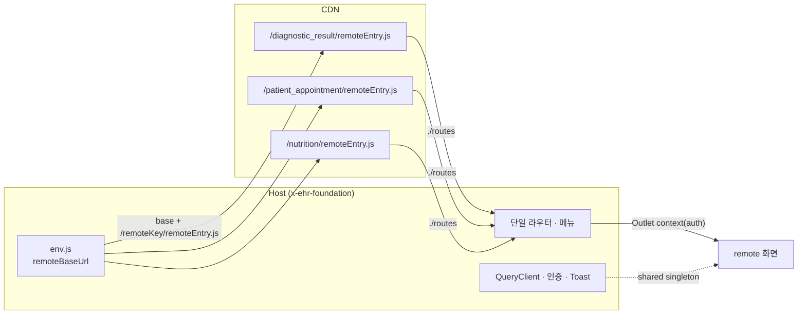
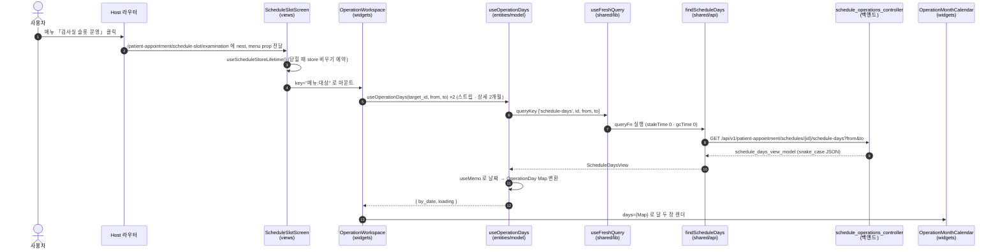
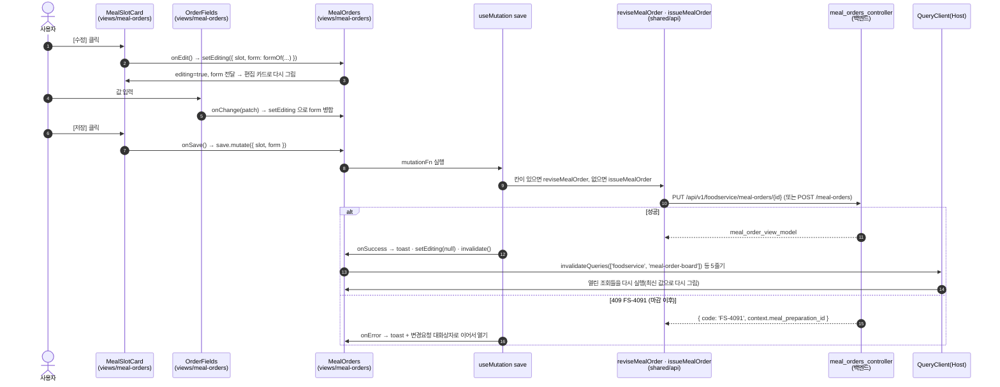

# 프론트엔드(React · TypeScript) 패턴 학습서 — 세 remote 로 배우는 공통 패턴과 차이

> 대상 독자: React · TypeScript 기초는 있지만 이 코드베이스는 처음인 신입 개발자.
> 교재로 쓰는 코드: 세 BC(Bounded Context) 레포의 프론트엔드 remote
> - `x-diagnostic-result/frontend/apps/diagnostic-result` — 검사결과조회 (이하 **DR**)
> - `x-patient-appointment/frontend/apps/patient-appointment` — 통합예약 (이하 **PA**)
> - `x-nutrition/frontend/apps/nutrition` — 영양 · 급식 (이하 **NU**)
>
> 모든 코드 인용은 실제 소스를 그대로 옮겼고, 블록 위에 `레포/경로:시작줄-끝줄` 을 적었다. 줄인 곳은 `// …(생략)…` 으로 표시했다.
> 6장의 샘플 코드만 **가상의 화면**이다(실제 레포에 없는 코드).

## 목차

- [들어가며 — 이 문서를 읽는 법](#들어가며--이-문서를-읽는-법)
- [1장. 큰 그림 — Host 와 Remote](#1장-큰-그림--host-와-remote)
- [2장. 폴더 구조 — FSD 와 세 레포의 실제 모습](#2장-폴더-구조--fsd-와-세-레포의-실제-모습)
- [3장. 화면이 데이터를 가져오는 여정](#3장-화면이-데이터를-가져오는-여정)
- [4장. 패턴별 해설](#4장-패턴별-해설)
- [5장. 이 코드에 실제로 나오는 TypeScript · React 문법](#5장-이-코드에-실제로-나오는-typescript--react-문법)
- [6장. 따라 만들기 — 새 화면 하나 추가(가상 샘플)](#6장-따라-만들기--새-화면-하나-추가가상-샘플)
- [7장. 세 remote 비교표](#7장-세-remote-비교표)
- [8장. 신입이 헷갈릴 포인트 모음](#8장-신입이-헷갈릴-포인트-모음)
- [9장. 연습 과제](#9장-연습-과제)
- [더 읽을거리](#더-읽을거리)

---

## 들어가며 — 이 문서를 읽는 법

이 프로젝트의 프론트엔드는 "한 앱"이 아니다. **Host(셸) 하나**가 메뉴 · 로그인 · 레이아웃을 쥐고, 업무 영역(BC)마다
**Remote 하나**가 자기 화면을 들고 와서 Host 안에 끼워진다. 그래서 신입이 처음 코드를 열면 두 가지에 놀란다.

1. 라우터 · QueryClient · 로그인 · 메뉴를 만드는 코드가 remote 안에 **없다**(전부 Host 가 준다).
2. 같은 규칙(루트 `CLAUDE.md`)을 따르는데도 세 remote 의 폴더 모양과 상태 관리 방식이 **서로 다르다**.

이 문서는 두 번째 놀라움을 정면으로 다룬다. "규칙이 무엇인가"만 외우면 실제 코드를 열었을 때 길을 잃는다.
그래서 각 패턴마다 **세 레포가 실제로 어떻게 했는지**를 나란히 놓는다. 읽는 순서는 다음을 권한다.

- 1~3장을 순서대로 읽는다(구조 → 폴더 → 데이터 흐름).
- 4장은 필요한 절만 골라 읽어도 된다. 각 절이 「무엇 / 왜 / 실제 코드 / 세 레포 비교 / 흔한 실수」로 되어 있다.
- 6장의 샘플을 직접 따라 쳐 보고, 9장의 과제로 코드 읽기를 연습한다.

처음 나오는 용어는 그 자리에서 한 줄로 설명한다. 자주 나오는 것만 먼저 모아 둔다.

| 용어 | 한 줄 설명 |
|---|---|
| BC (Bounded Context) | 업무 경계 하나. 레포 하나 = BC 하나이고 backend 와 frontend 를 함께 둔다 |
| MF (Module Federation) | 빌드가 따로 된 JS 묶음을 실행 중에 서로 불러 쓰게 하는 번들러 기능 |
| Host | 셸 앱(`x-ehr-foundation`). 메뉴 · 라우터 · 로그인 · QueryClient 를 소유 |
| Remote | BC 별 화면 묶음. Host 가 실행 중에 불러와 메뉴 경로 아래에 끼운다 |
| remoteKey | remote 의 MF 이름(언더스코어 표기, 예 `diagnostic_result`) |
| FSD (Feature-Sliced Design) | `views → widgets → features → entities → shared` 로 층을 나누는 폴더 규칙 |
| 디자인킷 | `@x-ehr/design-system`. 버튼 · 표 · 대화상자 등 모든 컨트롤의 정본 |
| standalone | Host 없이 remote 만 단독으로 띄우는 개발 전용 실행 방식 |

---

## 1장. 큰 그림 — Host 와 Remote

### 1.1 한 장으로 보는 구조



Host 는 remote 의 **소스 코드를 import 하지 않는다**. 대신 세 값이 맞으면 붙는다(루트 `CLAUDE.md` §0 Host 연계).

1. `rspack.config.js` 의 `name`(= remoteKey)
2. CDN 업로드 경로 `<base>/<remoteKey>/`
3. Host `env.js` 의 `remoteBaseUrl`

이 셋이 맞으면 "Host 소스 · 메뉴 변경이 0"이다. 반대로 remoteKey 나 포트를 바꾸면 Host 가 remote 를 찾지 못한다.
그래서 세 레포 모두 `rspack.config.js` 에 "불변"이라고 적어 둔다.

`x-diagnostic-result/frontend/apps/diagnostic-result/rspack.config.js:1-16`
```js
const { createRemoteRspackConfig } = require('@x-ehr/rspack-config')

// BC 레포(x-diagnostic-result) 의 MF remote. MF name(remoteKey)=diagnostic_result,
// 메뉴 path base=/diagnostic-result. ./routes 는 factory 가 강제 노출(host seam).
//
// remoteKey·port 는 **불변** — host 는 env.js 의 remoteBaseUrl 로
// `${base}/diagnostic_result/remoteEntry.js` convention 을 조립하므로 이 값이 바뀌면 host 가 못 찾는다.
//
// x-ehr-foundation in-repo 시절의 `alias: ehrSrcAlias()`(워크스페이스 packages/*/src 로 alias)는 제거했다 —
// 분리 레포에선 @x-ehr/* 를 Nexus 배포본(node_modules)에서 해석한다.
const configFn = createRemoteRspackConfig({
  dirname: __dirname,
  name: 'diagnostic_result',
  port: 3351,
  shared: ['@x-ehr/app-kit', '@x-ehr/auth-contract', '@x-ehr/design-system'],
})
```

- `createRemoteRspackConfig` — 공용 패키지 `@x-ehr/rspack-config` 가 주는 팩토리. remote 마다 빌드 설정을 손으로 짜지 않는다.
- `shared` — Host 와 **같은 인스턴스 하나**를 나눠 쓸 패키지(MF shared singleton). 디자인킷 · app-kit 이 여기 있는 이유는
  두 벌이 뜨면 CSS 토큰 · 상태 저장소가 갈라지기 때문이다.

### 1.2 `routes.tsx` — remote 가 내놓는 단 하나의 입구

팩토리는 `./routes` 를 **항상** 내보낸다(expose). remote 가 빼고 싶어도 뺄 수 없다.

`x-diagnostic-result/frontend/node_modules/@x-ehr/rspack-config/index.js:168-174`
```js
        new ModuleFederationPlugin({
          name,
          filename: 'remoteEntry.js',

          exposes: { ...exposes, ...(isDev ? devExposes : {}), './routes': './src/routes.tsx' },
          shared: sharedSingletons(shared),
          manifest: manifestWithRelease(),
```

`routes.tsx` 는 React Router 의 `RouteObject[]` 배열 하나를 export 한다. **top-level 경로는 Host(메뉴)가 소유**하므로
remote 는 상대 child 경로만 적는다. Host 는 메뉴 경로의 첫 마디(`/diagnostic-result`)에 이 배열을 한 번 끼운다(nest).

`x-diagnostic-result/frontend/apps/diagnostic-result/src/routes.tsx:1-25`
```tsx
import { type RouteObject } from 'react-router'
import RemoteScope from './shared/ui/RemoteScope'
import DiagnosticResultView from './views/diagnostic-result-view/DiagnosticResultView'
import ReportSummary from './views/summary/ReportSummary'
// Host nest 시에도 remote 유틸리티 CSS 가 로드되도록 노출 진입점에서 import.
import './styles/globals.css'

// top-level path 는 Host/메뉴 소유 — remote 는 상대 child route 만 정의한다(absolute path 금지).
// 메뉴 leaf path `/diagnostic-result/<child>` 의 base segment(`/diagnostic-result`)에 host 가 이 routes 를 1회 nest 한다.
// 운영 화면만 둔다 — host 메뉴에 없는 dev 전용 화면(환자목록 · 테스트조회 PoC)은 `app/Standalone.tsx` 가 붙인다(운영 번들에 들어가지 않는다).
// 공통 래퍼(`RemoteScope` — x-remote-root · khds-root · ToastProvider)는 `shared/ui/RemoteScope` 다.
const routes: RouteObject[] = [
  {
    element: <RemoteScope />,
    children: [
      // 검사결과조회 — 받은 폭에 따라 통합조회 · 상세 · 요약.
      // 메뉴 URL = /diagnostic-result/diagnostic-result-view (menuId 는 diagnostic_result_patient 그대로).
      { path: 'diagnostic-result-view', element: <DiagnosticResultView /> },
      // 검사결과 요약(읽기전용 검사일 요약 + AI 브리핑).
      { path: 'summary', element: <ReportSummary /> },
    ],
  },
]

export default routes
```

읽는 법:
- 맨 바깥 항목은 `path` 가 없는 **레이아웃 라우트**다. `element: <RemoteScope />` 가 모든 화면을 한 번 감싼다.
- 화면은 `children` 에 `path` + `element` 로 적는다. 메뉴 URL 은 `/diagnostic-result/diagnostic-result-view` 가 된다.
- `globals.css` 를 여기서 import 하는 이유: Host 가 이 파일만 불러오므로, CSS 도 이 입구에서 같이 실려야 한다.

PA 는 메뉴가 많아 같은 화면 컴포넌트를 메뉴 키 목록으로 펼친다. 이때 **`:param` 경로를 쓰지 않는 이유**가 주석에 있다.

`x-patient-appointment/frontend/apps/patient-appointment/src/routes.tsx:50-57`
```tsx
// **리터럴 경로로 등록한다** — `schedule-slot/:category` 로 두면 host 메뉴가 리터럴만 등록해 다른 값에서
// 「접근 권한이 없습니다」가 난다(목록은 `SCHEDULE_MENU_KEYS` 의 면별 메뉴를 펼친다).
// `key` 는 메뉴 전환 시 **리마운트**를 강제한다 — 같은 컴포넌트 타입이라 React 가 인스턴스를 재사용하면
// 이전 메뉴에서 고른 대상·편집 중인 시간표가 남아 엉뚱한 시간표를 고치게 된다.
const routes: RouteObject[] = [
  {
    element: <RemoteScope />,
    children: [
```

(펼치는 코드는 같은 파일의 `...SCHEDULE_MENU_KEYS['schedule-slot'].map((key) => ({ path: key, element: <ScheduleSlotScreen key={key} menu={key} /> }))` 이다.)

### 1.3 RemoteScope — `x-remote-root khds-root` 두 클래스

모든 화면을 감싸는 래퍼는 클래스 두 개를 한 요소에 단다.

| 클래스 | 하는 일 | 빼면 생기는 일 |
|---|---|---|
| `x-remote-root` | remote 가 쓰는 CSS 를 이 아래로만 가둔다 | remote 의 리셋 CSS 가 Host 헤더 · 배경을 덮는다 |
| `khds-root` | 디자인킷 CSS 의 base 리셋이 닿는 경계 | 킷 컴포넌트가 브라우저 기본 모양으로 풀린다 |

PA 와 NU 는 `routes.tsx` 안에 짧게 둔다.

`x-patient-appointment/frontend/apps/patient-appointment/src/routes.tsx:20-33`
```tsx
// remote CSS 격리 경계 — 전역 리셋이 host 헤더/배경을 덮지 않도록 모든 화면을 .x-remote-root 로 감싼다
// (host/standalone 공통 seam). 부모(host <main>/standalone shell)의 outlet context(auth)를 그대로 하위 화면에 전달한다.
//
// `khds-root` 는 디자인시스템의 소비측 계약이다 — dist CSS 의 base 리셋(box-sizing·폰트)이 이 클래스
// 하위로만 스코프돼 있어, 빠지면 컴포넌트가 브라우저 기본 모양으로 풀린다(README §Micro-Frontend).
// 두 클래스를 같은 엘리먼트에 둔다: 격리 경계와 킷 스코프가 같은 지점이어야 한다.
function RemoteScope() {
  const ctx = useOutletContext()
  return (
    <div className="x-remote-root khds-root">
      <Outlet context={ctx} />
    </div>
  )
}
```

DR 은 같은 래퍼를 `shared/ui/RemoteScope.tsx` 로 따로 빼고 두 가지를 더 한다 — `ToastProvider` 마운트, 그리고 Host 가 준 병원 시간대 동기화.

`x-diagnostic-result/frontend/apps/diagnostic-result/src/shared/ui/RemoteScope.tsx:21-31`
```tsx
export default function RemoteScope() {
  const ctx = useOutletContext()
  syncHospitalTimeZone(useContext(FormatContextProvider)?.hospitalTimeZone)
  return (
    <div className="x-remote-root khds-root">
      <ToastProvider>
        <Outlet context={ctx} />
      </ToastProvider>
    </div>
  )
}
```

같은 파일 머리 주석은 왜 `routes.tsx` 에 두지 않았는지도 적는다 — "그 파일은 routes 배열을 export 하므로 컴포넌트를 함께 두면
fast refresh 가 끊긴다". (fast refresh = 개발 중 저장하면 상태를 유지한 채 화면만 갈아 끼우는 기능. 컴포넌트가 아닌 값을 함께
export 하는 파일에서는 동작하지 않는다.)

`useOutletContext()` → `<Outlet context={ctx}>` 는 **Host 가 준 인증 정보(auth)를 그대로 아래로 흘려보내는** 줄이다.
remote 는 인증을 자기가 갖지 않는다.

`.x-remote-root` 는 CSS 에서 `display: contents` 다. 박스를 만들지 않아야 화면의 `h-full` 이 Host `<main>` 의 높이를 잡는다.

`x-patient-appointment/frontend/apps/patient-appointment/src/styles/globals.css:17-22`
```css
/* remote 높이 체인 — routes 의 <RemoteScope> 래퍼(div.x-remote-root.khds-root)에 붙는다.
 * `display: contents` 로 **박스를 만들지 않아야** 화면 셸의 `h-full` 이 래퍼(auto)가 아니라
 * 그 위(host <main> / standalone #root)의 확정 높이를 잡는다. 박스를 만들면 높이가 auto 로 끊겨
 * 셸이 헤더 높이만큼만 남고 본문이 0 으로 접힌다.
 * 디자인시스템의 base 리셋은 `.khds-root *` 후손 선택자라 display:contents 여도 그대로 적용된다. */
.x-remote-root { display: contents; }
```

### 1.4 Standalone — Host 없이 혼자 띄우기

개발할 때마다 Host 를 띄우기는 무겁다. 그래서 remote 마다 `src/app/Standalone.tsx` 가 **Host 흉내**를 낸다.
진입 순서는 세 레포가 같다: `index.ts` → `bootstrap.tsx` → `Standalone`.

`x-diagnostic-result/frontend/apps/diagnostic-result/src/index.ts:1-2`
```ts
// MF 비동기 경계 — shared 초기화가 끝난 뒤 standalone 부팅한다.
void import('./bootstrap')
```

`index.ts` 가 `bootstrap` 을 **동적 import** 하는 이유: MF 의 shared 패키지(React 등)가 준비되기 전에 React 를 쓰면
두 벌이 뜨거나 오류가 난다. 한 박자 늦춰(비동기 경계) 준비를 기다린다.

Standalone 은 Host 가 운영에서 주는 것(QueryClient · ToastProvider · 라우터 · 가짜 인증)을 직접 세운다.

`x-nutrition/frontend/apps/nutrition/src/app/Standalone.tsx:144-159`
```tsx
export default function Standalone() {
  useShellChrome()
  // 운영(Host nest)에서는 host 셸이 ToastProvider 를 마운트한다 — dev 단독 실행일 때만 여기서 같은 Provider 를 세운다
  // (useToast 는 Provider 밖에서 호출하면 throw 한다).
  // DragProvider 도 host 가 앱 루트에 하나 두는 계약이다(remote 마다 두지 않는다 — design-system dnd.md).
  // 없으면 DataGrid 행 끌기(식이처방·식이 코드 순서)가 no-op 이 되므로 standalone 에서만 같은 자리에 세운다.
  return (
    <QueryClientProvider client={queryClient}>
      <ToastProvider aria-label="알림">
        <DragProvider>
          <RouterProvider router={router} />
        </DragProvider>
      </ToastProvider>
    </QueryClientProvider>
  )
}
```

같은 파일 111-121줄의 `router` 는 `createBrowserRouter` 로 `DevShell`(dev 메뉴 + 가짜 인증 `<Outlet context={mockAuth} />`) 아래에
`...routes` 를 펼친다. 127-142줄의 `useShellChrome` 은 Host 가 없어 `html` · `body` · `#root` 높이가 비는 것을 채운다(cleanup 에서 되돌린다).

핵심: `createBrowserRouter` · `new QueryClient()` · `RouterProvider` 는 remote 에서 **금지**인데 Standalone 만 예외다.
lint 가 이 파일만 풀어 준다(2장 2.4). 그리고 이 파일은 운영 빌드에 들어가지 않는다.

### 1.5 세 remote 한눈에

| 항목 | DR (diagnostic-result) | PA (patient-appointment) | NU (nutrition) |
|---|---|---|---|
| remoteKey | `diagnostic_result` | `patient_appointment` | `nutrition` |
| dev 포트 | 3351 | 3352 | 3343 |
| 백엔드 API prefix (로컬 포트) | `/api/v1/diagnostic-result` (:5351) | `/api/v1/patient-appointment` (:5352) + `/api/v1/ancillary-main` (:5301) | `/api/v1/foodservice` (:5343) |
| 운영 라우트 수 | 2 (+ Standalone 전용 dev 화면 2) | 24 (예약 5 · 슬롯 16 · 기타 3) | 12 |
| MF expose | `./routes` | `./routes` + 대화상자 3개 | `./routes` |
| RemoteScope 위치 | `shared/ui/RemoteScope.tsx`(Toast · 시간대 포함) | `routes.tsx` 안 | `routes.tsx` 안 |
| 디자인킷 버전 | 0.0.34 | 0.0.36 | 0.0.34 |
| `src` 파일 수(대략) | 124 | 215 | 42 |

PA 만 `./routes` 외에 대화상자 세 개를 더 내보낸다. 다른 remote 가 자기 화면 안에서 PA 의 예약 대화상자를 띄우기 위해서다.

`x-patient-appointment/frontend/apps/patient-appointment/rspack.config.js:15-27`
```js
const base = createRemoteRspackConfig({
  dirname: __dirname,
  name: 'patient_appointment',
  port: DEV_PORT,
  // 검사 예약 · 외래 예약 대화상자 · 슬롯 마감 팝업 — 호출 화면(다른 remote)이 `remoteComponent('patient_appointment', '<이름>')` 로
  // 자기 화면 안에 띄운다(classdiagram 부록 P62 · P73 · P113). `./routes` 는 팩토리가 항상 덧붙인다(host seam 계약).
  exposes: {
    './AppointmentBookingDialog': './src/exposes/AppointmentBookingDialog.tsx',
    './OutpatientAppointmentDialog': './src/exposes/OutpatientAppointmentDialog.tsx',
    './BookingClosureDialog': './src/exposes/BookingClosureDialog.tsx',
  },
  shared: ['@x-ehr/app-kit', '@x-ehr/auth-contract', '@x-ehr/design-system'],
})
```

이 expose 진입점은 `./routes` 를 거치지 않으므로 CSS import 와 `x-remote-root khds-root` 래퍼를 **자기가 다시** 단다.

`x-patient-appointment/frontend/apps/patient-appointment/src/exposes/OutpatientAppointmentDialog.tsx:8-21`
```tsx
import '@/styles/globals.css'

import type { OutpatientAppointmentDialogProps } from '@/entities/appointment/model/outpatient_booking_contract'
import { OutpatientAppointmentDialog } from '@/widgets/appointment/OutpatientAppointmentDialog'

export type { OutpatientAppointmentDialogProps } from '@/entities/appointment/model/outpatient_booking_contract'

export default function OutpatientAppointmentDialogExpose(props: OutpatientAppointmentDialogProps) {
  return (
    <div className="x-remote-root khds-root">
      <OutpatientAppointmentDialog {...props} />
    </div>
  )
}
```

### 이 장에서 기억할 것 3줄

1. remote 는 Host 에 **코드가 아니라 규약**(remoteKey · CDN 경로 · `env.js`)으로 붙고, 내놓는 입구는 `routes.tsx` 하나가 기본이다.
2. 모든 화면은 `x-remote-root khds-root` 래퍼 아래서 그려지고, 그 래퍼는 `display: contents` 라 높이 체인을 끊지 않는다.
3. 라우터 · QueryClient · 인증 · Toast 는 Host 가 준다 — 직접 만드는 곳은 dev 전용 `Standalone.tsx` 뿐이다.

---

## 2장. 폴더 구조 — FSD 와 세 레포의 실제 모습

### 2.1 규칙: 위에서 아래로만

루트 `CLAUDE.md` §0 이 정한 Frontend 참조 방향은 다음과 같다.

```
views → widgets → features → entities → shared      (역방향 금지)
```

| 층 | 들어가는 것 | 예 |
|---|---|---|
| `views/<screen>/` | 페이지 하나의 레이아웃 조립. 라우트가 가리키는 컴포넌트 | `DiagnosticResultView.tsx` |
| `widgets/<domain>/` | 여러 feature · entity 를 묶은 큰 UI 블록 | `WideMain.tsx`(목록 + 분류 + 상세 패널) |
| `features/<domain>/<slice>/{ui,model,api}/` | 사용자 행동 하나(저장 · 즐겨찾기 등) | `features/favorite-set/` |
| `entities/<domain>/{model,api}/` | 업무 개체의 타입 · 조회 함수 · 조회 훅 | `entities/observation/` |
| `shared/` | 업무와 무관한 공용(HTTP 베이스 · 유틸 · 공용 UI) | `shared/api/apiBase.ts` |

세 가지 금지가 함께 따라온다.

- `shared/ui` 를 뺀 모든 슬라이스는 **배럴(`index.ts`) 금지** — 파일을 직접 import 한다. (배럴 = 폴더의 export 를 한 파일에 모아 다시 내보내는 파일.
  배럴이 있으면 의존 방향이 가려지고, 쓰지 않는 코드까지 번들에 딸려 온다.)
- `features` 끼리 직접 참조 금지 — 공통으로 필요한 것은 `entities` 로 내린다.
- 상위 상대경로(`../`) 금지 — 항상 `@/` 절대경로.

`@/` 는 `tsconfig.json` 의 경로 별칭이다.

`x-diagnostic-result/frontend/apps/diagnostic-result/tsconfig.json:1-10`
```json
{
  "extends": "../../tsconfig.base.json",
  "compilerOptions": {
    "types": ["node"],
    "paths": {
      "@/*": ["./src/*"]
    }
  },
  "include": ["src/**/*.ts", "src/**/*.tsx"]
}
```

`../` 금지는 공용 lint 설정이 강제한다.

`x-diagnostic-result/frontend/node_modules/@x-ehr/eslint-config/remote.mjs:150`
```js
  const noParentRelative = [{ group: ['../**'], message: '상위 경로 상대 import 금지 — @/ 절대경로(@/…) 사용' }];
```

### 2.2 실제 모습은 셋이 다르다

| 층 | DR | PA | NU |
|---|---|---|---|
| `views/` | 6 파일 | 14 파일 | 25 파일(화면 12종 + 화면 전용 부품) |
| `widgets/` | 55 | 127 | **없음** |
| `features/` | 4 (`favorite-set`) | **없음** | **없음** |
| `entities/` | 33 (`model` + `api` + 일부 `ui`) | 46 (**`model` 만**) | **없음** |
| `shared/` | 14 | 18 (`api/appointmentApi.ts` 가 2,949줄) | 11 (`api/foodserviceApi.ts` 가 1,298줄) |
| HTTP 함수 위치 | `entities/*/api/*.ts` (4파일) | `shared/api/appointmentApi.ts` 한 파일 | `shared/api/foodserviceApi.ts` 한 파일 |
| FSD 경계 lint | 켜짐(`fsdConfig`) | 없음 | 없음 |

정리하면:

- **DR 은 정석**이다. 5층을 다 쓰고, lint 로 층 경계를 강제한다.
- **PA 는 features 가 없다.** 사용자 행동의 상태 · 훅은 `entities/*/model` 에, 화면 조합은 `widgets` 에 있다.
  HTTP 함수는 `entities/*/api` 가 아니라 `shared/api/appointmentApi.ts` 한 파일에 모여 있다.
- **NU 는 2층(views + shared)** 이다. 화면(view)이 `shared/api` 함수를 직접 부르고, 화면 전용 계산은 같은 폴더의
  `*Model.ts`(예 `views/meal-orders/mealOrderModel.ts`)로 뺀다.

DR 의 FSD 경계 lint 배선은 이렇다(PA · NU 의 `eslint.config.mjs` 에는 이 줄이 없다).

`x-diagnostic-result/frontend/eslint.config.mjs:26-28`
```js
  // FSD 레이어 경계 — views → widgets → features → entities → shared 하향만, features 슬라이스 간 직접 참조 금지,
  // shared → mocks 금지(mock json 이 운영 번들에 섞인다). foundation 루트 config 와 같은 배선이다.
  ...REMOTE_DIRS.flatMap((d) => fsdConfig({ src: join(APPS_DIR, d, 'src'), files: [`apps/${d}/src/**/*.{ts,tsx}`] })),
```

### 2.3 왜 이 차이를 알아야 하나

1. **"어디에 두지?"의 답이 레포마다 다르다.** 새 API 함수를 PA 에서 `entities/*/api/` 폴더를 새로 만들어 넣으면
   그 레포에서 혼자 다른 모양이 된다. 기존 관례를 먼저 확인한다 — 규칙(CLAUDE.md §0)은 **신규 BC 와 전환 시의 목표**이고,
   이미 있는 레포는 그 레포의 현재 모양이 있다.
2. **찾는 위치가 다르다.** DR 에서 "검사결과를 부르는 코드"는 `entities/observation/api/observationApi.ts`, PA 에서는
   `shared/api/appointmentApi.ts` 의 2,949줄 안, NU 에서는 `shared/api/foodserviceApi.ts` 의 40개 함수 중 하나다.
3. **lint 가 지켜 주는 범위가 다르다.** DR 에서는 widgets 가 views 를 import 하면 lint 오류지만, PA · NU 에서는
   그런 역방향 import 를 기계가 잡아 주지 않는다. 사람이 지켜야 한다.

### 2.4 lint 가 막는 remote 계약

세 레포 모두 워크스페이스 루트 `eslint.config.mjs` 에서 `@x-ehr/eslint-config/remote` 를 켠다. 막는 것 중 자주 걸리는 것:

`x-diagnostic-result/frontend/node_modules/@x-ehr/eslint-config/remote.mjs:33-68`
```js
const remoteRestrictedImports = [
  ...baseRestrictedImports,
  {
    name: 'axios',
    // 타입 전용 import 는 인스턴스를 만들지 않아 토큰/single-flight 분열과 무관 → 허용. 값 import(인스턴스 소유)만 차단.
    allowTypeImports: true,
    message:
      'remote 는 자체 axios 인스턴스 금지 — @x-ehr/api-axios 의 api 를 소비하세요. 인스턴스 분열 시 401 refresh·single-flight 가 깨집니다 (ARCHITECTURE.md 금지 패턴).',
  },
  // …(생략)… react-router 의 createBrowserRouter · RouterProvider 등 라우터 생성 금지
  {
    name: '@tanstack/react-query',
    // 값 import 만 차단 → `new QueryClient()` 와 alias(`QueryClient as QC`) 둘 다 잡힌다. useQuery 등 다른 export 와
    // 타입 주석(useQueryClient 반환 타입 등)은 통과. imperative 접근이 필요하면 향후 escape hatch(ADR).
    importNames: ['QueryClient'],
    allowTypeImports: true,
    message:
      'remote 는 QueryClient 생성 금지 — host 가 주입한 @tanstack/react-query shared singleton context(useQuery 등)를 소비하세요. dev 용 Standalone.tsx 만 예외 (ARCHITECTURE.md 금지 패턴).',
  },
```

- 자체 `axios` 인스턴스 금지 — HTTP 는 반드시 `@x-ehr/api-axios` 의 `api` 로 한다. 인스턴스가 갈라지면 토큰 갱신(401 refresh)이 깨진다.
- 자체 라우터 금지 — Host 라우터 하나에 끼워진다.
- `new QueryClient()` 금지 — Host 의 QueryClient 를 같이 쓴다. 이것이 4장 4.1 의 `useFreshQuery` 가 필요한 이유로 이어진다.

PA 는 여기에 자기 규칙 두 개를 더 얹는다(4장 4.1 · 4.11).

### 이 장에서 기억할 것 3줄

1. 규칙은 `views → widgets → features → entities → shared` 하향 · 배럴 금지 · `@/` 절대경로다.
2. 실제로는 DR 만 5층 정석이고, PA 는 features 없이 HTTP 를 `shared/api` 한 파일에, NU 는 views + shared 2층이다.
3. 새 코드를 둘 자리는 그 레포의 현재 관례를 먼저 확인하고 정한다 — 기계(lint)가 층 경계를 지켜 주는 곳은 DR 뿐이다.

---
## 3장. 화면이 데이터를 가져오는 여정

이 장은 두 편의 "여정"을 따라간다. 사용자가 무엇을 누르면 어떤 컴포넌트 → 훅 → api 함수 → HTTP 경로 → 백엔드 컨트롤러 순으로
불리는지를 끝까지 본다. 화살표 하나하나를 실제 코드에서 확인하는 것이 목표다.

- 3.1 읽기 — PA 「슬롯 운영」 달력 한 장(`schedule-slot/examination` 등)
- 3.2 쓰기 — NU 「세부오더 관리」 끼니 카드 [저장](`meal-orders`)

### 3.1 읽기 여정 — PA 슬롯 운영 달력

#### 전체 흐름



#### 단계 1 — view: 메뉴 키로 화면 모양을 고르고, 닫힐 때 비울 준비

`x-patient-appointment/frontend/apps/patient-appointment/src/views/schedule/ScheduleSlotScreen.tsx:63-72`
```tsx
export default function ScheduleSlotScreen({ menu: menu_key }: { menu: ScheduleMenuKey }) {
  // 화면이 닫히면 store 를 비운다 — 다시 열면 서버에서 새로 읽는다(이전에 읽은 값을 쓰지 않는다).
  useScheduleStoreLifetime()
  const menu = schedule_menu(menu_key)
  return menu.category.slot_aside === 'physician-table' ? (
    <PhysicianSlotBoard menu={menu} />
  ) : (
    <TargetSlotBoard menu={menu} />
  )
}
```

- `menu` prop 은 `routes.tsx` 가 메뉴 키(`'schedule-slot/examination'` 등)로 넘겨준 값이다.
- 검사실 · 주사실 · 재활 등은 **화면이 따로 있지 않다**. 메뉴 프리셋(`schedule_menu`)의 열 값으로 모양만 바꾼다.

#### 단계 2 — view 안쪽: 대상이 바뀌면 작업면을 새로 마운트

`x-patient-appointment/frontend/apps/patient-appointment/src/views/schedule/ScheduleSlotScreen.tsx:124-138`
```tsx
              ) : (
                // `key` 는 대상·메뉴가 바뀔 때 **리마운트**를 강제한다 — 이전 대상의 선택 · 이력이 남지 않게.
                <OperationWorkspace
                  key={`${menu.key}:${target.id}`}
                  target={target}
                  service_category={category.service_category}
                  terms={profile.terms}
                  editor={editor}
                  cell_detail={profile.cell_detail}
                  missing_pattern_hint={profile.missing_pattern_hint}
                  // 슬롯 관리 · 오버부킹(classdiagram 1.33) — 구분과 상관없이 대상 목록 운영 면이 모두 같다.
                  toolbar_end={
                    <SlotModeControls schedule_id={target.id} target_name={target.name} />
                  }
                />
```

`key` 가 바뀌면 React 는 그 컴포넌트를 **버리고 새로 만든다**(remount). 그 안의 `useState` 가 전부 초기값으로 돌아가므로,
"이전 대상에서 고른 날짜가 남아 있다" 같은 버그를 한 줄로 막는다. 이 기법은 4장 · 5장에서 여러 번 다시 나온다.

#### 단계 3 — widget: 같은 훅을 두 범위로 부른다

`x-patient-appointment/frontend/apps/patient-appointment/src/widgets/schedule/operation/OperationWorkspace.tsx:368-375`
```tsx
  /**
   * 일자 데이터는 **스트립과 상세 2개월을 따로 읽는다** — 스트립을 옮겨도 아래 달력은 마지막에 고른 달을 그대로 보이고
   * 데이터도 그대로다(스트립 범위 하나로만 읽으면 스트립이 상세 달을 벗어나는 순간 달력이 비거나 다시 읽혀 깜빡인다).
   * 둘이 겹치면 상세 쪽 값이 이긴다 — 같은 서버 전개라 값은 같다.
   */
  const { by_date: strip_days } = useOperationDays(target_id, strip_from, strip_to)
  const { by_date: detail_days } = useOperationDays(target_id, detail_from, detail_to)
  const days = useMemo(() => new Map([...strip_days, ...detail_days]), [strip_days, detail_days])
```

widget 은 HTTP 를 모른다. "이 기간의 운영 하루들을 달라"고 entity 훅에 부탁할 뿐이다.

#### 단계 4 — entity model 훅: 조회 + 변환

`x-patient-appointment/frontend/apps/patient-appointment/src/entities/schedule/model/operation_days.ts:24-71`
```ts
export function useOperationDays(schedule_id: string, from: IsoDate, to: IsoDate) {
  const { assignments, patterns, actor_holiday_rules, global_holiday_rules, saved_overrides } =
    useScheduleData()
  // 대역 id(아직 없는 예약 기준)는 읽지 않는다 — 빈 날들(반영 없음)로 본다.
  const valid =
    schedule_id !== '' &&
    !is_stand_in_schedule_id(schedule_id) &&
    ISO_DATE.test(from) &&
    ISO_DATE.test(to) &&
    from <= to
  const query = useFreshQuery({
    queryKey: ['schedule-days', schedule_id, from, to],
    queryFn: () => findScheduleDays(schedule_id, from, to),
    enabled: valid,
    placeholderData: keepPreviousData,
  })

  const by_date = useMemo(() => {
    const server_days = query.data?.days ?? []
    if (server_days.length === 0) return EMPTY
    // …(생략)… 서버 날짜 + 패턴 · 반영 · 저장된 조정 · 휴무 규칙 → OperationDay[] (to_month_days · to_operation_days)
    return new Map(days.map((day) => [day.date, day]))
  }, [
    query.data,
    // …(생략)… assignments · patterns · saved_overrides · 휴무 규칙 · schedule_id
  ])

  return { by_date, loading: query.isFetching }
}
```

읽을 포인트:
- `queryKey` — react-query 가 캐시 칸을 구분하는 열쇠. `['schedule-days', id, from, to]` 처럼 **첫 칸을 줄기 이름**으로 두면
  저장 뒤 `'schedule-days'` 로 시작하는 것을 한 번에 무효화할 수 있다(주석의 "키가 같은 줄기").
- `enabled: valid` — 아직 서버에 없는 대역 id 로는 요청하지 않는다.
- `placeholderData: keepPreviousData` — 기간을 바꾸는 동안 이전 결과를 잠깐 보여 줘 0 으로 깜빡이지 않게 한다.
- 서버 응답(snake_case)을 화면이 쓰기 좋은 `OperationDay` 로 바꾸는 일은 `useMemo` 안에서 한다. 렌더마다 다시 계산하지 않도록
  의존값이 바뀔 때만 돈다.
- `useScheduleData()` — 패턴 · 휴무 규칙처럼 여러 화면이 같이 보는 서버 상태는 모듈 store 에서 읽는다(4장 4.6).

#### 단계 5 — api 함수: 경로를 조립하고 응답 타입을 붙인다

`x-patient-appointment/frontend/apps/patient-appointment/src/shared/api/appointmentApi.ts:1837-1849`
```ts
interface ScheduleDaysView {
  schedule_id: string
  actor_id: string
  from: string
  to: string
  days: ScheduleDayView[]
}

export function findScheduleDays(scheduleId: string, from: string, to: string) {
  return request<ScheduleDaysView>(() =>
    api.get(`${BASE}/schedules/${scheduleId}/schedule-days`, { params: { from, to } }),
  )
}
```

`api` 는 `@x-ehr/api-axios` 가 주는 공용 axios 인스턴스다. 토큰 첨부 · 401 갱신을 이 인스턴스가 한다.
`request` 는 성공이면 `data` 만 꺼내고 실패면 `ApiError` 로 바꾼다(4장 4.2). `BASE` 는 `'/api/v1/patient-appointment'` 다.

#### 단계 6 — 백엔드: 같은 경로를 매핑한 컨트롤러

`x-patient-appointment/backend/patient-appointment/src/main/kotlin/com/projectx/patientappointment/presentation/schedule_operations_controller.kt:217-225`
```kotlin
    @Operation(summary = "전개 결과 — 저장하지 않는 계획 + 각인된 슬롯 현황")
    @GetMapping("/schedules/{scheduleId}/schedule-days")
    fun schedule_days(
        @TokenPrincipal principal: AuthPrincipal,
        @PathVariable("scheduleId") schedule_id: String,
        @RequestParam from: String,
        @RequestParam to: String,
    ): schedule_days_view_model =
        schedule_days.expand(principal.to_tenant_scope(), schedule_id, date_param("from", from), date_param("to", to))
```

클래스에 `@RequestMapping("/api/v1/patient-appointment")` 가 붙어 있어(같은 파일 74줄) 전체 경로는
`/api/v1/patient-appointment/schedules/{scheduleId}/schedule-days` 가 된다. 프론트 `BASE` 와 백엔드 매핑이 **같은 prefix 를 공유**하는 이유는
게이트웨이 · dev 프록시가 prefix 를 벗기지 않고 그대로 넘기기 때문이다(`rspack.config.js` 의 proxy 에 pathRewrite 가 없다).
응답 타입 이름 `schedule_days_view_model` 이 프론트 `ScheduleDaysView` 와 짝이다.

#### 단계 7 — 말단 widget: 받은 Map 으로 그린다

`x-patient-appointment/frontend/apps/patient-appointment/src/widgets/schedule/operation/OperationMonthCalendar.tsx:81-102`
```tsx
  const [year, index] = month.split('-').map(Number)
  const first = new Date(year ?? 1970, (index ?? 1) - 1, 1)
  // …(생략)… 그 달의 날짜 목록 · 격자 줄 수 · 합계 변수(open_days · slots · booked · blocked · weekday_open) 준비
  for (const date of in_month) {
    const day = days.get(date)
    if (!day) continue
    if (day.blocked) blocked += 1
    if (day.generated) {
      open_days += 1
      slots += day.slot_count
      booked += day.booked
      weekday_open[day.weekday] = (weekday_open[day.weekday] ?? 0) + 1
    }
  }
```

말단 컴포넌트는 데이터를 **props 로만** 받는다(`days: ReadonlyMap<IsoDate, OperationDay>`). 조회 훅을 직접 부르지 않으니
같은 달력을 다른 데이터로 재사용하기 쉽다.

#### 정리 — 층별 책임

| 층 | 파일 | 책임 |
|---|---|---|
| views | `ScheduleSlotScreen.tsx` | 메뉴 해석 · store 수명 · 대상별 remount |
| widgets | `OperationWorkspace.tsx` | 어느 기간을 읽을지 결정, 결과 합치기 |
| entities/model | `operation_days.ts` | 조회 훅(`useFreshQuery`) + 응답 → 화면 모델 변환 |
| shared/api | `appointmentApi.ts` | 경로 조립 · 응답 타입 · 오류 변환 |
| widgets(말단) | `OperationMonthCalendar.tsx` | props 로 받은 데이터 그리기 |

### 3.2 쓰기 여정 — NU 세부오더 [저장]

NU 는 2층(views + shared)이라 층이 적다. 대신 `useMutation` 으로 저장하고 `invalidateQueries` 로 다시 읽는 전형적인 react-query 쓰기 흐름이 잘 보인다.

#### 전체 흐름



#### 단계 1 — 카드: 버튼은 콜백만 부른다

`x-nutrition/frontend/apps/nutrition/src/views/meal-orders/MealSlotCard.tsx:121-156`
```tsx
  if (editing && form) {
    return (
      <Card
        // …(생략)… title · action · divider · bodyOverflow · className
        actionArea={
          <Stack direction="row" gap={6} align="center" justify="end" className="w-full">
            <Button variant="gray" size="sm" disabled={saving} onClick={onCancelEdit}>
              닫기
            </Button>
            <Button
              variant="primary"
              size="sm"
              icon={<Check aria-hidden="true" />}
              loading={saving}
              onClick={onSave}
            >
              {cell ? '저장' : '발행'}
            </Button>
          </Stack>
        }
      >
        <OrderFields
          value={form}
          onChange={onFormChange}
          // …(생략)… diet · formOptions · mode · disabled
        />
      </Card>
    )
  }
```

카드는 **상태를 갖지 않는다**. 편집 중인지(`editing`) · 폼 값(`form`) · 저장 중인지(`saving`)를 전부 부모에게서 props 로 받고,
누르면 `onSave` · `onCancelEdit` 를 부를 뿐이다. 버튼은 킷 `Button` 이고, 저장 중에는 `loading` 으로 스피너를 보인다.

#### 단계 2 — 화면: 폼 상태와 카드 연결

`x-nutrition/frontend/apps/nutrition/src/views/meal-orders/MealOrders.tsx:553-582`
```tsx
                      <MealSlotCard
                        key={slot}
                        // …(생략)… label · servingTime · cell · wardClosing · canAdd
                        editing={isEditing}
                        form={isEditing ? editingSlot.form : null}
                        saving={save.isPending && isEditing}
                        // …(생략)… busy · diet · formOptions · formNameOf · revisions
                        onFormChange={(patch) =>
                          setEditing((e) => (e ? { ...e, form: { ...e.form, ...patch } } : e))
                        }
                        onEdit={() => setEditing({ key: keyOf(slot), slot, form: formOf(cell, diet, date, rx) })}
                        onCancelEdit={() => setEditing(null)}
                        onSave={() => {
                          if (editingSlot) save.mutate({ slot, form: editingSlot.form })
                        }}
                        // …(생략)… onRevoke · onRequest
                      />
```

- 폼 값은 화면의 `useState`(`editing`) 하나에 있다. 입력 칸이 바뀌면 `patch`(바뀐 필드만)를 받아 **함수형 setState** 로 병합한다.
- `saving={save.isPending && isEditing}` — 저장 중 표시는 `useMutation` 의 `isPending` 에서 파생한다. 따로 `useState` 를 두지 않는다.

#### 단계 3 — useMutation: 분기 · 성공 후 다시 읽기 · 오류 분기

`x-nutrition/frontend/apps/nutrition/src/views/meal-orders/MealOrders.tsx:222-272`
```tsx
  const save = useMutation({
    mutationFn: async (input: { slot: MealTypeCode; form: OrderForm }) => {
      if (!row?.diet_order_id) throw new Error('식이처방이 없는 환자입니다.')
      const f = input.form
      const axes = axesOf(diet, f.mealCode)
      const cell = row.slots[input.slot] ?? null
      // 축이 없는 값은 보내지 않는다(FS-4005) — 열량·용량·개수는 축이 세부오더에 허용할 때만.
      // 완제품은 형태 · 염도가 없다 — 보내지 않는다.
      const product = axes?.product ?? false
      const attrs = {
        meal_code: f.mealCode ?? undefined,
        meal_form_code: product ? undefined : (f.form ?? undefined),
        portion_code: f.portion,
        // …(생략)… 염도 · 격리 · 보호자식 · 열량 · 용량 · 개수(축이 허용할 때만)
      }
      return cell
        ? reviseMealOrder(cell.meal_order_id, { ...attrs, effective_from: f.from })
        : issueMealOrder({
            ...attrs,
            diet_order_id: row.diet_order_id,
            meal_type_code: input.slot,
            effective_start_date: f.from,
            // 발행자 · 수정자는 보내지 않는다 — 서버가 토큰 직원 id 로 기록한다.
          })
    },
    onSuccess: (_r, input) => {
      const issued = !row?.slots[input.slot]
      toast(`${labelOf(input.slot)} 세부오더를 ${issued ? '발행' : '수정'}했습니다 — ${toMonthDay(input.form.from)}부터 적용.`, {
        variant: 'success',
      })
      setEditing(null)
      invalidate()
    },
    onError: (e, input) => {
      toast(describe(e), { variant: 'error' })
      // 마감과 겹쳤다(409 FS-4091) — 같은 값으로 변경요청을 이어서 받는다(응답의 대상 접수자료로).
      const prepId = closedPreparationIdOf(e)
      if (prepId) {
        setEditing(null)
        openRequest('CHANGE', input.slot, { preparationId: prepId, initial: input.form })
      }
    },
  })
```

- 화면 표기(camelCase `OrderForm`)를 요청 본문(snake_case)으로 옮기는 일이 `mutationFn` 안에 있다. NU 의 REST JSON 은 **snake_case 그대로**다.
- **행위자(발행자 · 수정자)는 본문에 싣지 않는다.** 서버가 토큰에서 꺼낸다.
- `onSuccess` 에서 `invalidate()` — 아래 단계 4.
- `onError` 는 "실패 = 토스트" 로 끝나지 않는다. 409 `FS-4091`(마감 이후 수정)이면 응답에 실린 접수자료 id 로 **변경요청 대화상자를 이어서 연다**.

#### 단계 4 — invalidate: 관련 줄기를 한꺼번에 다시 읽기

`x-nutrition/frontend/apps/nutrition/src/views/meal-orders/MealOrders.tsx:191-195`
```tsx
  function invalidate() {
    for (const key of ['meal-order-board', 'meal-orders', 'preparations', 'closing-board', 'change-requests']) {
      void client.invalidateQueries({ queryKey: ['foodservice', key] })
    }
  }
```

`invalidateQueries({ queryKey: ['foodservice', 'meal-order-board'] })` 는 **앞부분이 같은 키 전부**를 "낡음"으로 표시하고,
지금 화면에 붙어 있는 조회는 곧바로 다시 실행한다. 세부오더 하나를 바꾸면 보드 · 이력 · 접수자료 · 마감 · 변경요청이 모두 달라질 수 있어 다섯 줄기를 함께 무효화한다.

#### 단계 5 — api 함수와 오류 변환

`x-nutrition/frontend/apps/nutrition/src/shared/api/foodserviceApi.ts:954-980`
```ts
/**
 * 세부오더 수정 — 값은 **`effective_from` 날짜부터** 적용된다(지난 날짜는 그대로 남는다).
 * 과거 날짜는 400 FS-4002, 그 날짜 이후에 마감된 끼니가 있으면 409 FS-4091 이다
 * (호출부는 ApiError.isMealClosed 로 변경요청 경로를 안내한다).
 */
export function reviseMealOrder(
  mealOrderId: string,
  body: {
    effective_from: string
    /** 처방의 식이처방 코드의 활성 식이 코드여야 한다(FS-4003). 생략 = 직전 리비전 값을 잇는다. */
    meal_code?: string | undefined
    unit_qty?: number | undefined
    // …(생략)… 형태 · 양 · 염도 · 열량 · 용량 · 격리 · 보호자식 필드(모두 `?: X | undefined`)
  },
) {
  // 수정자는 본문으로 보내지 않는다 — 서버가 토큰 직원 id 로 기록한다.
  return request<MealOrderView>(`/meal-orders/${mealOrderId}`, 'PUT', body)
}
```

(`?: X | undefined` 처럼 굳이 `| undefined` 를 붙인 이유는 세 레포가 함께 쓰는 공용 tsconfig 가 `exactOptionalPropertyTypes` 를 켜 두었기 때문이다 — 5장 5.1.)

409 를 받으면 `request` 가 `ApiError(status, code, message, context)` 로 바꾸고, 화면 쪽 헬퍼가 코드를 보고 다음 경로를 정한다.

`x-nutrition/frontend/apps/nutrition/src/views/meal-orders/mealOrderModel.ts:220-233`
```ts
/** 마감 후 수정 시도(FS-4091)면 응답이 막힌 접수자료 id 를 준다 — 변경요청 대상으로 그대로 쓴다. */
export function closedPreparationIdOf(error: unknown): string | null {
  if (!(error instanceof ApiError) || !error.isMealClosed) return null
  const id = error.context['meal_preparation_id']
  return typeof id === 'string' ? id : null
}

/** 에러 → 토스트 문구. 마감(FS-4091)은 변경요청 경로를 함께 안내한다. */
export function describe(error: unknown): string {
  if (error instanceof ApiError && error.isMealClosed) {
    return `${error.message} 변경요청으로 등록하세요.`
  }
  return error instanceof Error ? error.message : '처리에 실패했습니다.'
}
```

#### 단계 6 — 백엔드 컨트롤러

`x-nutrition/backend/foodservice/src/main/kotlin/com/projectx/foodservice/presentation/meal_orders_controller.kt:148-160`
```kotlin
    @PutMapping("/meal-orders/{moid}")
    @Operation(
        summary = "세부오더 수정 (식이 코드 · 병수 · 형태 · 양 · 간 · 열량 · 용량 · 격리 · 보호자식)",
        description = "effective_from **날짜부터** 적용된다(지난 날짜는 그대로). 과거 날짜는 400 FS-4002, " +
            "그 날짜 이후에 마감된 끼니가 있으면 409 FS-4091 로 변경요청 경로를 안내한다.",
    )
    fun revise(
        @TokenPrincipal principal: AuthPrincipal,
        @PathVariable("moid") moid: UUID,
        @Valid @RequestBody request: revise_meal_order_request,
    ): meal_order_view_model {
        val scope = principal.to_tenant_scope()
        command_bus.send<meal_order_command_result>(
```

클래스 매핑은 `@RequestMapping("/api/v1/foodservice")`(같은 파일 55줄)이다. 컨트롤러는 Command 를 버스로 보내고(쓰기) 다시 읽어
`meal_order_view_model` 을 돌려준다. 프론트의 `MealOrderView` 가 그 짝이다. 새로 발행할 때는 같은 컨트롤러의 `@PostMapping("/meal-orders")`(`issue`)가 받는다.

### 3.3 두 여정을 나란히

| 질문 | 읽기(PA 슬롯 달력) | 쓰기(NU 세부오더) |
|---|---|---|
| 데이터를 부르는 훅 | `useFreshQuery`(entity model 훅 안) | `useMutation`(view 안) |
| HTTP 함수 위치 | `shared/api/appointmentApi.ts` | `shared/api/foodserviceApi.ts` |
| 응답 표기 | snake_case 그대로 | snake_case 그대로 |
| 끝난 뒤 | `useMemo` 로 화면 모델 변환 | `invalidateQueries` 로 관련 조회 다시 읽기 |
| 상태 초기화 | `key` remount + 화면 닫힐 때 store 비우기 | `setEditing(null)` |
| 백엔드 | `schedule_operations_controller.schedule_days` | `meal_orders_controller.revise` / `issue` |

DR 은 이 두 여정과 **다르게** 데이터를 가져온다(react-query 를 화면 코드에서 쓰지 않는다). 그 차이는 4장 4.1 · 4.5 에서 본다.

### 이 장에서 기억할 것 3줄

1. 여정은 항상 view → (widget) → 조회/저장 훅 → api 함수 → `@x-ehr/api-axios` → 백엔드 컨트롤러이고, 말단 UI 는 props 로만 데이터를 받는다.
2. 읽기는 `queryKey` 의 첫 칸을 줄기 이름으로 두고, 쓰기 뒤에는 그 줄기를 `invalidateQueries` 로 다시 읽는다.
3. 오류는 "토스트 하나"로 끝나지 않는다 — 서버 오류 코드(예 `FS-4091`)로 다음 경로를 고른다.

---
## 4장. 패턴별 해설

각 절은 같은 틀로 쓴다.

- **무엇** — 패턴이 하는 일 한두 줄
- **왜** — 이 프로젝트에서 그 패턴이 필요한 이유
- **실제 코드** — 정본에 가까운 레포의 코드
- **세 레포 비교** — DR · PA · NU 가 실제로 어떻게 했는지
- **흔한 실수** — 처음 오는 사람이 자주 밟는 것

### 4.1 조회는 늘 최신 — `useFreshQuery`

**무엇.** react-query 의 `useQuery` 를 감싸 캐시 옵션을 `staleTime: 0 · gcTime: 0` 으로 고정한 훅이다.
(`staleTime` = 받은 값을 "아직 최신"으로 쳐 주는 시간. `gcTime` = 아무도 안 쓰는 캐시를 지우기까지 기다리는 시간.)

**왜.** remote 는 QueryClient 를 만들 수 없고(2장 2.4) Host 의 것을 같이 쓴다. Host 기본값이 `staleTime` 5분이라,
그대로 `useQuery` 를 쓰면 **5분 안에 다시 연 화면이 서버에 묻지 않고 이전 값을 보여 준다**. 프로젝트 규칙은
"화면이 열릴 때마다 최신 데이터를 조회한다"(루트 `CLAUDE.md` §2)이므로 래퍼로 캐시를 끈다.

**실제 코드(정본: PA).**

`x-patient-appointment/frontend/apps/patient-appointment/src/shared/lib/query_cache.ts:11-32`
```ts
/**
 * 조회는 **늘 DB 의 최신 값을 읽는다** — 이 remote 의 모든 react-query 조회가 이 파일의 [useFreshQuery] · [useFreshQueries] 를 거친다
 * (`@tanstack/react-query` 의 `useQuery` · `useQueries` 를 직접 쓰지 않는다 — `eslint.config.mjs` 가 막는다).
 *
 * @remarks
 * QueryClient 는 호출 화면(host)의 것이고 host 기본값이 `staleTime` 5분 · `gcTime` 10분이다(x-ehr-foundation `QueryProvider`).
 * 그대로 두면 5분 안에 다시 연 화면이 서버에 묻지 않고 처음 읽은 값을 보여 주고, 화면 밖에서 바뀐 값(다른 사용자 · 이벤트로 생긴 예약)이 안 보인다.
 * 그래서 받은 값을 최신으로 치지 않고(`staleTime: 0`) 쓰는 화면이 없어지면 곧바로 버린다(`gcTime: 0`) — 다시 열면 캐시 없이 서버에서 새로 읽고
 * 이전 값을 먼저 보여 주지 않는다. 열려 있는 동안 창에 다시 들어와도 새로 읽는다.
 * 화면이 열려 있는 동안 조건만 바꿀 때 이전 결과를 잠깐 들고 있는 것(`placeholderData`)은 이 규칙과 별개다 — 다시 연 화면에는 남지 않는다.
 */
export const READ_FROM_DB = { staleTime: 0, gcTime: 0 } as const

/** `useQuery` 와 같다 — 캐시 옵션만 [READ_FROM_DB] 로 고정한다(호출이 준 `staleTime` · `gcTime` 은 무시된다). */
export function useFreshQuery<
  TQueryFnData = unknown,
  TError = DefaultError,
  TData = TQueryFnData,
  TQueryKey extends QueryKey = QueryKey,
>(options: UseQueryOptions<TQueryFnData, TError, TData, TQueryKey>): UseQueryResult<TData, TError> {
  return useQuery({ ...options, ...READ_FROM_DB })
}
```

`{ ...options, ...READ_FROM_DB }` — 뒤에 펼친 값이 이긴다. 호출부가 `staleTime` 을 줘도 덮어쓴다.

PA 는 이 규칙을 **lint 로 강제**한다. `useQuery` 를 직접 import 하면 오류다(래퍼 파일만 예외).

`x-patient-appointment/frontend/eslint.config.mjs:51-66`
```js
  // 조회는 늘 DB 최신 — react-query 조회 훅은 `@/shared/lib/query_cache` 의 useFreshQuery · useFreshQueries 만 쓴다.
  // 직접 쓰면 host 기본 캐시(staleTime 5분)를 따라 다시 연 화면이 이전에 읽은 값을 보여 준다.
  // 날짜 칸은 `@/shared/ui/ClickDatePicker` 만 쓴다(DATE_PICKER_RESTRICTION).
  // (`no-restricted-imports` 는 공용 config 가 이미 쓰고 있어 덮어쓰지 않도록 typescript-eslint 판을 쓴다.)
  {
    files: REMOTE_DIRS.map((d) => `apps/${d}/src/**/*.{ts,tsx}`),
    ignores: REMOTE_DIRS.map((d) => `apps/${d}/src/shared/lib/query_cache.ts`),
    rules: {
      '@typescript-eslint/no-restricted-imports': [
        'error',
        {
          paths: [REACT_QUERY_RESTRICTION, DATE_PICKER_RESTRICTION],
        },
      ],
    },
  },
```

**세 레포 비교.**

| | DR | PA | NU |
|---|---|---|---|
| 화면 조회 방식 | react-query 안 씀. `useEffect` + `useState` 커스텀 훅 | 전부 `useFreshQuery` · `useFreshQueries` | 섞여 있음 |
| 래퍼 파일 | 없음 | `shared/lib/query_cache.ts` | `shared/lib/query_cache.ts`(같은 모양) |
| lint 강제 | 해당 없음 | 있음 | **없음** |
| "다시 열면 최신"을 지키는 방법 | 화면이 마운트될 때 effect 가 새로 fetch | `staleTime 0 · gcTime 0` | 래퍼 쓰는 화면만 보장 |

NU 에서 래퍼를 쓰는 화면은 diet-orders · meal-orders · ward-diet-orders · diet-meals · meal-codes 이고,
dashboard · closing · preparation · aggregation · change-requests · not-served · statistics 는 raw `useQuery` 다. 심지어 마스터 조회에
10분 캐시를 준 곳도 있다.

`x-nutrition/frontend/apps/nutrition/src/views/change-requests/ChangeRequests.tsx:94-100`
```tsx
  const mealTypes = useQuery({ queryKey: ['foodservice', 'meal-types'], queryFn: findActiveMealTypes })
  const diets = useQuery({
    queryKey: ['foodservice', 'masters', 'diets', 'all'],
    queryFn: () => findDiets(false),
    staleTime: 600_000,
  })
  const forms = useQuery({ queryKey: ['foodservice', 'meal-forms'], queryFn: findMealForms, staleTime: 600_000 })
```

새 코드를 쓸 때는 규칙(`useFreshQuery`)을 따르고, 기존 raw `useQuery` 를 고칠지는 팀과 확인한다.

DR 은 react-query 없이 같은 목표를 이룬다. 환자 · 요청키가 바뀔 때마다 effect 가 새로 부르고, 늦게 온 응답은 `alive` 플래그로 버린다.

`x-diagnostic-result/frontend/apps/diagnostic-result/src/entities/observation/model/useRangedObservations.ts:88-103`
```ts
  // ── 처음 읽기 — 결과([단계 시작, 오늘]) ──
  useEffect(() => {
    if (!enabled) return
    let alive = true
    const from = wantFromRef.current
    fetchObservations({ patientId, fromDate: from, dateBasis })
      .then((rows) => {
        if (alive) setCache({ key, from, rows })
      })
      .catch((e: unknown) => {
        if (alive) setLoadError({ key, message: errorMessage(e, '검사결과를 조회할 수 없습니다.') })
      })
    return () => {
      alive = false
    }
  }, [enabled, patientId, dateBasis, key])
```

**흔한 실수.**
- PA 에서 `import { useQuery } from '@tanstack/react-query'` 를 쓰고 lint 오류를 만난다 → `@/shared/lib/query_cache` 의 `useFreshQuery` 로 바꾼다.
- `useFreshQuery({ ..., staleTime: 60_000 })` 처럼 옵션을 줘도 **조용히 무시**된다. 주기 갱신이 필요하면 `refetchInterval` 을 쓴다(PA 현황판 · NU 대시보드).
- DR 에서 `useQuery` 를 찾아 헤맨다 — 없다. `useRangedObservations` · `useAnalysis` 같은 커스텀 훅을 본다.

### 4.2 공용 request 와 `ApiError`

**무엇.** 모든 HTTP 호출이 지나가는 함수 하나(`request` · `get` · `post` …)와, 실패를 화면이 다루기 쉬운 모양으로 바꾼 오류 클래스(`ApiError`).

**왜.** axios 오류 객체는 모양이 복잡하고(`error.response.data.…`) 백엔드마다 오류 본문이 다르다. 한 곳에서
`status` · `code` · `message` 로 정리해 두면 화면은 `error.status === 409` 나 `error.isMealClosed` 처럼 **뜻으로** 분기할 수 있다.

**실제 코드(PA).**

`x-patient-appointment/frontend/apps/patient-appointment/src/shared/api/appointmentApi.ts:243-289`
```ts
export class ApiError extends Error {
  constructor(
    readonly status: number,
    readonly code: ApiErrorCode,
    message: string,
    readonly issues: IssueView[] = [],
    readonly details?: Record<string, unknown>,
  ) {
    super(message)
    this.name = 'ApiError'
  }
}

// …(생략)… interface ProblemBody { title · detail · code · issue · details } — 서버 오류 본문 모양

function to_api_error(error: unknown): ApiError {
  const response = (error as { response?: { status?: number; data?: ProblemBody } }).response
  const body = response?.data
  const first = body?.issue?.[0]
  return new ApiError(
    response?.status ?? 0,
    body?.code ?? issue_code(first) ?? 'UNKNOWN',
    body?.detail ?? body?.title ?? (error as Error).message ?? '요청을 처리하지 못했습니다',
    body?.issue ?? [],
    body?.details,
  )
}

async function request<T>(run: () => Promise<{ data: T }>): Promise<T> {
  try {
    const response = await run()
    return response.data
  } catch (error) {
    throw to_api_error(error)
  }
}

/** `If-Match` — 값이 없으면 헤더를 아예 보내지 않는다(서버가 검사하지 않는다). */
function if_match(version: number | null | undefined) {
  return version == null ? undefined : { headers: { 'If-Match': String(version) } }
}
```

`If-Match` 는 **낙관적 잠금**(optimistic lock — 저장할 때 "내가 읽은 버전이 아직 최신이면 저장해 달라"고 버전 번호를 함께 보내는 방식)이다.
다른 사람이 먼저 저장했으면 서버가 409 를 돌려준다. 쓰는 쪽은 버전을 받아 헤더로 싣는다.

`x-patient-appointment/frontend/apps/patient-appointment/src/shared/api/appointmentApi.ts:428-432`
```ts
export function patchSchedule(scheduleId: string, ext: ScheduleExtInput, version?: number | null) {
  return request<SchedulePolicyResult>(() =>
    api.patch(`${BASE}/schedules/${scheduleId}`, { ext }, if_match(version)),
  )
}
```

화면은 409 를 이렇게 판정한다.

`x-patient-appointment/frontend/apps/patient-appointment/src/shared/lib/errors.ts:7-15`
```ts
/** 오류 → 문구. `Error` 가 아니거나 문구가 비어 있으면 `fallback`. */
export function error_message(error: unknown, fallback: string): string {
  return error instanceof Error && error.message !== '' ? error.message : fallback
}

/** `If-Match` 버전 충돌(`409`)인가 — 다른 사람이 먼저 바꾼 경우라 화면은 다시 읽는다. */
export function is_version_conflict(error: unknown): boolean {
  return error instanceof ApiError && error.status === 409
}
```

**세 레포 비교.**

| | DR | PA | NU |
|---|---|---|---|
| 베이스 함수 | `get` · `post` · `put` · `patch`(`shared/api/apiBase.ts`) | `request(run)` — 호출부가 `api.get(...)` 을 넘김 | `request(path, method, body)` + `query(params)` |
| `ApiError` 필드 | `status` · `timedOut` | `status` · `code` · `issues` · `details` | `status` · `code` · `context` + getter 3개 |
| 오류 코드 분기 | 상태 코드(404 등) · 시간 초과 | `is_version_conflict`(409) · `code` | `isMealClosed`(FS-4091) · `isVersionConflict`(FS-4094) · `isAttributeViolation`(FS-4005) |
| 낙관적 잠금 | 없음 | `If-Match` 헤더 | 요청 본문의 `version` 필드 |

NU 는 서버 오류 코드를 **getter**(속성처럼 읽는 함수)로 이름 붙였다. 호출부가 `'FS-4091'` 같은 문자열을 몰라도 된다.

`x-nutrition/frontend/apps/nutrition/src/shared/api/foodserviceApi.ts:836-861`
```ts
export class ApiError extends Error {
  constructor(
    readonly status: number,
    readonly code: string,
    message: string,
    readonly context: Record<string, unknown> = {},
  ) {
    super(message)
    this.name = 'ApiError'
  }

  /** 마감된 끼니의 직접 수정 시도인지 — 화면은 변경요청 다이얼로그로 유도한다. */
  get isMealClosed(): boolean {
    return this.code === 'FS-4091'
  }

  /** 낙관적 잠금 충돌(409 FS-4094) — 다른 사용자가 먼저 저장했다. 다시 조회한 뒤 저장해야 한다. */
  get isVersionConflict(): boolean {
    return this.code === 'FS-4094'
  }

  /** 조절값이 축의 허용 범위 밖(400 FS-4005) — `context.violations` 에 항목별 사유가 있다. */
  get isAttributeViolation(): boolean {
    return this.code === 'FS-4005'
  }
}
```

DR 은 "응답 없이 시간 초과"를 따로 표시한다. AI 분석처럼 오래 걸리는 요청은 브라우저가 먼저 끊어도 서버는 계속 일하기 때문이다.
`toApiError`(`x-diagnostic-result/frontend/apps/diagnostic-result/src/shared/api/apiBase.ts:55-72`)가 응답 없이 `ECONNABORTED` · `ETIMEDOUT` 이면
`new ApiError('응답 대기 시간을 넘었습니다 — …', 0, true)` 로 `timedOut` 을 켜고, 화면은 그것을 보고 폴링으로 바꾼다(8장 20번).

**흔한 실수.**
- 화면에서 `axios` 를 직접 import 한다 → lint 오류. 반드시 `@x-ehr/api-axios` 의 `api` 를 거친 공용 함수를 쓴다.
- 오류 문구를 프론트가 지어낸다 → 세 레포 모두 **서버가 준 문구를 그대로** 보이고, 없을 때만 폴백 문구를 쓴다.
- `If-Match` 버전을 빠뜨리고 저장한다 → 서버가 검사를 안 해 남의 변경을 덮어쓸 수 있다. PA 의 `if_match` 는 값이 없으면 헤더를 아예 안 보낸다.
- 409 를 "실패 토스트"로만 끝낸다 → 다시 읽고(refetch) 편집본을 버리는 것까지가 한 세트다(4.4 의 `DietMeals.saveAll` 참고).

### 4.3 entity api 함수와 타입 — 표기 규약

**무엇.** 엔드포인트 하나당 함수 하나(`findXxx` · `fetchXxx` · `saveXxx` …)와, 응답 모양을 적은 TypeScript 타입.

**왜.** 백엔드 JSON 필드는 snake_case 다. 화면 코드에서 이 표기를 **어떻게 다룰지**는 레포마다 정했고, 그 결정은 api 파일 한 곳에 모여 있다.

**세 레포 비교 — 가장 큰 차이.**

| | DR | PA | NU |
|---|---|---|---|
| 응답 필드 | **camelCase 로 명시 매핑**(`toObservation`) | snake_case 그대로 | snake_case 그대로 |
| 요청 파라미터 · 본문 | snake_case 로 직접 적음(`patient_id`) | 쿼리는 camelCase(`serviceCategory`) · 본문은 FHIR camelCase(`slotId`) | snake_case 그대로 |
| 타입 이름 | 화면 모델(`Observation`) | 서버 이름 그대로(`ScheduleDayView`) | 서버 이름 그대로(`MealOrderBoardView`) |

DR 의 매핑 이유는 파일 머리에 있다.

`x-diagnostic-result/frontend/apps/diagnostic-result/src/entities/observation/api/observationApi.ts:9-11`
```ts
// 표기 경계 — 백엔드는 요청 파라미터 · 응답 필드가 모두 snake_case 다. 화면 표기(camelCase)로의 변환은 이 파일의
// **명시 매핑**이 한다(자동 변환은 밑줄을 가진 값까지 망가뜨린다). 매핑표가 백엔드 view_model 과의 계약 문서다.
// 오류 정책 — 백엔드 호출 실패 시 폴백 없이 ApiError 를 throw 한다(화면이 오류를 표시한다).
```

`x-diagnostic-result/frontend/apps/diagnostic-result/src/entities/observation/api/observationApi.ts:121-145`
```ts
export async function fetchObservations(
  { patientId, fromDate, toDate, dateBasis }: {
    patientId: string
    fromDate?: string | null
    toDate?: string | null
    /** 기간을 거르는 날짜 — 기간을 줄 때 함께 준다. 없으면 서버 기본(결과일). */
    dateBasis?: DateBasis | null
  },
): Promise<Observation[]> {
  if (isMock()) {
    // …(생략)… mock 모드면 mock store 에서 같은 모양으로 꺼낸다(4.10)
  }
  const res = await get<unknown[]>('/observations', {
    patient_id: patientId,
    from_date: fromDate,
    to_date: toDate,
    date_basis: dateBasis,
  })
  if (!Array.isArray(res)) throw new ApiError('검사결과 응답 형식이 올바르지 않습니다.')
  return res.map(toObservation)
}
```

응답을 `unknown[]` 로 받고 `toObservation` 이 필드를 하나씩 옮긴다(앞부분만 보인다).

`x-diagnostic-result/frontend/apps/diagnostic-result/src/entities/observation/api/observationApi.ts:31-40`
```ts
const toObservation = (raw: unknown): Observation => {
  const o = asRecord(raw)
  return {
    id: o['id'] as string,
    observationTypeCode: o['observation_type_code'] as string,
    observationTypeName: o['observation_type_name'] as string,
    categoryCode: (o['category_code'] as string) ?? '',
    diagnosticServiceSectionCode: (o['diagnostic_service_section_code'] as string) ?? null,
    sourceTypeCode: (o['source_type_code'] as string) ?? null,
    observationCode: o['observation_code'] as string,
```

PA 는 같은 결정을 반대로 했다 — 응답은 그대로 두고, 그 대신 **방향마다 표기가 다르다는 사실**을 파일 머리에 적었다.

`x-patient-appointment/frontend/apps/patient-appointment/src/shared/api/appointmentApi.ts:6-13`
```ts
// **표기 규약이 방향마다 다르다** — 이 경계가 그것을 흡수하는 유일한 지점이다:
//   · 응답(view_model)은 백엔드와 **snake_case 그대로** 1:1 정합한다.
//   · 요청 본문은 **FHIR camelCase**(`slotDuration` · `capacityPerSlot` · `cycleType`)를 쓰고,
//     로컬 확장은 `ext` 객체에 담는다.
// 다른 파일은 이 규약을 신경 쓸 필요가 없다.
//
// 상태·유형 값은 **FHIR 코드**(`busy-unavailable` · `central-open` 처럼 소문자-하이픈)다 —
// 화면이 대문자 enum 을 기대하고 비교하면 조용히 어긋난다.
```

NU 는 한 줄 원칙이다 — "백엔드 view_model / command 와 snake_case 그대로 1:1 정합한다(변환하지 않는다)"(`foodserviceApi.ts:2`).

**흔한 실수.**
- DR 에서 백엔드에 새 필드를 추가했는데 화면에 안 나온다 → `toObservation` 같은 매퍼에 한 줄을 더해야 한다. 자동 변환이 없다.
- DR mock 데이터(json)는 이미 camelCase 라 매퍼를 거치지 않는다 → mock 에서는 보이는데 실서버에서는 안 보이는 필드가 생긴다(4.10).
- PA 에서 상태값을 `'BOOKED'` 처럼 대문자로 비교한다 → 실제 값은 `'booked'` 같은 소문자-하이픈 FHIR 코드라 조용히 거짓이 된다.
- 응답 필드에 접근할 때 `o.observation_type_code` 가 아니라 `o['observation_type_code']` 로 쓴 이유 → 5장 5.1 의 `noPropertyAccessFromIndexSignature`.

### 4.4 저장 — `useMutation` + invalidate, 또는 async 직접 호출

**무엇.** 쓰기 요청을 보내고, 끝나면 관련 조회를 다시 읽게 하는 흐름.

**왜.** 저장 뒤 화면 값을 손으로 고치면(로컬 상태 패치) 서버가 계산한 값(새 id · 순서 · 파생 상태)과 어긋나기 쉽다.
"저장 → 관련 조회 무효화 → 서버 값으로 다시 그림"이 가장 단순하고 틀리기 어렵다.

**실제 코드.** NU 의 `useMutation` 은 3장 3.2 에서 봤다. PA 는 대화상자 저장을 `useMutation` 없이 **async 함수에서 직접 await** 하고,
`finally` 에서 키 줄기 전체를 무효화한다.

`x-patient-appointment/frontend/apps/patient-appointment/src/widgets/appointment/OutpatientAppointmentDialog.tsx:462-491`
```tsx
    try {
      // 예약 등록 — 초안 줄 하나를 `book-bundle` 로 보낸다. 서버가 같은 트랜잭션에서 예약 행을 만들고 등록한다(classdiagram 1.21).
      const saved = await bookBundle(
        [
          {
            appointmentId: appointment_id,
            slotId: pick.slot_id,
            ...(setup.draft_input ? { draft: setup.draft_input } : {}),
          },
        ],
        link_booking_ext(request.booking_route),
      )
      const entry = saved.booked.find(
        (row) => (row.draft_id ?? row.appointment_id) === appointment_id,
      )
      if (!entry) throw new Error('예약 등록 결과를 받지 못했습니다')
      const result = { ...entry, encounter_id: entry.encounter_id ?? null }
      // …(생략)… 성공 토스트
      on_result(to_outpatient_result(result, pick, pick_doctor))
    } catch (error) {
      // 그 사이 칸이 찼거나(422 SLOT_FULL) 같은 순간 저장(409)이면 아무 일도 없다 — 그 날을 다시 읽고 다시 고른다.
      toast((error as Error).message, { variant: 'error' })
    } finally {
      set_saving(false)
      void invalidate()
    }
```

예약 등록은 `POST /appointments/book-bundle` **한 번**이다. 이동 · 취소도 같은 엔드포인트의 `plan` · `cancel` 조각으로 싣는다.

`x-patient-appointment/frontend/apps/patient-appointment/src/shared/api/appointmentApi.ts:2678-2690`
```ts
export function bookBundle(
  plan: BundlePlanEntry[],
  /** `bookingRoute` 는 이 저장에서 **새로 예약 등록하는 줄**에만 남는다(이동 · 취소 줄은 등록 때 값 유지). */
  ext?: BookingExt,
  /** 같은 저장에서 취소할 예약 — [예약 초기화]로 비운 채 둔 예약된 처방(전체 성공 or 전체 실패에 함께 묶인다). */
  cancel: Array<{ appointmentId: string }> = [],
  /** 변경 · 취소 사유 — 한 저장에 하나. 취소가 있으면 필수, `oth` 면 메모 필수(api §6.6). */
  change?: { changeReason: CancellationReasonCode; changeNote?: string },
) {
  return request<BundleResultView>(() =>
    api.post(`${BASE}/appointments/book-bundle`, { plan, ext, cancel, ...change }),
  )
}
```

무효화는 "첫 칸이 같은 키 전부"를 고르는 `predicate` 로 한다.

`x-patient-appointment/frontend/apps/patient-appointment/src/entities/appointment/model/booking_keys.ts:1-17`
```ts
import { useQueryClient } from '@tanstack/react-query'
import { useCallback } from 'react'

/**
 * 조회 키 줄기(`[root, …]`) 하나를 통째로 무효화하는 훅 — 검사 예약(`'booking'`) · 외래 예약(`'outpatient-booking'`) 대화상자가
 * 저장 뒤 달력 · 칩 · 환자 일정 · 초안을 함께 새로 읽을 때 쓴다. 초안도 다시 읽는다 — 부수효과가 없어 다시 읽어도 행이 생기지 않는다.
 */
export function useInvalidateRoot(root: string) {
  const client = useQueryClient()
  return useCallback(
    () =>
      client.invalidateQueries({
        predicate: (query) => query.queryKey[0] === root,
      }),
    [client, root],
  )
}
```

**세 레포 비교.**

| | DR | PA | NU |
|---|---|---|---|
| 저장 방식 | 커스텀 훅 안 `async` (`mutateSets`) | `useMutation`(16개 파일) + 대화상자는 `async` 직접 | 대부분 `useMutation`, 마스터 일괄 저장만 `async saveAll()` |
| 저장 뒤 | 설정을 다시 GET(`reloadSets`) | `useInvalidateRoot(root)` · `invalidateQueries` | 화면별 `invalidate()` 묶음 · 툴바 [새로고침]은 `['foodservice']` 전체 |
| 저장 중 표시 | `useSetAction` 의 `busy` | `useState` `saving` / `isPending` | `isPending` |

**흔한 실수.**
- 무효화를 `try` 안에만 둔다 → 실패(예 칸이 이미 찼음)해도 화면이 옛 값을 계속 보인다. PA 는 `finally` 에 둬 성공 · 실패 모두 다시 읽는다.
- 키 줄기를 일관되지 않게 짓는다(`['meal-orders']` 와 `['foodservice','meal-orders']` 혼용) → 무효화가 한쪽만 맞는다. NU 는 접두 `'foodservice'` 로 통일했다.
- 대화상자가 저장 뒤 스스로 닫는다고 가정한다 → PA 대화상자는 `on_result` 만 부르고 **닫는 것은 호출 화면**이다(계약 주석).

### 4.5 낙관적 업데이트

**무엇.** 서버 응답을 기다리지 않고 화면을 먼저 바꾼 뒤, 실패하면 되돌리는 방식. (위 4.2 의 "낙관적 잠금"과는 다른 말이다.)

**왜.** 체크박스처럼 누르면 바로 반응해야 하는 조작에서 응답 대기 시간을 숨긴다.

**실제 코드(DR 즐겨찾기 세트).** 화면 값을 먼저 바꾸고(`optimistic`), 성공이든 실패든 **서버 값을 다시 읽어 맞춘다**.

`x-diagnostic-result/frontend/apps/diagnostic-result/src/widgets/diagnostic-result/useDiagnosticResultData.ts:286-316`
```ts
  const mutateSets = useCallback(
    async (job: () => Promise<void>, optimistic?: (sets: FavoriteSet[]) => FavoriteSet[]): Promise<string | null> => {
      if (!userId) return NO_USER_MESSAGE
      if (optimistic) setConfig((prev) => ({ ...prev, favoriteSets: optimistic(prev.favoriteSets) }))
      try {
        await job()
        await reloadSets()
        return null
      } catch (e) {
        await reloadSets()
        return errorMessage(e, '즐겨찾기 세트를 저장하지 못했습니다.')
      }
    },
    [reloadSets, userId],
  )

  // 세트 API 는 사용자 키가 필수다 — 미로그인이면 mutateSets 가 먼저 막으므로 여기서는 빈 키가 나가지 않는다.
  const uid = userId ?? ''
  const favoriteSets = useMemo<FavoriteSetActions>(
    () => ({
      sets: favoriteSetList,
      toggleSet: (o, set, on) => {
        // 저장 안 된 「기본」 — 처음 체크할 때 이 검사를 넣으며 만든다(끄는 경우는 없다)
        if (set.unsaved) return on ? mutateSets(() => createFavoriteSet(uid, set.setName, keyOf(o))) : Promise.resolve(null)
        const ids = setIdsOf(o, setsRef.current)
        const next = on ? [...new Set([...ids, set.id])] : ids.filter((id) => id !== set.id)
        return mutateSets(
          () => assignFavoriteSets(uid, keyOf(o), next),
          (sets) => withAssignment(sets, o, set.id, on),
        )
      },
```

- `mutateSets` 는 실패 문구(`string`) 또는 `null`(성공)을 돌려준다. throw 하지 않으므로 호출부는 `try` 없이 문구만 보인다.
- 실패하면 `reloadSets()` 가 서버 값을 다시 읽어 **되돌린다**. 이전 값을 따로 저장해 두었다가 복원하는 방식이 아니다.

연달아 누르면 요청 순서가 뒤집힐 수 있다. 그래서 feature 쪽 작은 훅이 "한 번에 하나"를 지킨다.

`x-diagnostic-result/frontend/apps/diagnostic-result/src/features/favorite-set/model/useSetAction.ts:8-24`
```ts
export function useSetAction(): {
  busy: boolean
  error: string | null
  clearError: () => void
  run: (job: () => Promise<string | null>) => Promise<boolean>
} {
  const [busy, setBusy] = useState(false)
  const [error, setError] = useState<string | null>(null)
  const run = async (job: () => Promise<string | null>): Promise<boolean> => {
    setBusy(true)
    const message = await job()
    setBusy(false)
    setError(message)
    return message === null
  }
  return { busy, error, clearError: () => setError(null), run }
}
```

`busy` 동안 체크박스를 `disabled` 로 두어 다음 클릭을 막는다(`FavoriteSetPicker.tsx` 의 `<Checkbox disabled={busy}>`).

**세 레포 비교.** 낙관적 업데이트를 쓰는 곳은 **DR 즐겨찾기 세트뿐**이다. PA · NU 는 저장 버튼 → 응답 → 무효화의 "비관적" 흐름이다.
예약 · 급식처럼 서버가 거절할 수 있는(칸 찼음 · 마감됨) 업무에서는 먼저 바꿔 보여 주면 사용자가 잘못 믿기 쉽다.

**흔한 실수.**
- 실패했을 때 되돌리지 않는다 → 화면은 체크된 채 서버에는 없다. 되돌리는 경로(DR 은 재조회)를 반드시 둔다.
- 연타를 막지 않는다 → 응답 순서가 뒤집혀 마지막 상태가 틀린다. `busy` 로 잠근다.

### 4.6 상태를 어디에 둘까 — zustand · 모듈 store · `useState`

**무엇.** 화면 상태를 담는 곳 세 가지.

| 방식 | 한 줄 설명 | 쓰는 레포 |
|---|---|---|
| zustand | `create()` 로 만든 전역 store. 컴포넌트는 셀렉터로 필요한 조각만 구독 | DR (store 5개) |
| 모듈 store + `useSyncExternalStore` | 모듈 변수 + 구독자 목록을 직접 짜고 React 공식 훅으로 연결 | PA (`schedule_store.ts`) |
| 컴포넌트 `useState` | 화면 컴포넌트 안에만 산다. 닫히면 사라진다 | 셋 다. NU 는 **이것뿐** |

세 레포의 `package.json` 에 `zustand` 가 다 있지만, **import 하는 곳은 DR 뿐**이다(PA · NU 는 0건).

**왜 서로 다른가.**
- DR 은 같은 화면을 폭(L · M · S)에 따라 다른 컴포넌트 트리로 갈아 끼운다. 폭이 바뀌어도 기간 · 필터가 이어져야 해서 트리 밖(zustand)에 둔다.
- PA 는 정의 · 운영 · 현황 메뉴가 **같은 서버 상태**(자원 · 패턴)를 본다. 메뉴를 옮겨도 같은 세계여야 해서 라우트 밖 store 를 둔다.
- NU 는 화면끼리 공유할 상태가 없다. 서버 상태는 react-query 캐시, 편집 중인 값은 `useState` 로 충분하다.

**실제 코드 — zustand(DR).**

`x-diagnostic-result/frontend/apps/diagnostic-result/src/widgets/diagnostic-result/periodStore.ts:28-52`
```ts
export const usePeriodStore = create<PeriodState>((set, get) => ({
  patientId: null,
  rangeKey: DEFAULT_RANGE,
  bindPatient: (patientId) => {
    if (get().patientId !== patientId) set({ patientId, rangeKey: DEFAULT_RANGE })
  },
  setRangeKey: (rangeKey) => set({ rangeKey }),
  widen: () => {
    const next = nextRangeOf(get().rangeKey)
    if (next) set({ rangeKey: next.key })
  },
  widenToInclude: (date) => {
    const need = coveringRangeOf(date)
    if (need) set({ rangeKey: widerRange(get().rangeKey, need) })
  },
  coverFrom: (date) => {
    const need = coveringRangeOf(date)
    if (need) set({ rangeKey: need })
  },
  reset: () => set({ rangeKey: DEFAULT_RANGE }),
}))

/** 이 환자의 조회 기간 단계 — 아직 묶이지 않았거나 다른 환자에 묶여 있으면 기본(3개월). */
export const useRangeKey = (patientId: string | null): RangeKey =>
  usePeriodStore((s) => (patientId && s.patientId === patientId ? s.rangeKey : DEFAULT_RANGE))
```

zustand 사용법 두 가지를 구분한다.
- 렌더에 쓰는 값 → **셀렉터 구독** `usePeriodStore((s) => s.rangeKey)`. 그 조각이 바뀔 때만 다시 그린다.
- 이벤트 핸들러 · effect 안에서 한 번 읽거나 바꿀 때 → `useXxxStore.getState()`. 구독하지 않으므로 리렌더가 없다.

`x-diagnostic-result/frontend/apps/diagnostic-result/src/widgets/diagnostic-result/wide/WideMain.tsx:92-98`
```tsx
  // 정렬은 저장하지 않는다 — 보기 방식만 저장한다(다음 진입은 그 방식의 기본 정렬)
  const changeSort = useCallback((s: string) => useWideStore.getState().setSort(s), [])

  const setChip = useCallback((k: ChipKey | null) => {
    const next = useWideStore.getState().activeChip === k ? null : k
    useWideStore.getState().setActiveChip(next)
  }, [])
```

**실제 코드 — 모듈 store(PA).** zustand 가 내부에서 하는 일을 직접 짠 모양이다.

`x-patient-appointment/frontend/apps/patient-appointment/src/entities/schedule/model/schedule_store.ts:171-191`
```ts
let snapshot: ScheduleData = EMPTY
const listeners = new Set<() => void>()

function subscribe(listener: () => void): () => void {
  listeners.add(listener)
  return () => {
    listeners.delete(listener)
  }
}

/** 스냅샷은 **불변 교체**한다 — 제자리에서 고치면 `useSyncExternalStore` 가 변경을 못 본다. */
function commit(next: ScheduleData): void {
  snapshot = next
  for (const listener of listeners) listener()
}

const read = (): ScheduleData => snapshot

export function useScheduleData(): ScheduleData {
  return useSyncExternalStore(subscribe, read, read)
}
```

- `useSyncExternalStore(subscribe, getSnapshot, getServerSnapshot)` — React 밖 저장소를 React 렌더와 맞물리게 하는 공식 훅.
- `commit` 은 항상 **새 객체**로 갈아 끼운다(`{ ...snapshot, status: 'loading' }`). 같은 객체를 고치면 React 가 변화를 못 본다.
- zustand 와 달리 셀렉터가 없다. `useScheduleData()` 는 스냅샷 전체를 돌려주고, 호출부가 구조 분해로 필요한 것만 꺼낸다.
  스냅샷이 바뀌면 구독한 모든 컴포넌트가 다시 그려진다.

**실제 코드 — `useState`(NU).** 편집 중인 끼니 · 변경요청 초안 · 취소 대상이 전부 화면 컴포넌트의 `useState` 다
(`x-nutrition/frontend/apps/nutrition/src/views/meal-orders/MealOrders.tsx:108-116` 의 `date` · `wardId` · `editing` · `request` · `revokeTarget` …).
서버 상태는 react-query 캐시가, 화면 상태는 `useState` 가 들고, 화면을 떠나면 언마운트로 함께 사라진다.

**흔한 실수.**
- 서버에서 받은 목록을 zustand 에 복사해 둔다 → "다시 열면 최신" 규칙이 깨진다. 서버 상태는 조회 훅(react-query 또는 effect)의 몫이다.
  PA 처럼 서버 상태를 store 에 둘 때는 4.7 처럼 **화면이 닫힐 때 비우는** 장치가 반드시 같이 있어야 한다.
- 모듈 store 스냅샷을 제자리에서 고친다(`snapshot.patterns[id] = …`) → 화면이 안 바뀐다. 새 객체로 `commit` 한다.
- zustand 를 셀렉터 없이 `const s = useWideStore()` 로 통째로 구독한다 → 아무 값이 바뀌어도 다시 그린다.

### 4.7 화면이 닫히면 상태를 비운다

**무엇.** 화면을 떠났다가 다시 열 때 이전에 읽은 값 · 고른 값이 남아 있지 않게 하는 장치.

**왜.** "화면이 열릴 때마다 최신 데이터"(루트 `CLAUDE.md` §2)는 react-query 캐시만의 이야기가 아니다.
"react-query 밖의 store · 모듈 캐시는 화면이 닫힐 때 비운다"까지가 규칙이다.

**실제 코드(PA).** 화면 컴포넌트 첫 줄에서 `useScheduleStoreLifetime()` 을 부른다(3장 3.1 단계 1). 그 정체는 cleanup 만 있는 effect 다.

`x-patient-appointment/frontend/apps/patient-appointment/src/entities/schedule/model/schedule_store.ts:193-211`
```ts
/**
 * store 를 비운 횟수 — 비우기 전에 떠난 조회의 응답이 새 화면의 store 를 덮지 않게, 적재는 시작할 때의 값과 같을 때만 반영한다.
 */
let generation = 0

/**
 * store 를 비운다 — **화면이 닫힐 때** 부른다([useScheduleStoreLifetime]). 다음에 화면을 열면 빈 상태에서 서버를 새로 읽는다 —
 * 한 번 읽은 목록 · 패턴 · 운영 상태를 다시 연 화면이 그대로 쓰지 않는다(조회는 늘 DB 최신 · `shared/lib/query_cache`).
 * 저장 안 한 편집본도 함께 버린다(옛 버전 위의 편집을 새로 읽은 버전으로 저장하면 낙관적 잠금이 무력해진다).
 */
export function reset_schedule_store(): void {
  generation += 1
  commit(EMPTY)
}

/** 이 store 를 쓰는 화면(정의 · 운영 · 현황)이 부른다 — 화면이 닫히면(언마운트) store 를 비운다. */
export function useScheduleStoreLifetime(): void {
  useEffect(() => reset_schedule_store, [])
}
```

`useEffect(() => reset_schedule_store, [])` — effect 본문은 아무것도 안 하고, **돌려주는 함수(cleanup)** 가 언마운트 때 실행된다.

`generation` 은 "늦게 온 응답"을 버리는 장치다. 화면을 닫은 뒤에 이전 요청의 응답이 도착하면 새 화면의 store 를 덮어쓸 수 있다.
적재 함수는 시작할 때의 세대를 기억했다가, 응답이 왔을 때 세대가 바뀌었으면 버린다.

`x-patient-appointment/frontend/apps/patient-appointment/src/entities/schedule/model/schedule_store.ts:232-261`
```ts
export async function load_schedules(
  service_category: ServiceCategory,
  force = false,
): Promise<void> {
  // …(생략)… 이미 읽는 중이거나 같은 구분을 읽어 두었으면 반환
  commit({ ...snapshot, service_category, status: 'loading', error: null })
  const started = generation
  try {
    const response = await findSchedules({ serviceCategory: service_category, active: true })
    if (started !== generation) return
    commit({
      ...snapshot,
      service_category,
      status: 'ready',
      error: null,
      directory: build_directory(response.items),
    })
  } catch (error: unknown) {
    if (started !== generation) return
    // …(생략)… status: 'error' 와 문구로 commit
  }
}
```

**세 레포 비교.**

| | DR | PA | NU |
|---|---|---|---|
| react-query 밖 상태 | zustand 5개 | 모듈 store 1개 | 없음 |
| 비우는 시점 | 환자가 바뀔 때 · 환자 없음 화면 그리기 전(`resetForPatient`) + `key={patientId}` remount | 화면 언마운트(`useScheduleStoreLifetime`) + `key` remount | `useFreshQuery` 의 `gcTime: 0`(래퍼 쓰는 화면) · `useState` 는 언마운트로 자연 소멸 |
| 늦은 응답 방어 | effect 의 `alive` 플래그 · 요청 키 비교 | `generation` 비교 | react-query 가 처리 |

DR 은 "환자 없음" 화면을 그리기 **전에** 전역 store 를 비운다. 앞 환자의 필터가 빈 틀에 한 프레임 비치지 않게 `useLayoutEffect` 를 쓴다.

`x-diagnostic-result/frontend/apps/diagnostic-result/src/views/diagnostic-result-view/DiagnosticResultView.tsx:126-132`
```tsx
function EmptyBody({ tier }: { tier: ContainerTier }) {
  // 전역 뷰 스토어에 앞서 본 환자의 필터·열린 상세가 남아 있으면 빈 틀에 비친다 — 그리기 전에 비운다.
  useLayoutEffect(() => {
    useWideStore.getState().resetForPatient()
    useDetailStore.getState().resetForPatient()
    useCompactStore.getState().resetForPatient()
  }, [])
```

**흔한 실수.**
- 전역 store 를 새로 만들고 비우는 장치를 잊는다 → 다른 환자 · 다른 메뉴로 들어왔을 때 이전 값이 보인다.
- 언마운트 뒤에 도착한 응답으로 `setState` 한다 → 새 화면을 덮어쓴다. `alive` · `generation` 같은 가드를 둔다.
- "같은 컴포넌트 타입이니 재사용되겠지"를 잊는다 → 라우트만 바뀌고 컴포넌트 타입이 같으면 React 는 상태를 유지한다. `key` 로 강제 remount 한다.

### 4.8 event-bus — remote 사이의 연락 수단과 환자 세션

**무엇.** `@x-ehr/event-bus` 는 Host 와 모든 remote 가 같이 쓰는 발행/구독(publish/subscribe) 채널이다. MF shared singleton 이라 버스 하나를 다 같이 본다.

**왜.** remote 는 서로의 코드를 import 할 수 없다(빌드가 따로다). "환자가 바뀌었다" · "이 화면을 이 조건으로 열어라" 같은 신호는 버스로 주고받는다.

**핵심 개념 세 가지.**

1. **module augmentation(타입 확장)** — 버스의 이벤트 이름 → payload 타입 표(`EhrEventMap`)에 자기 이벤트를 더한다.
   그러면 `publish('이름', payload)` 의 payload 타입을 컴파일러가 검사한다.
2. **`replayLast`** — 마지막 값을 버스가 보관했다가, 나중에 구독한 쪽에도 즉시 한 번 전해 준다. 늦게 열린 화면도 "현재 환자"를 바로 안다.
3. **구독 해제** — `subscribe` 는 해제 함수를 돌려준다. effect cleanup 에서 반드시 부른다(또는 `useSubscribe` 훅이 대신한다).

`x-diagnostic-result/frontend/apps/diagnostic-result/src/shared/lib/events.ts:83-89`
```ts
declare module '@x-ehr/event-bus' {
  interface EhrEventMap {
    'ehr:patient:selected': PatientSelectedEvent
    'ehr:app:view-params': ViewParamsEvent
    'ehr:diagnostic:agent-command': AgentCommand
  }
}
```

**환자 세션 — 세 레포가 모두 다르다.** 화면이 "지금 환자"를 얻는 입구는 각 레포의 `shared/patient-session/` 한 파일로 모아 두었고, 그 안쪽 원천이 다르다.

| | DR | PA | NU |
|---|---|---|---|
| 입구 | `useSessionPatient()` | `useSessionPatient()` | 없음 |
| 원천 | Host app-kit store `usePatientContextStore` | event-bus `ehr:ancillary-patient:session`(`replayLast`) | 화면 안 환자 목록에서 고름 |
| 반환 표기 | `{ patientId, patientName }` | `{ patient_id, patient_no, … }` | — |

DR — Host 의 store 를 읽는다.

`x-diagnostic-result/frontend/apps/diagnostic-result/src/shared/patient-session/sessionPatient.ts:27-45`
```ts
/** 세션 응답 → 세션 환자. **응답 모양이 바뀌면 여기만 고친다.** */
function toSessionPatient(context: PatientContext | null): SessionPatient | null {
  if (!context) return null
  return {
    patientId: context.patient.id,
    patientName: context.patient.name ?? '',
  }
}

/**
 * 현재 세션 환자. 아무도 환자를 올리지 않았거나 세션이 비워졌으면 `null`.
 *
 * 같은 환자의 내원만 바뀌어도 새 객체가 온다 — 환자 단위로 다시 그릴 화면은 `patientId` 를 key 로 쓴다.
 * 다시 가져오기(`refresh`)로 바뀐 것이 없으면 store 가 같은 값을 두므로 다시 그리지 않는다.
 */
export function useSessionPatient(): SessionPatient | null {
  const context = usePatientContextStore((state) => state.data)
  return useMemo(() => toSessionPatient(context), [context])
}
```

PA — 버스에 보관된 세션을 읽는다. `ancillaryPatientSession.ts` 는 x-ancillary-main 정본의 **복사본**이다(MF 빌드가 분리돼 있어
`declare module` 타입 선언을 다른 레포가 볼 수 없으므로 파일째 복사한다고 머리 주석에 적혀 있다).

`x-patient-appointment/frontend/apps/patient-appointment/src/shared/patient-session/ancillaryPatientSession.ts:153-178`
```ts
export function useAncillaryPatientSession(): AncillaryPatientSession | null {
  const [session, setSession] = useState(readRetainedSession)
  useSubscribe(ANCILLARY_PATIENT_SESSION, (payload) => setSession(payload.session), {
    replayLast: true,
  })
  return session
}

/**
 * 보관된 세션을 **동기로** 읽는다 — 구독해서 replay 한 번만 받고 바로 해제한다.
 *
 * event-bus 에 보관값 조회 API 가 없어 이 모양이다. replay 는 `subscribe` 호출 스택에서 즉시 전달되므로
 * 해제 전에 값이 채워진다. 서버에서는 `subscribe` 가 no-op 이라 `null` 이다.
 */
function readRetainedSession(): AncillaryPatientSession | null {
  let current: AncillaryPatientSession | null = null
  const off = subscribe(
    ANCILLARY_PATIENT_SESSION,
    (payload) => {
      current = payload.session
    },
    { replayLast: true },
  )
  off()
  return current
}
```

`useState(readRetainedSession)` 은 **함수를 넘긴 lazy 초기값**이다. 첫 렌더에 한 번만 실행해 보관값을 동기로 읽는다.
그래야 이미 환자가 있는데도 첫 커밋에 "환자 없음"이 한 번 그려지는 깜빡임이 없다.

어느 쪽이든 화면 코드는 원천을 모른다 — 입구 함수 하나만 안다. 원천이 바뀌면 그 파일만 고친다.

**흔한 실수.**
- 두 레포의 세션 코드를 섞어 복사한다 → DR 은 camelCase(`patientId`), PA 는 snake_case(`patient_id`)라 필드가 맞지 않는다.
- `subscribe` 를 effect 에서 부르고 해제를 안 한다 → 화면을 열 때마다 구독이 쌓인다.
- `app-kit` 을 서브패스(`@x-ehr/app-kit/xxx`)로 import 한다 → Host 와 다른 store 인스턴스를 보게 돼 환자가 갈린다(`sessionPatient.ts` 머리 주석). 루트에서만 import 한다.

### 4.9 화면을 조건과 함께 열기 — `openView` / `useViewParams`

**무엇.** 다른 화면을 "이 환자 · 이 날짜로" 열어 달라는 요청. 이 기능이 있는 레포는 **DR 뿐**이다.

**왜.** 메뉴 이동은 Host 가 한다(`useAppLink().navigate(menuId)`). 그런데 URL 에 담기 어려운 조건(검사일 · 코드 목록)도 넘기고 싶다.
그래서 파라미터는 버스에 `replayLast` 로 맡기고, 이동은 Host 에 부탁한다. 받는 화면은 마운트되면서 보관값을 받는다.

`x-diagnostic-result/frontend/apps/diagnostic-result/src/shared/lib/viewBus.ts:63-74`
```ts
export function useOpenView(): (menuId: string, params?: ViewParams) => void {
  const { navigate } = useAppLink()
  return useCallback(
    (menuId: string, params: ViewParams = {}) => {
      // 1) 파라미터를 뷰 채널에 저장(replayLast) — 화면이 나중에 열려도 구독 즉시 수신.
      publish(VIEW_PARAMS_EVENT, { viewKey: menuId, params, requestId: nextRequestId() }, { replayLast: true })
      // 2) 열기(또는 포커스). Host 미주입(standalone)이면 no-op.
      navigate(menuId)
    },
    [navigate],
  )
}
```

받는 쪽 — 자기 viewKey 의 파라미터만 받고, 같은 요청을 두 번 적용하지 않으며(requestId), 해제할 때 기억을 지운다.

`x-diagnostic-result/frontend/apps/diagnostic-result/src/shared/lib/viewBus.ts:77-114`
```ts
export function useViewParams(
  viewKey: string,
  handler: (params: ViewParams, meta: { viewKey: string; fromUrl?: boolean; requestId?: string }) => void,
): void {
  // 최신 handler 를 ref 에 담아 구독을 재생성하지 않는다 — 렌더 중이 아니라 effect 에서 쓴다.
  const handlerRef = useRef(handler)
  useEffect(() => {
    handlerRef.current = handler
  })
  const lastReqId = useRef<string | null>(null)

  useEffect(() => {
    let delivered = false
    const unsub = subscribe(
      VIEW_PARAMS_EVENT,
      (ev: ViewParamsEvent) => {
        if (!ev || ev.viewKey !== viewKey) return
        if (ev.requestId && ev.requestId === lastReqId.current) return
        lastReqId.current = ev.requestId || null
        delivered = true
        const params = ev.params || {}
        reflectToUrl(params) // URL 동기 → 새로고침/북마크에서도 재현
        handlerRef.current(params, { viewKey, requestId: ev.requestId })
      },
      { replayLast: true },
    )
    // 버스에 저장값이 없던 경우(하드 리로드/딥링크 진입): URL 쿼리를 소스로 적용.
    if (!delivered) {
      const fromUrl = paramsFromUrl()
      if (fromUrl) handlerRef.current(fromUrl, { viewKey, fromUrl: true })
    }
    // 구독 해제 시 dedup 리셋 — 재오픈/환자변경/StrictMode 재실행마다 replayLast 를 다시 적용한다.
    return () => {
      unsub()
      lastReqId.current = null
    }
  }, [viewKey])
}
```

"최신 handler 를 ref 에 담는" 기법은 자주 쓰인다. 구독 effect 의 의존 배열에 `handler` 를 넣으면 렌더마다 구독을 다시 만들게 되므로,
handler 는 ref 로 들고 구독은 `viewKey` 가 바뀔 때만 다시 한다.

쓰는 쪽은 한 줄이다 — 요약 화면이 주요 결과를 누르면 검사결과조회를 그 날짜로 연다.

`x-diagnostic-result/frontend/apps/diagnostic-result/src/widgets/report-summary/ReportSummaryWidget.tsx:28-33`
```tsx
  const openView = useOpenView()
  const d = useReportSummaryData(patientId)
  const ai = useResultSummary(patientId)

  /** 주요 결과 「검사결과조회」 — 같은 환자 · 그 결과의 최근 검사일로 연다(받는 쪽이 그 날짜 묶음으로 스크롤 · 강조). */
  const openResults = (date: string) => openView(RESULTS_MENU_ID, { patientId, action: 'query', examDate: date })
```

**세 레포 비교.** DR 만 `openView` · `useViewParams` 를 갖는다. PA 는 app-kit 의 `useAppLink().navigate` 로 다른 메뉴를 여는 곳이 한 군데 있다
(`widgets/schedule/common/NotAvailableBadge.tsx`). NU 는 화면 간 이동 코드가 없다(메뉴는 Host 소유).

**흔한 실수.**
- 받은 파라미터를 그대로 쓴다 → 세션 환자와 다른 환자의 파라미터일 수 있다. DR 은 `forPatientId === patientId` 일 때만 본문에 넘긴다(`DiagnosticResultView.tsx:100`).
- standalone 에서 `openView` 가 아무 일도 안 한다고 당황한다 → Host 의 내비게이션이 없으면 no-op 이다. DR `Standalone.tsx` 는 이를 흉내 내는 대역(`NavigationContext.Provider`)을 둔다.

### 4.10 mock 모드 — 백엔드 없이 띄우기

**무엇.** 백엔드를 띄우지 않고도 화면을 볼 수 있게 가짜 데이터를 돌려주는 모드.

**세 레포 비교.**

| | DR | PA | NU |
|---|---|---|---|
| API mock | 있음 — `window.__DIAGNOSTIC_RESULT_API_BASE__ = 'mock'` | 없음 | 없음 |
| `mocks/` 폴더 | `mocks/patient-results/`(json + store) | `mocks/appointment/booking_request_mock.ts`(대화상자에 넘길 **입력값** 대역) | 없음 |
| standalone 데이터 원천 | mock 또는 dev 프록시 → 로컬 백엔드 | dev 프록시 → 로컬 백엔드(+ auth 스텁) | dev 프록시 → 로컬 백엔드 |

DR 의 구조는 "운영 번들에 mock 이 섞이지 않게" 짜여 있다. `shared` 는 mock 을 import 하지 않고, **등록 함수만** 둔다.

`x-diagnostic-result/frontend/apps/diagnostic-result/src/shared/api/mockStore.ts:1-20`
```ts
// mock 모드의 데이터 출처 — standalone 이 mock store 를 **지연 로드 함수**로 등록한다.
//
// 이 파일은 mock 을 import 하지 않는다 — shared 가 mocks 를 읽으면 mock json 이 운영 번들에 섞이고
// shared → mocks → shared 순환이 생긴다. 등록(`registerMockStore`)은 `app/Standalone.tsx` 가 `isMock()` 일 때만 하고,
// 그때 mock 모듈은 별도 청크로 분리돼 운영(host nest)에서는 로드되지 않는다.
// 각 entity API 가 자기에게 필요한 모양(`mockStore<T>()`)으로 꺼내 쓴다.
import { ApiError } from '@/shared/api/apiBase'

let loader: (() => Promise<unknown>) | null = null

/** mock store 지연 로드 함수 등록 — standalone 전용. */
export function registerMockStore(load: () => Promise<unknown>): void {
  loader = load
}

/** 등록된 mock store. mock 모드인데 등록이 없으면 배선 누락이라 바로 알린다. */
export async function mockStore<T>(): Promise<T> {
  if (!loader) throw new ApiError('mock 모드인데 mock 데이터가 등록되지 않았습니다 (app/Standalone.tsx 의 registerMockStore).')
  return (await loader()) as T
}
```

등록은 Standalone 한 줄이다: `registerMockStore(() => import('@/mocks/patient-results/store'))`(`Standalone.tsx:52`).
각 api 함수는 맨 앞에서 `if (isMock())` 로 갈린다(4.3 의 `fetchObservations`).

PA · NU 는 mock 대신 **실제 로컬 백엔드**로 프록시한다. NU `WardDietOrders.tsx` 머리 주석은 "실 API 전용 — 목업 데이터가 없다"라고 적는다.
백엔드 없이 standalone 을 띄우면 조회가 전부 실패하고 화면에 오류 `Banner` 가 뜬다 — 고장이 아니라 정상 동작이다.

**흔한 실수.**
- `shared/` 에서 `@/mocks/...` 를 import 한다 → mock json 이 운영 번들에 섞인다. DR 은 lint(`fsdConfig`)가 `shared → mocks` 를 막는다.
- DR mock 은 camelCase 라 매퍼를 거치지 않는다 → mock 에서만 보이는 필드에 기대 화면을 짜지 않는다.
- PA standalone 에서 401 이 난다 → dev 서버의 auth 스텁은 더미 토큰이라 백엔드가 거절한다. 데이터까지 보려면 Host 경유(`dev-up`)로 띄운다.

### 4.11 i18n — 배선은 있지만 번역은 없다

**무엇.** i18n(국제화) — 화면 문구를 언어별 파일에서 꺼내 쓰는 것(`t('key')`). 루트 `CLAUDE.md` §0 구조도에는 `public/i18n/v1/{ko-KR,en-US,ja-JP,ar-SA}/` 가 있다.

**현재 코드 사실.** 세 레포 모두
- `public/` 에 `index.html` 하나뿐이다(`public/i18n/` 없음).
- `useTranslation` · `t()` 호출이 없다. 화면 문구는 한국어 리터럴이다.
- 워크스페이스 루트의 `i18n:check` 스크립트는 `--allow-empty` 로 돈다.

그래도 `@x-ehr/i18n` 이 쓰이는 곳은 있다 — **날짜 · 시간대 포맷**이다. remote 계약은 "포맷은 `@x-ehr/i18n` 만(직접 `Intl` · `toLocale` 금지)"이다(NU `frontend/CLAUDE.md` 비협상).

| | DR | PA | NU |
|---|---|---|---|
| `@x-ehr/i18n` 사용 | 병원 시간대 Provider 읽기 · `instantParts` | 없음 | 없음 |
| 날짜 표기 | `shared/lib/hospitalTime.ts`(병원 시간대 기준 「오늘」) | `shared/lib/datetime.ts`(ISO 문자열 자르기 · 로컬 생성자) | `shared/ui/date.ts` 자체 헬퍼 |

DR — Host 가 준 병원 시간대로 「오늘」을 센다(RemoteScope 가 렌더마다 `syncHospitalTimeZone` 을 부른다, 1장 1.3).

`x-diagnostic-result/frontend/apps/diagnostic-result/src/shared/lib/hospitalTime.ts:12-22`
```ts
export const DEFAULT_HOSPITAL_TIME_ZONE = 'Asia/Seoul'

let hospitalTimeZone: string = DEFAULT_HOSPITAL_TIME_ZONE

/** host 가 준 병원 시간대로 맞춘다 — 비어 있으면 기본값(서울). 같은 값을 여러 번 넣어도 된다. */
export const syncHospitalTimeZone = (timeZone: string | null | undefined): void => {
  hospitalTimeZone = timeZone || DEFAULT_HOSPITAL_TIME_ZONE
}

/** 병원 기준 오늘 YYYY-MM-DD — 브라우저가 다른 시간대에 있어도 병원 날짜다. */
export const hospitalToday = (now: Date = new Date()): string => instantParts(now.toISOString(), hospitalTimeZone).date
```

NU 가 `@x-ehr/i18n` 대신 자체 헬퍼를 둔 이유도 주석에 있다.

`x-nutrition/frontend/apps/nutrition/src/shared/ui/date.ts:20-22`
```ts
 * ISO 시각 → `YYYY-MM-DD HH:mm`(브라우저 로컬 시각). 값을 바꾸지 않고 표기만 한다 — UTC(`Z`)로 와도 로컬로 읽는다.
 * `@x-ehr/i18n` 의 `useFormat` 은 host 포맷 컨텍스트가 없으면 throw 해 standalone 에서 쓸 수 없어 여기서 푼다.
 */
```

번역 파일 대신 NU 는 **코드 → 표시명 표**를 한 곳에 둔다. 모르는 코드가 오면 코드를 그대로 보여 "새 값이 조용히 사라지지 않게" 한다.

`x-nutrition/frontend/apps/nutrition/src/shared/ui/codeLabels.ts:10-20`
```ts
// 서버 코드 → 화면 표시 이름. 화면은 코드를 그대로 찍지 않는다(시안의 한글 칩과 같게).
// 모르는 코드가 오면 코드를 그대로 보인다 — 새 값이 조용히 사라지지 않게.

export const PREPARATION_STATUS_LABEL: Record<PreparationStatus, string> = {
  REQUESTED: '접수',
  ACCEPTED: '마감확정',
  IN_PROGRESS: '조제중',
  COMPLETED: '배식완료',
  CANCELLED: '취소',
  NOT_SERVED: '결식',
}
```

**흔한 실수.**
- `public/i18n/` 을 찾아 헤맨다 → 지금은 없다. 문구는 소스에 있다.
- `new Date().toLocaleDateString()` 이나 `Intl.DateTimeFormat` 을 직접 쓴다 → 계약 위반이다. 레포의 날짜 헬퍼를 쓴다.
- `new Date('2026-08-10')` 으로 날짜를 만든다 → UTC 자정으로 해석돼 시간대에 따라 하루 어긋난다. PA `datetime.ts` 머리 주석이 경고하듯 로컬 생성자 `new Date(y, m - 1, d)` 를 쓴다(3장 3.1 단계 7 의 `new Date(year ?? 1970, (index ?? 1) - 1, 1)`).

### 4.12 디자인킷 `@x-ehr/design-system`

**무엇.** 모든 컨트롤(버튼 · 입력 · 선택 · 표 · 대화상자 · 레이아웃)의 정본 라이브러리. 정본 문서는 각 레포 `frontend/node_modules/@x-ehr/design-system/llms.txt` 와 그 안의 `docs/`.

**규칙(루트 `CLAUDE.md` §2 + 킷 `llms.txt`).**
- 네이티브 `<button>` · `<input>` · `<select>` · `<textarea>` 를 직접 스타일링하지 않는다. 킷 컴포넌트를 import 한다.
- 아이콘은 `@x-ehr/design-system/icons` 카탈로그만. 이모지 금지.
- 컨테이너 레이아웃은 `Stack` · `Grid` 프리미티브로. `flex` · `grid` 유틸 클래스를 직접 쓰지 않는다.
- 값은 **semantic 토큰 문법**으로 — `p-(--spacing-12)` · `rounded-(--radius-md)` · `text-(--color-foreground)` · `typo-*`.
- 기계 검사: `yarn check:screens`.

**Tailwind 기본 스케일이 무시되는 이유.** 킷 테마는 Tailwind 의 기본 네임스페이스(간격 · 글자 크기 · 색 팔레트)를 **리셋**한다.
그래서 `p-4` · `text-sm` · `bg-blue-500` 는 CSS 가 아예 생성되지 않는다 — 써도 오류 없이 **아무 효과가 없다**.

`x-patient-appointment/frontend/apps/patient-appointment/src/styles/globals.css:1-9`
```css
/* Remote — 디자인 SOT = @x-ehr/design-system. foundation `templates/remote` 형태다.
 * preflight(전역 리셋)는 뺀다 — host 가 소유하고, `@x-ehr/design-system/styles` 의 `.khds-root` 스코프 리셋이 대신 커버한다.
 * `/theme` 은 킷 토큰 + 네임스페이스 리셋이라 Tailwind 기본 팔레트 · 기본 스케일(`bg-blue-500` · `text-sm` · `p-4`)이 생기지 않는다 —
 * 값은 토큰 문법(`p-(--spacing-12)` · `text-(--color-text-primary)` · `typo-*`)으로만 쓴다. */
@layer theme, base, components, utilities;
@import "tailwindcss/theme.css" layer(theme);
@import "tailwindcss/utilities.css" layer(utilities);
@import "@x-ehr/design-system/theme";
@import "@x-ehr/design-system/styles";
```

`x-nutrition/frontend/node_modules/@x-ehr/design-system/llms.txt:16-18`
```text
- **타이포는 `typo-*` 클래스가 정본.** `text-sm`·`leading-tight`·`tracking-wide`·`font-medium` 같은 개별 Tailwind 유틸은 킷 테마가 그 네임스페이스를 리셋해 **아예 생성되지 않는다**(써도 에러 없이 무효). 다만 `font-bold`·`font-semibold` 는 킷 토큰 이름(`--font-weight-bold`)과 겹쳐 **생성되고 실제로 동작한다** — 그래도 참조 경로를 하나로 유지하려고 lint 가 금지하므로 강조는 `typo-weight-bold`/`typo-weight-semibold` 를 쓴다. docs/foundation/typography.md
- **색은 semantic 토큰만**, CSS 변수 문법으로 — `bg-(--color-primary)`·`text-(--color-foreground)`. named 유틸(`bg-primary`)·primitive(`--color-blue-400`)·hex 는 쓰지 않는다. docs/foundation/semantic-color.md
- **간격·radius 도 토큰 문법** — `p-(--spacing-12)`·`rounded-(--radius-lg)`. Tailwind 기본 유틸(`p-4`·`rounded-lg`)은 스케일이 다르다. docs/foundation/shape.md
```

간격 토큰은 **이름이 곧 px** 다 — `--spacing-{0,2,4,6,8,10,12,16,20,24,32,40,48}` 뿐이고, `Stack` · `Grid` 의 숫자 `gap` 도 같은 px 값이다.
표에 없는 숫자(`gap={3}` · `p-(--spacing-1)`)는 CSS 가 생성되지 않아 **에러 없이 여백이 0** 이 된다(NU `frontend/CLAUDE.md`).

**토큰 이름은 킷 버전마다 다를 수 있다.** PA 는 킷 0.0.36, DR · NU 는 0.0.34 다. PA 코드에 보이는
`text-(--color-text-primary)` · `typo-caption-emphasis` · `border-(--color-border-default)` 는 0.0.34 의 CSS 에 **없다**
(0.0.36 은 옛 이름 `--color-foreground` · `--color-border-secondary` 도 함께 갖고 있다). PA 코드를 DR · NU 에 복사하면 조용히 무효가 된다.

**레이아웃 — `Stack` · `Grid`.**

`x-nutrition/frontend/apps/nutrition/src/views/meal-orders/MealOrders.tsx:299`
```tsx
    <Stack gap={8} className="h-full min-h-0 p-(--spacing-8) typo-body-md-regular text-(--color-foreground)">
```

`x-nutrition/frontend/apps/nutrition/src/views/meal-orders/MealOrders.tsx:339-340`
```tsx
      <Stack.Item grow className="min-h-0">
        <Grid columns={['300px', 'minmax(0,1fr)']} rows="minmax(0,1fr)" gap={8} className="h-full min-h-0">
```

- `Stack` 은 한 방향 줄 세우기(`direction="row"` · `align` · `justify` · `gap`), `Stack.Item grow` 는 남은 공간 차지.
- `Grid columns={[...]}` 는 열 정의. `className` 에 `flex` · `grid-cols-*` 를 쓰지 않는다.
- `h-full min-h-0` — 높이 체인을 이어받는 관용구. 부모가 준 높이를 다 쓰되, 내용이 커도 넘치지 않고 안쪽에서 스크롤되게 한다.

**표 — `DataGrid`.** 열 정의(`ColumnDef<MealPreparationView>[]`)는 같은 파일 263줄에서 `useMemo` 로 고정한다(매 렌더 새 배열이면 표가 다시 계산된다).
각 열은 `{ id, header, width, cell: ({ row }) => … }` 모양이다. 표 자체는 이렇게 쓴다.

`x-nutrition/frontend/apps/nutrition/src/views/preparation/Preparation.tsx:609-628`
```tsx
            <DataGrid
              rows={rows}
              columns={columns}
              getRowId={(r) => r.meal_preparation_id}
              height="100%"
              columnDividers={false}
              selectionMode={false}
              locale="ko-KR"
              aria-label="접수자료 목록"
              emptyVariant="keep-header"
              empty={
                <EmptyState
                  size="sm"
                  title={
                    loadError ??
                    (list.isLoading ? '불러오는 중…' : '조건에 맞는 접수자료가 없습니다.')
                  }
                />
              }
            />
```

킷 문서(`docs/components/datagrid.md`)는 `getRowId` 가 **값도 참조도 안정적**이어야 한다고 강조한다 — 가장 흔한 실수가 인라인 함수라서, 정적인 것은 모듈 스코프 상수로 두기를 권한다. 6장 샘플은 그 권고대로 쓴다.

**대화상자 — `Dialog`.** 버튼 구성은 `footer` 에 직접 조립한다. 취소는 앞(`gray`), 되돌릴 수 없는 동작은 `error`.

`x-nutrition/frontend/apps/nutrition/src/views/meal-orders/MealOrders.tsx:611-640`
```tsx
      <Dialog
        open={!!revokeTarget}
        onClose={() => setRevokeTarget(null)}
        title={`${revokeTarget ? labelOf(revokeTarget.slot) : ''} 세부오더 취소`}
        description="이 끼니의 세부오더와 마감 전 접수자료가 함께 취소됩니다. 되돌릴 수 없습니다."
        footer={
          <ButtonGroup>
            <DialogClose>
              <Button variant="gray">닫기</Button>
            </DialogClose>
            <Button
              variant="error"
              icon={<X aria-hidden="true" />}
              loading={revoke.isPending}
              onClick={() => revokeTarget && revoke.mutate({ ...revokeTarget, reason: revokeReason.trim() })}
            >
              세부오더 취소
            </Button>
          </ButtonGroup>
        }
      >
        {/* …(생략)… 취소 사유 TextField(value={revokeReason} · onChange · maxLength={500}) */}
      </Dialog>
```

**날짜 칸 — PA 의 `ClickDatePicker`.** 킷 `DatePicker` 는 포커스만 받아도 달력을 연다. 대화상자가 열리며 첫 입력에 포커스를 주면 달력이 떠 있는 문제가 생겨,
PA 는 "누를 때만 여는" 래퍼를 두고 킷 것을 직접 쓰지 못하게 lint 로 막았다.

`x-patient-appointment/frontend/apps/patient-appointment/src/shared/ui/ClickDatePicker.tsx:19-24`
```tsx
export function ClickDatePicker({
  onOpenChange,
  ...props
}: Omit<DatePickerProps, 'open' | 'defaultOpen'>) {
  return <DatePicker {...props} {...useClickOpen(onOpenChange)} />
}
```

`x-patient-appointment/frontend/eslint.config.mjs:28-35`
```js
// 날짜 칸은 누를 때만 달력을 연다 — 킷 그대로면 포커스만 받아도(대화상자 첫 입력 · 창 복귀) 달력이 떠 있고,
// 입력란이 스크롤로 가려지거나 화면이 숨겨져도 달력만 맨 위에 남는다.
const DATE_PICKER_RESTRICTION = {
  name: '@x-ehr/design-system',
  importNames: ['DatePicker', 'DateRangePicker'],
  message:
    '날짜 칸은 @/shared/ui/ClickDatePicker 의 ClickDatePicker · ClickDateRangePicker 를 쓴다(누를 때만 달력이 열린다).',
}
```

DR · NU 는 킷 `DatePicker` 를 그대로 쓴다(NU `MealOrders.tsx:303` 툴바 조회일). 레포마다 이 차이를 기억한다.

**세 레포 비교.**

| | DR | PA | NU |
|---|---|---|---|
| 킷 버전 | 0.0.34 | 0.0.36 | 0.0.34 |
| 많이 쓰는 컴포넌트 | Stack · Button · EmptyState · Banner · Card · DataGrid · Tree · Chart 계열 | Button · Badge · Select · Dialog · EmptyState · DataGrid · MonthView | Card · DataGrid · Dialog · List · Descriptions · Select · DatePicker |
| 날짜 입력 | 킷 그대로 | `ClickDatePicker` 래퍼만(lint) | 킷 그대로 |
| 공용 화면 틀 | `styles.css` 골격(`.dr-*`) | `ScreenShell` · `PanelCard` | `ScreenToolbar` · `PanelBar` · `.nut-flush` |
| `ToastProvider` | RemoteScope 가 마운트 | Host 의 것 | Host 의 것 |

**흔한 실수.**
- `className="p-4 text-sm"` → 아무 효과 없다. `p-(--spacing-16) typo-body-md-regular` 처럼 토큰 문법으로 쓴다.
- `gap={3}` → 0 이 된다. 간격은 토큰 표의 숫자만.
- `<div className="flex gap-2">` → `check:screens` 위반. `<Stack direction="row" gap={8}>` 로.
- `RemoteScope` 밖(예 Standalone 셸 · MF expose 진입점)에서 킷을 그리며 `khds-root` 를 빠뜨린다 → 컴포넌트가 브라우저 기본 모양이 된다.

### 4.13 킷에 없으면 — `design-system-gaps.md` 에 기록한다

**무엇.** 킷에 없는 컨트롤만 조합 · 네이티브로 대체하고, 대체한 것을 해당 BC 레포의 `_docs/design/design-system-gaps.md` 에 남긴다.
무엇을 · 왜(킷 부재 사유) · 무엇으로 대체했는지 + 추후 킷 제작 요청 목록. `_docs/README.md` 인덱스에도 한 줄 등록한다.

**왜.** 기록 없는 자체 컨트롤은 다음 사람이 "킷으로 바꿔도 되나?"를 판단할 수 없고, 킷 팀에 요청도 가지 않는다.

**실제 코드(NU).** 눌러서 거르는 요약 수치 — 킷 `Statistic` 은 표시 전용이라 클릭 · 선택 상태가 없다. 그래서 네이티브 `<button>` 으로 감싸되
**안의 수치는 킷 그대로** 두고, 검사 도구 예외 표시를 그 줄에 단다.

`x-nutrition/frontend/apps/nutrition/src/views/ward-diet-orders/WardDietOrders.tsx:1604-1609`
```tsx
  return (
    // uikit-check: ignore-next-line
    <button type="button" className="wdo-stat" aria-pressed={active} onClick={onClick}>
      <Statistic label={label} value={value} suffix="명" size="md" />
    </button>
  )
```

같은 내용이 문서에 있다.

`x-nutrition/_docs/design/design-system-gaps.md:62-72`
```markdown
## 5. 눌러서 거르는 요약 수치 (interactive Statistic)

- **어디** — [병동오더 발행] 좌측 현황 3종(재원 · 미발행 · 금식). **누르면 아래 환자 목록이 그 환자만 남는다**
  (다시 누르면 풀린다).
- **무엇이 없나** — 킷 `Statistic` 은 표시 전용이다(`statistic.md`) — `onClick`·선택 상태가 없고,
  `Card` 도 클릭·선택을 갖지 않는다. `Chip(filter)` 은 누를 수 있지만 수치를 크게 보여주는 컴포넌트가 아니다.
- **현재 구현** — 네이티브 `<button class="wdo-stat" aria-pressed>` 로 감싸고 **안의 수치는 킷 `Statistic`
  그대로** 둔다(`styles/globals.css`). 면·테두리·포커스링은 전부 semantic 토큰이다.
  `uikit-check: ignore-next-line` 이 그 자리다.
- **요청** — `Statistic` 에 **선택 가능 모드**(`onClick` + `selected`/`aria-pressed`), 또는 `Card` 에
  `selectable`. 요약 타일을 필터로 쓰는 화면은 급식 말고도 흔하다(대시보드·워크리스트).
```

PA 도 같은 방식이다. 슬롯 운영 달력은 킷 `MonthView` 대신 CSS 격자로 짰고, 이유와 gaps 절 번호를 컴포넌트 주석에 적었다.

`x-patient-appointment/frontend/apps/patient-appointment/src/widgets/schedule/operation/OperationMonthCalendar.tsx:36-38`
```tsx
 * 킷 `MonthView` 를 쓰지 않는다 — **요일 머리글을 눌러 그 요일 전부를 고르는 것**이 이 화면의 핵심 조작인데
 * `MonthView` 는 머리글을 열어 두지 않았다(`design-system-gaps.md` §3-2). 그래서 격자는 CSS(`.op-*`)로 짜고,
 * 조작은 전부 킷 `Button`(머리글 · 날짜 숫자 — 키보드가 여기로 들어온다)과 래퍼의 포인터(`useRangeSelection`)로 받는다.
```

세 레포 모두 `_docs/design/design-system-gaps.md` 를 갖고 있다(정본 예시는 `x-patient-appointment`).

**흔한 실수.**
- 킷에 있는데 못 찾고 직접 만든다 → 먼저 `llms.txt` 컴포넌트 목록(121개)과 `docs/components/index.md` 를 본다.
- 대체는 했는데 gaps 문서를 안 쓴다 → 규칙 위반이다. 코드 주석만으로는 부족하다.
- 대체하면서 안쪽까지 직접 그린다 → NU 예처럼 **바깥만** 대체하고 안은 킷을 그대로 쓴다.

### 4.14 화면 작업은 HTML 시안 먼저

**무엇.** 화면(UI)을 만들거나 바꾸는 작업은 ① HTML 시안 수정 → ② 확인(필요하면 사용자 리뷰) → ③ React 구현 순서로 한다(`.claude/docs/rules/frontend-workflow.md`).
구현 중 기술 제약으로 시안과 달라지면 **같은 작업 안에서 시안을 되돌려 맞추고** 이유를 시안에 한 줄 남긴다.
시각 변화가 없는 로직 · 데이터 · 버그 수정은 예외다.

**왜.** 시안이 화면의 단일 기준이다. 구현만 고치면 시안이 낡고, 다음 사람이 낡은 기준을 본다.
백엔드의 "클래스 다이어그램 먼저"와 같은 원칙이다.

**시안 위치.**

| 레포 | 위치 | 코드에서 시안을 가리키는 예 |
|---|---|---|
| DR | `x-diagnostic-result/_docs/views/*.html`(+ `_shared.css`) | `useContainerTier.ts` 주석: `diagnostic-result-view-full.html`(L) · `diagnostic-result-view-compact.html`(M·S) |
| PA | `x-patient-appointment/_docs/view/*.html` | `routes.tsx` 주석: "시안 파일명과 1:1(`_docs/view/configuration.html`)" |
| NU | `x-nutrition/_docs/views/*.html` | 각 view 머리 주석 |

NU 의 view 는 머리 주석에 시안 파일과 그 안의 라벨(L7 · L9 …)을 적어, 코드와 시안을 오가기 쉽게 한다.

`x-nutrition/frontend/apps/nutrition/src/views/meal-orders/MealOrders.tsx:57-66`
```tsx
// 세부오더 관리 (시안 `_docs/views/meal-orders.html`) — 병동 간호.
// 영양 BC 공통 화면 틀: ① 조회 툴바(ScreenToolbar — 조회일 · 병동 · 새로고침)
// ② 좌 재원 환자 목록(Q-20 행, 카드 안 PanelBar 검색) / 우 환자 머리 + 끼니 카드(칸 = 그 날짜의 리비전 값).
// 1920×1080 기준 fit — 화면 자체는 스크롤하지 않고 각 카드 본문 안에서만 스크롤한다.
//
// …(생략)… 업무 주의 세 줄(적용 시작일부터 수정 · 마감 끼니의 allowed_actions · 「추가요청」 판단 근거)
```

시안의 클래스 · 토큰 이름은 실제 CSS 와 맞춘다(구현 이관이 1:1 이 되게). 체크리스트는 `frontend-workflow.md` §4 에 있다.

**흔한 실수.**
- `.tsx` 부터 고치고 시안은 "나중에" → 규칙 위반이다. 시안을 손대지 않은 채 `.tsx` · `.css` 부터 고치지 않는다.
- 시안에 Tailwind 기본 클래스(`p-4`)를 쓴다 → 시안도 같은 토큰 표를 쓴다(NU 시안 머리의 `:root` 토큰 목록).

### 4.15 한글 입력(IME)과 엔터

**무엇.** 한글은 IME(입력기)가 글자를 **조합**한다. 조합 중에 누른 엔터는 "조합을 끝내는" 엔터이지 "검색 실행" 엔터가 아니다.
이것을 구분하지 않으면 끝 글자가 두 번 들어가거나(「평일패턴」 + Enter → 「평일패턴턴」) 조합 중인 글자로 검색이 나간다.

**규칙(PA `frontend/CLAUDE.md`).** ① `onKeyDown` 에서 `event.nativeEvent.isComposing`(또는 `keyCode === 229`)이면 먼저 반환한다.
② `onChange` 는 화면 입력값만 들고, 서버 · store 반영은 `onCompositionEnd` 에서 한 번 한다. 폐기된 `keypress` 이벤트는 쓰지 않는다.

**실제 코드(PA) — 검색어 칸.**

`x-patient-appointment/frontend/apps/patient-appointment/src/shared/ui/filter/KeywordField.tsx:17-29`
```tsx
  return (
    <TextField
      size="md"
      aria-label="검색어"
      className={className}
      placeholder={placeholder}
      value={value}
      onChange={(event) => on_change(event.target.value)}
      onKeyDown={(event) => {
        // 한글 조합 중 Enter 는 조합 확정이다 — 조회로 넘기지 않는다.
        if (event.key === 'Enter' && !event.nativeEvent.isComposing) on_submit()
      }}
    />
```

**실제 코드(PA) — 타자마다 store 에 반영하는 이름 칸.** 조합 중에는 화면 값만 바꾸고(`composing` ref), 조합이 끝날 때 반영한다.

`x-patient-appointment/frontend/apps/patient-appointment/src/widgets/schedule/pattern/PatternEditorFrame.tsx:119-139`
```tsx
    <TextField
      size="md"
      className="w-[220px] shrink-0"
      value={name_draft ?? pattern.name}
      error={name_draft?.trim() === ''}
      aria-label={`${noun} 이름`}
      onChange={(event) => type_name(event.target.value)}
      onCompositionStart={() => {
        composing.current = true
      }}
      onCompositionEnd={(event) => {
        composing.current = false
        type_name(event.currentTarget.value)
      }}
      onBlur={() => commit_name()}
      onKeyDown={(event) => {
        // 조합을 확정하는 엔터는 편집 종료가 아니다 — 여기서 blur 하면 끝 글자가 겹친다.
        if (event.nativeEvent.isComposing || event.keyCode === 229) return
        if (event.key === 'Enter') event.currentTarget.blur()
      }}
    />
```

`type_name` 은 `if (composing.current) return` 으로 조합 중에는 store 반영을 건너뛴다(같은 파일 80-85줄).

**세 레포 비교.** PA 는 `KeywordField` · `PatternEditorFrame` · `ChemotherapyPlan` 에 가드가 있다. DR 은 즐겨찾기 세트 이름 칸
(`features/favorite-set/ui/NewSetRow.tsx:29`, `FavoriteSetManageDialog.tsx`)에 같은 가드가 있다. NU 는 엔터로 무엇을 실행하는 입력 칸이 없어 가드 코드가 없다.

`x-diagnostic-result/frontend/apps/diagnostic-result/src/features/favorite-set/ui/NewSetRow.tsx:28-30`
```tsx
  const onKeyDown = (e: KeyboardEvent<HTMLInputElement>) => {
    if (e.key === 'Enter' && !e.nativeEvent.isComposing) void add()
  }
```

**흔한 실수.**
- `event.isComposing` 을 쓴다 → React 합성 이벤트에는 없다. `event.nativeEvent.isComposing` 이다.
- 엔터로 저장 · 검색하는 입력 칸을 새로 만들면서 가드를 빠뜨린다 → 한글로 직접 쳐 보고 확인한다.

### 이 장에서 기억할 것 3줄

1. 조회는 `useFreshQuery`(PA 는 lint 강제, NU 는 섞여 있음, DR 은 effect 기반)로 "다시 열면 최신"을 지키고, react-query 밖 상태는 화면이 닫힐 때 비운다.
2. 표기 규약(DR 은 camelCase 매핑, PA · NU 는 snake_case 그대로) · 상태 저장소(zustand · 모듈 store · useState) · 환자 세션 원천은 레포마다 다르다 — 복사 전에 확인한다.
3. 컨트롤은 킷과 토큰 문법으로만, 킷에 없으면 gaps 문서에 기록, 화면 변경은 HTML 시안 먼저, 엔터 입력은 IME 가드.

---
## 5장. 이 코드에 실제로 나오는 TypeScript · React 문법

교과서 전체가 아니라 **세 레포에 실제로 나오는 것만** 골랐다. 각 항목에 실제 코드 한 조각을 붙인다.

### 5.1 먼저 — 공용 tsconfig 가 켜 둔 엄격 옵션

세 레포는 `@x-ehr/tsconfig` 의 `base.json` 을 이어받는다. 코드에서 "왜 이렇게 번거롭게 썼지?" 싶은 곳은 대부분 이 옵션들 때문이다.

`x-nutrition/frontend/node_modules/@x-ehr/tsconfig/base.json:7-19`
```json
    "strict": true,
    "noUncheckedIndexedAccess": true,
    "noImplicitReturns": true,
    "noFallthroughCasesInSwitch": true,
    "noImplicitOverride": true,
    "noUnusedLocals": true,
    "noUnusedParameters": true,
    "noPropertyAccessFromIndexSignature": true,
    "noUncheckedSideEffectImports": true,
    "allowUnreachableCode": false,
    "allowUnusedLabels": false,
    "verbatimModuleSyntax": true,
    "exactOptionalPropertyTypes": true,
```

| 옵션 | 뜻 | 코드에 나타나는 모습 |
|---|---|---|
| `noUncheckedIndexedAccess` | `arr[i]` · `map[key]` 의 타입에 `undefined` 가 붙는다 | `const [year, index] = month.split('-').map(Number)` 뒤에 `year ?? 1970`(3장 3.1 단계 7) · `entries[0]` 검사 |
| `noPropertyAccessFromIndexSignature` | `Record<string, unknown>` 같은 값은 점(`.`)이 아니라 대괄호로 읽어야 한다 | `o['observation_type_code']`(4.3) · `error.context['meal_preparation_id']`(3.2) |
| `exactOptionalPropertyTypes` | `foo?: string` 에 `undefined` 를 **명시적으로** 넣을 수 없다 | 요청 타입의 `?: string \| undefined`(3.2) · `{...(cond ? { errorText: '…' } : {})}` 펼치기 |
| `verbatimModuleSyntax` | 타입만 쓰는 import 는 `type` 을 붙여야 한다 | `import { type RouteObject } from 'react-router'` · `import type { … }` |

`exactOptionalPropertyTypes` 때문에 생기는 관용구 하나를 기억하자. 조건에 따라 prop 을 줄 때 `errorText={cond ? '…' : undefined}` 는 오류가 날 수 있어서,
**객체를 펼쳐 prop 자체를 빼는** 모양을 쓴다.

`x-patient-appointment/frontend/apps/patient-appointment/src/entities/appointment/model/booking_ext.ts:7-12`
```ts
export function link_booking_ext(booking_route: BookingExt['bookingRoute'] | null): BookingExt {
  return {
    bookingChannel: 'link',
    ...(booking_route ? { bookingRoute: booking_route } : {}),
  }
}
```

`booking_route` 가 없으면 `bookingRoute` 키 자체가 객체에 생기지 않는다.

### 5.2 제네릭 — 타입을 매개변수로 받기

제네릭(generic)은 "타입을 나중에 정하는" 함수 · 훅이다. 기본값(`= HTMLDivElement`)과 제약(`extends HTMLElement`)을 함께 쓸 수 있다.

`x-diagnostic-result/frontend/apps/diagnostic-result/src/shared/lib/useContainerTier.ts:22-42`
```ts
export function useContainerTier<T extends HTMLElement = HTMLDivElement>(): {
  ref: (el: T | null) => (() => void) | undefined
  tier: ContainerTier | null
} {
  const [tier, setTier] = useState<ContainerTier | null>(null)

  // React 19 callback ref — 반환한 정리 함수가 요소가 빠질 때 관측을 끊는다.
  const ref = useCallback((el: T | null) => {
    if (!el || typeof ResizeObserver === 'undefined') return undefined
    const ro = new ResizeObserver((entries) => {
      const entry = entries[0]
      if (!entry) return
      const width = entry.borderBoxSize?.[0]?.inlineSize ?? entry.contentRect.width
      setTier(tierOf(width))
    })
    ro.observe(el)
    return () => ro.disconnect()
  }, [])

  return { ref, tier }
}
```

- 호출부는 `useContainerTier<HTMLDivElement>()` 로 쓴다(`DiagnosticResultView.tsx:93`).
- `entries[0]` 이 `undefined` 일 수 있어(`noUncheckedIndexedAccess`) `if (!entry) return` 이 필요하다.
- **React 19 callback ref** — ref 에 함수를 주면 요소가 붙을 때 불리고, 그 함수가 돌려준 정리 함수가 요소가 빠질 때 불린다.

다른 예: `request<T>`(4.2) · `mockStore<T>()`(4.10) · `useFreshQuery<TQueryFnData, TError, TData, TQueryKey>`(4.1) — 응답 타입을 호출부가 정한다.

### 5.3 유니언 · 판별 유니언 · `as const`

유니언(union)은 "이 중 하나"인 타입이다. 문자열 리터럴 유니언은 enum 대신 자주 쓴다.

`x-diagnostic-result/frontend/apps/diagnostic-result/src/shared/lib/useContainerTier.ts:10-15`
```ts
export type ContainerTier = 'S' | 'M' | 'L'

const TIER_MIN_WIDTH = { M: 640, L: 1200 } as const

const tierOf = (width: number): ContainerTier =>
  width >= TIER_MIN_WIDTH.L ? 'L' : width >= TIER_MIN_WIDTH.M ? 'M' : 'S'
```

`as const` 는 값을 **읽기 전용 리터럴 타입**으로 굳힌다. `TIER_MIN_WIDTH.L` 의 타입이 `number` 가 아니라 `1200` 이 되고, 고칠 수 없다.
`READ_FROM_DB = { staleTime: 0, gcTime: 0 } as const`(4.1)도 같은 이유다.

판별 유니언(discriminated union)은 여러 모양 중 하나인데, 공통 필드(여기서는 `kind`) 값으로 어느 모양인지 가려낸다.

`x-diagnostic-result/frontend/apps/diagnostic-result/src/entities/observation/model/reportSections.ts:56-88`
```ts
export type ReportSection =
  | {
      key: 'MAJOR'
      area: 'MAJOR'
      kind: 'major'
      name: string
      stats: ReportStats
      /** 수치형 — Flag 있는 항목, 유의미한 순 최대 6. */
      rows: ReportRow[]
      /** 이상 판독(영상 · 기능(과내) · 병리) — 시각 최근 순. */
      docs: Observation[]
    }
  | {
      key: string
      area: string
      kind: 'table'
      name: string
      stats: ReportStats
      // …(생략)… 문서 주석
      rows: ReportRow[]
      // …(생략)… 문서 주석
      dates: string[]
    }
  | { key: string; area: string; kind: 'narrative'; name: string; stats: ReportStats; items: Observation[] }
  // …(생략)… kind: 'doc' 모양(days: { date · items }[])
```

`if (section.kind === 'table')` 안에서는 컴파일러가 `section.dates` 가 있다고 안다. 사용 예: `sections.find((s) => s.kind === 'major')?.rows`
(`widgets/diagnostic-result/compact/DateGroupList.tsx:56`).

PA 의 store 상태도 유니언이다 — `status: 'idle' | 'loading' | 'ready' | 'error'`(`schedule_store.ts:92`).

### 5.4 템플릿 리터럴 타입

문자열 조합도 타입이 된다. PA 의 메뉴 키는 "면/대상" 모양만 허용한다.

`x-patient-appointment/frontend/apps/patient-appointment/src/entities/schedule/model/schedule_menu.ts:42`
```ts
export type ScheduleMenuKey = `${SchedulePaneKey}/${ScheduleTargetKey}`
```

`x-patient-appointment/frontend/apps/patient-appointment/src/entities/schedule/model/schedule_menu.ts:246-250`
```ts
function pane_keys(pane: SchedulePaneKey): ScheduleMenuKey[] {
  return TARGET_KEYS.filter((key) => PANE_TITLE[pane](SCHEDULE_CATEGORIES[key]) != null).map(
    (key): ScheduleMenuKey => `${pane}/${key}`,
  )
}
```

`'schedule-slot/exam'` 처럼 줄임말을 쓰면 컴파일 오류다. 오타가 런타임 「접근 권한이 없습니다」로 번지기 전에 잡힌다.

### 5.5 유틸리티 타입 — `Omit` · `Partial` · `Pick` · `Record` · `Readonly*`

| 유틸리티 | 뜻 | 실제 위치 |
|---|---|---|
| `Omit<T, K>` | T 에서 K 키를 뺀다 | `Omit<DatePickerProps, 'open' \| 'defaultOpen'>` — 열림은 래퍼가 쥔다(4.12) |
| `Partial<T>` | T 의 모든 키를 선택적으로 | `onChange: (patch: Partial<OrderForm>) => void` — 바뀐 필드만 넘긴다 |
| `Pick<T, K>` | T 에서 K 키만 고른다 | `Pick<FavoriteSetPickerProps, 'observation' \| 'actions'>`(DR `FavoriteSetPicker.tsx:42`) |
| `Record<K, V>` | 키 K → 값 V 표 | `Record<PreparationStatus, string>`(4.11) — 키를 하나라도 빠뜨리면 오류 |
| `ReadonlySet` · `ReadonlyMap` | 고칠 수 없는 Set · Map | `days: ReadonlyMap<IsoDate, OperationDay>` · `selected: ReadonlySet<IsoDate>`(PA 달력 props) |

`Partial` 과 문자열 리터럴 유니언이 한 번에 보이는 예:

`x-nutrition/frontend/apps/nutrition/src/views/meal-orders/OrderFields.tsx:40-54`
```tsx
export function OrderFields({
  value,
  onChange,
  diet,
  formOptions,
  mode,
  disabled = false,
}: {
  value: OrderForm
  onChange: (patch: Partial<OrderForm>) => void
  diet: DietView | undefined
  formOptions: MealFormView[]
  mode: 'order' | 'request'
  disabled?: boolean
}) {
```

`Record<K, V>` 는 **빠짐없음**을 컴파일러가 확인해 준다. 서버에 상태 코드가 하나 늘면, 표에 그 키가 없다는 오류가 먼저 난다.

### 5.6 optional chaining(`?.`) · nullish(`??`)

- `a?.b` — `a` 가 `null`/`undefined` 면 거기서 멈추고 `undefined`.
- `a ?? b` — `a` 가 `null`/`undefined` 일 때만 `b`. (`||` 는 `0` · `''` 도 거짓으로 보지만 `??` 는 아니다.)

`x-nutrition/frontend/apps/nutrition/src/views/meal-orders/MealOrders.tsx:118-121`
```tsx
  // Q-23 — 병동 마스터(원천은 x-ancillary-main). 못 읽으면 서버가 빈 배열을 준다.
  const wards = useFreshQuery({ queryKey: ['foodservice', 'wards'], queryFn: findWards })
  const ward = wardId || wards.data?.[0]?.ward_id || ''
  const wardMasterEmpty = !wards.isPending && (wards.data?.length ?? 0) === 0
```

`wardId || …` 에서 일부러 `||` 를 쓴 이유: `wardId` 의 초기값이 빈 문자열(`''`)이라 "아직 안 골랐음"을 거짓으로 봐야 하기 때문이다.
`?.[0]` 은 배열 인덱스에도 optional chaining 을 거는 문법이다.

### 5.7 `declare global` · `declare module`

전역 객체나 남의 패키지 타입을 **넓히는** 문법이다.

`x-diagnostic-result/frontend/apps/diagnostic-result/src/shared/api/apiBase.ts:37-49`
```ts
declare global {
  interface Window {
    __DIAGNOSTIC_RESULT_API_BASE__?: string | null
  }
}

/** 실패 1건의 사용자 문구 — 오류 메시지가 있으면 그것, 없으면 호출부의 폴백 문구. */
export const errorMessage = (e: unknown, fallback: string): string => (e as Error)?.message || fallback

export function isMock(): boolean {
  const v = typeof window !== 'undefined' ? window.__DIAGNOSTIC_RESULT_API_BASE__ : undefined
  return v === null || v === 'mock'
}
```

`window` 에 없던 속성을 타입에 추가해 `window.__DIAGNOSTIC_RESULT_API_BASE__` 를 오류 없이 읽는다. `declare module '@x-ehr/event-bus'`(4.8)도 같은 원리로
패키지의 `EhrEventMap` 인터페이스에 이벤트를 더한다(interface 는 같은 이름으로 다시 선언하면 **합쳐진다** — declaration merging).

### 5.8 클래스의 매개변수 속성 · getter

`constructor(readonly status: number, …)` 처럼 생성자 매개변수 앞에 `readonly` 를 붙이면 그 자리에서 **필드 선언 + 대입**이 끝난다.
`get isMealClosed()` 는 괄호 없이 `error.isMealClosed` 로 읽는 계산 속성이다. 예시는 4.2 의 NU `ApiError`.
DR `ApiError` 는 같은 일을 필드 선언 + 생성자 대입으로 길게 쓴다(`apiBase.ts:19-30`) — 결과는 같다.

### 5.9 훅 규칙 — 조건문 뒤에 훅을 부르지 않는다

훅은 **매 렌더에 같은 순서로** 불려야 한다. 그래서 "열려 있지 않으면 `return null`" 같은 이른 반환은 훅을 다 부른 **뒤에** 둔다.

`x-diagnostic-result/frontend/apps/diagnostic-result/src/widgets/diagnostic-result/DetailDialog.tsx:20-38`
```tsx
export default function DetailDialog({ observations, favoriteSets }: DetailProps) {
  const obs = useOpenDetail()
  const closeDrawer = useDetailStore((s) => s.closeDrawer)
  if (!obs) return null

  return (
    <Dialog
      open
      onOpenChange={(open) => {
        if (!open) closeDrawer()
      }}
      title={<DetailTitle obs={obs} />}
      className="max-w-(--size-dialog-lg)"
      footer={<DetailActions obs={obs} favoriteSets={favoriteSets} />}
    >
      <DetailBody obs={obs} observations={observations} />
    </Dialog>
  )
}
```

훅이 많은 본문은 **컴포넌트를 둘로 나누는** 방법도 있다. 바깥은 열림만 보고 이른 반환, 안쪽이 훅을 전부 갖는다(PA `OutpatientAppointmentDialog`, 5.12).

이름 규칙도 훅 규칙의 일부다. PA 는 전 영역 snake_case 지만 **훅 이름만 camelCase** 다.

`x-patient-appointment/frontend/apps/patient-appointment/src/entities/schedule/model/schedule_store.ts:16-18` 의 머리 주석이 이유를 적는다 —
dev 의 react-refresh 는 `use[A-Z]` 로 시작하는 이름만 훅으로 인식한다. snake_case(`use_schedule_data`)로 두면 refresh 서명에서 빠져 훅 순서가 어긋나고
`Should have a queue.` 오류로 화면이 죽는다.

### 5.10 `useEffect` 와 정리(cleanup) 함수

effect 가 무언가를 **등록**했다면 돌려주는 함수에서 **해제**한다. 관찰자 · 구독 · 타이머 · 전역 스타일 모두 같다.

`x-patient-appointment/frontend/apps/patient-appointment/src/shared/ui/ClickDatePicker.tsx:35-46`
```tsx
function useClickOpen(on_open_change?: (open: boolean, event: DatePickerOpenChangeEvent) => void) {
  const [open, set_open] = useState(false)
  const [anchor, set_anchor] = useState<Element | null>(null)

  useEffect(() => {
    if (!open || !anchor || typeof IntersectionObserver === 'undefined') return
    const observer = new IntersectionObserver((entries) => {
      if (entries[entries.length - 1]?.isIntersecting === false) set_open(false)
    })
    observer.observe(anchor)
    return () => observer.disconnect()
  }, [open, anchor])
```

이 문서에 나온 cleanup 모음:
- `return () => { alive = false }` — 늦게 온 응답 버리기(4.1 `useRangedObservations`)
- `return () => { unsub(); lastReqId.current = null }` — 버스 구독 해제(4.9 `useViewParams`)
- `useEffect(() => reset_schedule_store, [])` — 언마운트 때 store 비우기(4.7)
- `return () => prev.forEach(...)` — 바꾼 전역 스타일 되돌리기(1.4 `useShellChrome`)

**`useLayoutEffect` 는 언제?** 화면에 그려지기 **전에** 동기로 돈다. 이전 환자의 필터가 한 프레임 비치는 것을 막을 때 쓴다(4.7 `EmptyBody`).
평소에는 `useEffect` 를 쓴다.

### 5.11 `useMemo` · `useCallback`

- `useMemo(() => 값, [의존])` — 의존이 바뀔 때만 다시 계산한 **값**.
- `useCallback(fn, [의존])` — 의존이 바뀔 때만 새로 만든 **함수**.

둘 다 "같은 참조를 유지"하는 것이 핵심이다. 자식 props · effect 의존 배열 · 킷 `DataGrid` 의 `columns` 처럼 **참조가 바뀌면 다시 일하는 곳**에 넘길 때 쓴다.
예: `useInvalidateRoot` 가 돌려주는 함수(4.4) · `useOperationDays` 의 `by_date` Map(3.1) · NU `Preparation` 의 `columns`(4.12).

반대로 모든 값에 습관처럼 감쌀 필요는 없다. 렌더 중 가볍게 계산되는 파생값(`const empty = text.trim() === ''`)은 그냥 계산한다.

### 5.12 `key` 로 다시 마운트하기

`key` 가 바뀌면 React 는 이전 인스턴스를 버리고 새로 만든다 — 안의 `useState` 가 모두 초기값으로 돌아간다. 세 레포가 모두 이 기법을 쓴다.

`x-patient-appointment/frontend/apps/patient-appointment/src/widgets/appointment/OutpatientAppointmentDialog.tsx:91-107`
```tsx
export function OutpatientAppointmentDialog(props: OutpatientAppointmentDialogProps) {
  // 열 때마다 새 상태 — 지난 열림의 선택을 끌고 오지 않는다(닫히면 상태째 내린다).
  if (!props.open) return null
  return <OutpatientDialog key={request_key(props.request)} {...props} />
}

const request_key = (request: OutpatientBookingRequest) =>
  [
    request.patient_id,
    request.department_id,
    request.physician_id,
    request.date,
    request.timetable_view,
    request.appointment_id,
    request.encounter_id,
    request.save,
  ].join('|')
```

| 레포 | `key` 로 remount 하는 곳 |
|---|---|
| DR | `<ResultsBody key={patient.patientId}>` — 환자가 바뀌면 본문 전체 새로(`DiagnosticResultView.tsx:107-108`) |
| PA | 메뉴 라우트 `key={key}` · `OperationWorkspace key="메뉴:대상"` · 대화상자 `key={request_key(...)}` |
| NU | 끼니 카드 `key={slot}` 등 목록 key. 편집 상태는 `editing.key` 를 비교해 "선택이 바뀌면 저절로 접힘" |

"effect 로 상태를 초기화"하는 대신 `key` 를 바꾸는 편이 단순하고 깜빡임이 없다.

### 5.13 제어 컴포넌트(controlled input)

입력 칸의 값을 React 상태가 쥐는 방식이다 — `value` 를 주고, 바뀌면 `onChange` 로 상태를 갱신한다. 세 레포의 입력은 전부 이 방식이다.

`x-patient-appointment/frontend/apps/patient-appointment/src/shared/ui/filter/KeywordField.tsx:4-16`
```tsx
export function KeywordField({
  className,
  placeholder,
  value,
  on_change,
  on_submit,
}: {
  className?: string
  placeholder: string
  value: string
  on_change: (next: string) => void
  on_submit: () => void
}) {
```

값(`value`)도 바꾸는 함수(`on_change`)도 부모가 준다. 이 컴포넌트는 상태가 없어 재사용이 쉽다. NU `OrderFields` 도 `value` + `onChange(patch)` 만 받는 제어 컴포넌트다(5.5).

### 5.14 `useState` 의 두 가지 고급 형태

**lazy 초기값** — 초기값 계산이 무겁거나 한 번만 해야 하면 **함수**를 넘긴다. 첫 렌더에만 실행된다.

`x-patient-appointment/frontend/apps/patient-appointment/src/views/appointment/AppointmentBooking.tsx:26-28`
```tsx
  const [checked, set_checked] = useState<ReadonlySet<string>>(
    () => new Set(MOCK_BOOKING_ORDERS.map(order_key)),
  )
```

**함수형 갱신** — 이전 값을 바탕으로 다음 값을 만들 때는 `set(prev => next)` 로 쓴다. 클로저에 잡힌 옛 값을 쓰는 실수를 막는다.
예: `setEditing((e) => (e ? { ...e, form: { ...e.form, ...patch } } : e))`(3장 3.2 단계 2) · `setConfig((prev) => ({ ...prev, favoriteSets: … }))`(4.5).

### 5.15 `useRef` — 렌더와 상관없는 값

`useRef` 는 바꿔도 다시 그리지 않는 상자다. 이 코드에서 쓰는 곳:
- 최신 콜백 보관 — `handlerRef.current = handler`(4.9 `useViewParams`)
- 조합 중 표시 — `composing.current = true`(4.15 IME)
- 중복 적용 막기 — `lastReqId.current`(4.9)
- 최신 목록 참조 — `setsRef.current`(4.5 DR 즐겨찾기)

렌더 결과에 영향을 주는 값은 ref 가 아니라 state 에 둔다. ref 를 바꿔도 화면은 안 바뀐다.

### 이 장에서 기억할 것 3줄

1. 번거로워 보이는 문법(`o['x']` · `?? 1970` · 객체 펼쳐 prop 빼기 · `import { type … }`)은 공용 tsconfig 의 엄격 옵션 때문이다.
2. 훅은 이른 반환보다 먼저, 등록한 것은 cleanup 에서 해제, 초기화는 effect 대신 `key` remount.
3. 타입은 유니언 · 판별 유니언 · `Record` · 템플릿 리터럴로 "가능한 값"을 좁혀 실수를 컴파일 때 잡는다.

---

## 6장. 따라 만들기 — 새 화면 하나 추가(가상 샘플)

> (주의) 이 장의 화면 · API · 백엔드는 **모두 가상**이다. 「예약 메모」 화면, `/api/v1/appointment-memo` 경로, `AppointmentMemo` 타입은
> 실제 레포 어디에도 없다. 목적은 1~5장의 패턴을 한 번에 엮어 보는 것이다.

### 6.1 만들 것

- 메뉴: `/<remote-base>/appointment-memo` — 세션 환자의 예약 메모 목록
- 목록: 킷 `DataGrid`(예약 일시 · 진료과 · 메모 · 수정자). 행을 더블클릭하거나 [수정] 버튼을 누르면 대화상자
- 수정: 킷 `Dialog` + `TextArea`. 저장은 `PUT` + `If-Match`(낙관적 잠금), 끝나면 목록 다시 읽기

폴더 배치는 **정석 FSD**(DR 과 같은 5층)로 한다. 실제로 PA · NU 에 넣는다면 2장 2.3 처럼 그 레포의 관례(PA 는 `shared/api` 한 파일 ·
features 없음, NU 는 views + shared)에 맞춰 위치를 바꾼다.

```
src/
├─ routes.tsx                                              ← ① 라우트 한 줄 추가
├─ views/appointment-memo/AppointmentMemoScreen.tsx        ← ② 화면 조립
├─ widgets/appointment-memo/MemoBoard.tsx                  ← ③ 목록 + 대화상자 묶음
├─ features/appointment-memo/edit-memo/
│  ├─ ui/EditMemoDialog.tsx                                ← ④ 수정 대화상자
│  ├─ model/useSaveMemo.ts                                 ← ⑤ useMutation + invalidate
│  └─ api/saveMemo.ts                                      ← ⑥ PUT 함수
├─ entities/appointment-memo/
│  ├─ model/types.ts                                       ← ⑦ 응답 타입
│  ├─ model/useMemos.ts                                    ← ⑧ useFreshQuery 조회 훅
│  └─ api/memoApi.ts                                       ← ⑨ GET 함수 · 쿼리 키
└─ shared/
   ├─ api/http.ts                                          ← ⑩ 공용 request · ApiError · ifMatch
   ├─ lib/query_cache.ts                                   ← (있는 것) useFreshQuery — PA 파일과 같다
   ├─ patient-session/sessionPatient.ts                    ← (있는 것) 세션 환자 입구 — DR 파일과 같은 모양
   └─ ui/date.ts                                           ← (있는 것) 날짜 표기 헬퍼 — NU 파일과 같은 모양
```

참조 방향을 다시 확인하자: view → widget → (feature · entity) → shared. feature 는 entity 를 import 해도 되지만 다른 feature 는 안 된다.
모든 import 는 `@/` 로 시작하고, 어떤 폴더에도 `index.ts` 배럴을 만들지 않는다.

### 6.2 단계 0 — HTML 시안 먼저

코드보다 먼저 `_docs/views/appointment-memo.html` 에 화면을 그린다(4.14). 시안의 클래스 · 토큰 이름은 구현과 같게 쓴다.
시안이 확인되면 아래 순서로 구현한다. 구현 중 시안과 달라지면 그 변경을 시안에 되돌려 반영한다.

### 6.3 단계 1 — shared: 공용 HTTP 베이스(⑩)

이미 레포에 있다면 새로 만들지 않는다. 여기서는 PA `appointmentApi.ts` 의 앞부분과 같은 모양을 최소로 보인다.

`(가상) src/shared/api/http.ts`
```ts
import { api } from '@x-ehr/api-axios'

/** 이 remote 의 백엔드 prefix — 게이트웨이 · dev 프록시가 벗기지 않고 그대로 넘긴다(가상 경로). */
export const BASE = '/api/v1/appointment-memo'

/** 실패를 화면이 다루기 쉬운 모양으로 — 상태 코드 · 서버 오류 코드 · 서버 문구. */
export class ApiError extends Error {
  constructor(
    readonly status: number,
    readonly code: string,
    message: string,
  ) {
    super(message)
    this.name = 'ApiError'
  }

  /** 낙관적 잠금 충돌 — 다른 사람이 먼저 저장했다. 다시 읽고 다시 고친다. */
  get isVersionConflict(): boolean {
    return this.status === 409
  }
}

interface ErrorBody {
  code?: string
  message?: string
}

/** 모든 호출이 지나가는 한 곳 — 성공이면 본문, 실패면 ApiError. 문구는 서버가 준 것을 그대로 쓴다. */
export async function request<T>(run: () => Promise<{ data: T }>): Promise<T> {
  try {
    const response = await run()
    return response.data
  } catch (error: unknown) {
    const response = (error as { response?: { status?: number; data?: ErrorBody } }).response
    throw new ApiError(
      response?.status ?? 0,
      response?.data?.code ?? 'UNKNOWN',
      response?.data?.message ?? '요청을 처리하지 못했습니다',
    )
  }
}

/** If-Match — 버전이 없으면 헤더를 아예 보내지 않는다. */
export function ifMatch(version: number | null | undefined) {
  return version == null ? undefined : { headers: { 'If-Match': String(version) } }
}
```

### 6.4 단계 2 — entity: 타입 · 조회 함수 · 조회 훅(⑦ ⑧ ⑨)

`(가상) src/entities/appointment-memo/model/types.ts`
```ts
/** 예약 메모 1건 — 백엔드 view_model 과 snake_case 그대로 1:1(가상 계약). */
export interface AppointmentMemo {
  memo_id: string
  appointment_id: string
  /** 예약 일시 — 오프셋 포함 ISO-8601. */
  appointment_at: string
  department_name: string | null
  text: string
  /** 낙관적 잠금 버전 — 저장할 때 If-Match 로 돌려보낸다. */
  version: number
  updated_by_name: string | null
  updated_at: string
}
```

`(가상) src/entities/appointment-memo/api/memoApi.ts`
```ts
import { api } from '@x-ehr/api-axios'
import type { AppointmentMemo } from '@/entities/appointment-memo/model/types'
import { BASE, request } from '@/shared/api/http'

/** 조회 키 — 첫 칸이 줄기 이름이다. 저장 뒤 `memoKeys.root` 로 줄기 전체를 무효화한다. */
export const memoKeys = {
  root: ['appointment-memo'] as const,
  byPatient: (patientId: string) => ['appointment-memo', 'patient', patientId] as const,
}

/** 환자의 예약 메모 목록 — GET /appointment-memos?patient_id= (가상). */
export function findMemos(patientId: string) {
  return request<AppointmentMemo[]>(() =>
    api.get(`${BASE}/appointment-memos`, { params: { patient_id: patientId } }),
  )
}
```

`(가상) src/entities/appointment-memo/model/useMemos.ts`
```ts
import { findMemos, memoKeys } from '@/entities/appointment-memo/api/memoApi'
import { useFreshQuery } from '@/shared/lib/query_cache'

/** 환자의 예약 메모 — 화면이 열릴 때마다 서버에서 새로 읽는다(staleTime 0 · gcTime 0). */
export function useMemos(patientId: string) {
  return useFreshQuery({
    queryKey: memoKeys.byPatient(patientId),
    queryFn: () => findMemos(patientId),
  })
}
```

포인트: `useQuery` 가 아니라 `useFreshQuery`(4.1). 쿼리 키의 첫 칸은 줄기 이름 `'appointment-memo'`.

### 6.5 단계 3 — feature: 저장 api · 저장 훅 · 대화상자(⑥ ⑤ ④)

`(가상) src/features/appointment-memo/edit-memo/api/saveMemo.ts`
```ts
import { api } from '@x-ehr/api-axios'
import type { AppointmentMemo } from '@/entities/appointment-memo/model/types'
import { BASE, ifMatch, request } from '@/shared/api/http'

export interface SaveMemoInput {
  memo_id: string
  text: string
  /** 읽어 온 버전 — 그 사이 누가 먼저 고쳤으면 서버가 409 로 거절한다. */
  version: number
}

/** 메모 수정 — PUT /appointment-memos/{id} (가상). 수정자는 싣지 않는다 — 서버가 토큰에서 꺼낸다. */
export function saveMemo({ memo_id, text, version }: SaveMemoInput) {
  return request<AppointmentMemo>(() =>
    api.put(`${BASE}/appointment-memos/${memo_id}`, { text }, ifMatch(version)),
  )
}
```

`(가상) src/features/appointment-memo/edit-memo/model/useSaveMemo.ts`
```ts
import { useToast } from '@x-ehr/design-system'
import { useMutation, useQueryClient } from '@tanstack/react-query'
import { memoKeys } from '@/entities/appointment-memo/api/memoApi'
import { saveMemo, type SaveMemoInput } from '@/features/appointment-memo/edit-memo/api/saveMemo'
import { ApiError } from '@/shared/api/http'

/** 메모 저장 — 성공이든 실패든 끝나면 메모 줄기를 다시 읽는다(서버 값이 기준). */
export function useSaveMemo(onDone: () => void) {
  const { toast } = useToast()
  const client = useQueryClient()
  return useMutation({
    mutationFn: (input: SaveMemoInput) => saveMemo(input),
    onSuccess: () => {
      toast('메모를 저장했습니다.', { variant: 'success' })
      onDone()
    },
    onError: (error) => {
      if (error instanceof ApiError && error.isVersionConflict) {
        // 남의 변경 위에 덮어쓰지 않는다 — 편집본을 버리고 다시 읽은 값으로 시작하게 닫는다.
        toast('다른 사용자가 먼저 고쳤습니다 — 다시 불러왔습니다.', { variant: 'error' })
        onDone()
        return
      }
      toast(error.message || '저장하지 못했습니다.', { variant: 'error' })
    },
    onSettled: () => client.invalidateQueries({ queryKey: memoKeys.root }),
  })
}
```

포인트:
- 무효화는 `onSettled`(성공 · 실패 모두)에 둔다 — 4.4 의 PA `finally` 와 같은 생각이다.
- 409 는 "토스트로 끝"이 아니라 편집본을 버리고 다시 읽는다(4.2 흔한 실수).
- `useMutation` 은 PA lint 가 막는 목록(`useQuery` 류)에 없다. 쓰기는 `useMutation` 그대로 쓴다.

`(가상) src/features/appointment-memo/edit-memo/ui/EditMemoDialog.tsx`
```tsx
import { Button, ButtonGroup, Dialog, TextArea } from '@x-ehr/design-system'
import { useState } from 'react'
import type { AppointmentMemo } from '@/entities/appointment-memo/model/types'
import { useSaveMemo } from '@/features/appointment-memo/edit-memo/model/useSaveMemo'

const MEMO_MAX = 500

/**
 * 메모 수정 대화상자 — 고른 메모가 있을 때만 그린다.
 * 메모가 바뀌면 key 로 본문을 새로 마운트해 지난 입력을 끌고 오지 않는다.
 */
export function EditMemoDialog({ memo, onClose }: { memo: AppointmentMemo | null; onClose: () => void }) {
  if (!memo) return null
  return <EditMemoBody key={memo.memo_id} memo={memo} onClose={onClose} />
}

function EditMemoBody({ memo, onClose }: { memo: AppointmentMemo; onClose: () => void }) {
  const [text, setText] = useState(memo.text)
  const [tried, setTried] = useState(false)
  const save = useSaveMemo(onClose)

  // 파생값 — state 로 두지 않고 렌더 중에 계산한다.
  const empty = text.trim() === ''
  const unchanged = text.trim() === memo.text.trim()

  const submit = () => {
    setTried(true)
    if (empty) return
    save.mutate({ memo_id: memo.memo_id, text: text.trim(), version: memo.version })
  }

  return (
    <Dialog
      open
      onClose={onClose}
      title="예약 메모 수정"
      description="저장하면 이 예약의 메모가 바뀝니다."
      footer={
        <ButtonGroup>
          <Button variant="gray" disabled={save.isPending} onClick={onClose}>
            닫기
          </Button>
          <Button variant="primary" loading={save.isPending} disabled={unchanged} onClick={submit}>
            저장
          </Button>
        </ButtonGroup>
      }
    >
      <TextArea
        label="메모"
        value={text}
        maxLength={MEMO_MAX}
        onChange={(event) => setText(event.target.value)}
        // exactOptionalPropertyTypes — 오류가 없으면 errorText 키 자체를 빼야 한다.
        {...(tried && empty ? { errorText: '메모를 입력해 주세요' } : {})}
      />
    </Dialog>
  )
}
```

포인트:
- 바깥 `EditMemoDialog` 는 훅이 없고 이른 반환만 한다. 훅은 안쪽 `EditMemoBody` 에 있다(5.9).
- `key={memo.memo_id}` — 다른 메모를 열면 입력 상태가 새로 시작한다(5.12).
- 입력 오류는 토스트가 아니라 **폼 안**(`errorText`)에 적는다(PA `SaveReasonDialog` 와 같은 방식). 처음부터 빨간 글이 뜨지 않게 `tried` 뒤에만 보인다.
- 네이티브 `<textarea>` · `<button>` 이 없다. 모두 킷 컴포넌트다.
- 여러 줄 입력이라 엔터가 줄바꿈이다 — 엔터로 저장하지 않으므로 IME 가드가 필요 없다. 엔터로 저장하는 한 줄 입력이었다면 4.15 의 가드를 넣는다.

### 6.6 단계 4 — widget: 목록 + 대화상자(③)

`(가상) src/widgets/appointment-memo/MemoBoard.tsx`
```tsx
import { Banner, Button, Card, DataGrid, EmptyState, Stack, type ColumnDef } from '@x-ehr/design-system'
import { Pencil, RefreshCw } from '@x-ehr/design-system/icons'
import { useMemo, useState } from 'react'
import type { AppointmentMemo } from '@/entities/appointment-memo/model/types'
import { useMemos } from '@/entities/appointment-memo/model/useMemos'
import { EditMemoDialog } from '@/features/appointment-memo/edit-memo/ui/EditMemoDialog'
import { formatInstant } from '@/shared/ui/date'

/** 행 id — 값도 참조도 안정적이어야 한다(킷 datagrid.md) → 모듈 스코프 함수. */
const getMemoId = (memo: AppointmentMemo) => memo.memo_id

/** 열 정의 — 수정 콜백만 받아 만든다. 화면은 useMemo 로 한 번만 만든다. */
function columnsOf(onEdit: (memo: AppointmentMemo) => void): ColumnDef<AppointmentMemo>[] {
  return [
    {
      id: 'appointment_at',
      header: '예약 일시',
      width: 150,
      cell: ({ row }) => formatInstant(row.appointment_at) ?? '—',
    },
    { id: 'department_name', header: '진료과', width: 120, cell: ({ row }) => row.department_name ?? '—' },
    { id: 'text', header: '메모', flex: 1, minWidth: 200, cell: ({ row }) => row.text },
    {
      id: 'updated',
      header: '수정',
      width: 170,
      cell: ({ row }) => (
        <span className="typo-caption-sm-regular text-(--color-foreground-tertiary)">
          {row.updated_by_name ?? '—'} · {formatInstant(row.updated_at) ?? ''}
        </span>
      ),
    },
    {
      id: 'edit',
      header: '',
      width: 56,
      align: 'center',
      cell: ({ row }) => (
        <Button size="sm" variant="ghost" icon={<Pencil />} label="메모 수정" onClick={() => onEdit(row)} />
      ),
    },
  ]
}

export function MemoBoard({ patientId }: { patientId: string }) {
  const memos = useMemos(patientId)
  const [editing, setEditing] = useState<AppointmentMemo | null>(null)
  const columns = useMemo(() => columnsOf(setEditing), [])
  const rows = memos.data ?? []

  return (
    <Card
      title="예약 메모"
      divider
      bodyOverflow="auto"
      className="h-full min-h-0"
      action={
        <Button
          size="sm"
          variant="secondary"
          icon={<RefreshCw />}
          loading={memos.isFetching}
          onClick={() => void memos.refetch()}
        >
          조회
        </Button>
      }
    >
      <Stack gap={8} className="h-full min-h-0">
        {memos.error ? <Banner variant="error" description={memos.error.message} /> : null}
        <Stack.Item grow className="min-h-0">
          <DataGrid
            rows={rows}
            columns={columns}
            getRowId={getMemoId}
            height="100%"
            selectionMode={false}
            aria-label="예약 메모 목록"
            onRowDoubleClick={({ row }) => setEditing(row)}
            empty={
              <EmptyState
                size="sm"
                title={memos.isPending ? '불러오는 중…' : '이 환자의 예약 메모가 없습니다.'}
              />
            }
          />
        </Stack.Item>
      </Stack>
      <EditMemoDialog memo={editing} onClose={() => setEditing(null)} />
    </Card>
  )
}
```

포인트:
- 레이아웃은 `Stack` · `Stack.Item grow` 와 `h-full min-h-0` 관용구(4.12). `flex` · `grid` 유틸이 없다.
- 값은 토큰 문법(`typo-caption-sm-regular` · `text-(--color-foreground-tertiary)`)뿐이다. 이 두 이름은 킷 0.0.34 · 0.0.36 모두에 있다.
- 아이콘은 킷 카탈로그(`Pencil` · `RefreshCw`). 아이콘만 있는 버튼은 `label` 로 이름(툴팁 · 스크린리더)을 준다(DR `FavoriteButton` 과 같다).
- `getRowId` 는 모듈 스코프, `columns` 는 `useMemo` 로 참조를 고정한다(4.12).
- 서버 오류 문구를 그대로 `Banner` 에 보인다. 화면에 개발용 안내 문구를 두지 않는다.

### 6.7 단계 5 — view 와 라우트(② ①)

`(가상) src/views/appointment-memo/AppointmentMemoScreen.tsx`
```tsx
import { EmptyState, Stack } from '@x-ehr/design-system'
import { useSessionPatient } from '@/shared/patient-session/sessionPatient'
import { MemoBoard } from '@/widgets/appointment-memo/MemoBoard'

// 예약 메모 (시안 `_docs/views/appointment-memo.html`) — 가상 화면.
// 환자는 세션에서 받는다 — 화면이 환자를 고르지 않는다. 환자가 바뀌면 key 로 본문을 새로 마운트한다.
export default function AppointmentMemoScreen() {
  const patient = useSessionPatient()

  return (
    <Stack gap={8} className="h-full min-h-0 p-(--spacing-8) typo-body-md-regular text-(--color-foreground)">
      {patient ? (
        <Stack.Item grow className="min-h-0">
          <MemoBoard key={patient.patientId} patientId={patient.patientId} />
        </Stack.Item>
      ) : (
        <EmptyState size="md" title="선택된 환자가 없습니다" />
      )}
    </Stack>
  )
}
```

`(가상) src/routes.tsx — children 에 한 줄 추가`
```tsx
      // 예약 메모 — 세션 환자의 예약 메모 목록 · 수정(가상). 시안 `_docs/views/appointment-memo.html`
      { path: 'appointment-memo', element: <AppointmentMemoScreen /> },
```

`RemoteScope` 래퍼의 `children` 안에 넣는다. 그래야 `x-remote-root khds-root` 아래서 그려진다. 경로는 상대 경로이고(앞에 `/` 없음),
메뉴 등록(Host 쪽)은 이 경로와 같은 리터럴로 한다(1.2).

### 6.8 끝내기 전 점검표

- [ ] HTML 시안을 먼저 그렸고, 구현과 다른 점이 있으면 시안에 되돌려 반영했다
- [ ] 조회는 `useFreshQuery` 로 했다(`useQuery` 직접 사용 없음)
- [ ] 저장 뒤 쿼리 줄기를 무효화한다(성공 · 실패 모두)
- [ ] 409(낙관적 잠금 충돌)를 다시 읽기로 처리한다
- [ ] import 가 전부 `@/` 로 시작하고 `../` 가 없다
- [ ] `index.ts` 배럴을 만들지 않았다
- [ ] feature 가 다른 feature 를 import 하지 않는다
- [ ] 네이티브 `<button>` · `<input>` · `<select>` · `<textarea>` 가 없다(킷 없는 컨트롤을 썼다면 gaps 문서에 기록)
- [ ] `flex` · `grid` 유틸 대신 `Stack` · `Grid` 를 썼다
- [ ] 값은 토큰 문법(`p-(--spacing-*)` · `text-(--color-*)` · `typo-*`)이고, 그 레포 킷 버전에 있는 토큰 이름이다
- [ ] 이모지 · 개발 안내 문구가 화면에 없다
- [ ] 엔터로 실행하는 한 줄 입력이 있다면 IME 가드를 넣었다
- [ ] `yarn lint` · `yarn typecheck` · `yarn check:screens` 를 통과한다

### 이 장에서 기억할 것 3줄

1. 새 화면은 시안 → shared(있으면 재사용) → entity(타입 · 조회) → feature(저장) → widget(조합) → view → 라우트 순서로 아래에서 위로 쌓는다.
2. 조회는 `useFreshQuery`, 저장은 `useMutation` + `onSettled` 무효화, 충돌은 다시 읽기, 대화상자 상태는 `key` 로 새로 시작한다.
3. 화면 코드는 킷 컴포넌트 · `Stack`/`Grid` · 토큰 문법만 쓰고, 넣을 레포의 폴더 관례와 킷 버전을 먼저 확인한다.

---
## 7장. 세 remote 비교표

한 장에 모았다. 새 레포를 열었을 때 "이 레포는 어느 쪽이지?"를 확인하는 체크리스트로 쓴다.

### 7.1 구조 · 빌드

| 항목 | DR | PA | NU |
|---|---|---|---|
| 앱 경로 | `x-diagnostic-result/frontend/apps/diagnostic-result` | `x-patient-appointment/frontend/apps/patient-appointment` | `x-nutrition/frontend/apps/nutrition` |
| remoteKey · dev 포트 | `diagnostic_result` · 3351 | `patient_appointment` · 3352 | `nutrition` · 3343 |
| 백엔드 MS · prefix | `diagnostic-result` · `/api/v1/diagnostic-result` | `patient-appointment` · `/api/v1/patient-appointment` | `foodservice` · `/api/v1/foodservice` |
| 다른 BC 직접 호출 | 없음 | `/api/v1/ancillary-main`(처방 · 환자리스트) | 없음(병동 마스터는 백엔드가 중계) |
| MF expose | `./routes` | `./routes` + 대화상자 3개 | `./routes` |
| 운영 라우트 수 | 2 | 24 | 12 |
| 디자인킷 | 0.0.34 | 0.0.36 | 0.0.34 |
| RemoteScope | `shared/ui/RemoteScope.tsx`(+ Toast · 병원 시간대) | `routes.tsx` 안 | `routes.tsx` 안 |
| standalone 데이터 | mock 모드 또는 프록시 | 프록시 + auth 스텁(데이터는 Host 경유 권장) | 프록시 |

### 7.2 폴더 · 코드 배치

| 항목 | DR | PA | NU |
|---|---|---|---|
| FSD 층 | 5층 정석 | features 없음 | views + shared |
| HTTP 함수 위치 | `entities/*/api/*.ts` | `shared/api/appointmentApi.ts`(+ `ancillaryApi.ts`) | `shared/api/foodserviceApi.ts` |
| FSD 경계 lint | 있음 | 없음 | 없음 |
| 레포 전용 lint | — | `useQuery` 직접 금지 · `DatePicker` 직접 금지 | — |
| 이름 표기(변수 · 함수) | camelCase | snake_case(훅 이름만 camelCase) | camelCase |

### 7.3 데이터 · 상태

| 항목 | DR | PA | NU |
|---|---|---|---|
| 조회 | `useEffect` + `useState` 커스텀 훅 | `useFreshQuery` · `useFreshQueries` | `useFreshQuery` 와 raw `useQuery` 혼재 |
| 저장 | 커스텀 훅 안 async + 재조회 | `useMutation` · 대화상자는 async 직접 + `finally` 무효화 | `useMutation`(마스터 일괄은 async) |
| 응답 표기 | camelCase 로 명시 매핑 | snake_case 그대로 | snake_case 그대로 |
| 요청 본문 표기 | snake_case | FHIR camelCase(+ `ext`) | snake_case |
| 낙관적 잠금 | 없음 | `If-Match` 헤더 · 409 | 본문 `version` · 409 `FS-4094` |
| 낙관적 업데이트 | 즐겨찾기 세트 | 없음 | 없음 |
| 전역 상태 | zustand 5개 | 모듈 store(`useSyncExternalStore`) 1개 | 없음 |
| 화면 닫힘 · 환자 변경 시 | `resetForPatient` + `key` remount | `useScheduleStoreLifetime` + `key` remount | `gcTime: 0`(래퍼 화면) · 언마운트 |
| 오류 분기 | 상태 코드 · `timedOut` | `status` · `code` · `is_version_conflict` | `isMealClosed` · `isVersionConflict` · `isAttributeViolation` |

### 7.4 연계 · 표시

| 항목 | DR | PA | NU |
|---|---|---|---|
| 환자 세션 원천 | Host app-kit `usePatientContextStore` | event-bus `ehr:ancillary-patient:session` | 없음(화면 안 목록) |
| event-bus 사용 | 뷰 파라미터 · AI 커맨드 · dev 환자 선택 | 환자 세션 | 없음 |
| `openView` · `useViewParams` | 있음 | 없음(`useAppLink().navigate` 1곳) | 없음 |
| mock | API mock(지연 로드 등록) | 호출측 하네스 입력값만 | 없음 |
| i18n `t()` | 없음 | 없음 | 없음 |
| 날짜 표기 | `@x-ehr/i18n` + 병원 시간대 | `shared/lib/datetime.ts` | `shared/ui/date.ts` |
| 날짜 입력 | 킷 `DatePicker` | `ClickDatePicker` 래퍼(lint) | 킷 `DatePicker` |
| IME 가드 | 즐겨찾기 세트 이름 칸 | 검색어 칸 · 패턴 이름 칸 등 | 해당 입력 없음 |
| 시안 위치 | `_docs/views/` | `_docs/view/` | `_docs/views/` |
| 레포만의 특징 | 폭(L · M · S)에 따라 뷰 전환 · 기간 단계 넓히기 · AI 분석 폴링 | 메뉴 프리셋으로 화면 한 벌 · `book-bundle` 예약 등록 · 대화상자 MF expose | 서버 `allowed_actions` 로만 버튼 노출 · 오류 코드로 변경요청 분기 |

### 이 장에서 기억할 것 3줄

1. 같은 규칙 아래서도 폴더 · 조회 · 상태 · 표기 · 세션 원천이 레포마다 다르다.
2. 다른 레포 코드를 복사할 때는 7.2 · 7.3 의 행을 하나씩 대조한다(특히 표기 규약과 킷 버전).
3. 공통인 것은 Host 계약(`./routes` · RemoteScope · api-axios · Host QueryClient) · 디자인킷 · HTML 시안 우선이다.

---

## 8장. 신입이 헷갈릴 포인트 모음

세 수집본의 「헷갈릴 포인트」를 합치고 중복을 걷어냈다. 괄호 안이 근거 위치다.

### 8.1 구조 · 폴더

1. **FSD 5층이 다 있는 레포는 DR 뿐이다.** PA 는 features 가 없고 HTTP 함수가 `shared/api` 한 파일(2,949줄)에, NU 는 views + shared 2층이다.
   새 코드의 자리는 그 레포 관례를 먼저 본다(2장 2.2).
2. **`package.json` 에 있다고 쓰는 것이 아니다.** `zustand` 는 셋 다 의존성에 있지만 import 하는 곳은 DR 뿐이다.
   NU 는 `@x-ehr/event-bus` · `i18next` · `@x-ehr/i18n` 도 import 0건이다(NU `package.json` · `grep -rn "zustand" src`).
3. **라우트는 리터럴 경로다.** PA 는 `schedule-slot/:category` 대신 메뉴 키를 펼친다. `:param` 으로 두면 Host 메뉴가 리터럴만 등록해
   다른 값에서 「접근 권한이 없습니다」가 난다(`x-patient-appointment/.../src/routes.tsx:50-53`).
4. **같은 컴포넌트 타입이면 React 가 상태를 재사용한다.** 메뉴 · 대상 · 환자가 바뀌어도 이전 선택이 남는 버그는 `key` 로 막는다
   (`routes.tsx` 의 `key={key}` · `ScheduleSlotScreen.tsx:127` · `DiagnosticResultView.tsx:108`).
5. **PA 는 snake_case 레포지만 훅 이름만 camelCase 다.** `use[A-Z]` 가 아니면 react-refresh 가 훅으로 못 알아봐 `Should have a queue.` 로 화면이 죽는다
   (`x-patient-appointment/.../schedule_store.ts:16-18`).

### 8.2 데이터 · 상태

6. **react-query 를 쓰는 방식이 셋 다 다르다.** DR 은 화면 코드에서 안 쓰고(`QueryClient` 는 `app/Standalone.tsx:47` 에만),
   PA 는 `useFreshQuery` 만 허용(lint), NU 는 래퍼와 raw `useQuery` 가 섞였고 10분 `staleTime` 을 준 곳도 있다(`ChangeRequests.tsx:94-100`).
7. **`useFreshQuery` 에 `staleTime` 을 줘도 무시된다.** 래퍼가 `READ_FROM_DB` 로 덮는다. 주기 갱신은 `refetchInterval` 로 한다(`query_cache.ts:31`).
8. **DR 에서 `loading` 을 state 로 두지 않는다.** effect 본문의 동기 `setState` 를 lint 가 막아서 "요청 키와 결과 키가 같은가"로 파생한다
   (`useRangedObservations.ts:74-80`).
9. **snake ↔ camel 변환은 DR 만, 그것도 손으로 한다.** 새 필드는 `toObservation` 같은 매퍼에 직접 추가해야 화면에 나온다(`observationApi.ts:9-11`).
   PA · NU 는 응답을 snake_case 그대로 쓴다.
10. **PA 의 표기는 방향마다 다르다.** 응답은 snake_case, 요청 본문은 FHIR camelCase, 상태 · 유형 값은 소문자-하이픈 FHIR 코드다 — 대문자 enum 과 비교하면
    조용히 어긋난다(`appointmentApi.ts:6-13`).
11. **DR mock json 은 camelCase, 실서버는 snake_case 다.** mock 은 매퍼를 거치지 않아 mock 에서만 보이는 필드가 생긴다(`observationApi.ts:130-136`).
12. **전역 store 는 화면 수명보다 오래 산다.** DR 은 환자가 바뀌거나 빈 화면을 그리기 전에 `resetForPatient()`, PA 는 언마운트 때
    `reset_schedule_store()` 를 부른다. 새 store 를 만들면 비우는 장치도 같이 만든다(`DiagnosticResultView.tsx:126-132` · `schedule_store.ts:203-211`).
13. **PA 모듈 store 는 제자리 수정을 못 본다.** 항상 새 객체로 `commit` 한다(`schedule_store.ts:181-185`).

### 8.3 저장 · 오류

14. **PA 예약 등록은 `POST /appointments/book-bundle` 한 번이다.** 열 때 `POST /appointments/draft` 로 초안을 받고, 저장 때 그 초안을 `plan` 에 싣는다.
    이동 · 취소도 같은 엔드포인트의 조각이다(`appointmentApi.ts:2678-2690`).
15. **PA 대화상자는 스스로 닫지 않는다.** `on_result` 를 부를 뿐 `open` 을 내리는 것은 호출 화면이다(`outpatient_booking_contract.ts:158`).
    `save === 'N'` 이면 저장하지 않고 고른 결과만 돌려준다.
16. **NU 의 409 `FS-4091` 은 실패가 아니라 분기다.** `onError` 가 응답 `context` 의 접수자료 id 로 변경요청 대화상자를 이어서 연다(`MealOrders.tsx:263-271`).
17. **NU 세부오더 수정은 「적용 시작일부터」다.** PUT 본문에 `effective_from` 을 싣고, 과거 날짜는 `FS-4002` 로 거절된다. 칸의 값은 "조회한 날짜의 리비전"이라
    날짜를 바꾸면 값이 달라진다(`foodserviceApi.ts:954-958`).
18. **NU 버튼은 서버가 준 `allowed_actions` 로만 보인다.** 상태 전이 규칙을 화면에 다시 짜지 않는다(`MealSlotCard.tsx` 의 `actions.includes('REVISE')` 등).
19. **NU 마스터 편집은 `useMutation` 이 아니라 `async saveAll()` 이다.** 여러 건을 차례로 저장하고 409 면 다시 읽고 편집본을 버린다(`DietMeals.tsx:528-595`).
20. **DR AI 분석이 "실패"처럼 보여도 서버는 계속 돈다.** api-axios 기본 10초 · 상한 50초라 브라우저가 먼저 끊고(개발자 도구 `(canceled)`),
    화면은 `timedOut` 을 보고 5초 간격 90초 폴링으로 바꾼다(`analysisApi.ts:20-21 · 139`). 또 `fetchAnalysesForPatient` 는 throw 하지 않고
    `{ data | error }` 를 돌려줘 다른 API 와 반환 규약이 다르다(`analysisApi.ts:59`).
21. **행위자(작성자 · 수정자)를 요청 본문에 싣지 않는다.** 서버가 토큰에서 꺼낸다(`MealOrders.tsx:252` · `foodserviceApi.ts:978`).

### 8.4 연계 · 실행 환경

22. **환자는 화면이 고르지 않는다(DR · PA).** 입구는 `useSessionPatient()` 하나다. DR 은 Host app-kit store, PA 는 event-bus 보관값을 읽는다.
    DR 의 `ehr:patient:selected` 는 dev 전용 화면이 쏘는 것이고 운영 화면은 구독하지 않는다(`events.ts:10-15`).
    PA 세션은 메모리 보관이라 새로고침을 넘기지 못한다(`ancillaryPatientSession.ts`).
23. **app-kit 은 루트에서만 import 한다.** 서브패스로 가져오면 Host 와 store 가 갈라져 환자가 갈린다(DR `sessionPatient.ts:8-9`).
24. **dev 프록시는 prefix 를 벗기지 않는다.** `/api/v1/<ms>` 는 백엔드 컨트롤러 매핑이 소유한다. standalone 에서 "응답 형식이 올바르지 않습니다"가 뜨면
    백엔드가 꺼져 SPA fallback(HTML)을 받은 것이다(DR `rspack.config.js:18-21`).
25. **standalone 은 Host 가 아니다.** PA standalone 은 더미 토큰이라 API 가 401 이고(데이터는 Host 경유 `dev-up` 으로), NU 는 백엔드가 없으면 모든 조회가
    오류 `Banner` 로 뜬다. `useToast` 는 Provider 밖에서 부르면 throw 하므로 Standalone 이 같은 Provider 를 세운다(NU `Standalone.tsx:144-159`).
26. **`openView` 는 standalone 에서 no-op 이다.** Host 내비게이션이 없으면 아무 일도 없다. DR Standalone 은 `NavigationContext` 대역으로 흉내 낸다.
27. **i18n 은 배선만 있다.** 세 레포 모두 `public/i18n/` 과 `t()` 호출이 없고, `i18n:check` 는 `--allow-empty` 로 돈다. 날짜 포맷은 각 레포 헬퍼를 쓴다.

### 8.5 화면 · 디자인킷

28. **`.x-remote-root` 는 `display: contents` 다.** 박스를 만들지 않아야 `h-full` 이 Host `<main>` 높이를 잡는다. 래퍼에 패딩 · 배경을 주지 않는다.
    `khds-root` 를 빼면 킷이 브라우저 기본 모양으로 풀린다(PA `globals.css:17-22`).
29. **Tailwind 기본 스케일은 조용히 무시된다.** `p-4` · `text-sm` 대신 `p-(--spacing-16)` · `typo-*`. 간격은 토큰 표 숫자만 — `gap={3}` 은 0 이 된다
    (PA `globals.css:1-4` · NU `frontend/CLAUDE.md`).
30. **토큰 이름은 킷 버전을 따른다.** PA(0.0.36)의 `--color-text-primary` · `typo-caption-emphasis` · `--color-border-default` 는 DR · NU(0.0.34)에 없다.
31. **PA 는 킷 `DatePicker` 를 직접 쓰지 못한다.** `ClickDatePicker` 래퍼만 허용(lint). DR · NU 는 킷 그대로다(PA `eslint.config.mjs:28-35`).
32. **표 셀 안 팝오버의 열림은 셀 밖이 쥔다.** 표 행이 다시 그려지면 셀 state 가 날아가 창이 닫히므로 목록이 열림을 소유한다(DR `FavoriteSetPicker.tsx:14`).
33. **코드에 함수가 있다고 화면이 있는 것은 아니다.** NU `saveMealTypeSettings` · `saveClosingRoundSettings` 는 정의만 있고 부르는 화면이 없다(`foodserviceApi.ts:1288 · 1293`).

### 이 장에서 기억할 것 3줄

1. 헷갈림의 대부분은 "레포마다 다르다"에서 온다 — 폴더 · 조회 · 표기 · 세션 · 킷 버전을 먼저 확인한다.
2. 오류 · 충돌 · 마감은 실패가 아니라 다음 경로로 이어지는 분기다.
3. standalone 은 Host 흉내일 뿐이다 — 401 · 빈 화면 · no-op 은 대개 환경 문제다.

---

## 9장. 연습 과제

난이도 순이다. 대부분 **코드 읽기** 과제다. 먼저 스스로 파일을 열어 답을 찾고, 막히면 힌트를 본다.

### 과제 1 (쉬움) — 메뉴 URL 맞히기

DR 운영 화면은 몇 개이고, 각 화면의 메뉴 URL 은 무엇인가? 환자목록 화면은 왜 Host 메뉴에 없는가?

- 볼 곳: `x-diagnostic-result/frontend/apps/diagnostic-result/src/routes.tsx`, `src/app/Standalone.tsx`
- 정답 힌트: children 이 2개 — `/diagnostic-result/diagnostic-result-view` · `/diagnostic-result/summary`. 환자목록 · 테스트조회는
  `DEV_ONLY_CHILDREN` 으로 Standalone 에서만 붙는다(운영 번들에 들어가지 않는다).

### 과제 2 (쉬움) — 요청 URL 조립

NU `findMealOrderBoard('W01', '2026-11-02')` 가 실제로 보내는 HTTP 메서드와 전체 경로는?

- 볼 곳: `x-nutrition/.../src/shared/api/foodserviceApi.ts` 의 `BASE` · `request` · `query` · `findMealOrderBoard`
- 정답 힌트: `GET /api/v1/foodservice/wards/W01/meal-order-board?date=2026-11-02`. `query()` 는 빈 값을 빼고 `encodeURIComponent` 로 감싼다.

### 과제 3 (쉬움) — lint 가 막는 것

PA 의 아무 화면에서 `import { useQuery } from '@tanstack/react-query'` 를 쓰면 어떤 메시지가 나오는가? 이 import 가 허용되는 파일은 어디인가?

- 볼 곳: `x-patient-appointment/frontend/eslint.config.mjs`
- 정답 힌트: "조회는 늘 DB 최신이다 — @/shared/lib/query_cache 의 useFreshQuery · useFreshQueries 를 쓴다." 예외는 `src/shared/lib/query_cache.ts`(`ignores`).

### 과제 4 (보통) — 무효화 범위 비교

NU 세부오더 관리에서 ① 끼니 카드 [저장] 성공 뒤와 ② 툴바 [새로고침] 클릭 때, 각각 어떤 쿼리가 다시 읽히는가? 둘의 범위가 다른 이유는?

- 볼 곳: `x-nutrition/.../views/meal-orders/MealOrders.tsx` 의 `invalidate()` 와 [새로고침] 버튼
- 정답 힌트: ① `['foodservice', …]` 중 5줄기(`meal-order-board` · `meal-orders` · `preparations` · `closing-board` · `change-requests`),
  ② `['foodservice']` 전체. 저장은 영향받는 것만, 새로고침은 화면 전부를 다시 읽는다.

### 과제 5 (보통) — 환자가 바뀔 때

DR 검사결과조회에서 A 환자의 조회 기간을 「1년」으로 넓힌 뒤 B 환자로 바꿨다. B 의 첫 조회가 1년이 아니라 기본(3개월)으로 나가는 이유를 두 군데에서 찾아라.

- 볼 곳: `widgets/diagnostic-result/periodStore.ts` 의 `useRangeKey` · `bindPatient`, `views/diagnostic-result-view/DiagnosticResultView.tsx` 의 `ResultsBody`
- 정답 힌트: ① `useRangeKey(patientId)` 는 store 가 다른 환자에 묶여 있으면 `DEFAULT_RANGE` 를 돌려준다. ② `ResultsBody` 는 `key={patient.patientId}` 로
  다시 마운트되고, `useLayoutEffect` 에서 `bindPatient(patientId)` 가 다른 환자면 기본 단계로 바꾼다.

### 과제 6 (보통) — 다시 열면 최신인 이유

PA 슬롯 운영 화면을 닫았다가 다시 열면 패턴 · 운영일 데이터를 서버에서 새로 읽는다. 이를 보장하는 장치를 세 가지 찾아라.

- 볼 곳: `views/schedule/ScheduleSlotScreen.tsx`, `entities/schedule/model/schedule_store.ts`, `shared/lib/query_cache.ts`
- 정답 힌트: ① `useScheduleStoreLifetime()` 의 cleanup 이 `reset_schedule_store()` 로 store 를 비운다. ② `useOperationDays` 의 `useFreshQuery` 가
  `staleTime 0 · gcTime 0` 이다. ③ `generation` 비교로 닫기 전에 떠난 요청의 늦은 응답이 새 화면을 덮지 못한다.

### 과제 7 (보통) — 409 의 여정

NU 에서 이미 마감된 끼니를 [저장]하면 서버가 409 `FS-4091` 을 준다. 그 뒤 화면에서 일어나는 일을 함수 이름 순서대로 적어라.

- 볼 곳: `foodserviceApi.ts` 의 `request` · `ApiError`, `views/meal-orders/mealOrderModel.ts`, `MealOrders.tsx` 의 `save`
- 정답 힌트: `request` 가 `ApiError(409, 'FS-4091', message, context)` throw → `save.onError` → `describe(e)` 로 토스트("… 변경요청으로 등록하세요.")
  → `closedPreparationIdOf(e)` 가 `context['meal_preparation_id']` 를 꺼냄 → `setEditing(null)` → `openRequest('CHANGE', slot, { preparationId, initial })`.

### 과제 8 (어려움) — 구독 훅의 두 가지 ref

DR `useViewParams` 에서 (1) `handler` 를 `handlerRef` 에 담는 이유와 (2) cleanup 에서 `lastReqId.current = null` 로 되돌리는 이유를 설명하라.

- 볼 곳: `x-diagnostic-result/.../src/shared/lib/viewBus.ts:77-114`
- 정답 힌트: (1) `handler` 를 effect 의존 배열에 넣으면 렌더마다 구독을 다시 만든다 — ref 로 최신 함수만 바꿔 끼우고 구독은 `viewKey` 가 바뀔 때만.
  (2) 화면을 다시 열거나 StrictMode 가 effect 를 두 번 돌릴 때 `replayLast` 로 같은 요청이 다시 오면 다시 적용해야 한다 — 기억을 지우지 않으면 중복으로 보고 버린다.

### 과제 9 (어려움) — 동기로 읽는 구독

PA `readRetainedSession` 은 `subscribe` 하자마자 `off()` 하는데 어떻게 값을 얻는가? 그리고 `useState(readRetainedSession)` 처럼 **함수를 넘기는** 이유는?

- 볼 곳: `x-patient-appointment/.../src/shared/patient-session/ancillaryPatientSession.ts:153-178`
- 정답 힌트: `replayLast` 보관값은 `subscribe` 호출 스택 안에서 **즉시** 전달된다 — 해제 전에 `current` 가 채워진다. 함수를 넘기면 lazy 초기값이라 첫 렌더에
  한 번만 실행되고, 첫 렌더부터 보관된 환자를 써서 "환자 없음"이 한 번 비치는 깜빡임이 없다.

### 과제 10 (어려움) — 복사한 토큰이 안 먹는다

PA 의 `<span className="typo-caption-emphasis text-(--color-text-primary)">` 를 NU 화면에 그대로 붙였더니 글자 모양이 바뀌지 않는다. 오류도 없다. 왜인가? 어떻게 고치나?

- 볼 곳: 각 레포 `frontend/node_modules/@x-ehr/design-system/package.json` 의 version, `dist/*.css`
- 정답 힌트: PA 는 킷 0.0.36, NU 는 0.0.34 다. 0.0.34 CSS 에는 `typo-caption-emphasis` · `--color-text-primary` 가 없어 클래스가 조용히 무효다.
  NU 에 있는 이름(`typo-label-2sm-bold` · `text-(--color-foreground)` 등)으로 바꾼다.

### 과제 11 (도전) — 샘플을 PA 관례로 옮기기

6장의 가상 「예약 메모」 화면을 PA 레포에 넣는다면 각 파일은 어디로 가야 하나? 이름 표기는 어떻게 바뀌나?

- 볼 곳: 2장 2.2 표, PA `src/` 트리, `shared/api/appointmentApi.ts`, `entities/appointment/model/booking_data.ts`
- 정답 힌트: `findMemos` · `saveMemo` 는 `shared/api/appointmentApi.ts` 에(그 파일의 `request` · `if_match` 재사용), 조회 · 저장 훅은
  `entities/appointment-memo/model/` 에, 목록 · 대화상자는 `widgets/appointment/` 에 둔다(features 폴더 없음). 변수 · 함수는 snake_case(`on_close` · `is_version_conflict`),
  훅 이름만 camelCase(`useMemos`). 날짜 입력이 생기면 `ClickDatePicker` 를 쓴다. 킷 0.0.36 토큰 이름을 쓸 수 있다.

### 과제 12 (도전) — 파생 상태 vs effect

DR `useRangedObservations` 는 `loading` 을 `useState` 로 두지 않는다. 대신 무엇으로 계산하는가? `useEffect` 안에서 `setLoading(true)` 를 하면 무엇이 문제인가?

- 볼 곳: `entities/observation/model/useRangedObservations.ts:63-103`
- 정답 힌트: `key = patientId|dateBasis|seq` 를 만들고, 캐시의 `key` 와 같으면 `ready`, 다르고 오류도 없으면 `pending` → `loading` 으로 파생한다.
  effect 본문의 동기 `setState` 는 렌더를 한 번 더 돌게 하고(빈 화면이 스친다) lint 가 막는다. 파생값은 렌더 중에 계산한다.

### 이 장에서 기억할 것 3줄

1. 답은 늘 파일 안에 있다 — 주석이 "왜"까지 적어 둔 코드베이스다. 주석을 먼저 읽는다.
2. 데이터 여정은 버튼 → 콜백 → 훅 → api 함수 → 경로 → 컨트롤러 순으로 끝까지 따라간다.
3. 다른 레포로 옮길 때는 폴더 관례 · 표기 · 킷 버전 세 가지를 대조한다.

---

## 더 읽을거리

- DR 한 레포를 Kotlin 백엔드와 함께 깊게 보는 문서: [x-diagnostic-result Kotlin · React 가이드](../x-diagnostic-result-kotlin-react-guide.md)
- 루트 규칙: [루트 CLAUDE.md](../../CLAUDE.md) — §0 Repository / Folder Structure(Frontend 참조 방향 · Host 연계), §2 Frontend Project Rules
- 화면 작업 순서: [.claude/docs/rules/frontend-workflow.md](../../.claude/docs/rules/frontend-workflow.md)
- 레포별 프론트 규칙: `x-diagnostic-result/frontend/CLAUDE.md` · `x-patient-appointment/frontend/CLAUDE.md` · `x-nutrition/frontend/CLAUDE.md`
- 디자인킷 정본: 각 레포 `frontend/node_modules/@x-ehr/design-system/llms.txt` → `docs/components/index.md` · `docs/components/<이름>.md`
- 킷 부재 기록: 각 레포 `_docs/design/design-system-gaps.md`(정본 예시 `x-patient-appointment`)
- HTML 시안: `x-diagnostic-result/_docs/views/` · `x-patient-appointment/_docs/view/` · `x-nutrition/_docs/views/`
