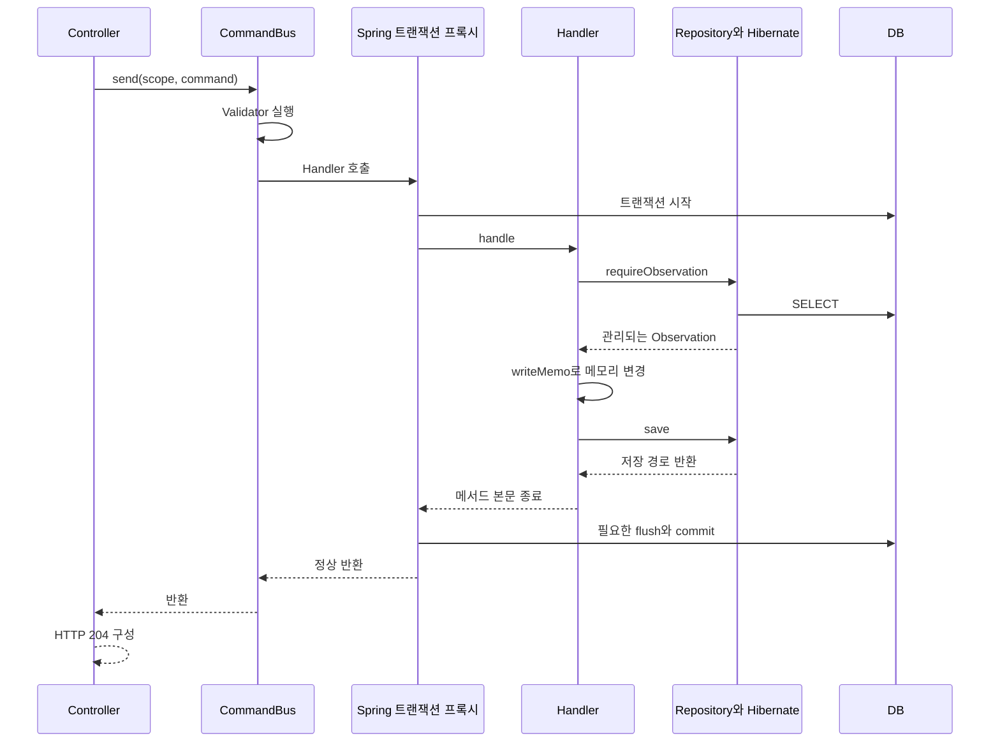

# 5. 명령·저장·트랜잭션·외부 API

[이전: 조회 패턴](04-querydsl-and-read-models.md) · [목차](README.md) · [다음: Kafka](06-kafka-and-inbox.md)

## 5.1 먼저 다섯 가지를 나눈다

| 행위 | 의미 | 아직 보장하지 않는 것 |
|---|---|---|
| 객체 생성·프로퍼티 설정 | 메모리 값이 바뀜 | SQL 실행 |
| `persist` / Repository `save` | JPA 저장 경로에 들어감 | 최외곽 트랜잭션 commit |
| `flush` | 변경을 SQL로 DB에 동기화 | 트랜잭션 최종 확정 |
| `commit` | 해당 DB 트랜잭션 확정 | Kafka 전달·외부 업무 완료 |
| 외부 업무 완료 회신 | 상대 서비스의 업무 결과 수신 | 모든 다른 서비스가 동시에 최신 상태 |

C#의 `SaveChanges()` 경험은 도움이 되지만 이 소스의 `save()`와 1:1로 대응하지 않는다. **이름 대신 구현과 호출자의 트랜잭션을 확인한다.**

## 5.2 메모 저장의 전체 시간표

[RegisterObservationMemoCommandHandler](../../../x-diagnostic-result/backend/diagnostic-result/src/main/kotlin/com/projectx/diagnosticresult/application/commands/observation/RegisterObservationMemoCommandHandler.kt)의 실제 본문:

```kotlin
@Transactional
override fun handle(command: RegisterObservationMemoCommand, scope: TenantScope) {
    val observation = repository.requireObservation(scope, command.observationId)
    observation.writeMemo(command.userId, command.memoHtml)
    repository.save(observation)
}
```

일반 HTTP 메모 저장처럼 바깥 쓰기 트랜잭션이 없는 경로의 순서는 다음과 같다.



[ObservationRepository.save](../../../x-diagnostic-result/backend/diagnostic-result/src/main/kotlin/com/projectx/diagnosticresult/infrastructure/repositories/ObservationRepository.kt)는 `jpa.save(aggregate)` 후 dispatcher를 부른다. SQL이 언제 나갈지는 flush와 쿼리 실행 등의 영향을 받는다. 그림은 **commit 위치를 설명**하며 모든 SQL이 반드시 마지막에만 나간다는 뜻은 아니다.

Handler 본문의 마지막 줄에 도달해도 프록시가 commit하다가 실패할 수 있다. HTTP 204는 Controller가 정상 반환을 받은 다음 구성한다. 응답 전송 장애가 DB commit을 되돌리는 것도 아니다.

## 5.3 영속성 컨텍스트: EF ChangeTracker와 비교

EntityManager의 영속성 컨텍스트는 현재 관리하는 객체와 상태를 추적한다.

| 상태 | 예 | 업무 개발에서의 의미 |
|---|---|---|
| 새 객체 | `Appointment(...)` 생성 직후 | 생성만으로 저장되지 않음 |
| managed | 같은 트랜잭션에서 Repository로 로딩·persist한 객체 | 변경 감지 대상 |
| detached | 영속성 컨텍스트에서 떨어진 객체 | 필드 변경만으로 현재 DB에 반영되지 않음 |
| removed | 삭제 대상으로 등록된 객체 | 실제 SQL·확정은 flush·commit과 연결 |

**dirty checking(변경 감지)**은 managed 객체의 변경을 Hibernate가 찾아 SQL로 반영하는 기능이다. 그러나 담당 레포에서는 “managed니까 save를 빼도 된다”로 결론 내리지 않는다. Repository 어댑터가 도메인 이벤트 dispatch나 flush 같은 프로젝트 동작도 담당하기 때문이다.

`save`가 반환한 객체를 확인하는 습관도 필요하다. Spring Data JPA는 새 객체 판정에 따라 `persist` 또는 `merge`를 사용한다. `merge`는 원래 객체를 관리 상태로 바꾸는 것과 달리 **관리 사본을 반환할 수 있다**. nullable version을 가진 Entity는 우선 version 값으로 신규 여부를 판단한다. 담당 레포의 `version: Long?`가 이 판정과 연결된다. [Spring Data JPA 공식 설명](https://docs.spring.io/spring-data/jpa/reference/jpa/entity-persistence.html).

예약의 [SaveWithEvents](../../../x-patient-appointment/backend/patient-appointment/src/main/kotlin/com/projectx/patientappointment/infrastructure/repositories/SaveWithEvents.kt)는 저장 결과를 반환하되 **입력 aggregate의 이벤트**를 dispatch한다. `@Transient` 이벤트 목록이 merge 결과에 자동 복사된다고 기대하지 않기 위해서다. 검사결과의 현재 Repository와 구현이 같다고 일반화하지 않는다.

## 5.4 saveAndFlush도 commit은 아니다

[AppointmentRepository](../../../x-patient-appointment/backend/patient-appointment/src/main/kotlin/com/projectx/patientappointment/infrastructure/repositories/AppointmentRepository.kt)의 실제 단건 저장:

```kotlin
override fun save(aggregate: Appointment): Appointment =
    saveWithEvents(aggregate, dispatcher) { jpa.saveAndFlush(it) }
```

`saveAndFlush`는 저장 후 SQL 동기화를 진행한다. 예약은 응답에서 사용할 version이 이전 값에 머무르지 않게 하려는 의도가 있다. 단, 실제 변경이 없는 저장까지 version을 무조건 올린다는 뜻은 아니다.

같은 트랜잭션에서 뒤의 예약 처리나 접수 문맥 검증이 실패하면 앞서 flush한 예약·슬롯 변경도 rollback된다. **DB에 UPDATE가 실행된 로그와 최종 commit 성공은 다른 증거**다.

업무별 저장 경로 비교:

| 경로 | 명시 저장·동기화 | 실제 commit 경계 |
|---|---|---|
| 검사결과 메모 HTTP | `ObservationRepository.save` | 이 경로의 Handler 프록시 종료 |
| 예약 묶음 HTTP | `saveAndFlush`·여러 Repository 호출 | `BookBundleCommandHandler.handle` 외곽 트랜잭션 |
| 예약 Kafka 수신 | 동일 Handler들이 기존 트랜잭션에 합류 | `InboxTxService.process` 업무+PROCESSED 트랜잭션 |
| ordering 초안 HTTP | `persist` + UnitOfWork flush | 바깥 tx가 없으면 CommandBus 프록시 |
| ordering 서명 HTTP | CommandBus·UnitOfWork·outbox | 바깥 `OrderDisplaySigning.saved` 트랜잭션 |
| 검사결과 AI 분석 | 외부 호출 후 저장 Service | 별도 짧은 저장 트랜잭션 |

## 5.5 @Transactional을 읽을 때 확인할 것

일반적인 Spring 프록시 방식에서는 Spring 빈의 프록시를 통해 메서드가 호출될 때 선언이 적용된다. 같은 객체 안에서 `this.otherMethod()`로 호출한다고 새 트랜잭션 정책이 자동 적용되는 것은 아니다. 생성자를 직접 호출해 만든 Spring 미관리 객체도 동일하게 생각하면 안 된다. [Spring 공식 @Transactional 설명](https://docs.spring.io/spring-framework/reference/data-access/transaction/declarative/annotations.html).

| 선언 | 읽는 방법 |
|---|---|
| `REQUIRED`(기본) | 기존 트랜잭션이 있으면 참여, 없으면 시작 |
| `REQUIRES_NEW` | 기존 트랜잭션을 일시 중단(suspend)하고 독립 트랜잭션 실행; 외곽 rollback과 운명을 같이하지 않음 |
| `NOT_SUPPORTED` | 기존 트랜잭션을 일시 중단(suspend)하고 트랜잭션 없이 실행 |
| `MANDATORY` | 기존 트랜잭션이 있어야 실행 |
| `readOnly = true` | 조회용 정책; 쓰기를 업무적으로 허용한다는 뜻도, 완전한 쓰기 차단도 아님 |

“어노테이션이 있는 메서드가 끝났다”보다 **누가 시작한 최외곽 트랜잭션인가**가 중요하다. 수신 Handler, 공유 Service, CommandBus가 같은 트랜잭션에 겹쳐 참여할 수 있다.

Spring 기본 rollback 규칙은 RuntimeException·Error이며 checked exception은 기본적으로 다르다. Kotlin이 checked exception 선언을 강제하지 않아도 Java 예외의 타입 계층은 남는다. `rollbackFor` 등 실제 설정을 확인한다. [공식 rollback 규칙](https://docs.spring.io/spring-framework/reference/data-access/transaction/declarative/rolling-back.html).

업무에서 특히 확인할 두 경우:

- `return Result(success = false)`: 정상 반환이므로 rollback 명령이 아니다. 그 전에 바꾼 managed 상태가 있으면 commit될 수 있다.
- `catch` 또는 `runCatching`으로 실패를 빈값으로 변경: 호출자는 성공으로 볼 수 있다. 반대로 내부 참여 트랜잭션이 이미 rollback-only이면 바깥 정상 반환 때도 commit 오류가 날 수 있다.

담당 레포의 일반 업무에는 선언적 트랜잭션 기준을 따른다. ordering의 내부 outbox 구현에 `TransactionTemplate`이 있다고 담당 레포에 수동 commit/rollback 패턴을 도입하지 않는다.

## 5.6 동시 저장: 사용자 version과 DB @Version

사용자 A·B가 같은 version의 예약을 읽었다고 하자. A의 변경이 반영된 뒤 B가 이전 화면으로 저장하려 하면 두 종류의 검사가 관련된다.

1. **요청의 expectedVersion 비교:** 사용자가 읽었던 버전과 현재 상태가 맞는지 업무 코드에서 확인한다. 어떤 요청은 선택적이므로 실제 Request·Handler를 읽는다.
2. **DB의 `@Version`:** 읽은 뒤 UPDATE 사이에 다른 트랜잭션이 변경했는지 Hibernate가 검사한다.

둘은 같은 검사가 아니다. expectedVersion을 보내지 않으면 “오래된 화면으로 덮기”를 막는 의미가 약해질 수 있고, DB 낙관락은 실제 동시 갱신 경합을 탐지한다. 재시도할 때는 최신 상태를 읽고 업무 의도를 다시 확인한다. 같은 요청을 무조건 반복하면 외부 요청까지 중복될 수 있다.

## 5.7 외부 API → 세팅 → 저장의 세 패턴

### A. 조회해서 반환만 한다

예약의 `DepartmentHttpAdapter`는 외부 부서 목록을 DTO로 변환해 반환한다. ordering의 처방 초기화 API는 외부 초기값을 Draft DTO에 조립한다. **둘 다 이 호출만으로 해당 업무 데이터를 저장하지 않는다.**

### B. 외부 값을 로컬 스냅샷으로 복사해 저장한다

예약의 실제 원무 수신 사례는 다음과 같다.

```text
ApplyAppointmentRequestsCommandHandler
  → OutpatientScheduleService.ensure/create
  → IPhysicianDirectoryPort / PhysicianHttpAdapter
  → 외부 JSON → UserDirectoryPayload → PhysicianView
  → CreateScheduleCommand(actorName = 외부 의사 표시명 등)
  → CreateScheduleCommandHandler → Schedule.of → Repository.save
  → 같은 inbox 업무 트랜잭션의 나머지 처리
  → 최종 commit
```

[OutpatientScheduleService](../../../x-patient-appointment/backend/patient-appointment/src/main/kotlin/com/projectx/patientappointment/application/services/OutpatientScheduleService.kt)와 [PhysicianHttpAdapter](../../../x-patient-appointment/backend/patient-appointment/src/main/kotlin/com/projectx/patientappointment/infrastructure/proxies/PhysicianHttpAdapter.kt)를 함께 읽는다. 외부 조회를 특정 행 잠금 전에 수행하지만 이 수신 흐름의 트랜잭션 밖이라는 뜻은 아니다. 현재 구현은 조회 실패 시 빈 목록·빈 이름으로 진행할 수 있다.

이름은 **그때 복사한 값**이다. 외부 원천 이름이 바뀌어도 자동 동기화되는 live binding이 아니다. 반면 shared 조회로 매번 붙이는 환자명은 조회 시점에 shared에 복제되어 있는 값을 사용한다(CDC 반영 지연 가능).

### C. 긴 외부 호출 뒤 결과만 짧은 트랜잭션으로 저장한다

검사결과 AI 분석은 [AnalyzeObservationsByPatientCommandHandler](../../../x-diagnostic-result/backend/diagnostic-result/src/main/kotlin/com/projectx/diagnosticresult/application/commands/observationanalyzeresult/AnalyzeObservationsByPatientCommandHandler.kt)의 `NOT_SUPPORTED`와 [ObservationAnalyzeResultSaveService](../../../x-diagnostic-result/backend/diagnostic-result/src/main/kotlin/com/projectx/diagnosticresult/application/services/ObservationAnalyzeResultSaveService.kt)를 나눠 읽는다.

```text
결과 조회 → 분석 자료 구성 → 외부 AI Gateway 호출
  → 응답 DTO 해석·정규화
  → 새 ObservationAnalyzeResult 생성(아직 메모리 객체)
  → 짧은 저장 트랜잭션 시작 → Repository.save → commit
  → HTTP 201 + Location(본문 없음) → 별도 GET으로 결과 읽기
```

분석할 결과가 없거나 처리할 대상이 없는 경로는 204를 반환한다. 이 방식은 외부 응답을 기다리는 동안 하나의 긴 DB 트랜잭션을 유지하지 않으려는 설계다. 조회·재점검 대상 표시·이력 저장에 개별 트랜잭션이 있으므로 전체 작업이 단일 DB 트랜잭션은 아니다. 자세한 실패 처리는 9장에 있다.

## 5.8 로컬 rollback은 외부 성공을 취소하지 않는다

| 실패 시점 | 로컬 상태 | 외부 상태를 해석하는 방법 |
|---|---|---|
| API 응답 변환 실패 | 아직 저장 안 됐거나 현재 tx rollback 가능 | 원격이 요청을 처리했는지는 별도 확인 |
| 외부 호출 성공 뒤 DB commit 실패 | 로컬 결과 미저장 가능 | 이미 실행한 원격 작업은 되돌아가지 않음 |
| DB commit 뒤 Kafka 발행 실패 | 로컬 저장 유지 | 상대는 미수신일 수 있음 |
| 외부 응답 타임아웃 | 성공 여부 불명확 | 타임아웃을 원격 미실행으로 단정하지 않음 |

설계 때는 “이 외부 API는 읽기인가 쓰기인가, 재시도 키가 있는가, 외부 성공·로컬 실패를 어떻게 발견하고 복구하는가”를 정한다. HTTP와 DB를 함께 감싸는 `@Transactional`이 자동 분산 트랜잭션을 만들지는 않는다.

## 5.9 저장 후 재조회

저장 응답을 받은 뒤 새 GET 요청으로 확인하면 서버 저장값·version·계산값·별도 원천 표시값을 읽을 수 있다. 같은 요청의 DTO 값을 다시 보여 준 것과 다르다. 다만 원무 접수나 Kafka 수신으로 나중에 반영되는 값은 바로 채워지지 않을 수 있다. 예약의 `REQUESTED`는 이런 중간 상태의 실제 예다.

[이전: 조회 패턴](04-querydsl-and-read-models.md) · [목차](README.md) · [다음: Kafka](06-kafka-and-inbox.md)
