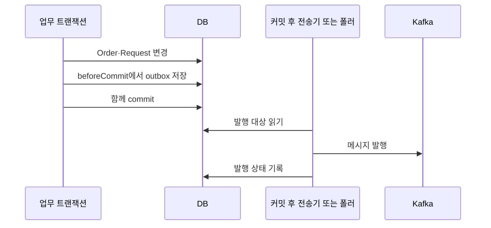

# 6. Kafka 발행과 inbox 수신

[이전: 저장·트랜잭션](05-commands-and-transactions.md) · [목차](README.md) · [다음: clinical-care 사례](07-clinical-care-walkthrough.md)

## 6.1 이벤트라는 이름이 같은 동작을 뜻하지 않는다

| 종류 | 어디에 존재하는가 | 뜻 |
|---|---|---|
| DomainEvent | 현재 프로세스의 객체·목록 | 업무 상태가 바뀌었다는 내부 알림 |
| Spring ApplicationEvent | Spring 내부 전달 | 내부 listener 실행 또는 트랜잭션 이후 콜백 예약 |
| IntegrationEvent payload | 서비스 간 계약 데이터 | 외부로 보내거나 외부에서 받을 업무 내용 |
| MessageEnvelope | 이벤트의 봉투 | message id·type·tenant·발행 주체 등 메타데이터 |
| Kafka record | 브로커 토픽·파티션 | 서비스 간 전송되는 메시지 |
| Outbox 행 | 발행측 DB | 커밋과 함께 남겨 두는 발행할 데이터 |
| Inbox 행 | 수신측 DB | 받은 데이터와 처리 상태·재처리 근거 |

`addDomainEvent(...)`, Spring의 `publishEvent(...)`, EventBus의 `publish(...)`는 서로 다른 단계다. 함수 이름에 publish가 있다는 이유만으로 브로커 전송 완료라고 읽지 않는다.

## 6.2 세 레포의 발행 전략부터 구분

| 대상 | 실제 경로 | 장애 시 의미 |
|---|---|---|
| ordering | 업무 변경+outbox 저장을 같은 DB tx → commit → 별도 전송·폴러 | 미전송 데이터가 DB에 남아 재시도 경로를 가짐 |
| patient-appointment | 업무 DB commit → listener/collector → EventBus.publish | outbox 없음. 발행 실패에도 업무 DB는 저장된 상태 |
| diagnostic-result | Kafka 수신 → inbox → Observation 반영 | 결과 이벤트 재발행 route 없음 |
| medication-destination | 동기 API 업무 | Kafka·inbox 없음 |

**outbox를 배웠다고 현재 예약에 존재한다고 가정하지 않는다.** outbox 역시 상대가 한 번만 처리했음을 자동 보장하지 않으며, 발행 성공 후 상태 기록 실패 같은 구간에는 중복 전송이 가능하다.

## 6.3 예약: 커밋 이후 발행 따라가기

예약 시 [PlannedEncounterService](../../../x-patient-appointment/backend/patient-appointment/src/main/kotlin/com/projectx/patientappointment/application/services/PlannedEncounterService.kt)가 접수 문맥을 묶고 요청 상태를 만든다. 접수 요청 포트를 거쳐 누적한 도메인 이벤트를 [DomainEventIntegrationPublisher](../../../x-patient-appointment/backend/patient-appointment/src/main/kotlin/com/projectx/patientappointment/infrastructure/eventbus/DomainEventIntegrationPublisher.kt)가 커밋 뒤 처리한다.

```text
예약·슬롯 변경, 접수 요청 상태 REQUESTED
  → 로컬 DB commit
  → onEncounterRequested(AFTER_COMMIT)
  → EncounterRequest payload
  → EventBus.publish
  → 원무 수신·처리
  → AppointmentRequest 회신
  → 예약 inbox 처리 → 접수 상태 반영
```

`@TransactionalEventListener(AFTER_COMMIT)`은 **commit 이후**라는 조건이지 자동으로 별도 스레드에서 실행된다는 뜻은 아니다. 실행 스레드·비동기 여부는 실제 listener·executor 코드를 본다. 이후 발행이 실패해도 앞선 DB commit은 되돌릴 수 없다.

예약 publisher에서 payload를 만들어 로그만 남기는 이벤트와 실제 `eventBus.publish`를 호출하는 이벤트를 구별한다. 현재 실제 외부 발행은 `EncounterRequest`, `OrderBasedAppointmentBooked`, `IntegratedAppointmentBooked` 경로다. 슬롯·휴무·재배정의 payload 조립을 발행 완료로 설명하면 안 된다.

통합예약 결과는 [IntegratedAppointmentChangeCollector](../../../x-patient-appointment/backend/patient-appointment/src/main/kotlin/com/projectx/patientappointment/infrastructure/eventbus/IntegratedAppointmentChangeCollector.kt)가 트랜잭션 안에서 id들을 모으고 `afterCommit`에 최종 상태를 발행한다. **모든 이벤트가 같은 listener 메서드를 지나는 것은 아니다.**

## 6.4 ordering: outbox가 추가하는 단계

[OrderingIntegrationEventService](../../../x-clinical-care/backend/ordering/src/main/kotlin/com/projectx/ordering/application/integrationevents/OrderingIntegrationEventService.kt)와 [서명 배치 collector](../../../x-clinical-care/backend/ordering/src/main/kotlin/com/projectx/ordering/application/integrationevents/OrderSheetSignBatchCollector.kt)가 중심이다.

다음 도식은 ordering의 **서명 배치** 예다. 다른 이벤트는 업무 트랜잭션 도중 outbox에 적재하는 경로도 있다.



핵심은 “업무는 저장됐는데 보내야 할 데이터 자체가 사라지는 구간”을 줄이도록 **발행할 데이터를 업무와 같은 DB 트랜잭션에 저장**한다는 점이다. 실제 발행과 상태 기록은 별도 작업이므로 장애·재시도·중복에 대한 고려는 계속 필요하다. 전체 코드 경로와 폴러는 7장에서 읽는다.

공통 EventBus 라이브러리의 실제 ack·retry 보장은 해당 버전과 설정까지 확인해야 한다. 이 교재의 정적 추적만으로 브로커 전달을 실측하거나 exactly-once를 보증하지 않는다.

## 6.5 토픽·타입·파티션 키·멱등 키

| 값 | 질문 | 혼동하면 생기는 문제 |
|---|---|---|
| topic | 어디로 보내는가? | 다른 토픽이면 구독되지 않음 |
| namespace | 어느 환경·테넌트 공간인가? | dev/local이 달라 조용히 미수신 |
| messageType | 어떤 이벤트 계약인가? | 같은 토픽에서도 payload 해석이 다름 |
| partition key | 어떤 업무 단위의 순서를 모으는가? | 다른 키의 메시지 전체 순서는 보장할 수 없음 |
| message id | 같은 전송 메시지인가? | 재전달 중복 판정 |
| sourceAggregateId·sourceEventVersion | 같은 원천 업무의 어느 상태인가? | 새 message id로 온 과거 상태를 다시 덮을 수 있음 |

담당 레포의 기준은 `{환경}.{테넌트id}.{이벤트명}`이며 실제 route는 `TopicRegistry`·payload 상수를 확인한다. 예를 들어 결과의 `laboratory-result`는 namespace와 합쳐진다. 그러나 간호기록의 `nursing-record.observation-record`처럼 **외부 계약 이름을 그대로 받는 예외**가 있다. ordering의 토픽 구성도 이 일반 규칙과 완전히 같지 않다. 계약을 보고 읽고 변경은 발행·수신 양쪽과 맞춘다.

Kafka의 순서는 토픽 전체가 아니라 파티션 범위를 중심으로 이해한다. inbox의 순서 처리와 원천 version 검사도 따로 필요하다. source version은 JPA `@Version`과 다른 값이다.

## 6.6 수신: 브로커 도착에서 업무 반영까지

검사결과 기준 실제 코드:

1. [ReceivedEventsConfig](../../../x-diagnostic-result/backend/diagnostic-result/src/main/kotlin/com/projectx/diagnosticresult/infrastructure/eventbus/ReceivedEventsConfig.kt): 토픽·payload·handler 등록 목록.
2. [EventBusSubscriptionInitializer](../../../x-diagnostic-result/backend/diagnostic-result/src/main/kotlin/com/projectx/diagnosticresult/infrastructure/eventbus/EventBusSubscriptionInitializer.kt): `subscribeRaw` 연결.
3. [InboxReceiver](../../../x-diagnostic-result/backend/diagnostic-result/src/main/kotlin/com/projectx/diagnosticresult/infrastructure/inbox/InboxReceiver.kt): 원문·메타데이터 접수.
4. [InboxTxService](../../../x-diagnostic-result/backend/diagnostic-result/src/main/kotlin/com/projectx/diagnosticresult/infrastructure/inbox/InboxTxService.kt): 적재·선점·업무 처리·상태 기록의 트랜잭션.
5. [InboxDispatcher](../../../x-diagnostic-result/backend/diagnostic-result/src/main/kotlin/com/projectx/diagnosticresult/infrastructure/inbox/InboxDispatcher.kt): 저장된 JSON을 이벤트 타입으로 바인딩해 handler 호출.
6. 생성·수정은 handler → 매퍼 → 원천 version 확인 → Observation 생성·변경 → Repository 저장이다. 삭제는 이 payload 매퍼를 거치지 않는 별도 분기다.

현재 검사결과 `InboxDispatcher`는 **토픽으로 payload 타입과 handler를 선택**하고 봉투의 messageType은 기록에 사용한다. 6.5의 일반적인 messageType 의미와 실제 분배 구현을 구분한다.

```text
구독 콜백
  → 원문 inbox 저장 commit
  → 처리 대상 선점 commit
  → 업무 트랜잭션 시작
       JSON → Envelope/DTO → 도메인 변경
       성공: 업무 저장 + inbox PROCESSED를 함께 commit
       처리 실패: 이 업무 트랜잭션 rollback
                  → 별도 tx로 재시도/실패 상태 기록
```

원문 보관·선점·업무 처리·실패 기록은 하나의 거대한 트랜잭션이 아니다. 업무 변경과 `PROCESSED`를 같은 경계에 두어 업무 실패인데 처리 완료만 남는 상황을 피하려는 구조다. 실패 뒤 다시 읽을 때는 원문이 존재해도 업무 데이터가 없을 수 있다.

현재 코드의 `subscribeRaw`는 공통 설명 문서의 `subscribeEnvelope` 예시와 다르다. 정적 소스 읽기에서는 실제 호출을 따른다. 구독 등록 목록이 있다는 사실만으로 배포 환경에서 Kafka가 켜졌다고 단정할 수는 없다.

## 6.7 테넌트·중복·과거 이벤트

HTTP의 tenant는 인증 주체에서, Kafka의 tenant는 이벤트 봉투와 배포 설정을 해석하는 resolver에서 온다. 검사결과의 [EventTenantResolver](../../../x-diagnostic-result/backend/diagnostic-result/src/main/kotlin/com/projectx/diagnosticresult/application/integrationevents/eventhandling/EventTenantResolver.kt)는 불일치 시 배포 범위를 우선하는 현재 정책을 갖는다. 모든 레포가 불일치를 즉시 거절한다고 가정하지 않는다.

중복 방어는 층이 다르다.

- 같은 message id 재전달: inbox의 중복 처리 기준을 확인한다.
- 새 message id지만 같은 원천 결과: source id·version의 업무 멱등 처리를 확인한다.
- 삭제·변경·생성 순서 역전: 이미 저장된 상태뿐 아니라 **아직 없는 대상** 처리도 확인한다.

검사결과는 기존 결과의 같거나 낮은 source version을 무시하는 경로가 있다. 하지만 없는 대상의 삭제를 tombstone으로 남기는 일반 보장은 없으므로 “어떤 역전 순서에도 안전하다”고 표현하지 않는다. 9장의 실제 분기를 참고한다.

## 6.8 발행·수신을 디버깅할 때의 증거 순서

| 보이는 증거 | 말할 수 있는 것 | 아직 말할 수 없는 것 |
|---|---|---|
| 도메인 이벤트 목록 | 내부 이벤트 생성 | 외부 전송 |
| publisher 메서드 진입 | 발행 경로 실행 | 브로커 전달·상대 처리 |
| outbox 행 | 발행 데이터 저장 | 전송 성공 |
| 상대 inbox 행 | 상대가 원문 적재 | 업무 처리 성공 |
| inbox PROCESSED | 해당 처리 트랜잭션 완료 | 업무상 승인이라는 뜻은 아님 |
| 업무 조회·회신 | 기대 상태 반영 확인 | 다른 모든 시스템 동시 반영 |

예약의 원무 `REJECTED` 회신은 정상 처리되어 inbox는 PROCESSED이고 접수 거절 목록에 남을 수 있다. 기술적 처리 성공과 업무 승인 결과를 구분한다.

수신이 안 보이면 namespace·topic·구독 활성·계약을, inbox 실패면 바인딩·id·tenant·version·도메인 규칙을, 발행 실패면 실제 publish 호출·설정·전송 오류를 본다. 재처리는 중복·순서·부분 성공을 확인하고 운영 절차에 따라 수행한다.

[이전: 저장·트랜잭션](05-commands-and-transactions.md) · [목차](README.md) · [다음: clinical-care 사례](07-clinical-care-walkthrough.md)
