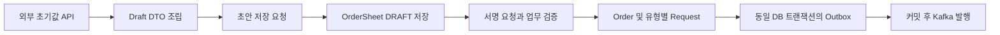
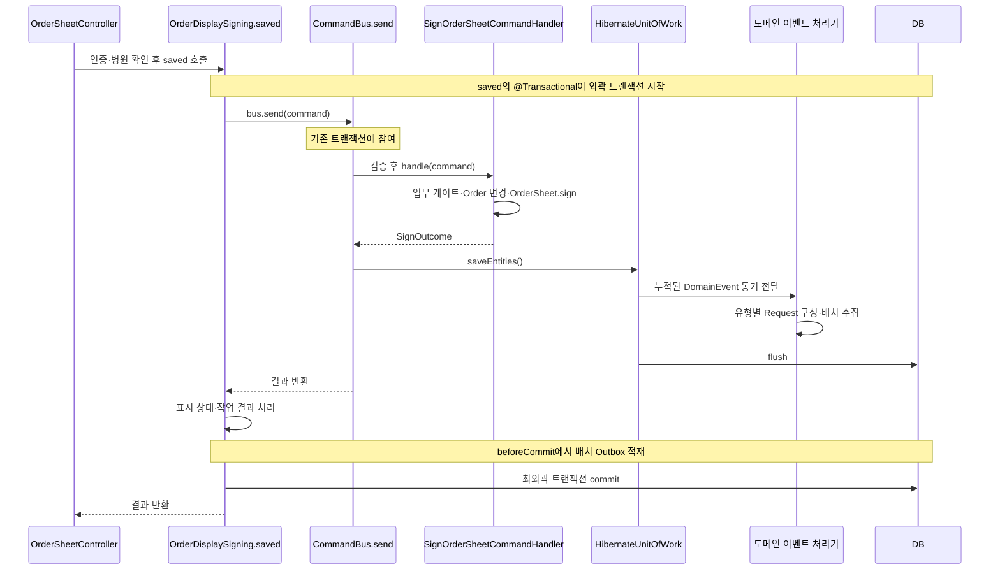

# 07. x-clinical-care: 처방 초안부터 서명·Outbox까지 읽기

[이전: Kafka와 Inbox](06-kafka-and-inbox.md) · [목차](README.md) · [다음: 예약 서비스](08-patient-appointment-walkthrough.md)

## 이 장의 목표

`x-clinical-care/backend/ordering`에서 **외부 API로 초기값을 받는 것, 초안을 DB에 저장하는 것, 업무적으로 서명하는 것, Kafka로 알리는 것**이 각각 어느 코드에서 일어나는지 따라간다. C#으로 치면 HTTP DTO, 응용 서비스, EF Core의 추적 객체, Unit of Work, 메시지 발행기를 구분하며 읽는 연습이다.

이 레포의 장점은 복잡한 업무 흐름을 도메인 객체·정책·이벤트·계약으로 나누어 설명한다는 점이다. 다만 현재 구현은 담당 레포의 공통 골든 템플릿과 다르다. 이 장은 **ordering의 실제 구현**을 설명하며, 파일 배치나 기반 클래스를 다른 레포에 그대로 복사하라는 뜻은 아니다. 내용은 소스와 설계 문서를 대조한 결과이며 실제 병원 데이터로 실행한 결과가 아니다.

관련 설계의 출발점은 [Ordering CONTEXT](../../../x-clinical-care/backend/ordering/CONTEXT.md), 레포별 구현 기준은 [ordering 안내](../../../x-clinical-care/backend/ordering/AGENTS.md)와 [backend 안내](../../../x-clinical-care/backend/AGENTS.md)다. 안내와 코드의 세부 호출 위치가 다르면 아래의 실제 호출 경로를 기준으로 읽는다.

## 1. 업무 객체 네 가지를 먼저 구분한다

| 이름 | 이 코드에서의 의미 | 저장·확정 시점 |
|---|---|---|
| `OrderSheetItemDraftDto` | 화면에 돌려줄 처방 한 줄의 초기값 | 초기화 응답 객체다. 이 객체를 만든 사실만으로 처방이 저장되지 않는다. |
| `OrderSheet` / `OrderSheetItem` | 처방 변경을 모아 둔 시트와 변경 항목 | 초안 저장 시 `DRAFT` 상태로 영속화할 수 있다. |
| `Order` | 처방의 확정 상태 | 서명 처리에서 신규 생성하거나 기존 상태를 변경한다. |
| `PatientExaminationRequest` 등 | 검사·약국 등 수행 영역으로 전달할 유형별 요청 | `Order`의 도메인 이벤트를 처리하며 생성·변경한다. |

같은 “데이터 세팅”이어도 대상이 다르다. 화면용 Draft DTO에 값을 채우는 작업과 JPA가 관리하는 `OrderSheet`를 변경하는 작업을 혼동하면 “값은 들어 있는데 왜 저장되지 않았나”를 찾기 어렵다.



화면을 거치지 않고 한 번에 저장·서명하는 `save-and-sign` 경로도 있다. 처음에는 초안 생성과 저장된 초안 서명을 나누어 읽고, 공통 흐름을 이해한 다음 [SaveAndSignOrderSheetCommand](../../../x-clinical-care/backend/ordering/src/main/kotlin/com/projectx/ordering/application/commands/SaveAndSignOrderSheetCommand.kt)를 읽는 편이 쉽다.

## 2. 소스 탐색 순서

모든 경로의 패키지 루트는 `backend/ordering/src/main/kotlin/com/projectx/ordering/`다.

| 순서 | 열 파일과 찾을 심볼 | 여기서 확인할 질문 |
|---|---|---|
| 1 | [OrderSheetController](../../../x-clinical-care/backend/ordering/src/main/kotlin/com/projectx/ordering/presentation/OrderSheetController.kt): `initializeItemDrafts`, `createOrderSheet`, `getOrderSheet`, `signOrderSheet` | 어느 URL이 어떤 메서드를 호출하는가? |
| 2 | [OrderInitializeService](../../../x-clinical-care/backend/ordering/src/main/kotlin/com/projectx/ordering/application/initialization/OrderInitializeService.kt): `initializeFromOrderCommand` | 외부 값을 어떤 DTO에 넣는가? |
| 3 | [CreateOrderSheetCommand](../../../x-clinical-care/backend/ordering/src/main/kotlin/com/projectx/ordering/application/commands/CreateOrderSheetCommand.kt): `CreateOrderSheetCommandHandler.handle` | 요청 값이 어느 Entity의 생성자·메서드로 넘어가는가? |
| 4 | [CommandBus](../../../x-clinical-care/backend/ordering/src/main/kotlin/com/projectx/ordering/application/commands/CommandBus.kt): `send` | 검증·핸들러·Unit of Work를 누가 실행하는가? |
| 5 | [OrderSheetRepository](../../../x-clinical-care/backend/ordering/src/main/kotlin/com/projectx/ordering/infrastructure/repositories/OrderSheetRepository.kt): `add`, `findById`, `update` | 객체가 언제 영속성 컨텍스트에 들어오는가? |
| 6 | [OrderingQueries](../../../x-clinical-care/backend/ordering/src/main/kotlin/com/projectx/ordering/application/queries/OrderingQueries.kt): `getOrderSheet`, `toOrderSheetView` | DB 결과와 응답 모델이 어디서 만들어지는가? |
| 7 | [OrderDisplaySigning](../../../x-clinical-care/backend/ordering/src/main/kotlin/com/projectx/ordering/application/orderdisplay/OrderDisplaySigning.kt): `saved` | 서명의 실제 최외곽 트랜잭션은 어디인가? |
| 8 | [SignOrderSheetCommand](../../../x-clinical-care/backend/ordering/src/main/kotlin/com/projectx/ordering/application/commands/SignOrderSheetCommand.kt): `SignOrderSheetCommandHandler.handle` | 서명을 허용하는 업무 조건은 무엇인가? |
| 9 | [HibernateUnitOfWork](../../../x-clinical-care/backend/ordering/src/main/kotlin/com/projectx/ordering/infrastructure/HibernateUnitOfWork.kt): `saveEntities` | 도메인 이벤트가 언제 처리되고 SQL이 언제 나가는가? |
| 10 | [OrderingIntegrationEventService](../../../x-clinical-care/backend/ordering/src/main/kotlin/com/projectx/ordering/application/integrationevents/OrderingIntegrationEventService.kt) | Outbox 저장과 실제 발행은 어떻게 분리되는가? |

처음부터 긴 핸들러 전체를 외우지 않는다. “입력 → 업무 객체 → 저장 → 응답” 선을 먼저 잡고, 그 선에 붙은 검증기를 하나씩 읽는다.

## 3. 외부 API로 초기값을 받고 DTO에 세팅한다

입구는 `POST /api/v1/ordering/order-sheets/item-drafts`다. `OrderSheetController.initializeItemDrafts`에서 `@RequestBody`가 HTTP JSON을 `ItemDraftInitializeRequest`로 역직렬화한다. 이때 생기는 것은 일반 Kotlin 객체이며 JPA Entity가 아니다.

`OrderInitializeService`는 초기화 출처에 따라 분기한다. `ORDER_COMMAND` 경로의 실제 외부 호출은 [SupplierInitializationClient.fetchForOrderCommand](../../../x-clinical-care/backend/ordering/src/main/kotlin/com/projectx/ordering/application/initialization/SupplierInitializationClient.kt)에 있다.

```kotlin
// 실제 호출의 핵심 발췌. 전체 설정·오류 메시지는 원본 파일 참조.
orderDefinitionRestClient
    .post()
    .uri("/api/v1/order-definition/order-codes/{id}/initialization", orderCodeId)
    .body(request)
    .retrieve()
    .body(INITIALIZATION_ENVELOPE_TYPE)
    ?.data
```

C#의 `HttpClient`로 요청을 보내고 `ReadFromJsonAsync<ApiResponse<T>>()`의 `Data`를 꺼내는 목적과 비슷하다. 다만 이 코드는 `RestClient`를 이용하는 동기 호출이며 `Task`나 코루틴을 반환하는 흐름이 아니다.

값이 연결되는 순서는 다음과 같다.

1. `SupplierInitializationRequest`를 만들어 외부 API로 보낸다.
2. 응답 JSON이 `ApiResponse<SupplierInitializationResponse>`로 변환된다.
3. `.data`를 꺼내 `supplierResponse`에 받는다.
4. `supplierResponse.values.map { ... }`에서 `DraftDetailDto` 목록을 만든다.
5. `overlayEntered`, 기본값 처리, 처방일 처리 등을 거쳐 `OrderSheetItemDraftDto`를 만든다.
6. `ItemDraftInitializeResponse(drafts = listOf(draft))`를 반환한다.

**이 과정에는 처방 초안 Entity를 저장하는 호출이 없다.** 초기값 API의 성공과 초안 저장 성공은 별도 사건이다. 외부 값이 DTO로 들어오는 순간이 바인딩이고, DB 커밋은 뒤의 저장 요청에서 일어난다.

이 파일의 `OrderDefinitionRestClientConfig`는 연결·읽기 타임아웃을 설정한다. `initializeFromOrderCommand`는 `RestClientException`을 `REVIEW_SOURCE_UNAVAILABLE` 업무 오류로 바꾼다. 빈 응답도 클라이언트에서 같은 계열의 오류로 처리한다. 외부 호출 성공 여부를 무시하고 빈 초기값으로 저장하는 흐름으로 읽으면 안 된다.

## 4. 요청 값이 초안 Entity에 들어가는 순간

초안 저장 입구는 `POST /api/v1/ordering/order-sheets`다.

```text
요청 JSON
  → CreateOrderSheetRequest
  → Controller가 CreateOrderSheetCommand 생성
  → CommandBus.send
  → CreateOrderSheetCommandHandler.handle
  → OrderSheet(...) 생성 + addItem(...)
  → OrderSheetRepository.add
  → Unit of Work의 이벤트 처리와 flush
  → 트랜잭션 commit
  → HTTP 201, ApiResponse(data = id)
```

Controller는 `request.items.map { it.toInput() }`로 경계 DTO를 Command 입력으로 변환한다. `authoredBy`는 `principal.userId`, `hospitalId`는 `principal.hospitalCode`에서 가져온다. 사용자 입력의 직원 ID를 그대로 신뢰하는 예제로 이해하면 안 된다.

핸들러는 Command 값으로 `OrderSheet(...)`를 만들고 항목마다 `orderSheet.addItem(...)`을 호출한다. 여기서 다음 세 종류의 바인딩을 따로 볼 수 있다.

| 시점 | 실제 코드 | 결과 |
|---|---|---|
| HTTP 입력 연결 | `@RequestBody request` | JSON → Request 객체 |
| 업무 입력 연결 | `CreateOrderSheetCommand(...)` | Request·인증 값 → Command 객체 |
| 업무 상태 구성 | `OrderSheet(...)`, `addItem(...)` | Command 값 → Entity/자식 항목 |

마지막 `orderSheetRepository.add(orderSheet)`는 내부에서 `entityManager.persist(orderSheet)`를 호출한다. 이때 새 객체는 JPA가 관리하는 상태가 된다. 메서드 이름이 `add`라고 해서 즉시 DB 커밋되는 것은 아니다.

`OrderSheet`의 `_items`에는 `@OneToMany(cascade = [CascadeType.ALL], fetch = FetchType.LAZY)`가 있다. 부모 저장이 자식 항목의 영속화로 이어지는 배선은 이 매핑에서 확인한다. `items`는 외부에 읽기용 목록을 제공하며, 업무 변경은 `addItem`, `sign`, `cancel` 같은 메서드로 한다.

## 5. 조회한 DB 값은 언제 Kotlin 객체가 되는가?

`GET /api/v1/ordering/order-sheets/{id}`는 `queries.getOrderSheet(id)`를 호출한다. [OrderingQueries.getOrderSheet](../../../x-clinical-care/backend/ordering/src/main/kotlin/com/projectx/ordering/application/queries/OrderingQueries.kt)의 본문은 다음과 같다.

```kotlin
@Transactional(readOnly = true)
override fun getOrderSheet(id: String): OrderSheetView {
    val os = QOrderSheet.orderSheet
    return queryFactory
        .selectFrom(os)
        .where(os.id.eq(id))
        .fetchOne()
        ?.toOrderSheetView()
        ?: throw NoSuchElementException("OrderSheet $id not found")
}
```

`QOrderSheet`는 실제 환자·처방 데이터가 아니라 **쿼리를 만들기 위한 타입 정보**다. C#의 LINQ 식에서 `x.Id == id`를 구성하는 역할과 비슷하다. `selectFrom`과 `where`는 쿼리를 조립하고, `fetchOne()`에서 조회가 실행되어 Hibernate가 `OrderSheet`를 materialize한다. 같은 영속성 컨텍스트에 해당 Entity가 이미 있으면 기존 관리 객체가 재사용될 수 있다.

그다음 `toOrderSheetView()`가 `OrderSheetView(...)`를 직접 만든다. `status.name`, `signedAt`, `hospitalId`, 자식의 `details` 등을 대응 필드에 넣는다. 이것이 두 번째 매핑이다. 응답에는 Entity 자체가 아니라 View가 들어가고, Controller가 `ApiResponse(data = ...)`로 감싼다.

여기서는 **Entity 조회 후 View 변환**을 사용한다. 담당 레포에서 볼 `Projections.constructor(...)`의 ViewModel 직접 투영과 구현 형태가 다르다. 또한 `OrderingQueries`의 위치는 `application/queries`다. 공통 규칙의 `infrastructure/queries` 위치를 예상하고 찾으면 놓칠 수 있다.

`toOrderSheetView`가 `items`를 읽으면 지연 로딩된 자식 목록의 조회가 추가로 발생할 수 있다. `readOnly`는 “조회 결과가 자동으로 DTO가 된다”거나 “SQL 한 번으로 끝난다”는 뜻이 아니다. 목록 조회의 성능을 볼 때는 Entity 관계 접근과 실제 쿼리 횟수를 별도로 확인해야 한다.

## 6. 서명 경로에서 실제 트랜잭션 경계를 찾는다

서명 입구는 `PUT /api/v1/ordering/order-sheets/{id}/sign`다. 이 경로는 단순히 Controller가 CommandBus만 부르는 형태가 아니다.



핵심 근거는 [OrderDisplaySigning.saved](../../../x-clinical-care/backend/ordering/src/main/kotlin/com/projectx/ordering/application/orderdisplay/OrderDisplaySigning.kt)의 `@Transactional`과 내부 `bus.send(command)`다. [CommandBus.send](../../../x-clinical-care/backend/ordering/src/main/kotlin/com/projectx/ordering/application/commands/CommandBus.kt)도 `@Transactional(rollbackFor = [Exception::class])`이지만 이 호출에서는 이미 시작된 트랜잭션에 참여한다.

따라서 다음 두 문장을 구별해야 한다.

- 초안 생성처럼 Controller가 `bus.send`를 직접 부르는 경로: 별도 외곽 트랜잭션이 없다면 bus 프록시가 끝나는 과정에서 커밋한다.
- 위 서명 경로: bus가 반환된 뒤에도 `OrderDisplaySigning.saved`의 작업이 남아 있으므로 그 외곽 트랜잭션이 끝날 때 커밋한다.

`OrderDisplaySigning`은 작업 ID 재요청, 표시 범위 검증, 잠금 등의 처리도 한다. 이미 처리한 작업의 결과를 돌려주는 경로는 핸들러를 다시 실행하지 않을 수 있다. “HTTP 서명 요청 한 번이면 언제나 이벤트 한 번 생성”이라고 단정하면 안 된다.

### 핸들러에서 볼 세 가지

[SignOrderSheetCommandHandler.handle](../../../x-clinical-care/backend/ordering/src/main/kotlin/com/projectx/ordering/application/commands/SignOrderSheetCommand.kt)은 다음을 연결한다.

1. 저장된 `OrderSheet`를 읽고 초안 상태·대상 범위·현재 상태 등을 검사한다.
2. CDSS, 처방 유형별 게이트, 동시성 검사 등을 통과하면 `Order` 변경과 순번 확보 등을 수행한다.
3. `orderSheet.sign(...)`을 호출해 시트의 상태와 서명 정보를 바꾸고 도메인 이벤트를 쌓는다.

`OrderSheet.sign` 자체는 Kafka API를 호출하지 않는다. `status = SIGNED`, `signedAt`, `signedBy`, `hospitalId`를 설정하고 `addDomainEvent(OrderSheetSignedDomainEvent(...))`를 호출한다.

`SignOutcome(signed = false, ...)`는 업무상 거절 결과를 정상 반환하는 값이다. **정상 반환은 롤백 명령이 아니다.** 거절 전 관리 Entity를 변경하면 그 변경도 커밋 대상이 될 수 있으므로, 이 핸들러는 검증과 상태 변경 순서를 신중히 배치한다. “signed가 false니까 그 앞의 수정은 전부 취소된다”는 가정으로 코드를 추가하면 안 된다.

## 7. save·flush·commit을 이 코드에서 구분한다

| 코드 | 하는 일 | 하지 않는 일 |
|---|---|---|
| `entityManager.persist(orderSheet)` | 새 Entity를 영속성 컨텍스트에 등록한다. | 호출 자체가 트랜잭션 commit은 아니다. |
| 관리 Entity의 `sign(...)` | 메모리 상태를 바꾸고 도메인 이벤트를 누적한다. | Kafka 발행 완료를 뜻하지 않는다. |
| `OrderSheetRepository.update(...)` | 해당 객체가 managed인지 확인한다. | 별도 UPDATE SQL을 직접 실행하는 메서드가 아니다. |
| `unitOfWork.saveEntities()` | 도메인 이벤트를 처리하고 `entityManager.flush()`를 호출한다. | 외곽 트랜잭션을 commit하지 않는다. |
| `flush()` | 변경 상태를 SQL로 동기화한다. | 다른 트랜잭션에도 최종 확정되었다는 뜻이 아니다. |
| 최외곽 트랜잭션 commit | 업무 행과 동일 트랜잭션의 Outbox 행을 확정한다. | 수신 서비스의 처리 완료를 보장하지 않는다. |

[OrderSheetRepository.update](../../../x-clinical-care/backend/ordering/src/main/kotlin/com/projectx/ordering/infrastructure/repositories/OrderSheetRepository.kt)는 `entityManager.contains(orderSheet)`를 검사한다. detached 객체를 merge해 생긴 관리 사본에 원래 객체의 일시적 `domainEvents`가 전달되지 않는 문제를 피하려는 코드다.

C#에서 “객체에 값을 넣고 `SaveChanges()` 한다”는 경험은 이해에 도움이 된다. 그러나 여기의 `saveEntities()`를 “DB 커밋”과 1:1로 대응시키면 안 된다. 이 메서드의 실제 마지막 동작은 `flush()`이고, 커밋은 외곽 Spring 트랜잭션 프록시가 담당한다.

## 8. 도메인 이벤트가 Outbox로 바뀐다

[HibernateUnitOfWork](../../../x-clinical-care/backend/ordering/src/main/kotlin/com/projectx/ordering/infrastructure/HibernateUnitOfWork.kt)는 영속성 컨텍스트의 `Entity`들에서 `domainEvents`를 수집한다. 이벤트 목록을 먼저 비운 다음 `ApplicationEventPublisher.publishEvent`로 전달하며, 동기 처리 중 새 이벤트가 생기면 다시 수집한다. 무한 연쇄를 방지하는 상한은 10회다.

여기서의 Spring `publishEvent`는 Kafka 전송과 다른 호출이다. 예를 들어 다음 처리기가 같은 업무 트랜잭션 안에서 실행된다.

- [OrderingIntegrationEventHandler.handle(OrderSheetSignedDomainEvent)](../../../x-clinical-care/backend/ordering/src/main/kotlin/com/projectx/ordering/application/domainevents/OrderingIntegrationEventHandler.kt): 서명 배치 수집 컨텍스트를 시작한다.
- [PatientExaminationRequestOrderEventHandler.handle(OrderCreatedDomainEvent)](../../../x-clinical-care/backend/ordering/src/main/kotlin/com/projectx/ordering/application/domainevents/PatientExaminationRequestOrderEventHandler.kt): 검사 유형의 `Order`로부터 `PatientExaminationRequest`를 만들고 발행용 항목을 수집한다.
- [OrderSheetSignBatchCollector](../../../x-clinical-care/backend/ordering/src/main/kotlin/com/projectx/ordering/application/integrationevents/OrderSheetSignBatchCollector.kt): `beforeCommit`에서 수집 항목을 배치 이벤트로 만들고 Outbox에 넣는다.

도메인 이벤트 처리기의 `@EventListener`와 `@Transactional(propagation = Propagation.MANDATORY)`는 **이미 진행 중인 트랜잭션 안에서 처리해야 한다**는 뜻이다. 이 처리가 실패하면 업무 상태와 Outbox도 함께 롤백될 수 있다. 커밋 후 외부 메시지만 보내는 처리기와 역할이 다르다.

### Outbox에 저장하는 값

[OrderingIntegrationEventService.prepare](../../../x-clinical-care/backend/ordering/src/main/kotlin/com/projectx/ordering/application/integrationevents/OrderingIntegrationEventService.kt)는 이벤트를 `EnvelopeFactory`로 감싸고 JSON 문자열로 직렬화한다. 이 시점의 MDC에 있는 발행 컨텍스트를 봉투에 캡처한다. 뒤의 발행 작업은 이미 저장된 JSON을 그대로 사용한다.

`addAndSaveEvent`는 [IntegrationEventLogEntry](../../../x-clinical-care/backend/ordering/src/main/kotlin/com/projectx/ordering/infrastructure/integrationevents/IntegrationEventLogEntry.kt)를 만들어 저장한다. 일반 경로의 초기 상태는 `NOT_PUBLISHED`다. 원본 업무 데이터와 Outbox가 같은 DB 트랜잭션에서 확정되므로, DB에 처방만 남고 발행할 기록은 전혀 없는 간격을 줄이는 구조다.

크기 초과는 `OVERSIZED`로 격리한다. 이 상태는 자동 재발행 대상이 아니다. 자세한 운영 설명은 [Outbox 크기 초과 문서](../../../x-clinical-care/docs/ordering/knowledge-base/outbox-oversized-envelope.md)를 참고한다. 이 교재는 운영 DB 수정 절차를 실행하지 않는다.

## 9. 실제 Kafka 호출은 커밋 뒤에 있다

`addAndSaveEvent`가 등록한 `afterCommit` 콜백은 전용 executor에 발행 작업을 맡긴다. 즉시 발행이 실패하거나 executor가 요청을 받지 못하면 폴러가 남은 Outbox를 다시 확인한다.

[OrderingIntegrationEventPoller](../../../x-clinical-care/backend/ordering/src/main/kotlin/com/projectx/ordering/application/integrationevents/OrderingIntegrationEventPoller.kt)는 최초 60초 뒤 시작하며, 이후에는 각 실행이 끝난 뒤 30초를 기다렸다가 `publishPendingEvents()`를 다시 호출한다. 발행 대상에는 `NOT_PUBLISHED`, 재시도 가능한 `FAILED`, 일정 시간 진행이 멈춘 `IN_PROGRESS`가 포함된다.

최종 호출 위치는 `OrderingIntegrationEventService.publishByIdInOwnTx`다.

```kotlin
// 실제 핵심 발췌. 앞에 점유·상태·발행 대상 확인, 뒤에 예외 처리가 있다.
eventBus.publishEnvelopeJson(logEntry.eventTypeName, logEntry.content)
logEntry.state = EventState.PUBLISHED
eventLogRepository.save(logEntry)
```

이 메서드는 `REQUIRES_NEW`로 설정한 `TransactionTemplate` 안에서 실행된다. **이 레포에는 프로그래밍 방식의 트랜잭션도 실제로 존재한다.** 담당 레포의 선언적 트랜잭션 규칙과 동일한 구현이라고 설명하면 안 된다.

`PUBLISHED`는 발행 호출이 예외 없이 끝나 코드가 그 상태를 기록했다는 뜻이다. “검사실이 업무 처리를 완료했다”는 뜻이 아니다. 브로커 발행 이후 Outbox의 상태 커밋 전에 프로세스가 중단되면 재발행이 발생할 수 있으므로 수신측 멱등 처리가 필요하다. 이 구조를 중복이 절대 없는 exactly-once 처리라고 부르면 안 된다.

토픽은 [presentation/event/TopicRegistry](../../../x-clinical-care/backend/ordering/src/main/kotlin/com/projectx/ordering/presentation/event/TopicRegistry.kt)에서 찾는다. 영상검사 배치는 `kafkaEnvironment`, `kafkaTenant`, 이벤트명을 점으로 연결하고 `partitionKeyField = "partitionKey"`를 사용한다. 다른 내부 토픽에는 `ordering.ordersheet-signed` 같은 별도 표기도 있다. 따라서 다른 레포의 namespace 규칙을 여기의 모든 route에 그대로 대입하지 말고 **해당 이벤트의 route와 설정을 함께** 읽는다.

## 10. 담당 레포로 가져갈 원리와 그대로 복사하면 안 되는 부분

가져갈 원리는 다음과 같다. HTTP 요청 객체를 곧바로 Entity로 취급하지 않기, 도메인 메서드에서 업무 상태를 변경하기, 실제 트랜잭션의 최외곽을 찾기, 내부 도메인 이벤트와 외부 통합 이벤트를 나누기, 저장 성공과 외부 전달 성공을 구분하기다.

다음은 ordering의 현재 사실이므로 담당 레포의 표준과 대조해야 한다.

| 항목 | ordering의 현재 구현 | 읽을 때 주의할 점 |
|---|---|---|
| Query 구현 위치 | `application/queries/OrderingQueries.kt` | 담당 레포의 `infrastructure/queries`와 다르다. |
| 조회 매핑 | Entity 조회 후 `toOrderSheetView()` | 담당 레포도 조회별로 Entity→ViewModel, Tuple→ViewModel 등 구현이 다르므로 실제 반환 경계를 비교한다. |
| Repository | `EntityManager.persist`, managed 상태 검사, Spring Data 조회 | 담당 레포의 QueryDSL 조회·`JpaRepository.save` 패턴과 다르다. |
| Entity ID | [seedwork Entity](../../../x-clinical-care/backend/ordering/src/main/kotlin/com/projectx/ordering/domain/seedwork/Entity.kt)의 UUIDv7 문자열 | 담당 레포의 `UUID` 타입·공통 버전/테넌트 필드가 여기에도 있다고 가정하지 않는다. |
| 인증·병원 범위 | 이 서명 API는 `@RequireAuth`, principal 병원 비교, `OrderDisplaySigning`의 추가 검사 | `getOrderSheet(id)` 자체는 ID 조건만 쓴다. 모든 쿼리에 `TenantScope`가 자동 적용되는 예제로 일반화하지 않는다. |
| 성공·오류 응답 | `common-web-kt`의 `ApiResponse`와 오류 계약 | 담당 레포의 직접 ViewModel·FHIR 오류 응답과 계약이 다르다. |
| 이벤트 전달 | 동일 트랜잭션 Outbox + 커밋 후 발행 + 폴러 | 담당 레포의 AFTER_COMMIT best-effort 발행과 복구 능력이 다르다. |
| 트랜잭션 | bus·외곽 서명 서비스 + 발행기의 `TransactionTemplate` | “모든 쓰기는 handler의 애노테이션만 찾으면 된다”로 읽지 않는다. |
| 코드 구성 | Command와 Handler, 여러 계약 타입이 같은 파일에 있는 곳이 있다. | 담당 레포의 선언별 파일 분리 기준과 구별한다. |

버전은 설치 가이드가 아니라 현재 소스 해석의 근거로만 본다. [backend/build.gradle.kts](../../../x-clinical-care/backend/build.gradle.kts)는 Kotlin `2.4.10`, Spring Boot `4.1.0`, Java toolchain `25`, OpenFeign QueryDSL `7.1`을 지정한다. [ordering/build.gradle.kts](../../../x-clinical-care/backend/ordering/build.gradle.kts)의 eventbus는 `0.1.19`다. Jackson도 실제 import와 의존성을 확인해야 하며, 이 레포의 `com.fasterxml.jackson.*` 사용을 다른 레포의 `tools.jackson.*` 사용과 섞지 않는다.

## 11. 직접 읽으며 답해 볼 질문

1. 초기값 API 성공 직후 `OrderSheet`의 ID가 생기는가? `initializeFromOrderCommand`가 반환하는 타입으로 답한다.
2. 초안 저장에서 `authoredBy`는 본문과 토큰 중 어디서 오는가? Controller의 Command 생성자를 찾는다.
3. `QOrderSheet.orderSheet`를 만들었을 때 SQL이 실행되는가? `fetchOne()`과 나누어 설명한다.
4. `OrderSheetRepository.update`에 `save()`가 없어도 상태가 저장되는 이유는 무엇인가? managed Entity와 dirty checking으로 답한다.
5. 서명에서 `CommandBus.send`가 반환되는 순간 이미 커밋되었다고 말할 수 있는가? 호출자 `OrderDisplaySigning.saved`를 함께 읽는다.
6. `addDomainEvent`와 `publishEnvelopeJson` 사이에 어떤 단계가 있는가? 내부 이벤트 처리·배치·Outbox·커밋을 순서대로 적는다.
7. `SignOutcome(signed = false)`와 예외 발생은 트랜잭션에 같은 의미인가?
8. `PUBLISHED`만 보고 담당 검사 서비스의 처리 완료를 확정할 수 있는가?

예제 테스트를 읽을 때는 [SupplierInitializationClientTest](../../../x-clinical-care/backend/ordering/src/test/kotlin/com/projectx/ordering/application/initialization/SupplierInitializationClientTest.kt), [SignOrderSheetCommandTests](../../../x-clinical-care/backend/ordering/src/test/kotlin/com/projectx/ordering/application/commands/SignOrderSheetCommandTests.kt), [OrderSheetSignedPublishCollectorTest](../../../x-clinical-care/backend/ordering/src/test/kotlin/com/projectx/ordering/application/integrationevents/OrderSheetSignedPublishCollectorTest.kt), [IntegrationEventLogEntryTests](../../../x-clinical-care/backend/ordering/src/test/kotlin/com/projectx/ordering/infrastructure/integrationevents/IntegrationEventLogEntryTests.kt) 순으로 보면 경계가 이어진다. 이 장 작성 과정에서 이 테스트들을 실행한 것은 아니다.

[이전: Kafka와 Inbox](06-kafka-and-inbox.md) · [목차](README.md) · [다음: 예약 서비스](08-patient-appointment-walkthrough.md)
