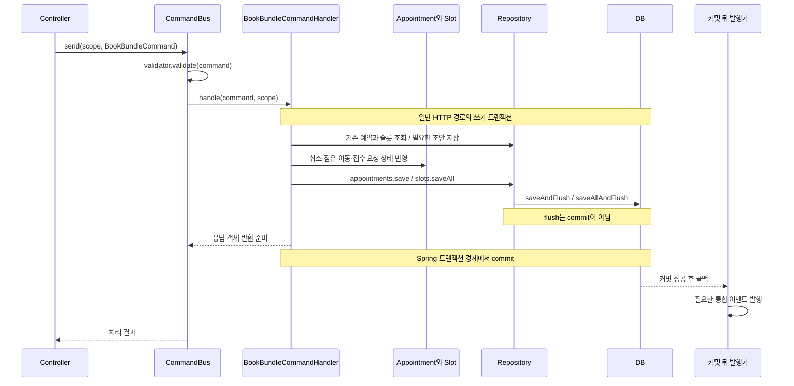

# 08. 담당 소스 읽기: x-patient-appointment

[목차](README.md) · [이전: clinical-care 실전 추적](07-clinical-care-walkthrough.md) · [다음: diagnostic-result 실전 추적](09-diagnostic-result-walkthrough.md)

이 장에서는 **예약을 조회하고, 초안을 만들고, 슬롯에 예약을 저장한 뒤 원무에 접수를 요청하는 흐름**을 따라간다. C#에서 Controller → 업무 서비스 → EF Core를 읽던 경험을 출발점으로 삼되, 이 레포의 실제 CommandBus·JPA·QueryDSL·이벤트 경계를 구분한다. 아래 내용은 소스와 설계문서를 대조한 설명이다. 실제 서버에서 예약을 만들거나 Kafka 전달을 시험한 결과는 아니다.

## 1. 처음 열 파일과 업무 지도

한 레포에 백엔드 서비스가 두 개 있다. 같은 저장소에 있다고 같은 DB 트랜잭션을 공유하는 것은 아니다.

| 서비스 | 담당 업무 | 소스 루트 | 이벤트 사용 |
|---|---|---|---|
| `patient-appointment` | 예약 기준·슬롯·예약·접수 연결 | `backend/patient-appointment` | Kafka 발행·수신, inbox 있음 |
| `medication-destination` | 약 전달위치 설정·결정·결정 로그 | `backend/medication-destination` | 현재 Kafka·inbox 없음 |

우선 [backend/CLAUDE.md][backend-guide]의 모델 표와 [설계 다이어그램][design]에서 `Schedule`, `Slot`, `Appointment`를 찾는다. 이 장의 주된 소스 패키지는 `com.projectx.patientappointment`다. [settings.gradle.kts][settings]에서 두 Gradle 모듈을 확인할 수 있다.

| 이름 | 업무상 의미 | C# 경험에 연결해서 읽기 |
|---|---|---|
| `Schedule` | 특정 의사·방의 예약 운영 기준 | 예약 대상과 운영 규칙을 가진 Aggregate |
| `Slot` | 특정 일시의 예약 칸, 정원·점유 수 | 동시에 두 요청이 갱신할 수 있는 영속 Entity |
| `Appointment` | 환자가 실제로 잡은 예약 | 상태 전이와 불변식을 가진 Aggregate |
| `OrderSnapshot`, `PatientSnapshot`, `ActorSnapshot` | 예약 판단·표시 등에 쓰는 복사값 | 다른 서비스의 객체를 참조하는 대신 필요한 값을 복사한 VO |
| `AppointmentViewModel` | API로 돌려줄 모양 | 응답 DTO. 서버 화면 바인딩 객체나 EF 추적 Entity가 아님 |

`PatientSnapshot`은 환자 신원 전체의 복사본이 아니다. 판정용 나이군·내원 구분·초재진 등을 담고, 환자 이름·번호 등의 조회는 `shared.cdc_patient_snapshot`을 읽는다. 처방 이름과 처방 진료과 이름은 예약 생성 요청에서 받은 스냅샷이다. 이 구분은 “이 이름을 바꿨는데 왜 예약에서 그대로 보이는가”를 이해하는 출발점이다.

## 2. 예약 목록 조회: 값은 어디서 생기는가

추적할 요청은 `GET /api/v1/patient-appointment/appointments?patient=...`다. 환자 식별자는 본인의 허용된 개발 데이터로만 확인한다.

```text
HTTP query string
  → AppointmentController.appointments
  → principal.toTenantScope() + AppointmentFilter
  → IAppointmentQueries.find
  → AppointmentQueries.find: QueryDSL 조건 조립 + fetch
  → views: 환자 신원·슬롯 시간대 보충
  → ViewMappers.toView
  → ItemsViewModel<AppointmentViewModel>
  → JSON 응답
```

1. [AppointmentController.appointments][controller]의 `@RequestParam`에서 문자열·Boolean 등의 메서드 인자가 정해진다. `patient?.let(UUID::fromString)`처럼 코드가 별도로 UUID를 만들거나 `ServiceCategory.fromCode`로 업무 코드를 변환하는 부분도 있다. 프레임워크 바인딩과 개발자가 작성한 변환을 구분해서 읽는다.
2. `principal.toTenantScope()`는 인증 주체에서 병원 범위를 만든다. 요청한 `patient`만으로 조회 범위를 정하지 않는다.
3. [AppointmentQueries.find][queries]는 `BooleanBuilder(tenantPredicate(...))`로 시작한다. 환자·예약일·상태·검색어가 있을 때 조건을 더한다. QueryDSL의 `QAppointment`는 실제 데이터 한 행이 아니라 쿼리를 만드는 메타모델이다.
4. `.fetch()`에서 쿼리가 실행되고 결과가 Kotlin 객체로 로딩된다. 그 앞의 `.where`, `.orderBy`는 조회식을 조립하는 단계다.
5. 이 조회는 현재 `Projections.constructor`로 바로 응답을 만들지 않는다. **`selectFrom(q)`로 Entity를 내부에서 읽고 `views`와 [ViewMappers.toView][mappers]로 응답을 만든다.** 중첩 단계인 `phase`를 함께 다루는 현재 구현이다. Controller가 Entity를 직접 반환한다는 뜻은 아니다.
6. `views`는 환자 id 목록을 `sharedDirectory.patients`에 한꺼번에 보내 신원을 보충하고, 슬롯의 시간대도 모아 읽는다. 마지막 `rows.map`에서 각 예약의 응답 값이 만들어진다.

실제 코드의 중심 부분만 발췌하면 다음과 같다.

```kotlin
// AppointmentQueries.find의 조회 실행 부분 발췌
return factory.selectFrom(q)
    .where(where)
    .orderBy(q.startAt.asc().nullsFirst(), q.createdAt.asc())
    .fetch()
    .let { views(scope, it) }
```

C#의 `IQueryable.Where(...).OrderBy(...).ToList()`와 연결해서 읽으면 된다. `let`은 조회를 한 번 더 하는 문법이 아니라, 방금 얻은 목록을 `views` 함수에 넘기는 Kotlin 문법이다. 목록을 응답 DTO로 옮겼다고 DB의 예약 값이 수정되지는 않는다.

이 조회 메서드에는 `@Transactional(readOnly = true)`가 있다. 응답용 조립 도중 Entity를 변경하는 방식으로 기능을 추가하지 않는다. 현재 읽기 구현의 반환 타입과 책임을 유지하고, 저장할 값은 쓰기 경로에서 다룬다.

## 3. 초안 응답이 왔다고 예약이 저장된 것은 아니다

다음 네 API는 이름이 비슷하지만 부수효과가 다르다. HTTP가 `POST`인지만 보고 쓰기로 판단하지 않는다.

| API | 주요 호출 | DB 예약 생성 | 슬롯 점유 |
|---|---|---|---|
| `POST /appointments/draft` | `AppointmentDraftQueries.draft` | 없음 | 없음 |
| `POST /appointments/find-optimal-dates` | `IRecommendationQueries.recommend` | 없음 | 없음 |
| `POST /appointments` | `CreateAppointmentCommandHandler` | `PROPOSED` 생성·재사용 경로 | 이 단계에는 없음 |
| `POST /appointments/book-bundle` | `BookBundleCommandHandler` | 초안이면 저장 단계에서 생성 | 있음 |

[AppointmentDraftQueries.draft][draft-queries]는 같은 근거의 재사용 가능한 예약이 있으면 그것을 조회해 반환한다. 없으면 [AppointmentDraftService.build][drafter]로 **메모리 객체만** 만들고 `appointmentId`를 `draft:...` 형태로 바꿔 응답한다. `build` 안에서 `Appointment.of(...)`를 호출하는 것은 생성자·팩터리로 객체를 만든다는 뜻이며, INSERT를 보낸다는 뜻이 아니다.

`reusable`의 조건도 읽어야 한다. 처방 근거는 종료 상태가 아닌 예약을 찾지만, 처방 없는 외래는 같은 환자의 **`PROPOSED`만** 재사용한다. 외래 근거의 번호가 환자 id이므로 이미 잡힌 외래 예약까지 무조건 덮어쓰면 안 되기 때문이다.

호출자가 보낸 처방·나이·초재진 등의 값은 `CreateAppointmentRequest → CreateAppointmentCommand → OrderSnapshot/PatientSnapshot`으로 명시적으로 변환된다. 이 경로가 처방 시스템을 자동으로 다시 호출해서 빈 값을 채워 주지는 않는다. 저장 시 필요한 접수 묶음 키가 없으면 `ENCOUNTER_CONTEXT_REQUIRED`로 거절되는 경로도 있다.

## 4. 묶음 예약 저장: 메모리 변경부터 DB commit까지

가장 먼저 열 것은 [AppointmentController.bookBundle][controller]과 [BookBundleCommandHandler.handle][bundle-handler]이다. 긴 핸들러를 처음부터 외우기보다 아래 단계의 경계부터 표시한다.



실제 호출 순서를 더 자세히 읽으면 다음과 같다.

1. Controller의 `request.plan.map`이 각 요청 줄을 `PlanEntryInput`으로 바꾼다. 초안 본문, `slotId`, `scheduleId + overbookDate`, `expectedVersion` 등이 이 단계에서 Command에 들어간다.
2. [CommandBus.send][bus]가 해당 Command의 validator를 실행한 뒤 Spring에 등록된 핸들러를 부른다. bus 자체가 수동으로 `commit()`을 호출하지 않는다.
3. `handle`의 `@Transactional`이 일반 HTTP 경로의 쓰기 경계다. 이미 트랜잭션이 있는 호출 경로라면 기본 전파 방식에 따라 그 트랜잭션에 합류한다.
4. `resolved = command.plan.map`에서 기존 예약을 로딩하거나 초안을 재사용·생성한다. 여기서 초기 `appointments.save`가 있어도 마지막 commit 전이므로 뒤에서 실패하면 생성도 함께 롤백된다.
5. [AppointmentEditorService][editor]가 현재 예약·슬롯·예약 기준을 로딩한다. 기존 예약 줄의 `expectedVersion`은 `guardVersion`에서 현재 값과 비교한다. **현재 구현은 expected가 null이면 이 사전 비교를 건너뛴다.** DB 저장 시의 `@Version` 경합 검사는 별도 장치다.
6. 취소 줄을 먼저 처리해 슬롯을 반환한다. 이어서 줄마다 신규 예약, 이동, 같은 칸 유지(`UNCHANGED`) 중 하나로 간다. 다단계 예약과 시각 미정 칸도 각각 분기가 있다.
7. [SlotOccupationService.book][occupation]이 예약 가능 여부를 검사하고 `Slot.occupy`로 점유 수를 바꾼 뒤 `Appointment.book`으로 예약 상태와 시각·장소 스냅샷을 바꾼다. 업무 규칙의 실제 위치가 여기다.
8. [PlannedEncounterService.attach][planned]가 필요한 접수 요청을 묶고 예약의 접수 상태를 바꾼다. 이 메서드는 전달받은 객체를 변경하고 요청 이벤트를 등록한다. 저장은 호출한 핸들러가 맡는다.
9. 예약별 `appointments.save`, 슬롯 `slots.saveAll`, 필요한 재배정 작업 저장을 실행한다. 마지막에 `BundleResultViewModel`을 만든다.

한 줄의 점유가 실패하거나 이미 접수된 예약을 취소하려 하면 예외가 밖으로 전파되어 **묶음의 DB 변경 전체**가 롤백된다. `book-series`의 부분 성공 규칙과 혼동하지 않는다.

### saveAndFlush에서 이미 저장됐는데 왜 롤백될까

[AppointmentRepository.save][repository]는 다음과 같이 구현되어 있다.

```kotlin
// 실제 구현 발췌
override fun save(aggregate: Appointment): Appointment =
    saveWithEvents(aggregate, dispatcher) { jpa.saveAndFlush(it) }
```

`saveAndFlush`는 JPA 변경을 DB에 반영하는 SQL을 실행하도록 한다. **진행 중인 트랜잭션을 확정하는 commit은 아니다.** 따라서 앞 줄에서 flush한 INSERT도 뒷줄 실패로 롤백될 수 있다. EF Core에서 명시적 트랜잭션 안의 `SaveChanges()`와 그 트랜잭션의 `Commit()`을 나누어 생각했던 경험이 도움이 된다.

[SaveWithEvents.kt][save-events]에는 flush를 사용하는 이유도 적혀 있다. `@Version` 증가를 응답 전에 반영해 다음 저장의 버전 비교가 어긋나지 않게 하려는 것이다. 다만 `BookBundle`의 응답 줄이 모든 버전 필드를 반환하는 것은 아니므로 응답 타입도 함께 확인한다.

이 헬퍼는 저장 반환 객체가 아니라 **인자로 받은 aggregate의 이벤트**를 dispatch한다. JPA merge 경로에서는 반환 객체가 달라질 수 있고 `@Transient` 도메인 이벤트가 그 반환본에 없을 수 있기 때문이다. C#에서 추적 객체와 DTO를 혼동하면 안 되듯, 여기서는 저장 인자와 반환본까지 확인한다.

## 5. 외부 API 조회 → 값 복사 → 로컬 저장의 실제 사례

이 레포의 예약·접수 연동을 모두 HTTP 호출로 생각하면 흐름을 잘못 읽게 된다. 원무에 접수를 만드는 요청은 다음 절의 Kafka다. **외부 HTTP를 읽어서 값을 세팅한 후 로컬 DB에 저장하는 사례**는 원무 주도 외래 예약에서 의사의 예약 기준을 확보하는 경로에 있다.

```text
원무 AppointmentRequest: 칸 없는 BOOK / RESCHEDULE
  → ApplyAppointmentRequestsCommandHandler.handle
  → OutpatientScheduleService.ensure → create
  → IPhysicianDirectoryPort.findByDepartment
  → PhysicianHttpAdapter: RestClient GET
  → UserDirectoryPayload → UserDirectoryEntryPayload.toView
  → PhysicianView
  → CreateScheduleCommand에 이름·진료과명 복사
  → CreateScheduleCommandHandler → Schedule.of
  → ScheduleRepository.save (같은 inbox 업무 트랜잭션에 참여)
  → 나머지 메시지 항목 처리 → InboxTxService.process의 최종 commit
```

[PhysicianHttpAdapter.directory][physician-adapter]의 `.retrieve().body(UserDirectoryPayload::class.java)`가 외부 응답을 DTO로 읽는 지점이다. [UserDirectoryEntryPayload][physician-payload]는 `@JsonProperty("korean_name")` 등으로 외부의 snake_case 계약과 내부 camelCase를 연결한다. 이후 `toView()`는 이 서비스가 사용할 `PhysicianView`를 만든다. 이 객체는 JPA Entity가 아니므로 프로퍼티를 바꿔도 DB에 자동 저장되지 않는다.

[OutpatientScheduleService.create][outpatient-schedule]는 의사 id가 맞는 한 줄을 골라 `actorName = master?.physicianName.orEmpty()`, `departmentName = master?.departmentName` 등으로 **명시적으로 복사**한다. [CreateScheduleCommandHandler.handle][create-schedule]가 `Schedule.of`와 Repository 저장을 수행해야 로컬 영속 데이터가 된다. 나중에 외부 의사 이름이 바뀌어도 이 대입 코드가 자동 재실행되는 연결은 아니다.

여기에는 업무 정책도 들어 있다. 현재 디렉터리 조회는 주소 미설정·실패 등에서 빈 목록으로 끝날 수 있고, 이 생성 경로는 이름을 비운 채 예약 기준을 만들 수 있다. 따라서 “이름 없음”을 곧바로 “해당 의사 없음”으로 판단하면 안 된다. 이 동작을 바꾸려면 HTTP 어댑터의 실패 처리와 예약 기준 생성의 허용 조건을 함께 검토해야 한다.

[ApplyAppointmentRequestsCommandHandler][apply-requests]는 항목을 반영하기 **전에** 필요한 의사 예약 기준을 모두 확보한다. 시각 미정 슬롯의 행 잠금을 잡고 나서 외부 HTTP를 기다리지 않게 하는 순서다. 이 HTTP 호출은 해당 행 잠금 전이지만 inbox 업무 트랜잭션 밖은 아니다. 일반 슬롯은 주로 `@Version` 경합 검사, 시각 미정 슬롯은 별도 행 잠금이 사용된다는 차이도 [backend 지침][backend-guide]과 `SlotRepository`에서 확인한다.

## 6. 원무 접수 요청: 로컬 저장과 원격 완료는 별개다

일반적인 새 예약의 흐름은 다음과 같다. 기존 접수에 연결하는 UPDATE나 접수를 만들지 않는 교육 예약 등은 분기가 다르다.

```text
예약 BOOKED + encounterStatus REQUESTED, encounterId 없음
  → 로컬 DB commit
  → Kafka EncounterRequest 발행
  → 원무가 접수 처리
  → Kafka AppointmentRequest 회신
  → inbox에 수신·업무 처리
  → 예약에 encounterId 연결, 접수 상태 반영
  → 다음 조회에서 연결된 수진 확인
```

`PlannedEncounterService`의 `IEncounterRequestPort.request`는 원격 접수를 그 자리에서 생성하지 않는다. 실제 구현 [EncounterRequestEventAdapter.request][encounter-adapter]가 환자별로 `EncounterRequestedDomainEvent`를 Spring에 발행한다. [DomainEventIntegrationPublisher.onEncounterRequested][publisher]의 `@TransactionalEventListener(AFTER_COMMIT)`가 커밋 뒤 `EncounterRequestIntegrationEvent`로 바꾸어 `EventBus.publish`를 부른다.

따라서 예약 저장 응답에서 `encounterId`가 비어 있다고 바로 저장 실패는 아니다. 반대로 HTTP 저장 성공만으로 원무 접수 완료나 Kafka 전달 완료를 보장할 수도 없다.

| 확인한 상태 | 의미 | 아직 확인되지 않은 것 |
|---|---|---|
| `Appointment.book`까지 도달 | 메모리에서 예약 전이 수행 | DB commit |
| `saveAndFlush` 반환 | SQL 반영과 일부 제약·버전 확인 | 트랜잭션 최종 commit |
| 로컬 트랜잭션 commit | 예약·슬롯의 로컬 변경 확정 | 원무 처리 완료 |
| 발행 함수 호출 | 공통 EventBus에 발행 요청 | 상대 서비스의 업무 성공 |
| 원무 회신 처리 및 로컬 commit | 회신 내용을 예약에 반영 | 조회 원천별 CDC 반영 시점 등 |

현재 이 발행기는 **outbox 없이 best-effort**로 동작한다. 발행·조립 실패를 잡아 로그를 남기며, 이미 커밋된 예약을 되돌리지 않는다. 새 접수 요청 실패라면 예약이 `REQUESTED`에 남을 수 있고 이 발행기 자체가 자동 재전송하지 않는다. 수신 inbox의 재시도가 발행 실패까지 복구해 주는 것은 아니다.

`PlannedEncounterService.attach`의 `linkSameDayEncounter`도 구분해서 읽는다. 기본값은 `false`이고, 처방 기반 자동 예약 경로는 `true`로 사용한다. 이 경우 기존 PLANNED 접수가 없으면 shared의 같은 환자·예약일·처방 진료과 수진을 찾아 UPDATE로 연결할 수 있다. 그 예약은 원무 회신을 기다리는 REQUESTED 대신 PLANNED가 될 수 있다. 수진 상태 조회 원천은 `IEncounterStatePort`의 [SharedEncounterStateAdapter][encounter-state]이며 외부 HTTP가 아니다.

### 통합예약 결과는 한 트랜잭션의 최종 상태를 모아서 보낸다

예약 변경의 또 다른 길은 `Appointment.touch → AppointmentChangedDomainEvent → IntegratedAppointmentChangeCollector`다. [collector][collector]는 일반 `@EventListener`에서 변경 id를 트랜잭션 자원에 모으고, `TransactionSynchronization.afterCommit`에서 환자마다 한 번 `publishIntegratedAppointmentBooked`를 부른다. 발행기는 예약을 다시 조회해 최종 상태를 만든다. 이것을 모든 이벤트가 동일한 `@TransactionalEventListener` 함수 하나를 지난다고 설명하면 부정확하다.

이 레포에서 이름에 `IntegrationEvent`가 있다고 모두 Kafka에 나가는 것도 아니다. 현재 [발행기][publisher]와 [TopicRegistry][topics]를 함께 보면 다음과 같다.

| 이벤트 | 현재 코드의 발행 상태 |
|---|---|
| `EncounterRequest` | 켜짐 조건을 만족하면 실제 `EventBus.publish` |
| `OrderBasedAppointmentBooked` | 켜짐 조건을 만족하면 실제 `EventBus.publish` |
| `IntegratedAppointmentBooked` | 커밋 뒤 모아서 실제 `EventBus.publish` |
| 슬롯 불가·휴무 등록/취소·재배정 이벤트 | 현재 helper가 payload를 조립하여 로그만 남김 |

마지막 종류를 “연계 완료”로 이해하지 않는다. 새 발행을 추가할 때는 상대 계약, payload, route, 실제 publish, 실패 정책까지 확인해야 한다.

## 7. Kafka 수신 데이터는 언제 객체와 DB에 들어가는가

[EventBusSubscriptionInitializer][subscriptions]는 현재 `subscribeRaw`를 사용한다. 콜백에서 바로 예약을 고치지 않고 원문을 `InboxReceiver`로 넘긴다. 실제 업무 객체로 해석해 분배하는 위치는 [InboxDispatcher][inbox-dispatcher]다. 잘못된 payload도 운영에서 확인할 수 있도록 inbox에 남기는 구조다.

```text
Kafka 원문 → InboxReceiver → inbox 적재 commit
  → InboxProcessor.drain
      T1: claimNext → PROCESSING과 처리 임대 commit
      T2: process → 역직렬화·핸들러·업무 변경 + PROCESSED commit
      실패 시 T2 rollback
      T3: markRetry → 실패 기록·다음 재시도 또는 FAILED commit
```

핵심은 [InboxTxService.process][inbox-tx]의 T2다. `AppointmentRequestHandler`가 보낸 Command의 `@Transactional`도 이 트랜잭션에 합류한다. **Kafka 경로에서는 Command 핸들러가 반환했다고 즉시 전체 commit된 것이 아니다.** 업무 변경과 inbox의 `PROCESSED`를 함께 확정해야 같은 메시지가 처리됐다는 기록만 남거나 업무만 반영되는 틈을 줄일 수 있다.

[AppointmentRequestHandler][reply-handler]는 메시지 항목 전체를 먼저 Command로 변환·검사한 뒤 `ApplyAppointmentRequestsCommand` 한 건을 보낸다. 항목의 `eventType`이 회신(`REGISTERED`, `UPDATED`, `CANCELLED`, `REJECTED`)인지, 원무 주도 예약(`BOOK`, `RESCHEDULE`, `CANCEL`)인지에 따라 처리기를 나눈다. `REGISTERED`와 `BOOK`을 같은 의미로 읽지 않는다.

중복 방지도 두 층이다. inbox는 `messageId`로 재전달을 거르고, 업무 핸들러는 예약이 이미 해당 상태인지 등 업무 조건을 확인한다. 새 메시지 id로 같은 업무가 다시 올 수 있으므로 inbox만으로 모든 업무 중복이 해결되지는 않는다. 같은 처리 키의 앞 메시지가 실패하면 뒤 메시지가 기다리는 규칙도 있어, “전체 Kafka가 멈춤”과 “특정 환자 키의 처리 대기”를 구분해서 본다.

## 8. 어떤 변경이면 어느 파일부터 읽을까

| 변경·문제 | 먼저 읽을 위치 | 함께 확인할 경계 |
|---|---|---|
| 예약 조회 열·필터 추가 | `AppointmentController` → `AppointmentFilter` → `AppointmentQueries` → `ViewMappers`·ViewModel | 테넌트 조건, null, 기간·시간대, 신원과 스냅샷 원천 |
| 예약 가능 여부 변경 | `SlotOccupationService.guardBookable` → `Slot.unbookableReason`·`isBookable` | 조회·추천·저장이 같은 기준을 쓰는지 |
| 예약 저장 요청에 값 추가 | `BookBundleRequest`/요청 DTO → Command → handler → 도메인 메서드 | 응답·이벤트에도 필요한지, 마이그레이션 필요 여부 |
| 저장 직후 409 | `AppointmentEditorService.guardVersion`, Repository의 flush, `@Version` | 요청 expectedVersion과 현재 버전, 실제 동시 저장 |
| 외부 의사 이름이 안 보임 | `PhysicianHttpAdapter` → 외부 payload → `toView` → `OutpatientScheduleService` | 실패 때 빈 목록 처리, 저장 복사값인지 실시간 조회인지 |
| 예약은 있는데 수진이 없음 | `PlannedEncounterService` → `EncounterRequestEventAdapter` → 발행기 → inbox → `AppointmentRequestHandler` | 발행 켜짐, REQUESTED, 실패 로그, 원무 회신, inbox 대기 |
| 통합예약 결과를 상대가 못 받음 | `Appointment.touch` → dispatcher → collector → publisher → TopicRegistry | 실제 발행 대상인지, namespace·partition key·상대 계약 |

디버거는 HTTP 사례라면 `AppointmentController.bookBundle`, `CommandBus.send`, `BookBundleCommandHandler.handle`, `SlotOccupationService.book`, `AppointmentRepository.save`, `DomainEventDispatcher.dispatch`, `onEncounterRequested` 순으로 건다. 조회 사례라면 `AppointmentQueries.find`의 `fetch` 앞뒤와 `views`에 건다. 로컬 변수에 환자정보가 들어갈 수 있으므로 내용을 문서·로그·스크린샷에 복사하지 않는다.

두 번째 MS의 기능을 수정할 때는 [medication-destination 설계][medication-design]부터 읽는다. 전달위치 결정은 `DestinationResolutionPolicy`, 설정 일관성은 `DestinationSettingPolicy`가 맡는다. 같은 레포의 예약 Kafka 구조를 그 서비스에도 있다고 가정하지 않는다.

## 9. 읽은 내용을 확인하는 실습과 기존 테스트

코드를 수정하지 않고 다음 질문에 답할 수 있으면 이 장의 흐름을 따라온 것이다.

1. `draft`가 새 UUID를 가진 객체를 만들더라도 DB에 새 예약이 없는 이유를 `AppointmentDraftQueries`에서 설명한다.
2. `book-bundle`에서 두 번째 줄이 예외를 던지면 앞 줄의 예약·슬롯 변경이 어떻게 되는지 트랜잭션 경계로 설명한다.
3. API에서 읽은 `PhysicianView.physicianName`이 `Schedule.actorName`으로 복사되는 코드를 찾는다.
4. `EncounterRequest` 실패 후 로컬 예약을 롤백할 수 없는 이유와 inbox가 이 실패를 대신 재전송하지 않는 이유를 설명한다.
5. HTTP 핸들러와 inbox 업무 처리에서 최종 commit 위치가 달라지는 이유를 설명한다.

기존 테스트는 요구사항을 읽는 두 번째 교재다. 예를 들어 [BookBundleOverbookLineTest][bundle-test], [BookBundleMovePartnerTest][move-test], [PlannedEncounterOutpatientTest][planned-test], [IntegratedAppointmentBookedPayloadTest][payload-test], [InboxFlowTest][inbox-test]를 읽으면 정상 상태뿐 아니라 의도한 경계도 볼 수 있다. 단위 테스트만으로 DB 잠금·Kafka 브로커 전달까지 검증했다고 생각하지 않는다.

아래는 개발자가 코드 변경 후 실행할 검증 명령이다. 이 문서를 만들면서 실행한 결과를 뜻하지 않는다.

```bash
cd x-patient-appointment/backend
./gradlew :patient-appointment:test
./gradlew build
```

전체 build는 두 서비스의 컴파일·테스트와 연결된 검사 작업을 포함한다. 사내 의존성 저장소와 JDK 등의 준비가 필요하다. 이 문서의 소스 읽기를 위해 DB에 직접 접속하거나 서버를 새로 기동할 필요는 없다.

[목차](README.md) · [이전](07-clinical-care-walkthrough.md) · [다음](09-diagnostic-result-walkthrough.md)

[backend-guide]: ../../../x-patient-appointment/backend/CLAUDE.md
[design]: ../../../x-patient-appointment/_docs/design/patient-appointment.classdiagram.md
[settings]: ../../../x-patient-appointment/backend/settings.gradle.kts
[controller]: ../../../x-patient-appointment/backend/patient-appointment/src/main/kotlin/com/projectx/patientappointment/presentation/AppointmentController.kt
[queries]: ../../../x-patient-appointment/backend/patient-appointment/src/main/kotlin/com/projectx/patientappointment/infrastructure/queries/AppointmentQueries.kt
[mappers]: ../../../x-patient-appointment/backend/patient-appointment/src/main/kotlin/com/projectx/patientappointment/application/queries/ViewMappers.kt
[draft-queries]: ../../../x-patient-appointment/backend/patient-appointment/src/main/kotlin/com/projectx/patientappointment/infrastructure/queries/AppointmentDraftQueries.kt
[drafter]: ../../../x-patient-appointment/backend/patient-appointment/src/main/kotlin/com/projectx/patientappointment/application/services/AppointmentDraftService.kt
[bundle-handler]: ../../../x-patient-appointment/backend/patient-appointment/src/main/kotlin/com/projectx/patientappointment/application/commands/appointment/BookBundleCommandHandler.kt
[bus]: ../../../x-patient-appointment/backend/patient-appointment/src/main/kotlin/com/projectx/patientappointment/application/commands/CommandBus.kt
[editor]: ../../../x-patient-appointment/backend/patient-appointment/src/main/kotlin/com/projectx/patientappointment/application/services/AppointmentEditorService.kt
[occupation]: ../../../x-patient-appointment/backend/patient-appointment/src/main/kotlin/com/projectx/patientappointment/domain/services/SlotOccupationService.kt
[planned]: ../../../x-patient-appointment/backend/patient-appointment/src/main/kotlin/com/projectx/patientappointment/application/services/PlannedEncounterService.kt
[repository]: ../../../x-patient-appointment/backend/patient-appointment/src/main/kotlin/com/projectx/patientappointment/infrastructure/repositories/AppointmentRepository.kt
[save-events]: ../../../x-patient-appointment/backend/patient-appointment/src/main/kotlin/com/projectx/patientappointment/infrastructure/repositories/SaveWithEvents.kt
[physician-adapter]: ../../../x-patient-appointment/backend/patient-appointment/src/main/kotlin/com/projectx/patientappointment/infrastructure/proxies/PhysicianHttpAdapter.kt
[physician-payload]: ../../../x-patient-appointment/backend/patient-appointment/src/main/kotlin/com/projectx/patientappointment/infrastructure/proxies/UserDirectoryEntryPayload.kt
[outpatient-schedule]: ../../../x-patient-appointment/backend/patient-appointment/src/main/kotlin/com/projectx/patientappointment/application/services/OutpatientScheduleService.kt
[create-schedule]: ../../../x-patient-appointment/backend/patient-appointment/src/main/kotlin/com/projectx/patientappointment/application/commands/schedule/CreateScheduleCommandHandler.kt
[apply-requests]: ../../../x-patient-appointment/backend/patient-appointment/src/main/kotlin/com/projectx/patientappointment/application/commands/appointment/ApplyAppointmentRequestsCommandHandler.kt
[encounter-adapter]: ../../../x-patient-appointment/backend/patient-appointment/src/main/kotlin/com/projectx/patientappointment/infrastructure/eventbus/EncounterRequestEventAdapter.kt
[publisher]: ../../../x-patient-appointment/backend/patient-appointment/src/main/kotlin/com/projectx/patientappointment/infrastructure/eventbus/DomainEventIntegrationPublisher.kt
[encounter-state]: ../../../x-patient-appointment/backend/patient-appointment/src/main/kotlin/com/projectx/patientappointment/infrastructure/queries/SharedEncounterStateAdapter.kt
[collector]: ../../../x-patient-appointment/backend/patient-appointment/src/main/kotlin/com/projectx/patientappointment/infrastructure/eventbus/IntegratedAppointmentChangeCollector.kt
[topics]: ../../../x-patient-appointment/backend/patient-appointment/src/main/kotlin/com/projectx/patientappointment/infrastructure/eventbus/TopicRegistry.kt
[subscriptions]: ../../../x-patient-appointment/backend/patient-appointment/src/main/kotlin/com/projectx/patientappointment/infrastructure/eventbus/EventBusSubscriptionInitializer.kt
[inbox-dispatcher]: ../../../x-patient-appointment/backend/patient-appointment/src/main/kotlin/com/projectx/patientappointment/infrastructure/inbox/InboxDispatcher.kt
[inbox-tx]: ../../../x-patient-appointment/backend/patient-appointment/src/main/kotlin/com/projectx/patientappointment/infrastructure/inbox/InboxTxService.kt
[reply-handler]: ../../../x-patient-appointment/backend/patient-appointment/src/main/kotlin/com/projectx/patientappointment/application/integrationevents/eventhandling/AppointmentRequestHandler.kt
[medication-design]: ../../../x-patient-appointment/_docs/design/medication-destination.classdiagram.md
[bundle-test]: ../../../x-patient-appointment/backend/patient-appointment/src/test/kotlin/com/projectx/patientappointment/application/BookBundleOverbookLineTest.kt
[move-test]: ../../../x-patient-appointment/backend/patient-appointment/src/test/kotlin/com/projectx/patientappointment/application/BookBundleMovePartnerTest.kt
[planned-test]: ../../../x-patient-appointment/backend/patient-appointment/src/test/kotlin/com/projectx/patientappointment/application/PlannedEncounterOutpatientTest.kt
[payload-test]: ../../../x-patient-appointment/backend/patient-appointment/src/test/kotlin/com/projectx/patientappointment/integrationevents/IntegratedAppointmentBookedPayloadTest.kt
[inbox-test]: ../../../x-patient-appointment/backend/patient-appointment/src/test/kotlin/com/projectx/patientappointment/inbox/InboxFlowTest.kt
