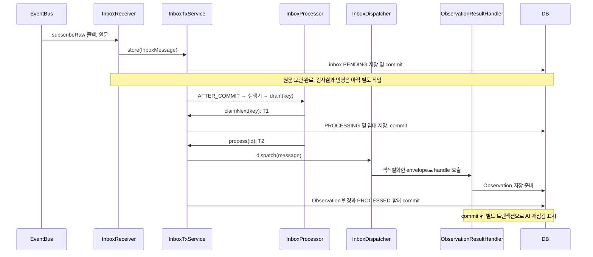
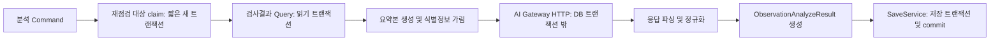

# 09. x-diagnostic-result — 이벤트가 검사결과가 되고 조회되는 과정

[목차](README.md) · [이전: 예약 소스 따라 읽기](08-patient-appointment-walkthrough.md) · [다음: 기능 개발과 디버깅](10-feature-development-and-debugging.md)

이 장에서는 **외부에서 받은 결과가 언제 Kotlin 객체가 되고, 언제 DB에 확정되며, HTTP 조회에 어떻게 나타나는지**를 실제 코드로 따라간다. 이어서 사용자 메모 저장과 AI API 응답 저장을 읽는다. 코드는 `x-diagnostic-result/backend/diagnostic-result` 모듈 기준이다. 아래 흐름은 소스에서 확인한 구현이며, 실제 환경의 Kafka 전달·DB 실행·외부 API 성공을 검증했다는 뜻은 아니다.

## 1. 먼저 서비스의 역할부터 구분한다

`diagnostic-result`는 여러 원천 BC가 만든 검사결과를 받아 환자 단위로 통합 조회하는 서비스다. `Observation`의 검사 수치·판독 결과를 사용자가 직접 생성하는 API는 없다. 사용자 메모, 뷰어 설정, 즐겨찾기, AI 분석 이력은 이 서비스가 직접 저장한다.

| 다루려는 업무 | 입력 경로 | 먼저 열 파일 |
|---|---|---|
| 검사결과 생성·변경·삭제 반영 | 외부 Kafka 이벤트 → inbox | [ReceivedEventsConfig][received], [ObservationResultHandler][result-handler] |
| 환자별 검사결과 조회 | `GET /api/v1/diagnostic-result/observations` | [ObservationsController][controller], [ObservationQueries][queries] |
| 결과별 개인 메모 저장 | `PUT /api/v1/diagnostic-result/observations/{observationId}/memo` | [RegisterObservationMemoCommandHandler][memo-handler] |
| AI 분석 생성 및 이력 저장 | `POST /api/v1/diagnostic-result/observation-analyze-results` | [AnalyzeObservationsByPatientCommandHandler][analysis-handler] |
| 원천 모듈의 기록 문서 보기 | `GET /api/v1/diagnostic-result/observations/{observationId}/record-document` | [RecordDocumentQueries][record-query] |

**이 서비스에는 업무 통합 이벤트를 Kafka로 발행하는 route가 없다.** [TopicRegistry][topics]에 등록되는 것은 수신 이벤트 목록이다. 코드의 `ApplicationEventPublisher.publishEvent(...)`를 발견해도 곧바로 Kafka 발행이라고 읽으면 안 된다. 예를 들어 `ObservationResultsChanged`는 같은 프로세스 안에서 AI 재점검 대상을 표시하기 위한 application 이벤트다.

상세 업무는 [business.md][business], 경계는 [overview.md][overview], 모델과 계약은 [클래스 다이어그램][design]을 참고한다. 설명과 구현이 다르게 보이면 현재 메서드와 호출자를 함께 확인한다. 예를 들어 업무 문서의 검사결과 전체 요약 설명에는 저장하지 않는다는 문장이 남아 있지만, 현재 [ResultSummarySaveService][summary-save]는 요약 이력을 저장한다.

## 2. Kafka 수신: 받았다는 것과 업무 반영은 두 단계다

### 2.1 전체 호출 순서



위 그림의 각 화살표는 다음 파일로 확인한다.

1. [ReceivedEventsConfig][received]가 토픽·payload 클래스·handler 클래스를 연결한다. 진단검사·병리·영상·기능·외부기록은 공용 `ObservationResultHandler`, 간호기록 그룹은 `ObservationRecordGroupHandler`가 받는다.
2. [EventBusSubscriptionInitializer.subscribe][subscription]가 토픽마다 `eventBus.subscribeRaw(...)`를 등록한다. **이 단계는 업무 DTO로 바인딩하지 않고 원문을 받는다.** 구독 등록 예외는 로그를 남기고 부팅을 계속하는 구현이므로 API가 살아 있다는 사실만으로 Kafka 구독 성공을 판정할 수 없다.
3. [InboxReceiver.receive][receiver]가 원문과 메타데이터로 `InboxMessage`를 만든다. `messageId`를 읽을 수 없으면 원문 해시를 대체 키로 사용한다. 잘못된 JSON도 원문 보관 대상이다.
4. [InboxTxService.store][inbox-tx]가 원문을 별도 트랜잭션으로 저장한다. 같은 `messageId`는 중복 적재하지 않는다. 수신 콜백의 책임은 이 보관까지이며, 코드는 여기서 반환한 뒤 라이브러리가 Kafka 수신을 확인하도록 구성한다.
5. 적재 commit 뒤 [InboxDrainTrigger][drain-trigger]가 실행기에 작업을 넘긴다. [InboxProcessor.drain][processor]은 다른 빈인 `InboxTxService`의 `claimNext` → `process`를 호출한다. 누락된 즉시 처리나 재시도는 [InboxSweeper][sweeper]도 다시 집는다.
6. `process` 안에서 [InboxDispatcher.dispatch][dispatcher]가 payload 타입을 선택하고 실제 업무 핸들러를 부른다.

### 2.2 바인딩은 정확히 언제 일어나는가

여기서는 하나의 “데이터 바인딩”이 아니라 서로 목적이 다른 변환을 구분해야 한다.

| 시점 | 입력 → 출력 | 해당 코드의 의미 |
|---|---|---|
| Kafka 콜백 | `RawMessage` → `InboxMessage` | 원문 보관. 아직 검사결과 객체가 아님 |
| inbox 처리 시작 | 원문 JSON → `MessageEnvelope<이벤트 타입>` | `InboxDispatcher`의 `objectMapper.readValue(...)`가 봉투와 payload를 역직렬화 |
| 업무 입력 검증 | 통합 이벤트 → `ObservationPayload` | [ObservationPayloadMapper][payload-mapper]가 필수값·UUID·시각·분류를 검증하고 도메인 입력값을 생성 |
| 기존 결과 읽기 | DB 행 → `Observation` 하위 객체 | [ObservationRepository.findObservationBySource][repository]의 QueryDSL 엔티티 조회를 Hibernate가 materialize |
| 업무 상태 변경 | `ObservationPayload` → Aggregate 프로퍼티 | [Observation.applySourceEvent][observation]가 명시적으로 값을 대입 |
| DB 반영 | Aggregate 변경 → SQL → commit | JPA 영속성 관리와 바깥 트랜잭션이 처리 |
| 화면 데이터 조회 | DB 컬럼 → `Tuple` → ViewModel → JSON | `ObservationQueries`의 조회·매핑 후 Controller 응답 직렬화 |

C# 관점에서는 JSON 역직렬화, DTO 변환, EF의 엔티티 materialization, 객체 프로퍼티 변경, 응답 DTO 생성이 각각 다른 작업인 것과 같다. 이 흐름에 화면의 양방향 데이터 바인딩은 없다.

`InboxDispatcher`는 실제로 다음처럼 타입을 확정한다. **실제 코드 일부 발췌**이며 앞뒤의 MDC 설정과 handler 호출은 생략했다.

```kotlin
val envelopeType = objectMapper.typeFactory.constructParametricType(
    MessageEnvelope::class.java, event.eventType.java
)
val envelope: MessageEnvelope<out IntegrationEvent> =
    objectMapper.readValue(message.payload, envelopeType)
```

`event.eventType`은 수신 토픽 카탈로그에서 고른 클래스다. 현재 inbox dispatcher는 **토픽을 기준으로 클래스와 handler를 선택**한다. 봉투의 `messageType`을 검사해 아무 클래스나 자동 검색하는 구조로 생각하면 안 된다.

### 2.3 DTO에 값이 들어왔다고 도메인이 갱신되지는 않는다

[ObservationResultHandler.handleInternal][result-handler]은 `eventType`이 `deleted`이면 삭제 경로로, 나머지는 적재 경로로 보낸다. 생성·수정은 같은 `upsertSource`를 사용한다.

```text
sourceAggregateId로 기존 Observation 찾기
    → 없으면 newObservation(분류, 새 UUID, scope)
    → applySourceEvent(원천 ID, 원천 버전, payload)
    → 실제 반영된 경우만 repository.save(target)
    → ObservationResultsChanged application 이벤트 전달
```

`newObservation`은 분류에 맞는 하위 Entity를 만든다. `Observation`은 JPA `JOINED` 상속을 사용하므로 부모 `observation` 행과 해당 자식 테이블 행이 같은 식별자를 공유한다. 진단검사와 병리는 `SpecimenDiagnosticsObservation` 하나를 쓰고 `observationTypeCode`로 구별한다.

값을 대입하는 지점은 `Observation.applySourceEvent`다. 다음은 **실제 코드의 연속되지 않은 일부를 모은 발췌**다.

```kotlin
this.patientId = payload.patientId
this.encounterId = payload.encounterId
payload.originEncounterId?.let { this.originEncounterId = it }
payload.orderId?.let { this.orderId = it }
payload.orderName?.let { this.orderName = it }
this.verifiedAt = payload.verifiedAt
applyDetail(payload)
```

- `this.patientId = ...`는 C# 프로퍼티 대입처럼 항상 교체한다.
- `payload.orderName?.let { ... }`는 값이 null이 아닐 때만 대입한다. 이 필드에서 null은 **기존 값을 지우라는 뜻이 아니라 미동봉**이다.
- 반면 `verifiedAt`은 null도 그대로 대입한다. 모든 nullable 프로퍼티의 갱신 의미가 같지 않다.
- `applyDetail(payload)`는 하위 타입의 수치·소견 등 세부 값을 적용한다. 필드를 추가할 때 공통 매퍼만 고치고 이 단계를 놓치면 DTO에는 값이 있어도 DB에는 반영되지 않는다.

### 2.4 원천 버전과 JPA 버전은 서로 다르다

| 값 | 해결하는 문제 | 확인할 곳 |
|---|---|---|
| inbox `messageId` | 동일 메시지 재전달로 같은 원문을 중복 보관하는 문제 | `InboxReceiver`, `InboxTxService.store` |
| `sourceAggregateId` + `sourceEventVersion` | 이미 반영한 결과 버전보다 같거나 오래된 이벤트가 다시 오는 문제 | `Observation.applySourceEvent`, `markDeleted` |
| Entity `version`의 `@Version` | 동일 DB 행을 여러 트랜잭션이 동시에 수정하는 문제 | [Entity][entity] |
| `InboxKey(topic, partitionKey)` | 같은 처리 키의 앞 메시지가 끝나기 전에 뒤 메시지가 처리되는 문제 | `InboxProcessor`, [InboxMessageRepository][inbox-repository] |

**이미 저장된 결과**에 대해서는 같은 버전이나 이전 버전의 upsert·delete를 무시한다. 그러나 `deleteSource`는 아직 없는 원천 ID의 삭제를 기록으로 남기지 않고 무시한다. 따라서 “삭제가 생성보다 먼저 처리돼도 모든 경우가 해결된다”는 보장은 이 코드만으로 할 수 없다. 같은 토픽·키의 순서와 발행측 계약을 함께 봐야 한다.

`markDeleted`는 행을 물리 삭제하지 않고 `isDeleted = true`로 만든다. 또한 현재 `applySourceEvent`에는 이 값을 다시 false로 만드는 코드가 없다. 삭제 이후의 더 높은 버전 upsert를 “자동 복원”으로 해석하지 않는다.

### 2.5 commit과 실패의 경계

`ObservationRepository.save`는 `jpa.save(aggregate)` 뒤 도메인 이벤트 dispatcher를 호출한다. 이것만으로 최종 commit을 끝내지 않는다. 수신 경로의 바깥 경계는 `InboxTxService.process`다. [IntegrationEventHandler.handle][event-handler]의 `@Transactional`은 이 트랜잭션에 합류한다.

- 성공하면 **Observation 변경과 inbox `PROCESSED`가 함께 commit**된다.
- 처리 중 예외가 나면 T2가 롤백된다. 이미 commit된 원문 inbox 행은 남는다.
- `InboxProcessor`가 예외를 받은 뒤 `markRetry`를 호출한다. 이 메서드는 `REQUIRES_NEW`로 실패 상태를 별도 저장한다. 깨진 JSON·필수값 오류처럼 영구 실패로 분류된 경우는 `FAILED`가 된다.
- 같은 키의 앞 행이 미완료 또는 FAILED이면 뒤 행은 기다린다. 다른 토픽·키까지 한꺼번에 막는 전역 순서가 아니다.
- 결과 commit 뒤 [AnalysisReviewTargetListener][review-listener]가 재점검 대상을 표시한다. 표시 쓰기는 [AnalysisReviewTargetWriteService][review-write]의 새 트랜잭션이다. 원래 결과 저장과 하나의 원자적 commit은 아니다.

`EventTenantResolver`의 수신 스코프도 확인한다. 현재 구현은 배포 테넌트가 설정되었으면 이를 우선하고, 봉투 값이 달라도 경고 후 배포값으로 처리한다. HTTP 조회는 토큰에서 얻은 스코프로 제한한다. 이벤트가 적재되었는데 API에서 보이지 않으면 [수신 스코프 해석][tenant-resolver]과 조회 토큰의 범위를 같이 확인한다.

## 3. DB 조회: fetch에서 읽고, ViewModel 생성에서 응답값을 정한다

[ObservationsController.searchObservationsByCategory][controller]는 환자 ID·기간·분류 등을 받은 뒤 `principal.toTenantScope()`와 함께 `IObservationQueries`를 호출한다. Spring이 생성자에 주입한 실제 구현은 [ObservationQueries][queries]다. 이 클래스에는 `@Transactional(readOnly = true)`가 붙는다.

`searchObservationsByCategory`의 핵심은 다음 한 줄이다. **실제 코드 발췌**다.

```kotlin
return toCategoryViews(
    categoryQuery().where(where).orderBy(o.resultDatetime.desc()).fetch()
)
```

읽는 순서는 다음과 같다.

1. `searchWhere` → `scopedWhere`: 테넌트·병원, 환자 ID, 삭제 제외, 분류, 기간 조건을 조립한다.
2. `categoryQuery`: 부모 결과와 하위 테이블들의 **필요 컬럼**을 선택한다. 이 시점의 QueryDSL 객체는 질의의 구성이다.
3. `fetch()`: 질의를 실행하고 `List<Tuple>`을 받는다. C#에서 `IQueryable`을 `ToList()`로 materialize하는 위치와 비교하면 이해하기 쉽다.
4. `toCategoryViews`: 조회된 진료의·처방의 ID를 모아 직원명을 한 번 조회한다.
5. `toCategoryView`: Tuple에서 값을 읽어 `ObservationCategoryViewModel(...)` 생성자에 넣는다. 여기의 Kotlin `map`·`let`·Elvis 연산자(`?:`)는 이미 가져온 객체를 조립하는 코드다.
6. Controller가 ViewModel 목록을 반환하면 Spring의 응답 직렬화가 JSON 본문을 만든다.

이 조회는 `Projections.constructor(...)`를 사용하는 예와 달리 **Tuple을 받은 뒤 Kotlin에서 ViewModel을 만든다.** 결과 유형마다 다른 컬럼을 하나의 `resultSummary`, 수치, 단위, flag로 합치는 규칙이 있기 때문이다. QueryDSL을 쓴다고 반드시 DTO 생성자 projection만 존재하는 것은 아니다.

### 조회를 수정할 때 놓치기 쉬운 세 곳

- 새 응답 필드는 **select 컬럼 → `toCategoryView` 대입 → ViewModel 프로퍼티**를 함께 확인한다. ViewModel에 필드만 추가한다고 DB 값이 자동 연결되지 않는다.
- 결과 본문처럼 긴 값은 목록에서 전부 읽지 않는다. 단건의 `findObservation`이 추가 `narrativeQuery`로 읽는다. 목록 화면의 필드 추가가 대용량 본문 일괄 조회로 바뀌지 않도록 본다.
- 직원 이름은 행마다 HTTP/DB로 조회하지 않고 ID 집합으로 읽는다. `findUserNames`의 일괄 조회 구조를 유지한다.

`Observation`은 진료과·직원 이름을 자체 스냅샷으로 저장하지 않는다. 진료과명은 읽기 전용 `shared` 매핑과 조인하고, 직원명은 ID 묶음으로 읽는다. 따라서 이벤트 수신값이 정상이어도 shared 데이터에 대응 행이 없으면 표시 이름은 null일 수 있다. 부모 결과의 tenant 조건과 shared 조인의 ID 조건은 서로 다른 역할이다.

시각도 조회 경계에서 변환한다. 저장값은 `Instant`, 수신 시각은 `OffsetDateTime`에서 `toInstant()`로 변환한다. 이 BC의 HTTP ViewModel은 `hospitalClock.toLocal(...)`로 병원 현지시각을 만든다. 따라서 API의 `LocalDateTime` 표현을 그대로 Kafka의 시각 계약으로 복사하지 않는다.

## 4. HTTP 쓰기: 개인 메모 한 건을 저장하며 Command 흐름 읽기

원천 검사결과 자체 수정과 구별해서, 소유권이 분명한 개인 메모를 쓰기 예제로 읽는다.

```text
PUT /observations/{observationId}/memo
  → SaveObservationMemoRequest(memoHtml)
  → request.toCommand(토큰 직원 ID, 경로 observationId)
  → CommandBus.send(scope, command)
  → RegisterObservationMemoCommandValidator
  → RegisterObservationMemoCommandHandler.handle [트랜잭션]
  → repository.requireObservation(scope, id)
  → observation.writeMemo(userId, memoHtml)
  → repository.save(observation)
  → handler 트랜잭션 commit
  → HTTP 204
```

[SaveObservationMemoRequest][memo-request]는 `data class`이고 `memoHtml` 하나만 받는다. `@RequestBody`를 처리할 때 요청 JSON이 이 객체가 된다. `userId`는 요청자가 지정하지 않고 Controller가 로그인 토큰에서 얻어 `toCommand` 인자로 전달한다. `observationId`는 URL 경로에서 온다. **세 값이 한 Command로 합쳐지는 곳은 자동 매퍼가 아니라 `toCommand` 함수다.**

[CommandBus][command-bus]는 커맨드 타입에 대응하는 validator들을 먼저 실행한 뒤 handler를 부른다. [RegisterObservationMemoCommandValidator][memo-validator]는 허용 HTML 서식과 길이, 평문 길이를 검사한다. 이 검증이 끝나야 handler에 진입한다.

[RegisterObservationMemoCommandHandler.handle][memo-handler]은 조회한 Aggregate에 `writeMemo`를 요청한다. 메모의 신규·수정·삭제 후 복원 여부는 `Observation.writeMemo`가 결정한다. 자식 `ObservationMemo`는 부모의 cascade 저장 대상이며, 평문 `memoText`는 도메인에서 HTML로부터 만든다. 클라이언트가 보내 준 평문을 그대로 믿고 저장하지 않는다.

여기서도 `save` 줄을 통과한 것과 commit 완료를 구분한다. 최종 flush·제약 검사에서 실패하면 Controller의 정상 204 응답까지 가지 못한다. 저장 후 값을 확인할 때는 `GET /observations/memos?patientId=...`를 읽는다. 이 조회는 토큰 사용자가 쓴 메모만 반환하고 삭제된 메모와 원천 삭제된 결과는 제외한다.

## 5. 외부 API 호출 → 결과 세팅 → 저장: AI 분석 흐름

이 사례는 일반 쓰기 handler와 달리 긴 외부 호출을 트랜잭션 밖으로 분리한다. **모든 handler에 무조건 긴 쓰기 트랜잭션을 둘 필요는 없으며, 이 예외는 실제 설계와 코드에 명시되어 있다.**



### 5.1 어디에서 어떤 값을 갖는가

| 파일·메서드 | 담당하는 일 | 읽을 값 |
|---|---|---|
| [AnalyzeObservationsByPatientCommandHandler.handle][analysis-handler] | 전체 순서 제어. `NOT_SUPPORTED`로 외부 호출 동안 트랜잭션을 두지 않음 | `claimed`, `onlyIfTarget` |
| [AnalysisDeliveryService.deliver][analysis-delivery] | 환자 결과 조회 → 요약본 → 마스킹 → 에이전트 호출 | `observations`, `digest`, `response` |
| [IAnalysisAgentPort][analysis-port] | application이 의존하는 외부 서비스 인터페이스 | `agent()`가 반환하는 `IAnalysisAgent` |
| [AiGatewayAnalysisAgent.complete][analysis-adapter] | `RestClient.post()`로 `/v2/chat/complete` 호출 | 원문 응답 `responseBody` |
| 같은 클래스의 `parseEnvelope` | 응답 JSON을 `GatewayEnvelope`로 해석 | `status`, `outputText`, `agents` |
| 같은 클래스의 `analyze` | 정규화한 분석 응답 반환 | `AnalysisAgentResponse` |
| handler의 생성자 호출 | 응답 필드를 새 `ObservationAnalyzeResult`에 명시적으로 세팅 | `summary`, `detail`, 에이전트 메타 |
| [ObservationAnalyzeResultSaveService.save][analysis-save] | 별도 빈의 짧은 쓰기 트랜잭션에서 저장 | 저장된 ID |

이 구현의 HTTP 클라이언트는 `RestClient`이고 동기 호출이다. Kotlin이라는 이유로 `suspend`나 C# `async/await`와 같은 비동기 실행이 자동으로 생기지 않는다. `complete`의 응답 본문 읽기와 `parseEnvelope`를 지나야 분석 응답이 준비된다.

또한 외부 API 응답이 곧바로 엔티티가 되는 것이 아니다. **원문 → Gateway 봉투 → 정규화한 분석 응답 → 새 Aggregate 생성 → repository 저장**이라는 명시적인 경계를 지난다. API 응답에 필드가 추가되었을 때 어느 경계에서 버려지는지 이 순서로 찾는다.

### 5.2 commit과 실패를 읽는 법

- `onlyIfTarget = true`인데 가져갈 대상이 없으면 분석 없이 null을 반환한다. 해당 Controller는 이를 204로 처리한다.
- 검사결과가 0건이면 AI 호출도 이력 저장도 하지 않는다.
- AI 호출 전에 대상을 claim하므로 호출 도중 새 결과가 들어오면 다시 재점검 대상으로 표시할 수 있다.
- AI 또는 이력 저장이 실패하면 가져갔던 대상을 다시 표시하고 예외를 던진다.
- AI 호출이 성공한 뒤 DB 저장이 실패해도 이미 완료된 원격 실행은 취소되지 않는다. 재시도는 외부 실행을 다시 일으킬 수 있다. 원격 처리와 로컬 저장을 하나의 ACID 트랜잭션으로 보장하는 코드가 아니다.
- `SaveService`를 별도 빈으로 둔 이유는 Spring 트랜잭션 프록시를 거치게 하기 위해서다. 같은 handler 안의 private 저장 함수에 애노테이션만 붙이는 것으로 같은 효과를 만들 수는 없다.

인증은 현재 HTTP 요청의 사용자 Bearer 토큰을 전달한다. 토큰·환자 식별정보·원문 결과를 디버그 출력이나 문서 예시에 복사하지 않는다. 이 흐름은 [AnalysisDeliveryServiceTest][analysis-test], [AiGatewayAnalysisAgentTest][adapter-test], [PersonalInfoMaskingTest][masking-test]를 함께 읽으면 입력 조립과 외부 응답 처리의 분리가 보인다.

## 6. 외부 API로 읽어 왔지만 저장하지 않는 예: 기록 문서

[RecordDocumentQueries.findRecordDocument][record-query]는 자기 DB에서 `observationTypeCode`, `recordId`만 읽고, [IRecordDocumentPort][record-port]에 HTML 요청을 위임한 뒤 `RecordDocumentViewModel`로 반환한다. [RecordDocumentHttpAdapter][record-adapter]가 원천 모듈에 GET 요청을 보낸다.

이 흐름에는 `repository.save`가 없다. 외부 API의 값을 화면 응답에 넣었다고 언제나 로컬 DB에 저장되는 것은 아니다. 설계에서 `recordId`만 보관하고 HTML은 조회할 때 중계하기로 정한 사례다. 원천 주소가 설정되지 않으면 서식 조회는 503이 될 수 있다. 이를 결과 적재 실패나 결과 목록 조회 실패와 구별한다.

## 7. 디버깅할 때의 정지점과 질문

| 현상 | 순서대로 멈출 위치 | 확인할 질문 |
|---|---|---|
| Kafka 이벤트가 안 보임 | `EventBusSubscriptionInitializer.subscribe` → `InboxReceiver.receive` | 구독 등록이 실패했는가? namespace·토픽이 상대와 같은가? |
| inbox에 있지만 결과 없음 | `InboxTxService.process` → `InboxDispatcher.dispatch` → mapper | 앞 행 대기인가? 역직렬화인가? 필수 ID·시각 검증인가? |
| 재전송했는데 결과 그대로 | `Observation.applySourceEvent` | `sourceEventVersion`이 같거나 낮아 false인가? |
| 이벤트 필드는 있는데 저장값 없음 | `toObservationPayload` → `applySourceEvent` → 하위 `applyDetail` | 각 변환에 필드를 연결했는가? null을 미동봉으로 처리하는가? |
| 저장됐는데 목록에서 없음 | `ObservationQueries.searchWhere` / `scopedWhere` | tenant·병원·환자·기간 기준·분류·삭제 조건 중 어디서 제외되는가? |
| 조회값은 있는데 HTTP 필드가 없음 | `categoryColumns` → `toCategoryView` → ViewModel | select와 대입이 모두 있는가? |
| 메모 저장이 거절됨 | validator → handler → `Observation.writeMemo` | 형식 오류인가? 결과가 원천 삭제 상태인가? |
| AI 응답은 있는데 이력 없음 | `complete` → `analyze` → `resultSaver.save` | 응답 상태·정규화가 실패했는가? 최종 저장 commit이 실패했는가? |

실제 환자 데이터 대신 승인된 개발용 데이터로 흐름을 확인한다. 객체 전체를 로그로 남기기보다 상태·버전·분기 여부를 디버거에서 최소한으로 확인한다. DB 확인은 프로젝트 규칙대로 앱 로그와 HTTP 조회를 사용한다.

## 8. 이 레포에서 기능을 추가할 때의 읽기 순서

**수신 결과 필드 하나 추가**라면 먼저 [클래스 다이어그램][design]과 상대 BC의 payload 계약을 확인하고, `ObservationResultIntegrationEvent` → `ObservationPayloadMapper` → `ObservationPayload` → 해당 하위 Entity의 `applyDetail` → Liquibase 매핑 → `ObservationQueries` → ViewModel 순으로 영향 범위를 찾는다. 분류·원천마다 의미가 다르면 공통 필드인지 자식 필드인지 먼저 정한다. DB 컬럼을 보강하는 새 changelog와 조회·변환 검증까지 기능 작업 범위다.

**새 사용자 명령**이라면 Request → Command → Validator → Handler → Aggregate 메서드 → Repository 순서로 읽는다. 명령 타입과 handler·validator 연결은 `CommandWiringTest`, 레이어 참조는 `LayerIsolationTest`가 확인한다. 메모처럼 부모 Aggregate가 소유하는 자식은 별도 repository를 먼저 만드는 대신 부모의 규칙으로 변경하는 구조를 따른다.

**새 수신 토픽**이라면 payload 클래스만 만들어서는 수신되지 않는다. 발행측 계약과 분류를 정한 뒤 `ReceivedEventsConfig`에 토픽·partition key·클래스·handler를 등록하고 라우팅·테넌트·inbox 처리를 함께 검증한다. 현재 dispatcher의 토픽별 분배 방식이 새 계약에도 맞는지 확인한다.

다음 테스트들은 소스 흐름을 이해할 때 함께 읽을 수 있다. 여기서는 테스트 결과를 주장하지 않고 **위치와 실행 예시**를 제공한다.

| 확인할 성질 | 테스트 |
|---|---|
| 수신 라우팅·partition key | [ResultEventRoutingTest][routing-test] |
| 삭제 버전·환자 변경 | [ObservationDeleteVersionTest][delete-test], [ObservationPatientChangeTest][patient-test] |
| inbox 원문·재시도·순서 | [InboxReceiverTest][receiver-test], [InboxFlowTest][inbox-test] |
| 간호기록 그룹을 항목으로 펼치기 | [ObservationRecordGroupInboxTest][group-test] |
| 조회 기간·shared 조인 | [ObservationDateBasisQueryTest][date-test], [SharedJoinQueryTest][join-test] |
| 사용자 메모 규칙·조회 | [ObservationMemoRulesTest][memo-test], [ObservationMemoQueryTest][memo-query-test] |
| AI 자료 조립·응답 변환 | [AnalysisDeliveryServiceTest][analysis-test], [AiGatewayAnalysisAgentTest][adapter-test] |

`x-diagnostic-result/backend`에서 실행하는 예다. 처음에는 관련 테스트를 고르고, 기능 작업의 최종 검증은 레포 지침에 따라 전체 빌드까지 수행한다.

```bash
./gradlew :diagnostic-result:test --tests '*ObservationDeleteVersionTest' --tests '*ObservationMemoRulesTest'
./gradlew :diagnostic-result:test --tests '*InboxFlowTest' --tests '*AnalysisDeliveryServiceTest'
./gradlew build
```

이 모듈의 테스트에는 DB 없이 QueryDSL·Hibernate 메타데이터를 검사하는 테스트도 있다. 그런 테스트의 통과는 실제 DB commit이나 Kafka 왕복 전달의 검증과 구별한다.

[목차로 돌아가기](README.md) · [다음: 기능 개발과 디버깅](10-feature-development-and-debugging.md)

[business]: ../../../x-diagnostic-result/_docs/business.md
[overview]: ../../../x-diagnostic-result/_docs/overview.md
[design]: ../../../x-diagnostic-result/_docs/design/diagnostic-result.classdiagram.md
[received]: ../../../x-diagnostic-result/backend/diagnostic-result/src/main/kotlin/com/projectx/diagnosticresult/infrastructure/eventbus/ReceivedEventsConfig.kt
[topics]: ../../../x-diagnostic-result/backend/diagnostic-result/src/main/kotlin/com/projectx/diagnosticresult/infrastructure/eventbus/TopicRegistry.kt
[subscription]: ../../../x-diagnostic-result/backend/diagnostic-result/src/main/kotlin/com/projectx/diagnosticresult/infrastructure/eventbus/EventBusSubscriptionInitializer.kt
[receiver]: ../../../x-diagnostic-result/backend/diagnostic-result/src/main/kotlin/com/projectx/diagnosticresult/infrastructure/inbox/InboxReceiver.kt
[inbox-tx]: ../../../x-diagnostic-result/backend/diagnostic-result/src/main/kotlin/com/projectx/diagnosticresult/infrastructure/inbox/InboxTxService.kt
[drain-trigger]: ../../../x-diagnostic-result/backend/diagnostic-result/src/main/kotlin/com/projectx/diagnosticresult/infrastructure/inbox/InboxDrainTrigger.kt
[processor]: ../../../x-diagnostic-result/backend/diagnostic-result/src/main/kotlin/com/projectx/diagnosticresult/infrastructure/inbox/InboxProcessor.kt
[sweeper]: ../../../x-diagnostic-result/backend/diagnostic-result/src/main/kotlin/com/projectx/diagnosticresult/infrastructure/inbox/InboxSweeper.kt
[dispatcher]: ../../../x-diagnostic-result/backend/diagnostic-result/src/main/kotlin/com/projectx/diagnosticresult/infrastructure/inbox/InboxDispatcher.kt
[inbox-repository]: ../../../x-diagnostic-result/backend/diagnostic-result/src/main/kotlin/com/projectx/diagnosticresult/infrastructure/inbox/InboxMessageRepository.kt
[result-handler]: ../../../x-diagnostic-result/backend/diagnostic-result/src/main/kotlin/com/projectx/diagnosticresult/application/integrationevents/eventhandling/ObservationResultHandler.kt
[event-handler]: ../../../x-diagnostic-result/backend/diagnostic-result/src/main/kotlin/com/projectx/diagnosticresult/application/integrationevents/eventhandling/IntegrationEventHandler.kt
[tenant-resolver]: ../../../x-diagnostic-result/backend/diagnostic-result/src/main/kotlin/com/projectx/diagnosticresult/application/integrationevents/eventhandling/EventTenantResolver.kt
[payload-mapper]: ../../../x-diagnostic-result/backend/diagnostic-result/src/main/kotlin/com/projectx/diagnosticresult/application/integrationevents/eventhandling/ObservationPayloadMapper.kt
[repository]: ../../../x-diagnostic-result/backend/diagnostic-result/src/main/kotlin/com/projectx/diagnosticresult/infrastructure/repositories/ObservationRepository.kt
[observation]: ../../../x-diagnostic-result/backend/diagnostic-result/src/main/kotlin/com/projectx/diagnosticresult/domain/aggregatesmodel/observation/Observation.kt
[entity]: ../../../x-diagnostic-result/backend/diagnostic-result/src/main/kotlin/com/projectx/diagnosticresult/domain/seedwork/Entity.kt
[controller]: ../../../x-diagnostic-result/backend/diagnostic-result/src/main/kotlin/com/projectx/diagnosticresult/presentation/ObservationsController.kt
[queries]: ../../../x-diagnostic-result/backend/diagnostic-result/src/main/kotlin/com/projectx/diagnosticresult/infrastructure/queries/ObservationQueries.kt
[memo-request]: ../../../x-diagnostic-result/backend/diagnostic-result/src/main/kotlin/com/projectx/diagnosticresult/presentation/SaveObservationMemoRequest.kt
[memo-handler]: ../../../x-diagnostic-result/backend/diagnostic-result/src/main/kotlin/com/projectx/diagnosticresult/application/commands/observation/RegisterObservationMemoCommandHandler.kt
[memo-validator]: ../../../x-diagnostic-result/backend/diagnostic-result/src/main/kotlin/com/projectx/diagnosticresult/application/validations/observation/RegisterObservationMemoCommandValidator.kt
[command-bus]: ../../../x-diagnostic-result/backend/diagnostic-result/src/main/kotlin/com/projectx/diagnosticresult/application/commands/CommandBus.kt
[analysis-handler]: ../../../x-diagnostic-result/backend/diagnostic-result/src/main/kotlin/com/projectx/diagnosticresult/application/commands/observationanalyzeresult/AnalyzeObservationsByPatientCommandHandler.kt
[analysis-delivery]: ../../../x-diagnostic-result/backend/diagnostic-result/src/main/kotlin/com/projectx/diagnosticresult/application/services/AnalysisDeliveryService.kt
[analysis-save]: ../../../x-diagnostic-result/backend/diagnostic-result/src/main/kotlin/com/projectx/diagnosticresult/application/services/ObservationAnalyzeResultSaveService.kt
[review-listener]: ../../../x-diagnostic-result/backend/diagnostic-result/src/main/kotlin/com/projectx/diagnosticresult/application/services/AnalysisReviewTargetListener.kt
[review-write]: ../../../x-diagnostic-result/backend/diagnostic-result/src/main/kotlin/com/projectx/diagnosticresult/application/services/AnalysisReviewTargetWriteService.kt
[summary-save]: ../../../x-diagnostic-result/backend/diagnostic-result/src/main/kotlin/com/projectx/diagnosticresult/application/services/ResultSummarySaveService.kt
[analysis-port]: ../../../x-diagnostic-result/backend/diagnostic-result/src/main/kotlin/com/projectx/diagnosticresult/application/ports/IAnalysisAgentPort.kt
[analysis-adapter]: ../../../x-diagnostic-result/backend/diagnostic-result/src/main/kotlin/com/projectx/diagnosticresult/infrastructure/proxies/AiGatewayAnalysisAgent.kt
[record-query]: ../../../x-diagnostic-result/backend/diagnostic-result/src/main/kotlin/com/projectx/diagnosticresult/infrastructure/queries/RecordDocumentQueries.kt
[record-port]: ../../../x-diagnostic-result/backend/diagnostic-result/src/main/kotlin/com/projectx/diagnosticresult/application/ports/IRecordDocumentPort.kt
[record-adapter]: ../../../x-diagnostic-result/backend/diagnostic-result/src/main/kotlin/com/projectx/diagnosticresult/infrastructure/proxies/RecordDocumentHttpAdapter.kt
[routing-test]: ../../../x-diagnostic-result/backend/diagnostic-result/src/test/kotlin/com/projectx/diagnosticresult/integrationevents/ResultEventRoutingTest.kt
[delete-test]: ../../../x-diagnostic-result/backend/diagnostic-result/src/test/kotlin/com/projectx/diagnosticresult/integrationevents/ObservationDeleteVersionTest.kt
[patient-test]: ../../../x-diagnostic-result/backend/diagnostic-result/src/test/kotlin/com/projectx/diagnosticresult/integrationevents/ObservationPatientChangeTest.kt
[receiver-test]: ../../../x-diagnostic-result/backend/diagnostic-result/src/test/kotlin/com/projectx/diagnosticresult/inbox/InboxReceiverTest.kt
[inbox-test]: ../../../x-diagnostic-result/backend/diagnostic-result/src/test/kotlin/com/projectx/diagnosticresult/inbox/InboxFlowTest.kt
[group-test]: ../../../x-diagnostic-result/backend/diagnostic-result/src/test/kotlin/com/projectx/diagnosticresult/inbox/ObservationRecordGroupInboxTest.kt
[date-test]: ../../../x-diagnostic-result/backend/diagnostic-result/src/test/kotlin/com/projectx/diagnosticresult/persistence/ObservationDateBasisQueryTest.kt
[join-test]: ../../../x-diagnostic-result/backend/diagnostic-result/src/test/kotlin/com/projectx/diagnosticresult/persistence/SharedJoinQueryTest.kt
[memo-test]: ../../../x-diagnostic-result/backend/diagnostic-result/src/test/kotlin/com/projectx/diagnosticresult/memo/ObservationMemoRulesTest.kt
[memo-query-test]: ../../../x-diagnostic-result/backend/diagnostic-result/src/test/kotlin/com/projectx/diagnosticresult/persistence/ObservationMemoQueryTest.kt
[analysis-test]: ../../../x-diagnostic-result/backend/diagnostic-result/src/test/kotlin/com/projectx/diagnosticresult/analysis/AnalysisDeliveryServiceTest.kt
[adapter-test]: ../../../x-diagnostic-result/backend/diagnostic-result/src/test/kotlin/com/projectx/diagnosticresult/proxies/AiGatewayAnalysisAgentTest.kt
[masking-test]: ../../../x-diagnostic-result/backend/diagnostic-result/src/test/kotlin/com/projectx/diagnosticresult/analysis/PersonalInfoMaskingTest.kt
