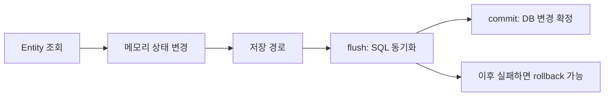

# 6. 조회한 객체를 바꾸면 언제 DB가 바뀌는가

[이전: 페이징과 집계](05-pagination-and-aggregation.md) · [목차](README.md) · [다음: 외부 데이터 조회](07-external-data-patterns.md)

같은 `name` 값을 조회해도 **어떤 객체로 받았는지**에 따라 수정의 의미가 달라진다. 이 장은 “조회 결과를 수정했는데 저장되지 않는다”, “조회만 했는데 UPDATE가 실행된다”, “다시 조회했는데 값이 그대로다”를 설명하는 패턴이다.

예제의 `Item`은 `id: UUID`, `name: String`, `active: Boolean`, `version: Long?`, `tenantId`, `hospitalCode`를 가진 설명용 JPA Entity다. `ItemView`는 scalar 값만 담는 DTO다. C#은 EF Core, Kotlin은 Spring Data JPA와 QueryDSL을 비교한다. import·빈 등록·Entity 매핑은 생략했으며 실행 가능한 전체 프로그램은 아니다. `scope`는 서버에서 확인한 접근 범위이고 `itemNotFound()`·`versionConflict()`는 프로젝트의 오류 처리로 연결할 설명용 함수다.

`q`는 `QItem.item`이다. 이 장의 `inScope(q._super, scope)`는 Item이 프로젝트 공통 Entity 베이스를 상속한다고 가정한 필수 범위 조건이며, 앞 장의 `scopeCondition(scope)`와 같은 역할이다.

## 6.1 패턴: 응답 모양만 바꾸려면 DTO를 바꾼다

**문제:** 조회한 이름에 표시용 접두사를 붙이고 싶다. 이 수정은 DB에 저장되어야 할까?

### C#에서 익숙한 코드

```csharp
// 설명용: ItemView는 record ItemView(Guid Id, string Name)
var dto = await db.Items
    .Where(x => x.TenantId == scope.TenantId &&
                x.HospitalCode == scope.HospitalCode && x.Id == id)
    .Select(x => new ItemView(x.Id, x.Name))
    .SingleOrDefaultAsync();

var display = dto is null ? null : dto with { Name = "표시: " + dto.Name };
```

### 같은 목적의 Kotlin 코드

```kotlin
// 설명용: ItemView는 data class ItemView(val id: UUID, val name: String)
val dto = queryFactory
    .select(Projections.constructor(ItemView::class.java, q.id, q.name))
    .from(q)
    .where(inScope(q._super, scope), q.id.eq(id))
    .fetchOne()

val display = dto?.copy(name = "표시: " + dto.name)
```

| 코드 | 일어나는 일 | DB 쓰기 |
|---|---|---|
| `select(... q.id, q.name)` | 필요한 컬럼과 DTO 생성 방법을 지정 | 없음 |
| `fetchOne()` | SQL 실행 후 컬럼값으로 DTO 생성 | 이 예제 자체에는 없음 |
| `dto?.copy(...)` | DTO가 있으면 표시값을 바꾼 새 객체 생성 | 없음 |
| HTTP 응답 직렬화 | DTO를 JSON으로 표현 | 없음 |

예를 들어 DB 이름이 `Alpha`라면 응답용 객체는 `표시: Alpha`가 되지만 DB는 `Alpha`다. DTO는 Entity와 같은 id를 갖더라도 자동으로 DB 추적 대상이 되지 않는다.

여기서 중요한 조건은 **DTO 안에 Entity 자체가 아닌 scalar 값만 넣었다**는 것이다. DTO가 `Item` 참조를 포함하면 그 안의 Entity가 추적 대상일 수 있다. C#에서도 Entity를 포함하는 projection은 내부 Entity의 추적 여부를 따로 생각한다. [EF Core 추적 문서](https://learn.microsoft.com/en-us/ef/core/querying/tracking).

**선택 기준:** 표시명, 조합한 문장, 외부 이름 보충처럼 응답만 가공할 때 사용한다. 영속 상태를 변경할 목적이면 다음 패턴으로 간다.

## 6.2 패턴: 저장할 변경은 Entity를 읽어 업무 메서드로 적용한다

**문제:** 사용자가 이름을 바꾸었고 이후 조회에서도 새 이름이 나와야 한다.

### C# — 추적 조회와 명시적 트랜잭션

```csharp
// 설명용: 추적이 켜진 DbContext, 실제 프로젝트의 오류·트랜잭션 배선은 생략
await using var tx = await db.Database.BeginTransactionAsync();
var item = await db.Items.SingleOrDefaultAsync(x =>
    x.TenantId == scope.TenantId &&
    x.HospitalCode == scope.HospitalCode && x.Id == command.Id)
    ?? throw ItemNotFound();

item.ChangeName(command.Name);
await db.SaveChangesAsync();
await tx.CommitAsync();
```

### Kotlin — 같은 변경 의도와 선언적 트랜잭션

```kotlin
// 설명용: Spring이 관리하는 Handler의 메서드를 프록시를 통해 호출한다.
@Transactional
fun handle(command: ChangeItemName, scope: TenantScope) {
    val item = repository.findById(scope, command.id) ?: throw itemNotFound()
    item.changeName(command.name)
    repository.save(item)
}
```

C# 예제에서 트랜잭션을 명시한 것은 `SaveChangesAsync()`와 `CommitAsync()`의 위치를 분리해 보여 주기 위해서다. Kotlin 예제에서는 트랜잭션 프록시가 그 경계를 맡는다. Kotlin 코드에 수동 commit을 추가하라는 뜻이 아니다.

1. `findById`는 해당 scope의 Entity를 읽는다. 같은 트랜잭션의 영속성 컨텍스트에서 관리되는 객체가 된다.
2. `changeName`은 메모리의 Entity 상태를 바꾼다. 필요한 업무 검증도 이 메서드가 수행한다.
3. `repository.save`는 이 프로젝트의 저장 어댑터를 호출한다. 어댑터는 JPA 저장 외에 이벤트 처리나 flush를 포함할 수 있다.
4. 최외곽 트랜잭션이 정상 완료되면 변경이 commit된다. 프록시 밖 호출자에게 정상 반환되기 전에 commit 오류가 발생할 수도 있다.

C#에서 ChangeTracker가 수정 Entity를 기억하듯 JPA의 **영속성 컨텍스트**도 관리 객체를 추적한다. 메모리의 변경을 찾아내는 것이 dirty checking이며, flush 때 필요한 SQL로 동기화한다. 다만 프로젝트 Repository가 이벤트 처리까지 맡으므로 “이미 managed이니 save 호출은 모두 삭제해도 된다”로 일반화하지 않는다.

**선택 기준:** 영속 데이터를 변경할 때는 응답 DTO의 값을 임의로 Entity 전체에 덮기보다 필요한 입력으로 기존 Entity를 읽고 명시적 업무 메서드를 호출한다.

## 6.3 패턴: 조회 결과의 객체 상태부터 확인한다

| 객체 상태 | 어떻게 생기는가 | 프로퍼티를 바꾸면 |
|---|---|---|
| 새 Entity | `Item(...)` 또는 팩터리 호출 | 객체만 바뀜. 영속화 경로가 필요 |
| managed Entity | 현재 컨텍스트에서 로딩하거나 `persist` | 쓰기 트랜잭션의 변경 감지 대상 |
| detached Entity | 관리하던 컨텍스트 종료·detach 등 | 변경만으로 현재 DB에 자동 반영되지 않음 |
| scalar DTO | 컬럼 projection·매퍼·외부 JSON | DTO만 바뀜 |

`val item`이라는 선언은 이 네 상태를 판별하지 않는다. `val`은 변수 참조를 다른 객체로 바꾸지 못하게 할 뿐이다. `item.changeName(...)`으로 내부 상태는 바뀔 수 있다.

Spring 주입 필드의 `EntityManager`는 요청마다 직접 생성하는 `DbContext` 코드와 모양이 다를 수 있다. 주입된 참조와 **그 호출에서 사용하는 영속성 컨텍스트의 수명**을 구분한다. Entity를 singleton 필드나 요청 사이의 저장소에 보관해 계속 수정하는 패턴으로 확대하지 않는다.

### persist와 merge를 구분하는 이유

```kotlin
// JPA 동작을 설명하는 축약 예제. 실제 업무는 프로젝트 Repository를 사용한다.
entityManager.persist(newItem)         // 새 객체를 관리 대상으로 등록
val managed = entityManager.merge(detachedItem) // 상태를 관리 객체로 병합
managed.changeName("Beta")            // 반환된 관리 객체를 다룸
```

`merge`는 전달한 detached 객체의 참조를 그대로 “추적 켜기”로 바꾸는 것과 다르다. 상태를 관리 객체에 복사하고 그 관리 객체를 반환할 수 있다. 따라서 반환값을 무시한 채 원래 객체를 계속 수정하면 기대와 어긋날 수 있다.

Spring Data의 `save`는 신규 판정에 따라 `persist` 또는 `merge`를 선택한다. nullable `@Version` 프로퍼티를 가진 기본 판정에서는 `version == null`이면 새 객체로 본다. id를 이미 발급했어도 신규일 수 있다는 뜻이다. 이 규칙은 별도 `Persistable` 등 사용자 정의 판정이 없는 경우에 해당한다. [Spring Data JPA 저장 설명](https://docs.spring.io/spring-data/jpa/reference/jpa/entity-persistence.html).

**선택 기준:** id가 있다는 사실만으로 이미 저장됐다고 판단하지 않는다. 새 Entity인지, 현재 관리 중인지, 저장 반환본이 다른 객체인지 확인한다.

## 6.4 패턴: save·flush·commit을 시간 순서로 읽는다

조회 시 DB 값이 `Alpha`, 변경값이 `Beta`라고 하자. 다음은 같은 쓰기 트랜잭션 안에서의 시간표다.

| 시점 | 메모리 객체 | DB 동작 | 이후 rollback 가능 여부 |
|---|---|---|---|
| 조회 완료 | `Alpha` | SELECT | 가능 |
| `changeName("Beta")` | `Beta` | 아직 UPDATE가 나가지 않았을 수 있음 | 가능 |
| `save` | `Beta` | 저장 구현에 따라 SQL 시점이 다름 | 가능 |
| `flush` | `Beta` | 필요한 INSERT·UPDATE·DELETE 동기화 | 가능 |
| 최외곽 commit 성공 | `Beta` | 트랜잭션 확정 | 그 트랜잭션을 뒤늦게 rollback할 수 없음 |



flush는 한 Entity만을 대상으로 하는 호출이라고 생각하면 안 된다. 같은 영속성 컨텍스트에 쌓인 다른 변경도 동기화 대상이 될 수 있다. 그래서 저장 함수 안의 `saveAndFlush(item)`에서 다른 변경의 제약 위반이 함께 드러날 수 있다.

`saveAndFlush`를 호출하면 SQL을 내보내도록 동기화하지만 외곽 트랜잭션을 끝내지는 않는다. 새 version을 응답에 넣어야 할 때 유용한 구현이지만, 매 행마다 flush하면 묶음 처리의 이점이 줄 수 있다. 모든 저장을 같은 방식으로 바꾸지 않는다.

**선택 기준:** SQL 실행·제약 확인·version 갱신이 메서드 반환 전에 필요한지 구분한다. 최종 저장 성공은 최외곽 commit 경계에서 판단한다.

## 6.5 패턴: 변경 뒤 SELECT가 먼저 UPDATE를 일으킬 수 있다

**문제:** 아직 commit하지 않았는데 조회 함수에서 UPDATE 로그가 보인다.

```kotlin
// 설명용: 이미 쓰기 트랜잭션 안에 있다.
val item = repository.findById(scope, id) ?: throw itemNotFound()
item.changeName("Beta")

val names = queryFactory.select(q.name).from(q)
    .where(inScope(q._super, scope), q.name.eq("Beta"))
    .fetch()
```

메모리만 보면 `Beta`지만 DB는 아직 `Alpha`일 수 있다. DB 조건 `name = 'Beta'`를 정확히 평가하려면 미반영 변경을 먼저 동기화해야 한다. Hibernate의 AUTO flush는 쿼리와 대기 중인 변경의 관계 등에 따라 조회 전에 flush할 수 있다. **모든 SELECT 전 무조건 flush하는 것은 아니며**, flush mode·트랜잭션·쿼리 방식의 영향을 받는다. [Hibernate flush 설명](https://docs.hibernate.org/orm/7.1/userguide/html_single/#flushing).

따라서 읽기 코드의 `fetch()`에서 오류가 났더라도 원인은 앞서 변경한 객체의 제약 위반일 수 있다. 읽기 함수만 보지 말고 같은 트랜잭션의 선행 변경을 확인한다.

이 프로젝트의 기준은 같은 트랜잭션에서 쓰기 뒤 QueryDSL 조회의 정합성이 필요하면 적절한 경계에서 명시적으로 flush하는 것이다. `flush`를 쓴다고 commit되는 것은 아니다. 또한 `flush`는 **내 변경을 DB로 보내는 동작**이며 다른 트랜잭션의 최신값을 내 객체로 새로 읽는 동작이 아니다.

**선택 기준:** “내 변경이 SQL 조건에 반영되어야 하는가”를 먼저 판단한다. 다른 요청의 최신값을 읽는 문제는 다음 패턴으로 구분한다.

## 6.6 패턴: 같은 id를 재조회해도 새 객체·최신값이 아닐 수 있다

**문제:** 이미 조회한 객체를 다른 요청이 수정했는데 다시 조회해도 내 객체는 이전 값이다.

```kotlin
// 설명용: 동일 영속성 컨텍스트 안의 Entity 조회
val first = repository.findById(scope, id)
val second = repository.findById(scope, id)
// 두 조회가 모두 존재하는 동일 Entity를 반환하면 같은 관리 인스턴스를 쓸 수 있다.
```

영속성 컨텍스트는 Entity의 정체성을 관리한다. 조회가 SQL을 실행하더라도 이미 관리 중인 객체를 무조건 DB 값으로 덮어쓰는 “새로고침”으로 이해하면 안 된다. EF Core 추적 조회에서도 같은 키의 기존 인스턴스를 재사용하는 상황을 떠올릴 수 있다.

| 원하는 것 | 고려할 방식 | 주의 |
|---|---|---|
| 응답으로 받은 값을 다시 표시 | DTO 사용 | DB 재조회 자체가 필요 없는 경우 |
| 다음 사용자 요청에서 저장값 읽기 | 새 요청의 조회 경로·새 컨텍스트 | DB 격리·복제 지연도 확인 |
| 관리 Entity를 DB 상태로 덮어 읽기 | 필요성이 검토된 `refresh` | 미저장 변경을 잃을 수 있음 |
| 대기 변경을 SQL로 보내기 | `flush` | 최신값 로딩과 다름 |

`clear()`로 컨텍스트를 비우는 것을 일반적인 새로고침 요령으로 쓰지 않는다. 추적 중인 변경을 잃거나 이후 저장 동작을 바꿀 수 있다. 먼저 조회의 목적과 트랜잭션 범위를 줄이는 설계를 검토한다.

같은 DB 트랜잭션에서도 격리 수준에 따라 읽을 수 있는 다른 트랜잭션의 commit이 다르다. “재조회했다”는 사실만으로 실시간 최신성을 약속하지 않는다.

## 6.7 패턴: 관계 데이터는 접근 시점까지 조회가 미뤄질 수 있다

```kotlin
// 설명용: Item의 details가 LAZY 관계라고 가정
val item = repository.findById(scope, id) ?: throw itemNotFound()
val labels = item.details.map { it.label } // 여기서 추가 SELECT가 발생할 수 있음
```

첫 조회는 `Item`을 만들고 자식 목록은 지연 로딩된 상태일 수 있다. `map`이라는 Kotlin 문법이 SQL을 만드는 것이 아니라, `item.details` 접근이 Hibernate 로딩을 촉발할 수 있는 것이다.

컨텍스트가 닫힌 뒤 초기화되지 않은 관계를 읽으면 실패할 수 있다. 반대로 열린 컨텍스트에서 목록마다 관계를 읽으면 N+1이 생길 수 있다. API가 Entity를 그대로 직렬화하지 않고 **조회 경계 안에서 필요한 값을 DTO로 구성**하는 이유 중 하나다. 관계 조회 선택은 [4장](04-join-and-batch-patterns.md)에서 다룬다.

`@Transactional(readOnly = true)`는 EF Core의 `AsNoTracking()`을 그대로 옮긴 표시가 아니다. 조회용 트랜잭션 정책이며 DTO 변환도 자동 수행하지 않는다. 내부에서 Entity를 읽을 수 있고, provider 설정에 따라 flush·변경 감지 최적화가 적용될 수 있다. 이 선언을 DB 쓰기 금지 보안 장치로 간주하지 말고 조회 경로에서 업무 변경을 하지 않는다.

## 6.8 패턴: commit은 가장 바깥 트랜잭션을 찾아 판단한다

```text
외곽 메서드: @Transactional
  → 내부 Handler: @Transactional(REQUIRED)
      → Entity 조회 → 변경 → saveAndFlush
      → Handler 반환
  → 외곽의 나머지 처리
  → 최외곽 정상 완료와 commit
```

기본 전파인 `REQUIRED`는 기존 트랜잭션이 있으면 참여한다. 그래서 Handler가 반환된 시점에 commit이 끝났다고 할 수 없다. 반면 `REQUIRES_NEW`는 기존 것을 일시 중단하고 독립된 트랜잭션을 수행하므로 외곽 rollback과 운명을 같이하지 않는다.

Spring의 기본 프록시 방식은 관리 빈의 프록시를 통과하는 호출에서 동작한다. 같은 객체에서 `this.otherMethod()`를 호출하는 것으로 새 트랜잭션 선언이 자동 적용되지는 않는다. [Spring 트랜잭션 설명](https://docs.spring.io/spring-framework/reference/data-access/transaction/declarative/annotations.html).

| 종료 방식 | 읽는 방법 |
|---|---|
| `RuntimeException`이 경계 밖으로 전파 | 기본 rollback 대상. 실제 설정도 확인 |
| `return false`·실패 DTO 반환 | 정상 반환. 자동 rollback 명령 아님 |
| 예외를 잡고 빈값 반환 | rollback 기대와 다를 수 있음 |
| 내부 참여 tx가 rollback-only | 바깥에서 예외를 삼켜도 commit 때 실패할 수 있음 |
| commit 뒤 외부 API·Kafka 실패 | 이미 확정된 DB 변경을 되돌리지 않음 |

Kotlin이 checked exception 선언을 강제하지 않더라도 Spring의 rollback 정책은 예외 타입과 설정에 따라 결정된다. `rollbackFor`·전파 설정을 실제 호출 경로에서 확인한다.

## 6.9 패턴: 화면의 오래된 값과 DB 동시 수정은 별도 검사다

```kotlin
// 설명용: 이미 쓰기 트랜잭션 안에서 현재 Entity를 로딩한 뒤 검사
if (command.expectedVersion != item.version) throw versionConflict()
item.changeName(command.name)
repository.save(item)
```

| 검사 | 예 | 막으려는 상황 |
|---|---|---|
| 요청 expectedVersion 비교 | 사용자가 읽은 v3, 현재 DB는 v4 | 오래된 화면의 의도로 덮어쓰기 |
| JPA `@Version` | 내 조회는 v4, 실제 UPDATE 전에 다른 tx가 v5로 변경 | 읽기와 UPDATE 사이의 동시 경합 |

두 검사는 같은 문제가 아니다. expectedVersion을 선택적으로 받는 API는 그 값을 생략했을 때의 정책도 읽어야 한다. 충돌 후 조회는 화면과 업무 의도를 다시 맞추기 위한 것이며, 같은 저장을 무조건 반복하는 방법이 아니다.

## 6.10 어떤 패턴을 고를까

| 목적 | 선택 |
|---|---|
| 조회 결과를 표시용으로 변환 | scalar DTO projection 또는 DTO 매핑 |
| 기존 영속 상태 수정 | scope 안에서 Entity 로딩 → 업무 메서드 → 저장 경로 |
| 새 행 생성 | 새 Entity 생성 → 신규 판정·persist 경로 |
| 변경 후 같은 tx에서 SQL 조회 | 필요한 동기화 경계에서 flush 확인 |
| 다른 요청의 수정 확인 | 컨텍스트·격리 수준을 고려한 새 조회 |
| 자식 목록 표시 | 필요한 관계를 조회 경계 안에서 DTO로 구성 |
| 저장 성공 판단 | 실제 최외곽 commit 완료 확인 |

## 6.11 직접 수정해 보기: 응답은 바뀌었는데 다시 읽으면 원래 값이다

**아래는 수정 연습용 가상 결함이다. 실제 서비스에서 발견한 버그가 아니다.** 요구사항은 “이름 변경 후 새 GET에서도 새 이름을 읽을 수 있어야 한다”다. 초기 DB 값은 `name=Alpha`, `version=3`이고 요청은 `name=Beta`, `expectedVersion=3`이다.

이 연습의 `Item.version`은 JPA `@Version`으로 매핑된 필드다. 일반 숫자 프로퍼티라는 이유만으로 자동 갱신되는 것은 아니다.

### 증상에서 수정 위치까지 좁히기

| 확인 위치 | 기대 | 가상 결함에서 관측한 것 |
|---|---|---|
| 저장 응답 | 새 이름 | `Beta` |
| 새 요청으로 GET | 새 이름 | `Alpha` |
| 저장 함수의 로컬 변수 타입 | 변경할 Entity | `ItemView` DTO |
| 저장 호출 | Repository 경로 실행 | 호출 없음 |

응답이 바뀌므로 JSON 요청 바인딩부터 다시 고치기보다 **변경 대상의 타입과 저장 경계**를 먼저 확인한다. 같은 메서드 안의 응답 재사용으로 확인하지 않고 새 GET으로 증상을 재현한다.

### 수정 전: 표시값만 복사한다

```kotlin
// 가상 결함: queries.findItem은 scalar DTO를 반환한다.
fun saveName(scope: TenantScope, command: ChangeItemName): ItemView {
    val view = queries.findItem(scope, command.id) ?: throw itemNotFound()
    return view.copy(name = command.name)
}
```

`copy`는 다른 `ItemView`를 만들 뿐이다. 이 함수에 `@Transactional`만 붙여도 DTO가 Entity로 바뀌거나 UPDATE가 생기지 않는다.

### 수정 후: 쓰기 경계에서 Entity를 바꾼다

```kotlin
// 수정 연습용: 실제 요청·오류·Repository 계약은 대상 코드에 맞춘다.
@Transactional
fun saveName(scope: TenantScope, command: ChangeItemName) {
    val item = repository.findById(scope, command.id) ?: throw itemNotFound()
    if (command.expectedVersion != item.version) throw versionConflict()
    item.changeName(command.name)
    repository.save(item)
}
```

이 메서드는 다른 객체가 Spring 프록시를 통해 호출하며, 이 예제의 `expectedVersion`은 필수 입력이다. `changeName`은 이름 규칙을 검증하는 도메인 메서드다. HTTP의 기존 성공 응답 계약은 호출측에서 유지하고, 응답 모델이 필요하면 저장 경로가 완료된 뒤 대상 API의 방식으로 구성한다.

수정 위치를 **영속 상태를 변경하는 요청 처리기**로 정한 이유를 설명할 수 있어야 한다. DTO를 mutable로 바꾸거나 Entity setter를 공개하는 것은 이 결함을 고치는 방법이 아니다.

### 입력과 기대값으로 회귀 확인하기

| 조건·조작 | 기대 결과 |
|---|---|
| `Alpha/v3`에 `Beta/expected=3` 저장 | commit 뒤 새 GET은 `Beta`, 실제 변경에 따른 version 갱신 |
| 현재 v4에 `expected=3` 저장 | 충돌로 거절, 기존 이름 유지 |
| 다른 tenant의 같은 id로 요청 | 범위 밖 Entity를 변경하지 않음 |
| `changeName`이 허용하지 않는 값 | 업무 오류, 기존 이름 유지 |
| 같은 tx에서 저장 뒤 RuntimeException이 트랜잭션 경계 밖으로 전파 | 앞서 flush했어도 전체 rollback, 새 GET은 기존 이름 |

첫 행은 반환 DTO만 비교하는 단위 테스트로 완료 판정하지 않는다. Entity 변경 규칙·호출 여부 테스트와 함께 **별도 조회에서 commit 결과를 확인하는 검증**을 구분한다. 이 표는 실행할 검증 조건이며 실행 결과가 아니다.

### 다른 호출에 미치는 영향

새 쓰기 경로가 기존 Repository의 감사·도메인 이벤트도 실행하는지 확인한다. 일반 조회의 표시용 `copy`까지 저장 경로로 바꾸지 않는다. 다른 Handler나 수신 처리에서 이 메서드를 부르면 외곽 tx에 참여할 수 있으므로 메서드 반환을 곧바로 commit으로 표현하지 않는다.

실제 소스 수정에서 재현·탐색·최소 변경을 진행하는 순서는 [직접 수정하기 위한 공부 방법](09-studying-to-change-code.md)을 따른다.

## 실제 소스에서 패턴 확인하기

아래는 앞의 기술 패턴을 확인하는 근거다. 예제의 `Item`이 실제로 존재한다는 뜻은 아니다.

| 확인할 패턴 | 실제 코드에서 볼 부분 |
|---|---|
| Entity 조회 후 변경·저장 | [RegisterObservationMemoCommandHandler](../../../x-diagnostic-result/backend/diagnostic-result/src/main/kotlin/com/projectx/diagnosticresult/application/commands/observation/RegisterObservationMemoCommandHandler.kt)의 `handle` |
| scope를 가진 Entity 조회·JPA save | [ObservationRepository](../../../x-diagnostic-result/backend/diagnostic-result/src/main/kotlin/com/projectx/diagnosticresult/infrastructure/repositories/ObservationRepository.kt)의 `findById`, `save` |
| saveAndFlush와 이벤트 처리 | [AppointmentRepository](../../../x-patient-appointment/backend/patient-appointment/src/main/kotlin/com/projectx/patientappointment/infrastructure/repositories/AppointmentRepository.kt), [SaveWithEvents](../../../x-patient-appointment/backend/patient-appointment/src/main/kotlin/com/projectx/patientappointment/infrastructure/repositories/SaveWithEvents.kt) |
| nullable version 신규 판정 | [Entity](../../../x-patient-appointment/backend/patient-appointment/src/main/kotlin/com/projectx/patientappointment/domain/seedwork/Entity.kt)의 `version`, `isNew` |
| managed 객체만 갱신 허용 | [OrderSheetRepository](../../../x-clinical-care/backend/ordering/src/main/kotlin/com/projectx/ordering/infrastructure/repositories/OrderSheetRepository.kt)의 `update` |
| 명시적 flush와 외곽 tx | [HibernateUnitOfWork](../../../x-clinical-care/backend/ordering/src/main/kotlin/com/projectx/ordering/infrastructure/HibernateUnitOfWork.kt)의 `saveEntities`, [OrderDisplaySigning](../../../x-clinical-care/backend/ordering/src/main/kotlin/com/projectx/ordering/application/orderdisplay/OrderDisplaySigning.kt)의 `saved` |
| 내부 Handler가 수신 tx에 참여 | [InboxTxService](../../../x-patient-appointment/backend/patient-appointment/src/main/kotlin/com/projectx/patientappointment/infrastructure/inbox/InboxTxService.kt)의 `process` |
| 조회 Entity를 경계 안에서 DTO로 구성 | [AppointmentQueries](../../../x-patient-appointment/backend/patient-appointment/src/main/kotlin/com/projectx/patientappointment/infrastructure/queries/AppointmentQueries.kt)의 `find`, `views` |
| 프로젝트의 쓰기 뒤 조회 기준 | [Persistence 규칙](../../../.claude/docs/rules/persistence.md)의 트랜잭션·동시성 절 |

[이전: 페이징과 집계](05-pagination-and-aggregation.md) · [목차](README.md) · [다음: 외부 데이터 조회](07-external-data-patterns.md)
