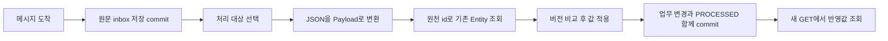

# 8. 이벤트로 데이터를 반영한 뒤 조회하는 패턴

[이전: 외부 API 데이터](07-external-data-patterns.md) · [목차](README.md) · [다음: 직접 수정하기 위한 학습법](09-studying-to-change-code.md)

## 8.1 요청 시 외부를 부르는 것과 미리 받아 두는 것

```text
요청 시 조회:
GET → 외부 API 호출 → 응답 DTO 조립 → 반환

이벤트로 적재 후 조회:
외부 변경 → 이벤트 수신 → 로컬 DB 반영·commit
GET → 로컬 DB 조회 → 응답 DTO 조립 → 반환
```

두 번째 패턴에서 GET은 Kafka를 조회하지 않는다. 앞서 수신 처리기가 저장한 DB를 읽는다. 수신이 늦거나 실패하면 GET도 이전 상태를 반환할 수 있다.

이 장의 관심은 **전달된 값이 언제 조회 가능한 DB 상태가 되는가**다.

## 8.2 메시지의 식별자와 버전

```text
messageId = M100             전달 메시지의 식별자
sourceId = A                 원천 항목의 식별자
sourceVersion = 12           원천 항목 상태의 버전
payload.name = Alpha-new     적용할 값
```

| 값 | 답하는 질문 |
|---|---|
| messageId | 같은 메시지가 다시 온 것인가? |
| sourceId | 어느 항목의 값인가? |
| sourceVersion | 과거 값인가, 새 값인가? |
| JPA Entity version | 로컬 행을 다른 tx가 동시에 수정했는가? |

messageId·sourceVersion·JPA version은 서로 대체하지 못한다. 같은 업무 상태가 새 messageId로 재전송될 수 있다.

## 8.3 패턴 A: 로컬 commit 뒤 변경 사실을 발행한다

```text
관리 Entity 변경 → DB commit → 외부 EventBus.publish
```

설명용 Kotlin 형태:

```kotlin
// 진행 중인 트랜잭션 안에서 내부 이벤트가 전달되었다는 전제다.
@TransactionalEventListener(phase = TransactionPhase.AFTER_COMMIT)
fun onChanged(event: ItemChanged) {
    // 실제 구현은 전송 계약·인증/tenant 문맥·예외 처리도 담당한다.
    eventBus.publish(toIntegrationEvent(event))
}
```

C#에서 DB 트랜잭션 완료 후 메시지 버스를 호출하는 의도와 비교한다. Spring 애노테이션은 트랜잭션 후 콜백을 연결한다. `AFTER_COMMIT`이 자동 비동기 스레드를 뜻하지는 않는다.

| 단계 | 로컬 DB | 외부 수신 |
|---|---|---|
| Entity 변경 | 미확정 | 아직 없음 |
| commit 성공 | 새 값 확정 | 아직 없을 수 있음 |
| 발행 실패 | 새 값 유지 | 이전 값일 수 있음 |

DB commit 이후 발행 전 프로세스가 멈추면 보낼 데이터가 유실될 수 있다. 수신측 inbox가 이 발행측 구간까지 해결하지는 않는다.

커밋 뒤 DB를 다시 읽어 payload를 만들면 원래 변경 이후의 수정까지 읽을 수 있다. **변경 순간의 snapshot인지, 전송 시점의 최신 상태인지**에 따라 payload 구성 시점을 정한다.

## 8.4 패턴 B: 보낼 데이터를 업무와 함께 저장한다 — outbox

```text
하나의 DB 트랜잭션:
  Entity 변경 + 전송할 payload를 outbox에 저장 → 함께 commit

별도 전송 작업:
  미전송 outbox 읽기 → EventBus.publish → 발행 상태 기록
```

C# 개념 예제:

```csharp
// 설명용: item은 현재 범위에서 로딩한 추적 객체다.
await using var tx = await db.Database.BeginTransactionAsync();
item.ChangeName(newName);
db.Outbox.Add(SerializeMessage(item));
await db.SaveChangesAsync();
await tx.CommitAsync();
// 별도 전송기가 미전송 행을 읽고 발행한다.
```

Kotlin의 같은 의도다. 이 예제의 Repository와 outbox는 **같은 DB·같은 트랜잭션에 참여**한다. `store`가 `REQUIRES_NEW`로 따로 commit하거나 즉시 외부로 발행하는 동작이면 아래의 원자성은 성립하지 않는다.

```kotlin
// 설명용. 실제 프로젝트의 저장·outbox 계약으로 연결한다.
@Transactional
fun change(scope: TenantScope, id: UUID, name: String) {
    val item = repository.findById(scope, id) ?: throw itemNotFound()
    item.changeName(name)
    repository.save(item)
    outbox.store(snapshotOf(item))
} // 최외곽 tx라면 업무와 outbox를 함께 commit
```

발행 전 프로세스가 중단돼도 outbox 행에서 다시 보낼 근거를 얻는다. 하지만 발행 성공 후 상태 기록 전에 실패하면 재발행될 수 있다. **outbox 자체가 중복 없는 처리를 보장하지는 않는다.** 이 그림은 DB와 Kafka의 자동 원자적 commit을 뜻하지 않는다.

## 8.5 패턴 C: 받은 원문을 보관하고 나중에 적재한다 — inbox



처리 부분의 의사코드다. `message`는 같은 영속성 컨텍스트에서 로딩한 managed inbox Entity다. `SourceItem`은 이 장에서만 사용하는 수신용 모델로 source id·version을 추가로 갖는다고 가정한다.

```kotlin
// 설명용 의사코드. 충돌 재시도·삭제·비정상 입력 정책은 생략했다.
@Transactional
fun process(message: InboxMessage) {
    val payload = deserialize(message.body)
    val scope = resolveScope(message)
    val existing = repository.findBySource(scope, payload.sourceId)

    if (existing == null) {
        repository.save(newItemFrom(scope, payload))
    } else if (payload.sourceVersion > existing.sourceVersion) {
        existing.applySource(payload)
        repository.save(existing)
    }
    message.markProcessed()
} // 업무 변경과 inbox 처리 완료를 같은 DB 트랜잭션에 둔다.
```

이 조각은 완전한 수신기 구현이 아니다. 실제 코드에는 중복 선점·실패 기록·version 없는 입력·삭제 정책 등이 더 필요하다.

C#에서도 JSON 역직렬화 → scoped 조회 → EF Entity 변경 → inbox 상태 변경 → 하나의 `SaveChanges`/트랜잭션 commit으로 비교한다. 세 변환을 구분한다.

1. JSON → Payload: 직렬화기가 일반 객체를 만든다.
2. DB → 기존 Entity: ORM이 관리 객체를 로딩한다.
3. Payload → Entity: `applySource`가 정해진 갱신 규칙으로 값을 복사한다.

Payload의 `name`에 값이 있다고 기존 Entity가 자동 수정되지는 않는다. 항상 교체할 필드와 null이면 유지할 필드를 매퍼·도메인 메서드가 정한다.

## 8.6 조회에 보이는 시점

| 시점 | 상태 | 조회 결과의 의미 |
|---|---|---|
| t0 | 원천에서 Alpha-new로 변경 | 로컬은 Alpha일 수 있음 |
| t1 | inbox 원문 적재 | 아직 Alpha일 수 있음 |
| t2 | Payload 변환·Entity 변경 중 | 아직 commit 전 |
| t3 | 업무 변경 commit | 일반적인 새 tx에서 Alpha-new 조회 가능 |
| t4 | DTO·JSON 구성 | 응답에 새 값 포함 |

이미 열린 tx의 snapshot·영속성 컨텍스트, 캐시, 별도 replica를 읽으면 관측 시점이 달라질 수 있다. 수신 로그보다 **업무 commit과 조회 경로**를 확인한다.

처리 실패 시 업무 tx를 rollback하고 실패 상태를 별도 tx에 남길 수 있다. inbox 원문은 존재하지만 업무 행은 이전 값이다. 실패 기록까지 업무 tx와 함께 rollback시키면 재처리 근거가 남지 않을 수 있다.

## 8.7 중복·역전·삭제의 선택

| 도착 | 현재 sourceVersion | 일반적인 선택 |
|---|---|---|
| 버전 12 재전달 | 12 | 중복 효과 없이 no-op |
| 버전 11 | 12 | 과거 값으로 덮지 않음 |
| 버전 13 | 12 | 새 값 적용 |
| 없는 대상의 삭제 | 없음 | 무시할지 tombstone을 남길지 계약 결정 |

없는 대상의 삭제를 무시한 뒤 과거 생성 이벤트가 오면 데이터가 생길 수 있다. 모든 구현이 tombstone이나 완전한 역전 방어를 갖는 것은 아니다. topic·partition key의 순서와 업무 버전 규칙을 함께 확인한다.

DomainEvent, Spring `publishEvent`, 외부 `eventBus.publish`도 서로 다른 단계다. **DB에 무엇이 남았고 다음 단계가 무엇을 읽는지**로 구분한다.

## 8.8 직접 수정해 보기: 늦게 온 과거 이벤트가 최신값을 덮는다

**아래는 수정 연습용 가상 결함이다. 실제 레포에서 동일 결함을 발견했다는 뜻이 아니다.** 이미 저장된 항목은 `sourceVersion=12`, `name=Beta`다. 뒤늦게 `sourceVersion=11`, `name=Alpha`가 도착했는데 GET 결과가 `Alpha`로 돌아갔다고 하자.

이 연습은 **원천이 항목별로 증가하는 필수 version과 전체 상태 payload를 보낸다**는 계약, 기존 항목의 갱신만 다룬다. version이 없거나 이벤트가 증분 명령이라면 이 비교 규칙을 바로 적용하지 않는다. 최초 생성·삭제·원천 재설정은 별도 계약이다.

### 어떤 값을 비교하지 않았는지 찾는다

| 확인 위치 | 기대 | 가상 결함에서 관측한 것 |
|---|---|---|
| 기존 Entity | `Beta/v12` | 정상 |
| 수신 payload | `Alpha/v11` | 정상 수신된 과거 값 |
| 도메인 변경 직후 | `Beta/v12` 유지 | `Alpha/v11`로 대입 |
| 새 GET | `Beta` | `Alpha` |

JSON 바인딩과 조회식은 정상이다. 문제는 **원천 상태를 적용하는 시점의 버전 판정**이다. Kafka messageId가 다르면 같은 원천의 과거 상태도 새로운 메시지로 올 수 있으므로 messageId 중복 검사만 늘려서는 해결되지 않는다.

### 수정 전: 들어온 값을 항상 대입한다

```kotlin
// 가상 SourceItem의 메서드: sourceVersion은 원천 버전이며 JPA version과 다르다.
fun applySource(payload: SourcePayload) {
    changeName(payload.name)
    sourceVersion = payload.sourceVersion
}
```

### 수정 후: 상태와 원천 버전을 함께 갱신한다

```kotlin
// 설명용: scope 안에서 읽은 기존 managed Entity의 메서드다.
fun applySource(payload: SourcePayload): Boolean {
    if (payload.sourceVersion <= sourceVersion) return false
    changeName(payload.name)
    sourceVersion = payload.sourceVersion
    return true
}

// inbox 업무 tx 안. message도 같은 컨텍스트에서 관리되는 Entity다.
if (existing.applySource(payload)) repository.save(existing)
message.markProcessed() // 과거·중복 메시지를 정상 no-op 처리하는 계약
```

판정을 도메인 적용 경계에 두면 여러 수신 경로가 같은 갱신 규칙을 사용한다. 필드만 먼저 대입하고 나중에 version을 비교하면 이미 managed 상태가 바뀌었으므로 늦다. sourceVersion만 별도 tx에서 저장해도 업무 값과 version이 어긋날 수 있다.

### 입력과 기대값으로 회귀 확인하기

| 초기 상태 / 수신 | 기대하는 업무 상태 | inbox 처리 |
|---|---|---|
| `Beta/v12` / `Alpha/v11` | `Beta/v12` 유지 | 정상 no-op 완료 |
| `Beta/v12` / 다른 messageId의 `Beta/v12` | 불필요한 변경·업무 이벤트 없음 | 정상 no-op 완료 |
| `Beta/v12` / `Gamma/v13` | commit 뒤 `Gamma/v13` | 업무와 함께 완료 |
| `Beta/v12` / v13이지만 이름 규칙 위반 | `Beta/v12` 유지 | 업무 rollback 뒤 실패 정책 적용 |
| v12 조회 뒤 v13·v14 처리의 실제 동시 경합 | JPA 충돌 처리 후 다시 읽고 원천 버전 재판정 | 완료·재시도 상태 정합 유지 |

마지막 행은 if 비교만으로 해결되지 않는다. 두 tx가 동시에 v12를 읽으면 둘 다 통과할 수 있다. 기존 `@Version`·동시성 처리·재시도에서 새 상태를 다시 읽는 경로까지 확인한다. in-memory 단위 테스트만으로 실제 DB 경합을 검증했다고 하지 않는다. 이 표는 실행할 조건이다.

### 다른 호출에 미치는 영향

기존에 `applySource`를 부르던 모든 경로가 Boolean 결과와 no-op 의미를 올바르게 처리하는지 본다. 같은 버전 재전달로 새 매핑 필드를 뒤늦게 채우려던 작업은 이제 적용되지 않을 수 있다. 기존 데이터 보강이 필요하면 별도 재적재·보정 요구사항을 정하며, 학습 예제를 근거로 version 검사를 우회하지 않는다.

버그 재현과 변경 영향 범위를 정하는 순서는 [직접 수정하기 위한 공부 방법](09-studying-to-change-code.md)을 따른다.

## 실제 소스에서 같은 패턴 찾기

| 패턴 | 근거 파일 |
|---|---|
| commit 이후 외부 발행 | [DomainEventIntegrationPublisher](../../../x-patient-appointment/backend/patient-appointment/src/main/kotlin/com/projectx/patientappointment/infrastructure/eventbus/DomainEventIntegrationPublisher.kt) |
| outbox 적재와 별도 전송 | [OrderingIntegrationEventService](../../../x-clinical-care/backend/ordering/src/main/kotlin/com/projectx/ordering/application/integrationevents/OrderingIntegrationEventService.kt) |
| 원문 보관 후 역직렬화 | [InboxDispatcher](../../../x-diagnostic-result/backend/diagnostic-result/src/main/kotlin/com/projectx/diagnosticresult/infrastructure/inbox/InboxDispatcher.kt) |
| 업무 반영과 처리 상태의 tx | [InboxTxService](../../../x-diagnostic-result/backend/diagnostic-result/src/main/kotlin/com/projectx/diagnosticresult/infrastructure/inbox/InboxTxService.kt) |
| 원천 버전 검사·필드 갱신 | [Observation](../../../x-diagnostic-result/backend/diagnostic-result/src/main/kotlin/com/projectx/diagnosticresult/domain/aggregatesmodel/observation/Observation.kt) |

이 구현들은 서로 다른 패턴의 근거다. 한 레포의 outbox를 다른 레포에도 존재한다고 가정하지 않는다.

[이전: 외부 API 데이터](07-external-data-patterns.md) · [목차](README.md) · [다음: 직접 수정하기 위한 학습법](09-studying-to-change-code.md)
