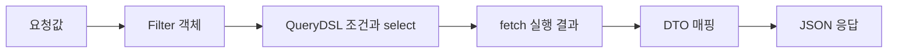

# 9. 직접 소스를 수정하기 위한 학습법

[이전: 이벤트 데이터](08-event-data-patterns.md) · [목차](README.md)

이 장의 목표는 **증상을 보고 데이터를 따라가며 수정할 위치를 정하는 것**이다. C#에서 해 왔던 입력 확인, 호출 추적, 중단점 관측, 변경 후 검증을 Kotlin의 조회·매핑·트랜잭션 경계에 연결한다.

## 9.1 한 패턴을 익히는 순서

한 번에 공부할 단위는 검색조건 하나나 응답 필드 하나로 잡는다. 다음 다섯 단계를 한 사이클로 반복한다.

1. **결과를 먼저 예상한다.** 작은 입력표를 보고 어떤 id와 값이 나와야 하는지 적는다. null·빈 목록·false의 뜻도 정한다.
2. **타입과 실행 경계를 표시한다.** Q경로, 조회식, Entity, Tuple, DTO를 구분하고 DB·HTTP 실행 줄을 찾는다.
3. **값이 처음 달라지는 곳을 찾는다.** 요청 입력, 조회 직후, 매핑 직후를 비교한다. 예상과 처음 달라지는 경계가 수정 후보가 된다.
4. **수정 이유를 말한 뒤 코드를 바꾼다.** “이 필드가 select에 없어서 여기서 읽도록 추가한다”처럼 원인과 변경을 연결한다.
5. **고친 사례와 기존 사례를 확인한다.** 이전에 맞던 입력, 값이 없는 입력, 다른 범위의 데이터도 결과표와 비교한다.

각 장의 실습에서 먼저 답을 가리고 원인과 수정안을 적어 본다. 이후 diff와 비교한다. 답이 달라도 요구한 결과와 실행·저장 시점을 설명할 수 있는지가 기준이다.

| 학습 단계 | 스스로 설명할 수 있어야 하는 것 |
|---|---|
| 1~3장 | 어디서 읽고, 무엇을 고르며, 어느 코드가 응답 필드를 채우는가 |
| 4~5장 | JOIN 때문에 행 수가 바뀌는가, 페이지와 count가 같은 대상을 세는가 |
| 6장 | 지금 바꾼 객체가 관리 Entity인가, 트랜잭션은 어디서 끝나는가 |
| 7~8장 | 값의 원천이 어디인가, 외부 값이 로컬 DB에 반영되는 경로는 무엇인가 |

## 9.2 데이터가 지나는 경계에서 관측한다

다음 그림은 한 조회에서 비교할 위치다. 호출된 함수가 다른 클래스로 넘어가더라도 같은 값을 따라간다.



| 증상 | 먼저 비교할 값 | 수정 후보 |
|---|---|---|
| 보낸 검색값이 적용되지 않음 | 요청 인자 → Filter → 조건식 | 바인딩·전달·조건 조립 |
| 있어야 할 행이 없음 | 조건식 → fetch 결과 id | null 처리, JOIN 조건, 범위, 페이지 |
| 같은 행이 반복됨 | JOIN 결과의 부모 id·자식 id | 관계의 행 수, EXISTS, 묶음 조회 |
| 새 응답 필드가 null | select 대상 → Tuple/Entity → DTO 필드 | projection·매퍼·필드 선택 |
| DTO 값은 맞는데 JSON 값이 다름 | DTO → 실제 JSON | 직렬화 이름·제외 설정·응답 포장 |
| 변경했는데 재조회 시 원래 값임 | 변경 대상 타입 → 저장 호출 → 트랜잭션 종료 | DTO/Entity 혼동, 매핑 누락, 롤백 |
| 외부에는 새 값, 로컬에는 옛 값 | 원격 응답/이벤트 → 로컬 반영 → 로컬 조회 | HTTP 저장 매핑, 수신 처리, 원천 버전 |

“응답이 이상하다”는 이유만으로 마지막 매퍼부터 바꾸지 않는다. `fetch` 직후부터 틀렸다면 매퍼로 감추기보다 선택 조건이나 행 구성을 확인해야 한다. 반대로 DB 결과가 맞고 DTO부터 달라졌다면 조회 조건 변경은 문제를 넓힐 수 있다.

디버거에서는 이미 얻은 지역 변수와 기본 필드를 먼저 본다. `fetch()`·HTTP 호출·저장 함수를 평가식에서 호출하면 상태나 실행 횟수를 바꿀 수 있다. 지연 관계의 값 평가도 추가 조회를 일으킬 수 있다. 연습 데이터는 직접 만든 식별자와 문자열을 사용한다.

## 9.3 IDE에서 이름보다 선언과 사용처를 따라간다

C#에서 인터페이스 구현으로 이동하듯 Kotlin에서도 선언 이동, 구현 이동, 사용처 찾기를 함께 쓴다. 단축키는 IDE와 키맵에 따라 다르므로 메뉴 이름을 기준으로 익힌다.

| 만난 코드 | 다음으로 열 곳 | 알아낼 것 |
|---|---|---|
| `queries.find(scope, filter)` | 인터페이스 선언 → 주입되는 구현 | 반환 타입과 실제 QueryDSL 실행 |
| `filter.keyword` | Filter 선언 → 생성하는 호출자 | null·기본값·요청값 전달 방식 |
| `toView(row)` 또는 `row.toView()` | 함수 선언과 import | 일반 함수인지 확장 함수인지, 어떤 필드를 복사하는지 |
| `row.get(q.name)` | select 목록 | 해당 표현식이 실제로 선택됐는지 |
| `repository.save(entity)` | Repository 타입 → 구현/확장 함수 | Spring Data 저장인지 이벤트 처리가 붙은 저장인지 |
| `@Transactional` | 호출되는 Bean과 바깥 호출자 | 프록시를 통과하는지, 기존 트랜잭션에 참여하는지 |

Kotlin의 확장 함수는 호출 모양만으로 원래 클래스의 멤버처럼 보일 수 있다. `import`와 선언을 열어 본다. `saveWithEvents` 같은 이름도 동작을 보증하지 않으므로 실제 구현에서 이벤트 처리와 저장 순서를 읽는다.

프로젝트 검색은 좁은 범위에서 시작한다. 예를 들어 `AppointmentFilter`의 사용처를 찾고 싶다면 작업 루트에서 다음처럼 찾는다.

```bash
rg -n --glob '*.kt' 'AppointmentFilter' x-patient-appointment/backend/patient-appointment/src
```

검색 결과 전체를 읽기보다 **생성하는 곳 → 전달하는 곳 → 소비하는 곳**을 표시한다. 공유되는 매퍼나 조건 함수를 고칠 때는 사용처 검색으로 영향을 받는 다른 조회도 찾는다. 생성된 `Q...` 파일은 수동 수정하지 않는다. Entity 매핑 변경이 필요하다면 원본 Entity와 프로젝트의 생성 절차를 확인한다.

## 9.4 기능 수정 연습: 최소 금액 검색을 추가한다

가상 `Item` 조회에 `minAmount`를 추가해 보자. [2장](02-filter-patterns.md)의 조건 조립을 입력 전달까지 연결하는 연습이다. 실제 서비스에 이 기능을 추가하라는 지시는 아니다.

먼저 계약을 적는다. **미입력이면 기존 조회, 입력하면 amount가 그 금액 이상인 행만 반환**한다. amount가 null인 행은 금액을 알 수 없으므로 조건이 주어졌을 때 제외한다. 음수는 이 예제의 검색 입력 계약상 거부한다. 새 DB 컬럼은 필요 없다. 기존 `Item.amount`를 사용한다.

### 바꿀 연결을 먼저 그린다

| 연결 | 바꿀 내용 | 빠뜨렸을 때 |
|---|---|---|
| HTTP 요청 → Controller 인자 | 선택적인 `BigDecimal?` 입력과 음수 검증 | 요청값이 들어오지 않거나 잘못된 값 수용 |
| Controller → Filter | `minAmount`를 명시적으로 전달 | 인자는 맞는데 조회 함수에는 null |
| Filter → 조회 조건 | null이 아니면 `amount.goe(value)` | 입력이 전달돼도 결과 변화 없음 |
| 목록 → 전체 건수 | 같은 선택 조건 사용 | 목록과 total 불일치 |
| API 계약·사용처 | 선택 입력·경계값 의미 기록 | 호출자가 생략·0을 다르게 해석 |

아래는 기존 입력 연결에 추가할 **부분 코드**다. 다른 요청 인자, 기존 조건, DI 설정은 각 서비스에 유지한다.

```kotlin
// Controller의 조회 메서드 인자에 추가할 형태
@RequestParam(name = "minAmount", required = false) minAmount: BigDecimal?
```

```kotlin
// 설명용 Filter: 기존 active 조건은 유지한다.
data class ItemFilter(
    val active: Boolean? = null,
    val minAmount: BigDecimal? = null,
)

// 요청 처리 코드의 일부. 오류 변환은 대상 프로젝트 방식을 따른다.
if (minAmount != null && minAmount.signum() < 0) {
    throw invalidMinimumAmount()
}
val filter = ItemFilter(active = active, minAmount = minAmount)
return queries.find(scope, filter)
```

`invalidMinimumAmount()`는 설명용 업무 오류 생성 함수다. `scope`는 기존의 신뢰할 수 있는 요청 범위를 사용한다. Controller의 검증을 다른 내부 호출도 반드시 거치는지는 사용처를 확인한다. 공용 조회 계약 자체에서 검증이 필요하면 프로젝트 기준에 맞는 경계로 옮긴다.

```diff
 val where = BooleanBuilder(scopeCondition(scope))
 filter.active?.let { where.and(q.active.eq(it)) }
+filter.minAmount?.let { where.and(q.amount.goe(it)) }
```

이 줄은 `fetch` 전에 들어간다. `goe`는 greater or equal, 즉 `>=` 비교를 만드는 QueryDSL 연산이다. Kotlin 목록의 `.filter { ... }`를 추가하는 것과 실행 위치가 다르다. count가 있다면 같은 조건을 사용하게 한다([5장 실습](05-pagination-and-aggregation.md)).

Filter에 기본값 null이 있으면 기존 생성 코드는 계속 컴파일될 수 있다. **컴파일 성공만으로 새 입력이 끝까지 연결됐다고 판단할 수 없는 이유**다. HTTP에서 받은 값과 조회 메서드의 값을 비교해야 한다.

### 먼저 예상 결과표를 채운다

같은 범위에 A(amount=null, active=true), B(0, true), C(500, true), D(500, false), 다른 범위에 E(900, true)를 둔다. 각 행의 id와 결과 집합을 비교한다.

| 입력 | 기대 id | 검증 목적 |
|---|---|---|
| 모두 생략 | A, B, C, D | 이전 조회 의미 유지 |
| minAmount=0 | B, C, D | 0은 입력값이며 null과 다름 |
| minAmount=500 | C, D | 경계값 포함 |
| minAmount=501 | 없음 | 경계값 밖 제외 |
| minAmount=500, active=true | C | 기존 조건과 AND 결합 |
| minAmount=-1 | 계약에 맞는 입력 오류 | 조회 이전 검증 |
| minAmount=500, 전체 건수 조회 | total=2 | 필터와 count 일치 |

여기서는 결과 순서가 아닌 선택 집합이 검증 대상이다. 기존 정렬 계약을 바꿨다면 순서와 동률 처리도 별도로 확인한다. 다른 범위 E는 어떤 정상 입력에서도 포함되지 않아야 한다.

**추가 문제:** Filter를 만들 때 `minAmount = minAmount ?: BigDecimal.ZERO`로 전달하면 미입력 동작은 유지되는가?

<details>
<summary>판단 확인</summary>

유지되지 않는다. 미입력에도 금액 조건이 걸려 amount=null인 A가 빠진다. 음수 금액이 저장될 수 있는 모델이라면 그 행도 빠진다. 기본값을 정하는 일은 편의 문법이 아니라 조회 계약 변경이다.

다만 **Filter 생성자 기본 인자만 ZERO로 바꾸는 것**은 다른 변경이다. 생성자 기본 인자는 해당 인자를 생략할 때 사용한다. 위의 호출처럼 `minAmount = null`을 명시적으로 넘기면 그 null이 전달되며 기본 인자로 대체되지 않는다. 선언과 실제 호출을 함께 읽어야 한다.

</details>

## 9.5 바꾼 내용에 맞게 확인 방법을 고른다

| 수정 대상 | 필요한 확인 | 이것만으로 알 수 없는 것 |
|---|---|---|
| 순수한 DTO 매퍼 | 가상 객체의 필드·null 입력으로 출력 비교 | DB가 해당 컬럼을 실제로 읽는지 |
| QueryDSL 조건·JOIN·projection | 프로젝트에서 준비한 DB 통합 테스트로 결과 행·바인딩 확인 | HTTP 입력이 그 조건까지 오는지 |
| HTTP 입력·JSON 응답 | 요청 바인딩과 응답 계약 테스트 | mock 조회를 쓰면 실제 SQL의 정확성 |
| Entity 변경·저장 | 별도 조회/영속성 컨텍스트에서 저장값, 실패 시 롤백 확인 | 같은 관리 객체를 읽는 것만으로 커밋 여부 |
| 외부 API·이벤트 매핑 | 가상 원격 응답·이벤트로 필드 반영, 누락·역순·중복 입력 확인 | 실제 외부 서비스의 가용성 |

행 목록을 미리 반환하도록 만든 mock만으로 JOIN이나 SQL null 처리를 검증할 수는 없다. 반대로 매퍼 한 줄을 확인하는 데 실제 외부 시스템을 호출할 필요는 없다. 바꾼 경계를 실행하는 검증을 고른다.

저장 테스트의 바깥 트랜잭션이 종료 시 자동 롤백되는지도 확인한다. 그 안에서 `save`와 재조회를 했다는 사실은 실제 커밋이나 `afterCommit` 발행까지 확인했다는 뜻이 아니다. 6·8장에서 배운 경계에 맞춰 테스트를 읽는다.

연습은 프로젝트의 기존 테스트 방식과 허용된 개발 환경을 사용한다. 직접 만든 fixture로 재현 조건을 고정한다. 실행하지 않은 검증은 “예상 결과를 정했다”와 구분해 기록한다.

## 9.6 실제 소스에서 패턴 하나를 골라 적용한다

처음에는 코드를 고치기 전에 기존 동작을 말로 설명해 본다. 아래 파일에서 지정한 패턴 하나를 찾고, 이름을 공통 예제의 역할에 대응시킨다.

| 연습할 읽기 | 실제 소스에서 찾을 곳 | 읽은 뒤 답할 질문 |
|---|---|---|
| 조건 → 실행 → 목록 변환 | [AppointmentQueries](../../../x-patient-appointment/backend/patient-appointment/src/main/kotlin/com/projectx/patientappointment/infrastructure/queries/AppointmentQueries.kt)의 `find`, `views` | 조건 추가와 응답 필드 추가는 각각 어디에 들어가는가? |
| 선택 컬럼 → Tuple → 응답 | [ObservationQueries](../../../x-diagnostic-result/backend/diagnostic-result/src/main/kotlin/com/projectx/diagnosticresult/infrastructure/queries/ObservationQueries.kt)의 `categoryQuery`와 호출부 | 이 필드는 어느 표현식으로 선택되고 어디에서 꺼내는가? |
| 단건 실행 → 결과 변환 | [OrderingQueries](../../../x-clinical-care/backend/ordering/src/main/kotlin/com/projectx/ordering/application/queries/OrderingQueries.kt)의 `getOrderSheet` | 결과가 없는 경우는 어느 줄에서 처리되는가? |

이후 실제 수정 요구를 받으면 다음 메모를 작성한다. 빈칸을 채우기 위해 모든 파일을 읽을 필요는 없다. 해당 데이터가 지나는 코드와 사용처를 확인하면 된다.

```text
바꾸려는 동작:
입력과 현재 결과 / 기대 결과:
관련 값이 처음 달라지는 경계:
바꿀 코드와 그 이유:
함께 변경할 전달·매핑·count·계약:
영향받는 다른 호출자:
수정 전 실패를 확인할 방법:
수정 후 확인할 입력과 기대값:
실제로 확인한 결과 / 아직 확인하지 않은 것:
```

실제 기능 변경에서는 대상 프로젝트의 설계·API 계약과 로컬 개발 규칙도 함께 확인한다. 예제의 코드 형태를 그대로 복사하기보다 **지금 수정하는 함수의 입력 계약, 반환 타입, 트랜잭션과 호출자**에 맞게 적용한다.

[이전: 이벤트 데이터](08-event-data-patterns.md) · [목차](README.md)
