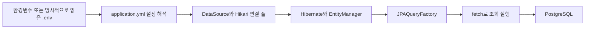

# 11. 새 Kotlin 프로젝트에 한 파일씩 넣어 실행하기

[학습 목차](README.md) · [패턴별 문제 풀기](10-practice-workbook.md)

이 실습에서는 **IntelliJ에서 새 Kotlin 프로젝트를 직접 생성**하고 DB 연결 → 표 생성 → Entity → 조회 → 저장 → 외부 API → Kafka 순서로 코드를 추가한다. 빌드와 점검은 Gradle·Kotlin/JUnit으로 수행한다. Python 설치나 생성 스크립트는 필요하지 않다. 아래 파일의 전체 내용을 순서대로 작성하며 [완성 예제](lab/reference/README.md)와 비교한다.

여기서 사용할 대상은 **Kotlin/JVM + Spring Boot**다. 사용자가 원하는 일반적인 Kotlin 백엔드 개발 흐름이며, JVM 없이 실행하는 바이너리를 만드는 별도 기술인 Kotlin/Native를 설정하는 실습은 아니다.

## 먼저: DB 연결 문자열은 어디에 있는가

**있다. PostgreSQL 접속 주소는 JDBC URL 문자열이고, 계정과 비밀번호는 별도 설정이다.** C#에서 connection string을 DI로 넘기던 역할을 Spring의 `spring.datasource` 설정이 맡는다.

```yaml
spring:
  datasource:
    url: jdbc:postgresql://${DB_HOST:127.0.0.1}:${DB_PORT:55432}/${DB_NAME:kotlin_lab}
    username: ${DB_USER}
    password: ${DB_PASSWORD}
```

| 부분 | 실습값·의미 | C# 경험과 연결 |
|---|---|---|
| `jdbc:postgresql:` | PostgreSQL JDBC 드라이버 사용 | DB provider 선택 |
| `127.0.0.1` | 접속할 서버 주소 | Host 또는 Server |
| `55432` | 내 컴퓨터에서 열어 둔 DB 포트 | Port |
| `kotlin_lab` | 데이터베이스 이름 | Database |
| `username`, `password` | 환경 설정에서 가져오는 계정·암호 | Username·Password |
| `${DB_PORT:55432}` | DB_PORT가 없으면 55432 사용 | 설정값과 기본값 |
| `${DB_PASSWORD}` | 기본값 없이 설정에서 읽음 | 외부에서 제공하는 암호 |

예제의 최종 URL은 `jdbc:postgresql://127.0.0.1:55432/kotlin_lab`이다. 비밀번호가 이 URL에 포함되어 있지는 않다. `public` 같은 **스키마 이름은 데이터베이스 이름과 다른 층위**다. 실습은 별도 DB 안의 기본 public 스키마를 사용한다.



Spring Boot가 DB 설정과 JDBC 드라이버를 바탕으로 연결을 구성한다. 조회 함수마다 연결 문자열을 만들거나 `Open()`·`Close()`를 직접 호출하지 않는다. 주입된 EntityManager는 Spring이 현재 트랜잭션의 영속성 컨텍스트에 연결하므로, 모든 요청이 하나의 DbContext 객체를 함께 수정한다고 생각하면 안 된다. 앱 기동 중 Liquibase와 Hibernate 검증도 DB를 사용한다. [Spring Boot의 DataSource 설명](https://docs.spring.io/spring-boot/4.0/reference/data/sql.html).

실제 담당 프로젝트의 근거:

- [예약 application.yml](../../../x-patient-appointment/backend/patient-appointment/src/main/resources/application.yml): `DB_HOST`, `DB_PORT`, `DB_NAME`, `DB_USER`, `DB_PASSWORD`로 조합한다.
- [결과 application.yml](../../../x-diagnostic-result/backend/diagnostic-result/src/main/resources/application.yml): 같은 이름의 DB 설정을 사용한다.
- [예약 QuerydslConfig](../../../x-patient-appointment/backend/patient-appointment/src/main/kotlin/com/projectx/patientappointment/infrastructure/config/QuerydslConfig.kt): EntityManager를 주입받아 JPAQueryFactory를 만든다.
- [예약 DotenvEnvironmentPostProcessor](../../../x-patient-appointment/backend/patient-appointment/src/main/kotlin/com/projectx/patientappointment/infrastructure/config/DotenvEnvironmentPostProcessor.kt): 실제 프로젝트가 `.env`를 읽도록 연결하는 코드다.

`.env`라는 파일을 놓는 것만으로 모든 Spring 프로젝트가 자동으로 읽지는 않는다. 실제 담당 프로젝트는 별도의 로더가 있고, **이번 실습은 `spring.config.import`로 `.env`를 properties 형식으로 읽도록 명시**한다. 실행 폴더도 설정의 일부다. [외부 설정과 config import](https://docs.spring.io/spring-boot/4.0/reference/features/external-config.html).

## 준비와 단계별 도착점

IntelliJ IDEA, JDK 25, Docker Compose를 준비한다. JDK 25는 JVM 실행·개발 도구이고, Kotlin 컴파일러와 Spring 라이브러리는 Gradle이 내려받는다. 시스템 Gradle을 따로 설치할 필요 없이 IntelliJ가 생성한 프로젝트의 `gradlew`를 쓴다.

| 구성 | 이 실습의 기준 |
|---|---|
| Kotlin / Spring Boot | 2.3.0 / 4.0.4 — 담당 소스의 계열에 맞춤 |
| Java / Gradle Wrapper | JDK 25 / 9.1.0 |
| QueryDSL | OpenFeign fork 6.11, kapt로 Q클래스 생성 |
| DB | PostgreSQL 17.12, 127.0.0.1:55432, kotlin_lab |
| 앱 | 127.0.0.1:58080 |
| Kafka | 선택 단계에서 Apache Kafka 4.0.2, 127.0.0.1:19092 |

JDK 25에서 Gradle을 실행하려면 9.1.0 이상이 지원 범위다. 따라서 기존 레포의 wrapper 버전을 그대로 복사하지 않고 이 실습의 설정을 사용한다. [Gradle Java 호환표](https://docs.gradle.org/current/userguide/compatibility.html).

| 단계 | 내가 추가할 코드 | 확인할 결과 |
|---|---|---|
| 0 | IntelliJ의 Kotlin·Gradle 프로젝트 | IDE에서 main 실행, Gradle JVM 확인 |
| 1 | 접속 설정·Liquibase·시작점·ping | DB 표 준비 후 `/lab/ping` |
| 2 | Entity·범위·Repository·QueryDSL 설정 | QItem 생성과 컴파일 |
| 3 | 조회 DTO·조회 구현·GET | 비어 있는 목록과 total=0 |
| 4 | 생성·변경 명령·POST/PATCH | 실제 저장·검색·버전·rollback |
| 5 | HTTP DTO·원격 어댑터·갱신 흐름 | 외부 값이 로컬 GET에 반영 |
| 6 | Kafka 발행·수신 관찰 | commit된 변경만 수신 화면용 API에 표시 |
| 7 | Kotlin/JUnit 테스트 | 단위 테스트와 실제 HTTP 점검을 Gradle로 실행 |

이 프로젝트는 로컬 학습 앱이다. `LabScope.LOCAL`의 T1/H1을 사용하고 앱은 loopback에 바인딩한다. 실무의 인증·CommandBus·seedwork·감사·inbox 골격은 담당 프로젝트의 것을 사용해야 한다. [학습 앱 설계와 차이](lab/DESIGN.md)를 확인한다.

## 0단계. IntelliJ에서 새 Kotlin 프로젝트 만들기

### 0-1. Kotlin과 Gradle을 선택한다

IntelliJ 시작 화면의 **New Project**, 또는 열린 IDE의 **File → New → Project**를 사용한다. 버전·언어 설정에 따라 메뉴 이름이 조금 다를 수 있으므로 아래 선택 항목을 기준으로 찾는다.

| 항목 | 선택값 | 이유 |
|---|---|---|
| 프로젝트 종류 | Kotlin | Kotlin/JVM 소스를 직접 작성 |
| Name | kotlin-data-lab | 교재의 프로젝트 이름과 일치 |
| Location | 내가 실습할 새 폴더 | 제품 소스와 별도 작업 |
| Build system | Gradle | 의존성·컴파일·테스트를 같은 빌드로 관리 |
| Gradle DSL | Kotlin | 빌드 파일을 build.gradle.kts로 작성 |
| JDK | 25 | 교재의 JVM 대상과 일치 |
| Add sample code | 끔 | 다음 절에서 첫 파일을 직접 작성 |
| Use compact project structure | 옵션이 있다면 끔 | src/main/kotlin·src/test/kotlin 구조 사용 |

JDK가 목록에 없으면 **Download JDK** 또는 **Add JDK from Disk**로 등록한다. Create를 누르고 Gradle 동기화가 끝날 때까지 기다린다. 이것이 IntelliJ가 제공하는 Kotlin 프로젝트 생성 과정이다. [JetBrains의 Kotlin 프로젝트 생성 안내](https://www.jetbrains.com/help/idea/create-your-first-kotlin-app.html).

IDE가 제안한 기본 버전으로 JDK 25 호환성 오류가 나면 **0-3의 Gradle·Kotlin 버전 설정부터 적용**하고 동기화한 뒤 첫 Kotlin 파일을 실행한다.

### 0-2. DB를 붙이기 전에 Kotlin 파일을 실행한다

`src/main/kotlin`을 오른쪽 클릭하고 **New → Kotlin Class/File → File**로 `Main.kt`를 만든다. 아래 코드는 이 단계에서만 사용할 첫 실행 예제다.

```kotlin
fun main() {
    val names = listOf("Alpha", "Beta")
    println(names.map { it.uppercase() })
}
```

`main` 왼쪽의 실행 아이콘으로 Run을 누른다. Run 창에 `[ALPHA, BETA]`가 나오면 Kotlin/JVM 실행을 확인한 것이다. 아직 DB나 Spring이 필요한 코드가 아니다. 이후 Spring 시작점을 추가할 때는 **방금 만든 연습용 Main.kt만 제거**하여 실행할 main이 헷갈리지 않게 한다.

### 0-3. 교재의 Gradle 설정으로 맞춘다

이제 아래 `settings.gradle.kts`, `build.gradle.kts`, `gradle/wrapper/gradle-wrapper.properties` 내용을 순서대로 반영한다. Gradle 파일을 바꾼 뒤 **Load Gradle Changes / Sync Gradle Project**를 누른다. IDE가 만든 Kotlin·Gradle 버전이 교재와 다르면 이 단계에서 맞춰진다.

`gradlew`, `gradlew.bat`, `gradle-wrapper.jar`는 IntelliJ가 만든 것을 사용한다. 직접 작성하거나 Python으로 복사할 필요가 없다. `gradle/libs.versions.toml`이 생성되어 있어도, 아래 빌드 파일은 버전을 직접 선언하므로 해당 카탈로그를 참조하지 않는다.

**Settings → Build, Execution, Deployment → Build Tools → Gradle**에서 다음을 확인한다. macOS에서는 Settings 진입 위치가 앱 메뉴에 있을 수 있다.

| 설정 | 이 실습에서 사용할 값 |
|---|---|
| Gradle distribution | Wrapper / gradle-wrapper.properties 사용 |
| Gradle JVM | JDK 25 |
| Build and run using | Gradle |
| Run tests using | Gradle |

Project Structure의 Project SDK도 25로 맞춘다. QueryDSL의 Q클래스를 kapt가 생성하므로 Gradle 빌드를 기준으로 맞추는 것이다. [IntelliJ의 Gradle 설정](https://www.jetbrains.com/help/idea/gradle.html), [Gradle 테스트 실행기 선택](https://www.jetbrains.com/help/idea/work-with-tests-in-gradle.html).

IntelliJ Terminal은 **내 새 프로젝트 루트**에서 연다. 처음에는 Gradle과 Maven Central 다운로드를 위한 네트워크가 필요하다.

```bash
java -version
./gradlew --version
```

Windows에서는 `.\gradlew.bat`를 사용한다. macOS/Linux에서 실행 권한 오류가 나면 `chmod +x gradlew`를 실행한다.

<details>
<summary>다른 정식 생성 방법: Spring Boot 마법사와 Spring Initializr</summary>

IDE에 **Spring Boot** 생성 항목이 보이면 이를 선택해도 된다. Language는 Kotlin, Type은 Gradle - Kotlin, Group은 com.projectx, Artifact는 kotlin-data-lab, Package는 com.projectx.kotlinlab, Java는 25로 지정한다. 보이는 의존성에서 Spring Web·Spring Data JPA·PostgreSQL Driver·Validation·Liquibase를 선택하고, 이후 아래 교재 빌드 파일의 정확한 의존성·버전으로 맞춘다.

Spring Boot 메뉴가 보이지 않으면 [Spring Initializr](https://start.spring.io/)에서 같은 항목을 선택해 Generate한 ZIP을 풀고 IntelliJ의 **Open**으로 프로젝트 폴더를 연다. IDE·Initializr가 제공하는 버전 목록에 4.0.4가 없다면 이 장의 기본 경로인 Kotlin+Gradle 프로젝트에서 아래 빌드 파일을 직접 작성하면 된다. 현재 제공되는 버전으로 생성한 뼈대를 사용해도 아래 파일로 버전을 맞춰야 한다. [JetBrains의 Spring Boot 생성 안내](https://www.jetbrains.com/help/idea/spring-boot.html).

Initializr가 만든 시작 클래스와 빈 `contextLoads` 테스트가 있다면 교재 파일과 중복되지 않게 정리한다. **이 새 프로젝트가 자동 생성한 기본 파일만** 대상으로 한다. 교재의 시작점은 KotlinLabApplication과 KotlinLabMain이고, DB 없이 실행하는 테스트는 7단계의 JUnit 테스트다. 생성된 contextLoads는 Spring 전체를 띄워 DB 설정을 요구할 수 있다.

</details>

<!-- lab-files:0 -->


### 파일: settings.gradle.kts

경로: [settings.gradle.kts](lab/reference/settings.gradle.kts)

Gradle 프로젝트 이름.

<details>
<summary>전체 코드 펼치기</summary>

<!-- lab-source: settings.gradle.kts sha256=5af4d083b116603b4eacba4e56010ab8ee01b0d9945412d002e8a4e6826e4824 -->
```kotlin
rootProject.name = "kotlin-data-lab"
```

</details>


### 파일: build.gradle.kts

경로: [build.gradle.kts](lab/reference/build.gradle.kts)

사용할 라이브러리와 Kotlin·JPA 빌드 설정.

<details>
<summary>전체 코드 펼치기</summary>

<!-- lab-source: build.gradle.kts sha256=c02507c8be89b1b30c1ebccfac9fb58ad7c59aa41b89b72c5865a72de4c4392b -->
```kotlin
import org.jetbrains.kotlin.gradle.dsl.JvmTarget

plugins {
    kotlin("jvm") version "2.3.0"
    kotlin("plugin.spring") version "2.3.0"
    kotlin("plugin.jpa") version "2.3.0"
    kotlin("plugin.allopen") version "2.3.0"
    kotlin("kapt") version "2.3.0"
    id("org.springframework.boot") version "4.0.4"
    id("io.spring.dependency-management") version "1.1.7"
}

group = "com.projectx"
version = "0.0.1"

repositories {
    mavenCentral()
}

kotlin {
    jvmToolchain(25)
    compilerOptions {
        jvmTarget.set(JvmTarget.JVM_25)
        freeCompilerArgs.add("-Xjsr305=strict")
    }
}

// Kotlin 2.3.0의 jpa 플러그인은 no-arg를 제공한다. 프록시용 open은 따로 설정한다.
allOpen {
    annotation("jakarta.persistence.Entity")
    annotation("jakarta.persistence.MappedSuperclass")
    annotation("jakarta.persistence.Embeddable")
}

dependencies {
    implementation("org.springframework.boot:spring-boot-starter-webmvc")
    implementation("org.springframework.boot:spring-boot-starter-restclient")
    implementation("org.springframework.boot:spring-boot-starter-validation")
    implementation("org.springframework.boot:spring-boot-starter-data-jpa")
    implementation("org.springframework.boot:spring-boot-liquibase")
    implementation("org.springframework.boot:spring-boot-starter-kafka")
    implementation("tools.jackson.module:jackson-module-kotlin")
    implementation("org.jetbrains.kotlin:kotlin-reflect")
    implementation("io.github.openfeign.querydsl:querydsl-jpa:6.11")
    kapt("io.github.openfeign.querydsl:querydsl-apt:6.11:jakarta")
    kapt("jakarta.persistence:jakarta.persistence-api")
    kapt("jakarta.annotation:jakarta.annotation-api")
    runtimeOnly("org.postgresql:postgresql")

    testImplementation("org.springframework.boot:spring-boot-starter-test")
    testRuntimeOnly("org.junit.platform:junit-platform-launcher")
}

springBoot {
    mainClass.set("com.projectx.kotlinlab.KotlinLabMainKt")
}

tasks.named<Test>("test") {
    useJUnitPlatform {
        excludeTags("http-smoke")
    }
}

// 실행 중인 로컬 실습 앱을 Kotlin/JUnit으로 점검한다. 일반 test와 별도로 실행한다.
tasks.register<Test>("httpSmokeTest") {
    group = "verification"
    description = "실행 중인 학습 앱의 DB·HTTP·선택 Kafka 동작을 확인합니다."
    dependsOn(tasks.named("testClasses"))
    testClassesDirs = sourceSets["test"].output.classesDirs
    classpath = sourceSets["test"].runtimeClasspath
    useJUnitPlatform {
        includeTags("http-smoke")
    }
    systemProperty("lab.baseUrl", providers.gradleProperty("labBaseUrl").getOrElse("http://127.0.0.1:58080"))
    systemProperty("lab.kafka.check", providers.gradleProperty("labKafka").getOrElse("false"))
    testLogging.showStandardStreams = true
    // 대상 앱·DB의 상태는 Gradle 입력 파일만으로 추적할 수 없어 매번 실제 요청한다.
    outputs.upToDateWhen { false }
}
```

</details>

- [gradlew](lab/reference/gradlew): IntelliJ가 생성한 Gradle 실행 파일을 사용한다. 링크는 비교용이다.
- [gradlew.bat](lab/reference/gradlew.bat): Windows용 Gradle 실행 파일이다. 링크는 비교용이다.

### 파일: gradle-wrapper.properties

경로: [gradle/wrapper/gradle-wrapper.properties](lab/reference/gradle/wrapper/gradle-wrapper.properties)

JDK 25를 지원하는 Gradle 버전과 배포본 검증값.

<details>
<summary>전체 코드 펼치기</summary>

<!-- lab-source: gradle/wrapper/gradle-wrapper.properties sha256=42bc80546f2979857efc20b23ede63b1c5a20478aef5a5c7b89ca66fb46fc786 -->
```properties
distributionBase=GRADLE_USER_HOME
distributionPath=wrapper/dists
distributionUrl=https\://services.gradle.org/distributions/gradle-9.1.0-bin.zip
distributionSha256Sum=a17ddd85a26b6a7f5ddb71ff8b05fc5104c0202c6e64782429790c933686c806
networkTimeout=10000
validateDistributionUrl=true
zipStoreBase=GRADLE_USER_HOME
zipStorePath=wrapper/dists
```

</details>

- [gradle/wrapper/gradle-wrapper.jar](lab/reference/gradle/wrapper/gradle-wrapper.jar): IntelliJ가 생성한 wrapper jar를 사용한다. 직접 작성하는 파일이 아니다.

### 파일: .gitignore

경로: [.gitignore](lab/reference/.gitignore)

로컬 접속값과 빌드 결과 제외.

<details>
<summary>전체 코드 펼치기</summary>

<!-- lab-source: .gitignore sha256=b2d133e67f3fd76af95b8a2952abeecda88c094f016c88c11186c95770431ce1 -->
```text
.env
.gradle/
.kotlin/
build/
.idea/
*.iml
```

</details>

<!-- /lab-files:0 -->

`build.gradle.kts`는 `.csproj`의 대상 런타임·패키지 참조·빌드 설정에 대응한다. `settings.gradle.kts`는 이 빌드의 프로젝트 이름을 정한다. Kotlin 소스는 `src/main/kotlin`, 설정·마이그레이션은 `src/main/resources`, 테스트는 `src/test/kotlin`에 둔다.

Kotlin 2.3.0의 JPA no-arg 처리와 Entity를 open으로 만드는 처리를 함께 설정했다. QItem은 kapt가 생성하므로 직접 파일을 만들지 않는다. 이후 Kotlin 버전으로 옮길 때는 플러그인의 동작도 다시 확인한다. [Kotlin JPA 플러그인 변경 설명](https://kotlinlang.org/docs/whatsnew2320.html).

## 1단계. 접속 설정과 앱 시작점 넣기

아래 순서로 파일을 추가한다. 각 경로는 **내 새 프로젝트 루트 기준**이다. 파일이 길면 접힌 전체 코드를 펼쳐 작성한다. 같은 이름의 다른 디렉터리에 넣지 않도록 package와 실제 폴더를 함께 본다.

IntelliJ의 Project 창에서 상위 폴더를 선택해 **New → Package**, **New → Kotlin Class/File**로 파일을 만든다. 설정 파일은 **New → File**로 추가한다. 코드 블록은 파일 전체 내용이므로 IDE가 미리 넣은 `package` 선언을 중복해서 남기지 않는다. Spring 마법사에서 빈 `application.properties`를 만들었다면 이 실습의 `application.yml`과 설정이 중복되지 않게 정리한다.

<!-- lab-files:1 -->


### 파일: compose.yaml

경로: [compose.yaml](lab/reference/compose.yaml)

학습용 PostgreSQL과 선택 Kafka 컨테이너.

<details>
<summary>전체 코드 펼치기</summary>

<!-- lab-source: compose.yaml sha256=7f27b3b68c3e0cf643271b4cca63e26c573fa389cbf9ca0139a213b7bb12442d -->
```yaml
name: kotlin-data-lab

services:
  postgres:
    image: postgres:17.12
    environment:
      POSTGRES_DB: ${DB_NAME:-kotlin_lab}
      POSTGRES_USER: ${DB_USER:?DB_USER를 .env에 입력하세요}
      POSTGRES_PASSWORD: ${DB_PASSWORD:?DB_PASSWORD를 .env에 입력하세요}
    ports:
      - "127.0.0.1:${DB_PORT:-55432}:5432"
    volumes:
      - lab_postgres_data:/var/lib/postgresql/data

  kafka:
    image: apache/kafka:4.0.2
    profiles: ["events"]
    ports:
      - "127.0.0.1:19092:9092"
    environment:
      KAFKA_NODE_ID: 1
      KAFKA_PROCESS_ROLES: broker,controller
      KAFKA_LISTENERS: INTERNAL://:29092,EXTERNAL://:9092,CONTROLLER://:9093
      KAFKA_ADVERTISED_LISTENERS: INTERNAL://kafka:29092,EXTERNAL://127.0.0.1:19092
      KAFKA_LISTENER_SECURITY_PROTOCOL_MAP: INTERNAL:PLAINTEXT,EXTERNAL:PLAINTEXT,CONTROLLER:PLAINTEXT
      KAFKA_INTER_BROKER_LISTENER_NAME: INTERNAL
      KAFKA_CONTROLLER_LISTENER_NAMES: CONTROLLER
      KAFKA_CONTROLLER_QUORUM_VOTERS: 1@kafka:9093
      KAFKA_OFFSETS_TOPIC_REPLICATION_FACTOR: 1
      KAFKA_TRANSACTION_STATE_LOG_REPLICATION_FACTOR: 1
      KAFKA_TRANSACTION_STATE_LOG_MIN_ISR: 1
      KAFKA_GROUP_INITIAL_REBALANCE_DELAY_MS: 0
      KAFKA_AUTO_CREATE_TOPICS_ENABLE: "true"

volumes:
  lab_postgres_data:
```

</details>


### 파일: .env.example

경로: [.env.example](lab/reference/.env.example)

직접 채울 로컬 설정의 양식.

<details>
<summary>전체 코드 펼치기</summary>

<!-- lab-source: .env.example sha256=7212c7a9aea1a3ed733a5bf6b973d06c51bade945eea6a75ff44f1e2228ee4e1 -->
```text
# 모두 로컬 실습용 설정이다. DB_PASSWORD는 직접 입력한다.
DB_HOST=127.0.0.1
DB_PORT=55432
DB_NAME=kotlin_lab
DB_USER=lab_user
DB_PASSWORD=
SERVER_PORT=58080
LAB_REMOTE_BASE_URL=http://127.0.0.1:58080
LAB_KAFKA_ENABLED=false
KAFKA_BOOTSTRAP_SERVERS=127.0.0.1:19092
```

</details>


### 파일: application.yml

경로: [src/main/resources/application.yml](lab/reference/src/main/resources/application.yml)

DB 연결 문자열과 Spring 자동 설정.

<details>
<summary>전체 코드 펼치기</summary>

<!-- lab-source: src/main/resources/application.yml sha256=c84d9d00ca9c6654b82109434d8d339fd788c7b16b3156bb97838131bceec7da -->
```yaml
server:
  address: 127.0.0.1
  port: ${SERVER_PORT:58080}

spring:
  application:
    name: kotlin-data-lab
  config:
    import: "optional:file:./.env[.properties]"
  jackson:
    deserialization:
      fail-on-null-for-primitives: true
  datasource:
    url: jdbc:postgresql://${DB_HOST:127.0.0.1}:${DB_PORT:55432}/${DB_NAME:kotlin_lab}
    username: ${DB_USER}
    password: ${DB_PASSWORD}
    hikari:
      connection-init-sql: SET search_path TO public
      maximum-pool-size: 5
  liquibase:
    change-log: classpath:db/changelog/db.changelog-master.xml
    default-schema: public
    liquibase-schema: public
  jpa:
    open-in-view: false
    hibernate:
      ddl-auto: validate
    properties:
      hibernate:
        default_schema: public
        format_sql: true
  kafka:
    bootstrap-servers: ${KAFKA_BOOTSTRAP_SERVERS:127.0.0.1:19092}
    admin:
      auto-create: ${LAB_KAFKA_ENABLED:false}
    producer:
      key-serializer: org.apache.kafka.common.serialization.StringSerializer
      value-serializer: org.apache.kafka.common.serialization.StringSerializer
    consumer:
      group-id: ${LAB_KAFKA_GROUP_ID:kotlin-lab-observer}
      auto-offset-reset: earliest
      key-deserializer: org.apache.kafka.common.serialization.StringDeserializer
      value-deserializer: org.apache.kafka.common.serialization.StringDeserializer
    listener:
      auto-startup: ${LAB_KAFKA_ENABLED:false}

logging:
  level:
    org.hibernate.SQL: DEBUG

lab:
  remote:
    base-url: ${LAB_REMOTE_BASE_URL:http://127.0.0.1:58080}
  kafka:
    enabled: ${LAB_KAFKA_ENABLED:false}
    topic: ${LAB_KAFKA_TOPIC:local.T1.item-changed}
```

</details>


### 파일: db.changelog-master.xml

경로: [src/main/resources/db/changelog/db.changelog-master.xml](lab/reference/src/main/resources/db/changelog/db.changelog-master.xml)

Liquibase의 시작 파일.

<details>
<summary>전체 코드 펼치기</summary>

<!-- lab-source: src/main/resources/db/changelog/db.changelog-master.xml sha256=68b5fb55001b7bf242d3127810b0456ed0d2570ace5396163f91250c3fbc5884 -->
```xml
<?xml version="1.0" encoding="UTF-8"?>
<databaseChangeLog xmlns="http://www.liquibase.org/xml/ns/dbchangelog"
                   xmlns:xsi="http://www.w3.org/2001/XMLSchema-instance"
                   xsi:schemaLocation="http://www.liquibase.org/xml/ns/dbchangelog https://www.liquibase.org/xml/ns/dbchangelog/dbchangelog-latest.xsd">
    <include file="changes/001-create-tables.xml" relativeToChangelogFile="true"/>
</databaseChangeLog>
```

</details>


### 파일: 001-create-tables.xml

경로: [src/main/resources/db/changelog/changes/001-create-tables.xml](lab/reference/src/main/resources/db/changelog/changes/001-create-tables.xml)

Item 표와 조회 인덱스 정의.

<details>
<summary>전체 코드 펼치기</summary>

<!-- lab-source: src/main/resources/db/changelog/changes/001-create-tables.xml sha256=c4e2a57e5e76ea38a6c7ee06ba95654e0e63ec2d48d1bc3669daac3315fa3374 -->
```xml
<?xml version="1.0" encoding="UTF-8"?>
<databaseChangeLog xmlns="http://www.liquibase.org/xml/ns/dbchangelog"
                   xmlns:xsi="http://www.w3.org/2001/XMLSchema-instance"
                   xsi:schemaLocation="http://www.liquibase.org/xml/ns/dbchangelog https://www.liquibase.org/xml/ns/dbchangelog/dbchangelog-latest.xsd">
    <changeSet id="001-create-item" author="kotlin-lab">
        <createTable tableName="item">
            <column name="item_id" type="UUID">
                <constraints primaryKey="true" primaryKeyName="pk_item" nullable="false"/>
            </column>
            <column name="tenant_id" type="VARCHAR(64)"><constraints nullable="false"/></column>
            <column name="hospital_code" type="VARCHAR(64)"><constraints nullable="false"/></column>
            <column name="name" type="VARCHAR(120)"><constraints nullable="false"/></column>
            <column name="active" type="BOOLEAN"><constraints nullable="false"/></column>
            <column name="amount" type="NUMERIC(19,2)"/>
            <column name="version" type="BIGINT"><constraints nullable="false"/></column>
        </createTable>
        <createIndex tableName="item" indexName="ix_item_scope_name_id">
            <column name="tenant_id"/>
            <column name="hospital_code"/>
            <column name="name"/>
            <column name="item_id"/>
        </createIndex>
    </changeSet>
</databaseChangeLog>
```

</details>


### 파일: KotlinLabApplication.kt

경로: [src/main/kotlin/com/projectx/kotlinlab/KotlinLabApplication.kt](lab/reference/src/main/kotlin/com/projectx/kotlinlab/KotlinLabApplication.kt)

Spring의 구성과 클래스 탐색 시작점.

<details>
<summary>전체 코드 펼치기</summary>

<!-- lab-source: src/main/kotlin/com/projectx/kotlinlab/KotlinLabApplication.kt sha256=46a3350a461af68f6d53e42d441f65d636bb1ef44e5a1a1474d9b762d7edded4 -->
```kotlin
package com.projectx.kotlinlab

import org.springframework.boot.autoconfigure.SpringBootApplication

@SpringBootApplication
class KotlinLabApplication
```

</details>


### 파일: KotlinLabMain.kt

경로: [src/main/kotlin/com/projectx/kotlinlab/KotlinLabMain.kt](lab/reference/src/main/kotlin/com/projectx/kotlinlab/KotlinLabMain.kt)

JVM이 실행할 main 함수.

<details>
<summary>전체 코드 펼치기</summary>

<!-- lab-source: src/main/kotlin/com/projectx/kotlinlab/KotlinLabMain.kt sha256=94db810b2819452f6f949cd5174e91e96289c0c151748439584c8cfbdb6ee45a -->
```kotlin
package com.projectx.kotlinlab

import org.springframework.boot.runApplication

fun main(args: Array<String>) {
    runApplication<KotlinLabApplication>(*args)
}
```

</details>


### 파일: PingController.kt

경로: [src/main/kotlin/com/projectx/kotlinlab/presentation/PingController.kt](lab/reference/src/main/kotlin/com/projectx/kotlinlab/presentation/PingController.kt)

처음 호출할 HTTP 확인 경로.

<details>
<summary>전체 코드 펼치기</summary>

<!-- lab-source: src/main/kotlin/com/projectx/kotlinlab/presentation/PingController.kt sha256=0c5e0f36c19dd02898747e1dd0fb059f97662a5c5c8bdc942688d1c1686a2856 -->
```kotlin
package com.projectx.kotlinlab.presentation

import org.springframework.web.bind.annotation.GetMapping
import org.springframework.web.bind.annotation.RestController

@RestController
class PingController {
    @GetMapping("/lab/ping")
    fun ping(): Map<String, String> = mapOf("status" to "ok")
}
```

</details>

<!-- /lab-files:1 -->

`.env.example`을 `.env`로 복사한 뒤 **DB_PASSWORD의 빈칸만 직접 채운다**. 이 실습에서는 Docker dotenv와 Java properties 양쪽에서 같은 값으로 읽히도록 공백·따옴표 없는 영문/숫자 조합을 사용한다. 파일 앞에 `export`를 붙이지 않는다.

```bash
cp .env.example .env
```

`.env`는 Git에서 제외된다. IDE의 실행 환경변수나 현재 터미널에 같은 키를 지정하면 파일 값보다 우선할 수 있으므로 접속 대상이 예상과 다를 때 그 설정도 확인한다.

```bash
docker compose up -d postgres
docker compose logs --tail=30 postgres
./gradlew bootRun
```

DB 로그의 `database system is ready to accept connections`를 확인한 뒤 앱을 실행한다. 터미널에서는 위 `bootRun`을 쓰고, **IDE에서는 KotlinLabMain.kt의 main 왼쪽 실행 아이콘 → Run**을 누른다. 둘 중 하나만 실행한다. IDE 로그의 시작 클래스 표시는 실행 방식에 따라 다를 수 있으므로 `Started`와 Tomcat의 정상 기동을 함께 확인한다. HTTP 요청은 앱을 실행한 상태로 다른 터미널이나 IDE HTTP Client에서 보낸다.

처음 만든 Run Configuration에서 **Working directory를 새 프로젝트 루트**, JRE/JDK를 25로 맞춘다. 진입점 이름이 필요한 설정에는 `com.projectx.kotlinlab.KotlinLabMainKt`를 사용한다. `KotlinLabApplication` 클래스 선언에는 main 함수가 없다.

Debug로 관찰하려면 같은 main 실행 아이콘에서 **Debug**를 선택한다. Controller 메서드의 첫 줄에 중단점을 둔 다음 HTTP 요청을 보내면 요청값을 볼 수 있다. 이후 Query의 `fetch()` 전·후, Handler의 `saveAndFlush()` 전·후를 따라간다. 지연 관계나 조회 함수를 Evaluate에서 호출하면 관측 자체가 추가 작업을 실행할 수 있으므로 이미 얻은 지역 변수부터 본다.

| 작업 | IntelliJ에서 할 일 | 터미널의 같은 작업 |
|---|---|---|
| 코드·Q클래스 생성 | Gradle 창에서 Execute Gradle Task → compileKotlin | `./gradlew compileKotlin` |
| 앱 실행 | KotlinLabMain.kt → main 옆 Run | `./gradlew bootRun` |
| 중단점 관찰 | KotlinLabMain.kt → main 옆 Debug | 이 실습은 IDE Debug 사용 |
| DB 없는 단위 테스트 | Gradle 창에서 test 실행 | `./gradlew test` |
| 단위 테스트 하나 | 해당 테스트 함수 옆 Run/Debug | `./gradlew test --tests '클래스명'` |

Gradle 창이 보이지 않으면 **View → Tool Windows → Gradle**을 찾는다. 작업 목록에서 찾기 어려운 태스크는 **Execute Gradle Task** 입력란에 이름을 입력한다. [IntelliJ의 Gradle 작업 실행](https://www.jetbrains.com/help/idea/work-with-gradle-tasks.html).

```bash
curl -i http://127.0.0.1:58080/lab/ping
```

200 응답이 나오면 HTTP 실행 경로가 열린 것이다. 기본 설정에서 DB 연결·마이그레이션이 실패하면 앱도 정상 기동하지 않으므로, 시작 로그와 함께 본다. ping 자체가 매번 DB를 조회하는 health check인 것은 아니다.

**여기서 관찰할 순서:** Spring 설정 읽기 → PostgreSQL 연결 → Liquibase의 item 표 준비 → Hibernate 초기화 → 웹 서버 기동. 이 단계에서는 Entity를 아직 추가하지 않았으므로 해당 Entity의 매핑 검증은 2단계에서 가능해진다. 데이터는 아직 넣지 않았다.

Docker는 호스트 55432를 컨테이너 PostgreSQL의 5432로 연결한다. JVM 앱은 내 컴퓨터에서 실행되므로 JDBC URL에는 55432를 쓴다. 나중에 앱도 컨테이너로 옮기면 서버 이름과 포트의 의미가 달라진다. [PostgreSQL 공식 이미지](https://hub.docker.com/_/postgres).

## 2단계. Entity와 DB 접근 코드 넣기

1단계의 앱을 IntelliJ Run/Debug 창의 **Stop**으로 종료한다. 터미널에서 bootRun으로 실행했다면 Ctrl+C를 누른다. 아래 파일들을 순서대로 추가한다.

<!-- lab-files:2 -->


### 파일: LabScope.kt

경로: [src/main/kotlin/com/projectx/kotlinlab/domain/LabScope.kt](lab/reference/src/main/kotlin/com/projectx/kotlinlab/domain/LabScope.kt)

학습용 조회 범위.

<details>
<summary>전체 코드 펼치기</summary>

<!-- lab-source: src/main/kotlin/com/projectx/kotlinlab/domain/LabScope.kt sha256=55a4c975e36f06ede51ed43535950c08e28117f04e6f3403f3cbae220187ea74 -->
```kotlin
package com.projectx.kotlinlab.domain

data class LabScope(val tenantId: String, val hospitalCode: String) {
    companion object {
        // localhost 전용 실습값이다. 실제 서비스는 인증에서 얻은 범위를 사용한다.
        val LOCAL = LabScope(tenantId = "T1", hospitalCode = "H1")
    }
}
```

</details>


### 파일: LabError.kt

경로: [src/main/kotlin/com/projectx/kotlinlab/domain/LabError.kt](lab/reference/src/main/kotlin/com/projectx/kotlinlab/domain/LabError.kt)

실습에서 구분하는 오류 종류.

<details>
<summary>전체 코드 펼치기</summary>

<!-- lab-source: src/main/kotlin/com/projectx/kotlinlab/domain/LabError.kt sha256=85a548feca1f91e9173b2100c98dfdad4d5c349cbd9d6f87e32f3bf4a9bb7ac0 -->
```kotlin
package com.projectx.kotlinlab.domain

enum class LabError {
    INVALID_INPUT,
    ITEM_NOT_FOUND,
    VERSION_CONFLICT,
    DEMO_ROLLBACK,
}
```

</details>


### 파일: LabException.kt

경로: [src/main/kotlin/com/projectx/kotlinlab/domain/LabException.kt](lab/reference/src/main/kotlin/com/projectx/kotlinlab/domain/LabException.kt)

트랜잭션 밖으로 전파할 업무 오류.

<details>
<summary>전체 코드 펼치기</summary>

<!-- lab-source: src/main/kotlin/com/projectx/kotlinlab/domain/LabException.kt sha256=10a198f9802938c3bc13ae3bb5c8304001daf07ce990b1701b3a9ef5a8b56359 -->
```kotlin
package com.projectx.kotlinlab.domain

class LabException(val error: LabError, message: String) : RuntimeException(message)
```

</details>


### 파일: Item.kt

경로: [src/main/kotlin/com/projectx/kotlinlab/domain/Item.kt](lab/reference/src/main/kotlin/com/projectx/kotlinlab/domain/Item.kt)

DB 행에 매핑되는 객체와 변경 규칙.

<details>
<summary>전체 코드 펼치기</summary>

<!-- lab-source: src/main/kotlin/com/projectx/kotlinlab/domain/Item.kt sha256=ac8cb6dbb3b5430471843d60f4715b88c690c60f45f3921b9725049f589e570e -->
```kotlin
package com.projectx.kotlinlab.domain

import jakarta.persistence.Column
import jakarta.persistence.Entity
import jakarta.persistence.Id
import jakarta.persistence.Table
import jakarta.persistence.Version
import java.math.BigDecimal
import java.util.UUID

@Entity
@Table(name = "item")
class Item private constructor(scope: LabScope, name: String, active: Boolean, amount: BigDecimal?) {
    @field:Id
    @field:Column(name = "item_id", nullable = false)
    var id: UUID = UUID.randomUUID()
        protected set

    @field:Column(nullable = false, length = 64)
    var tenantId: String = scope.tenantId
        protected set

    @field:Column(nullable = false, length = 64)
    var hospitalCode: String = scope.hospitalCode
        protected set

    @field:Column(nullable = false, length = 120)
    var name: String = validatedName(name)
        protected set

    @field:Column(nullable = false)
    var active: Boolean = active
        protected set

    @field:Column(precision = 19, scale = 2)
    var amount: BigDecimal? = validatedAmount(amount)
        protected set

    // null은 아직 저장하지 않은 Entity를 뜻한다. flush 후 Hibernate가 값을 채운다.
    @field:Version
    var version: Long? = null
        protected set

    fun changeName(name: String) {
        this.name = validatedName(name)
    }

    companion object {
        fun create(scope: LabScope, name: String, active: Boolean, amount: BigDecimal?): Item =
            Item(scope, name, active, amount)

        private fun validatedName(name: String): String {
            val normalized = name.trim()
            if (normalized.isEmpty() || normalized.length > 120) {
                throw LabException(LabError.INVALID_INPUT, "이름은 공백을 제외하고 1~120자여야 합니다.")
            }
            return normalized
        }

        private fun validatedAmount(amount: BigDecimal?): BigDecimal? {
            if (amount == null) return null
            val normalized = amount.stripTrailingZeros()
            if (amount.signum() < 0 || normalized.scale() > 2 ||
                normalized.precision() - normalized.scale() > 17
            ) {
                throw LabException(LabError.INVALID_INPUT, "금액은 0 이상, 정수 17자리와 소수 2자리 이내여야 합니다.")
            }
            return amount
        }
    }
}
```

</details>


### 파일: QuerydslConfig.kt

경로: [src/main/kotlin/com/projectx/kotlinlab/infrastructure/config/QuerydslConfig.kt](lab/reference/src/main/kotlin/com/projectx/kotlinlab/infrastructure/config/QuerydslConfig.kt)

EntityManager로 QueryDSL 조회 도구 만들기.

<details>
<summary>전체 코드 펼치기</summary>

<!-- lab-source: src/main/kotlin/com/projectx/kotlinlab/infrastructure/config/QuerydslConfig.kt sha256=19f1e9c4e50e5405d063f9f5d40c39870d467156277ce895ccd3a0ff04a95f1d -->
```kotlin
package com.projectx.kotlinlab.infrastructure.config

import com.querydsl.jpa.impl.JPAQueryFactory
import jakarta.persistence.EntityManager
import org.springframework.context.annotation.Bean
import org.springframework.context.annotation.Configuration

@Configuration
class QuerydslConfig {
    @Bean
    fun jpaQueryFactory(entityManager: EntityManager): JPAQueryFactory = JPAQueryFactory(entityManager)
}
```

</details>


### 파일: ItemJpaRepository.kt

경로: [src/main/kotlin/com/projectx/kotlinlab/infrastructure/repositories/ItemJpaRepository.kt](lab/reference/src/main/kotlin/com/projectx/kotlinlab/infrastructure/repositories/ItemJpaRepository.kt)

Spring Data의 기본 저장 기능 연결.

<details>
<summary>전체 코드 펼치기</summary>

<!-- lab-source: src/main/kotlin/com/projectx/kotlinlab/infrastructure/repositories/ItemJpaRepository.kt sha256=5a276c54e3f7ce30629a9774e608220e3fb9106bcbc9be8c9776b2bfc4bb7d31 -->
```kotlin
package com.projectx.kotlinlab.infrastructure.repositories

import com.projectx.kotlinlab.domain.Item
import org.springframework.data.jpa.repository.JpaRepository
import java.util.UUID

interface ItemJpaRepository : JpaRepository<Item, UUID>
```

</details>


### 파일: ItemRepository.kt

경로: [src/main/kotlin/com/projectx/kotlinlab/infrastructure/repositories/ItemRepository.kt](lab/reference/src/main/kotlin/com/projectx/kotlinlab/infrastructure/repositories/ItemRepository.kt)

scope 안의 Entity 조회와 저장.

<details>
<summary>전체 코드 펼치기</summary>

<!-- lab-source: src/main/kotlin/com/projectx/kotlinlab/infrastructure/repositories/ItemRepository.kt sha256=a7d3ca0a63b3ab19dd5e8258bdcbd92bbe18d8fb14f3b65655c42e11df3b1f65 -->
```kotlin
package com.projectx.kotlinlab.infrastructure.repositories

import com.projectx.kotlinlab.domain.Item
import com.projectx.kotlinlab.domain.LabScope
import com.projectx.kotlinlab.domain.QItem
import com.querydsl.jpa.impl.JPAQueryFactory
import org.springframework.stereotype.Repository
import java.util.UUID

@Repository
class ItemRepository(private val queryFactory: JPAQueryFactory, private val jpa: ItemJpaRepository) {
    private val item = QItem.item

    // 쓰기 대상을 찾을 때도 id와 함께 tenant·hospital 범위를 검사한다.
    fun find(scope: LabScope, id: UUID): Item? = queryFactory.selectFrom(item)
        .where(item.id.eq(id), item.tenantId.eq(scope.tenantId), item.hospitalCode.eq(scope.hospitalCode))
        .fetchOne()

    fun saveAndFlush(item: Item): Item = jpa.saveAndFlush(item)
}
```

</details>

<!-- /lab-files:2 -->

```bash
./gradlew compileKotlin
```

`build/generated/source/kapt/main`에서 QItem을 찾아본다. IDE에 빨간 줄이 남으면 Gradle을 다시 불러온다. QItem은 Item의 컬럼을 가리키는 조회 경로이며, DB에서 읽어 온 Item 객체가 아니다.

`Item.version`은 신규 객체일 때 null이다. `saveAndFlush` 뒤에는 JPA가 관리하는 버전이 생긴다. Repository는 scope와 id로 대상 Entity를 찾고, 조회 구현은 이후 필요한 컬럼을 DTO로 옮긴다. 이 두 경로가 같은 EntityManager 기반을 쓰지만 반환 목적이 다르다는 점을 본다.

IntelliJ에서 KotlinLabMain을 다시 실행하거나 터미널에서 `./gradlew bootRun`으로 기동해 Entity와 item 표의 매핑 검증이 성공하는지 확인한다. 다음 파일을 추가할 때 다시 종료한다.

## 3단계. 조회 코드를 넣기

<!-- lab-files:3 -->


### 파일: ItemView.kt

경로: [src/main/kotlin/com/projectx/kotlinlab/application/queries/ItemView.kt](lab/reference/src/main/kotlin/com/projectx/kotlinlab/application/queries/ItemView.kt)

외부로 반환할 필드와 쓰기 응답 매핑.

<details>
<summary>전체 코드 펼치기</summary>

<!-- lab-source: src/main/kotlin/com/projectx/kotlinlab/application/queries/ItemView.kt sha256=e0bace9bdc7dbae4eb745676ab6de93154616818eac598d32bb6f217f66f5ab3 -->
```kotlin
package com.projectx.kotlinlab.application.queries

import com.projectx.kotlinlab.domain.Item
import java.math.BigDecimal
import java.util.UUID

data class ItemView(
    val id: UUID,
    val name: String,
    val active: Boolean,
    val amount: BigDecimal?,
    val version: Long,
) {
    companion object {
        // 저장 핸들러에서만 사용한다. 조회 경로는 QueryDSL이 생성자로 직접 바인딩한다.
        fun from(item: Item): ItemView = ItemView(
            id = item.id,
            name = item.name,
            active = item.active,
            amount = item.amount,
            version = checkNotNull(item.version) { "flush 후 확정된 버전이 필요합니다." },
        )
    }
}
```

</details>


### 파일: ItemPage.kt

경로: [src/main/kotlin/com/projectx/kotlinlab/application/queries/ItemPage.kt](lab/reference/src/main/kotlin/com/projectx/kotlinlab/application/queries/ItemPage.kt)

목록과 전체 건수를 담을 응답.

<details>
<summary>전체 코드 펼치기</summary>

<!-- lab-source: src/main/kotlin/com/projectx/kotlinlab/application/queries/ItemPage.kt sha256=0ac3bf3b939683ad87301e0e1e8f6ee8a26f22c629bd4d2c8e960f9f45306633 -->
```kotlin
package com.projectx.kotlinlab.application.queries

data class ItemPage(val items: List<ItemView>, val total: Long, val page: Int, val size: Int)
```

</details>


### 파일: ItemFilter.kt

경로: [src/main/kotlin/com/projectx/kotlinlab/application/queries/ItemFilter.kt](lab/reference/src/main/kotlin/com/projectx/kotlinlab/application/queries/ItemFilter.kt)

선택 검색조건과 페이지 입력.

<details>
<summary>전체 코드 펼치기</summary>

<!-- lab-source: src/main/kotlin/com/projectx/kotlinlab/application/queries/ItemFilter.kt sha256=3615d9642b71634299e6457e867e757d08368ddd34e95ab5463efecf3867094b -->
```kotlin
package com.projectx.kotlinlab.application.queries

import com.projectx.kotlinlab.domain.LabError
import com.projectx.kotlinlab.domain.LabException
import java.math.BigDecimal

data class ItemFilter(
    val active: Boolean? = null,
    val minimum: BigDecimal? = null,
    val keyword: String? = null,
    val page: Int = 0,
    val size: Int = 20,
) {
    init {
        if (page < 0 || size !in 1..100) {
            throw LabException(LabError.INVALID_INPUT, "page는 0 이상, size는 1~100이어야 합니다.")
        }
    }
}
```

</details>


### 파일: ItemQueries.kt

경로: [src/main/kotlin/com/projectx/kotlinlab/infrastructure/queries/ItemQueries.kt](lab/reference/src/main/kotlin/com/projectx/kotlinlab/infrastructure/queries/ItemQueries.kt)

조건 조립·생성자 projection·조회 실행.

<details>
<summary>전체 코드 펼치기</summary>

<!-- lab-source: src/main/kotlin/com/projectx/kotlinlab/infrastructure/queries/ItemQueries.kt sha256=b7bae453743810ea157f1ed43dcbdb9e040b39540a643592b3928440338894c0 -->
```kotlin
package com.projectx.kotlinlab.infrastructure.queries

import com.projectx.kotlinlab.application.queries.ItemFilter
import com.projectx.kotlinlab.application.queries.ItemPage
import com.projectx.kotlinlab.application.queries.ItemView
import com.projectx.kotlinlab.domain.LabScope
import com.projectx.kotlinlab.domain.QItem
import com.querydsl.core.BooleanBuilder
import com.querydsl.core.types.Projections
import com.querydsl.jpa.impl.JPAQueryFactory
import org.springframework.stereotype.Component
import org.springframework.transaction.annotation.Transactional
import java.util.UUID

@Component
@Transactional(readOnly = true)
class ItemQueries(private val queryFactory: JPAQueryFactory) {
    private val item = QItem.item

    fun find(scope: LabScope, filter: ItemFilter): ItemPage {
        val condition = condition(scope, filter)
        val rows = queryFactory.select(viewProjection()).from(item)
            .where(condition)
            .orderBy(item.name.asc(), item.id.asc())
            .offset(filter.page.toLong() * filter.size)
            .limit(filter.size.toLong())
            .fetch()
        // 목록과 같은 후보 집합을 센다. count에는 offset/limit를 적용하지 않는다.
        val total = queryFactory.select(item.id.count()).from(item).where(condition).fetchOne() ?: 0L
        return ItemPage(rows, total, filter.page, filter.size)
    }

    fun findById(scope: LabScope, id: UUID): ItemView? = queryFactory.select(viewProjection()).from(item)
        .where(condition(scope, ItemFilter()), item.id.eq(id))
        .fetchOne()

    private fun condition(scope: LabScope, filter: ItemFilter): BooleanBuilder {
        val condition = BooleanBuilder(item.tenantId.eq(scope.tenantId))
            .and(item.hospitalCode.eq(scope.hospitalCode))
        filter.active?.let { condition.and(item.active.eq(it)) }
        filter.minimum?.let { condition.and(item.amount.goe(it)) }
        filter.keyword?.trim()?.takeIf { it.isNotEmpty() }?.let { condition.and(item.name.containsIgnoreCase(it)) }
        return condition
    }

    private fun viewProjection() = Projections.constructor(
        ItemView::class.java, item.id, item.name, item.active, item.amount, item.version,
    )
}
```

</details>


### 파일: ApiError.kt

경로: [src/main/kotlin/com/projectx/kotlinlab/presentation/ApiError.kt](lab/reference/src/main/kotlin/com/projectx/kotlinlab/presentation/ApiError.kt)

실습 앱의 오류 응답 모양.

<details>
<summary>전체 코드 펼치기</summary>

<!-- lab-source: src/main/kotlin/com/projectx/kotlinlab/presentation/ApiError.kt sha256=74e0ef2909364378179c15f99da399b88d710e6429d4f139fd6fff8350703d1b -->
```kotlin
package com.projectx.kotlinlab.presentation

data class ApiError(val code: String, val message: String)
```

</details>


### 파일: LabExceptionHandler.kt

경로: [src/main/kotlin/com/projectx/kotlinlab/presentation/LabExceptionHandler.kt](lab/reference/src/main/kotlin/com/projectx/kotlinlab/presentation/LabExceptionHandler.kt)

업무·바인딩 오류를 HTTP 응답으로 변환.

<details>
<summary>전체 코드 펼치기</summary>

<!-- lab-source: src/main/kotlin/com/projectx/kotlinlab/presentation/LabExceptionHandler.kt sha256=18565a6976cef109792aa1305354a7669c795d141e6982647d16c4d03cb506e3 -->
```kotlin
package com.projectx.kotlinlab.presentation

import com.projectx.kotlinlab.domain.LabError
import com.projectx.kotlinlab.domain.LabException
import org.springframework.dao.OptimisticLockingFailureException
import org.springframework.http.HttpStatus
import org.springframework.http.ResponseEntity
import org.springframework.http.converter.HttpMessageNotReadableException
import org.springframework.web.bind.MethodArgumentNotValidException
import org.springframework.web.bind.annotation.ExceptionHandler
import org.springframework.web.bind.annotation.RestControllerAdvice
import org.springframework.web.method.annotation.MethodArgumentTypeMismatchException

@RestControllerAdvice
class LabExceptionHandler {
    @ExceptionHandler(LabException::class)
    fun domain(exception: LabException): ResponseEntity<ApiError> {
        val status = when (exception.error) {
            LabError.INVALID_INPUT -> HttpStatus.BAD_REQUEST
            LabError.ITEM_NOT_FOUND -> HttpStatus.NOT_FOUND
            LabError.VERSION_CONFLICT -> HttpStatus.CONFLICT
            LabError.DEMO_ROLLBACK -> HttpStatus.UNPROCESSABLE_ENTITY
        }
        return ResponseEntity.status(status).body(ApiError(exception.error.name, exception.message ?: "요청을 처리할 수 없습니다."))
    }

    @ExceptionHandler(OptimisticLockingFailureException::class)
    fun optimisticConflict(): ResponseEntity<ApiError> = ResponseEntity.status(HttpStatus.CONFLICT)
        .body(ApiError("VERSION_CONFLICT", "다른 요청이 먼저 수정했습니다. 다시 조회해 주세요."))

    @ExceptionHandler(
        MethodArgumentNotValidException::class,
        HttpMessageNotReadableException::class,
        MethodArgumentTypeMismatchException::class,
    )
    fun invalidInput(): ResponseEntity<ApiError> = ResponseEntity.badRequest()
        .body(ApiError("INVALID_INPUT", "요청 값의 형식 또는 필수값을 확인해 주세요."))
}
```

</details>


### 파일: ItemQueryController.kt

경로: [src/main/kotlin/com/projectx/kotlinlab/presentation/ItemQueryController.kt](lab/reference/src/main/kotlin/com/projectx/kotlinlab/presentation/ItemQueryController.kt)

URL 검색값을 Filter로 전달.

<details>
<summary>전체 코드 펼치기</summary>

<!-- lab-source: src/main/kotlin/com/projectx/kotlinlab/presentation/ItemQueryController.kt sha256=f4e4ecb39ea0208eaaef21b2119013c35fd8edd3735fd7fa1949e0c8266337cd -->
```kotlin
package com.projectx.kotlinlab.presentation

import com.projectx.kotlinlab.application.queries.ItemFilter
import com.projectx.kotlinlab.application.queries.ItemPage
import com.projectx.kotlinlab.application.queries.ItemView
import com.projectx.kotlinlab.domain.LabError
import com.projectx.kotlinlab.domain.LabException
import com.projectx.kotlinlab.domain.LabScope
import com.projectx.kotlinlab.infrastructure.queries.ItemQueries
import org.springframework.web.bind.annotation.GetMapping
import org.springframework.web.bind.annotation.PathVariable
import org.springframework.web.bind.annotation.RequestMapping
import org.springframework.web.bind.annotation.RequestParam
import org.springframework.web.bind.annotation.RestController
import java.math.BigDecimal
import java.util.UUID

@RestController
@RequestMapping("/lab/items")
class ItemQueryController(private val queries: ItemQueries) {
    @GetMapping
    fun find(
        @RequestParam(required = false) active: Boolean?,
        @RequestParam(required = false) minimum: BigDecimal?,
        @RequestParam(required = false) keyword: String?,
        @RequestParam(defaultValue = "0") page: Int,
        @RequestParam(defaultValue = "20") size: Int,
    ): ItemPage = queries.find(LabScope.LOCAL, ItemFilter(active, minimum, keyword, page, size))

    @GetMapping("/{id}")
    fun findById(@PathVariable id: UUID): ItemView = queries.findById(LabScope.LOCAL, id)
        ?: throw LabException(LabError.ITEM_NOT_FOUND, "항목을 찾을 수 없습니다.")
}
```

</details>

<!-- /lab-files:3 -->

```bash
./gradlew compileKotlin
./gradlew bootRun
```

다른 터미널에서 요청한다.

```bash
curl 'http://127.0.0.1:58080/lab/items?page=0&size=2'
```

처음 만든 빈 DB라면 `items=[]`, `total=0`, `page=0`, `size=2`다. 여기서 빈 목록은 연결 실패가 아니라 정상 조회 결과다.

디버거에서 Controller의 입력 → ItemFilter → QueryDSL 조건 → fetch 결과를 따라간다. 이 실습은 **생성자 projection**을 사용하므로 fetch 결과가 이미 ItemView 목록이다. `Projections.constructor`에 넣는 표현식의 타입·순서와 ItemView 생성자의 타입·순서를 맞춘다. C#의 `Select(x => new ItemView(...))`에 대응하는 부분이다. count는 같은 조건을 사용하되 offset·limit을 사용하지 않는다.

## 4단계. 생성·변경·커밋 코드를 넣기

앱을 종료한 뒤 다음 파일을 추가한다.

<!-- lab-files:4 -->


### 파일: CreateItemCommand.kt

경로: [src/main/kotlin/com/projectx/kotlinlab/application/commands/CreateItemCommand.kt](lab/reference/src/main/kotlin/com/projectx/kotlinlab/application/commands/CreateItemCommand.kt)

신규 생성에 필요한 입력.

<details>
<summary>전체 코드 펼치기</summary>

<!-- lab-source: src/main/kotlin/com/projectx/kotlinlab/application/commands/CreateItemCommand.kt sha256=960692d741b51bed20412e7be34645a36fe946785670158086b9650ada908113 -->
```kotlin
package com.projectx.kotlinlab.application.commands

import java.math.BigDecimal

data class CreateItemCommand(val name: String, val active: Boolean = true, val amount: BigDecimal? = null)
```

</details>


### 파일: RenameItemCommand.kt

경로: [src/main/kotlin/com/projectx/kotlinlab/application/commands/RenameItemCommand.kt](lab/reference/src/main/kotlin/com/projectx/kotlinlab/application/commands/RenameItemCommand.kt)

수정할 값·화면 버전·실패 실습 입력.

<details>
<summary>전체 코드 펼치기</summary>

<!-- lab-source: src/main/kotlin/com/projectx/kotlinlab/application/commands/RenameItemCommand.kt sha256=d0eb8441f163b908a418f513b9b9c7669b3714a1996ea45b3b6341415286d007 -->
```kotlin
package com.projectx.kotlinlab.application.commands

import java.util.UUID

data class RenameItemCommand(
    val id: UUID,
    val name: String,
    val expectedVersion: Long,
    val failAfterFlush: Boolean = false,
)
```

</details>


### 파일: ItemChangedEvent.kt

경로: [src/main/kotlin/com/projectx/kotlinlab/application/events/ItemChangedEvent.kt](lab/reference/src/main/kotlin/com/projectx/kotlinlab/application/events/ItemChangedEvent.kt)

commit 뒤에 보낼 변경값 복사본.

<details>
<summary>전체 코드 펼치기</summary>

<!-- lab-source: src/main/kotlin/com/projectx/kotlinlab/application/events/ItemChangedEvent.kt sha256=d621611a55468322ee3fd6342ff92cc2f0cb0a99bf2a8b2fc90c60518e1a4f6f -->
```kotlin
package com.projectx.kotlinlab.application.events

import java.util.UUID

data class ItemChangedEvent(
    val itemId: UUID,
    val tenantId: String,
    val hospitalCode: String,
    val name: String,
    val sourceVersion: Long,
)
```

</details>


### 파일: CreateItemCommandHandler.kt

경로: [src/main/kotlin/com/projectx/kotlinlab/application/commands/CreateItemCommandHandler.kt](lab/reference/src/main/kotlin/com/projectx/kotlinlab/application/commands/CreateItemCommandHandler.kt)

새 Entity 저장·flush·이벤트 등록.

<details>
<summary>전체 코드 펼치기</summary>

<!-- lab-source: src/main/kotlin/com/projectx/kotlinlab/application/commands/CreateItemCommandHandler.kt sha256=645cc1165b53d92ea55e617e5ae53d26ec512a7779c2d63d08dcfd67da4c5b46 -->
```kotlin
package com.projectx.kotlinlab.application.commands

import com.projectx.kotlinlab.application.events.ItemChangedEvent
import com.projectx.kotlinlab.application.queries.ItemView
import com.projectx.kotlinlab.domain.Item
import com.projectx.kotlinlab.domain.LabScope
import com.projectx.kotlinlab.infrastructure.repositories.ItemRepository
import org.springframework.context.ApplicationEventPublisher
import org.springframework.stereotype.Component
import org.springframework.transaction.annotation.Transactional

@Component
class CreateItemCommandHandler(
    private val repository: ItemRepository,
    private val events: ApplicationEventPublisher,
) {
    @Transactional
    fun handle(scope: LabScope, command: CreateItemCommand): ItemView {
        val item = Item.create(scope, command.name, command.active, command.amount)
        val saved = repository.saveAndFlush(item)
        val view = ItemView.from(saved)
        events.publishEvent(ItemChangedEvent(saved.id, saved.tenantId, saved.hospitalCode, saved.name, view.version))
        return view
    }
}
```

</details>


### 파일: RenameItemCommandHandler.kt

경로: [src/main/kotlin/com/projectx/kotlinlab/application/commands/RenameItemCommandHandler.kt](lab/reference/src/main/kotlin/com/projectx/kotlinlab/application/commands/RenameItemCommandHandler.kt)

조회·버전 비교·변경·rollback 경계.

<details>
<summary>전체 코드 펼치기</summary>

<!-- lab-source: src/main/kotlin/com/projectx/kotlinlab/application/commands/RenameItemCommandHandler.kt sha256=fc7fa5fbc7bf1ddf9bc6bfc5524c80be57282a33523fcc0265aa14597b672a0a -->
```kotlin
package com.projectx.kotlinlab.application.commands

import com.projectx.kotlinlab.application.events.ItemChangedEvent
import com.projectx.kotlinlab.application.queries.ItemView
import com.projectx.kotlinlab.domain.LabError
import com.projectx.kotlinlab.domain.LabException
import com.projectx.kotlinlab.domain.LabScope
import com.projectx.kotlinlab.infrastructure.repositories.ItemRepository
import org.springframework.context.ApplicationEventPublisher
import org.springframework.stereotype.Component
import org.springframework.transaction.annotation.Transactional

@Component
class RenameItemCommandHandler(
    private val repository: ItemRepository,
    private val events: ApplicationEventPublisher,
) {
    @Transactional
    fun handle(scope: LabScope, command: RenameItemCommand): ItemView {
        val item = repository.find(scope, command.id)
            ?: throw LabException(LabError.ITEM_NOT_FOUND, "항목을 찾을 수 없습니다.")
        if (item.version != command.expectedVersion) {
            throw LabException(LabError.VERSION_CONFLICT, "조회한 버전이 오래되었습니다. 다시 조회해 주세요.")
        }
        item.changeName(command.name)
        val saved = repository.saveAndFlush(item)
        val view = ItemView.from(saved)
        events.publishEvent(ItemChangedEvent(saved.id, saved.tenantId, saved.hospitalCode, saved.name, view.version))
        if (command.failAfterFlush) {
            throw LabException(LabError.DEMO_ROLLBACK, "flush 뒤 의도적으로 실패했습니다. 변경은 rollback됩니다.")
        }
        return view
    }
}
```

</details>


### 파일: CreateItemRequest.kt

경로: [src/main/kotlin/com/projectx/kotlinlab/presentation/CreateItemRequest.kt](lab/reference/src/main/kotlin/com/projectx/kotlinlab/presentation/CreateItemRequest.kt)

생성 요청 JSON의 바인딩 대상.

<details>
<summary>전체 코드 펼치기</summary>

<!-- lab-source: src/main/kotlin/com/projectx/kotlinlab/presentation/CreateItemRequest.kt sha256=b1cb7eb37f344fab447a27e5bc14bd9bc4e6fa8603c5820ec6672440d8b2a100 -->
```kotlin
package com.projectx.kotlinlab.presentation

import jakarta.validation.constraints.DecimalMin
import jakarta.validation.constraints.Digits
import jakarta.validation.constraints.NotBlank
import jakarta.validation.constraints.Size
import java.math.BigDecimal

data class CreateItemRequest(
    @field:NotBlank
    @field:Size(max = 120)
    val name: String,
    val active: Boolean = true,
    @field:DecimalMin("0.00")
    @field:Digits(integer = 17, fraction = 2)
    val amount: BigDecimal? = null,
)
```

</details>


### 파일: RenameItemRequest.kt

경로: [src/main/kotlin/com/projectx/kotlinlab/presentation/RenameItemRequest.kt](lab/reference/src/main/kotlin/com/projectx/kotlinlab/presentation/RenameItemRequest.kt)

이름 수정 JSON과 필수 버전.

<details>
<summary>전체 코드 펼치기</summary>

<!-- lab-source: src/main/kotlin/com/projectx/kotlinlab/presentation/RenameItemRequest.kt sha256=8cbdba033e34836dae9b3921467a233b3559d6c44c5b51df4b6094b4d5dfc37c -->
```kotlin
package com.projectx.kotlinlab.presentation

import com.fasterxml.jackson.annotation.JsonProperty
import jakarta.validation.constraints.NotBlank
import jakarta.validation.constraints.PositiveOrZero
import jakarta.validation.constraints.Size

data class RenameItemRequest(
    @field:NotBlank
    @field:Size(max = 120)
    val name: String,
    @param:JsonProperty(required = true)
    @field:PositiveOrZero
    val expectedVersion: Long,
    val failAfterFlush: Boolean = false,
)
```

</details>


### 파일: ItemCommandController.kt

경로: [src/main/kotlin/com/projectx/kotlinlab/presentation/ItemCommandController.kt](lab/reference/src/main/kotlin/com/projectx/kotlinlab/presentation/ItemCommandController.kt)

요청을 쓰기 명령에 연결.

<details>
<summary>전체 코드 펼치기</summary>

<!-- lab-source: src/main/kotlin/com/projectx/kotlinlab/presentation/ItemCommandController.kt sha256=194b6e6cb3260c264c90d4fa74d6ad53557953fb8fd26db2b06a586c288c52e9 -->
```kotlin
package com.projectx.kotlinlab.presentation

import com.projectx.kotlinlab.application.commands.CreateItemCommand
import com.projectx.kotlinlab.application.commands.CreateItemCommandHandler
import com.projectx.kotlinlab.application.commands.RenameItemCommand
import com.projectx.kotlinlab.application.commands.RenameItemCommandHandler
import com.projectx.kotlinlab.application.queries.ItemView
import com.projectx.kotlinlab.domain.LabScope
import jakarta.validation.Valid
import org.springframework.http.ResponseEntity
import org.springframework.web.bind.annotation.PatchMapping
import org.springframework.web.bind.annotation.PathVariable
import org.springframework.web.bind.annotation.PostMapping
import org.springframework.web.bind.annotation.RequestBody
import org.springframework.web.bind.annotation.RequestMapping
import org.springframework.web.bind.annotation.RestController
import java.net.URI
import java.util.UUID

@RestController
@RequestMapping("/lab/items")
class ItemCommandController(
    private val createHandler: CreateItemCommandHandler,
    private val renameHandler: RenameItemCommandHandler,
) {
    @PostMapping
    fun create(@Valid @RequestBody request: CreateItemRequest): ResponseEntity<ItemView> {
        val view = createHandler.handle(LabScope.LOCAL, CreateItemCommand(request.name, request.active, request.amount))
        return ResponseEntity.created(URI.create("/lab/items/${view.id}")).body(view)
    }

    @PatchMapping("/{id}/name")
    fun rename(@PathVariable id: UUID, @Valid @RequestBody request: RenameItemRequest): ItemView =
        renameHandler.handle(
            LabScope.LOCAL,
            RenameItemCommand(id, request.name, request.expectedVersion, request.failAfterFlush),
        )
}
```

</details>

<!-- /lab-files:4 -->

```bash
./gradlew compileKotlin
./gradlew bootRun
```

다른 터미널에서 데이터를 만든다. 아래 네 요청은 **새 학습 DB에 한 번씩** 실행한다. 다시 POST하면 새 행이 추가된다. 각 응답의 id와 version을 기록한다.

```bash
curl -i -X POST http://127.0.0.1:58080/lab/items \
  -H 'Content-Type: application/json' \
  -d '{"name":"Alpha","active":true,"amount":100}'
curl -i -X POST http://127.0.0.1:58080/lab/items \
  -H 'Content-Type: application/json' \
  -d '{"name":"Beta","active":false,"amount":500}'
curl -i -X POST http://127.0.0.1:58080/lab/items \
  -H 'Content-Type: application/json' \
  -d '{"name":"Gamma","active":true,"amount":null}'
curl -i -X POST http://127.0.0.1:58080/lab/items \
  -H 'Content-Type: application/json' \
  -d '{"name":"Omega","active":true,"amount":700}'
```

| 요청 쿼리 | 기대 이름·건수 |
|---|---|
| `?page=0&size=10` | Alpha, Beta, Gamma, Omega / total=4 |
| `?active=false&page=0&size=10` | Beta / total=1 |
| `?minimum=400&page=0&size=1` | Beta / total=2 |
| `?minimum=400&page=1&size=1` | Omega / total=2 |
| `?keyword=Gam&page=0&size=10` | Gamma / total=1 |

```bash
curl 'http://127.0.0.1:58080/lab/items?active=false&page=0&size=10'
curl 'http://127.0.0.1:58080/lab/items?minimum=400&page=0&size=1'
```

요청 DTO → Command → Handler → Entity 메서드 → Repository 순서로 이름과 금액이 전달되는 것을 따라간다. 아래의 id·version은 **내 실제 응답으로 바꾼다**. A 같은 교재용 별칭을 URL에 넣지 않는다.

```bash
ITEM_ID='Alpha를 만든 응답의 UUID'
curl "http://127.0.0.1:58080/lab/items/$ITEM_ID"
curl -i -X PATCH "http://127.0.0.1:58080/lab/items/$ITEM_ID/name" \
  -H 'Content-Type: application/json' \
  -d '{"name":"Alpha updated","expectedVersion":0,"failAfterFlush":false}'
```

`expectedVersion:0`은 예시다. 방금 GET한 version을 넣는다. 성공 후 다시 GET하여 이름과 새 버전을 확인한다. 이후 **성공 전의 오래된 version**으로 한 번 더 수정하면 409가 나야 한다.

이제 최신 version을 넣고 `failAfterFlush:true`로 변경한다. 예를 들어 성공 후 version이 1이었다면:

```bash
curl -i -X PATCH "http://127.0.0.1:58080/lab/items/$ITEM_ID/name" \
  -H 'Content-Type: application/json' \
  -d '{"name":"Should rollback","expectedVersion":1,"failAfterFlush":true}'
curl "http://127.0.0.1:58080/lab/items/$ITEM_ID"
```

오류 응답 뒤에도 이름은 Alpha updated, version은 실패 전 값이어야 한다. Handler 안에서는 바뀐 Entity를 볼 수 있고 SQL이 flush되었어도, RuntimeException이 트랜잭션 경계 밖으로 전파되면 rollback된다. **saveAndFlush가 commit은 아니라는 것**을 직접 확인하는 단계다.

이 코드에서 Controller는 주입된 Handler의 Spring 프록시를 호출한다. 프록시가 트랜잭션을 열고 Handler가 정상 반환한 뒤 commit을 처리하므로, 호출자가 성공 결과를 받은 시점에는 그 트랜잭션도 성공해야 한다. 그래서 코드에 직접 `commit()`이 보이지 않는다. 실무에서 바깥 트랜잭션에 참여하는 경우에는 그 바깥 경계까지 확인해야 한다.

## 5단계. 외부 API 값을 받아 저장하기

실제 외부 시스템 대신 이 앱의 `/lab/remote/items/{externalId}`가 작은 원격 응답 역할을 한다. RestClient는 실제 HTTP를 한 번 호출한다. 원격 조회 호출자에는 DB 트랜잭션을 두지 않고, 값을 받은 뒤 기존 쓰기 Handler가 저장한다.

<!-- lab-files:5 -->


### 파일: RemoteItemSnapshot.kt

경로: [src/main/kotlin/com/projectx/kotlinlab/application/ports/RemoteItemSnapshot.kt](lab/reference/src/main/kotlin/com/projectx/kotlinlab/application/ports/RemoteItemSnapshot.kt)

내부에서 사용할 외부 조회 결과.

<details>
<summary>전체 코드 펼치기</summary>

<!-- lab-source: src/main/kotlin/com/projectx/kotlinlab/application/ports/RemoteItemSnapshot.kt sha256=eef28efea7f098fd2e3f1e7f2cffec7c5be97de9456674933d62c860d3d29139 -->
```kotlin
package com.projectx.kotlinlab.application.ports

// null은 변경할 이름이 없다는 뜻이며, 빈 문자열은 도메인에서 거절한다.
data class RemoteItemSnapshot(val name: String?)
```

</details>


### 파일: RemoteItemPort.kt

경로: [src/main/kotlin/com/projectx/kotlinlab/application/ports/RemoteItemPort.kt](lab/reference/src/main/kotlin/com/projectx/kotlinlab/application/ports/RemoteItemPort.kt)

외부 조회를 호출하는 계약.

<details>
<summary>전체 코드 펼치기</summary>

<!-- lab-source: src/main/kotlin/com/projectx/kotlinlab/application/ports/RemoteItemPort.kt sha256=45f32c05474838d0e8a297a88a7a99558a21cab0c07559861f79b0be68dcc901 -->
```kotlin
package com.projectx.kotlinlab.application.ports

interface RemoteItemPort {
    fun find(externalId: String): RemoteItemSnapshot
}
```

</details>


### 파일: RemoteItemResponse.kt

경로: [src/main/kotlin/com/projectx/kotlinlab/infrastructure/proxies/RemoteItemResponse.kt](lab/reference/src/main/kotlin/com/projectx/kotlinlab/infrastructure/proxies/RemoteItemResponse.kt)

원격 JSON 키를 Kotlin 프로퍼티에 연결.

<details>
<summary>전체 코드 펼치기</summary>

<!-- lab-source: src/main/kotlin/com/projectx/kotlinlab/infrastructure/proxies/RemoteItemResponse.kt sha256=6549add16ffc9116b79a60a20ce89332cabca649d4a5edfddc8cf0d7d933fa81 -->
```kotlin
package com.projectx.kotlinlab.infrastructure.proxies

import com.fasterxml.jackson.annotation.JsonProperty
import com.projectx.kotlinlab.application.ports.RemoteItemSnapshot

data class RemoteItemResponse(
    @param:JsonProperty("item_name")
    val name: String?,
) {
    // HTTP 응답을 읽은 것과 저장할 값을 정한 것은 서로 다른 단계다.
    fun toSnapshot(): RemoteItemSnapshot = RemoteItemSnapshot(name = name)
}
```

</details>


### 파일: RemoteItemHttpProxy.kt

경로: [src/main/kotlin/com/projectx/kotlinlab/infrastructure/proxies/RemoteItemHttpProxy.kt](lab/reference/src/main/kotlin/com/projectx/kotlinlab/infrastructure/proxies/RemoteItemHttpProxy.kt)

RestClient로 HTTP 실행·응답 변환.

<details>
<summary>전체 코드 펼치기</summary>

<!-- lab-source: src/main/kotlin/com/projectx/kotlinlab/infrastructure/proxies/RemoteItemHttpProxy.kt sha256=df72461956b9be6a86593627a9943ddc4739254cc45ff58924600312ab45414e -->
```kotlin
package com.projectx.kotlinlab.infrastructure.proxies

import com.projectx.kotlinlab.application.ports.RemoteItemPort
import com.projectx.kotlinlab.application.ports.RemoteItemSnapshot
import org.springframework.beans.factory.annotation.Value
import org.springframework.stereotype.Component
import org.springframework.web.client.RestClient

@Component
class RemoteItemHttpProxy(
    builder: RestClient.Builder,
    @Value("\${lab.remote.base-url}") baseUrl: String,
) : RemoteItemPort {
    private val client = builder.baseUrl(baseUrl).build()

    override fun find(externalId: String): RemoteItemSnapshot {
        // body에서 HTTP 응답 본문을 읽고 RemoteItemResponse로 역직렬화한다.
        val response = client.get()
            .uri("/lab/remote/items/{externalId}", externalId)
            .retrieve()
            .body(RemoteItemResponse::class.java)
            ?: error("외부 실습 API의 응답 본문이 없습니다.")
        return response.toSnapshot()
    }
}
```

</details>


### 파일: RefreshItemNameService.kt

경로: [src/main/kotlin/com/projectx/kotlinlab/application/services/RefreshItemNameService.kt](lab/reference/src/main/kotlin/com/projectx/kotlinlab/application/services/RefreshItemNameService.kt)

외부 조회 뒤 쓰기 명령으로 전달.

<details>
<summary>전체 코드 펼치기</summary>

<!-- lab-source: src/main/kotlin/com/projectx/kotlinlab/application/services/RefreshItemNameService.kt sha256=35a16a23767423dadf125514c1a167590f7eac631a45390028dbb6d6f766142b -->
```kotlin
package com.projectx.kotlinlab.application.services

import com.projectx.kotlinlab.application.commands.RenameItemCommand
import com.projectx.kotlinlab.application.commands.RenameItemCommandHandler
import com.projectx.kotlinlab.application.ports.RemoteItemPort
import com.projectx.kotlinlab.application.queries.ItemView
import com.projectx.kotlinlab.domain.LabError
import com.projectx.kotlinlab.domain.LabException
import com.projectx.kotlinlab.domain.LabScope
import com.projectx.kotlinlab.infrastructure.queries.ItemQueries
import org.springframework.stereotype.Service
import java.util.UUID

@Service
class RefreshItemNameService(
    private val remoteItems: RemoteItemPort,
    private val renameHandler: RenameItemCommandHandler,
    private val queries: ItemQueries,
) {
    // 이 흐름에는 트랜잭션을 붙이지 않는다. HTTP가 끝난 뒤 별도 핸들러가 쓰기를 시작한다.
    fun refresh(scope: LabScope, localId: UUID, externalId: String, expectedVersion: Long): ItemView {
        val remote = remoteItems.find(externalId)
        val name = remote.name ?: return queries.findById(scope, localId)
            ?: throw LabException(LabError.ITEM_NOT_FOUND, "항목을 찾을 수 없습니다.")

        // 빈 문자열을 null로 바꾸지 않는다. 도메인 규칙이 변경을 거절하도록 전달한다.
        return renameHandler.handle(
            scope,
            RenameItemCommand(id = localId, name = name, expectedVersion = expectedVersion),
        )
    }
}
```

</details>


### 파일: RemoteItemView.kt

경로: [src/main/kotlin/com/projectx/kotlinlab/presentation/RemoteItemView.kt](lab/reference/src/main/kotlin/com/projectx/kotlinlab/presentation/RemoteItemView.kt)

가상 외부 시스템의 응답 모양.

<details>
<summary>전체 코드 펼치기</summary>

<!-- lab-source: src/main/kotlin/com/projectx/kotlinlab/presentation/RemoteItemView.kt sha256=68caba049b9de8fda3248dec965806706773bc0b1c4d830ee59edfda50b0a996 -->
```kotlin
package com.projectx.kotlinlab.presentation

import com.fasterxml.jackson.annotation.JsonInclude
import com.fasterxml.jackson.annotation.JsonProperty

@JsonInclude(JsonInclude.Include.ALWAYS)
data class RemoteItemView(
    @get:JsonProperty("item_name")
    val name: String?,
)
```

</details>


### 파일: RemoteItemController.kt

경로: [src/main/kotlin/com/projectx/kotlinlab/presentation/RemoteItemController.kt](lab/reference/src/main/kotlin/com/projectx/kotlinlab/presentation/RemoteItemController.kt)

원격 API 역할을 할 학습용 경로.

<details>
<summary>전체 코드 펼치기</summary>

<!-- lab-source: src/main/kotlin/com/projectx/kotlinlab/presentation/RemoteItemController.kt sha256=2a3597638732c5ac1a7fa3d8aa23f767bd5571d866ca2a57d1d8bb52560d5a60 -->
```kotlin
package com.projectx.kotlinlab.presentation

import com.projectx.kotlinlab.domain.LabError
import com.projectx.kotlinlab.domain.LabException
import org.springframework.web.bind.annotation.GetMapping
import org.springframework.web.bind.annotation.PathVariable
import org.springframework.web.bind.annotation.RequestMapping
import org.springframework.web.bind.annotation.RestController

// 외부 시스템 역할을 대신하는 학습 전용 HTTP 응답이다. DB를 읽거나 변경하지 않는다.
@RestController
@RequestMapping("/lab/remote/items")
class RemoteItemController {
    @GetMapping("/{externalId}")
    fun find(@PathVariable externalId: String): RemoteItemView = when (externalId) {
        "alice" -> RemoteItemView(name = "Alice")
        "unchanged" -> RemoteItemView(name = null)
        "blank" -> RemoteItemView(name = "")
        else -> throw LabException(LabError.ITEM_NOT_FOUND, "실습용 외부 항목이 없습니다.")
    }
}
```

</details>


### 파일: RefreshItemNameRequest.kt

경로: [src/main/kotlin/com/projectx/kotlinlab/presentation/RefreshItemNameRequest.kt](lab/reference/src/main/kotlin/com/projectx/kotlinlab/presentation/RefreshItemNameRequest.kt)

외부 식별자와 현재 로컬 버전 입력.

<details>
<summary>전체 코드 펼치기</summary>

<!-- lab-source: src/main/kotlin/com/projectx/kotlinlab/presentation/RefreshItemNameRequest.kt sha256=ba0e5a6d9f91be24dbc8c3f564296060cbdf6caad2cf969450a55db2bc98db57 -->
```kotlin
package com.projectx.kotlinlab.presentation

import com.fasterxml.jackson.annotation.JsonProperty

data class RefreshItemNameRequest(
    val externalId: String,
    @param:JsonProperty(required = true)
    val expectedVersion: Long,
)
```

</details>


### 파일: RemoteRefreshController.kt

경로: [src/main/kotlin/com/projectx/kotlinlab/presentation/RemoteRefreshController.kt](lab/reference/src/main/kotlin/com/projectx/kotlinlab/presentation/RemoteRefreshController.kt)

동기화 요청을 외부 조회 흐름에 연결.

<details>
<summary>전체 코드 펼치기</summary>

<!-- lab-source: src/main/kotlin/com/projectx/kotlinlab/presentation/RemoteRefreshController.kt sha256=fbe2eb2b72d512eb626b9267dd8a6e1ee64a5d4a8786ce6672566d011fdf40e6 -->
```kotlin
package com.projectx.kotlinlab.presentation

import com.projectx.kotlinlab.application.queries.ItemView
import com.projectx.kotlinlab.application.services.RefreshItemNameService
import com.projectx.kotlinlab.domain.LabScope
import org.springframework.web.bind.annotation.PathVariable
import org.springframework.web.bind.annotation.PostMapping
import org.springframework.web.bind.annotation.RequestBody
import org.springframework.web.bind.annotation.RequestMapping
import org.springframework.web.bind.annotation.RestController
import java.util.UUID

@RestController
@RequestMapping("/lab/items")
class RemoteRefreshController(private val service: RefreshItemNameService) {
    @PostMapping("/{id}/refresh-name")
    fun refresh(@PathVariable id: UUID, @RequestBody request: RefreshItemNameRequest): ItemView =
        service.refresh(LabScope.LOCAL, id, request.externalId, request.expectedVersion)
}
```

</details>

<!-- /lab-files:5 -->

앱을 다시 빌드·기동한다. `.env`의 `LAB_REMOTE_BASE_URL`은 내 앱 주소와 같아야 한다. `SERVER_PORT`를 바꾸었다면 이 주소도 바꾼다.

```bash
curl http://127.0.0.1:58080/lab/remote/items/alice
curl http://127.0.0.1:58080/lab/remote/items/unchanged
curl http://127.0.0.1:58080/lab/remote/items/blank
```

응답의 `item_name`은 순서대로 `Alice`, null, 빈 문자열이다. 이 snake_case 키는 가상의 외부 계약이며 로컬 요청·응답에는 camelCase를 사용한다.

최신 version을 GET으로 확인한 뒤 다음 요청의 expectedVersion을 맞춘다.

```bash
curl -i -X POST "http://127.0.0.1:58080/lab/items/$ITEM_ID/refresh-name" \
  -H 'Content-Type: application/json' \
  -d '{"externalId":"alice","expectedVersion":1}'
curl "http://127.0.0.1:58080/lab/items/$ITEM_ID"
```

| externalId | 기대 동작 |
|---|---|
| alice | 로컬 이름을 Alice로 변경, 실제 변경 시 version 갱신 |
| unchanged | 원격 name=null이므로 기존 이름 유지, 저장·버전 증가 없음 |
| blank | 도메인 이름 규칙에서 오류, 기존 로컬 이름 유지 |

null은 이 실습에서 “미제공이므로 유지”다. 따라서 unchanged 경로는 쓰기 명령을 실행하지 않으며 expectedVersion 검사를 통한 수정 시도도 하지 않는다. 실제 계약이 다르면 이 판단도 변경해야 한다.

디버거는 `body(...)` 직후, 원격 DTO에서 name을 꺼내는 줄, RenameItemCommand 생성, Entity.changeName에 둔다. `@JsonProperty`가 로컬 DB 컬럼을 갱신하지 않는다는 것을 이 네 위치에서 확인한다.

## 6단계. commit 뒤 Kafka 발행하고 수신값 확인하기

이 단계 전까지 Kafka는 꺼져 있어도 앱이 실행된다. 아래 파일을 추가한다.

<!-- lab-files:6 -->


### 파일: ReceivedItemState.kt

경로: [src/main/kotlin/com/projectx/kotlinlab/infrastructure/eventbus/ReceivedItemState.kt](lab/reference/src/main/kotlin/com/projectx/kotlinlab/infrastructure/eventbus/ReceivedItemState.kt)

수신한 항목별 최신 상태.

<details>
<summary>전체 코드 펼치기</summary>

<!-- lab-source: src/main/kotlin/com/projectx/kotlinlab/infrastructure/eventbus/ReceivedItemState.kt sha256=7d203f3a715365fa8065655a483e9995201c380f32dc72374116036edd187f64 -->
```kotlin
package com.projectx.kotlinlab.infrastructure.eventbus

import java.util.UUID

// 수신 내용을 관찰하기 위한 메모리 값이다. JPA Entity나 영속 inbox 행이 아니다.
data class ReceivedItemState(
    val itemId: UUID,
    val tenantId: String,
    val hospitalCode: String,
    val name: String,
    val sourceVersion: Long,
)
```

</details>


### 파일: InMemoryReceivedItemStore.kt

경로: [src/main/kotlin/com/projectx/kotlinlab/infrastructure/eventbus/InMemoryReceivedItemStore.kt](lab/reference/src/main/kotlin/com/projectx/kotlinlab/infrastructure/eventbus/InMemoryReceivedItemStore.kt)

원천 버전을 비교하는 메모리 관찰 저장소.

<details>
<summary>전체 코드 펼치기</summary>

<!-- lab-source: src/main/kotlin/com/projectx/kotlinlab/infrastructure/eventbus/InMemoryReceivedItemStore.kt sha256=ce7d3e0e1d7031377aa108c7c920e196aac1f6154be8e7887ddc2507ba0f03f1 -->
```kotlin
package com.projectx.kotlinlab.infrastructure.eventbus

import com.projectx.kotlinlab.application.events.ItemChangedEvent
import com.projectx.kotlinlab.domain.LabScope
import org.springframework.stereotype.Component
import java.util.UUID
import java.util.concurrent.ConcurrentHashMap

@Component
class InMemoryReceivedItemStore {
    private val items = ConcurrentHashMap<UUID, ReceivedItemState>()

    fun accept(event: ItemChangedEvent): Boolean {
        // 다른 범위의 이벤트는 이 실습 앱의 관찰 상태에 넣지 않는다.
        if (event.tenantId != LabScope.LOCAL.tenantId || event.hospitalCode != LabScope.LOCAL.hospitalCode) {
            return false
        }
        require(event.sourceVersion >= 0) { "원천 버전은 0 이상이어야 합니다." }
        require(event.name.isNotBlank()) { "수신한 이름은 비어 있을 수 없습니다." }

        var applied = false
        // 같은 항목은 버전 비교와 교체를 한 번의 compute 안에서 수행한다.
        items.compute(event.itemId) { _, current ->
            if (current != null && event.sourceVersion <= current.sourceVersion) {
                current
            } else {
                applied = true
                ReceivedItemState(
                    event.itemId, event.tenantId, event.hospitalCode, event.name, event.sourceVersion,
                )
            }
        }
        return applied
    }

    fun snapshot(): List<ReceivedItemState> = items.values.sortedBy { it.itemId.toString() }
}
```

</details>


### 파일: LabKafkaTopicConfiguration.kt

경로: [src/main/kotlin/com/projectx/kotlinlab/infrastructure/eventbus/LabKafkaTopicConfiguration.kt](lab/reference/src/main/kotlin/com/projectx/kotlinlab/infrastructure/eventbus/LabKafkaTopicConfiguration.kt)

단일 학습 브로커의 토픽 준비.

<details>
<summary>전체 코드 펼치기</summary>

<!-- lab-source: src/main/kotlin/com/projectx/kotlinlab/infrastructure/eventbus/LabKafkaTopicConfiguration.kt sha256=84f0a84b73f15cfc91a3033b81b4f5287157440eec93819ebc75e1606d90f86d -->
```kotlin
package com.projectx.kotlinlab.infrastructure.eventbus

import org.apache.kafka.clients.admin.NewTopic
import org.springframework.beans.factory.annotation.Value
import org.springframework.boot.autoconfigure.condition.ConditionalOnProperty
import org.springframework.context.annotation.Bean
import org.springframework.context.annotation.Configuration
import org.springframework.kafka.config.TopicBuilder

// 실습용 단일 브로커 토픽이다. 실제 서비스는 공통 이벤트 라이브러리의 배선을 사용한다.
@Configuration(proxyBeanMethods = false)
@ConditionalOnProperty(prefix = "lab.kafka", name = ["enabled"], havingValue = "true")
class LabKafkaTopicConfiguration {
    @Bean
    fun labItemChangedTopic(@Value("\${lab.kafka.topic}") topic: String): NewTopic =
        TopicBuilder.name(topic).partitions(1).replicas(1).build()
}
```

</details>


### 파일: ItemChangedKafkaPublisher.kt

경로: [src/main/kotlin/com/projectx/kotlinlab/infrastructure/eventbus/ItemChangedKafkaPublisher.kt](lab/reference/src/main/kotlin/com/projectx/kotlinlab/infrastructure/eventbus/ItemChangedKafkaPublisher.kt)

AFTER_COMMIT에서 실제 Kafka 발행.

<details>
<summary>전체 코드 펼치기</summary>

<!-- lab-source: src/main/kotlin/com/projectx/kotlinlab/infrastructure/eventbus/ItemChangedKafkaPublisher.kt sha256=fed1159aced56d55a7bb08c9c9a49f6d6a07ad3e7cb6f401f12884fca3ea3ebf -->
```kotlin
package com.projectx.kotlinlab.infrastructure.eventbus

import com.projectx.kotlinlab.application.events.ItemChangedEvent
import org.slf4j.LoggerFactory
import org.springframework.beans.factory.annotation.Value
import org.springframework.boot.autoconfigure.condition.ConditionalOnProperty
import org.springframework.kafka.core.KafkaTemplate
import org.springframework.stereotype.Component
import org.springframework.transaction.event.TransactionPhase
import org.springframework.transaction.event.TransactionalEventListener
import tools.jackson.databind.ObjectMapper

@Component
@ConditionalOnProperty(prefix = "lab.kafka", name = ["enabled"], havingValue = "true")
class ItemChangedKafkaPublisher(
    private val kafka: KafkaTemplate<String, String>,
    private val mapper: ObjectMapper,
    @param:Value("\${lab.kafka.topic}") private val topic: String,
) {
    private val log = LoggerFactory.getLogger(javaClass)

    @TransactionalEventListener(phase = TransactionPhase.AFTER_COMMIT)
    fun publish(event: ItemChangedEvent) {
        // DB는 이미 커밋됐다. 발행 실패를 잡아도 DB가 되돌아가는 것은 아니다.
        try {
            val json = mapper.writeValueAsString(event)
            kafka.send(topic, event.itemId.toString(), json).whenComplete { _, failure ->
                if (failure != null) {
                    log.warn("실습 Kafka 발행이 실패했습니다. DB는 이미 커밋됐으며 재전송 기록은 없습니다.")
                }
            }
        } catch (failure: Exception) {
            log.warn("실습 Kafka 발행을 시작하지 못했습니다. DB는 이미 커밋됐으며 재전송 기록은 없습니다.")
        }
    }
}
```

</details>


### 파일: ItemChangedKafkaReceiver.kt

경로: [src/main/kotlin/com/projectx/kotlinlab/infrastructure/eventbus/ItemChangedKafkaReceiver.kt](lab/reference/src/main/kotlin/com/projectx/kotlinlab/infrastructure/eventbus/ItemChangedKafkaReceiver.kt)

Kafka 문자열을 이벤트 DTO로 변환.

<details>
<summary>전체 코드 펼치기</summary>

<!-- lab-source: src/main/kotlin/com/projectx/kotlinlab/infrastructure/eventbus/ItemChangedKafkaReceiver.kt sha256=7fb78411d192350564bfd5f31eae225b1354a9b1b7dd557e1de7bf0a4bbf3ef9 -->
```kotlin
package com.projectx.kotlinlab.infrastructure.eventbus

import com.projectx.kotlinlab.application.events.ItemChangedEvent
import org.springframework.boot.autoconfigure.condition.ConditionalOnProperty
import org.springframework.kafka.annotation.KafkaListener
import org.springframework.stereotype.Component
import tools.jackson.databind.ObjectMapper

// 실습용 관찰자다. 실무의 inbox 적재·업무 DB 반영·재처리 보장을 구현하지 않는다.
@Component
@ConditionalOnProperty(prefix = "lab.kafka", name = ["enabled"], havingValue = "true")
class ItemChangedKafkaReceiver(
    private val mapper: ObjectMapper,
    private val receivedItems: InMemoryReceivedItemStore,
) {
    @KafkaListener(topics = ["\${lab.kafka.topic}"])
    fun receive(json: String) {
        val event = mapper.readValue(json, ItemChangedEvent::class.java)
        receivedItems.accept(event)
    }
}
```

</details>


### 파일: ReceivedEventsView.kt

경로: [src/main/kotlin/com/projectx/kotlinlab/presentation/ReceivedEventsView.kt](lab/reference/src/main/kotlin/com/projectx/kotlinlab/presentation/ReceivedEventsView.kt)

메모리 보관이라는 한계를 표시하는 응답.

<details>
<summary>전체 코드 펼치기</summary>

<!-- lab-source: src/main/kotlin/com/projectx/kotlinlab/presentation/ReceivedEventsView.kt sha256=03af173e67ac4e815a90789496cd161f3abe5f9e5ba921b6cd74d1d0afe92b44 -->
```kotlin
package com.projectx.kotlinlab.presentation

import com.projectx.kotlinlab.infrastructure.eventbus.ReceivedItemState

data class ReceivedEventsView(
    val kafkaEnabled: Boolean,
    val items: List<ReceivedItemState>,
    val storage: String = "MEMORY_ONLY",
    val survivesRestart: Boolean = false,
)
```

</details>


### 파일: EventObservationController.kt

경로: [src/main/kotlin/com/projectx/kotlinlab/presentation/EventObservationController.kt](lab/reference/src/main/kotlin/com/projectx/kotlinlab/presentation/EventObservationController.kt)

수신값을 HTTP로 확인.

<details>
<summary>전체 코드 펼치기</summary>

<!-- lab-source: src/main/kotlin/com/projectx/kotlinlab/presentation/EventObservationController.kt sha256=b50ac5b41000dbe0e21a9660165525d3f86b7e38b17adced51b1b0087377568d -->
```kotlin
package com.projectx.kotlinlab.presentation

import com.projectx.kotlinlab.infrastructure.eventbus.InMemoryReceivedItemStore
import org.springframework.beans.factory.annotation.Value
import org.springframework.web.bind.annotation.GetMapping
import org.springframework.web.bind.annotation.RequestMapping
import org.springframework.web.bind.annotation.RestController

@RestController
@RequestMapping("/lab/received-events")
class EventObservationController(
    private val receivedItems: InMemoryReceivedItemStore,
    @param:Value("\${lab.kafka.enabled:false}") private val kafkaEnabled: Boolean,
) {
    @GetMapping
    fun find(): ReceivedEventsView = ReceivedEventsView(kafkaEnabled, receivedItems.snapshot())
}
```

</details>

<!-- /lab-files:6 -->

앱을 종료하고 `.env`의 `LAB_KAFKA_ENABLED`를 true로 바꾼다. 다음 명령으로 별도의 학습 Kafka를 시작한다.

```bash
docker compose --profile events up -d kafka
docker compose logs --tail=30 kafka
./gradlew bootRun
```

기동 후 새 Item을 하나 만들거나 기존 Item의 이름을 최신 version으로 바꾼다. 잠시 뒤 확인한다.

```bash
curl http://127.0.0.1:58080/lab/received-events
```

응답은 `kafkaEnabled`, `items`, `storage:"MEMORY_ONLY"`, `survivesRestart:false`를 포함한다. items는 수신한 항목별 최신 원천 버전이며 메시지 이력 전체가 아니다.

```text
이름 변경 요청
 → Handler가 Entity 변경·flush·Spring 이벤트 등록
 → DB commit
 → AFTER_COMMIT 리스너가 JSON을 Kafka로 발행
 → KafkaListener가 JSON을 DTO로 변환
 → 학습용 메모리 저장소가 버전 비교 후 최신값 보관
 → GET /lab/received-events로 확인
```

**확인할 두 요청:** 정상 수정은 수신값이 바뀌고, `failAfterFlush:true`인 수정은 DB가 rollback되어 그 변경의 AFTER_COMMIT 발행도 실행되지 않아야 한다. 수신은 비동기이므로 요청 직후의 GET에 아직 이전 값이 보일 수 있다.

이 실습의 메모리 저장소는 DB·inbox가 아니다. 앱 재시작 시 비며, 같은 consumer group의 이미 commit된 offset이 있다고 해서 과거 메시지를 자동으로 전부 재생하지 않는다. `earliest`는 offset이 없는 경우의 시작 정책이다. 다시 새 변경을 만들어 관찰한다.

Kafka 발행 실패는 WARN으로 남고 이미 commit된 DB 변경을 되돌리지 않는다. 이 코드는 **best-effort AFTER_COMMIT 발행**이며 outbox 재전송 보장은 없다. 실무의 outbox·inbox는 [8장](08-event-data-patterns.md)과 담당 소스에서 이어서 읽는다. [Apache Kafka Docker 안내](https://kafka.apache.org/40/getting-started/docker/).

## 7단계. Kotlin과 JUnit으로 직접 점검하기

이제 테스트 파일을 넣는다. `test`는 DB 없이 실행하는 단위 테스트이고, `httpSmokeTest`는 실행 중인 내 학습 앱에 실제 HTTP를 보내는 Kotlin/JUnit 테스트다. 둘 다 Gradle에서 실행한다. 앱 내부의 트랜잭션 결과는 별도 GET으로 확인한다.

<!-- lab-files:7 -->


### 파일: ItemTest.kt

경로: [src/test/kotlin/com/projectx/kotlinlab/domain/ItemTest.kt](lab/reference/src/test/kotlin/com/projectx/kotlinlab/domain/ItemTest.kt)

이 경계의 입력과 기대 결과를 확인하는 단위 테스트.

<details>
<summary>전체 코드 펼치기</summary>

<!-- lab-source: src/test/kotlin/com/projectx/kotlinlab/domain/ItemTest.kt sha256=06210bc015203f1d3fb6a47f367aeb04b267ab361f19e54cd23b917c1d5d38e3 -->
```kotlin
package com.projectx.kotlinlab.domain

import org.junit.jupiter.api.Assertions.assertEquals
import org.junit.jupiter.api.Assertions.assertNull
import org.junit.jupiter.api.Assertions.assertThrows
import org.junit.jupiter.api.Test
import java.math.BigDecimal

class ItemTest {
    @Test
    fun `새 항목은 미저장 버전과 입력한 상태를 가진다`() {
        val item = Item.create(LabScope.LOCAL, " Alpha ", false, null)

        assertEquals("Alpha", item.name)
        assertEquals(false, item.active)
        assertEquals("T1", item.tenantId)
        assertEquals("H1", item.hospitalCode)
        assertNull(item.amount)
        assertNull(item.version)
    }

    @Test
    fun `잘못된 이름으로 바꾸면 기존 상태를 유지한다`() {
        val item = Item.create(LabScope.LOCAL, "Alpha", true, BigDecimal("10.50"))

        val exception = assertThrows(LabException::class.java) { item.changeName("  ") }

        assertEquals(LabError.INVALID_INPUT, exception.error)
        assertEquals("Alpha", item.name)
    }

    @Test
    fun `빈 이름과 최대 길이를 넘긴 이름은 생성할 수 없다`() {
        for (name in listOf("  ", "A".repeat(121))) {
            assertThrows(LabException::class.java) { Item.create(LabScope.LOCAL, name, true, null) }
        }
    }

    @Test
    fun `새 이름을 검증하고 공백을 정리한다`() {
        val item = Item.create(LabScope.LOCAL, "Alpha", true, null)
        item.changeName(" Beta ")
        assertEquals("Beta", item.name)
        // 이 테스트에는 EntityManager가 없으므로 DB 저장이나 버전 증가를 검증하지 않는다.
        assertNull(item.version)
    }

    @Test
    fun `DB 금액 자릿수 밖의 값과 음수를 생성 전에 거절한다`() {
        for (amount in listOf("-1", "1.001", "100000000000000000")) {
            assertThrows(LabException::class.java) {
                Item.create(LabScope.LOCAL, "Alpha", true, BigDecimal(amount))
            }
        }
    }
}
```

</details>


### 파일: ItemFilterTest.kt

경로: [src/test/kotlin/com/projectx/kotlinlab/application/queries/ItemFilterTest.kt](lab/reference/src/test/kotlin/com/projectx/kotlinlab/application/queries/ItemFilterTest.kt)

이 경계의 입력과 기대 결과를 확인하는 단위 테스트.

<details>
<summary>전체 코드 펼치기</summary>

<!-- lab-source: src/test/kotlin/com/projectx/kotlinlab/application/queries/ItemFilterTest.kt sha256=5bb1cd78b8247c6d8afec12a076fa14bf40ff434a8d0ab784ed548e4c7859e7e -->
```kotlin
package com.projectx.kotlinlab.application.queries

import com.projectx.kotlinlab.domain.LabException
import org.junit.jupiter.api.Assertions.assertThrows
import org.junit.jupiter.api.Test

class ItemFilterTest {
    @Test
    fun `허용 범위 밖의 페이지 입력을 거절한다`() {
        assertThrows(LabException::class.java) { ItemFilter(page = -1) }
        assertThrows(LabException::class.java) { ItemFilter(size = 0) }
        assertThrows(LabException::class.java) { ItemFilter(size = 101) }
    }
}
```

</details>


### 파일: RenameItemRequestTest.kt

경로: [src/test/kotlin/com/projectx/kotlinlab/presentation/RenameItemRequestTest.kt](lab/reference/src/test/kotlin/com/projectx/kotlinlab/presentation/RenameItemRequestTest.kt)

이 경계의 입력과 기대 결과를 확인하는 단위 테스트.

<details>
<summary>전체 코드 펼치기</summary>

<!-- lab-source: src/test/kotlin/com/projectx/kotlinlab/presentation/RenameItemRequestTest.kt sha256=6fd2ef766b2771e2d3ab311b82ed67762e7c8b20d6adbd278175166e2e15b309 -->
```kotlin
package com.projectx.kotlinlab.presentation

import org.junit.jupiter.api.Assertions.assertEquals
import org.junit.jupiter.api.Assertions.assertThrows
import org.junit.jupiter.api.Test
import tools.jackson.databind.DeserializationFeature
import tools.jackson.databind.json.JsonMapper
import tools.jackson.module.kotlin.KotlinModule

class RenameItemRequestTest {
    // application.yml의 primitive null 처리와 같은 역직렬화 설정이다.
    private val mapper = JsonMapper.builder()
        .addModule(KotlinModule.Builder().build())
        .enable(DeserializationFeature.FAIL_ON_NULL_FOR_PRIMITIVES)
        .build()

    @Test
    fun `필수 버전이 없거나 null이면 0으로 대신 바인딩하지 않는다`() {
        for (json in listOf("""{"name":"Beta"}""", """{"name":"Beta","expectedVersion":null}""")) {
            assertThrows(Exception::class.java) { mapper.readValue(json, RenameItemRequest::class.java) }
        }
    }

    @Test
    fun `실제로 전달된 버전 0은 정상 입력이다`() {
        val request = mapper.readValue("""{"name":"Beta","expectedVersion":0}""", RenameItemRequest::class.java)
        assertEquals(0L, request.expectedVersion)
        assertEquals(false, request.failAfterFlush)
    }
}
```

</details>


### 파일: RefreshItemNameRequestTest.kt

경로: [src/test/kotlin/com/projectx/kotlinlab/presentation/RefreshItemNameRequestTest.kt](lab/reference/src/test/kotlin/com/projectx/kotlinlab/presentation/RefreshItemNameRequestTest.kt)

이 경계의 입력과 기대 결과를 확인하는 단위 테스트.

<details>
<summary>전체 코드 펼치기</summary>

<!-- lab-source: src/test/kotlin/com/projectx/kotlinlab/presentation/RefreshItemNameRequestTest.kt sha256=01817a22c0daae405a76e1f1bcfcd2fd340ff988b93cace2824c669109a53a96 -->
```kotlin
package com.projectx.kotlinlab.presentation

import org.junit.jupiter.api.Assertions.assertEquals
import org.junit.jupiter.api.Assertions.assertThrows
import org.junit.jupiter.api.Test
import tools.jackson.databind.DeserializationFeature
import tools.jackson.databind.json.JsonMapper
import tools.jackson.module.kotlin.KotlinModule

class RefreshItemNameRequestTest {
    // application.yml의 primitive null 처리와 같은 역직렬화 설정이다.
    private val mapper = JsonMapper.builder()
        .addModule(KotlinModule.Builder().build())
        .enable(DeserializationFeature.FAIL_ON_NULL_FOR_PRIMITIVES)
        .build()

    @Test
    fun `필수 버전을 생략하면 0으로 대신 바인딩하지 않는다`() {
        val json = """{"externalId":"alice"}"""
        assertThrows(Exception::class.java) { mapper.readValue(json, RefreshItemNameRequest::class.java) }
    }

    @Test
    fun `필수 버전에 null을 보내면 0으로 대신 바인딩하지 않는다`() {
        val json = """{"externalId":"alice","expectedVersion":null}"""
        assertThrows(Exception::class.java) { mapper.readValue(json, RefreshItemNameRequest::class.java) }
    }

    @Test
    fun `실제로 전달된 버전 0은 정상 입력이다`() {
        val json = """{"externalId":"alice","expectedVersion":0}"""
        val request = mapper.readValue(json, RefreshItemNameRequest::class.java)
        assertEquals("alice", request.externalId)
        assertEquals(0L, request.expectedVersion)
    }
}
```

</details>


### 파일: RemoteItemMappingTest.kt

경로: [src/test/kotlin/com/projectx/kotlinlab/infrastructure/proxies/RemoteItemMappingTest.kt](lab/reference/src/test/kotlin/com/projectx/kotlinlab/infrastructure/proxies/RemoteItemMappingTest.kt)

이 경계의 입력과 기대 결과를 확인하는 단위 테스트.

<details>
<summary>전체 코드 펼치기</summary>

<!-- lab-source: src/test/kotlin/com/projectx/kotlinlab/infrastructure/proxies/RemoteItemMappingTest.kt sha256=5885d05bd306d494b20b2ce6572a9c189370de127951e6ba92c5f19d4aa8580b -->
```kotlin
package com.projectx.kotlinlab.infrastructure.proxies

import com.projectx.kotlinlab.presentation.RemoteItemView
import org.junit.jupiter.api.Assertions.assertEquals
import org.junit.jupiter.api.Assertions.assertFalse
import org.junit.jupiter.api.Assertions.assertNull
import org.junit.jupiter.api.Assertions.assertTrue
import org.junit.jupiter.api.Test
import tools.jackson.module.kotlin.jacksonObjectMapper

class RemoteItemMappingTest {
    private val mapper = jacksonObjectMapper()

    @Test
    fun `외부 JSON 필드가 내부 이름에 바인딩된다`() {
        val response = mapper.readValue("""{"item_name":"Alice"}""", RemoteItemResponse::class.java)
        assertEquals("Alice", response.toSnapshot().name)
    }

    @Test
    fun `null과 빈 문자열을 서로 바꾸지 않는다`() {
        val absent = mapper.readValue("""{"item_name":null}""", RemoteItemResponse::class.java)
        val empty = mapper.readValue("""{"item_name":""}""", RemoteItemResponse::class.java)
        assertNull(absent.toSnapshot().name)
        assertEquals("", empty.toSnapshot().name)
    }

    @Test
    fun `가상 원격 응답도 정해진 외부 필드명과 null을 사용한다`() {
        val json = mapper.readTree(mapper.writeValueAsString(RemoteItemView(name = null)))
        assertTrue(json.has("item_name"))
        assertTrue(json.get("item_name").isNull)
        assertFalse(json.has("name"))
    }
}
```

</details>


### 파일: RefreshItemNameServiceTest.kt

경로: [src/test/kotlin/com/projectx/kotlinlab/application/services/RefreshItemNameServiceTest.kt](lab/reference/src/test/kotlin/com/projectx/kotlinlab/application/services/RefreshItemNameServiceTest.kt)

이 경계의 입력과 기대 결과를 확인하는 단위 테스트.

<details>
<summary>전체 코드 펼치기</summary>

<!-- lab-source: src/test/kotlin/com/projectx/kotlinlab/application/services/RefreshItemNameServiceTest.kt sha256=a1a2cc6d92b3b3d8766a87cb3dfd6da4e20105eb6ed94bb5e59e54d6b925f9d4 -->
```kotlin
package com.projectx.kotlinlab.application.services

import com.projectx.kotlinlab.application.commands.RenameItemCommand
import com.projectx.kotlinlab.application.commands.RenameItemCommandHandler
import com.projectx.kotlinlab.application.ports.RemoteItemPort
import com.projectx.kotlinlab.application.ports.RemoteItemSnapshot
import com.projectx.kotlinlab.application.queries.ItemView
import com.projectx.kotlinlab.domain.LabError
import com.projectx.kotlinlab.domain.LabException
import com.projectx.kotlinlab.domain.LabScope
import com.projectx.kotlinlab.infrastructure.queries.ItemQueries
import org.junit.jupiter.api.Assertions.assertEquals
import org.junit.jupiter.api.Assertions.assertThrows
import org.junit.jupiter.api.Test
import org.mockito.Mockito
import java.util.UUID

// 흐름과 입력 전달만 검사한다. JPA commit/rollback이나 HTTP 연결을 검증하는 테스트는 아니다.
class RefreshItemNameServiceTest {
    private val id = UUID.fromString("00000000-0000-0000-0000-000000000001")
    private val scope = LabScope.LOCAL
    private val handler = Mockito.mock(RenameItemCommandHandler::class.java)
    private val queries = Mockito.mock(ItemQueries::class.java)

    @Test
    fun `외부 이름과 화면 버전을 기존 쓰기 핸들러에 전달한다`() {
        val command = RenameItemCommand(id, "Alice", 3)
        val expected = ItemView(id, "Alice", true, null, 4)
        Mockito.`when`(handler.handle(scope, command)).thenReturn(expected)

        val actual = service("Alice").refresh(scope, id, "alice", 3)

        assertEquals(expected, actual)
        Mockito.verify(handler).handle(scope, command)
        Mockito.verifyNoInteractions(queries)
    }

    @Test
    fun `외부 이름이 null이면 쓰기를 호출하지 않고 현재 조회값을 반환한다`() {
        val current = ItemView(id, "Old name", true, null, 3)
        Mockito.`when`(queries.findById(scope, id)).thenReturn(current)

        assertEquals(current, service(null).refresh(scope, id, "unchanged", 1))
        Mockito.verifyNoInteractions(handler)
    }

    @Test
    fun `빈 문자열은 숨기지 않고 쓰기 규칙에 전달하며 거절 오류를 전파한다`() {
        val command = RenameItemCommand(id, "", 3)
        Mockito.`when`(handler.handle(scope, command))
            .thenThrow(LabException(LabError.INVALID_INPUT, "이름은 비어 있을 수 없습니다."))

        assertThrows(LabException::class.java) { service("").refresh(scope, id, "blank", 3) }
        Mockito.verify(handler).handle(scope, command)
        Mockito.verifyNoInteractions(queries)
    }

    private fun service(name: String?): RefreshItemNameService {
        val remote = object : RemoteItemPort {
            override fun find(externalId: String) = RemoteItemSnapshot(name)
        }
        return RefreshItemNameService(remote, handler, queries)
    }
}
```

</details>


### 파일: InMemoryReceivedItemStoreTest.kt

경로: [src/test/kotlin/com/projectx/kotlinlab/infrastructure/eventbus/InMemoryReceivedItemStoreTest.kt](lab/reference/src/test/kotlin/com/projectx/kotlinlab/infrastructure/eventbus/InMemoryReceivedItemStoreTest.kt)

이 경계의 입력과 기대 결과를 확인하는 단위 테스트.

<details>
<summary>전체 코드 펼치기</summary>

<!-- lab-source: src/test/kotlin/com/projectx/kotlinlab/infrastructure/eventbus/InMemoryReceivedItemStoreTest.kt sha256=19a3cc81cb25b3ad084ace02f471dbb8f548c6dc374d196fbeca6c2512ddf156 -->
```kotlin
package com.projectx.kotlinlab.infrastructure.eventbus

import com.projectx.kotlinlab.application.events.ItemChangedEvent
import org.junit.jupiter.api.Assertions.assertEquals
import org.junit.jupiter.api.Assertions.assertFalse
import org.junit.jupiter.api.Assertions.assertTrue
import org.junit.jupiter.api.Test
import java.util.UUID
import java.util.concurrent.Callable
import java.util.concurrent.Executors

class InMemoryReceivedItemStoreTest {
    private val itemId = UUID.fromString("00000000-0000-0000-0000-000000000001")

    @Test
    fun `동일 버전과 과거 버전은 최신 수신 상태를 덮지 않는다`() {
        val store = InMemoryReceivedItemStore()
        assertTrue(store.accept(event(12, "Beta")))
        assertFalse(store.accept(event(11, "Alpha")))
        assertFalse(store.accept(event(12, "같은 버전의 다른 값")))
        assertEquals("Beta", store.snapshot().single().name)
        assertTrue(store.accept(event(13, "Gamma")))
        assertFalse(store.accept(event(12, "Beta")))
        assertEquals("Gamma", store.snapshot().single().name)
        assertEquals(13L, store.snapshot().single().sourceVersion)
    }

    @Test
    fun `다른 테넌트와 병원의 이벤트는 수신 상태에 반영하지 않는다`() {
        val store = InMemoryReceivedItemStore()
        assertFalse(store.accept(event(1, "Alpha").copy(tenantId = "T2")))
        assertFalse(store.accept(event(1, "Alpha").copy(hospitalCode = "H2")))
        assertTrue(store.snapshot().isEmpty())
    }

    @Test
    fun `항목이 다르면 버전을 독립적으로 비교한다`() {
        val store = InMemoryReceivedItemStore()
        val secondId = UUID.fromString("00000000-0000-0000-0000-000000000002")
        store.accept(event(12, "Beta"))
        assertTrue(store.accept(event(1, "Alpha").copy(itemId = secondId)))
        assertEquals(listOf(12L, 1L), store.snapshot().map { it.sourceVersion })
    }

    @Test
    fun `같은 항목을 동시에 받더라도 가장 높은 버전이 남는다`() {
        val store = InMemoryReceivedItemStore()
        // Kafka나 DB를 띄우지 않고 메모리 저장소의 비교와 교체 경쟁을 확인한다.
        Executors.newFixedThreadPool(4).use { executor ->
            val tasks = (1L..100L).map { version ->
                Callable { store.accept(event(version, "이름 $version")) }
            }
            executor.invokeAll(tasks).forEach { it.get() }
        }
        assertEquals(100L, store.snapshot().single().sourceVersion)
        assertEquals("이름 100", store.snapshot().single().name)
    }

    private fun event(version: Long, name: String) = ItemChangedEvent(itemId, "T1", "H1", name, version)
}
```

</details>

### 실행 중인 앱을 확인하는 Kotlin HTTP 테스트

파일: [src/test/kotlin/com/projectx/kotlinlab/verification/LabHttpSmokeTest.kt](lab/reference/src/test/kotlin/com/projectx/kotlinlab/verification/LabHttpSmokeTest.kt)

JDK의 HttpClient로 실제 요청을 보내고 JUnit으로 응답을 비교한다. 일반 단위 테스트와 달리 실행 중인 앱·PostgreSQL이 필요하다. Kafka 확인은 선택할 수 있다. 아래 테스트를 작성한 뒤 이 장 하단의 전용 Gradle 태스크로 실행한다.

<details>
<summary>전체 코드</summary>

<!-- lab-source: src/test/kotlin/com/projectx/kotlinlab/verification/LabHttpSmokeTest.kt sha256=14ae683221e74d8240b7ee53cd373a1204eac865a2ee1cdc1d6307c29546dd21 -->
```kotlin
package com.projectx.kotlinlab.verification

import org.junit.jupiter.api.AfterEach
import org.junit.jupiter.api.Assertions.assertEquals
import org.junit.jupiter.api.Assertions.assertTrue
import org.junit.jupiter.api.Tag
import org.junit.jupiter.api.Test
import tools.jackson.databind.JsonNode
import tools.jackson.databind.json.JsonMapper
import tools.jackson.module.kotlin.KotlinModule
import java.io.IOException
import java.net.URI
import java.net.URLEncoder
import java.net.http.HttpClient
import java.net.http.HttpRequest
import java.net.http.HttpResponse
import java.nio.charset.StandardCharsets.UTF_8
import java.time.Duration
import java.util.UUID

// 실행 중인 학습 앱을 HTTP로 검사한다. 앱이나 DB를 직접 시작하지 않으며 가상 항목 네 개를 남긴다.
@Tag("http-smoke")
class LabHttpSmokeTest {
    private val mapper = JsonMapper.builder().addModule(KotlinModule.Builder().build()).build()
    private val baseUri = loopbackUri(System.getProperty("lab.baseUrl", "http://127.0.0.1:58080"))
    private val client = HttpClient.newBuilder()
        .connectTimeout(Duration.ofSeconds(5))
        .followRedirects(HttpClient.Redirect.NEVER)
        .build()
    private val passed = mutableListOf<String>()

    @AfterEach
    fun closeClient() = client.close()

    @Test
    fun `실행 중인 앱의 조회 저장 외부 호출과 선택 Kafka 흐름을 확인한다`() {
        val kafkaCheck = System.getProperty("lab.kafka.check", "false").toBooleanStrictOrNull()
            ?: throw AssertionError("lab.kafka.check는 true 또는 false여야 합니다.")
        verify("앱 응답") {
            assertEquals(mapper.readTree("""{"status":"ok"}"""), request("GET", "/lab/ping"))
        }

        val prefix = "labcheck" + UUID.randomUUID().toString().replace("-", "").take(10)
        val rows = listOf(
            Triple("A", true, 100), Triple("B", false, 500),
            Triple("C", true, null), Triple("D", true, 700),
        ).map { (suffix, active, amount) ->
            request("POST", "/lab/items", mapOf("name" to prefix + suffix, "active" to active, "amount" to amount), 201)
        }
        verify("생성 후 버전 바인딩") {
            rows.forEach { assertTrue(number(it, "version") >= 0, "생성 응답에 0 이상의 버전이 필요합니다.") }
        }
        verify("목록·정렬·total") {
            val result = page(prefix)
            assertEquals(rows.map { text(it, "id") }, itemIds(result))
            assertEquals(4L, number(result, "total"))
        }
        verify("false 선택 조건") {
            val result = page(prefix, "active" to "false")
            assertEquals(listOf(text(rows[1], "id")), itemIds(result))
            assertEquals(1L, number(result, "total"))
        }
        listOf(rows[1], rows[3]).forEachIndexed { index, expected ->
            verify("금액 조건·페이지 $index") {
                val result = page(prefix, "minimum" to "400", "size" to "1", "page" to index.toString())
                assertEquals(listOf(text(expected, "id")), itemIds(result))
                assertEquals(2L, number(result, "total"))
            }
        }
        verify("마지막 페이지 이후에도 total 유지") {
            val result = page(prefix, "minimum" to "400", "size" to "1", "page" to "2")
            assertEquals(emptyList<String>(), itemIds(result))
            assertEquals(2L, number(result, "total"))
        }
        verify("nullable 금액 바인딩") {
            val result = request("GET", "/lab/items/" + text(rows[2], "id"))
            assertTrue(field(result, "amount").isNull, "null 금액을 0으로 바꾸면 안 됩니다.")
        }
        verify("입력 검증") {
            request("GET", "/lab/items?size=0", expectedStatus = 400)
            request("POST", "/lab/items", mapOf("name" to "   ", "active" to true), 400)
        }

        val item = rows.first()
        val itemId = text(item, "id")
        val path = "/lab/items/$itemId"
        verify("수정 요청의 필수 버전") {
            request("PATCH", "$path/name", mapOf("name" to "Missing version"), 400)
            request("PATCH", "$path/name", mapOf("name" to "Null version", "expectedVersion" to null), 400)
        }
        val changed = request("PATCH", "$path/name", mapOf("name" to prefix + "Updated", "expectedVersion" to number(item, "version")))
        val after = request("GET", path)
        verify("별도 GET에서 commit·버전 확인") {
            assertEquals(changed, after)
            assertTrue(number(after, "version") > number(item, "version"), "변경 후 버전이 증가해야 합니다.")
        }
        verify("flush 뒤 오류의 rollback") {
            request("PATCH", "$path/name", mapOf("name" to "Stale", "expectedVersion" to number(item, "version")), 409)
            request("PATCH", "$path/name", mapOf("name" to "Rejected", "expectedVersion" to number(after, "version"), "failAfterFlush" to true), 422)
            assertEquals(after, request("GET", path), "충돌·rollback 뒤에는 직전 commit 값이 유지되어야 합니다.")
        }

        verify("원격 HTTP 계약") {
            assertEquals(mapper.readTree("""{"item_name":"Alice"}"""), request("GET", "/lab/remote/items/alice"))
        }
        var refreshed = after
        verify("HTTP 값의 로컬 저장") {
            request("POST", "$path/refresh-name", mapOf("externalId" to "alice"), 400)
            request("POST", "$path/refresh-name", mapOf("externalId" to "alice", "expectedVersion" to null), 400)
            refreshed = request("POST", "$path/refresh-name", mapOf("externalId" to "alice", "expectedVersion" to number(after, "version")))
            assertEquals("Alice", text(refreshed, "name"))
            assertEquals(refreshed, request("GET", path))
        }
        verify("원격 null은 저장 없이 유지") {
            val unchanged = request("POST", "$path/refresh-name", mapOf("externalId" to "unchanged", "expectedVersion" to number(refreshed, "version")))
            assertEquals(refreshed, unchanged)
            assertEquals(refreshed, request("GET", path))
        }
        verify("원격 빈 이름 거절 후 유지") {
            request("POST", "$path/refresh-name", mapOf("externalId" to "blank", "expectedVersion" to number(refreshed, "version")), 400)
            assertEquals(refreshed, request("GET", path))
        }

        if (kafkaCheck) verifyKafka(itemId, path, refreshed)
        assertEquals(if (kafkaCheck) 19 else 16, passed.size)
        println("HTTP 실습 검증 ${passed.size}개 통과: 가상 Item 4개 생성, 접두어=$prefix")
        passed.forEachIndexed { index, label -> println("${index + 1}. $label") }
    }

    private fun verifyKafka(itemId: String, path: String, committed: JsonNode) {
        var observation: Pair<JsonNode, JsonNode>? = null
        verify("Kafka 실제 발행·수신") {
            observation = awaitReceived(itemId, number(committed, "version"))
            assertEquals(text(committed, "name"), text(observation!!.second, "name"))
        }
        val (response, observed) = checkNotNull(observation)
        verify("수신 저장소 계약") {
            assertEquals("MEMORY_ONLY", text(response, "storage"))
            assertEquals(mapper.valueToTree<JsonNode>(false), field(response, "survivesRestart"))
        }
        verify("rollback 뒤 DB·관측된 이벤트 상태 유지") {
            request("PATCH", "$path/name", mapOf("name" to "Kafka rejected", "expectedVersion" to number(committed, "version"), "failAfterFlush" to true), 422)
            // 1초 관찰 구간의 결과다. 미래의 이벤트 미발행까지 증명하는 테스트는 아니다.
            val deadline = System.nanoTime() + Duration.ofSeconds(1).toNanos()
            do {
                val latest = receivedItem(request("GET", "/lab/received-events"), itemId)
                assertEquals(observed, latest, "rollback한 버전이 수신 상태에 나타나면 안 됩니다.")
                Thread.sleep(100)
            } while (System.nanoTime() < deadline)
            assertEquals(committed, request("GET", path))
        }
    }

    private fun awaitReceived(itemId: String, expectedVersion: Long): Pair<JsonNode, JsonNode> {
        val deadline = System.nanoTime() + Duration.ofSeconds(20).toNanos()
        do {
            val response = request("GET", "/lab/received-events")
            assertEquals(mapper.valueToTree<JsonNode>(true), field(response, "kafkaEnabled"), "Kafka 검증에는 LAB_KAFKA_ENABLED=true로 실행한 앱이 필요합니다.")
            val observed = receivedItem(response, itemId)
            if (observed != null && number(observed, "sourceVersion") == expectedVersion) return response to observed
            Thread.sleep(250)
        } while (System.nanoTime() < deadline)
        throw AssertionError("20초 안에 항목 $itemId 의 Kafka 버전 $expectedVersion 을 수신하지 못했습니다. 브로커와 앱 발행 로그를 확인하세요.")
    }

    private fun receivedItem(response: JsonNode, itemId: String): JsonNode? =
        items(response).firstOrNull { text(it, "itemId") == itemId }

    private fun page(prefix: String, vararg filters: Pair<String, String>): JsonNode {
        val parameters = linkedMapOf("keyword" to prefix, "size" to "10").apply { putAll(filters) }
        val query = parameters.entries.joinToString("&") { (key, value) ->
            URLEncoder.encode(key, UTF_8) + "=" + URLEncoder.encode(value, UTF_8)
        }
        return request("GET", "/lab/items?$query")
    }

    private fun request(method: String, path: String, body: Any? = null, expectedStatus: Int = 200): JsonNode {
        val content = if (body == null) HttpRequest.BodyPublishers.noBody()
            else HttpRequest.BodyPublishers.ofString(mapper.writeValueAsString(body), UTF_8)
        val request = HttpRequest.newBuilder(baseUri.resolve(path))
            .timeout(Duration.ofSeconds(20))
            .header("Accept", "application/json")
            .header("Content-Type", "application/json")
            .method(method, content)
            .build()
        val response = try {
            client.send(request, HttpResponse.BodyHandlers.ofString(UTF_8))
        } catch (failure: IOException) {
            throw AssertionError("$method $path: 학습 앱 $baseUri 에 HTTP로 연결하지 못했습니다. IntelliJ에서 앱을 먼저 실행하고 주소·포트를 확인하세요.", failure)
        } catch (failure: InterruptedException) {
            Thread.currentThread().interrupt()
            throw AssertionError("$method $path: HTTP 검증이 중단됐습니다.", failure)
        }
        assertEquals(expectedStatus, response.statusCode(), "$method $path: 예상 HTTP 상태와 실제 상태가 다릅니다.")
        return try {
            mapper.readTree(response.body()) ?: throw AssertionError("$method $path: JSON 응답 본문이 없습니다.")
        } catch (failure: RuntimeException) {
            throw AssertionError("$method $path: 응답 본문을 JSON으로 읽지 못했습니다.", failure)
        }
    }

    private fun verify(label: String, action: () -> Unit) {
        try {
            action()
            passed += label
        } catch (failure: AssertionError) {
            throw AssertionError("검증 실패 [$label]: ${failure.message}", failure)
        }
    }

    private fun field(node: JsonNode, name: String): JsonNode = node.get(name)
        ?: throw AssertionError("JSON 응답에 필수 필드 '$name'이 없습니다.")

    private fun text(node: JsonNode, name: String): String {
        val value = field(node, name)
        assertTrue(value.isString, "'$name'은 문자열이어야 합니다.")
        return value.stringValue()
    }

    private fun number(node: JsonNode, name: String): Long {
        val value = field(node, name)
        assertTrue(value.isIntegralNumber, "'$name'은 null이 아닌 정수여야 합니다.")
        return value.longValue()
    }

    private fun items(node: JsonNode): List<JsonNode> {
        val value = field(node, "items")
        assertTrue(value.isArray, "'items'는 배열이어야 합니다.")
        return value.toList()
    }

    private fun itemIds(node: JsonNode): List<String> = items(node).map { text(it, "id") }

    private fun loopbackUri(value: String): URI {
        val uri = try {
            URI.create(value)
        } catch (failure: IllegalArgumentException) {
            throw AssertionError("lab.baseUrl이 올바른 HTTP 주소가 아닙니다.", failure)
        }
        val host = uri.host?.removeSurrounding("[", "]")?.lowercase()
        assertTrue(
            uri.scheme == "http" && host in setOf("127.0.0.1", "localhost", "::1") &&
                uri.rawPath in setOf("", "/") && uri.rawQuery == null && uri.rawFragment == null && uri.rawUserInfo == null,
            "lab.baseUrl에는 경로·인증정보가 없는 loopback HTTP 주소만 지정할 수 있습니다. 예: http://127.0.0.1:58080",
        )
        return uri
    }
}
```

</details>

<!-- /lab-files:7 -->

```bash
./gradlew test
```

완성 예제를 실행한 뒤에는 다음 변경을 한 번에 하나씩 해 본다.

| 과제 | 시작할 코드 | 확인할 결과 |
|---|---|---|
| 최대 금액 조건 추가 | Filter·조회 조건·Controller 인자 | 목록과 total에 같은 조건 적용, 생략 시 기존 동작 |
| active=false 분기를 일부러 누락 후 복구 | ItemQueries | 비활성 조회 결과 변화 |
| 새 응답 필드 추가 | ItemView·생성자 projection·쓰기 경로의 from | 생성자 인자·조회 표현식·쓰기 응답 매핑을 함께 연결 |
| 오류를 잡아 정상 반환하도록 바꿔 보기 | 실패 실습의 Handler | rollback 조건과 최종 DB 값 변화 설명 |
| 원격 null을 빈 문자열로 바꿔 보기 | 외부 응답 매핑 | 기존 값 유지 정책이 오류 정책으로 바뀌는 이유 |

모든 변경은 학습 프로젝트에서 한다. [실습장](10-practice-workbook.md)의 결과표에 내 코드의 실행 결과를 기록하면 된다. 실무 파일에 적용할 때는 해당 프로젝트의 설계·API·로컬 지침과 사용처를 다시 확인한다.

### 실제 앱의 DB·HTTP 동작을 Kotlin으로 확인한다

5단계까지 작성한 앱과 PostgreSQL을 실행해 둔 뒤 **IntelliJ Gradle 창의 Execute Gradle Task에서 `httpSmokeTest`**를 실행한다. Kotlin으로 작성한 LabHttpSmokeTest가 가상 Item 네 개를 생성하고 조회 조건·페이지·버전·rollback·외부 API 값을 확인한다. 테스트가 만든 행은 삭제하지 않으며 고유 이름으로 구분한다.

```bash
./gradlew httpSmokeTest
```

6단계 Kafka도 켜 두었다면 다음 작업을 실행한다. IDE의 Gradle 실행 입력란에도 `httpSmokeTest -PlabKafka=true`를 그대로 입력할 수 있다.

```bash
./gradlew httpSmokeTest -PlabKafka=true
```

앱 포트를 바꾼 경우 Gradle 프로젝트 속성으로 대상 주소를 지정한다. 여기에 `-P`를 쓰는 것은 Gradle 입력이며, 빌드 설정이 이를 테스트 JVM의 `lab.baseUrl` 속성으로 넘긴다.

```bash
./gradlew httpSmokeTest -PlabBaseUrl=http://127.0.0.1:58089
```

이 태스크는 서버나 DB를 대신 시작하지 않는다. 앱이 꺼져 있으면 실패하며 자동으로 건너뛰지 않는다. 기본 `test`에서는 `http-smoke` 태그를 제외하므로 **LabHttpSmokeTest는 전용 httpSmokeTest 태스크로 실행**한다. 일반 단위 테스트는 테스트 함수 옆의 Run/Debug로 한 개씩 실행해도 된다. 결과는 IDE의 테스트 창과 `build/reports/tests/test`, `build/reports/tests/httpSmokeTest`에서 확인한다.

Python 생성·HTTP 확인 스크립트는 기존 보조 자료로 남아 있지만 이 학습 과정에서는 호출하지 않는다. 프로젝트 생성부터 파일 작성·빌드·디버깅·테스트까지 IntelliJ와 Gradle로 진행한다.

## 실행이 막힐 때 확인할 위치

| 증상 | 확인할 것 |
|---|---|
| Java 버전·지원하지 않는 class file 오류 | 터미널 `java -version`, IDE Gradle JVM, wrapper 9.1.0 |
| Gradle 패키지를 못 받음 | Maven Central·Gradle 배포 서버 연결, 프록시, 최초 다운로드 여부 |
| DB_PASSWORD 자리표시자 오류 | 새 프로젝트 루트의 `.env`, config import, 실행 Working directory |
| DB connection refused | DB 컨테이너 기동 완료 여부, 호스트 포트 55432, 다른 실행과 포트 충돌 |
| password authentication failed | `.env` 값과 최초 DB 볼륨 생성 당시 계정·암호, 외부 환경변수 우선순위 |
| `.env`를 고쳤는데 DB 암호가 그대로 | 기존 PostgreSQL 볼륨의 계정은 `.env` 변경만으로 재생성되지 않음 |
| missing table·wrong column type | Liquibase 로그, XML과 Entity 타입, 접속 DB 이름 |
| QItem unresolved | Gradle kapt 실행·프로젝트 새로고침, package·Entity 애노테이션 |
| GET은 되는데 같은 URL의 POST가 405 | 아직 쓰기 Controller·POST 매핑을 넣지 않은 단계인지 확인 |
| 요청이 404 | URL·경로 변수·Controller의 package와 탐색 범위 확인 |
| 수정 시 409 | GET으로 확인한 최신 version을 expectedVersion에 넣었는지 |
| 외부 호출 실패 | LAB_REMOTE_BASE_URL과 SERVER_PORT, 앱 기동 상태 |
| 수신 목록이 비어 있음 | Kafka 활성화 후 재기동, 브로커 주소, 새 변경 발생, WARN 로그 |

Docker 컨테이너를 내릴 때는 `docker compose --profile events down`을 사용한다. 이 명령은 학습 DB의 named volume을 삭제하지 않는다. 기존 데이터가 필요하다면 볼륨 삭제로 문제를 해결하지 않는다.

Compose 프로젝트 이름은 `kotlin-data-lab`으로 고정했다. 같은 파일을 복사한 두 프로젝트를 동시에 켜면 같은 컨테이너·볼륨을 가리킬 수 있다. 실습 앱은 한 벌씩 실행한다.

## 실제로 확인한 범위

| 확인 | 결과와 범위 |
|---|---|
| IntelliJ 생성·실행 안내 | 공식 문서를 기준으로 작성. IDE 메뉴 클릭과 Run/Debug 화면 조작은 직접 실행 검증하지 않음 |
| 단계별 빌드 | 1~6단계 누적 파일로 `compileKotlin` 모두 성공 |
| 완성 앱 | `./gradlew test bootJar --no-daemon` 성공, 단위 테스트 21개 통과 |
| 첫 단계 | 1단계 최소 앱의 DB 연결·기동과 `/lab/ping` 200 확인 |
| 실제 DB·HTTP | 별도 PostgreSQL 17.12에서 표 생성, 조회·조건·페이징·null 바인딩·버전·commit·rollback·외부 HTTP 값 저장 확인 |
| 실제 Kafka | Apache Kafka 4.0.2로 발행·수신, 메모리 관찰 상태, rollback 뒤 관측값 유지 확인 |
| Kotlin HTTP 테스트 | `./gradlew httpSmokeTest -PlabBaseUrl=http://127.0.0.1:58089 -PlabKafka=true --no-daemon` 성공. JUnit 테스트 1개 안의 확인 항목 19개 통과 |

검증은 독립 컨테이너와 55439·58089·19099 포트를 사용했다. 이번 검증의 앱·컨테이너·DB 볼륨은 정리했다. 기존 업무 서비스나 업무 DB를 대상으로 실행한 결과가 아니다. Kafka 수신 영속화·outbox 재전송은 이 학습 앱이 구현하는 범위에 포함되지 않는다.

[학습 목차](README.md) · [실습장](10-practice-workbook.md) · [완성 코드](lab/reference/README.md)
