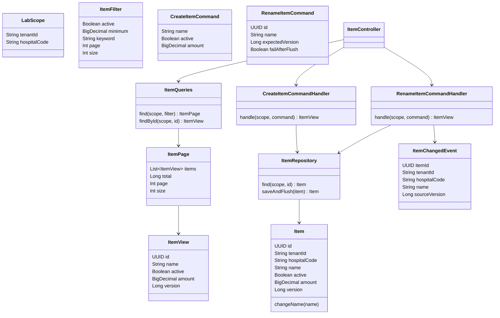
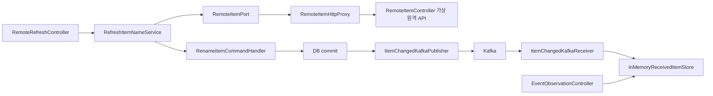

# Kotlin 실습 앱 설계

이 폴더는 독립적인 로컬 학습 프로젝트의 완성 예제를 제공한다. 실제 BC의 배포 골격이 아니다. PostgreSQL·QueryDSL·JPA·선언적 트랜잭션의 연결을 작은 코드로 실습한다.

## 실행 기준

- 참조 프로젝트: `reference/`, Gradle 단일 프로젝트, 패키지 `com.projectx.kotlinlab`.
- JDK 25, Kotlin 2.3.0, Spring Boot 4.0.4, QueryDSL OpenFeign 6.11, Gradle 9.1.0.
- PostgreSQL 전용 학습 DB `kotlin_lab`, 기본 스키마 `public`, 호스트 포트 55432. 앱은 127.0.0.1:58080에 바인딩한다.
- 데이터베이스 계정·비밀번호는 `.env` 또는 환경변수로 제공한다. 실제 서비스의 접속 설정은 복사하지 않는다.
- Liquibase가 표를 만들고 Hibernate는 `validate`로 매핑을 확인한다. 데이터는 HTTP POST로 넣는다.
- 인증 토큰 대신 앱 내부의 고정 범위 T1/H1을 쓴다. 실무에서는 인증에서 얻은 TenantScope로 대체한다.
- 실무의 CommandBus·사내 인증·공통 오류/관측 라이브러리는 사용하지 않는다. 조회와 쓰기를 분리한 핸들러를 Controller가 직접 호출한다.
- 이 교육용 축약은 기존 서비스의 표준을 바꾸지 않는다. 실무에서는 seedwork·CommandBus·인증·감사·inbox 등 해당 프로젝트 지침을 따른다.

## 모델과 경계

amount는 nullable, Entity version은 신규 상태에서 nullable이다. ItemView.version과 이벤트의 sourceVersion은 flush 이후 확정된 Long이다. ItemFilter의 active·minimum·keyword는 nullable이다.

쓰기 핸들러는 scope로 찾고, 도메인 메서드를 호출한 뒤 saveAndFlush한다. 현재 상태의 ItemChangedEvent를 Spring 이벤트로 올린다. 실패 실습은 flush·이벤트 등록 뒤 RuntimeException을 전파하여 rollback과 AFTER_COMMIT 리스너 미호출을 확인한다.

## 단계별 HTTP 계약

| 요청 | 의미 |
|---|---|
| `GET /lab/ping` | 앱 기동 확인 |
| `POST /lab/items` | name·active·amount로 생성, 생성 DTO 반환 |
| `GET /lab/items` | active·minimum·keyword·page·size로 목록과 total 조회 |
| `GET /lab/items/{id}` | 범위 내 단건 조회 |
| `PATCH /lab/items/{id}/name` | name·expectedVersion으로 수정; failAfterFlush로 rollback 실습 |

## 선택 확장

외부 HTTP는 실습 앱의 `/lab/remote/items/{externalId}`에서 가상 응답을 받아 별도 writer 트랜잭션으로 로컬 이름에 적용한다. 외부 DTO가 자동 저장되는 것이 아니라 명시 대입되는 것을 관찰한다.

Kafka는 `LAB_KAFKA_ENABLED=true`에서만 활성화한다. ItemChangedEvent를 AFTER_COMMIT에서 발행하는 best-effort 패턴이며 DB와 Kafka 원자성이나 재전송 보장을 제공하지 않는다. 수신은 payload를 로그 대신 별도 학습 상태로 확인할 수 있도록 확장한다. 상세 계약은 해당 확장 코드와 실습 문서에 함께 적는다.

| 추가 입력·응답 | 필드 |
|---|---|
| RefreshItemNameRequest | externalId: String, expectedVersion: Long |
| RemoteItemResponse / RemoteItemView | name: String? — 원격 JSON 키는 item_name |
| RemoteItemSnapshot | name: String? |
| ReceivedItemState | itemId: UUID, tenantId: String, hospitalCode: String, name: String, sourceVersion: Long |
| ReceivedEventsView | kafkaEnabled: Boolean, items: List<ReceivedItemState>, storage: String, survivesRestart: Boolean |

`InMemoryReceivedItemStore`는 항목별 sourceVersion을 비교하여 최신 상태만 메모리에 남긴다. DB inbox나 영속 사본이 아니며 재시작 시 소실된다. 같은 consumer group에 이미 저장된 offset이 있으면 과거 메시지를 자동으로 다시 읽지 않으므로 새 변경으로 실습한다. 원격 name=null이면 저장 없이 유지하고, 빈 문자열이면 기존 도메인 이름 규칙으로 거절한다.
