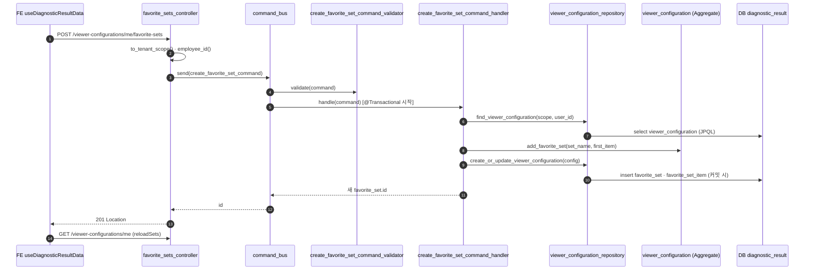
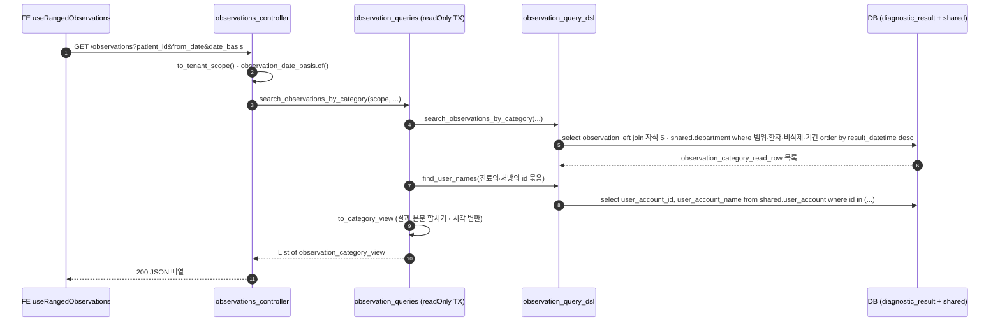
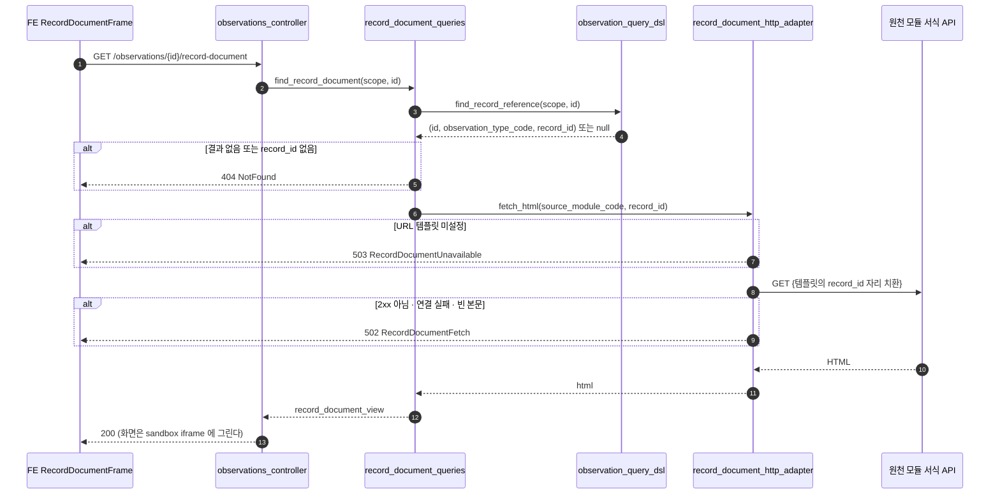
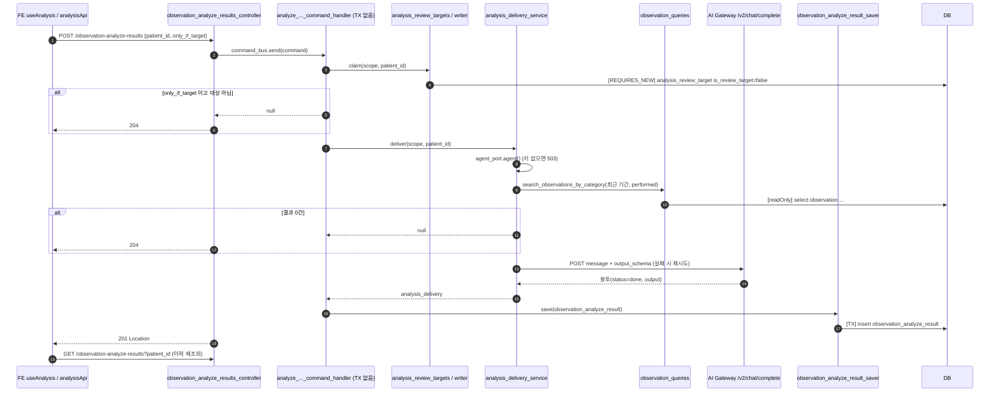
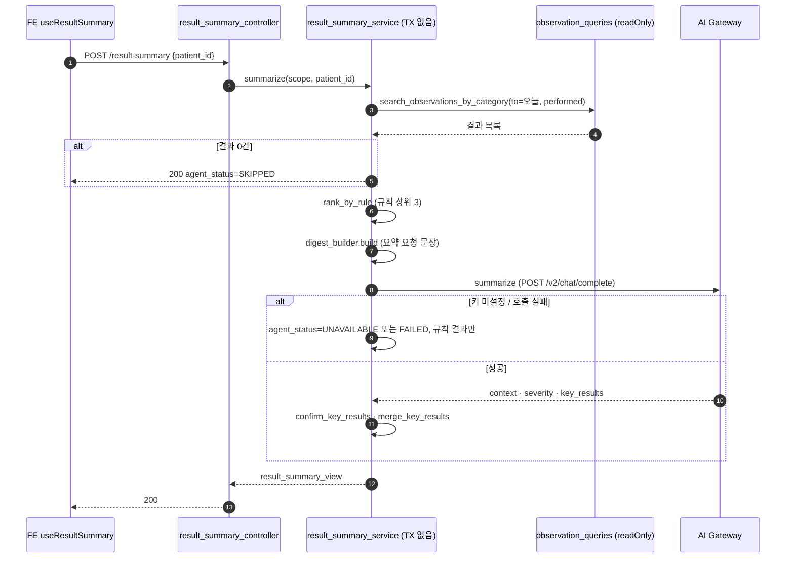
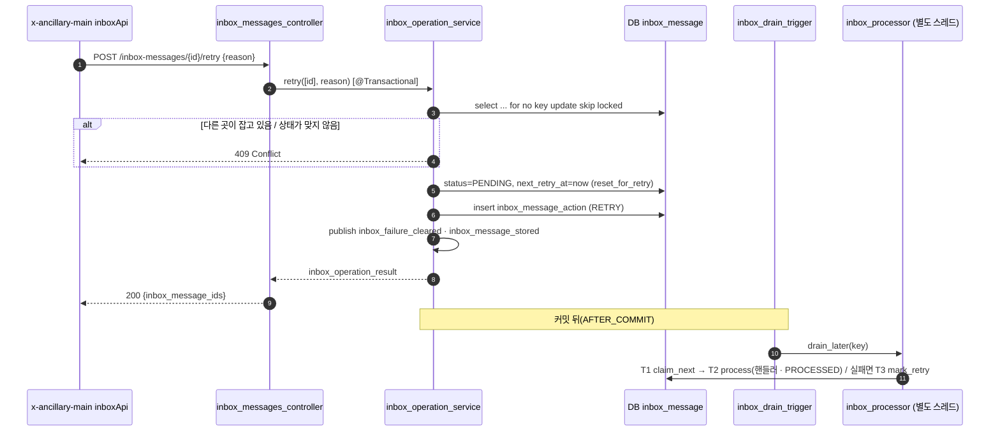
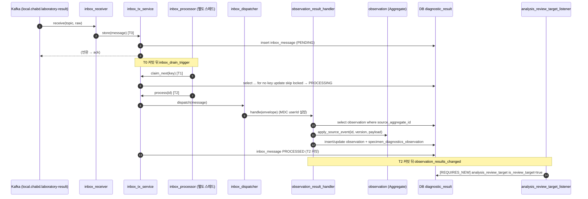

# diagnostic-result API 호출 추적서

> 대상 BC: `x-diagnostic-result` (MicroService 1개 = `diagnostic-result`, 포트 5351, API 접두 `/api/v1/diagnostic-result`)
> 독자: 신입 개발자. 「화면에서 이 API 를 부르면 백엔드의 어느 클래스 · 메서드가 차례로 불리고, 데이터는 어느 테이블에서 어떤 쿼리로 가져와 어떤 모양으로 돌아오는가」를 **엔드포인트 32개 전부**에 대해 찾아보는 참조서다.

## 목차

- [읽는 법 — 경로 약어와 표기](#읽는-법--경로-약어와-표기)
- [1. 이 BC 가 하는 일 · 테이블 · Aggregate](#1-이-bc-가-하는-일--테이블--aggregate)
  - [1.1 다섯 줄 요약](#11-다섯-줄-요약)
  - [1.2 레이어와 호출 방향](#12-레이어와-호출-방향)
  - [1.3 테이블 ↔ 엔티티 ↔ Aggregate](#13-테이블--엔티티--aggregate)
  - [1.4 shared 스키마로 읽는 테이블](#14-shared-스키마로-읽는-테이블)
  - [1.5 모든 API 에 공통인 규칙](#15-모든-api-에-공통인-규칙)
- [2. 엔드포인트 총괄표](#2-엔드포인트-총괄표)
- [3. 엔드포인트별 상세 카드](#3-엔드포인트별-상세-카드)
  - [3.0 공통 진입 흐름](#30-공통-진입-흐름)
  - [3.1 화면 설정 — A1 · A2](#31-화면-설정--a1--a2)
  - [3.2 즐겨찾기 세트 — B1 ~ B5](#32-즐겨찾기-세트--b1--b5)
  - [3.3 검사결과 조회 — C1 ~ C7](#33-검사결과-조회--c1--c7)
  - [3.4 AI 분석 이력 · 실행 — D1 ~ D4](#34-ai-분석-이력--실행--d1--d4)
  - [3.5 검사결과 요약 · 자유 질의 — E1 · E2](#35-검사결과-요약--자유-질의--e1--e2)
  - [3.6 수신 inbox 운영 — F1 ~ F12](#36-수신-inbox-운영--f1--f12)
- [4. Kafka 수신 경로 추적](#4-kafka-수신-경로-추적)
- [5. 외부 호출 추적](#5-외부-호출-추적)
- [6. 화면 → API 역추적표](#6-화면--api-역추적표)
- [7. 디버깅 가이드](#7-디버깅-가이드)
- [8. 스스로 확인 문제](#8-스스로-확인-문제)

---

## 읽는 법 — 경로 약어와 표기

본문 표 · 호출 체인에서는 경로가 길어 아래 약어를 쓴다. **코드 인용 블록 위에는 약어 없이 `x-diagnostic-result/…:시작줄-끝줄` 전체 경로**를 적었다.

| 약어 | 실제 경로 |
|---|---|
| `BE/` | `x-diagnostic-result/backend/diagnostic-result/src/main/kotlin/com/projectx/diagnosticresult/` |
| `RES/` | `x-diagnostic-result/backend/diagnostic-result/src/main/resources/` |
| `FE/` | `x-diagnostic-result/frontend/apps/diagnostic-result/src/` |
| `AM/` | `x-ancillary-main/frontend/apps/ancillary-main/src/` (inbox 운영 화면은 이 레포에 있다) |

- 표의 **경로** 칸은 접두 `/api/v1/diagnostic-result` 를 뺀 나머지다. 예: `/observations` = `GET /api/v1/diagnostic-result/observations`.
- 호출 체인의 `→` 는 「다음으로 부른다」, `⇒` 는 「트랜잭션 커밋 뒤 비동기로 이어진다」는 뜻이다.
- 요청 · 응답 JSON 은 **view_model · request 클래스 필드로 만든 예시**다. 값(UUID · 이름 · 수치)은 전부 가짜다.
- 이 MS 의 코드는 클래스 · 함수 · 변수 · JSON 필드가 전부 snake_case 다. 유일한 예외는 Kafka 로 받는 payload 필드(camelCase)다.

---

## 1. 이 BC 가 하는 일 · 테이블 · Aggregate

### 1.1 다섯 줄 요약

1. **검사결과를 스스로 만들지 않는 수신 전용 리드모델 BC** 다 — 검체진단(진검 · 병리) · 영상진단 · 기능진단 · 임상관찰(간호기록) · 외부연동기록이 Kafka 로 보내는 결과를 받아 하나의 `observation` 트리에 적재한다.
2. 적재한 결과를 **환자 · 수진 · 원 수진 · 단건 · 검사일 타임라인 · 환자목록** 단위로 조회하는 API 를 연다(전부 QueryDSL).
3. 결과를 **AI Gateway** 로 분석해 이력(`observation_analyze_result`)으로 남기고, 결과가 바뀐 환자를 「AI 재점검 대상」(`analysis_review_target`)으로 표시해 화면이 열릴 때 자동 분석하게 한다. 저장 없는 전체 요약 · 자유 질의도 연다.
4. 사용자(직원)별 화면 설정 — 마지막 보기 방식 · 즐겨찾기 세트 — 을 `viewer_configuration` Aggregate 로 저장한다.
5. Kafka 원문은 먼저 `inbox_message` 에 적재하고 따로 처리 · 재시도한다. 막힌 메시지를 사람이 재처리 · 수정 · 재전송 · 강제 종료하는 **inbox 운영 API** 를 x-ancillary-main 「수신 메시지 관리」 화면에 연다. 자체 발행 Kafka 이벤트는 없다.

### 1.2 레이어와 호출 방향

```
FE (React remote)                     BE (Spring Boot, 단일 모듈)
 views → widgets → features            presentation  — Controller · 요청 DTO · token_principal_scope
       → entities/*/api ──HTTP──▶       application   — command · command_bus · handler · validator
         shared/api/apiBase.ts                          query IF · view_model · port IF · analysis 서비스
                                        domain        — Aggregate · Entity · VO · Repository IF (Spring 의존 없음)
                                        infrastructure— Repository 어댑터 · QueryDSL · inbox · proxies(외부 HTTP) · shared 엔티티
```

- **쓰기**: Controller → `command_bus.send` → validator → handler(`@Transactional`) → Aggregate 메서드 → Repository IF → JPA 어댑터.
- **읽기**: Controller → `i_*_queries`(application IF) → `*_queries`(infrastructure, 클래스 단위 `@Transactional(readOnly = true)`) → `*_query_dsl`(`JPAQueryFactory`) → read row / view_model.
- **command_bus 를 거치지 않는 예외 셋**: 검사결과 요약(저장 없음 · 서비스 직접), AI 자유 질의(port 직접), inbox 운영(도메인 Aggregate 가 아니라 port `i_inbox_operation_port` 직접).

### 1.3 테이블 ↔ 엔티티 ↔ Aggregate

스키마는 `diagnostic_result`(모듈명 snake_case) 하나다. 테이블은 Liquibase `RES/db/changelog/changes/` 가 만든다.

| 테이블 | 엔티티 클래스 (파일) | Aggregate | 역할 · 비고 | 만든 changeSet |
|---|---|---|---|---|
| `observation` | `observation` (추상 · `@Inheritance(JOINED)` · 판별자 `observation_type_code`) `BE/domain/aggregatesmodel/observation/observation.kt` | **observation Root** | 결과 공통 헤더(환자 · 수진 · 처방 · 일시 4종 · 검사코드 · `source_aggregate_id` · `source_event_version` · `is_deleted` · `is_abnormal` · `record_id`) | 001 |
| `specimen_diagnostics_observation` | `specimen_diagnostics_observation` | observation 자식 | 검체진단(진검 · 병리 한 Entity, 병리는 부모 `diagnostic_service_section_code = SP`) | 001 |
| `diagnostic_imaging_observation` | `diagnostic_imaging_observation` | observation 자식 | 영상진단(판독 · 결론 · `pacs_study_uid`) | 001 |
| `functional_diagnostics_observation` | `functional_diagnostics_observation` | observation 자식 | 기능진단(ECG · PFT 등, `waveform_data_url`) | 001 |
| `clinical_record_observation` | `clinical_record_observation` (`numeric_record_observation` 상속) | observation 자식 | 임상관찰(혈압 · 체중 등) | 001 |
| `external_record_observation` | `external_record_observation` (`numeric_record_observation` 상속) | observation 자식 | 외부연동기록(PASTA 등, `source_type_code`) | 001 |
| `viewer_configuration` | `viewer_configuration` `BE/domain/aggregatesmodel/viewerconfiguration/viewer_configuration.kt` | **viewer_configuration Root** | 사용자당 1행(UK `tenant_id, hospital_code, user_id`) · `last_view_layout_code` · `@Version` | 001 |
| `favorite_set` | `favorite_set` | viewer_configuration 자식 Entity | 즐겨찾기 세트(이름 · `sort_order`), 사용자당 최대 20개 | 001 |
| `favorite_set_item` | `favorite_observation` (`@Embeddable` · `@ElementCollection`) | viewer_configuration 안 VO | 세트에 든 (검사구분, 검사코드) 쌍 | 001 |
| `observation_analyze_result` | `observation_analyze_result` `BE/domain/aggregatesmodel/observationanalyzeresult/` | **observation_analyze_result Root** | AI 분석 1회 = 1행(요약 · 본문 JSON · 에이전트 메타) | 001 |
| `analysis_review_target` | `analysis_review_target` `BE/domain/aggregatesmodel/analysisreviewtarget/` | **analysis_review_target Root** | 환자당 1행 — 재점검 대상 여부 · `marked_at` · `claimed_at` · `@Version` | 003 |
| `inbox_message` | `inbox_message` `BE/infrastructure/inbox/inbox_message.kt` | Aggregate 아님(수신 장치) | Kafka 원문 1건 · 상태(PENDING · PROCESSING · PROCESSED · FAILED · TERMINATED) · PK = 도착 순번(IDENTITY) | 004 |
| `inbox_message_action` | `inbox_message_action` `BE/infrastructure/inbox/inbox_message_action.kt` | Aggregate 아님 | 사람이 한 조작 이력(RETRY · EDIT · RESEND · TERMINATE) | 006 |

- 모든 도메인 테이블은 「PK(`<테이블명>_id`) → `tenant_id` · `hospital_code` → 업무 컬럼 → 감사 4종(`created_at` · `created_by` · `updated_at` · `updated_by`)」 순서다. 감사 컬럼은 `BE/infrastructure/persistence/audit_entity_listener.kt` 가 MDC `userId` 로 채운다(`RES/META-INF/orm.xml` 등록).
- 시각 컬럼은 전부 `timestamptz`(엔티티 타입 `Instant`)이고, API 로 내릴 때 병원 현지시각 `LocalDateTime` 으로 바꾼다(`BE/infrastructure/queries/query_conversions.kt` 의 `Clock.to_local`).

### 1.4 shared 스키마로 읽는 테이블

프로젝트 정책상 환자 · 수진 · 직원 정보는 같은 DB 의 `shared` 스키마에 있고, 이 MS 는 **읽기 전용 JPA 엔티티**(`@Immutable` · `@Table(schema = "shared")`)로만 읽는다. 쓰는 컬럼만 매핑한다.

| shared 테이블 | 매핑 클래스 (파일) | 매핑한 컬럼 | 어디서 읽나 | 읽는 방식 |
|---|---|---|---|---|
| `shared.patient` | `shared_patient` `BE/infrastructure/shared/shared_patient.kt:25` | `patient_id`, `patient_name` | C5 환자목록 | `observation.patient_id = patient.patient_id` LEFT JOIN + `max(patient_name)` |
| `shared.department` | `shared_department` `BE/infrastructure/shared/shared_department.kt:21` | `department_id`, `department_name` | C1 · C2 · C3 · C6 (그리고 D4 · E1 이 내부에서 C1 쿼리를 다시 쓴다) | `observation.department_id = department.department_id` LEFT JOIN |
| `shared.user_account` | `shared_user_account` `BE/infrastructure/shared/shared_user_account.kt:19` | `user_account_id`, `user_account_name` | C1 · C2 · C3 · C6 진료의 · 처방의 이름, F3 조작자 이름 | **조인하지 않고** 결과 행의 id 를 모아 `IN (...)` 으로 한 번 더 읽는다 |

- `shared.encounter` 는 매핑하지 않는다 — `observation.encounter_id` · `origin_encounter_id` 는 uuid 값만 갖고, 수진 정보(입원외래 구분 · 진료일자)는 수신 payload 스냅샷(`encounter_class` · `encounter_date`)을 쓴다.
- 앱 계정에 `shared` SELECT 권한이 없으면 Hibernate `validate` 단계에서 기동이 실패한다.

### 1.5 모든 API 에 공통인 규칙

| 항목 | 내용 | 근거 |
|---|---|---|
| 인증 | 모든 컨트롤러에 `@RequireAuth`(common-jwt-kt). 토큰이 없거나 만료면 401 | 각 컨트롤러 클래스 선언부 |
| 테넌트 범위 | `@TokenPrincipal AuthPrincipal` → `to_tenant_scope()` 로 `(tenant_id, hospital_code)` 를 만들고, **모든 조회 · 저장이 이 범위 안에서만** 본다 | `BE/presentation/token_principal_scope.kt:14` |
| 사용자 키 | 토큰 `sub` → `employee_id()`. UUID 표준 형식이 아니면 401 `AUTH_TOKEN_INVALID` | `BE/presentation/token_principal_scope.kt:18-20` |
| 오류 본문 | `{ "error": "<카테고리>", "message": "<사유>", "details": [...] }` (`details` 는 command 검증 실패 때만 채운다) | `BE/infrastructure/config/global_exception_handler.kt` |
| inbox 오류 본문 | `{ "error", "message" }` — `inbox_messages_controller` 에만 걸리는 별도 advice. 다른 BC(x-patient-appointment)와 같은 계약 | `BE/presentation/inbox_error_advice.kt:38-40` |
| 시각 표기 | 응답 시각은 오프셋 없는 병원 현지시각(`2026-03-02T09:10:00`) | `query_conversions.kt` |

예외 → HTTP 매핑 요약(전역 advice 기준):

| 예외 | HTTP | `error` |
|---|---|---|
| `JwtAuthenticationException` | 401 · 403 | `AUTH_TOKEN_MISSING` 등 라이브러리 코드 |
| `diagnostic_result_not_found_exception` | 404 | `NotFound` |
| `diagnostic_result_validation_exception` · `command_validation_exception` · `IllegalArgumentException` · 파라미터 형식 오류 · 본문 해석 실패 | 400 | `Validation` |
| `diagnostic_result_conflict_exception` · `OptimisticLockingFailureException` | 409 | `Conflict` |
| 위에서 안 잡힌 `diagnostic_result_domain_exception` | 422 | `DomainRuleViolation` |
| `analysis_agent_unavailable_exception` / `record_document_unavailable_exception` | 503 | `AgentUnavailable` / `RecordDocumentUnavailable` |
| `analysis_agent_failure_exception` / `record_document_fetch_exception` | 502 | `AgentFailure` / `RecordDocumentFetch` |
| 그 밖의 `Exception` | 500 | `InternalError`(고정 문구, 원인은 로그만) |

---

## 2. 엔드포인트 총괄표

컨트롤러 7개 · 엔드포인트 32개다(원본 `BE/presentation/*_controller.kt` 전수). 경로는 접두 `/api/v1/diagnostic-result` 를 뺐다. 「FE」 칸의 함수는 별도 표기가 없으면 `FE/` 아래에 있다.

| ID | HTTP | 경로 | 컨트롤러.메서드 | 쓰기/읽기 | 호출 체인 | 데이터 출처 | 응답 타입 | 부르는 FE 화면 / 함수 |
|---|---|---|---|---|---|---|---|---|
| A1 | GET | `/viewer-configurations/me` | `viewer_configurations_controller.find_viewer_configuration` | 읽기 | `i_viewer_configuration_queries.find_viewer_configuration` → `viewer_configuration_queries.find_viewer_configuration` → `viewer_configuration_query_dsl.find_viewer_configuration` | `viewer_configuration` · `favorite_set` · `favorite_set_item` (`Qviewer_configuration` · `Qfavorite_set` · `Qfavorite_observation`, 3번 projection) | `viewer_configuration_view` / 404 | 검사결과조회 — `useDiagnosticResultData` 진입 effect · `reloadSets` → `fetchViewerConfig` |
| A2 | PUT | `/viewer-configurations/me` | `viewer_configurations_controller.save` | 쓰기 | `command_bus.send` → `register_viewer_configuration_command_validator.validate` → `register_viewer_configuration_command_handler.handle` → `find_or_new_viewer_configuration` → `viewer_configuration.set_last_view_layout` → `viewer_configuration_repository.create_or_update_viewer_configuration` | `viewer_configuration` (JPQL `find_first_by_user_id` + `save`) | 204 | 검사결과조회 — `persistConfig` → `saveViewerConfig` |
| B1 | POST | `/viewer-configurations/me/favorite-sets` | `favorite_sets_controller.create_favorite_set` | 쓰기 | `command_bus.send` → `create_favorite_set_command_validator` → `create_favorite_set_command_handler.handle` → `find_or_new_viewer_configuration` → `viewer_configuration.add_favorite_set` → `create_or_update_viewer_configuration` | `viewer_configuration` · `favorite_set` · `favorite_set_item` | 201 + `Location` | 검사결과조회 — `createSet` · `toggleSet`(저장 안 된 기본 세트) · `renameSet`(저장 안 된 세트) → `createFavoriteSet` |
| B2 | PATCH | `/viewer-configurations/me/favorite-sets/{favorite_set_id}` | `favorite_sets_controller.rename_favorite_set` | 쓰기 | `command_bus.send` → `rename_favorite_set_command_validator` → `rename_favorite_set_command_handler.handle` → `require_viewer_configuration` → `viewer_configuration.rename_favorite_set` → `create_or_update_viewer_configuration` | `favorite_set.set_name` | 204 | 검사결과조회 — `renameSet` → `renameFavoriteSet` |
| B3 | DELETE | `/viewer-configurations/me/favorite-sets/{favorite_set_id}` | `favorite_sets_controller.delete_favorite_set` | 쓰기 | `command_bus.send`(validator 없음) → `delete_favorite_set_command_handler.handle` → `require_viewer_configuration` → `viewer_configuration.remove_favorite_set` → `create_or_update_viewer_configuration` | `favorite_set` · `favorite_set_item` (orphanRemoval 로 DELETE) | 204 | 검사결과조회 — `deleteSet` → `deleteFavoriteSet` |
| B4 | PUT | `/viewer-configurations/me/favorite-sets/order` | `favorite_sets_controller.reorder_favorite_sets` | 쓰기 | `command_bus.send` → `reorder_favorite_sets_command_validator` → `reorder_favorite_sets_command_handler.handle` → `require_viewer_configuration` → `viewer_configuration.reorder_favorite_sets` → `create_or_update_viewer_configuration` | `favorite_set.sort_order` | 204 | 검사결과조회 — `moveSet` → `reorderFavoriteSets` |
| B5 | PUT | `/viewer-configurations/me/favorite-assignments` | `favorite_sets_controller.assign_favorite_sets` | 쓰기 | `command_bus.send` → `assign_favorite_sets_command_validator` → `assign_favorite_sets_command_handler.handle` → `find_or_new_viewer_configuration` → `viewer_configuration.assign_observation_to_sets` → `create_or_update_viewer_configuration` | `favorite_set_item` (설정이 없으면 `viewer_configuration` INSERT 포함) | 204 | 검사결과조회 — 별표 선택창 `toggleSet` → `assignFavoriteSets` |
| C1 | GET | `/observations?patient_id&observation_type_code&category_code&from_date&to_date&date_basis` | `observations_controller.search_observations_by_category` | 읽기 | `observation_date_basis.of` → `i_observation_queries.search_observations_by_category` → `observation_queries.search_observations_by_category` → `observation_query_dsl.search_observations_by_category`(`category_query` + `search_where` + `period_predicate`) → `observation_queries.to_category_views` → `observation_query_dsl.find_user_names` | `observation` + 자식 5테이블 LEFT JOIN + `shared.department` LEFT JOIN, `shared.user_account` 별도 IN 조회 (`Qobservation` · `Qspecimen_diagnostics_observation` · `Qdiagnostic_imaging_observation` · `Qfunctional_diagnostics_observation` · `Qclinical_record_observation` · `Qexternal_record_observation` · `Qshared_department` · `Qshared_user_account`) | `List<observation_category_view>` | 검사결과조회 · 검사결과 요약 — `useRangedObservations` → `fetchObservations` |
| C2 | GET | `/observations/encounters/{encounter_id}` | `observations_controller.search_observations_by_encounter` | 읽기 | `observation_queries.search_observations_by_encounter` → `observation_query_dsl.search_observations_by_encounter`(`encounter_where`) → `to_category_views` | C1 과 같음(조건만 `encounter_id`) | `List<observation_category_view>` | 이 FE 에서는 부르지 않는다(수진 단위 조회가 필요한 다른 화면 · BC 용) |
| C3 | GET | `/observations/origin-encounters/{origin_encounter_id}` | `observations_controller.search_observations_by_origin_encounter` | 읽기 | `observation_queries.search_observations_by_origin_encounter` → `observation_query_dsl.search_observations_by_origin_encounter`(`origin_encounter_where`) → `to_category_views` | C1 과 같음(조건만 `origin_encounter_id`) | `List<observation_category_view>` | 이 FE 에서는 부르지 않는다 |
| C4 | GET | `/observations/exam-dates?patient_id&date_basis` | `observations_controller.search_observation_exam_dates` | 읽기 | `observation_queries.search_observation_exam_dates` → `observation_query_dsl.search_observation_exam_dates`(`exam_date_query`, Tuple) → `to_exam_date_views`(Kotlin 집계) | `observation` + `specimen_diagnostics_observation` LEFT JOIN | `List<observation_exam_date_view>` | 검사결과조회 · 검사결과 요약 — `useRangedObservations` → `fetchExamDates` |
| C5 | GET | `/observations/patients?keyword&page&size` | `observations_controller.search_observation_patients` | 읽기 | `observation_queries.search_observation_patients` → `observation_query_dsl.search_observation_patients`(`patient_list_query`) + `count_observation_patients` | `observation` + `shared.patient` LEFT JOIN, `group by patient_id` (`Qshared_patient`) | `page_view<observation_patient_view>` | 환자목록(dev) · 테스트조회(dev) — `usePatientSearch` → `fetchObservationPatients` |
| C6 | GET | `/observations/{id}` | `observations_controller.find_observation` | 읽기 | `observation_queries.find_observation` → `observation_query_dsl.find_observation`(`category_query`) → `to_category_views` | C1 과 같음(조건만 `id`) | `observation_category_view` / 404 | 검사결과조회 — 상세 열기 `openDetail` → `fetchObservation` |
| C7 | GET | `/observations/{id}/record-document` | `observations_controller.find_record_document` | 읽기 + 외부 | `i_record_document_queries.find_record_document` → `record_document_queries.find_record_document` → `find_reference` → `observation_query_dsl.find_record_reference` → `source_module_code_of` → `i_record_document_port.fetch_html` → `record_document_http_adapter.fetch_html` | `observation`(id · 분류 · `record_id`) + **원천 모듈 서식 API(HTTP GET)** | `record_document_view` / 404 · 503 · 502 | 검사결과조회 — 상세 서식 탭 · 보고서뷰 `RecordDocumentFrame` → `fetchRecordDocument` |
| D1 | GET | `/observation-analyze-results/{id}` | `observation_analyze_results_controller.find_one` | 읽기 | `observation_analyze_result_queries.find_observation_analyze_result` → `observation_analyze_result_query_dsl.find_observation_analyze_result` → `to_view` → `analysis_response_normalizer.derive` | `observation_analyze_result` (`Qobservation_analyze_result`) | `observation_analyze_result_view` / 404 | 이 FE 에서는 부르지 않는다(D4 응답 `Location` 이 가리키는 주소) |
| D2 | GET | `/observation-analyze-results?patient_id&page&size` | `observation_analyze_results_controller.search_by_patient` | 읽기 | `observation_analyze_result_queries.search_by_patient` → `observation_analyze_result_query_dsl.search_by_patient` + `count_by_patient` → `to_view` | `observation_analyze_result` | `page_view<observation_analyze_result_view>` | 검사결과조회 — `useAnalysis` · `runAnalysisOnce` → `fetchAnalysesForPatient` |
| D3 | GET | `/observation-analyze-results/status?patient_id` | `observation_analyze_results_controller.find_analysis_status` | 읽기 | `observation_analyze_result_queries.find_analysis_status` → `observation_analyze_result_query_dsl.find_review_target` | `analysis_review_target` (`Qanalysis_review_target`) | `observation_analysis_status_view` | 검사결과조회 — `useAnalysis` 자동 판정 → `fetchAnalysisStatus` |
| D4 | POST | `/observation-analyze-results` | `observation_analyze_results_controller.run_analysis` | 쓰기 + 외부 | `command_bus.send` → `analyze_observations_by_patient_command_handler.handle` → `analysis_review_targets.claim` → `analysis_review_target_writer.claim` → `analysis_delivery_service.deliver` → `i_analysis_agent_port.agent` → `i_observation_queries.search_observations_by_category` → `observation_digest_builder.build` → `ai_gateway_analysis_agent.analyze` → `observation_analyze_result_saver.save` | `analysis_review_target`(UPDATE) · `observation`+자식+shared(읽기) · **AI Gateway** · `observation_analyze_result`(INSERT) | 201 + `Location` / 204 / 503 / 502 | 검사결과조회 — `useAnalysis.run`(자동 · 「다시 분석」) → `runAnalysis` |
| E1 | POST | `/result-summary` | `result_summary_controller.summarize` | 읽기 + 외부(저장 없음) | `result_summary_service.summarize` → `i_observation_queries.search_observations_by_category` → `rank_by_rule` → `observation_digest_builder.build` → `i_analysis_agent_port.agent().summarize` → `confirm_key_results` → `merge_key_results` | `observation`+자식+shared(읽기) · **AI Gateway** | `result_summary_view` (에이전트 실패도 200) | 검사결과 요약 — `useResultSummary` → `fetchResultSummary` |
| E2 | POST | `/ai-chat` | `ai_chat_controller.chat` | 외부 중계(저장 없음) | `i_analysis_agent_port.agent` → `ai_gateway_analysis_agent.chat` → `complete` | **AI Gateway** 만 | `ai_chat_view` / 400 · 503 | 테스트조회(dev) — `FE/views/poc-test/aiAgent.ts` `callAiAgent` |
| F1 | GET | `/inbox-summary?received_from&received_to` | `inbox_messages_controller.summary` | 읽기 | `inbox_message_queries.summary` → `inbox_message_query_dsl.summary` | `inbox_message` (`group by status`, `Qinbox_message`) | `inbox_summary_view` | x-ancillary-main 수신 메시지 관리 — `AM/pages/inbox-messages/model/api.ts` `inboxApi.summary` |
| F2 | GET | `/inbox-messages?statuses&q&topic&partition_key&received_from&received_to&order&cursor&size` | `inbox_messages_controller.find_messages` | 읽기 | `inbox_message_queries.find_messages` → `inbox_message_query_dsl.find_rows` + `count_rows` | `inbox_message` (커서 페이징) | `inbox_message_page_view` | 〃 `inboxApi.messages` |
| F3 | GET | `/inbox-messages/{inbox_message_id}` | `inbox_messages_controller.find_message` | 읽기 | `inbox_message_queries.find_message` → `find_rows_by_ids` + `find_detail_row` + `find_actions` + `find_user_names` → `inbox_payload_rules.locked_paths` | `inbox_message` · `inbox_message_action` · `shared.user_account` (`Qinbox_message_action` · `Qshared_user_account`) | `inbox_message_detail_view` / 404 | 〃 `inboxApi.message` |
| F4 | GET | `/inbox-messages/{inbox_message_id}/sequence?before&after` | `inbox_messages_controller.find_sequence` | 읽기 | `inbox_message_queries.find_sequence` → `find_rows_by_ids` + `find_before` + `find_after` + `count_around` | `inbox_message` | `inbox_sequence_view` / 404 | 〃 `inboxApi.sequence` |
| F5 | GET | `/inbox-keys?q&partition_key&received_from&received_to&unfinished_only&size` | `inbox_messages_controller.find_keys` | 읽기 | `inbox_message_queries.find_keys` → `find_key_rows` + `find_rows_by_ids` → `inbox_status_rules.key_status` | `inbox_message` | `inbox_key_list_view` | 〃 `inboxApi.keys` |
| F6 | POST | `/inbox-messages/{inbox_message_id}/retry` | `inbox_messages_controller.retry` | 쓰기 | `i_inbox_operation_port.retry` → `inbox_operation_service.retry` → `lock`(`lock_for_operation`, SKIP LOCKED) → `inbox_message.reset_for_retry` → `inbox_message_action` 저장 → `inbox_message_stored` 발행 ⇒ `inbox_drain_trigger` → `inbox_processor.drain` | `inbox_message` · `inbox_message_action` | `inbox_operation_result` | 〃 `inboxApi.retry`(1건) |
| F7 | POST | `/inbox-message-retries` | `inbox_messages_controller.retry_many` | 쓰기 | F6 과 같은 `inbox_operation_service.retry`(최대 200건, 하나라도 안 되면 전부 거절) | 〃 | `inbox_operation_result` | 〃 `inboxApi.retry`(여러 건) |
| F8 | PUT | `/inbox-messages/{inbox_message_id}/payload` | `inbox_messages_controller.edit_payload` | 쓰기 | `inbox_operation_service.edit_payload` → `lock` → `inbox_payload_rules.changed_locked_paths` → `replace_payload` + `reset_for_retry` → action 저장 → `inbox_message_stored` | 〃 | `inbox_operation_result` | 〃 `inboxApi.editPayload` |
| F9 | POST | `/inbox-messages/{inbox_message_id}/resend` | `inbox_messages_controller.resend` | 쓰기 | `inbox_operation_service.resend` → `lock` → `count_resends` → `inbox_message.resent_from` 새 행 저장 → action 저장 → `inbox_message_stored` | 〃 (새 행 INSERT) | `inbox_operation_result`(새 행 id) | 〃 `inboxApi.resend` |
| F10 | POST | `/inbox-messages/{inbox_message_id}/terminate` | `inbox_messages_controller.terminate` | 쓰기 | `inbox_operation_service.terminate` → `lock` → `inbox_message.terminate` → action 저장 → `inbox_message_stored` | 〃 | `inbox_operation_result` | 〃 `inboxApi.terminate`(1건) |
| F11 | POST | `/inbox-message-terminations` | `inbox_messages_controller.terminate_many` | 쓰기 | F10 과 같은 `inbox_operation_service.terminate`(최대 200건) | 〃 | `inbox_operation_result` | 〃 `inboxApi.terminate`(여러 건) |
| F12 | POST | `/inbox-messages/{inbox_message_id}/alert` | `inbox_messages_controller.send_alert` | 읽기 + 외부 | `inbox_operation_service.send_alert`(트랜잭션 없음) → `inbox_message_jpa_repository.findById` → `communication_token_source.request_token` → `inbox_failure_alert.send_now` → `communication_inbox_client.emit` | `inbox_message`(읽기) + **알림 센터 HTTP POST** | `inbox_alert_result` / 400 · 404 · 409 · 503 · 502 | 〃 `inboxApi.sendAlert` |

---

## 3. 엔드포인트별 상세 카드

각 카드는 「요청 예시 → 호출 체인 → 데이터 조회 방식 → 트랜잭션 경계 → 응답 예시 → 예외」 순서다. 같은 패턴은 한 카드로 묶고 차이만 표로 보였다. 시퀀스 다이어그램은 B1 · C1 · C7 · D4 · E1 · F6 에 있다.

### 3.0 공통 진입 흐름

모든 요청은 같은 입구를 지난다.

1. FE 의 entity api 함수가 `FE/shared/api/apiBase.ts` 의 `get` · `post` · `put` · `patch` · `del` 을 부른다. 이 함수들은 `@x-ehr/api-axios` 의 `api` 에 위임하므로 **로그인 토큰 헤더는 공통 패키지가 붙인다**. 접두 `PREFIX = '/api/v1/diagnostic-result'`(`apiBase.ts:17`)가 여기서 붙는다.
2. BE 에서 common-jwt-kt 가 `@RequireAuth` 를 보고 토큰을 검증하고, `@TokenPrincipal AuthPrincipal` 을 컨트롤러 인자로 넣는다. 같은 필터가 MDC 에 `userId` · `tenantId` · `hospitalCode` 를 넣는다(감사 컬럼 · inbox 조작자가 이 값을 읽는다).
3. 컨트롤러가 `principal.to_tenant_scope()` · `principal.employee_id()` 로 테넌트 범위와 직원 id 를 만든다 — **`AuthPrincipal` 은 presentation 밖으로 나가지 않는다.**
4. 쓰기면 `command_bus.send`, 읽기면 `i_*_queries` 를 부른다.

`x-diagnostic-result/frontend/apps/diagnostic-result/src/shared/api/apiBase.ts:83-90`
```ts
export async function get<T>(path: string, params?: QueryParams): Promise<T> {
  try {
    const res = await api.get<T>(PREFIX + path, { params: cleanParams(params) })
    return res.data
  } catch (e) {
    throw toApiError(e, path)
  }
}
```

`toApiError` 는 응답 본문의 `message` 를 그대로 `ApiError.message` 로 옮긴다 — 그래서 BE 오류 문구가 화면 배너에 그대로 보인다. 응답 없이 시간이 넘으면 `timedOut = true` 다(기본 10초, 요청별 최대 50초).

쓰기 명령은 전부 `command_bus` 한 곳을 지난다 — **validator 를 먼저 모두 돌리고**, 그다음 `handle(파라미터 타입)` 이 맞는 핸들러 빈을 찾아 부른다.

`x-diagnostic-result/backend/diagnostic-result/src/main/kotlin/com/projectx/diagnosticresult/application/commands/command_bus.kt:19-47`
```kotlin
    @Suppress("UNCHECKED_CAST")
    fun <C : command<R>, R> send(command: C): R {
        val command_type = command::class.java

        validators
            .filter { it.command_type().java.isAssignableFrom(command_type) }
            .forEach { validator ->
                logger.debug { "커맨드 검증: ${command_type.simpleName}" }
                (validator as command_validator<C>).validate(command)
            }

        // !it.isBridge 필수 — Kotlin 제네릭 타입 소거 시 bridge method 가 모든 핸들러를 매칭하는 문제 방지
        val handler_bean_name = handler_cache.getOrPut(command_type) {
            application_context.getBeanNamesForType(command_handler::class.java)
                .firstOrNull { bean_name ->
                    val bean = application_context.getBean(bean_name) as command_handler<*, *>
                    val handle_method = bean::class.java.methods
                        .firstOrNull { it.name == "handle" && it.parameterCount == 1 && !it.isBridge }
                    handle_method?.parameterTypes?.firstOrNull()?.isAssignableFrom(command_type) == true
                }
                ?: throw IllegalStateException("핸들러를 찾을 수 없습니다: ${command_type.simpleName}")
        }

        val handler = application_context.getBean(handler_bean_name) as command_handler<C, R>
        logger.debug { "커맨드 처리 시작: ${command_type.simpleName}" }
        val result = handler.handle(command)
        logger.debug { "커맨드 처리 완료: ${command_type.simpleName}" }
        return result
    }
```

- `command_bus` 자체에는 트랜잭션이 없다. **트랜잭션 경계는 각 핸들러의 `handle()`** 이다(D4 만 예외 — 아래 카드).
- validator 가 던지는 `command_validation_exception` 은 400 이고, 응답 `details` 에 오류 문장 목록이 실린다.

---

### 3.1 화면 설정 — A1 · A2

#### A1. `GET /viewer-configurations/me` — 내 화면 설정 조회

**요청 예시**
```http
GET /api/v1/diagnostic-result/viewer-configurations/me
Authorization: Bearer <로그인 토큰>
```

**호출 체인**

| 단계 | 클래스.메서드 | 위치 |
|---|---|---|
| 1 | FE `useDiagnosticResultData` 진입 effect → `fetchViewerConfig(userId)` | `FE/widgets/diagnostic-result/useDiagnosticResultData.ts:161` → `FE/entities/viewer-configuration/api/viewerConfigurationApi.ts:65-73` |
| 2 | `viewer_configurations_controller.find_viewer_configuration` | `BE/presentation/viewer_configurations_controller.kt:33-38` |
| 3 | `i_viewer_configuration_queries.find_viewer_configuration` (IF) | `BE/application/queries/i_viewer_configuration_queries.kt` |
| 4 | `viewer_configuration_queries.find_viewer_configuration` — 클래스 `@Transactional(readOnly = true)` | `BE/infrastructure/queries/viewer_configuration_queries.kt:15-22` |
| 5 | `viewer_configuration_query_dsl.find_viewer_configuration` — 본체 → 세트 → 항목 3번 조회 | `BE/infrastructure/queries/viewer_configuration_query_dsl.kt:29-89` |

**데이터 조회 방식** — 컬렉션은 생성자 projection 으로 한 번에 못 만들어 3번에 나눠 읽는다. 세트 항목은 세트 id 묶음 `IN` 한 번이라 N+1 이 없다.

`x-diagnostic-result/backend/diagnostic-result/src/main/kotlin/com/projectx/diagnosticresult/infrastructure/queries/viewer_configuration_query_dsl.kt:29-56`
```kotlin
    fun find_viewer_configuration(scope: tenant_scope, user_id: UUID): viewer_configuration_view? {
        val head = query_factory
            .select(
                Projections.constructor(
                    viewer_configuration_head::class.java,
                    c.id,
                    c.user_id,
                    c.last_view_layout_code,
                ),
            )
            .from(c)
            .where(tenant_predicate(c.tenant_id, c.hospital_code, scope), c.user_id.eq(user_id))
            .fetchFirst() ?: return null

        val sets = query_factory
            .select(
                Projections.constructor(
                    favorite_set_head::class.java,
                    s.id,
                    s.set_name,
                    s.sort_order,
                ),
            )
            .from(c)
            .join(c._favorite_sets, s)
            .where(c.id.eq(head.id))
            .orderBy(s.sort_order.asc())
            .fetch()
```

세 번째 조회(`:58-75`)는 `from(s).join(s._items, i).where(s.id.in(세트 id 목록))` 으로 `favorite_set_item` 을 한 번에 읽어 세트 id 로 묶는다.

**트랜잭션** — `viewer_configuration_queries` 클래스 단위 읽기 전용 트랜잭션 1개 안에서 SELECT 3번.

**응답 예시** (`viewer_configuration_view` 필드 기준 · 값은 가짜)
```json
{
  "user_id": "11111111-1111-4111-8111-111111111111",
  "favorite_sets": [
    {
      "id": "aaaaaaaa-0000-4000-8000-000000000001",
      "set_name": "신장 기능",
      "sort_order": 0,
      "items": [
        { "observation_type_code": "SPECIMEN_DIAGNOSTICS", "observation_code": "LAB-CRE" }
      ]
    }
  ],
  "last_view_layout_code": "CUMULATIVE"
}
```

**예외** — 설정 행이 없으면 **본문 없는 404**(컨트롤러가 `ResponseEntity.notFound()` 를 돌려준다). FE 는 404 를 정상으로 보고 기본값(`DEFAULT_VIEWER_CONFIG`, 보기 방식 `CUMULATIVE`)을 쓴다(`viewerConfigurationApi.ts:70`). 토큰 문제는 401.

#### A2. `PUT /viewer-configurations/me` — 마지막 보기 방식 저장(upsert)

**요청 예시** (`save_viewer_configuration_request`)
```http
PUT /api/v1/diagnostic-result/viewer-configurations/me
Content-Type: application/json

{ "last_view_layout_code": "REPORT" }
```

**호출 체인**

| 단계 | 클래스.메서드 | 위치 |
|---|---|---|
| 1 | FE 보기 방식 전환 → `persistLayout` → `persistConfig` → `saveViewerConfig` | `FE/widgets/diagnostic-result/useDiagnosticResultData.ts:247-266` → `viewerConfigurationApi.ts:76-84` |
| 2 | `viewer_configurations_controller.save` → `save_viewer_configuration_request.to_command` | `BE/presentation/viewer_configurations_controller.kt:45-52, 57-64` |
| 3 | `command_bus.send` | `BE/application/commands/command_bus.kt:20` |
| 4 | `register_viewer_configuration_command_validator.validate` — 코드가 DETAIL · REPORT · CUMULATIVE · HOURLY 밖이면 400 | `BE/application/validations/register_viewer_configuration_command_validator.kt:19` |
| 5 | `register_viewer_configuration_command_handler.handle` — `@Transactional` | `BE/application/commands/register_viewer_configuration_command_handler.kt:13-20` |
| 6 | `find_or_new_viewer_configuration` — 없으면 새 Aggregate | `BE/application/commands/viewer_configuration_lookup.kt:25-26` |
| 7 | `viewer_configuration_repository.find_viewer_configuration` → `viewer_configuration_jpa_repository.find_first_by_user_id`(JPQL) | `BE/infrastructure/repositories/viewer_configuration_repository.kt:24-25` · `BE/infrastructure/diagnostic_result_context.kt:36-47` |
| 8 | `viewer_configuration.set_last_view_layout` — 허용 코드 재검증 | `BE/domain/aggregatesmodel/viewerconfiguration/viewer_configuration.kt:124` |
| 9 | `viewer_configuration_repository.create_or_update_viewer_configuration` → `jpa.save` + `domain_event_dispatcher.dispatch` | `BE/infrastructure/repositories/viewer_configuration_repository.kt:18-22` |

**데이터** — `viewer_configuration` 1행 SELECT 뒤 INSERT 또는 UPDATE(`version` 증가). 감사 컬럼은 `audit_entity_listener` 가 채운다.

**트랜잭션** — 핸들러 `handle()` 하나. 커밋 때 `@Version` 낙관적 잠금을 검사한다.

**응답** — 204(본문 없음).

**예외** — 400 `Validation`(허용되지 않은 코드), 409 `Conflict`(같은 사용자의 동시 저장 · 낙관락 충돌). FE 는 이 API 의 실패를 화면에 알리지 않는다(`useDiagnosticResultData.ts:253-256` — 조작마다 저장하는 값이라 배너가 반복되지 않게 한다).

---

### 3.2 즐겨찾기 세트 — B1 ~ B5

다섯 API 모두 `viewer_configuration` Aggregate 하나를 읽어 Aggregate Root 메서드로 바꾸고 통째로 저장한다. 즐겨찾기 **조회 API 는 따로 없다** — A1 응답의 `favorite_sets` 가 조회다. FE 는 조작마다 저장한 뒤 A1 을 다시 불러 서버 값(새 세트 id · 순서)으로 맞춘다(`mutateSets` → `reloadSets`).

#### B1. `POST /viewer-configurations/me/favorite-sets` — 세트 생성 (대표 쓰기 경로)

**요청 예시** (`create_favorite_set_request`)
```http
POST /api/v1/diagnostic-result/viewer-configurations/me/favorite-sets
Content-Type: application/json

{ "set_name": "신장 기능", "observation_type_code": "SPECIMEN_DIAGNOSTICS", "observation_code": "LAB-CRE" }
```
검사 두 필드는 선택이다 — 둘 다 주면 새 세트에 그 검사를 바로 넣는다(별표 선택창의 「새 세트」). 한쪽만 주면 validator 가 400 으로 잡는다.

**호출 체인**

| 단계 | 클래스.메서드 | 위치 |
|---|---|---|
| 1 | FE `favoriteSets.createSet` → `mutateSets(job)` | `FE/widgets/diagnostic-result/useDiagnosticResultData.ts:317` · `:286-300` |
| 2 | FE `createFavoriteSet` → `post` | `FE/entities/viewer-configuration/api/viewerConfigurationApi.ts:89-97` |
| 3 | `favorite_sets_controller.create_favorite_set` → `create_favorite_set_request.to_command` | `BE/presentation/favorite_sets_controller.kt:40-49` · `:99-115` |
| 4 | `command_bus.send` | `BE/application/commands/command_bus.kt:20-47` |
| 5 | `create_favorite_set_command_validator.validate` → `validate_set_name` · `validate_observation_key` | `BE/application/validations/create_favorite_set_command_validator.kt` · `viewer_configuration_input_rules.kt:10-26` |
| 6 | `create_favorite_set_command_handler.handle` — `@Transactional` | `BE/application/commands/create_favorite_set_command_handler.kt:14-24` |
| 7 | `find_or_new_viewer_configuration` | `BE/application/commands/viewer_configuration_lookup.kt:25-26` |
| 8 | `viewer_configuration.add_favorite_set` — 개수 상한 20 · 이름 정규화 · 중복 이름 검사 · 맨 뒤 순서 | `BE/domain/aggregatesmodel/viewerconfiguration/viewer_configuration.kt:68-79` |
| 9 | `viewer_configuration_repository.create_or_update_viewer_configuration` | `BE/infrastructure/repositories/viewer_configuration_repository.kt:18-22` |
| 10 | 커밋 — `favorite_set` INSERT, (검사를 줬으면) `favorite_set_item` INSERT, (설정이 없었으면) `viewer_configuration` INSERT | JPA cascade |
| 11 | 컨트롤러가 201 + `Location: …/favorite-sets/{새 id}` | `favorite_sets_controller.kt:46-48` |
| 12 | FE `reloadSets` → A1 재조회 | `useDiagnosticResultData.ts:276-284` |



**Aggregate 규칙 (인용)**

`x-diagnostic-result/backend/diagnostic-result/src/main/kotlin/com/projectx/diagnosticresult/domain/aggregatesmodel/viewerconfiguration/viewer_configuration.kt:68-79`
```kotlin
    fun add_favorite_set(set_name: String, first_item: favorite_observation? = null): favorite_set {
        if (_favorite_sets.size >= MAX_FAVORITE_SETS) {
            throw diagnostic_result_domain_exception("즐겨찾기 세트는 ${MAX_FAVORITE_SETS}개까지 만들 수 있습니다")
        }
        val name = favorite_set.normalize_set_name(set_name)
        ensure_unique_set_name(name, except_id = null)
        // 자식 세트는 Root 의 테넌트 범위를 그대로 받는다
        val created = favorite_set(name, sort_order = _favorite_sets.size, scope = tenant_scope.of(tenant_id, hospital_code))
        first_item?.let { created.add_item(it) }
        _favorite_sets.add(created)
        return created
    }
```

**트랜잭션** — `create_favorite_set_command_handler.handle()` 하나. 조회 · Aggregate 변경 · 저장이 한 트랜잭션이다.

**응답 예시**
```http
HTTP/1.1 201 Created
Location: /api/v1/diagnostic-result/viewer-configurations/me/favorite-sets/aaaaaaaa-0000-4000-8000-000000000002
```

**예외**

| 상황 | 예외 | HTTP · `error` |
|---|---|---|
| 이름이 비었거나 30자 초과 · 검사 필드 한쪽만 | `command_validation_exception`(validator) | 400 `Validation` + `details` |
| 세트가 이미 20개 · 같은 이름이 이미 있음 | `diagnostic_result_domain_exception`(기반 클래스 그대로) | 422 `DomainRuleViolation` |
| 같은 사용자 저장이 겹침 | `OptimisticLockingFailureException` | 409 `Conflict` |
| 토큰 sub 가 UUID 아님 | `JwtAuthenticationException` | 401 `AUTH_TOKEN_INVALID` |

#### B2 ~ B5 — 같은 패턴, 다른 점만

네 API 모두 「컨트롤러 → `command_bus.send` → (validator) → 핸들러 `@Transactional handle()` → 설정 찾기 → Aggregate 메서드 → `create_or_update_viewer_configuration`」이고 응답은 204 다.

| ID | 요청 본문 예시 | validator (규칙) | 핸들러 (위치) | 설정 찾기 | Aggregate 메서드 (위치) | 바뀌는 테이블 | 대표 오류 |
|---|---|---|---|---|---|---|---|
| B2 PATCH `/favorite-sets/{id}` | `{ "set_name": "간 기능" }` | `rename_favorite_set_command_validator`(id 필수 · 이름 1~30자) | `rename_favorite_set_command_handler.kt:13-19` | `require_viewer_configuration` — 없으면 404 | `rename_favorite_set` `viewer_configuration.kt:82` — 자기 제외 이름 중복 검사 | `favorite_set.set_name` | 404 `NotFound`(설정 · 세트 없음), 422(이름 중복) |
| B3 DELETE `/favorite-sets/{id}` | (없음) | 없음 | `delete_favorite_set_command_handler.kt:13-19` | `require_viewer_configuration` | `remove_favorite_set` `viewer_configuration.kt:90` — 남은 세트 순서를 0부터 다시 매김 | `favorite_set` · `favorite_set_item` DELETE(orphanRemoval), 남은 `sort_order` UPDATE | 404 |
| B4 PUT `/favorite-sets/order` | `{ "favorite_set_ids": ["…02", "…01"] }` | `reorder_favorite_sets_command_validator`(비어 있지 않음 · 중복 없음) | `reorder_favorite_sets_command_handler.kt:13-19` | `require_viewer_configuration` | `reorder_favorite_sets` `viewer_configuration.kt:111` — **모든 세트를 정확히 한 번씩** | `favorite_set.sort_order` | 400(세트 누락 · 중복 — `diagnostic_result_validation_exception`), 404 |
| B5 PUT `/favorite-assignments` | `{ "observation_type_code": "SPECIMEN_DIAGNOSTICS", "observation_code": "LAB-CRE", "favorite_set_ids": ["…01"] }` | `assign_favorite_sets_command_validator`(검사 키 필수 · 빈 id 없음) | `assign_favorite_sets_command_handler.kt:13-23` | `find_or_new_viewer_configuration` — 없으면 만든다 | `assign_observation_to_sets` `viewer_configuration.kt:98` — 고른 세트엔 넣고 나머지에선 뺀다(멱등). 모르는 세트 id 가 있으면 **아무것도 바꾸기 전에** 404 | `favorite_set_item` INSERT · DELETE | 404(모르는 세트), 400 |

B5 의 FE 쪽은 **낙관적 반영**을 한다 — `mutateSets(job, optimistic)` 가 화면 상태를 먼저 바꾸고 API 를 부른 뒤, 성공이든 실패든 A1 을 다시 읽어 서버 값으로 맞춘다(`useDiagnosticResultData.ts:307-315`).

---

### 3.3 검사결과 조회 — C1 ~ C7

C1 · C2 · C3 · C6 은 **같은 쿼리 뼈대**(`category_query()`)에 조건만 다르게 붙인다. 뼈대를 C1 카드에서 한 번 자세히 보고, 나머지는 조건만 본다.

#### C1. `GET /observations` — 환자 검사분류별 결과 목록 (대표 읽기 경로)

**요청 예시**
```http
GET /api/v1/diagnostic-result/observations?patient_id=22222222-2222-4222-8222-222222222222&from_date=2026-01-01&to_date=2026-03-31&date_basis=performed
```

| 파라미터 | 필수 | 뜻 |
|---|---|---|
| `patient_id` | 예 | shared 환자 uuid. 형식이 틀리면 400 |
| `observation_type_code` | 아니오 | `SPECIMEN_DIAGNOSTICS` · `DIAGNOSTIC_IMAGING` · `FUNCTIONAL_DIAGNOSTICS` · `CLINICAL_RECORD` · `EXTERNAL_RECORD` |
| `category_code` | 아니오 | `laboratory` · `imaging` · `procedure` · `vital-signs` · `exam` · `survey` 등(열린 값) |
| `from_date` · `to_date` | 아니오 | `yyyy-MM-dd`, 양끝 포함, 한쪽만 줘도 된다 |
| `date_basis` | 아니오 | `order` · `encounter` · `performed` · `result`(기본). 모르는 값이면 400 |

**호출 체인**

| 단계 | 클래스.메서드 | 위치 |
|---|---|---|
| 1 | FE `useRangedObservations` 처음 읽기 effect · 넓히기 effect · `refresh` → `fetchObservations` | `FE/entities/observation/model/useRangedObservations.ts:93` · `:128` · `:153` → `FE/entities/observation/api/observationApi.ts:121-145` |
| 2 | `observations_controller.search_observations_by_category` | `BE/presentation/observations_controller.kt:39-66` |
| 3 | `observation_date_basis.of(date_basis)` — 빈 값이면 RESULT, 모르는 값이면 `IllegalArgumentException` | `BE/application/queries/observation_date_basis.kt` |
| 4 | `observation_queries.search_observations_by_category` — 클래스 `@Transactional(readOnly = true)`, 빈 문자열 필터를 null 로 정리 | `BE/infrastructure/queries/observation_queries.kt:21-47` |
| 5 | `observation_query_dsl.search_observations_by_category` → `category_query()` + `search_where()` → `period_predicate()` | `BE/infrastructure/queries/observation_query_dsl.kt:135-147` · `:150-167` · `:192-203` · `:384-393` |
| 6 | `observation_queries.to_category_views` → `observation_query_dsl.find_user_names` | `observation_queries.kt:113-117` · `observation_query_dsl.kt:340-350` |
| 7 | `to_category_view` — 자식 5종 중 채워진 칸을 골라 합치고(`?:`), `Instant` → 병원 현지시각 | `observation_queries.kt:119-171` |
| 8 | FE `toObservation` — snake_case → camelCase 명시 매핑 | `observationApi.ts:31-67` |



**데이터 조회 방식 ① — 쿼리 뼈대.** 부모 `observation` 에 자식 5테이블을 같은 id 로 LEFT JOIN 하고, 진료과명을 위해 `shared.department` 를 LEFT JOIN 한다. 어느 자식에 값이 들었는지는 분류마다 다르므로 **자식 컬럼을 전부 받아 Kotlin 에서 합친다**(SQL `coalesce` 문자열을 쓰지 않으려는 것).

`x-diagnostic-result/backend/diagnostic-result/src/main/kotlin/com/projectx/diagnosticresult/infrastructure/queries/observation_query_dsl.kt:384-393`
```kotlin
    internal fun category_query(): JPAQuery<observation_category_read_row> =
        query_factory
            .select(category_projection)
            .from(o)
            .leftJoin(spec).on(spec.id.eq(o.id))
            .leftJoin(img).on(img.id.eq(o.id))
            .leftJoin(func).on(func.id.eq(o.id))
            .leftJoin(record).on(record.id.eq(o.id))
            .leftJoin(ext).on(ext.id.eq(o.id))
            .leftJoin(department).on(department_join)
```

**데이터 조회 방식 ② — 조건.** 테넌트 범위 · 환자 · 비삭제는 언제나, 분류 · 분류코드 · 기간은 줄 때만 건다.

`x-diagnostic-result/backend/diagnostic-result/src/main/kotlin/com/projectx/diagnosticresult/infrastructure/queries/observation_query_dsl.kt:135-167`
```kotlin
    fun search_observations_by_category(
        scope: tenant_scope,
        patient_id: UUID,
        observation_type_code: String?,
        category_code: String?,
        from_date: LocalDate?,
        to_date: LocalDate?,
        date_basis: observation_date_basis,
    ): List<observation_category_read_row> =
        category_query()
            .where(search_where(scope, patient_id, observation_type_code, category_code, from_date, to_date, date_basis))
            .orderBy(o.result_datetime.desc())
            .fetch()

    /** 목록 조건 — 실행 없이 JPQL 해석을 검사하는 테스트도 이 조건을 쓴다. */
    internal fun search_where(
        scope: tenant_scope,
        patient_id: UUID,
        observation_type_code: String?,
        category_code: String?,
        from_date: LocalDate?,
        to_date: LocalDate?,
        date_basis: observation_date_basis,
    ): BooleanBuilder {
        val where = BooleanBuilder()
            .and(tenant_predicate(o.tenant_id, o.hospital_code, scope))
            .and(o.patient_id.eq(patient_id))
            .and(o.is_deleted.isFalse)
        observation_type_code?.let { where.and(o.observation_type_code.eq(it)) }
        category_code?.let { where.and(o.category_code.eq(it)) }
        period_predicate(date_basis, from_date, to_date)?.let { where.and(it) }
        return where
    }
```

**데이터 조회 방식 ③ — 기간과 날짜기준.** 날짜기준마다 「날짜 칸(있으면 우선)」과 「날짜 칸이 비었을 때 보는 시각 칸」이 짝지어 있다. 시각 칸은 병원 시간대 `[from 00:00, to 다음날 00:00)` 반열린 구간으로 거른다.

| `date_basis` | 날짜 칸 | 비었을 때 보는 시각 칸 |
|---|---|---|
| `order` | `order_date` | `ordered_at` |
| `encounter` | `encounter_date` | `performed_at` |
| `performed` | (없음) | `performed_at` |
| `result`(기본) | (없음) | `result_datetime` |

`x-diagnostic-result/backend/diagnostic-result/src/main/kotlin/com/projectx/diagnosticresult/infrastructure/queries/observation_query_dsl.kt:192-203`
```kotlin
    private fun period_predicate(basis: observation_date_basis, from: LocalDate?, to: LocalDate?): BooleanExpression? {
        if (from == null && to == null) return null
        val from_ts = hospital_clock.start_of(from)
        val to_ts_exclusive = hospital_clock.end_of_exclusive(to)
        fun timestamp_in(path: DateTimePath<Instant>): BooleanExpression =
            listOfNotNull(from_ts?.let { path.goe(it) }, to_ts_exclusive?.let { path.lt(it) }).reduce { a, b -> a.and(b) }
        fun date_in(path: DatePath<LocalDate>): BooleanExpression =
            listOfNotNull(from?.let { path.goe(it) }, to?.let { path.loe(it) }).reduce { a, b -> a.and(b) }
        val columns = basis_columns(basis)
        val date = columns.date ?: return timestamp_in(columns.timestamp)
        return date_in(date).or(date.isNull.and(timestamp_in(columns.timestamp)))
    }
```

**데이터 조회 방식 ④ — 직원 이름은 조인하지 않는다.** `shared.user_account` 에 같은 id 가 두 행 이상인 환경에서도 결과 행이 늘지 않도록, 결과 행의 진료의 · 처방의 id 를 모아 한 번 더 읽는다.

`x-diagnostic-result/backend/diagnostic-result/src/main/kotlin/com/projectx/diagnosticresult/infrastructure/queries/observation_queries.kt:113-117`
```kotlin
    /** 진료의 · 처방의 이름은 행들의 id 를 모아 shared 에서 한 번에 읽는다(조인하지 않는다 — classdiagram §1.6). */
    private fun to_category_views(rows: List<observation_category_read_row>): List<observation_category_view> {
        val names = query_dsl.find_user_names(rows.flatMap { listOfNotNull(it.doctor_id, it.ordering_doctor_id) }.toSet())
        return rows.map { to_category_view(it, names) }
    }
```

**`result_summary` 는 어디서 오나** — `to_category_view`(`observation_queries.kt:119-171`)가 아래 순서로 첫 번째 비어 있지 않은 값을 쓴다: 검체진단 `result_value` → 검체진단 `diagnosis`(병리) → 영상 `conclusion` → 기능 `result_value` → 임상관찰 `result_value` → 외부연동기록 `result_value`. `is_abnormal` 은 적재 때 도메인이 계산해 저장한 값을 그대로 내리고 다시 판정하지 않는다.

**트랜잭션** — `observation_queries` 의 읽기 전용 트랜잭션 1개 안에서 SELECT 2번(본 쿼리 + 이름 IN 조회).

**응답 예시** (`observation_category_view` 필드 기준 · 값은 가짜)
```json
[
  {
    "id": "33333333-3333-4333-8333-333333333333",
    "observation_type_code": "SPECIMEN_DIAGNOSTICS",
    "observation_type_name": "진단검사",
    "category_code": "laboratory",
    "diagnostic_service_section_code": null,
    "source_type_code": null,
    "observation_code": "LAB-CRE",
    "observation_name": "Creatinine",
    "encounter_id": "44444444-4444-4444-8444-444444444444",
    "origin_encounter_id": null,
    "order_id": "ORD-TEST-0001",
    "encounter_class": "O",
    "encounter_date": "2026-03-02",
    "department_name": "신장내과",
    "doctor_name": "테스트의사",
    "ordering_doctor_name": "테스트의사",
    "ordered_at": "2026-03-02T09:00:00",
    "order_date": "2026-03-02",
    "performed_at": "2026-03-02T09:30:00",
    "result_datetime": "2026-03-02T11:00:00",
    "verified_at": "2026-03-02T11:05:00",
    "result_summary": "1.8",
    "result_unit": "mg/dL",
    "result_flag": "H",
    "result_group_code": "RENAL",
    "delta_value": 0.3,
    "reference_low": 0.6,
    "reference_high": 1.2,
    "report_status": "final",
    "is_abnormal": true,
    "is_critical": false,
    "pacs_study_uid": null,
    "slide_image_url": null,
    "waveform_data_url": null,
    "record_id": null
  }
]
```

**예외** — 400 `Validation`(`patient_id` 가 UUID 아님 · 날짜 형식 오류 · 모르는 `date_basis`), 401. 결과가 없으면 404 가 아니라 **빈 배열 200** 이다.

#### C2 · C3. `GET /observations/encounters/{encounter_id}` · `GET /observations/origin-encounters/{origin_encounter_id}`

C1 과 같은 `category_query()` · 같은 `to_category_views` 를 쓰고 **조건만 다르다**. 기간 · 날짜기준 파라미터는 없다. 이 FE 에서는 부르지 않는다.

| | C2 수진별 | C3 원 수진별 |
|---|---|---|
| 컨트롤러 | `observations_controller.kt:69-84` | `observations_controller.kt:87-104` |
| 쿼리 | `observation_query_dsl.search_observations_by_encounter` `:253-262` | `observation_query_dsl.search_observations_by_origin_encounter` `:268-277` |
| 키 조건 | `o.encounter_id = :encounter_id` | `o.origin_encounter_id = :origin_encounter_id` (원 수진이 실려 오지 않은 결과는 안 나온다) |
| 인덱스 | `ix_observation_tenant_id_hospital_code_encounter_id`(changeSet 008) | `ix_observation_tenant_id_hospital_code_origin_encounter_id`(changeSet 009) |

`x-diagnostic-result/backend/diagnostic-result/src/main/kotlin/com/projectx/diagnosticresult/infrastructure/queries/observation_query_dsl.kt:296-309`
```kotlin
    private fun scoped_where(
        scope: tenant_scope,
        key: BooleanExpression,
        observation_type_code: String?,
        category_code: String?,
    ): BooleanBuilder {
        val where = BooleanBuilder()
            .and(tenant_predicate(o.tenant_id, o.hospital_code, scope))
            .and(key)
            .and(o.is_deleted.isFalse)
        observation_type_code?.let { where.and(o.observation_type_code.eq(it)) }
        category_code?.let { where.and(o.category_code.eq(it)) }
        return where
    }
```

**요청 예시** — `GET /api/v1/diagnostic-result/observations/encounters/44444444-4444-4444-8444-444444444444?observation_type_code=DIAGNOSTIC_IMAGING`
**응답** — C1 과 같은 `observation_category_view` 배열. **예외** — 400(경로 id 가 UUID 아님), 401.

#### C4. `GET /observations/exam-dates` — 검사일 타임라인

화면의 기간 슬라이더 눈금과 「불러온 기간 밖에 더 과거가 있는지」 판정에 쓴다. **기간 없이 환자 전 이력**을 본다.

**요청 예시** — `GET /api/v1/diagnostic-result/observations/exam-dates?patient_id=22222222-2222-4222-8222-222222222222&date_basis=performed`

**호출 체인** — FE `useRangedObservations` 타임라인 effect(`useRangedObservations.ts:109`) · `refresh`(`:154`) → `fetchExamDates`(`observationApi.ts:151-158`) → `observations_controller.search_observation_exam_dates`(`observations_controller.kt:113-126`) → `observation_queries.search_observation_exam_dates`(`observation_queries.kt:74-79`) → `observation_query_dsl.search_observation_exam_dates`(`observation_query_dsl.kt:212-229`) → `to_exam_date_views`(`observation_queries.kt:182-196`).

**데이터 조회 방식** — 결과 1건마다 (분류 · 구분 · 날짜 칸 · 시각 칸 · 비정상 · 위험치)를 Tuple 로 읽고, 시각 → 병원 날짜 변환과 (날짜, 분류, 구분) 집계는 **Kotlin 에서** 한다. DB 날짜 함수를 문자열로 쓰지 않기 위해서다. 조건은 C1 의 `search_where` 를 기간 없이 다시 쓴다.

`x-diagnostic-result/backend/diagnostic-result/src/main/kotlin/com/projectx/diagnosticresult/infrastructure/queries/observation_query_dsl.kt:212-247`
```kotlin
    fun search_observation_exam_dates(
        scope: tenant_scope,
        patient_id: UUID,
        date_basis: observation_date_basis,
    ): List<observation_exam_date_read_row> {
        val columns = basis_columns(date_basis)
        return exam_date_query(scope, patient_id, date_basis).fetch().map { tuple ->
            val exam_date = columns.date?.let { tuple.get(it) }
                ?: tuple.get(columns.timestamp)?.atZone(hospital_clock.zone)?.toLocalDate()
            observation_exam_date_read_row(
                observation_type_code = tuple.get(o.observation_type_code)!!,
                diagnostic_service_section_code = tuple.get(o.diagnostic_service_section_code),
                exam_date = exam_date,
                is_abnormal = tuple.get(o.is_abnormal) == true,
                is_critical = tuple.get(spec.is_critical) == true,
            )
        }
    }

    /** 검사일 타임라인 쿼리(실행 전) — 날짜기준의 칸만 더 읽는다. 실행 없이 JPQL 해석을 검사하는 테스트도 이 쿼리를 쓴다. */
    internal fun exam_date_query(scope: tenant_scope, patient_id: UUID, date_basis: observation_date_basis): JPAQuery<Tuple> {
        val columns = basis_columns(date_basis)
        val select = listOfNotNull<Expression<*>>(
            o.observation_type_code,
            o.diagnostic_service_section_code,
            columns.date,
            columns.timestamp,
            o.is_abnormal,
            spec.is_critical,
        )
        return query_factory
            .select(*select.toTypedArray())
            .from(o)
            .leftJoin(spec).on(spec.id.eq(o.id))
            .where(search_where(scope, patient_id, null, null, null, null, date_basis))
    }
```

**트랜잭션** — `observation_queries` 읽기 전용 1개.

**응답 예시** (`observation_exam_date_view`)
```json
[
  { "date": "2026-03-02", "observation_type_code": "SPECIMEN_DIAGNOSTICS", "diagnostic_service_section_code": null,
    "observation_count": 12, "abnormal_count": 3, "critical_count": 0 },
  { "date": "2026-03-02", "observation_type_code": "DIAGNOSTIC_IMAGING", "diagnostic_service_section_code": null,
    "observation_count": 1, "abnormal_count": 0, "critical_count": 0 }
]
```
정렬은 날짜 내림차순 → 분류 → 구분(null 이 앞)이다. **예외** — C1 과 같다. FE 는 이 API 가 실패해도 빈 타임라인으로 두고 결과 목록은 그대로 쓴다(`useRangedObservations.ts:112-115`).

#### C5. `GET /observations/patients` — 검사결과 환자목록 (dev 화면용)

**요청 예시** — `GET /api/v1/diagnostic-result/observations/patients?keyword=테스트&page=0&size=20`

**호출 체인** — FE `usePatientSearch`(`FE/widgets/patient-search/usePatientSearch.ts:67`) → `fetchObservationPatients`(`observationApi.ts:104-119`) → `observations_controller.search_observation_patients`(`observations_controller.kt:129-139`) → `observation_queries.search_observation_patients`(`observation_queries.kt:84-100`, page · size 보정: size 1~200) → `observation_query_dsl.search_observation_patients`(`:330-334`) + `count_observation_patients`(`:353-354`).

**데이터 조회 방식** — `observation` 을 환자별로 묶고 `shared.patient` 를 id 로 LEFT JOIN 해 이름을 붙인다. 이름 검색은 shared 의 이름으로, id 검색은 uuid 를 문자열로 바꿔 부분 일치한다.

`x-diagnostic-result/backend/diagnostic-result/src/main/kotlin/com/projectx/diagnosticresult/infrastructure/queries/observation_query_dsl.kt:357-373`
```kotlin
    internal fun patient_list_query(scope: tenant_scope, keyword: String?): JPAQuery<observation_patient_read_row> =
        query_factory
            .select(
                Projections.constructor(
                    observation_patient_read_row::class.java,
                    o.patient_id,
                    patient.patient_name.max().coalesce(""),
                    o.result_datetime.min(),
                    o.result_datetime.max(),
                    o.count(),
                ),
            )
            .from(o)
            .leftJoin(patient).on(patient_join)
            .where(patient_list_where(scope, keyword))
            .groupBy(o.patient_id)
            .orderBy(o.result_datetime.max().desc())
```

`x-diagnostic-result/backend/diagnostic-result/src/main/kotlin/com/projectx/diagnosticresult/infrastructure/queries/observation_query_dsl.kt:396-406`
```kotlin
    private fun patient_list_where(scope: tenant_scope, keyword: String?): BooleanBuilder {
        val where = BooleanBuilder().and(tenant_predicate(o.tenant_id, o.hospital_code, scope)).and(o.is_deleted.isFalse)
        keyword?.let {
            where.and(
                // 환자 id 는 uuid 라 문자열로 바꿔 부분일치한다(id 앞부분으로 찾는 용도)
                Expressions.stringTemplate("str({0})", o.patient_id).containsIgnoreCase(it)
                    .or(patient.patient_name.containsIgnoreCase(it)),
            )
        }
        return where
    }
```

**트랜잭션** — 읽기 전용 1개(목록 쿼리 + 건수 쿼리 `countDistinct`).

**응답 예시** (`page_view<observation_patient_view>`)
```json
{
  "content": [
    { "patient_id": "22222222-2222-4222-8222-222222222222", "patient_name": "테스트환자",
      "first_result_at": "2025-11-04T10:00:00", "last_result_at": "2026-03-02T11:00:00", "observation_count": 57 }
  ],
  "page": 0, "size": 20, "total_elements": 1, "total_pages": 1
}
```
shared 에 없는 환자는 `patient_name` 이 빈 문자열이다. **예외** — 401 정도다(page 음수 · size 범위 밖은 보정한다).

#### C6. `GET /observations/{id}` — 단건 상세

**요청 예시** — `GET /api/v1/diagnostic-result/observations/33333333-3333-4333-8333-333333333333`

**호출 체인** — FE 상세 열기 `openDetail`(`FE/widgets/diagnostic-result/useDiagnosticResultData.ts:228-236`)이 목록 행으로 먼저 상세를 그리고, `fetchObservation`(`observationApi.ts:160-164`)으로 받은 값을 덮어쓴다 → `observations_controller.find_observation`(`observations_controller.kt:142-149`) → `observation_queries.find_observation`(`observation_queries.kt:81-82`) → `observation_query_dsl.find_observation`(`observation_query_dsl.kt:312-313`) → `to_category_views`.

`x-diagnostic-result/backend/diagnostic-result/src/main/kotlin/com/projectx/diagnosticresult/infrastructure/queries/observation_query_dsl.kt:312-313`
```kotlin
    fun find_observation(scope: tenant_scope, id: String): observation_category_read_row? =
        category_query().where(tenant_predicate(o.tenant_id, o.hospital_code, scope), o.id.eq(id), o.is_deleted.isFalse).fetchFirst()
```

**응답** — C1 배열의 원소 하나와 같은 `observation_category_view`. **예외** — 없거나 삭제됐거나 **다른 테넌트 · 병원의 결과면 본문 없는 404**(범위 밖은 「없음」으로 보인다).

#### C7. `GET /observations/{id}/record-document` — 서식(기록 문서 HTML) 중계

서식 HTML 은 **저장하지 않는다** — `observation.record_id` 만 적재해 두고, 화면이 열 때마다 원천 모듈에서 받아 그대로 돌려준다.

**요청 예시** — `GET /api/v1/diagnostic-result/observations/33333333-3333-4333-8333-333333333333/record-document`

**호출 체인**

| 단계 | 클래스.메서드 | 위치 |
|---|---|---|
| 1 | FE `RecordDocumentFrame`(상세 「서식」 탭 `ResultDetail.tsx` · 보고서뷰 `wide/report/reportParts.tsx`) → `fetchRecordDocument` | `FE/entities/observation/ui/RecordDocumentFrame.tsx:35-49` → `observationApi.ts:170-179` |
| 2 | `observations_controller.find_record_document` | `BE/presentation/observations_controller.kt:157-162` |
| 3 | `record_document_queries.find_record_document` | `BE/infrastructure/queries/record_document_queries.kt:24-38` |
| 4 | `find_reference` → `observation_query_dsl.find_record_reference` — id · 분류 · `record_id` 만 읽는다 | `record_document_queries.kt:41-43` · `observation_query_dsl.kt:319-324` |
| 5 | `source_module_code_of` — `SPECIMEN_DIAGNOSTICS` → `specimen-diagnostics` | `record_document_queries.kt:54-55` |
| 6 | `i_record_document_port.fetch_html` → `record_document_http_adapter.fetch_html` — 설정의 URL 템플릿으로 HTTP GET | `BE/infrastructure/proxies/record_document_http_adapter.kt:35-58` |



`x-diagnostic-result/backend/diagnostic-result/src/main/kotlin/com/projectx/diagnosticresult/infrastructure/queries/record_document_queries.kt:24-43`
```kotlin
    override fun find_record_document(scope: tenant_scope, id: String): record_document_view {
        val reference = find_reference(scope, id)
            ?: throw diagnostic_result_not_found_exception("검사결과를 찾을 수 없습니다: $id")
        val record_id = reference.record_id?.takeIf { it.isNotBlank() }
            ?: throw diagnostic_result_not_found_exception("이 검사결과에는 서식이 없습니다: $id")
        val source_module_code = source_module_code_of(reference.observation_type_code)
        val html = record_document_port.fetch_html(source_module_code, record_id)
        return record_document_view(
            observation_id = reference.id,
            record_id = record_id,
            source_module_code = source_module_code,
            content_type = CONTENT_TYPE_HTML,
            html = html,
        )
    }

    // DB 읽기만 트랜잭션(readOnly) — 원천 모듈 호출은 트랜잭션 밖
    @Transactional(readOnly = true)
    internal fun find_reference(scope: tenant_scope, id: String): observation_record_reference_read_row? =
        query_dsl.find_record_reference(scope, id)
```

**트랜잭션** — 메서드 단위 트랜잭션을 일부러 두지 않았다(원천 HTTP 호출 동안 DB 커넥션을 잡지 않으려고). 확인 포인트: `find_reference` 의 `@Transactional(readOnly = true)` 는 **같은 빈 안에서 부르는 호출(self-invocation)이라 프록시를 타지 않는다** — 실제로는 트랜잭션 없이 단건 SELECT 가 돈다. 클래스 주석도 「QueryDSL 단건 조회는 readOnly 트랜잭션 없이도 동작한다」고 적어 두었다.

**원천 주소 설정** — `RES/application.yml` 의 `diagnosticresult.record-document.sources.<원천 모듈 코드>`(`specimen-diagnostics` · `functional-diagnostics` · `diagnostic-imaging`). 기본값이 **빈 값**이라 설정하지 않은 환경에서는 늘 503 이다. 타임아웃은 연결 3초 · 응답 10초.

**응답 예시** (`record_document_view`)
```json
{
  "observation_id": "33333333-3333-4333-8333-333333333333",
  "record_id": "REC-TEST-0001",
  "source_module_code": "functional-diagnostics",
  "content_type": "text/html",
  "html": "<html><body>(원천 모듈 서식 본문)</body></html>"
}
```

**예외**

| 상황 | HTTP · `error` | FE 표시 |
|---|---|---|
| 결과 없음 · 범위 밖 · 삭제됨 / `record_id` 없음 | 404 `NotFound` | 서식 없음 |
| 그 원천 모듈의 URL 템플릿이 비어 있음 | 503 `RecordDocumentUnavailable` | 실패가 아니라 미연결 빈 상태(`RecordDocumentFrame.tsx:59-60`) |
| 원천이 2xx 아님 · 연결 실패 · 빈 본문 | 502 `RecordDocumentFetch` | 오류 문구 |

---

### 3.4 AI 분석 이력 · 실행 — D1 ~ D4

용어 두 개를 먼저 잡자.

- **분석 이력** `observation_analyze_result` — AI 분석 1회 = 1행. 조회(D1 · D2)는 저장된 값만 읽고 AI 를 부르지 않는다.
- **재점검 대상** `analysis_review_target` — 환자당 1행. 결과가 적재 · 수정 · 삭제되면 켜지고(§4), 분석이 시작되면 꺼진다. 화면은 환자를 열 때 이 값(D3)을 보고 자동 분석(D4 `only_if_target=true`)을 할지 정한다.

#### D1 · D2. 분석 이력 조회 — `GET /observation-analyze-results/{id}` · `GET /observation-analyze-results?patient_id&page&size`

**요청 예시** — `GET /api/v1/diagnostic-result/observation-analyze-results?patient_id=22222222-2222-4222-8222-222222222222&page=0&size=20`

**호출 체인**

| | D1 단건 | D2 환자별 페이지 |
|---|---|---|
| FE | 부르지 않는다(D4 의 `Location`) | `useAnalysis` 진입 effect `FE/entities/analysis/model/useAnalysis.ts:64` · `runAnalysisOnce` `FE/entities/analysis/api/analysisApi.ts:130` · `:143` · `waitForNewAnalysis` `:155` → `fetchAnalysesForPatient` `analysisApi.ts:59-72` |
| 컨트롤러 | `observation_analyze_results_controller.find_one` `:49-57` | `observation_analyze_results_controller.search_by_patient` `:64-74` |
| 조회 서비스 (`@Transactional(readOnly = true)` 클래스) | `observation_analyze_result_queries.find_observation_analyze_result` `:26-27` | `observation_analyze_result_queries.search_by_patient` `:29-39` (page<0 → 0, size 1~50 보정) |
| QueryDSL | `observation_analyze_result_query_dsl.find_observation_analyze_result` `:36-37` | `search_by_patient` `:40-44` + `count_by_patient` `:47-48` |
| 파생 필드 | `to_view` `:51-70` → `analysis_response_normalizer.derive` `BE/infrastructure/proxies/analysis_response_normalizer.kt:77` | 같음 |

**데이터 조회 방식** — 원본 행만 projection 하고, `severity` · `recommendation` · `abnormal_items` · `following_questions` · `token_usage` · `model` 은 저장된 `analyze_report_detail`(AI 응답 JSON 문자열)에서 **조회할 때마다 파싱해 파생**한다.

`x-diagnostic-result/backend/diagnostic-result/src/main/kotlin/com/projectx/diagnosticresult/infrastructure/queries/observation_analyze_result_query_dsl.kt:24-60`
```kotlin
    private val projection = Projections.constructor(
        observation_analyze_result_read_row::class.java,
        r.id,
        r.patient_id,
        r.analyze_at,
        r.analyze_report_summary,
        r.analyze_report_detail,
        r.agent_name,
        r.agent_version,
        r.agent_details,
    )

    fun find_observation_analyze_result(scope: tenant_scope, id: String): observation_analyze_result_read_row? =
        query_factory.select(projection).from(r).where(tenant_predicate(r.tenant_id, r.hospital_code, scope), r.id.eq(id)).fetchFirst()

    /** 환자별 분석 이력 한 페이지 — 최신순(같은 시각이면 id 역순으로 고정). 보정된 size · offset 을 받는다. */
    fun search_by_patient(scope: tenant_scope, patient_id: UUID, size: Int, offset: Long): List<observation_analyze_result_read_row> =
        patient_history_query(scope, patient_id)
            .limit(size.toLong())
            .offset(offset)
            .fetch()

    /** 환자별 분석 이력 전체 건수 — 페이지 수 계산용. */
    fun count_by_patient(scope: tenant_scope, patient_id: UUID): Long =
        patient_history_count_query(scope, patient_id).fetchOne() ?: 0

    // 쿼리 모양 — 테스트가 실행 없이 HQL 의미 분석으로 확인한다(analysis_status_query_test)
    internal fun patient_history_query(scope: tenant_scope, patient_id: UUID) =
        query_factory.select(projection)
            .from(r)
            .where(tenant_predicate(r.tenant_id, r.hospital_code, scope), r.patient_id.eq(patient_id))
            .orderBy(r.analyze_at.desc(), r.id.desc())

    internal fun patient_history_count_query(scope: tenant_scope, patient_id: UUID) =
        query_factory.select(r.count())
            .from(r)
            .where(tenant_predicate(r.tenant_id, r.hospital_code, scope), r.patient_id.eq(patient_id))
```

**트랜잭션** — 읽기 전용 1개.

**응답 예시** (D2 = `page_view<observation_analyze_result_view>`, D1 은 `content` 원소 하나와 같은 모양)
```json
{
  "content": [
    {
      "id": "55555555-5555-4555-8555-555555555555",
      "patient_id": "22222222-2222-4222-8222-222222222222",
      "analyze_at": "2026-03-02T11:20:00",
      "analyze_report_summary": "신장 기능 수치가 최근 3회 연속 상승했습니다.",
      "analyze_report_detail": "{\"summary\":\"…\",\"severity\":\"MODERATE\",\"abnormal_items\":[…]}",
      "severity": "MODERATE",
      "recommendation": "추적 검사를 권합니다.",
      "abnormal_items": [
        { "observation_name": "Creatinine", "observation_code": "LAB-CRE", "value": "1.8", "flag": "H", "clinical_meaning": "신기능 저하 가능" }
      ],
      "following_questions": ["최근 복용 약 변경이 있었습니까?"],
      "token_usage": null,
      "model": null,
      "agent_name": "ai-gateway",
      "agent_version": "lab-analysis-agent",
      "agent_details": "{\"provider\":\"ai-gateway\",\"route\":\"v2/chat/complete\",…}"
    }
  ],
  "page": 0, "size": 20, "total_elements": 1, "total_pages": 1
}
```

**예외** — D1 은 없거나 범위 밖이면 본문 없는 404. D2 는 결과가 없으면 빈 `content`. FE `fetchAnalysesForPatient` 는 예외를 던지지 않고 `{ error }` 로 돌려준다 — 카드에 오류 문구만 보인다.

#### D3. `GET /observation-analyze-results/status` — 재점검 대상 여부

**요청 예시** — `GET /api/v1/diagnostic-result/observation-analyze-results/status?patient_id=22222222-2222-4222-8222-222222222222`

**호출 체인** — FE `useAnalysis` 자동 판정 effect(`useAnalysis.ts:97-114`) → `fetchAnalysisStatus`(`analysisApi.ts:78-88`) → `observation_analyze_results_controller.find_analysis_status`(`:81-87`) → `observation_analyze_result_queries.find_analysis_status`(`:41-49`) → `observation_analyze_result_query_dsl.find_review_target`(`:63-71`).

`x-diagnostic-result/backend/diagnostic-result/src/main/kotlin/com/projectx/diagnosticresult/infrastructure/queries/observation_analyze_result_query_dsl.kt:63-71`
```kotlin
    fun find_review_target(scope: tenant_scope, patient_id: UUID): Pair<Boolean, Instant?>? =
        review_target_query(scope, patient_id).fetchFirst()
            ?.let { row -> Pair(row.get(t.is_review_target) == true, row.get(t.marked_at)) }

    // 쿼리 모양 — 테스트가 실행 없이 HQL 의미 분석으로 확인한다(analysis_status_query_test)
    internal fun review_target_query(scope: tenant_scope, patient_id: UUID) =
        query_factory.select(t.is_review_target, t.marked_at)
            .from(t)
            .where(tenant_predicate(t.tenant_id, t.hospital_code, scope), t.patient_id.eq(patient_id))
```

**응답 예시** (`observation_analysis_status_view`) — 행이 없으면 `is_review_target: false`, `marked_at: null` 이다(404 아님).
```json
{ "patient_id": "22222222-2222-4222-8222-222222222222", "is_review_target": true, "marked_at": "2026-03-02T11:01:00" }
```

#### D4. `POST /observation-analyze-results` — AI 분석 1회 실행 · 저장

이 BC 에서 가장 많은 클래스를 지나는 API 다. **핸들러에 `@Transactional` 이 없다** — AI 호출(수 초 ~ 수십 초) 동안 DB 커넥션을 잡지 않으려고, 짧은 트랜잭션 세 조각으로 나눴다.

**요청 예시** (`analyze_observations_by_patient_request`)
```http
POST /api/v1/diagnostic-result/observation-analyze-results
Content-Type: application/json

{ "patient_id": "22222222-2222-4222-8222-222222222222", "only_if_target": true }
```
`only_if_target` 를 빼면 `false`(사용자의 「다시 분석」)다.

**호출 체인**

| 단계 | 클래스.메서드 | 트랜잭션 | 위치 |
|---|---|---|---|
| 1 | FE `useAnalysis.run(onlyIfTarget)` → `runAnalysis`(환자별 진행 중 요청 공유) → `runAnalysisOnce` — 실행 전 최신 1건 id 를 D2(size=1)로 읽어 둔다 | — | `FE/entities/analysis/model/useAnalysis.ts:74-87` · `FE/entities/analysis/api/analysisApi.ts:111-144` |
| 2 | `observation_analyze_results_controller.run_analysis` | 없음 | `BE/presentation/observation_analyze_results_controller.kt:96-107` |
| 3 | `command_bus.send`(validator 없음) | 없음 | `command_bus.kt:20-47` |
| 4 | `analyze_observations_by_patient_command_handler.handle` | **없음** | `BE/application/commands/analyze_observations_by_patient_command_handler.kt:31-55` |
| 5 | `analysis_review_targets.claim` → `analysis_review_target_writer.claim` → `analysis_review_target.claim` — 대상이면 끄고 true | **REQUIRES_NEW** (충돌 시 최대 3회 재시도) | `BE/application/analysis/analysis_review_targets.kt:39-40` · `analysis_review_target_writer.kt:36-42` · `BE/domain/aggregatesmodel/analysisreviewtarget/analysis_review_target.kt:66-71` |
| 6 | `only_if_target` 인데 가져갈 대상이 없으면 `null` → 204 | — | handler `:33` |
| 7 | `analysis_delivery_service.deliver` → `i_analysis_agent_port.agent()`(키 없으면 503) | 없음 | `BE/application/analysis/analysis_delivery_service.kt:47-49` · `BE/infrastructure/proxies/ai_gateway_analysis_agent_provider.kt:49-50` |
| 8 | `i_observation_queries.search_observations_by_category`(검사일 기준 · 최근 `lookback_months` = 기본 12개월, `observation_digest.kt:37`) — C1 과 같은 쿼리 | readOnly (조회 서비스) | `analysis_delivery_service.kt:52-60` |
| 9 | 결과 0건이면 `null` → 204(에이전트 미호출) | — | `:61-65` |
| 10 | `observation_digest_builder.build` — 검사 단위 요약본(요청 문장) | — | `BE/application/analysis/observation_digest_builder.kt` |
| 11 | `ai_gateway_analysis_agent.analyze` → `complete` → **`POST /v2/chat/complete`**(구조화 출력) → `analysis_response_normalizer.normalize` | 없음 | `BE/infrastructure/proxies/ai_gateway_analysis_agent.kt:42-74` · `:120-147` |
| 12 | `observation_analyze_result` 생성 → `observation_analyze_result_saver.save` → `observation_analyze_result_repository.save_observation_analyze_result` | **`@Transactional`**(짧게) | `observation_analyze_result_saver.kt:20-22` · `BE/infrastructure/repositories/observation_analyze_result_repository.kt:16-20` |
| 13 | 7~12 에서 예외가 나면 가져갔던 대상을 다시 켠다(`review_targets.mark`) | REQUIRES_NEW | handler `:50-53` |
| 14 | 201 + `Location: /api/v1/diagnostic-result/observation-analyze-results/{id}` / null 이면 204 | — | 컨트롤러 `:102-106` |
| 15 | FE 는 201 · 204 모두 D2 로 이력을 다시 읽는다. 50초 안에 응답이 없으면 5초 간격 최대 90초 동안 D2 를 다시 읽어 최신 id 가 바뀌길 기다린다 | — | `analysisApi.ts:139-160` |



**핸들러 (인용)**

`x-diagnostic-result/backend/diagnostic-result/src/main/kotlin/com/projectx/diagnosticresult/application/commands/analyze_observations_by_patient_command_handler.kt:31-55`
```kotlin
    override fun handle(command: analyze_observations_by_patient_command): String? {
        val claimed = review_targets.claim(command.scope, command.patient_id)
        if (command.only_if_target && !claimed) return null

        try {
            val delivery = delivery_service.deliver(command.scope, command.patient_id) ?: return null
            val result = observation_analyze_result(
                scope = command.scope,
                patient_id = command.patient_id,
                analyze_at = Instant.now(clock),
                analyze_report_summary = delivery.response.summary,
                analyze_report_detail = delivery.response.detail,
                agent_name = delivery.agent_name,
                // 게이트웨이가 실제로 쓴 에이전트 이름들 — 없으면 경로(이 BC 가 고른 에이전트가 아니다)
                agent_version = delivery.agent_version,
                agent_details = delivery.response.agent_details
            )
            // 저장만 별도 트랜잭션 경계로 (AI 호출은 트랜잭션 밖에서 이미 완료됨).
            return result_saver.save(result)
        } catch (e: Exception) {
            // 분석 · 저장을 못 했다 — 가져갔던 대상을 되돌린다(다음 화면 진입 때 다시 시도)
            if (claimed) review_targets.mark(command.scope, command.patient_id)
            throw e
        }
    }
```

**전달 서비스 (인용)** — 「조회 → 요약본 → 에이전트 호출」을 이 한 곳이 맡는다.

`x-diagnostic-result/backend/diagnostic-result/src/main/kotlin/com/projectx/diagnosticresult/application/analysis/analysis_delivery_service.kt:47-74`
```kotlin
    fun deliver(scope: tenant_scope, patient_id: UUID): analysis_delivery? {
        // 에이전트 먼저 — 미설정(503)이면 검사결과를 읽기 전에 끊는다
        val agent = agent_port.agent()

        // 기준일 = 분석 시점(오늘). 조회 범위는 검사일 기준 — 화면 기본 날짜기준과 같다
        val reference_date = LocalDate.now(clock)
        val from_date = reference_date.minusMonths(digest_builder.policy.lookback_months)
        val observations = observation_queries.search_observations_by_category(
            scope = scope,
            patient_id = patient_id,
            from_date = from_date,
            to_date = reference_date,
            date_basis = observation_date_basis.PERFORMED,
        )
        if (observations.isEmpty()) {
            // 0건이면 에이전트를 부르지 않는다 — 삭제만 들어와 결과가 없어진 환자의 빈 호출을 막는다
            logger.info { "AI 분석 생략: patient_id=$patient_id, 범위=$from_date~$reference_date 에 검사결과가 없다" }
            return null
        }
        val digest = digest_builder.build(patient_id, reference_date, from_date, observations)
        logger.info {
            "AI 분석 전달: patient_id=$patient_id, 범위=${digest.from_date}~${digest.reference_date}, " +
                "결과=${digest.observation_count}건, 검사=${digest.code_count}종, 위험치=${digest.critical_code_count}종, " +
                "이상=${digest.abnormal_code_count}종, 판독=${digest.narrative_count}건, 생략=${digest.omitted_count}줄, " +
                "메시지=${digest.message.length}자"
        }

        val response = agent.analyze(digest.message)
```

**응답 예시**
```http
HTTP/1.1 201 Created
Location: /api/v1/diagnostic-result/observation-analyze-results/55555555-5555-4555-8555-555555555555
```

**예외**

| 상황 | HTTP · `error` | 재점검 대상 |
|---|---|---|
| `only_if_target` 인데 대상 아님 · 조회 범위 결과 0건 | 204 (오류 아님) | 0건이면 꺼진 채 둔다 |
| AI Gateway api-key 미설정 | 503 `AgentUnavailable` | 다시 켠다 |
| 게이트웨이 호출 실패(재시도 후) · `status != done` · output 없음 | 502 `AgentFailure` | 다시 켠다 |
| 대상 표시 · 해제가 끝내 충돌(3회) | 409 `Conflict` | — |
| `patient_id` 형식 오류 | 400 `Validation` | — |

---

### 3.5 검사결과 요약 · 자유 질의 — E1 · E2

둘 다 **저장하지 않는다** — 그래서 command_bus 를 거치지 않고 서비스 · port 를 바로 부른다. GET 이 아니라 POST 인 까닭은 부를 때마다 AI 호출이 일어나 캐시 · 프리페치 · 재시도로 반복되면 안 되기 때문이다.

#### E1. `POST /result-summary` — 환자 전 이력 AI 요약

**요청 예시** (`result_summary_request`)
```http
POST /api/v1/diagnostic-result/result-summary
Content-Type: application/json

{ "patient_id": "22222222-2222-4222-8222-222222222222" }
```

**호출 체인**

| 단계 | 클래스.메서드 | 위치 |
|---|---|---|
| 1 | FE 검사결과 요약 화면 `ReportSummaryWidget` → `useResultSummary` → `fetchResultSummary`(타임아웃 50초) | `FE/widgets/report-summary/ReportSummaryWidget.tsx:30` · `FE/entities/analysis/model/useResultSummary.ts:34` · `FE/entities/analysis/api/resultSummaryApi.ts:63-72` |
| 2 | `result_summary_controller.summarize` | `BE/presentation/result_summary_controller.kt:42-47` |
| 3 | `result_summary_service.summarize` — 트랜잭션 없음 | `BE/application/analysis/result_summary_service.kt:93-166` |
| 4 | `i_observation_queries.search_observations_by_category`(검사일 기준 · 기준일까지 전 이력) — C1 쿼리 재사용 | `:96-101` |
| 5 | 결과 0건이면 `agent_status = SKIPPED` 로 바로 반환 | `:103-116` |
| 6 | `rank_by_rule` — 규칙(이격도 · 연속 이상 · 악화 · 최근성 감쇠)으로 주요 결과 1차 선정 | `:173-210` |
| 7 | `observation_digest_builder.build(..., RESULT_SUMMARY, highlight_codes)` | `:122-126` |
| 8 | `i_analysis_agent_port.agent().summarize` → `ai_gateway_analysis_agent.summarize` → `complete` | `:131-144` · `ai_gateway_analysis_agent.kt:76-85` |
| 9 | `confirm_key_results`(에이전트가 고른 코드를 실제 결과로 확인) → `merge_key_results`(최대 3개) | `:147-148` · `:218-242` · `:296-307` |



**에이전트 실패를 오류로 끝내지 않는 부분 (인용)**

`x-diagnostic-result/backend/diagnostic-result/src/main/kotlin/com/projectx/diagnosticresult/application/analysis/result_summary_service.kt:128-148`
```kotlin
        // ③ 에이전트 보강 — 미설정 · 실패는 상태로 남기고 규칙 결과만으로 진행한다
        var agent_status = AGENT_STATUS_DONE
        var agent_error: String? = null
        val response: result_summary_agent_response? = try {
            agent_port.agent().summarize(digest.message)
        } catch (e: analysis_agent_unavailable_exception) {
            agent_status = AGENT_STATUS_UNAVAILABLE
            // 화면 Banner 사유 — 미설정 예외 문구(키 · 주소 같은 내부 값을 싣지 않는 고정 문구)
            agent_error = e.message?.takeIf { it.isNotBlank() } ?: AGENT_FAILURE_FALLBACK_MESSAGE
            logger.warn { "검사결과 요약 에이전트 미설정 — 규칙 결과만 돌려준다: patient_id=$patient_id, 사유=${e.message}" }
            null
        } catch (e: analysis_agent_failure_exception) {
            agent_status = AGENT_STATUS_FAILED
            agent_error = e.message?.takeIf { it.isNotBlank() } ?: AGENT_FAILURE_FALLBACK_MESSAGE
            logger.warn(e) { "검사결과 요약 에이전트 실패 — 규칙 결과만 돌려준다: patient_id=$patient_id, 사유=${e.message}" }
            null
        }

        // ④ 에이전트가 고른 결과를 실제 결과로 확인하고 ⑤ 규칙 결과와 합친다(최대 3)
        val agent_picks = response?.let { r -> confirm_key_results(r.key_results.map { it.observation_code to it.reason }, observations) }.orEmpty()
        val key_results = merge_key_results(rule_top, agent_picks)
```

**트랜잭션** — 서비스에는 없다. DB 접근은 4단계의 읽기 전용 트랜잭션 하나뿐이고, 저장하는 테이블이 없다.

**응답 예시** (`result_summary_view` · 값은 가짜)
```json
{
  "patient_id": "22222222-2222-4222-8222-222222222222",
  "reference_date": "2026-03-05",
  "generated_at": "2026-03-05T14:00:00",
  "observation_count": 57,
  "agent_status": "DONE",
  "agent_error": null,
  "context": "만성 신질환 추적 중으로 최근 신기능 수치가 악화 추세입니다.",
  "severity": "MODERATE",
  "key_results": [
    { "observation_code": "LAB-CRE", "observation_name": "Creatinine", "display": "GRAPH",
      "source": "BOTH", "reason": "최근 3회 연속 상승", "latest_date": "2026-03-02" }
  ]
}
```

**예외** — 에이전트 미설정 · 게이트웨이 실패도 **200**(`agent_status = UNAVAILABLE · FAILED` + `agent_error`, `context` · `severity` 는 null). 400(`patient_id` 형식), 401 만 오류 상태 코드로 온다. FE 는 50초를 넘기면 「AI 요약이 오래 걸려 기다리지 못했습니다」를 보인다(`resultSummaryApi.ts:69`).

#### E2. `POST /ai-chat` — AI 자유 질의 중계 (dev 테스트조회 화면)

**요청 예시** (`ai_chat_request`)
```http
POST /api/v1/diagnostic-result/ai-chat
Content-Type: application/json

{ "message": "이 환자의 최근 신장 기능 추이를 요약해 줘", "thread_id": null }
```

**호출 체인** — FE `PocTest` → `callAiAgent`(`FE/views/poc-test/aiAgent.ts:59-89`) → `ai_chat_controller.chat`(`BE/presentation/ai_chat_controller.kt:35-52`) → `i_analysis_agent_port.agent()` → `ai_gateway_analysis_agent.chat`(`ai_gateway_analysis_agent.kt:87-102`) → `complete`(output_schema 없이).

`x-diagnostic-result/backend/diagnostic-result/src/main/kotlin/com/projectx/diagnosticresult/presentation/ai_chat_controller.kt:35-52`
```kotlin
    @PostMapping
    fun chat(
        @TokenPrincipal principal: AuthPrincipal,
        @RequestBody request: ai_chat_request,
    ): ResponseEntity<ai_chat_view> {
        val message = request.message.trim()
        require(message.isNotBlank()) { "message 는 필수입니다" }
        val reply = agent_port.agent().chat(message, request.thread_id?.takeIf { it.isNotBlank() })
        return ResponseEntity.ok(
            ai_chat_view(
                status = reply.status,
                output = reply.output,
                thread_id = reply.thread_id,
                elapsed_sec = reply.elapsed_sec,
                error = reply.error
            )
        )
    }
```

**데이터 · 트랜잭션** — DB 접근 없음. **응답 예시** (`ai_chat_view`)
```json
{ "status": "done", "output": "(게이트웨이가 돌려준 문자열)", "thread_id": "thread-test-01", "elapsed_sec": 7.4, "error": null }
```

**예외** — 빈 `message` 는 `require` 실패(`IllegalArgumentException`) → 400 `Validation`. 키 미설정은 503 `AgentUnavailable`. **게이트웨이 호출 실패는 예외가 아니라 200 + `status: "error"`** 로 온다(`ai_gateway_analysis_agent.kt:90-93`) — FE `callAiAgent` 가 `status != 'done'` 이면 예외로 바꿔 배너에 보인다.

---

### 3.6 수신 inbox 운영 — F1 ~ F12

- **이 BC 의 FE 가 아니라 x-ancillary-main 「수신 메시지 관리」 화면**(`AM/pages/inbox-messages/`)이 부른다. 그 화면은 서비스 표의 접두로 diagnostic-result · patient-appointment 를 **직접** 부른다(`AM/pages/inbox-messages/model/api.ts:143-214` `inboxApi`).
- 경로 · 파라미터 · 응답 · 오류 모양이 x-patient-appointment 와 **같은 계약**이다. 오류 본문은 `inbox_error_advice` 가 `{ error, message }` 로 낸다(전역 advice 보다 먼저 잡는다).
- 컨트롤러는 `@TokenPrincipal` 을 받지 않는다 — inbox 는 배포(테넌트)마다 따로라 범위 인자가 없고, 조작자는 MDC `userId` 에서 읽는다.
- 상태(`inbox_status`): `PENDING`(처리 대기) · `PROCESSING`(한 파드가 집음) · `PROCESSED`(완료) · `FAILED`(포기 — 같은 키의 뒤 행이 멈춘다) · `TERMINATED`(사람이 강제 종료). 「키」는 `(topic, partition_key)` 다.

#### F1 ~ F5. 조회 다섯 — 요약 · 목록 · 상세 · 앞뒤 순서 · 키별 묶음

모두 `inbox_messages_controller` → `i_inbox_message_queries` → `inbox_message_queries`(`BE/infrastructure/queries/inbox_message_queries.kt`, 클래스 `@Transactional(readOnly = true)`) → `inbox_message_query_dsl`(`BE/infrastructure/queries/inbox_message_query_dsl.kt`) 순서다.

| ID | 컨트롤러 (위치) | 조회 서비스 (위치) | QueryDSL (위치) | 핵심 |
|---|---|---|---|---|
| F1 `GET /inbox-summary` | `summary` `inbox_messages_controller.kt:44-48` | `summary` `:42-51` | `summary` · `summary_query` `:98-106` | `select status, count(*) … group by status`, 수신일 기간은 병원 시간대로 자른다 |
| F2 `GET /inbox-messages` | `find_messages` `:51-74` | `find_messages` `:53-72` | `find_rows` · `rows_query` `:108-119` + `count_rows` `:121-124` | `statuses` 가 없으면 미완료 셋(FAILED · PENDING · PROCESSING). **커서 페이징** — `size+1` 개를 읽어 다음 커서를 정한다. 기본 100 · 최대 500 |
| F3 `GET /inbox-messages/{id}` | `find_message` `:77-79` | `find_message` `:74-102` | `find_rows_by_ids` `:126` · `find_detail_row` `:133` · `find_actions` `:146` · `find_user_names` `:161` | 원문 · 원래 원문 · 헤더 · 잠긴 경로(`inbox_payload_rules.locked_paths`) · 조작 이력(조작자 이름은 `shared.user_account`) |
| F4 `GET /inbox-messages/{id}/sequence` | `find_sequence` `:82-87` | `find_sequence` `:104-117` | `find_before` `:174` · `find_after` `:189` · `count_around` `:203` | 같은 키의 앞(기본 3, 최대 50) · 뒤(기본 50, 최대 200) 행 |
| F5 `GET /inbox-keys` | `find_keys` `:90-100` | `find_keys` `:119-146` | `find_key_rows` · `key_rows_query` `:214-236` | 키별 묶음 · 키 상태(BLOCKED · WAITING_RETRY · PROCESSING · PENDING · DONE), 막힌 키 먼저 |

목록 1행의 `display_status` 는 저장 상태가 아니라 **파생 값**이다 — PENDING 을 「순서 대기(앞 행이 안 끝남) · 재시도 대기 · 처리 대기」로 나눈다(`inbox_message_queries.kt:189-199`). 「앞 행이 안 끝남」 판정(`blocked_by`)은 실제 처리기의 집기 조건(`inbox_message_jpa_repository.pick_next`)과 같은 식이다.

`x-diagnostic-result/backend/diagnostic-result/src/main/kotlin/com/projectx/diagnosticresult/infrastructure/queries/inbox_message_query_dsl.kt:98-119`
```kotlin
    internal fun summary(from: Instant?, to: Instant?): Map<inbox_status, Long> =
        summary_query(from, to).fetch().associate { it.get(m.status)!! to (it.get(status_count) ?: 0L) }

    internal fun summary_query(from: Instant?, to: Instant?): JPAQuery<Tuple> =
        query_factory
            .select(m.status, status_count)
            .from(m)
            .where(*received_between(from, to))
            .groupBy(m.status)

    internal fun find_rows(filter: inbox_row_filter, order: inbox_list_order, cursor: Long?, limit: Int): List<inbox_message_read_row> =
        rows_query(filter, order, cursor, limit).fetch()

    internal fun rows_query(filter: inbox_row_filter, order: inbox_list_order, cursor: Long?, limit: Int): JPAQuery<inbox_message_read_row> {
        val after_cursor = cursor?.let { if (order == inbox_list_order.RECENT) m.inbox_message_id.lt(it) else m.inbox_message_id.gt(it) }
        return query_factory
            .select(row_projection())
            .from(m)
            .where(*conditions(filter), after_cursor)
            .orderBy(if (order == inbox_list_order.RECENT) m.inbox_message_id.desc() else m.inbox_message_id.asc())
            .limit(limit.toLong())
    }
```

**요청 예시**
```http
GET /api/v1/diagnostic-result/inbox-messages?statuses=FAILED,PENDING&q=laboratory&order=RECENT&size=100
```

**응답 예시** (F1 `inbox_summary_view` · F2 `inbox_message_page_view`)
```json
{ "failed_count": 1, "pending_count": 0, "processing_count": 0, "processed_count": 1520, "terminated_count": 2 }
```
```json
{
  "items": [
    {
      "inbox_message_id": 1042,
      "message_id": "msg-test-0001",
      "topic": "laboratory-result",
      "event_type": "LaboratoryResult",
      "partition_key": "LR-TEST-0001",
      "source_service": "specimen-diagnostics",
      "status": "FAILED",
      "display_status": "FAILED",
      "blocked_by": null,
      "retry_count": 1,
      "next_retry_at": "2026-03-02T11:01:00",
      "received_at": "2026-03-02T11:00:00",
      "processed_at": null,
      "last_error": "java.lang.IllegalArgumentException: 수신 payload 필수 필드 누락: orderedAt",
      "origin": "KAFKA",
      "source_inbox_message_id": null,
      "edited": false
    }
  ],
  "total_count": 1,
  "next_cursor": null
}
```

F3 응답(`inbox_message_detail_view`)은 위 행(`message`)에 `payload` · `original_payload` · `headers` · `locked_by` · `locked_until` · `partition_key_field` · `locked_paths` · `actions[]` 를 더한 모양이다. F4 는 `{ topic, partition_key, earlier_count, items[], later_count }`, F5 는 `{ items: [{ topic, partition_key, key_status, head_inbox_message_id, head_received_at, waiting_count, total_count, last_received_at }] }` 다.

**예외** — F3 · F4 는 행이 없으면 404 `NotFound`(`{ "error": "NotFound", "message": "inbox 행이 없습니다: #1042" }`). 모르는 `statuses` · `order` 값은 400 `Validation`.

#### F6 · F7. 재처리 — `POST /inbox-messages/{id}/retry` · `POST /inbox-message-retries` (대표 운영 경로)

**요청 예시**
```http
POST /api/v1/diagnostic-result/inbox-messages/1042/retry
Content-Type: application/json

{ "reason": "원천 수정 확인 후 재처리" }
```
```http
POST /api/v1/diagnostic-result/inbox-message-retries
Content-Type: application/json

{ "inbox_message_ids": [1042, 1043], "reason": null }
```

**호출 체인**

| 단계 | 클래스.메서드 | 트랜잭션 | 위치 |
|---|---|---|---|
| 1 | FE `inboxApi.retry`(1건이면 F6, 여러 건이면 F7) | — | `AM/pages/inbox-messages/model/api.ts:188-192` |
| 2 | `inbox_messages_controller.retry` / `retry_many` | — | `BE/presentation/inbox_messages_controller.kt:103-112` |
| 3 | `i_inbox_operation_port.retry` → `inbox_operation_service.retry` — 0건 · 200건 초과 · 사유 길이 검사 | `@Transactional` | `BE/infrastructure/inbox/inbox_operation_service.kt:49-72` |
| 4 | `lock` → `inbox_message_jpa_repository.lock_for_operation` — `PESSIMISTIC_WRITE` + SKIP LOCKED. 못 잡은 행이 있으면 있는 행이면 409, 없는 행이면 404 | 같은 TX | `inbox_operation_service.kt:177-184` · `BE/infrastructure/inbox/inbox_message_jpa_repository.kt:108-111` |
| 5 | `can_retry()` 아닌 행(FAILED · PENDING 이 아님)이 하나라도 있으면 전부 409 | 같은 TX | `:56-61` |
| 6 | `publish_cleared` — FAILED 행이면 `inbox_failure_cleared` 발행(커밋 뒤 알림 센터 카드를 끝낸다) | 같은 TX | `:171-174` |
| 7 | `inbox_message.reset_for_retry` + `inbox_message_action`(RETRY) 저장 | 같은 TX | `:65-68` |
| 8 | 키마다 `inbox_message_stored` 발행 | 같은 TX | `:69` |
| 9 | 커밋 ⇒ `inbox_drain_trigger.on_stored`(AFTER_COMMIT) → `inbox_drain_executor.drain_later` → 별도 스레드에서 `inbox_processor.drain(key)` — §4 의 처리 경로를 그대로 탄다 | T1 · T2 · T3 | `BE/infrastructure/inbox/inbox_drain_trigger.kt:21-24` · `inbox_processor.kt:22-33` |



`x-diagnostic-result/backend/diagnostic-result/src/main/kotlin/com/projectx/diagnosticresult/infrastructure/inbox/inbox_operation_service.kt:49-72`
```kotlin
    @Transactional
    override fun retry(inbox_message_ids: List<Long>, reason: String?): inbox_operation_result {
        val ids = inbox_message_ids.distinct()
        if (ids.isEmpty()) throw diagnostic_result_validation_exception("재처리할 inbox 행이 없습니다")
        if (ids.size > MAX_BATCH) throw diagnostic_result_validation_exception("한 번에 재처리할 수 있는 행은 ${MAX_BATCH}건까지입니다")
        check_reason(reason)
        val rows = lock(ids)
        val blocked = rows.filterNot { it.can_retry() }
        if (blocked.isNotEmpty()) {
            throw diagnostic_result_conflict_exception(
                "재처리할 수 없는 상태입니다(실패 · 처리 대기만 됩니다): " + blocked.joinToString { "#${it.inbox_message_id}=${it.status}" },
            )
        }
        val now = Instant.now()
        val actor = current_actor_id()
        publish_cleared(rows)
        rows.forEach { row ->
            row.reset_for_retry(now)
            action_repository.save(inbox_message_action.recorded(row.inbox_message_id!!, inbox_action_type.RETRY, actor, reason, null, null, now))
        }
        rows.map { it.key() }.distinct().forEach { event_publisher.publishEvent(inbox_message_stored(it)) }
        logger.info { "inbox 재처리: ids=${rows.map { it.inbox_message_id }} 조작자=$actor" }
        return inbox_operation_result(rows.map { it.inbox_message_id!! })
    }
```

**응답 예시** (`inbox_operation_result`) — `{ "inbox_message_ids": [1042] }`. API 응답은 「처리 대기로 되돌렸다」까지이고, **실제 재처리 결과는 F2 · F3 를 다시 읽어 확인**한다.

**예외** — 400 `Validation`(0건 · 200건 초과 · 사유 200자 초과), 404 `NotFound`(없는 행), 409 `Conflict`(다른 곳이 처리 중 · 상태가 맞지 않음).

#### F8 · F9 · F10 · F11. 수정 후 재처리 · 재전송 · 강제 종료

모두 `inbox_operation_service` 의 `@Transactional` 메서드 하나이고, `lock`(SKIP LOCKED) → 상태 검사 → 행 변경 → `inbox_message_action` 저장 → `inbox_message_stored` 발행 순서는 F6 과 같다.

| ID | 요청 본문 예시 | 서비스 메서드 (위치) | 허용 상태 | 하는 일 | 대표 오류 |
|---|---|---|---|---|---|
| F8 PUT `/inbox-messages/{id}/payload` | `{ "payload": "{…고친 봉투 JSON…}", "reason": "orderedAt 보정" }` | `edit_payload` `inbox_operation_service.kt:74-101` | FAILED · PENDING | JSON 객체인지 · 바뀐 곳이 있는지 · **잠긴 경로(봉투 최상위 칸 · `payload.<파티션 키 필드>`)를 고치지 않았는지** 검사 → `replace_payload` + `reset_for_retry` → action(EDIT, 수정 전 원문 보관) | 400(JSON 아님 · 변경 없음 · 잠긴 칸 수정 · 100만 자 초과), 409 |
| F9 POST `/inbox-messages/{id}/resend` | `{ "reason": null }` 또는 본문 없음 | `resend` `:103-121` | PROCESSED · TERMINATED | 원문을 **같은 키 맨 뒤 새 행**으로 넣는다(`message_id` = 원래 앞 58자 + `#r<n>`). Kafka 재발행이 아니다 | 409(끝나지 않은 행) |
| F10 POST `/inbox-messages/{id}/terminate` | `{ "reason": "원천 취소 건" }` | `terminate` `:127-150` | FAILED · PENDING | 반영 없이 TERMINATED 로 끝낸다 → 같은 키의 뒤 행이 풀린다 | 409 |
| F11 POST `/inbox-message-terminations` | `{ "inbox_message_ids": [1042, 1043], "reason": null }` | `terminate`(같은 메서드, 최대 200건) | 〃 | 〃(하나라도 안 되면 전부 거절) | 400 · 409 |

`x-diagnostic-result/backend/diagnostic-result/src/main/kotlin/com/projectx/diagnosticresult/infrastructure/inbox/inbox_operation_service.kt:177-184`
```kotlin
    private fun lock(ids: List<Long>): List<inbox_message> {
        val rows = repository.lock_for_operation(ids)
        val missing = ids - rows.mapNotNull { it.inbox_message_id }.toSet()
        if (missing.isEmpty()) return rows
        val existing = repository.findAllById(missing).mapNotNull { it.inbox_message_id }
        if (existing.isNotEmpty()) throw diagnostic_result_conflict_exception("다른 곳에서 처리 중입니다: ${existing.joinToString { "#$it" }}")
        throw diagnostic_result_not_found_exception("inbox 행이 없습니다: ${missing.joinToString { "#$it" }}")
    }
```

**응답** — `inbox_operation_result`. F9 만 **새 행의 id** 를 돌려준다(`{ "inbox_message_ids": [2001] }`).

#### F12. `POST /inbox-messages/{id}/alert` — 처리 실패 알림 보내기

**요청 예시** — `POST /api/v1/diagnostic-result/inbox-messages/1042/alert` (본문 `{}`)

**호출 체인** — FE `inboxApi.sendAlert`(`AM/pages/inbox-messages/model/api.ts:212-213`) → `inbox_messages_controller.send_alert`(`:141-142`) → `inbox_operation_service.send_alert`(**트랜잭션 없음** `:156-165`) → `inbox_message_jpa_repository.findById` → `communication_token_source.request_token`(요청한 사람의 로그인 토큰) → `inbox_failure_alert.send_now`(`BE/infrastructure/inbox/inbox_failure_alert.kt:117-134`) → `communication_inbox_client.emit`(`BE/infrastructure/communication/communication_inbox_client.kt:28-35`) → **알림 센터 `POST /api/v1/communication/external/emit`**.

`x-diagnostic-result/backend/diagnostic-result/src/main/kotlin/com/projectx/diagnosticresult/infrastructure/inbox/inbox_operation_service.kt:156-165`
```kotlin
    override fun send_alert(inbox_message_id: Long): inbox_alert_result {
        val row = repository.findById(inbox_message_id).orElseThrow { diagnostic_result_not_found_exception("inbox 행이 없습니다: #$inbox_message_id") }
        if (row.status != inbox_status.FAILED) {
            throw diagnostic_result_conflict_exception("실패 행만 알림을 보냅니다: #$inbox_message_id=${row.status}")
        }
        val token = token_source.request_token() ?: throw diagnostic_result_validation_exception("로그인 토큰이 없습니다")
        val sent = failure_alert.send_now(inbox_message_failed.of_failed_row(row, retry_policy.max_retry), token)
        logger.info { "inbox 실패 알림 보내기: id=$inbox_message_id 조작자=${current_actor_id()} 중복=${sent.deduplicated}" }
        return inbox_alert_result(inbox_message_id, sent.notification_id, sent.deduplicated)
    }
```

**데이터** — `inbox_message` 를 읽기만 한다(행 상태를 바꾸지 않는다). **응답 예시** (`inbox_alert_result`) — `{ "inbox_message_id": 1042, "notification_id": "ntf-test-01", "deduplicated": false }`. 같은 FAILED 에 다시 보내면 알림 센터가 같은 카드로 합치고 `deduplicated: true` 가 온다.

**예외**

| 상황 | HTTP · `error` |
|---|---|
| 행 없음 | 404 `NotFound` |
| FAILED 가 아님 | 409 `Conflict` |
| 요청 토큰을 못 읽음 | 400 `Validation` |
| 알림 설정(알림 센터 주소 · 정의 코드 · 받는 사람) 중 비어 있는 것이 있음 | 503 `AlertUnavailable` |
| 알림 센터가 2xx 가 아님 · 연결 실패 | 502 `AlertFailure`(사유에 상대 오류 코드만 싣고, 원인 체인은 로그) |

---

## 4. Kafka 수신 경로 추적

이 MS 는 Kafka 로 **받기만** 한다(발행 route 없음). 받은 원문은 바로 처리하지 않고 먼저 DB(`inbox_message`)에 넣는다 — 본문이 깨졌거나 처리가 실패해도 DLT 로 사라지지 않고 inbox 에 남아 §3.6 의 운영 API 로 다룰 수 있다.

### 4.1 토픽별 표

토픽 이름은 `{환경}.{테넌트id}.{이벤트명}` 이다. 앞 두 마디는 `kafka_namespace`(로컬 기본 `local.chabd`, dev `dev.chabd` — `RES/application.yml` · `RES/application-dev.yml`)가 붙이고, 뒤 이벤트명은 각 이벤트 클래스의 `TOPIC` 상수다. 수신 토픽 목록의 정본은 `BE/infrastructure/eventbus/received_result_event.kt` 의 `RECEIVED_RESULT_EVENTS` 한 곳이다.

| 이벤트명 (`TOPIC`) | 로컬 토픽 예 | 이벤트 클래스 (`BE/application/integrationevents/events/`) | `@MessageType` | `partitionKeyField` | 허용 검사분류 → 적재 테이블 | 원천 |
|---|---|---|---|---|---|---|
| `laboratory-result` | `local.chabd.laboratory-result` | `laboratory_result_integration_event` | `LaboratoryResult` | `laboratoryResultId` | `SPECIMEN_DIAGNOSTICS` → `observation` + `specimen_diagnostics_observation` | 검체진단(진검) |
| `pathology-result` | `local.chabd.pathology-result` | `pathology_result_integration_event` | `PathologyResult` | `pathologyResultId` | `SPECIMEN_DIAGNOSTICS` → 같은 자식 테이블, 부모 `diagnostic_service_section_code = SP` | 검체진단(병리) |
| `diagnostic-imaging-result` | `local.chabd.diagnostic-imaging-result` | `diagnostic_imaging_result_integration_event` | `DiagnosticImagingResult` | `diagnosticImagingProcessId` | `DIAGNOSTIC_IMAGING` → `diagnostic_imaging_observation` | 영상진단 |
| `functional-diagnostics-result` | `local.chabd.functional-diagnostics-result` | `functional_diagnostics_result_integration_event` | `FunctionalDiagnosticsResult` | `functionalDiagnosticsProcessId` | `FUNCTIONAL_DIAGNOSTICS` → `functional_diagnostics_observation` | 기능진단 |
| `observation-record` | `local.chabd.observation-record` | `observation_record_group_snapshot_integration_event` | `ObservationRecordGroupSnapshotEvent` | `recordingGroupId` | `CLINICAL_RECORD` → `clinical_record_observation` (버전은 `groupVersion` 우선) | 간호기록(임상관찰) |
| `external-record` | `local.chabd.external-record` | `external_record_integration_event` | `ExternalRecord` | `sourceAggregateId` | `EXTERNAL_RECORD` → `external_record_observation` (`categoryCode` 필수) | 외부 연동 모듈(PASTA 등) |

- consumer group 은 `diagnostic-result.<이벤트명>` 에 namespace 가 다시 붙는다(`BE/infrastructure/eventbus/topic_registry.kt`).
- **생성 · 수정 · 삭제는 같은 토픽 · 같은 클래스**로 온다. 행위는 payload 의 `eventType`(`created` · `modified` · `deleted`)이 정하고, 값이 없거나 모르면 적재(upsert)로 본다.
- `@MessageType` 은 분배에 쓰이지 않는다 — inbox 분배 키는 **토픽**이다(`inbox_dispatcher` 의 `event_types[message.topic]`). 그래도 라이브러리 route 등록에 필요해 지우면 안 된다.
- payload 필드는 이 BC 에서 유일하게 **camelCase** 다(BC 간 계약).

### 4.2 전체 흐름 — 토픽 → 구독 → inbox 적재 → 처리 → 핸들러 → command → 테이블

이 BC 의 수신 처리에는 command 객체가 없다 — 핸들러가 Aggregate(`observation`)를 직접 찾아 `apply_source_event` · `mark_deleted` 로 바꾸고 Repository 로 저장한다. 표의 「도메인 변경」 단계가 HTTP 경로의 command handler 자리에 해당한다.

| 단계 | 하는 일 | 클래스.메서드 | 트랜잭션 | 위치 |
|---|---|---|---|---|
| 0 | 부팅 때 토픽 ↔ 이벤트 클래스 route 등록 | `topic_registry.event_router` | — | `BE/infrastructure/eventbus/topic_registry.kt` |
| 0 | 부팅 때 토픽마다 `subscribeRaw` 구독(실패해도 부팅은 계속, ERROR 로그만) | `event_bus_subscription_initializer.subscribe` | — | `BE/infrastructure/eventbus/event_bus_subscription_initializer.kt:25-39` |
| 1 | 원문 수신 → inbox 행으로 변환(`message_id` 없으면 원문 SHA-256, 파티션 키 = Kafka 키) | `inbox_receiver.receive` → `to_inbox_message` | 없음 | `BE/infrastructure/inbox/inbox_receiver.kt:31-44` · `:51` |
| 2 | **적재(T0)** — 같은 `message_id` 면 건너뜀, INSERT 후 `inbox_message_stored` 발행. 여기서 돌아가면 Kafka 가 ack 한다 | `inbox_tx_service.store` | `@Transactional` | `BE/infrastructure/inbox/inbox_tx_service.kt:36-42` |
| 3 | 커밋 뒤 그 키를 별도 스레드에서 흘린다 | `inbox_drain_trigger.on_stored` → `inbox_drain_executor.drain_later` → `inbox_processor.drain` | AFTER_COMMIT · 없음 | `inbox_drain_trigger.kt:21-24` · `inbox_drain_executor.kt:37` · `inbox_processor.kt:22-33` |
| 4 | **집기(T1)** — 키의 맨 앞 처리 가능 행을 SKIP LOCKED 로 잠그고 PROCESSING + 임대(기본 120초) | `inbox_tx_service.claim_next` → `inbox_message_jpa_repository.pick_next` | `@Transactional` | `inbox_tx_service.kt:48-56` · `inbox_message_jpa_repository.kt:32-57` |
| 5 | **처리(T2)** 시작 — 행을 다시 읽고 분배 | `inbox_tx_service.process` → `inbox_dispatcher.dispatch` | `@Transactional`(제한 60초) | `inbox_tx_service.kt:63-69` · `inbox_dispatcher.kt:31-38` |
| 6 | 원문 → `MessageEnvelope<토픽의 이벤트 클래스>` 역직렬화, 봉투 `userId` · `tenantId` · `hospitalCode` 를 MDC 에 넣음 | `inbox_dispatcher.dispatch` · `with_envelope_mdc` | T2 | `inbox_dispatcher.kt:35-37` · `:40-50` |
| 7 | 핸들러 진입 · 테넌트 범위 결정(봉투 값 vs 배포값, 다르면 경고 후 배포값) | `integration_event_handler.handle` → `event_tenant_resolver.resolve` | T2 에 합류 | `BE/application/integrationevents/eventhandling/integration_event_handler.kt:33-46` · `event_tenant_resolver.kt:27-31` |
| 8 | 행위 판정 → 삭제 또는 적재 | `observation_result_handler.handle_internal` · `is_deleted` | T2 | `observation_result_handler.kt:42-49` · `:84` |
| 9 | 계약 payload → 도메인 VO 변환 · 필수값 검증(누락 · UUID 아님 → `IllegalArgumentException`) | `to_observation_payload` | T2 | `observation_payload_mapper.kt:30` |
| 10 | 기존 결과 찾기(원천 id) 또는 새로 만들기(분류별 자식) | `observation_repository.find_observation_by_source` → JPQL `find_first_by_source_aggregate_id` / `new_observation` | T2 | `BE/infrastructure/repositories/observation_repository.kt:27-28` · `BE/infrastructure/diagnostic_result_context.kt:22-34` · `BE/domain/aggregatesmodel/observation/observation_factory.kt` |
| 11 | **도메인 변경** — 버전이 높을 때만 반영(멱등), flag 재계산, `is_abnormal` 계산 | `observation.apply_source_event` / `mark_deleted` | T2 | `observation.kt:178` · `:229` |
| 12 | 저장 + 프로세스 내부 이벤트 `observation_results_changed` 발행 | `observation_repository.create_or_update_observation` | T2 | `observation_repository.kt:21-25` · `observation_result_handler.kt:75-76` |
| 13 | inbox 행 PROCESSED → **T2 커밋**(결과 반영과 PROCESSED 가 함께 커밋) | `inbox_message.mark_processed` | T2 | `inbox_tx_service.kt:68` |
| 14 | 커밋 뒤 AI 재점검 대상 켜기 | `analysis_review_target_listener.on_results_changed` → `analysis_review_targets.mark` → `analysis_review_target_writer.mark` | AFTER_COMMIT → REQUIRES_NEW | `BE/application/analysis/analysis_review_target_listener.kt:17-20` · `analysis_review_targets.kt:29-36` · `analysis_review_target_writer.kt:23-33` |
| 15 | 같은 키의 다음 행을 이어서 집는다(4로) | `inbox_processor.drain` 루프 | — | `inbox_processor.kt:23-25` |
| 실패 | **T3** — 실패 횟수 기록. 영구 실패(Jackson · `IllegalArgumentException` · 도메인 예외)거나 최대 10회면 FAILED, 아니면 60 · 300 · 1800 · 3600초 뒤 재시도 | `inbox_tx_service.mark_retry` · `inbox_retry_policy` | REQUIRES_NEW | `inbox_tx_service.kt:76-115` · `inbox_retry_policy.kt` |
| 실패 | FAILED 확정 커밋 뒤 알림 센터로 카드 전송(서비스 토큰이 있을 때만) | `inbox_failure_alert.on_failed` → `send_failed` | AFTER_COMMIT | `inbox_failure_alert.kt:80-84` · `:98-111` |
| 안전망 | 30초마다 임대 만료 행 회수 + 처리 가능한 키 drain | `inbox_sweeper.sweep` | 메서드별 | `inbox_sweeper.kt:30-44` |



### 4.3 대표 1건 상세 — `laboratory-result` 생성 메시지

**받는 원문 예시** (봉투 + payload, 주요 필드만 · 값은 가짜). 봉투는 common-eventbus-kt 의 `MessageEnvelope` 이고, `payload` 안이 `laboratory_result_integration_event` 다.
```json
{
  "messageId": "msg-test-0001",
  "messageType": "LaboratoryResult",
  "sourceService": "specimen-diagnostics",
  "tenantId": "TENANT-TEST",
  "hospitalCode": "HOSP-TEST",
  "userId": "11111111-1111-4111-8111-111111111111",
  "payload": {
    "eventType": "created",
    "sourceAggregateId": "LR-TEST-0001",
    "sourceEventVersion": 1,
    "laboratoryResultId": "LR-TEST-0001",
    "observationTypeCode": "SPECIMEN_DIAGNOSTICS",
    "observationTypeName": "진단검사",
    "patientId": "22222222-2222-4222-8222-222222222222",
    "encounterId": "44444444-4444-4444-8444-444444444444",
    "orderId": "ORD-TEST-0001",
    "encounterClass": "O",
    "encounterDate": "2026-03-02",
    "orderedAt": "2026-03-02T09:00:00+09:00",
    "receivedAt": "2026-03-02T09:20:00+09:00",
    "performedAt": "2026-03-02T09:30:00+09:00",
    "resultDatetime": "2026-03-02T11:00:00+09:00",
    "verifiedAt": "2026-03-02T11:05:00+09:00",
    "observationCode": "LAB-CRE",
    "observationName": "Creatinine",
    "resultTypeCode": "numeric",
    "resultValue": "1.8",
    "resultNumericValue": 1.8,
    "resultUnitCode": "mg/dL",
    "referenceLow": 0.6,
    "referenceHigh": 1.2,
    "isCritical": false
  }
}
```

**① 구독과 적재** — 토픽마다 `subscribeRaw` 한 줄이고, 받은 원문은 `inbox_receiver` 로 넘긴다.

`x-diagnostic-result/backend/diagnostic-result/src/main/kotlin/com/projectx/diagnosticresult/infrastructure/eventbus/event_bus_subscription_initializer.kt:25-28`
```kotlin
    @PostConstruct
    fun subscribe() {
        RECEIVED_RESULT_EVENTS.forEach { subscribe(it) }
    }
```

`x-diagnostic-result/backend/diagnostic-result/src/main/kotlin/com/projectx/diagnosticresult/infrastructure/eventbus/event_bus_subscription_initializer.kt:36-39`
```kotlin
    private fun subscribe(event: received_result_event) {
        runCatching { event_bus.subscribeRaw(setOf(event.event_type)) { raw -> receiver.receive(event.topic, raw) } }
            .onFailure { logger.error(it) { "이벤트 구독 등록 실패 — 이 토픽은 수신되지 않는다: ${event.topic}" } }
    }
```
구독 등록이 실패해도 예외를 삼키고 ERROR 로그만 남긴다(`:30-35` 주석) — 브로커 문제로 부팅이 죽으면 검사결과 조회 API 까지 사라지기 때문이다. 그래서 「이벤트가 안 들어온다」는 이 로그로만 드러난다.

`x-diagnostic-result/backend/diagnostic-result/src/main/kotlin/com/projectx/diagnosticresult/infrastructure/inbox/inbox_receiver.kt:31-44`
```kotlin
    fun receive(topic: String, raw: RawMessage) {
        val message = to_inbox_message(topic, raw, Instant.now())
        try {
            if (tx.store(message)) {
                logger.info { "inbox 적재: topic=$topic key=${message.partition_key} messageId=${message.message_id} messageType=${message.event_type}" }
            } else {
                logger.info { "중복 수신 — 이미 적재된 메시지라 건너뛴다: topic=$topic messageId=${message.message_id}" }
            }
        } catch (ex: DataIntegrityViolationException) {
            // 다른 무결성 위반(길이 초과 등)은 삼키지 않는다 — 중복이 확인될 때만 성공으로 본다.
            if (!tx.exists(message.message_id)) throw ex
            logger.info { "중복 수신(동시 재전달) — 건너뛴다: topic=$topic messageId=${message.message_id}" }
        }
    }
```
결과: `inbox_message` 에 `(topic=laboratory-result, partition_key=Kafka 키, status=PENDING)` 1행이 생긴다.

**② 트랜잭션 경계 T0 · T1 · T2** — 적재 · 집기 · 처리가 각각 별도 트랜잭션이다. T2 안에서 핸들러가 돌고, 핸들러의 `@Transactional` 은 T2 에 합류한다.

`x-diagnostic-result/backend/diagnostic-result/src/main/kotlin/com/projectx/diagnosticresult/infrastructure/inbox/inbox_tx_service.kt:36-69`
```kotlin
    @Transactional
    fun store(message: inbox_message): Boolean {
        if (repository.exists_by_message_id(message.message_id)) return false
        repository.save(message)
        event_publisher.publishEvent(inbox_message_stored(message.key()))
        return true
    }

    @Transactional(readOnly = true)
    fun exists(message_id: String): Boolean = repository.exists_by_message_id(message_id)

    /** T1 — 키의 맨 앞 처리 가능 행을 집어 PROCESSING + 임대. 집을 것이 없으면 null(hold 포함). */
    @Transactional
    fun claim_next(key: inbox_key): Long? {
        val now = Instant.now()
        val message = repository.pick_next(
            key.topic, key.partition_key, now, inbox_status.PENDING, inbox_status.FINISHED, FIRST_ONE,
        ).firstOrNull() ?: return null
        message.mark_processing(worker_id(), now.plusSeconds(properties.lease_seconds))
        return message.inbox_message_id
    }

    /**
     * T2 — 비즈니스 처리와 PROCESSED 를 **한 트랜잭션**으로 커밋한다. 핸들러의 `@Transactional` 은 여기에 합류한다.
     * 예외는 잡지 않고 그대로 던진다 — 여기서 잡으면 rollback-only 인 채 커밋을 시도해 `UnexpectedRollbackException` 이 난다.
     * 시간 제한은 임대(lease)보다 짧아야 한다 — 길면 처리 중에 sweeper 가 회수해 다른 파드가 같은 행을 또 처리한다.
     */
    @Transactional(timeoutString = "\${diagnosticresult.inbox.process-timeout-seconds:60}")
    fun process(inbox_message_id: Long) {
        val message = load(inbox_message_id)
        if (message.status in inbox_status.FINISHED) return // 임대 만료 회수 뒤 다른 파드가 먼저 끝냈다(또는 강제 종료됐다)
        dispatcher.dispatch(message)
        message.mark_processed(Instant.now())
    }
```

**③ 처리 루프** — 성공하면 같은 키의 다음 행을 바로 잇고, 실패하면 T3 로 기록하고 멈춘다(뒤 행은 hold 조건으로 기다린다).

`x-diagnostic-result/backend/diagnostic-result/src/main/kotlin/com/projectx/diagnosticresult/infrastructure/inbox/inbox_processor.kt:22-33`
```kotlin
    fun drain(key: inbox_key) {
        while (true) {
            val inbox_message_id = tx.claim_next(key) ?: return
            val failure = runCatching { tx.process(inbox_message_id) }.exceptionOrNull() ?: continue
            runCatching { tx.mark_retry(inbox_message_id, failure) }
                .onFailure {
                    // 실패 기록마저 못 했다(DB 장애 등) — 행은 PROCESSING 으로 남고 임대가 끝나면 sweeper 가 회수한다.
                    logger.error(it) { "inbox 실패 기록 실패 — 임대 만료 뒤 다시 처리된다: id=$inbox_message_id key=$key" }
                }
            return
        }
    }
```

**④ 분배 → 핸들러** — 토픽으로 이벤트 클래스를 고르고, 봉투로 역직렬화한 뒤 핸들러를 부른다.

`x-diagnostic-result/backend/diagnostic-result/src/main/kotlin/com/projectx/diagnosticresult/infrastructure/inbox/inbox_dispatcher.kt:31-38`
```kotlin
    fun dispatch(message: inbox_message) {
        val event_type = requireNotNull(event_types[message.topic]) {
            "수신 토픽이 아니다 — 분배할 이벤트 클래스가 없다: topic=${message.topic}"
        }
        val envelope_type = object_mapper.typeFactory.constructParametricType(MessageEnvelope::class.java, event_type.java)
        val envelope: MessageEnvelope<out observation_result_integration_event> = object_mapper.readValue(message.payload, envelope_type)
        with_envelope_mdc(envelope) { handler.handle(envelope) }
    }
```

**⑤ 핸들러 — 삭제 또는 적재(upsert)**

`x-diagnostic-result/backend/diagnostic-result/src/main/kotlin/com/projectx/diagnosticresult/application/integrationevents/eventhandling/observation_result_handler.kt:42-78`
```kotlin
    override fun handle_internal(event: observation_result_integration_event, scope: tenant_scope) {
        val source_aggregate_id = requireNotNull(event.sourceAggregateId) { "수신 payload 필수 필드 누락: sourceAggregateId" }
        if (is_deleted(event)) {
            delete(event, scope, source_aggregate_id)
            return
        }
        upsert(event, scope, source_aggregate_id)
    }

    /**
     * 원천 삭제 — 버전 비교는 `mark_deleted` 가 한다(같거나 낮은 버전이면 무시).
     * 아직 적재되지 않은 건은 지울 것이 없다 — 정상 무시, 로그만 남긴다.
     */
    private fun delete(event: observation_result_integration_event, scope: tenant_scope, source_aggregate_id: String) {
        val target = repository.find_observation_by_source(scope, source_aggregate_id)
        if (target == null) {
            logger.info { "삭제 대상 없음 — 적재된 적 없는 원천: sourceAggregateId=$source_aggregate_id" }
            return
        }
        val version = event.resolved_event_version()
        if (target.mark_deleted(version)) {
            repository.create_or_update_observation(target)
            event_publisher.publishEvent(observation_results_changed(scope, target.patient_id))
        } else {
            logger.info { "늦게 온 삭제 무시: sourceAggregateId=$source_aggregate_id 삭제버전=$version 적재버전=${target.source_event_version}" }
        }
    }

    private fun upsert(event: observation_result_integration_event, scope: tenant_scope, source_aggregate_id: String) {
        val payload = event.to_observation_payload()
        val target = repository.find_observation_by_source(scope, source_aggregate_id)
            ?: new_observation(payload.observation_type_code, UUID.randomUUID().toString(), scope)
        if (target.apply_source_event(source_aggregate_id, event.resolved_event_version(), payload)) {
            repository.create_or_update_observation(target)
            event_publisher.publishEvent(observation_results_changed(scope, target.patient_id))
        }
    }
```

**⑥ 테이블에 남는 것** — 이 예시 메시지 하나가 끝나면:

| 테이블 | 변화 |
|---|---|
| `inbox_message` | 1행 INSERT(PENDING) → PROCESSING → PROCESSED(`processed_at`) |
| `observation` | 1행 INSERT — `observation_type_code = SPECIMEN_DIAGNOSTICS`, `source_aggregate_id = LR-TEST-0001`, `source_event_version = 1`, `category_code = laboratory`(payload 에 없어 분류에서 파생), `is_abnormal = true`(참고범위 0.6~1.2 밖 → flag `H`) |
| `specimen_diagnostics_observation` | 1행 INSERT(같은 id) — `result_value` · `result_numeric_value` · 참고범위 · `result_flag = H`(발행측 flag 가 비어 있어 도메인이 계산) |
| `analysis_review_target` | 환자 행 INSERT 또는 `is_review_target = true` 로 UPDATE(T2 커밋 뒤 별도 트랜잭션) |

같은 메시지가 다시 오면 `message_id` 중복이라 적재되지 않는다. `sourceEventVersion` 이 같거나 낮은 수정 · 삭제는 `apply_source_event` · `mark_deleted` 가 `false` 를 돌려 반영하지 않는다(멱등).

**⑦ 실패하면** — 예를 들어 `orderedAt` 이 빠졌으면 매퍼가 `IllegalArgumentException("수신 payload 필수 필드 누락: orderedAt")` 을 던진다 → T2 롤백 → T3 `mark_retry` 가 **영구 실패로 판정해 바로 FAILED** → 같은 `(laboratory-result, Kafka 키)` 의 뒤 행이 멈춘다 → 커밋 뒤 알림 센터 카드. 운영자는 F8(원문 수정 후 재처리)이나 F10(강제 종료)으로 푼다.

---

## 5. 외부 호출 추적

### 5.1 한눈에 보기

| 외부 대상 | 부르는 API (언제) | 클라이언트 클래스 | 설정 키 (`RES/application.yml`) | 타임아웃 · 재시도 | 실패하면 |
|---|---|---|---|---|---|
| **AI Gateway** `POST /v2/chat/complete` | D4 분석(`analyze`, 구조화 출력) · E1 요약(`summarize`, 구조화 출력) · E2 자유 질의(`chat`, 스키마 없음) — 요청마다 동기 호출 | `ai_gateway_analysis_agent_provider` → `ai_gateway_analysis_agent` (`BE/infrastructure/proxies/`) | `diagnosticresult.analysis.ai-gateway.base-url` · API 키는 환경변수 `AI_GATEWAY_API_KEY`(값을 문서에 적지 않는다) | 연결 · 응답 각 60초(yml 기본), `max-retries: 1` → 최대 2번 시도 | 키 없음 → 503(부팅은 정상) / 호출 실패 · `status != done` → D4 502, E1 200 `FAILED`, E2 200 `status: "error"` |
| **원천 모듈 서식 API** `GET <URL 템플릿>` | C7 서식 열기 — 요청마다 동기 | `record_document_http_adapter` (`BE/infrastructure/proxies/`) | `diagnosticresult.record-document.sources.<모듈>` (기본값 빈 값) | 연결 3초 · 응답 10초, 재시도 없음 | 템플릿 없음 → 503 / 2xx 아님 · 빈 본문 · 연결 실패 → 502 |
| **알림 센터(communication Inbox)** `POST /api/v1/communication/external/emit` | F12 알림 보내기(요청한 사람의 토큰 · 동기) · inbox 행 FAILED 확정 직후(서비스 토큰 · 비동기) | `inbox_failure_alert` → `communication_inbox_client` (`BE/infrastructure/inbox/` · `BE/infrastructure/communication/`) | `diagnosticresult.communication.*` · `diagnosticresult.inbox.alert.*` | 연결 3초 · 응답 5초 | F12: 503 `AlertUnavailable` · 502 `AlertFailure` / 자동 발송: 경고 로그만(처리 흐름에 영향 없음) |
| 알림 센터 `POST /api/v1/communication/external/emit/resolve` | F6 · F8 · F10 · F11 로 **FAILED 행**을 처리한 커밋 직후(카드 끝내기) | `inbox_failure_alert.on_cleared` → `communication_inbox_client.resolve` | 〃 | 〃 | 경고 로그만 |

- 세 외부 호출 모두 **부팅을 막지 않는다**(degrade). 설정이 비어 있으면 그 기능만 503 이다 — 검사결과 조회 API 는 그대로 뜬다.
- 세 외부 호출 모두 **DB 트랜잭션 밖**에서 한다(D4 핸들러 · E1 서비스 · C7 조회 · F12 서비스에 트랜잭션이 없는 이유).
- `shared` 스키마는 외부 호출이 아니다 — 같은 DB 의 다른 스키마를 JPA 로 읽는다(§1.4).

### 5.2 AI Gateway — 언제, 어떻게 부르나

```
D4  analyze_..._handler ─▶ analysis_delivery_service.deliver ─▶ agent.analyze(요약본 문장)  ─┐
E1  result_summary_service.summarize ───────────────────────▶ agent.summarize(요약 문장) ─┼─▶ complete() ─▶ POST /v2/chat/complete
E2  ai_chat_controller.chat ────────────────────────────────▶ agent.chat(message, thread) ─┘     (X-API-Key 헤더)
```

- 에이전트 · 모델 · 경로를 이 BC 가 고르지 않는다 — 요청 본문은 `{ message, approval: "auto", output_schema, thread_id }` 뿐이고, 어느 에이전트가 처리할지는 게이트웨이가 정한다.
- `agent()` 는 키가 없을 때만 예외를 던진다 — `ai_gateway_analysis_agent_provider.kt:49-50`. 그래서 D4 는 「키 확인 → 결과 조회 → 호출」 순서로, 키가 없으면 DB 를 읽기 전에 끊는다.

`x-diagnostic-result/backend/diagnostic-result/src/main/kotlin/com/projectx/diagnosticresult/infrastructure/proxies/ai_gateway_analysis_agent.kt:120-147`
```kotlin
    private fun complete(message: String, output_schema: Map<String, Any>?, thread_id: String?): gateway_envelope {
        val request_body = mapOf(
            "message" to message,
            "approval" to APPROVAL_AUTO,
            "output_schema" to output_schema,
            "thread_id" to thread_id
        )

        var last_error: Exception? = null
        repeat(max_retries + 1) { attempt ->
            try {
                val response_body = rest_client.post()
                    .uri(COMPLETE_PATH)
                    .contentType(MediaType.APPLICATION_JSON)
                    .accept(MediaType.APPLICATION_JSON)
                    .body(request_body)
                    .retrieve()
                    .body(String::class.java)
                    ?: throw IllegalStateException("AI Gateway 응답이 비어있습니다")
                return parse_envelope(response_body)
            } catch (e: Exception) {
                last_error = e
                logger.warn { "ai_gateway_analysis_agent 호출 실패(시도 ${attempt + 1}/${max_retries + 1}): cause=${e.message}" }
            }
        }
        // 응답 메시지에는 원인 체인을 싣지 않는다(게이트웨이 내부 문구가 그대로 화면에 가지 않게) — 원인은 로그와 cause 에 남는다
        throw analysis_agent_failure_exception("AI Gateway 호출에 실패했습니다", last_error)
    }
```

**실패가 API 마다 다르게 보이는 이유** — 같은 예외(`analysis_agent_failure_exception`)를 세 호출부가 다르게 다룬다.

| 호출부 | 키 미설정(`analysis_agent_unavailable_exception`) | 호출 실패 · 미완료(`analysis_agent_failure_exception`) | 근거 |
|---|---|---|---|
| D4 분석 | 503 `AgentUnavailable` + 재점검 대상 되켜기 | 502 `AgentFailure` + 재점검 대상 되켜기, 이력 저장 안 함 | `analyze_observations_by_patient_command_handler.kt:50-53` · 전역 advice |
| E1 요약 | 200, `agent_status: "UNAVAILABLE"`, 규칙 결과만 | 200, `agent_status: "FAILED"` + `agent_error`, 규칙 결과만 | `result_summary_service.kt:131-144` |
| E2 자유 질의 | 503 `AgentUnavailable` | 200, `status: "error"`, `error` 에 사유 | `ai_gateway_analysis_agent.kt:88-93` |

**FE 쪽 기다리는 시간도 다르다** — D4 는 50초 뒤 끊고 5초 간격 최대 90초 동안 이력(D2)을 다시 읽는다(`analysisApi.ts:19-21` · `:139` · `:147-160`). E1 은 50초(`resultSummaryApi.ts:16`). E2(`callAiAgent`)는 타임아웃을 따로 주지 않아 api-axios 기본 10초가 적용된다 — 게이트웨이가 10초 넘게 걸리면 화면은 「응답 대기 시간을 넘었습니다」를 보이지만 서버는 호출을 계속한다.

### 5.3 원천 모듈 서식 API · 알림 센터

- **서식 API**(C7) — URL 템플릿의 `{record_id}` 를 URL 인코딩한 값으로 바꿔 GET 한다(`record_document_http_adapter.kt:64-71`). 응답 본문은 환자 정보일 수 있어 **로그에도 남기지 않고** 상태 코드만 남긴다(`:46-48`). 원천 모듈 코드 = 분류 코드의 kebab-case 라, 새 원천을 붙이려면 `sources` 에 키 하나를 더하면 된다.
- **알림 센터** — 사람 없이 보내는 FAILED 알림은 `diagnosticresult.communication.service-token`(자격증명, 환경변수로만 준다)이 있어야 나간다. 없으면 `inbox 실패 알림을 보내지 않았다 — 서비스 토큰 … 이 없다` 경고만 남는다(`inbox_failure_alert.kt:98-107`). F12 는 서비스 토큰이 아니라 **누른 사람의 로그인 토큰**으로 보내므로 서비스 토큰이 없어도 된다.

---

## 6. 화면 → API 역추적표

이 FE remote 의 운영 화면은 `FE/routes.tsx` 의 두 개다. 메뉴 URL 은 host 가 `/diagnostic-result/<path>` 로 붙인다. dev 전용 두 화면은 `FE/app/Standalone.tsx` 에만 있다(운영 번들에 들어가지 않는다). 데이터 조회는 react-query 없이 `useEffect` + `useState` 훅이 하고, 환자가 바뀌면 본문이 `key={patientId}` 로 다시 마운트되어 **열릴 때마다 새로 읽는다**.

### 6.1 검사결과조회 — `/diagnostic-result/diagnostic-result-view` (menuId `diagnostic_result_patient`)

뷰 `FE/views/diagnostic-result-view/DiagnosticResultView.tsx` → `ResultsBody` → 데이터 훅 `FE/widgets/diagnostic-result/useDiagnosticResultData.ts`(`:118` 이하). 환자는 host 세션(`@x-ehr/app-kit` `usePatientContextStore`)에서 온다.

| 화면에서 일어나는 일 | FE 함수 (위치) | 부르는 API |
|---|---|---|
| 환자를 연다 · 환자가 바뀐다 | `useDiagnosticResultData` 진입 effect → `fetchViewerConfig` (`:161`) | A1 |
| 〃 | `useRangedObservations` 처음 읽기 → `fetchObservations`(기간 단계 시작일부터) (`useRangedObservations.ts:93`) | C1 |
| 〃 | `useRangedObservations` 타임라인 → `fetchExamDates` (`:109`) | C4 |
| 〃 | `useAnalysis` 이력 → `fetchAnalysesForPatient` (`useAnalysis.ts:64`) | D2 |
| 〃 | `useAnalysis` 자동 판정 → `fetchAnalysisStatus` (`useAnalysis.ts:102`) | D3 |
| 〃 (D3 가 대상이면) | `run(true)` → `runAnalysis(onlyIfTarget)` → D2(size 1) → **D4** → D2 (`analysisApi.ts:111-144`) | D2 · D4 · D2 |
| 조회 기간을 넓힌다(슬라이더) | 넓히기 effect → `fetchObservations`(새 시작일 ~ 읽어 둔 시작일 전날) (`useRangedObservations.ts:128`) | C1 |
| 날짜기준을 바꾼다(넓은 폭) | 요청 키가 바뀌어 처음 읽기 · 타임라인 다시 | C1 · C4 |
| 새로고침 | `refresh` → `fetchObservations` + `fetchExamDates` (`useRangedObservations.ts:153-154`) | C1 · C4 |
| 결과 행을 눌러 상세를 연다 | `openDetail` → `fetchObservation` (`useDiagnosticResultData.ts:228-236`) | C6 |
| 상세 「서식」 탭 · 보고서뷰의 서식 | `RecordDocumentFrame` → `fetchRecordDocument` (`RecordDocumentFrame.tsx:37`) | C7 |
| 보기 방식(상세 · 보고서 · 누적 · 시간대별)을 바꾼다 | `persistLayout` → `persistConfig` → `saveViewerConfig` (`:247-266`) | A2 |
| 별표로 세트 소속을 바꾼다 | `toggleSet` → `assignFavoriteSets` → `reloadSets` (`:307-315`) | B5 → A1 |
| 별표 선택창에서 저장 안 된 「기본」 세트를 처음 체크 | `toggleSet` → `createFavoriteSet` (`:309`) | B1 → A1 |
| 세트 관리 — 새 세트 · 이름 변경 · 삭제 · 순서 이동 | `createSet` · `renameSet` · `deleteSet` · `moveSet` (`:317-330`) | B1 · B2 · B3 · B4 → A1 |
| 「다시 분석」 | `reanalyze` → `run(false)` → `runAnalysis` (`useAnalysis.ts:88`) | D2 · D4 · D2 |

### 6.2 검사결과 요약 — `/diagnostic-result/summary` (menuId `diagnostic_result_summary`)

뷰 `FE/views/summary/ReportSummary.tsx` → `FE/widgets/report-summary/ReportSummaryWidget.tsx`.

| 화면에서 일어나는 일 | FE 함수 (위치) | 부르는 API |
|---|---|---|
| 환자를 연다 | `useReportSummaryData` → `useRangedObservations({ rangeKey: 'all', dateBasis: 'performed' })` (`useReportSummaryData.ts:24`) | C1(기간 없음) · C4 |
| 〃 | `useResultSummary` → `fetchResultSummary` (`useResultSummary.ts:34`) | E1 |
| 「다시 요약」 | `resummarize` → 요청 순번 증가 → `fetchResultSummary` | E1 |

### 6.3 dev 전용 화면 (standalone 에서만)

| 화면 (`Standalone.tsx` 메뉴) | 화면에서 일어나는 일 | FE 함수 (위치) | 부르는 API |
|---|---|---|---|
| `patient-list` 환자목록 | 검색어 · 페이지 변경 | `usePatientSearch` → `fetchObservationPatients` (`FE/widgets/patient-search/usePatientSearch.ts:67`) | C5 |
| 〃 | 환자 선택 | event-bus 로 환자 발행(API 호출 없음) | — |
| `poc-test` 테스트조회 | 왼쪽 환자 목록 | `PatientsSidebar` → `usePatientSearch` | C5 |
| 〃 | 질의 보내기 | `callAiAgent` (`FE/views/poc-test/aiAgent.ts:59-89`) | E2 |

### 6.4 다른 레포 화면 — x-ancillary-main 「수신 메시지 관리」

`AM/pages/inbox-messages/` 가 서비스 표의 접두로 이 BC 를 직접 부른다(이 BC 의 FE 를 거치지 않는다). 함수는 전부 `AM/pages/inbox-messages/model/api.ts` 의 `inboxApi`.

| 화면에서 일어나는 일 | `inboxApi` 함수 | 부르는 API |
|---|---|---|
| 상태별 수 배지 | `summary` | F1 |
| 메시지 목록 · 더 보기(커서) | `messages` | F2 |
| 메시지 상세 · 원문 보기 | `message` | F3 |
| 같은 키 앞뒤 순서 타임라인 | `sequence` | F4 |
| 키별 묶음 보기 | `keys` | F5 |
| [재처리] 1건 / 여러 건 | `retry` | F6 / F7 |
| [수정 후 재처리] | `editPayload` | F8 |
| [재전송] | `resend` | F9 |
| [강제 종료] 1건 / 여러 건 | `terminate` | F10 / F11 |
| [알림 보내기] | `sendAlert` | F12 |

### 6.5 FE 에서 부르지 않는 API

C2 · C3(수진 · 원 수진 단위 조회)와 D1(분석 단건)은 이 레포의 FE 코드에서 부르는 곳이 없다. C2 · C3 는 다른 화면 · BC 가 쓸 조회 계약이고, D1 은 D4 응답의 `Location` 이 가리키는 주소다.

---

## 7. 디버깅 가이드

### 7.1 기본 순서 — 바깥에서 안으로

어떤 증상이든 아래 순서로 좁힌다. 앞 단계에서 원인이 보이면 멈춘다.

1. **브라우저 개발자 도구 Network** — `/api/v1/diagnostic-result/...` 요청이 나갔는가, 상태 코드와 응답 본문(`error` · `message`)은 무엇인가. 응답 없이 끊겼으면 `(canceled)` 로 보인다(FE 타임아웃).
2. **FE api 함수** — 요청 파라미터를 어떻게 만들었나(`FE/entities/*/api/*.ts`), 응답을 어떻게 옮겼나(`toObservation` 등 snake → camel 명시 매핑). 필드 이름 오타면 값이 조용히 `null` 이 된다.
3. **컨트롤러** — 경로 · 파라미터 이름이 맞나(`BE/presentation/*_controller.kt`). 토큰에서 만든 `tenant_scope` 가 무엇인가.
4. **Query 구현** — `BE/infrastructure/queries/*_query_dsl.kt` 의 where 조건(테넌트 범위 · `is_deleted` · 기간 · 날짜기준).
5. **테이블** — 행이 정말 있나, `tenant_id` · `hospital_code` · `is_deleted` · 날짜 칸 값은 무엇인가. (DB 를 직접 보는 것은 사람이 한다.)
6. 테이블에 행이 없으면 **수신 경로(§4)** — `GET /inbox-summary` 로 FAILED · PENDING 이 쌓였는지 먼저 본다.

### 7.2 증상별로 어디부터 볼까

| 증상 | 먼저 볼 곳 | 흔한 원인 |
|---|---|---|
| 화면은 뜨는데 Network 에 요청이 하나도 없다 | `window.__DIAGNOSTIC_RESULT_API_BASE__`(`FE/shared/api/apiBase.ts` `isMock`) · host 환자 세션 | mock 모드(standalone)라 API 를 부르지 않는다 / 환자 세션이 비어 「환자 없음」 상태 |
| 모든 API 가 401 | 응답 `error`, 토큰의 `sub` | 토큰 sub 가 UUID 표준 형식이 아님(`AUTH_TOKEN_INVALID`, `token_principal_scope.kt:18-20`) / BE 의 JWT 공개키 · claim 복호화 키 설정 누락 |
| 검사결과 목록이 비어 있다(200 `[]`) | C1 요청 파라미터 → `observation_query_dsl.search_where`(`:150-167`) → `observation` 행의 `tenant_id` · `hospital_code` | ① 토큰의 테넌트 · 병원과 적재된 행의 값이 다르다 — 수신 때 배포값(`TENANT_ID` · `HOSPITAL_CODES`)이 없으면 `INVALID_DATA` 로 적재된다 ② 기간 · 날짜기준 밖 ③ 삭제 이벤트로 `is_deleted = true` ④ 애초에 수신되지 않음(§4) |
| 특정 결과 하나만 안 보인다 | 그 결과의 날짜 칸 · `is_deleted` · inbox 상태 | 날짜기준의 날짜 칸과 시각 칸이 기간 밖 / 같은 키 앞 메시지가 FAILED 라 뒤 메시지가 멈춤(F5 `BLOCKED`) / 버전이 같거나 낮아 무시됨(로그 `늦게 온 삭제 무시`) |
| 진료과 · 진료의 이름이 빈칸 | `observation.department_id` · `doctor_id` → `shared.department` · `shared.user_account` | id 가 shared 에 없다 / 수신 때 UUID 가 아니어서 null 로 적재됨(경고 로그 `수신 id 가 UUID 가 아니다 — null 로 적재한다`) |
| 환자목록(C5)에 이름이 빈 문자열 | `shared.patient` | 그 `patient_id` 가 shared 에 없다 |
| 시각이 9시간 어긋난다 | 수신 payload 시각의 오프셋 · 병원 시간대 설정 | 발행측이 오프셋 없는 시각을 보냈거나 병원 시간대 환경변수가 다르다 |
| AI 브리핑이 계속 「분석 없음」 | D3 응답 → D4 상태 코드 → BE 로그 | D3 가 false(결과 적재 뒤 대상 표시 실패 — 경고 로그 `AI 재점검 대상 표시 실패`) / D4 204(최근 12개월 검사일 기준 결과 0건) / D4 503(키 미설정 — 기동 로그 `AI Gateway api-key 가 비어 있어`) / D4 502 |
| 검사결과 요약 카드에 맥락 문단이 없다 | E1 응답 `agent_status` · `agent_error` | `UNAVAILABLE`(키 미설정) · `FAILED`(게이트웨이 실패) — 규칙 결과만 온 정상 동작 / `SKIPPED`(결과 0건) |
| 서식 탭이 비어 있다 | C7 상태 코드 | 503 = 그 원천 모듈 URL 템플릿 미설정(기본값) / 404 = `record_id` 없음 / 502 = 원천 호출 실패 |
| 즐겨찾기 저장이 되돌아간다 | B* 응답 `error` · `message` | 422(세트 20개 초과 · 이름 중복) / 400(이름 빈칸 · 30자 초과) / 409(동시 저장) / 404(이미 지워진 세트) |
| 발행측은 보냈다는데 결과가 안 들어온다 | 기동 로그 → F1 → F2(FAILED) → F3(`last_error`) | 구독 등록 실패(ERROR `이벤트 구독 등록 실패`) / `kafka_namespace` 가 발행측과 다름(브로커 · 앱 모두 정상인데 다른 토픽을 본다) / 매퍼 필수값 누락으로 FAILED |
| 감사 컬럼이 `1970-01-01` · null 로 저장된다 | `RES/META-INF/orm.xml` · `spring.jpa.mapping-resources` | 감사 리스너 등록이 빠졌다(부팅 · 빌드는 통과한다) |

### 7.3 로그는 어디서, 무엇으로 찾나

- **BE 로그 위치** — 로컬은 앱을 띄운 터미널(stdout), dev 는 `diagnostic-result` 파드 로그다. HTTP 요청 · 응답 자동 로깅과 PII 마스킹은 `common-observability-kt` · `common-masking-kt` 가 한다(설정 `RES/common-libs/common-observability.yaml` · `common-masking.yaml`).
- **API 문서** — `/spec/diagnostic-result/swagger-ui`, 상태 확인은 `/actuator/health`.
- **FE** — 화면 배너 문구는 BE 응답의 `message` 그대로다(`toApiError`). 응답이 없으면 「백엔드에 연결할 수 없습니다」, 시간 초과면 「응답 대기 시간을 넘었습니다」.

자주 찾는 로그 문구:

| 무엇을 확인하나 | 로그 문구(일부) | 레벨 | 남기는 곳 |
|---|---|---|---|
| 구독이 안 걸렸다 | `이벤트 구독 등록 실패 — 이 토픽은 수신되지 않는다` | ERROR | `event_bus_subscription_initializer.kt:38` |
| 원문이 들어왔다 | `inbox 적재: topic=… key=… messageId=…` | INFO | `inbox_receiver.kt:35` |
| 중복 원문 | `중복 수신 — 이미 적재된 메시지라 건너뛴다` | INFO | `inbox_receiver.kt:37` |
| 핸들러 진입 · 실패 | `통합 이벤트 수신: messageType=…` / `통합 이벤트 처리 실패: …` | INFO / ERROR | `integration_event_handler.kt` |
| 재시도 예정 | `inbox 처리 실패 — 다시 시도한다` | WARN | `inbox_tx_service.kt:109-112` |
| 포기(FAILED) | `inbox 처리 실패 확정(FAILED) — 같은 키의 뒤 행이 멈춘다` | ERROR | `inbox_tx_service.kt:103-107` |
| AI 키 미설정 | `AI Gateway api-key 가 비어 있어 AI 에이전트를 만들지 않습니다` | WARN(기동 때 1번) | `ai_gateway_analysis_agent_provider.kt` |
| AI 분석 입력 크기 | `AI 분석 전달: patient_id=… 결과=…건 …` / `AI 분석 생략: …` | INFO | `analysis_delivery_service.kt:63` · `:67-72` |
| AI 호출 실패 | `ai_gateway_analysis_agent 호출 실패(시도 n/m)` | WARN | `ai_gateway_analysis_agent.kt:142` |
| 서식 원천 실패 | `서식 원천 호출 실패: module=… status=…` | WARN | `record_document_http_adapter.kt:47` · `:50` |
| 예상 못 한 오류(500) | `처리되지 않은 예외` (스택 포함) | ERROR | `global_exception_handler.kt:146-153` |
| 요청 오류(4xx) | `NotFound: …` · `Validation: …` · `Conflict: …` · `DomainRuleViolation: …` | INFO · WARN | `global_exception_handler.kt` |

---

## 8. 스스로 확인 문제

**문제 1.** 검사결과조회 화면에서 진료과명은 잘 나오는데 진료의 이름만 비어 있다. 두 값은 각각 어느 테이블에서 어떤 방식으로 읽히는가? 왜 두 값을 읽는 방식이 다른가?

<details>
<summary>정답</summary>

- 진료과명: `shared.department` 를 C1 쿼리 안에서 `observation.department_id = department.department_id` 로 **LEFT JOIN** 해 projection 한다(`observation_query_dsl.kt:384-393`).
- 진료의 이름: 조인하지 않는다. 결과 행들의 `doctor_id` · `ordering_doctor_id` 를 모아 `shared.user_account` 를 `IN (...)` 으로 **한 번 더 조회**해 이름을 붙인다(`observation_queries.kt:113-117` → `observation_query_dsl.kt:340-350`).
- 이유: `shared.user_account` 에 같은 id 가 두 행 이상인 환경이 있어, 조인하면 결과 행이 늘어난다. 따로 읽으면 같은 id 는 첫 이름만 쓴다.
- 이름만 빈칸이면 `observation.doctor_id` 가 null 인지(수신 때 UUID 가 아니라 null 로 적재 — 경고 로그), 또는 그 id 가 `shared.user_account` 에 없는지를 본다.
</details>

**문제 2.** `POST /observation-analyze-results` 의 핸들러에는 `@Transactional` 이 없다. 왜 그런가? 그렇다면 DB 쓰기는 어디서 어떤 트랜잭션으로 일어나는가?

<details>
<summary>정답</summary>

- AI Gateway 호출이 수 초 ~ 수십 초 걸린다. 핸들러 전체를 트랜잭션으로 묶으면 그동안 DB 커넥션을 붙잡는다.
- 쓰기는 세 조각이다: ① 재점검 대상 해제 `analysis_review_target_writer.claim` — `REQUIRES_NEW` ② 결과 조회 — `observation_queries` 의 읽기 전용 트랜잭션 ③ 이력 저장 `observation_analyze_result_saver.save` — 짧은 `@Transactional`.
- 저장을 다른 빈(`observation_analyze_result_saver`)으로 뺀 이유: 같은 빈 안에서 부르면(self-invocation) 프록시를 타지 않아 `@Transactional` 이 걸리지 않는다.
- 실패하면 핸들러가 가져간 대상을 다시 켠다(`review_targets.mark`, 역시 `REQUIRES_NEW`).
</details>

**문제 3.** `laboratory-result` 토픽으로 `orderedAt` 이 빠진 메시지가 들어왔다. 그 `inbox_message` 행은 어떤 상태가 되는가? 같은 Kafka 키로 뒤이어 들어온 정상 메시지는? 운영자는 무엇으로 풀 수 있는가?

<details>
<summary>정답</summary>

- 매퍼 `to_observation_payload` 가 `IllegalArgumentException("수신 payload 필수 필드 누락: orderedAt")` 을 던진다 → T2 롤백 → T3 `mark_retry` 에서 `inbox_retry_policy.is_permanent` 가 영구 실패로 보고 **재시도 없이 바로 FAILED**.
- 같은 `(topic, partition_key)` 의 뒤 행은 「앞 행이 끝나지 않았다」는 hold 조건(`pick_next` 의 `not exists`)에 걸려 **PENDING 으로 멈춘다**(화면 표시는 「순서 대기」, 키 상태는 `BLOCKED`).
- 푸는 방법: F8 `PUT /inbox-messages/{id}/payload` 로 원문에 `orderedAt` 을 넣고 재처리, 또는 반영할 필요가 없으면 F10 `POST /inbox-messages/{id}/terminate` 로 강제 종료 → 뒤 행이 풀린다. 원문을 고치지 않고 F6 재처리만 하면 같은 이유로 다시 FAILED 가 된다.
</details>

**문제 4.** 이미 세트가 20개인 사용자가 새 세트를 만들면 HTTP 상태와 `error` 는? 세트 이름을 31자로 보내면? 두 경우 예외가 나는 위치는 어떻게 다른가?

<details>
<summary>정답</summary>

- 21번째 세트: `viewer_configuration.add_favorite_set` 이 `diagnostic_result_domain_exception`(기반 클래스)을 던진다 → 전역 advice 의 마지막 도메인 처리기 → **422 `DomainRuleViolation`**. 핸들러 트랜잭션 안, Aggregate 규칙에서 난다.
- 31자 이름: `command_bus` 가 핸들러를 부르기 **전에** `create_favorite_set_command_validator` 가 `command_validation_exception` 을 던진다 → **400 `Validation`**, `details` 에 「세트 이름은 30자 이하여야 합니다」. 트랜잭션도 열리지 않는다.
- (참고) Aggregate 의 `favorite_set.normalize_set_name` 도 같은 규칙을 한 번 더 지킨다 — validator 를 거치지 않는 경로가 생겨도 도메인이 막는다.
</details>

**문제 5.** `GET /observations?patient_id=…&from_date=2026-03-02&to_date=2026-03-02&date_basis=order` 를 불렀다. `order_date` 가 null 이고 `ordered_at` 이 `2026-03-02T23:30:00+09:00`(병원 시간대 기준)인 결과는 목록에 나오는가? 날짜기준이 `result` 이고 `result_datetime` 이 `2026-03-03T00:10:00+09:00` 이면?

<details>
<summary>정답</summary>

- `order` 기준: 날짜 칸 `order_date` 가 null 이므로 시각 칸 `ordered_at` 으로 본다. 시각 칸은 병원 시간대 `[2026-03-02 00:00, 2026-03-03 00:00)` 반열린 구간이라 23:30 은 **포함된다**(`period_predicate` — `date.isNull.and(timestamp_in(...))`, `observation_query_dsl.kt:192-203`).
- `result` 기준: 날짜 칸이 없고 `result_datetime` 만 본다. 00:10 은 다음날이라 `lt(2026-03-03 00:00)` 조건에 걸려 **나오지 않는다**.
- 날짜 → 시각 경계를 병원 시간대로 자르는 곳은 `query_conversions.kt` 의 `start_of` · `end_of_exclusive` 다.
</details>
