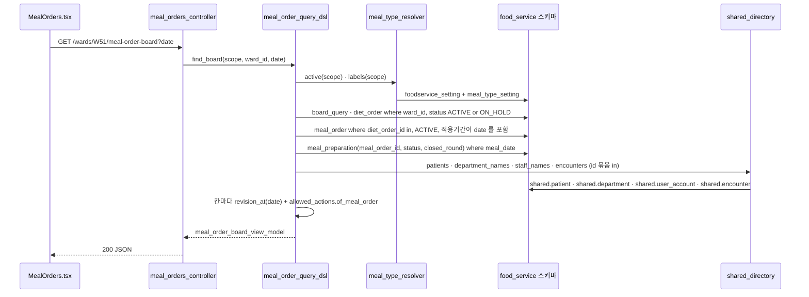
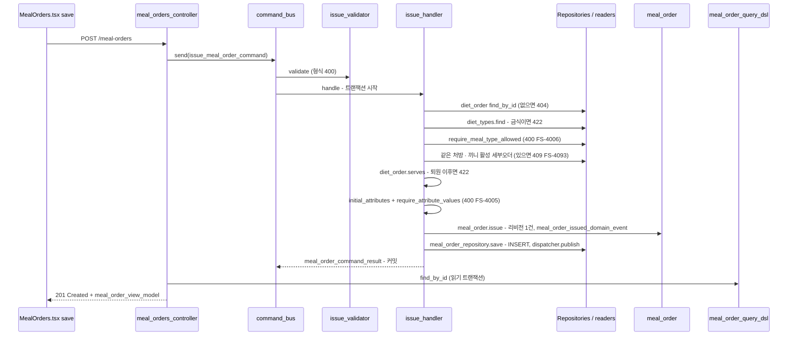
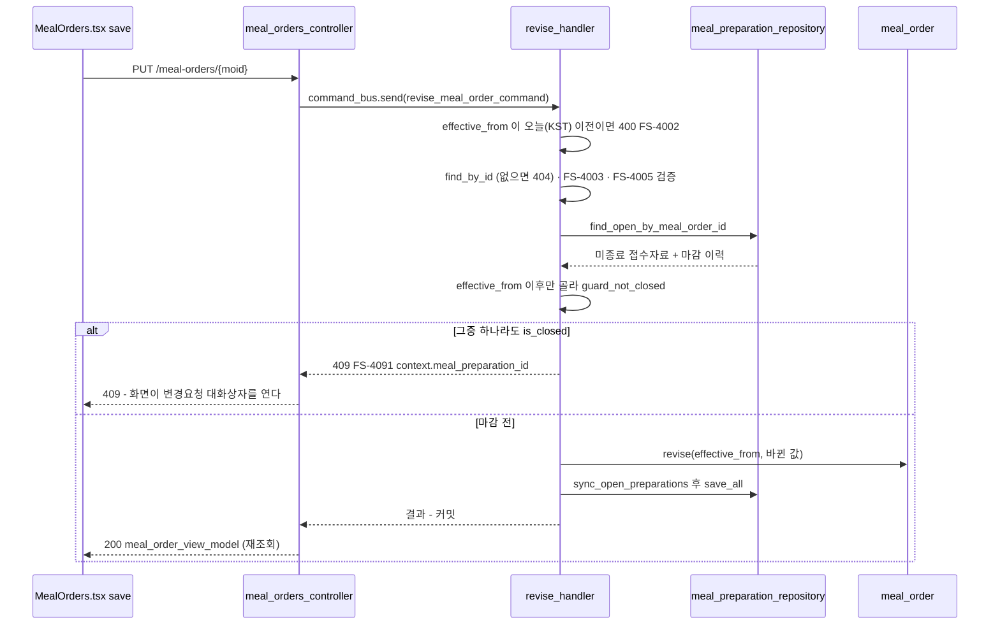
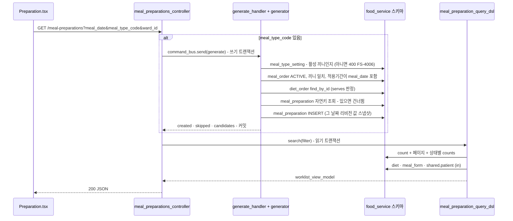
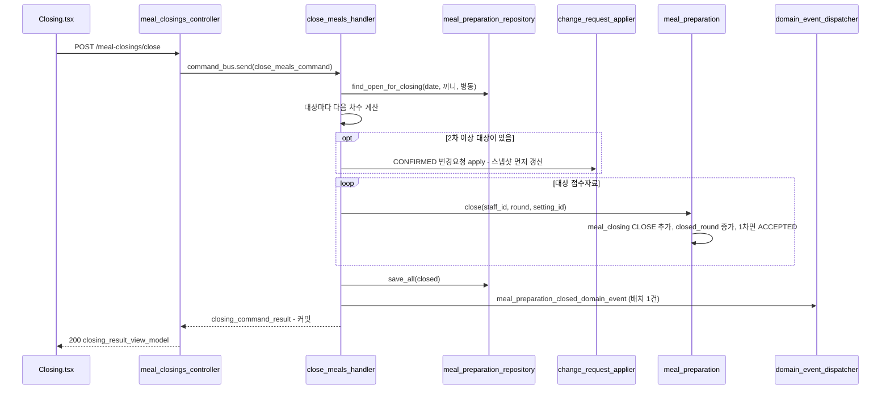
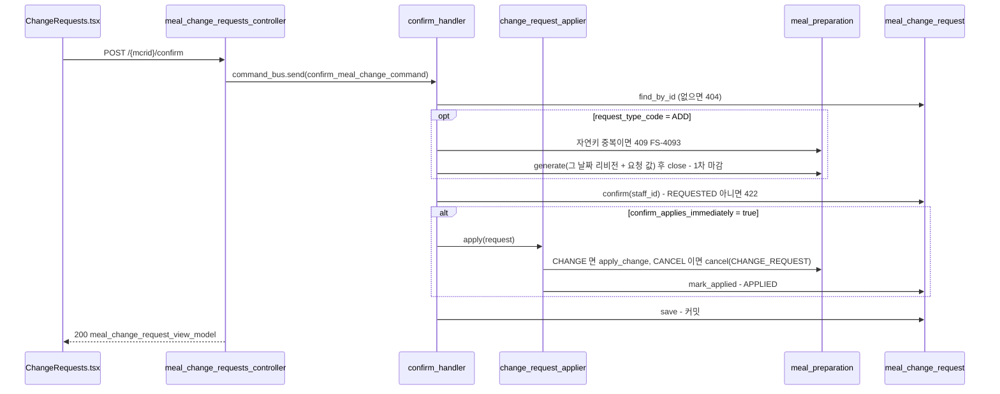

# nutrition(foodservice) API 호출 추적서

> 대상 BC: `x-nutrition` (MicroService 1개 = `foodservice`, 포트 5343, API 접두 `/api/v1/foodservice`) · 프런트 remote `nutrition`(포트 3343, 메뉴 경로 `/nutrition/<화면>`)
> 독자: 신입 개발자. 「화면에서 이 API 를 부르면 백엔드의 어느 클래스 · 메서드가 차례로 불리고, 데이터는 어느 테이블에서 어떤 쿼리로 가져와 어떤 모양으로 돌아오는가」를 **엔드포인트 46개 전부**에 대해 찾아보는 참조서다.

## 목차

- [읽는 법 — 경로 약어와 표기](#읽는-법--경로-약어와-표기)
- [1. 이 BC 가 하는 일 · 테이블 · Aggregate](#1-이-bc-가-하는-일--테이블--aggregate)
  - [1.1 다섯 줄 요약](#11-다섯-줄-요약)
  - [1.2 용어 사전](#12-용어-사전)
  - [1.3 테이블 ↔ 엔티티 ↔ Aggregate](#13-테이블--엔티티--aggregate)
  - [1.4 shared 스키마로 읽는 테이블](#14-shared-스키마로-읽는-테이블)
  - [1.5 스키마 이름 확인](#15-스키마-이름-확인)
- [2. 엔드포인트 총괄표](#2-엔드포인트-총괄표)
  - [2.0 모든 엔드포인트에 공통인 골격](#20-모든-엔드포인트에-공통인-골격)
  - [2.1 meal_orders_controller — O1 ~ O9](#21-meal_orders_controller--o1--o9)
  - [2.2 meal_preparations_controller — P1 ~ P11](#22-meal_preparations_controller--p1--p11)
  - [2.3 meal_closings_controller — C1 ~ C4](#23-meal_closings_controller--c1--c4)
  - [2.4 meal_change_requests_controller — R1 ~ R6](#24-meal_change_requests_controller--r1--r6)
  - [2.5 foodservice_dashboard_controller — D1 ~ D7](#25-foodservice_dashboard_controller--d1--d7)
  - [2.6 diet_masters_controller — M1 ~ M5](#26-diet_masters_controller--m1--m5)
  - [2.7 foodservice_settings_controller — S1 ~ S4](#27-foodservice_settings_controller--s1--s4)
- [3. 엔드포인트별 상세 카드](#3-엔드포인트별-상세-카드)
  - [3.1 O5 세부오더 보드 조회](#31-o5-세부오더-보드-조회)
  - [3.2 O6 세부오더 발행](#32-o6-세부오더-발행)
  - [3.3 O7 세부오더 수정](#33-o7-세부오더-수정)
  - [3.4 O8 세부오더 취소](#34-o8-세부오더-취소)
  - [3.5 O1 처방 목록](#35-o1-처방-목록)
  - [3.6 P1 접수자료 목록(조회 전 생성)](#36-p1-접수자료-목록조회-전-생성)
  - [3.7 C3 N차 마감](#37-c3-n차-마감)
  - [3.8 R3 변경요청 생성](#38-r3-변경요청-생성)
  - [3.9 R4 변경요청 확인(승인)](#39-r4-변경요청-확인승인)
  - [3.10 O4 퇴식끼니 설정](#310-o4-퇴식끼니-설정)
  - [3.11 M4 식이처방 저장(발행으로 이어지는 쓰기)](#311-m4-식이처방-저장발행으로-이어지는-쓰기)
  - [3.12 나머지 엔드포인트 — 패턴 묶음](#312-나머지-엔드포인트--패턴-묶음)
- [4. Kafka 수신 · 발행 경로 추적](#4-kafka-수신--발행-경로-추적)
- [5. 화면 → API 역추적표](#5-화면--api-역추적표)
- [6. 디버깅 가이드](#6-디버깅-가이드)
- [7. 스스로 확인 문제](#7-스스로-확인-문제)

---

## 읽는 법 — 경로 약어와 표기

본문 표 · 호출 체인에서는 경로가 길어 아래 약어를 쓴다. **코드 인용 블록 위에는 약어 없이 `x-nutrition/…:시작줄-끝줄` 전체 경로**를 적었다.

| 약어 | 실제 경로 |
|---|---|
| `BE/` | `x-nutrition/backend/foodservice/src/main/kotlin/com/projectx/foodservice/` |
| `RES/` | `x-nutrition/backend/foodservice/src/main/resources/` |
| `FE/` | `x-nutrition/frontend/apps/nutrition/src/` |

- 총괄표의 **경로** 칸은 컨트롤러 접두(절 머리에 적었다)를 뺀 나머지다. 예: 2.1 절의 `/meal-orders` = `POST /api/v1/foodservice/meal-orders`.
- 호출 체인의 `→` 는 「다음으로 부른다」, `⇒` 는 「트랜잭션 커밋 뒤 이어진다」, `↺` 는 「같은 요청 안에서 조회를 다시 한다(응답 재조회)」는 뜻이다.
- 요청 · 응답 JSON 은 **request · view_model 클래스 필드로 만든 예시**다. 값(UUID · 환자 · 병동 · 코드)은 전부 가짜다.
- REST JSON 필드는 snake_case 다(백엔드 view_model 필드명 그대로, 프런트도 변환하지 않는다). 유일한 예외는 Kafka payload 필드(camelCase)다.
- 원본 주석에 들어 있는 경고 기호는 인용할 때 「주의:」로 바꿔 적었다. 그 밖의 글자는 원본 그대로다.

---

## 1. 이 BC 가 하는 일 · 테이블 · Aggregate

### 1.1 다섯 줄 요약

1. 처방 BC 가 보낸 **식이처방**(의사가 낸 「이 환자에게 어떤 식사를」)의 사본(`diet_order`)을 받아 두고, 처음 받을 때 끼니마다 기본 **세부오더**(`meal_order`)를 자동으로 낸다.
2. 병동 간호사는 끼니별 세부오더(형태 · 양 · 간 · 열량 · 격리 · 보호자식)를 **발행 · 수정 · 취소**한다. 수정은 「그 날짜부터」 적용되며 값은 적용일자별 리비전(`meal_order_revision`)이 갖는다.
3. 영양팀이 접수 목록을 열면 그 식사일 × 끼니의 **접수자료**(`meal_preparation`, 조리 지시 스냅샷)가 만들어지고, 영양팀이 병동 × 끼니 단위로 **N차 마감**한다. 마감 뒤에는 세부오더를 직접 고칠 수 없다(409 FS-4091).
4. 마감 뒤 바꿀 것은 **변경요청**(`meal_change_request`, CHANGE · CANCEL · ADD)으로 올리고 영양팀이 확인(승인)하면 접수자료 스냅샷에 반영된다. 조제 시작 · 배식 완료 · 결식이 접수자료 상태를 바꾼다.
5. **퇴원지시**(퇴원 예정일)를 받으면 그 다음날부터 식사가 없고, 퇴원일 당일은 간호가 정한 **퇴식끼니**(마지막으로 먹는 끼니)까지만 나간다. 식이처방 코드 마스터(`diet`)는 이 MS 가 주인이라 바뀌면 `diet-definition` 토픽으로 발행한다.

### 1.2 용어 사전

| 화면 · 문서 용어 | 코드 이름 | 뜻 |
|---|---|---|
| 식이처방 | `diet_order` | 의사 처방(FHIR NutritionOrder) 한 건의 로컬 사본. 처방 BC 이벤트를 따라가며 사용자가 바꾸는 것은 퇴식끼니뿐이다 |
| 식이처방 코드 · 식종 | `diet` (`diet_code`) | 일반식 · 치료식 · 금식 같은 처방 종류 마스터. 금식(NPO)도 식이처방 코드다 |
| 식이 코드 | `meal` (`meal_code`) | 같은 식이처방을 어떤 상품으로 낼지(일반 · 외국인 특별식 · 경관 제품 등) |
| 조절 축 | `meal_attribute` | 열량 · 용량 · 염도 · 양 · 병수의 허용 범위와 기본값 |
| 식사 형태 | `meal_form` | 밥 · 죽 · 미음처럼 물성. 식종과 다른 축이다 |
| 세부오더 | `meal_order` | 끼니 하나에 대한 간호 오더(FHIR filler-order). 처방 · 끼니당 활성 1건 |
| 리비전 | `meal_order_revision` | 세부오더 속성의 적용일자 구간(`effective_from ~ effective_to`) |
| 접수자료 | `meal_preparation` | 날짜 × 끼니 × 세부오더 1건의 조리 지시. 세부오더 값을 스냅샷으로 복사해 둔다 |
| 마감 · 차수 | `meal_closing` · `closed_round` | 접수자료를 시점 고정하는 기록. 1차 · 2차 … 로 올라가고 해제(REOPEN)할 수 있다 |
| 변경요청 | `meal_change_request` | 마감 뒤 변경(CHANGE) · 취소(CANCEL) · 추가(ADD) 요청 |
| 퇴원지시 · 퇴식끼니 | `discharge_planned_date` · `discharge_last_meal_type_code` | 퇴원 예정일과 그날 마지막으로 먹는 끼니. 둘 다 `diet_order` 컬럼이다 |
| 결식 | `NOT_SERVED` | 접수자료 상태. 금식 · 수술 · 외출 등으로 먹지 않는 식사 |
| 끼니 | `meal_type_setting` (`meal_type_code`) | 아침 · 점심 · 저녁 · 간식. enum 이 아니라 설정 행이다 |
| 급식 운영 설정 | `foodservice_setting` | 병원(테넌트 범위)당 1건. 끼니 목록과 마감 차수 설정을 갖는다 |

### 1.3 테이블 ↔ 엔티티 ↔ Aggregate

모든 테이블은 「PK `<테이블명>_id`(UUID) → `tenant_id` · `hospital_code` → 업무 컬럼 → `created_at` · `created_by` · `updated_at` · `updated_by`」 순서다. 생성 changeSet 은 `RES/db/changelog/changes/001-create-tables.xml` 한 벌이다. QueryDSL Q 타입 이름은 `Q<엔티티>` 다(예 `Qmeal_order`).

| 테이블 | 엔티티 클래스(`BE/domain/aggregatesmodel/…`) | Aggregate | 역할 | 쓰는 쪽 |
|---|---|---|---|---|
| `diet_order` | `dietorder/diet_order.kt` | **diet_order** (Root) | 식이처방 사본 · 퇴원 예정일 · 퇴식끼니 | Kafka 수신 · O4 |
| `meal_order` | `mealorder/meal_order.kt` | **meal_order** (Root) | 끼니별 세부오더 | O6 · O7 · O8 · 자동 발행 |
| `meal_order_revision` | `mealorder/meal_order_revision.kt` | meal_order 하위 | 적용일자별 조리 속성 | O6 · O7 |
| `meal_preparation` | `mealpreparation/meal_preparation.kt` | **meal_preparation** (Root) | 접수자료(스냅샷 · 상태 · `closed_round`) | P1 · P11 · C3 · R4 |
| `meal_closing` | `mealpreparation/meal_closing.kt` | meal_preparation 하위 | 마감 · 해제 이력(CLOSE · REOPEN, 차수) | C3 · C4 |
| `meal_change_request` | `mealchangerequest/meal_change_request.kt` | **meal_change_request** (Root) | 변경 · 취소 · 추가 요청(`request_detail` jsonb) | R3 ~ R6 |
| `diet` | `diet/diet.kt` | **diet** (Root) | 식이처방 코드 마스터 | M3 ~ M5 |
| `meal` | `diet/meal.kt` | diet 하위 | 식이 코드 | M4 |
| `meal_attribute` | `diet/meal_attribute.kt` | diet 하위 | 조절 축 · 기본값 | M4 · M5 |
| `foodservice_setting` | `setting/foodservice_setting.kt` | **foodservice_setting** (Root) | 급식 운영 설정(병원당 1건) | S3 · S4 |
| `meal_type_setting` | `setting/meal_type_setting.kt` | foodservice_setting 하위 | 끼니 목록(배식 시각 · 대상 식이처방) | S3 |
| `meal_closing_setting` | `setting/meal_closing_setting.kt` | foodservice_setting 하위 | 마감 차수 · 기준시각 | S4 |
| `meal_form` | `master/foodservice_masters.kt` | (Aggregate 아님 — 참조 데이터) | 식사 형태 카탈로그. Liquibase 002 가 적재 | 읽기만 |

- Aggregate 사이는 JPA 연관이 아니라 **UUID 값**으로만 가리킨다(`meal_order.diet_order_id`, `meal_preparation.meal_order_id` …). 물리 FK 도 없다.
- 하위 Entity 는 Root 의 단방향 `@OneToMany` + `@JoinColumn` 으로만 저장된다. 예: 세부오더를 저장하면 리비전도 함께 INSERT · UPDATE 된다.
- 병동 마스터는 이 MS 의 테이블이 아니다 — `x-ancillary-main` 의 `GET /ancillary-wards` 를 `BE/infrastructure/proxies/ward_master_proxy.kt` 가 HTTP 로 읽는다.

### 1.4 shared 스키마로 읽는 테이블

환자 · 수진 · 직원 · 진료과의 이름과 번호는 이 MS 가 보관하지 않는다. 이 MS 테이블은 **id(uuid)만** 갖고, 조회 때 `shared` 스키마에서 읽는다. 매핑은 `BE/infrastructure/shared/` 의 `@Immutable` · `@Table(schema = "shared")` 엔티티이고, 조회는 `BE/infrastructure/queries/shared_directory.kt` 가 한다.

| shared 테이블 | 매핑 클래스 | 읽는 컬럼 | 쓰는 곳 |
|---|---|---|---|
| `shared.patient` | `shared_patient` | `patient_id` · `patient_number` · `patient_name` · `birth_date` · `gender_code` | 모든 목록의 환자 칸(`patient_view_model`), 검색어 `exists` 서브쿼리 |
| `shared.encounter` | `shared_encounter` | `encounter_id` · `patient_id` · `start_at` · `end_at` | 보드의 입원일 · 퇴원일, 수신 이벤트의 환자 id 역추적 |
| `shared.user_account` | `shared_user_account` | 직원 id · 이름 | 처방의 이름, 발행자 · 수정자 · 요청자 · 마감자 이름 |
| `shared.department` | `shared_department` | 진료과 id · 이름 | 처방 목록 · 보드의 진료과명 |

읽는 방식은 두 가지다.

- **이름 붙이기**: 화면 한 번에 필요한 id 를 모아 `in (...)` 한 번으로 읽는다(`shared_directory.patients` · `staff_names` · `department_names` · `encounters`). JOIN 이 아니다.
- **검색어 조건**: `shared_directory.patient_matches` 가 `exists` 상관 서브쿼리를 만들어 이 MS 쪽 쿼리의 where 에 붙인다.

`x-nutrition/backend/foodservice/src/main/kotlin/com/projectx/foodservice/infrastructure/queries/shared_directory.kt:81-94`

```kotlin
    /**
     * 검색어 조건 — 그 환자의 shared 이름 · 환자번호에 검색어가 들어 있는지(`exists` 상관 서브쿼리).
     * @param patient_id 이 MS 테이블의 환자 id 경로(uuid)
     */
    fun patient_matches(patient_id: ComparablePath<UUID>, keyword: String): BooleanExpression {
        val matched = Qshared_patient("matched_patient")
        return JPAExpressions.selectOne()
            .from(matched)
            .where(
                matched.patient_id.eq(patient_id)
                    .and(matched.patient_name.containsIgnoreCase(keyword).or(matched.patient_number.containsIgnoreCase(keyword))),
            )
            .exists()
    }
```

### 1.5 스키마 이름 확인

이 MS 의 스키마는 **`food_service`** 다. BC 이름 `nutrition` 이 아니다(`nutrition` 은 레포 · gradle `rootProject.name` · remoteKey 에만 쓰인다). 스키마명은 `application.yml` 의 `DB_SCHEMA` 한 값에서 나온다.

`x-nutrition/backend/foodservice/src/main/resources/application.yml:32`

```yaml
      connection-init-sql: SET search_path TO ${DB_SCHEMA:food_service}
```

`x-nutrition/backend/foodservice/src/main/resources/application.yml:56-57`

```yaml
    default-schema: ${DB_SCHEMA:food_service}
    liquibase-schema: ${DB_SCHEMA:food_service}
```

부팅 때 스키마를 만드는 `BE/infrastructure/config/db_schema_initializer.kt:32` 도 같은 기본값 `${DB_SCHEMA:food_service}` 를 쓴다. dev 는 `RES/application-dev.yml:13` 이 같은 값을 다시 적는다. 배포 값(`DB_SCHEMA`)이 덮어쓸 수 있으므로 실제 값은 기동 로그 `DB 스키마 확인/생성 완료 — db=…, schema=…` 로 확인한다. 모듈명 `foodservice` 와 스키마명 `food_service` 는 밑줄 하나가 다르다.

---

## 2. 엔드포인트 총괄표

### 2.0 모든 엔드포인트에 공통인 골격

```
FE 화면(views/…) → foodserviceApi.ts 함수 → request() → @x-ehr/api-axios(api.request)
  → [게이트웨이 · dev 프록시] → Controller(@RequireAuth · @TokenPrincipal)
     쓰기: → 요청 DTO.to_command(scope) → command_bus.send → validator 들 → handler.handle(@Transactional)
            → Aggregate 메서드 → Repository IF.save → JPA 어댑터(저장 직후 domain_event_dispatcher.publish)
          ↺ Controller 가 Query IF 로 다시 읽어 view_model 응답
     읽기: → Query IF(application) → *_query_dsl(infrastructure, @Transactional(readOnly = true)) → view_model
```

1. **인증 · 테넌트**: 모든 컨트롤러가 클래스에 `@RequireAuth` 를 단다. 토큰이 없거나 틀리면 401(`AUTH_TOKEN_*`). 테넌트 범위(`tenant_id` · `hospital_code`)와 작업자 id 는 요청 본문 · 경로가 아니라 **토큰에서만** 꺼낸다.

`x-nutrition/backend/foodservice/src/main/kotlin/com/projectx/foodservice/presentation/token_principal_scope.kt:13-19`

```kotlin
// claim 이 비어 있으면 tenant_scope.of 가 INVALID_DATA 로 채운다(라이브러리가 필수 claim 을 검증하므로 정상 토큰에서는 생기지 않는다)
fun AuthPrincipal.to_tenant_scope(): tenant_scope = tenant_scope.of(tenantId, hospitalCode)

// 토큰 sub = 직원 레코드 uuid(shared 직원 id). UUID 가 아니면 이 BC 가 쓸 수 없는 토큰이라 401(AUTH_TOKEN_INVALID)로 거절한다
fun AuthPrincipal.employee_id(): UUID =
    userId.trim().takeIf { UUID_FORMAT.matches(it) }?.let(UUID::fromString)
        ?: throw JwtAuthenticationException(JwtErrorCode.AUTH_TOKEN_INVALID, "토큰 사용자 ID 가 UUID 형식이 아닙니다")
```

2. **command_bus**: 명령 클래스 타입으로 validator 와 handler 를 찾는다. validator 가 먼저 돌고(400), handler 가 돈다. **한 엔드포인트는 Command 1개만** 보낸다.

`x-nutrition/backend/foodservice/src/main/kotlin/com/projectx/foodservice/application/commands/command_bus.kt:23-30`

```kotlin
    @Suppress("UNCHECKED_CAST")
    fun <TResult> send(command: command): TResult {
        val type = command.javaClass
        validator_index[type]?.forEach { (it as command_validator<command>).validate(command) }
        val handler = handler_index[type]
            ?: throw IllegalStateException("등록된 핸들러가 없습니다: ${type.name}")
        return (handler as command_handler<command, TResult>).handle(command)
    }
```

3. **트랜잭션 경계**: 쓰기는 handler 의 `handle()` 에 붙은 `@Transactional` 하나다. 컨트롤러에는 트랜잭션이 없다. 그래서 쓰기 API 는 「쓰기 트랜잭션 1 + 응답 재조회 읽기 트랜잭션 1」 두 번으로 끝난다. 예외는 C3 · C4(마감 결과를 그대로 변환)와 P11(생성 건수 응답)이다.
4. **조회 구현**: Query IF 는 `BE/application/queries/foodservice_queries.kt`, 구현은 `BE/infrastructure/queries/*_query_dsl.kt` 다. `meal_closing_query_dsl` 한 클래스가 `i_meal_closing_queries` · `i_foodservice_master_queries` · `i_foodservice_setting_queries` 세 IF 를 함께 구현한다(마스터 · 설정 조회도 여기 있다).
5. **Aggregate 로드(쓰기 경로)**: Repository IF(`BE/domain/aggregatesmodel/*/i_*_repository.kt`)의 구현은 `BE/infrastructure/repositories/foodservice_repositories.kt` 이고, 그 아래 Spring Data 인터페이스는 `BE/infrastructure/foodservice_context.kt` 의 JPQL `@Query` 다. 「조회는 QueryDSL」 규칙은 view_model 조회 경로 이야기이고 Aggregate 로드는 JPQL 이다.
6. **마스터 · 설정 읽기(쓰기 경로)**: handler 는 다른 Aggregate 를 직접 로드하지 않고 스냅샷 reader(`i_diet_type_reader` · `i_meal_form_reader` · `i_foodservice_setting_reader`, 구현 `foodservice_repositories.kt:268` 부터)로 읽는다.
7. **오류 응답**: `BE/infrastructure/config/global_exception_handler.kt` 가 `{ error, code, message, trace_id, context }` 로 바꾼다. 404 FS-4041 · 400 FS-4001 ~ FS-4006 · 422 FS-4092 · FS-4004 · FS-4007 · FS-4008 · 409 FS-4091 · FS-4093 · FS-4094.
8. **allowed_actions**: 행 단위 view_model 은 `allowed_actions` 배열을 싣는다. 계산은 `BE/application/support/allowed_actions.kt` 한 곳이고, 화면은 이 배열만 보고 버튼을 보인다.

### 2.1 meal_orders_controller — O1 ~ O9

접두 `/api/v1/foodservice` · 파일 `BE/presentation/meal_orders_controller.kt` · 조회 IF `i_diet_order_queries`(구현 `diet_order_query_dsl`) · `i_meal_order_queries`(구현 `meal_order_query_dsl`)

| ID | HTTP | 경로 | 컨트롤러.메서드 | 쓰기/읽기 | 호출 체인 | 데이터 출처(테이블 · Q 타입) | 응답 타입 | FE 함수 · 화면 |
|---|---|---|---|---|---|---|---|---|
| O1 | GET | `/diet-orders` | `meal_orders_controller.search_diet_orders` (:65-91) | 읽기 | → `diet_order_query_dsl.search` → `search_predicate`(BooleanBuilder) → `search_query`(Projections.constructor `diet_order_row`) → `issued_slots_of` → `diet_type_resolver.load` → `shared_names_of` | `diet_order`(Qdiet_order) · `meal_order`(Qmeal_order, 발행 끼니) · `diet`/`meal` · shared 4종 | `page_view_model<diet_order_view_model>` | `findDietOrders` — diet-orders · meal-orders · ward-diet-orders |
| O2 | GET | `/diet-orders/{doid}` | `.find_diet_order` (:93-96) | 읽기 | → `diet_order_query_dsl.find_by_id` → `meal_order_query_dsl.find_by_diet_order_id` | `diet_order` · `meal_order`(+`meal_order_revision`) · `meal_preparation`(마감 여부) · shared | `diet_order_view_model`(+`meal_orders`), 없으면 404 FS-4041 | 없음(함수 없음) |
| O3 | GET | `/diet-orders/{doid}/meal-orders` | `.find_meal_orders` (:98-101) | 읽기 | → `meal_order_query_dsl.find_by_diet_order_id` → `closed_meal_order_ids` → `shared.staff_names` | `meal_order`(Qmeal_order) · `meal_order_revision`(지연 로딩, batch 100) · `meal_preparation`(Qmeal_preparation) · `meal_type_setting` · `diet` · `shared.user_account` | `List<meal_order_view_model>` | `findMealOrders` — meal-orders · ward-diet-orders |
| O4 | PUT | `/diet-orders/{doid}/discharge-meal` | `.set_discharge_meal` (:103-117) | 쓰기 | → `command_bus.send(set_discharge_meal_command)` → `set_discharge_meal_command_handler.handle` → `require_meal_type_allowed` → `diet_order.set_discharge_meal` → `diet_order_repository.save` → `cancel_discharge_preparations` → `meal_preparation.cancel(DISCHARGE)` ↺ `diet_order_query_dsl.find_by_id` | `diet_order`(UPDATE) · `meal_order`(읽기) · `meal_preparation`(UPDATE) · `meal_type_setting`(읽기) | `diet_order_view_model` | `setDischargeMeal` — ward-diet-orders(`DischargeMealDialog`) |
| O5 | GET | `/wards/{ward_id}/meal-order-board?date=` | `.find_board` (:121-130) | 읽기 | → `meal_order_query_dsl.find_board` → `meal_type_resolver.active` · `labels` → `board_query` → `selectFrom(meal_order)` → `select(meal_preparation)` → `shared_directory.patients` · `department_names` · `staff_names` · `encounters` → `allowed_actions.of_meal_order` | `diet_order`(Qdiet_order) · `meal_order`(Qmeal_order)+리비전 · `meal_preparation`(Qmeal_preparation) · `meal_type_setting` · `diet`/`meal`/`meal_attribute` · shared 4종 | `meal_order_board_view_model` | `findMealOrderBoard` — meal-orders · ward-diet-orders · change-requests(`AddRequestCard`) |
| O6 | POST | `/meal-orders` | `.issue` (:134-146) | 쓰기(201) | → `issue_meal_order_request.to_command` → `command_bus.send` → `issue_meal_order_command_validator.validate` → `issue_meal_order_command_handler.handle` → `meal_order.issue` → `meal_order_repository.save` → `domain_event_dispatcher.publish` ↺ `meal_order_query_dsl.find_by_id` | `diet_order`(읽기) · `diet`/`meal`/`meal_attribute` · `meal_form` · `meal_type_setting`(읽기) · **`meal_order` + `meal_order_revision` INSERT** | `meal_order_view_model` | `issueMealOrder` — meal-orders · ward-diet-orders |
| O7 | PUT | `/meal-orders/{moid}` | `.revise` (:148-182) | 쓰기 | → `revise_meal_order_command_validator` → `revise_meal_order_command_handler.handle` → `require_meal_in_diet` · `require_attribute_values` → `find_open_by_meal_order_id` → `guard_not_closed` → `meal_order.revise` → `save` → `sync_open_preparations` → `save_all` ↺ `find_by_id` | `meal_order` · `meal_order_revision`(INSERT · UPDATE) · `meal_preparation`+`meal_closing`(마감 판정 · 스냅샷 동기화) · `diet` | `meal_order_view_model` | `reviseMealOrder` — meal-orders · ward-diet-orders |
| O8 | POST | `/meal-orders/{moid}/revoke` | `.revoke` (:184-194) | 쓰기 | → `revoke_meal_order_command_handler.handle` → `find_open_by_meal_order_id` → `guard_not_closed` → `meal_preparation.cancel(ORDER_REVOKED)` → `meal_order.revoke` → `save` ↺ `find_by_id` | `meal_order`(UPDATE) · `meal_preparation`(UPDATE) | `meal_order_view_model` | `revokeMealOrder` — meal-orders · ward-diet-orders |
| O9 | GET | `/meal-orders/{moid}` | `.find` (:196-198) | 읽기 | → `load` → `meal_order_query_dsl.find_by_id` → `closed_meal_order_ids` → `to_view_model` | `meal_order`+리비전 · `meal_preparation` · `diet` · `shared.user_account` | `meal_order_view_model`, 없으면 404 | 없음(함수 없음) |

### 2.2 meal_preparations_controller — P1 ~ P11

접두 `/api/v1/foodservice/meal-preparations` · 파일 `BE/presentation/meal_preparations_controller.kt` · 조회 IF `i_meal_preparation_queries`(구현 `meal_preparation_query_dsl`, Q 타입은 `Qmeal_preparation` 하나)

| ID | HTTP | 경로 | 컨트롤러.메서드 | 쓰기/읽기 | 호출 체인 | 데이터 출처 | 응답 타입 | FE 함수 · 화면 |
|---|---|---|---|---|---|---|---|---|
| P1 | GET | `?meal_date&meal_type_code&ward_id&status&diet_type_code&keyword&page&size` | `.search` (:63-96) | **읽기지만 끼니를 주면 먼저 쓴다** | (끼니 있음) → `command_bus.send(generate_meal_preparations_command)` → `generate_meal_preparations_command_validator` → `generate_meal_preparations_command_handler.handle` → `meal_preparation_generator.generate` / 이어서 → `meal_preparation_query_dsl.search` → `search_predicate` → `status_counts` | 생성: `meal_order` · `diet_order` · `meal_type_setting` 읽기, **`meal_preparation` INSERT** / 조회: `meal_preparation` · `diet` · `meal_form` · `shared.patient` | `worklist_view_model<meal_preparation_view_model>` | `findMealPreparations` — preparation · diet-orders · not-served(`ManualNotServedCard`) · meal-orders(끼니 없이 부름 → 생성 안 함) |
| P2 | GET | `/aggregations/diet-types?meal_date&meal_type_code` | `.aggregate_by_diet_type` (:98-104) | 읽기 | → `meal_preparation_query_dsl.aggregate_by_diet_type` | `meal_preparation` 스냅샷 컬럼만 · `diet` | `diet_type_aggregation_view_model` | `aggregateByDietType` — aggregation |
| P3 | GET | `/aggregations/wards?meal_date&meal_type_code` | `.aggregate_by_ward` (:106-112) | 읽기 | → `aggregate_by_ward` → `ward_master_proxy.find_all` | `meal_preparation` · 병동 HTTP | `ward_aggregation_view_model` | `aggregateByWard` — aggregation · diet-orders |
| P4 | GET | `/serving-sheet?meal_date&meal_type_code&format=json` | `.serving_sheet` (:119-134) | 읽기 | (format 이 json 아님 → 400 FS-4001) → `find_serving_sheet` | `meal_preparation` · `shared.patient` · 병동 HTTP | `serving_sheet_view_model` | `findServingSheet` — aggregation(`ServingSheetDialog`) |
| P5 | GET | `/not-served?meal_date&ward_id` | `.not_served` (:136-142) | 읽기 | → `find_not_served` | `meal_preparation` | `not_served_view_model` | `findNotServed` — not-served |
| P6 | GET | `/{mpid}` | `.find` (:144-146) | 읽기 | → `load` → `find_by_id` | `meal_preparation`(+`meal_closing`) · `diet` · `meal_form` · `shared.patient` | `meal_preparation_view_model` | 없음(함수 없음) |
| P7 | POST | `/{mpid}/start` | `.start` (:150-156) | 쓰기 | → `start_meal_preparation_command_handler.handle` → `meal_preparation.start_preparation` → `save` ↺ `find_by_id` | `meal_preparation` | `meal_preparation_view_model` | `startPreparation` — preparation |
| P8 | POST | `/{mpid}/complete` | `.complete` (:158-164) | 쓰기 | → `complete_meal_preparation_command_handler.handle` → `meal_preparation.complete` → `save` ↺ | `meal_preparation` | 같음 | `completePreparation` — preparation |
| P9 | POST | `/{mpid}/not-served` | `.mark_not_served` (:166-185) | 쓰기 | → `mark_meal_not_served_command_handler.handle`(`automatic = false` 고정) → `meal_preparation.mark_not_served` → `save` ↺ | `meal_preparation` | 같음 | `markNotServed` — preparation · not-served(`ManualNotServedCard`) |
| P10 | POST | `/{mpid}/restore` | `.restore` (:187-199) | 쓰기 | → `restore_meal_preparation_command_handler.handle` → `meal_preparation.restore_from_not_served` → `save` ↺ | `meal_preparation`(+`meal_closing` 이력으로 복원 상태 결정) | 같음 | `restorePreparation` — preparation · not-served |
| P11 | POST | `/generate` | `.generate` (:201-226) | 쓰기(생성 있으면 201, 없으면 200) | → `generate_meal_preparations_command_validator` → `generate_meal_preparations_command_handler.handle` → `meal_preparation_generator.generate`(재조회 없음) | P1 생성과 같음 | `generate_response`(컨트롤러 안 DTO :252-260) | `generatePreparations` — closing |

### 2.3 meal_closings_controller — C1 ~ C4

접두 `/api/v1/foodservice/meal-closings` · 파일 `BE/presentation/meal_closings_controller.kt` · 조회 IF `i_meal_closing_queries`(구현 `meal_closing_query_dsl`)

| ID | HTTP | 경로 | 컨트롤러.메서드 | 쓰기/읽기 | 호출 체인 | 데이터 출처 | 응답 타입 | FE 함수 · 화면 |
|---|---|---|---|---|---|---|---|---|
| C1 | GET | `/board?meal_date` | `.board` (:48-54) | 읽기 | → `meal_closing_query_dsl.find_board`(병동 × 끼니 × 상태 × 차수 groupBy) → `setting_reader.closing_rounds` → `meal_types.active` → `find_wards`(병동 HTTP) → `deadline_policy.rounds_of` | `meal_preparation`(Qmeal_preparation) · `meal_closing_setting` · `meal_type_setting` · 병동 HTTP | `closing_board_view_model` | `findClosingBoard` — closing · meal-orders |
| C2 | GET | `/histories?meal_date&ward_id&page&size` | `.histories` (:56-65) | 읽기 | → `find_histories` | `meal_closing`(Qmeal_closing) · `meal_preparation` · `shared.user_account` | `page_view_model<closing_history_view_model>` | `findClosingHistories` — closing |
| C3 | POST | `/close` | `.close` (:69-88) | 쓰기 | → `close_meals_command_validator` → `close_meals_command_handler.handle` → `find_open_for_closing` → (2차 이상) `change_request_applier.apply` → `meal_preparation.close` → `save_all` → `domain_event_dispatcher.publish(meal_preparation_closed_domain_event)` → `to_view_model`(재조회 없음) | `meal_preparation`(UPDATE) · **`meal_closing` INSERT** · `meal_change_request`(UPDATE) · `meal_closing_setting` · `diet`(읽기) | `closing_result_view_model` | `closeMeals` — closing |
| C4 | POST | `/reopen` | `.reopen` (:90-104) | 쓰기 | → `reopen_meals_command_validator` → `reopen_meals_command_handler.handle` → `meal_preparation.reopen`(조제 시작분은 건너뜀) → `save_all` → `publish(meal_preparation_reopened_domain_event)` | `meal_preparation` · `meal_closing`(REOPEN INSERT · CLOSE 비활성) | `closing_result_view_model` | `reopenMeals` — closing |

### 2.4 meal_change_requests_controller — R1 ~ R6

접두 `/api/v1/foodservice/meal-change-requests` · 파일 `BE/presentation/meal_change_requests_controller.kt` · 조회 IF `i_meal_change_request_queries`(구현 `meal_change_request_query_dsl`, Q 타입 `Qmeal_change_request`)

| ID | HTTP | 경로 | 컨트롤러.메서드 | 쓰기/읽기 | 호출 체인 | 데이터 출처 | 응답 타입 | FE 함수 · 화면 |
|---|---|---|---|---|---|---|---|---|
| R1 | GET | `?status&meal_date&ward_id&request_type_code&page&size` | `.search` (:57-77) | 읽기 | → `meal_change_request_query_dsl.search`(BooleanBuilder · 상태별 counts groupBy) → `shared_names_of` | `meal_change_request` · `diet` · `meal_type_setting` · `shared.patient` · `shared.user_account` | `worklist_view_model<meal_change_request_view_model>` | `findChangeRequests` — change-requests |
| R2 | GET | `/{mcrid}` | `.find` (:79-81) | 읽기 | → `load` → `find_by_id` | 같음 | `meal_change_request_view_model` | 없음(함수 없음) |
| R3 | POST | `` (본문만) | `.request` (:85-96) | 쓰기(201) | → `meal_change_request_body.to_command(scope, employee_id)` → `request_meal_change_command_validator` → `request_meal_change_command_handler.handle` → `build_change_request` 또는 `build_add_request` → `meal_change_request.request` · `request_add` → `save` ↺ `find_by_id` | **`meal_change_request` INSERT** · `meal_preparation`+`meal_closing` · `meal_order` · `diet_order` · `diet` · `meal_type_setting`(읽기) | `meal_change_request_view_model` | `createChangeRequest` — meal-orders(`ChangeRequestDialog`) · change-requests(`AddRequestCard`) |
| R4 | POST | `/{mcrid}/confirm` | `.confirm` (:98-107) | 쓰기 | → `confirm_meal_change_command_handler.handle` → (ADD) `create_preparation_for_add` → `meal_preparation.generate` · `close` → `meal_change_request.confirm` → (정책 기본 true) `change_request_applier.apply` → `save` ↺ | `meal_change_request` · `meal_preparation`(ADD 면 INSERT + 1차 마감, CHANGE 면 스냅샷 UPDATE, CANCEL 이면 취소) · `meal_closing` · `meal_order` · `diet_order` · `diet` | `meal_change_request_view_model` | `confirmMealChange` — change-requests |
| R5 | POST | `/{mcrid}/apply` | `.apply` (:109-118) | 쓰기 | → `apply_meal_change_command_handler.handle` → `change_request_applier.apply`(즉시 반영 정책이면 no-op) → `save` ↺ | `meal_change_request` · `meal_preparation` | 같음 | `applyMealChange` — change-requests |
| R6 | POST | `/{mcrid}/reject` | `.reject` (:120-132) | 쓰기 | → `reject_meal_change_command_handler.handle` → `meal_change_request.reject` → `save` ↺ | `meal_change_request` | 같음 | `rejectMealChange` — change-requests |

### 2.5 foodservice_dashboard_controller — D1 ~ D7

접두 `/api/v1/foodservice` · 파일 `BE/presentation/foodservice_dashboard_controller.kt` · 조회 IF `i_dashboard_queries`(구현 `dashboard_query_dsl`) · `i_meal_preparation_queries` · `i_foodservice_master_queries`

| ID | HTTP | 경로 | 컨트롤러.메서드 | 쓰기/읽기 | 호출 체인 | 데이터 출처 | 응답 타입 | FE 함수 · 화면 |
|---|---|---|---|---|---|---|---|---|
| D1 | GET | `/dashboard/summary?date` | `.summary` (:46-49) | 읽기 | → `dashboard_query_dsl.find_summary`(date 없으면 KST 오늘) | `meal_preparation` · `meal_change_request` · `diet_order` | `dashboard_summary_view_model` | `findDashboardSummary` — dashboard |
| D2 | GET | `/dashboard/closing-status?date` | `.closing_status` (:51-54) | 읽기 | → `dashboard_query_dsl.find_closing_status` → `meal_closing_deadline_policy.next_deadline` → `meal_closing_query_dsl.find_closing_status` | `meal_preparation` · `meal_type_setting` · `meal_closing_setting` | `closing_status_view_model` | `findClosingStatus` — dashboard · diet-orders |
| D3 | GET | `/dashboard/recent-events?limit` | `.recent_events` (:56-62) | 읽기 | → `dashboard_query_dsl.find_recent_events`(4 테이블 합성) | `diet_order` · `meal_preparation` · `meal_change_request` · `meal_closing` · `shared.patient` | `List<recent_event_view_model>` | `findRecentEvents` — dashboard |
| D4 | GET | `/meal-statistics/daily?from&to` | `.daily_statistics` (:66-72) | 읽기 | → `meal_preparation_query_dsl.find_daily_statistics` | `meal_preparation` | `daily_statistics_view_model` | `findDailyStatistics` — statistics |
| D5 | GET | `/masters/diet-types` | `.diet_types` (:76-82) | 읽기 | → `meal_closing_query_dsl.find_diet_types` | `diet`(Qdiet) | `List<diet_type_view_model>` | 없음(함수 없음) |
| D6 | GET | `/masters/meal-forms` | `.meal_forms` (:84-89) | 읽기 | → `meal_closing_query_dsl.find_meal_forms` | `meal_form`(Qmeal_form) | `List<meal_form_view_model>` | `findMealForms` — diet-orders · meal-orders · ward-diet-orders · aggregation(`ServingSheetDialog`) · change-requests · diet-meals |
| D7 | GET | `/masters/wards` | `.wards` (:91-93) | 읽기 | → `meal_closing_query_dsl.find_wards` → `ward_master_proxy.find_all` → HTTP `GET {ancillary-main}/ancillary-wards?active_only=true`(실패하면 빈 목록) | DB 아님 | `List<ward_view_model>` | `findWards` — diet-orders · meal-orders · ward-diet-orders · preparation · change-requests · not-served |

- D7 은 메서드 인자에 `@TokenPrincipal` 이 없어 테넌트 범위로 거르지 않는다. 클래스의 `@RequireAuth` 는 그대로라 토큰은 필요하다.

### 2.6 diet_masters_controller — M1 ~ M5

접두 `/api/v1/foodservice/masters/diets` · 파일 `BE/presentation/diet_masters_controller.kt` · 조회 IF `i_foodservice_master_queries`(구현 `meal_closing_query_dsl`)

| ID | HTTP | 경로 | 컨트롤러.메서드 | 쓰기/읽기 | 호출 체인 | 데이터 출처 | 응답 타입 | FE 함수 · 화면 |
|---|---|---|---|---|---|---|---|---|
| M1 | GET | `?active_only` | `.find_diets` (:55-63) | 읽기 | → `meal_closing_query_dsl.find_diets` | `diet`(Qdiet) · `meal`(Qmeal) · `meal_attribute`(Qmeal_attribute) | `List<diet_view_model>` | `findDiets` — meal-orders · ward-diet-orders · change-requests · diet-meals · meal-codes |
| M2 | GET | `/{diet_id}` | `.find_diet` (:65-67) | 읽기 | → `load` → `find_diet` | 같음 | `diet_view_model` | 없음(함수 없음) |
| M3 | POST | `` (본문만) | `.create` (:69-80) | 쓰기(201) | → `create_diet_command_validator` → `create_diet_command_handler.handle` → `diet` 생성(`touch` → `diet_changed_domain_event`) → `diet_repository.save` ⇒ `domain_event_integration_publisher.on_diet_changed` ↺ `find_diet` | **`diet` INSERT** | `diet_view_model` | `createDiet` — diet-meals |
| M4 | PUT | `/{diet_id}` | `.save` (:82-98) | 쓰기 | → `save_diet_command_validator` → `save_diet_command_handler.handle` → `diet` 변경(버전 비교 FS-4094) → `save` ⇒ `on_diet_changed` ↺ | `diet` · `meal`(upsert) · `meal_attribute`(전체 교체) · `meal_form`(읽기) | `diet_view_model` | `saveDiet` — diet-meals |
| M5 | PUT | `/{diet_id}/defaults` | `.save_defaults` (:100-114) | 쓰기 | → `save_diet_defaults_command_handler.handle` → `save` ⇒ `on_diet_changed` ↺ | `diet` · `meal_attribute`(`default_value`) | `diet_view_model` | `saveDietDefaults` — diet-meals(`DietDefaultsPanel`) |

### 2.7 foodservice_settings_controller — S1 ~ S4

접두 `/api/v1/foodservice/settings` · 파일 `BE/presentation/foodservice_settings_controller.kt` · 조회 IF `i_foodservice_setting_queries`(구현 `meal_closing_query_dsl`)

| ID | HTTP | 경로 | 컨트롤러.메서드 | 쓰기/읽기 | 호출 체인 | 데이터 출처 | 응답 타입 | FE 함수 · 화면 |
|---|---|---|---|---|---|---|---|---|
| S1 | GET | `` | `.find_setting` (:46-51) | 읽기 | → `meal_closing_query_dsl.find_setting` | `foodservice_setting`(Qfoodservice_setting) · `meal_type_setting`(Qmeal_type_setting) · `meal_closing_setting`(Qmeal_closing_setting) | `foodservice_setting_view_model`(설정 없으면 id null · version 0) | `findFoodserviceSetting` — ward-diet-orders · closing |
| S2 | GET | `/meal-types` | `.active_meal_types` (:53-55) | 읽기 | → `find_active_meal_types` → `meal_type_resolver.labels` → `foodservice_setting_reader.meal_types`(JPA) | `foodservice_setting` · `meal_type_setting` | `List<meal_type_label_view_model>` | `findActiveMealTypes` — dashboard · ward-diet-orders · closing · preparation · aggregation · change-requests · not-served |
| S3 | PUT | `/meal-types` | `.save_meal_types` (:57-67) | 쓰기 | → `save_meal_type_settings_command_validator` → `save_meal_type_settings_command_handler.handle`(활성 세부오더 남은 끼니 사용 중지 → 422 FS-4008) ↺ `find_setting` | `foodservice_setting` · `meal_type_setting`(upsert) · `meal_order`(건수) | `foodservice_setting_view_model` | `saveMealTypeSettings` — **호출 화면 없음** |
| S4 | PUT | `/closing-rounds` | `.save_closing_rounds` (:69-79) | 쓰기 | → `save_closing_round_settings_command_validator` → `save_closing_round_settings_command_handler.handle` ↺ `find_setting` | `foodservice_setting` · `meal_closing_setting`(전체 교체) | 같음 | `saveClosingRoundSettings` — **호출 화면 없음** |

---

## 3. 엔드포인트별 상세 카드

핵심 11개를 한 절씩 다룬다. 시퀀스 다이어그램은 3.1 · 3.2 · 3.3 · 3.6 · 3.7 · 3.9 에 있다. 나머지는 3.12 에서 패턴으로 묶는다.

### 3.1 O5 세부오더 보드 조회

병동 간호사가 「세부오더 관리」 · 「병동오더 발행」 화면을 열면 가장 먼저 부르는 API 다. 행 = 그 병동의 활성 처방(환자별 마지막 1건), 열 = 활성 끼니, 칸 = 그 날짜의 세부오더 값.

**요청 예시**

```http
GET /api/v1/foodservice/wards/W51/meal-order-board?date=2026-11-02
Authorization: Bearer <토큰>
```

**호출 체인**

1. FE `findMealOrderBoard(wardId, date)` — `FE/shared/api/foodserviceApi.ts:920-922`, 부르는 곳 `FE/views/meal-orders/MealOrders.tsx:124-128`(useFreshQuery) · `FE/views/ward-diet-orders/WardDietOrders.tsx:283-288`(병동 여러 개를 useFreshQueries)
2. `meal_orders_controller.find_board` — `BE/presentation/meal_orders_controller.kt:121-130`
3. `i_meal_order_queries.find_board` → `meal_order_query_dsl.find_board` — `BE/infrastructure/queries/meal_order_query_dsl.kt:73-195`
4. 열(끼니) 결정: `meal_type_resolver.active` · `labels` — `BE/infrastructure/queries/query_support.kt:38-58` → `foodservice_setting_reader.meal_types`(JPA)
5. 행(처방): `board_query` — `meal_order_query_dsl.kt:197-203`
6. 칸(세부오더) · 접수자료 상태 · shared 이름 · 마스터를 각각 한 번씩 읽는다 — `meal_order_query_dsl.kt:87-120`
7. 칸 조립 · `allowed_actions.of_meal_order` — `meal_order_query_dsl.kt:156-189`, `BE/application/support/allowed_actions.kt:41-51`



**데이터 조회 방식** — 처방 → 세부오더 → 접수자료를 세 번의 QueryDSL 쿼리로 읽고 메모리에서 묶는다. JOIN 이 아니라 id 묶음 `in` 조회다.

`x-nutrition/backend/foodservice/src/main/kotlin/com/projectx/foodservice/infrastructure/queries/meal_order_query_dsl.kt:73-111`

```kotlin
    @Transactional(readOnly = true)
    override fun find_board(scope: tenant_scope, ward_id: String, meal_date: LocalDate): meal_order_board_view_model {
        val active_types = meal_types.active(scope)
        val slots = active_types.map { it.meal_type_code }
        val labels = meal_types.labels(scope)

        // 그 병동의 활성 처방을 읽어 환자별 마지막 1건만 남긴다.
        val diet_orders = board_query(scope, ward_id).fetch()
            .groupBy { it.patient_id }
            .map { (_, orders) -> orders.maxBy { it.ordered_at } }
        if (diet_orders.isEmpty()) {
            return meal_order_board_view_model(meal_date, ward_id, slots, labels, emptyList())
        }

        val diet_order_ids = diet_orders.map { it.diet_order_id }
        val meal_orders = query_factory.selectFrom(m)
            .where(
                in_scope(scope)
                    .and(m.diet_order_id.`in`(diet_order_ids))
                    .and(m.status.eq(meal_order_status.ACTIVE))
                    // 주의: **그 날짜의 적용기간 안**인 것만 발행으로 본다. 기간을 보지 않으면 시작일이
                    //   미래인 오더가 오늘 칸에 "발행" 으로 뜨고, 같은 기간을 보는 달력(Q-21)과 어긋난다.
                    .and(m.effective_start_date.loe(meal_date))
                    .and(m.effective_end_date.isNull.or(m.effective_end_date.goe(meal_date))),
            )
            .fetch()
            .groupBy { it.diet_order_id }

        // 해당 날짜의 접수자료 상태 + 마감 차수를 (세부오더 id) 키로 모아 둔다.
        val preparations = query_factory.select(p.meal_order_id, p.status, p.closed_round)
            .from(p)
            .where(
                p.tenant_id.eq(scope.tenant_id).and(p.hospital_code.eq(scope.hospital_code))
                    .and(p.meal_date.eq(meal_date)),
            )
            .fetch()
            .associate { tuple ->
                tuple.get(p.meal_order_id)!! to Pair(tuple.get(p.status)?.name, tuple.get(p.closed_round))
            }
```

칸 값은 **그 날짜의 리비전**(`order.revision_at(meal_date)`)에서 꺼낸다. 마지막 리비전을 쓰면 오늘 바꾼 값이 지난 날짜 칸에도 보인다.

`x-nutrition/backend/foodservice/src/main/kotlin/com/projectx/foodservice/infrastructure/queries/meal_order_query_dsl.kt:156-189`

```kotlin
                    slots = slots.associateWith { type ->
                        by_type[type]?.let { order ->
                            val preparation = preparations[order.meal_order_id]
                            val closed_round = preparation?.second
                            val closed = closed_round != null
                            // 주의: 칸의 값은 **그 날짜의 리비전**이다 — 오더 한 벌의 값을 그대로 실으면
                            //   오늘 바꾼 값이 지난 날짜 칸에도 뜬다(수정이 과거를 덮는 것처럼 보인다).
                            val revision = order.revision_at(meal_date) ?: order.latest_revision()
                            val missing = diet_type?.missing_required(revision.meal_code, revision.attributes()).orEmpty()
                            meal_order_slot_view_model(
                                meal_order_id = order.meal_order_id,
                                meal_code = revision.meal_code,
                                meal_name = master[order.diet_type_code]?.meal_of(revision.meal_code)?.meal_name,
                                unit_qty = revision.unit_qty,
                                meal_form_code = revision.meal_form_code,
                                portion_code = revision.portion_code,
                                salt_level_code = revision.salt_level_code,
                                kcal = revision.kcal,
                                volume_ml = revision.volume_ml,
                                is_isolation_meal = revision.is_isolation_meal,
                                is_guardian_meal = revision.is_guardian_meal,
                                guardian_portion_code = revision.guardian_portion_code,
                                guardian_salt_level_code = revision.guardian_salt_level_code,
                                is_guardian_isolation_meal = revision.is_guardian_isolation_meal,
                                revision_effective_from = revision.effective_from,
                                revision_effective_to = revision.effective_to,
                                status = order.status.name,
                                preparation_status = preparation?.first,
                                closed = closed,
                                closed_round = closed_round,
                                allowed_actions = allowed_actions.of_meal_order(order.status, closed),
                                needs_review = missing.isNotEmpty(),
                                missing_attribute_codes = missing,
                            )
```

행 쿼리는 테스트(`shared_join_query_test`)가 실행 없이 HQL 해석을 검사할 수 있게 따로 뺐다.

`x-nutrition/backend/foodservice/src/main/kotlin/com/projectx/foodservice/infrastructure/queries/meal_order_query_dsl.kt:197-203`

```kotlin
    /** 병동 보드의 처방 쿼리(실행 전) — 그 병동의 활성(ACTIVE · ON_HOLD) 처방. 실행 없이 HQL 해석을 검사하는 테스트도 쓴다. */
    internal fun board_query(scope: tenant_scope, ward_id: String): JPAQuery<diet_order> =
        query_factory.selectFrom(o)
            .where(
                o.tenant_id.eq(scope.tenant_id).and(o.hospital_code.eq(scope.hospital_code))
                    .and(o.ward_id.eq(ward_id))
                    .and(o.status.`in`(diet_order_status.ACTIVE, diet_order_status.ON_HOLD)),
```

**트랜잭션 경계**: `find_board` 의 `@Transactional(readOnly = true)` 하나. 리비전 컬렉션은 지연 로딩이지만 `default_batch_fetch_size: 100`(`RES/application.yml`)이 묶어 읽는다.

**발행 이벤트**: 없음(읽기).

**응답 예시**(필드 일부 생략)

```json
{
  "meal_date": "2026-11-02",
  "ward_id": "W51",
  "slots": ["BREAKFAST", "LUNCH", "DINNER"],
  "meal_types": [
    { "meal_type_code": "BREAKFAST", "meal_type_name": "아침", "meal_type_category_code": "MAIN", "serving_time": "07:30:00" }
  ],
  "content": [
    {
      "encounter_id": "22222222-2222-2222-2222-222222222222",
      "diet_order_id": "11111111-1111-1111-1111-111111111111",
      "patient": { "patient_id": "33333333-3333-3333-3333-333333333333", "patient_no": "P-0001", "patient_name": "환자A", "birth_date": "1960-01-01", "gender_code": "F" },
      "room_id": "501", "bed_no": "1",
      "department_name": "내과", "doctor_name": "의사A",
      "admission_date": "2026-10-28", "discharge_date": null,
      "discharge_planned_date": null, "discharge_last_meal_type_code": null,
      "diet_type_code": "GEN", "diet_type_name": "일반식",
      "diet_type_npo": false, "diet_type_product": false,
      "diet_order_status": "ACTIVE",
      "applicable_meal_types": ["BREAKFAST", "LUNCH", "DINNER"],
      "slots": {
        "BREAKFAST": {
          "meal_order_id": "44444444-4444-4444-4444-444444444444",
          "meal_code": "GEN_STD", "meal_name": "일반", "unit_qty": null,
          "meal_form_code": "REGULAR", "portion_code": "NORMAL", "salt_level_code": "NORMAL",
          "kcal": null, "volume_ml": null, "is_isolation_meal": false, "is_guardian_meal": false,
          "status": "ACTIVE",
          "revision_effective_from": "2026-10-28", "revision_effective_to": null,
          "preparation_status": "ACCEPTED", "closed": true, "closed_round": 1,
          "allowed_actions": ["REQUEST_CHANGE", "REQUEST_CANCEL"],
          "needs_review": false, "missing_attribute_codes": []
        },
        "LUNCH": null,
        "DINNER": null
      }
    }
  ]
}
```

**오류**: `date` 형식 오류 → 400 FS-4001(`global_exception_handler.kt:112-115`). 병동에 처방이 없으면 오류가 아니라 `content: []` 다.

**allowed_actions**(칸): 세부오더 ACTIVE + 마감 전 → `REVISE` · `REVOKE`, 마감 후 → `REQUEST_CHANGE` · `REQUEST_CANCEL`. 「추가요청」 버튼은 서버 신호가 없어 화면이 병동 마감(C1)과 접수자료 유무로 판단한다(`_docs/features.md` 세부오더 관리의 (설계미비) 항목).

### 3.2 O6 세부오더 발행

**요청 예시**(`issue_meal_order_request` 필드, 비운 속성은 서버가 처방 값 → 기본값으로 채운다)

```http
POST /api/v1/foodservice/meal-orders
Content-Type: application/json
```

```json
{
  "diet_order_id": "11111111-1111-1111-1111-111111111111",
  "meal_type_code": "LUNCH",
  "meal_code": "GEN_STD",
  "meal_form_code": "PORRIDGE",
  "portion_code": "SMALL",
  "is_guardian_meal": false,
  "effective_start_date": "2026-11-02"
}
```

**호출 체인**

1. FE `issueMealOrder(body)` — `FE/shared/api/foodserviceApi.ts:928-952`, `MealOrders.tsx` 의 `save` mutation(칸이 비어 있으면 발행, 있으면 수정으로 분기)
2. `meal_orders_controller.issue` — `BE/presentation/meal_orders_controller.kt:134-146`. 본문 bean validation(`@NotBlank` · `@NotNull`, :224-253) → `to_command`(:256-274, `diet_order_id` 문자열을 `to_request_uuid` 로 UUID 변환)
3. `command_bus.send` — `BE/application/commands/command_bus.kt:23-30`
4. `issue_meal_order_command_validator.validate` — `BE/application/validations/foodservice_command_validators.kt:37` 부터(형식 · 음수 · 종료일 < 시작일 → 400)
5. `issue_meal_order_command_handler.handle` — `BE/application/commands/mealorder/meal_order_command_handlers.kt:77-150`
6. `meal_order.issue`(팩토리, 리비전 1건 + 도메인 이벤트 적재) — `BE/domain/aggregatesmodel/mealorder/meal_order.kt:336-382`
7. `meal_order_repository.save` → `domain_event_dispatcher.publish` — `BE/infrastructure/repositories/foodservice_repositories.kt:81-87`
8. 응답 재조회 `load` → `meal_order_query_dsl.find_by_id` — `meal_orders_controller.kt:201-202`, `meal_order_query_dsl.kt:45-50`



**데이터 조회 · 검증 방식** — 처방은 Repository(JPQL), 마스터 · 설정은 스냅샷 reader 로 읽는다. 중복은 선검사 + DB partial unique index(`uk_meal_order_diet_order_id_meal_type_code`, `status = 'ACTIVE'` 조건) 두 겹이다.

`x-nutrition/backend/foodservice/src/main/kotlin/com/projectx/foodservice/application/commands/mealorder/meal_order_command_handlers.kt:77-101`

```kotlin
    @Transactional
    override fun handle(command: issue_meal_order_command): meal_order_command_result {
        val at = clock.instant()
        val diet_order = diet_order_repository.find_by_id(command.scope, command.diet_order_id)
            ?: throw diet_order_not_found_exception(command.diet_order_id)

        // 금식은 낼 끼니가 없는 처방이다 — 화면은 ISSUE_MEAL_ORDER 를 숨기고, 여기서 한 번 더 막는다.
        val diet = diet_types.find(command.scope, diet_order.diet_type_code)
        if (diet?.is_npo() == true) {
            throw npo_diet_order_issue_domain_exception(diet_order.diet_order_id, diet_order.diet_type_code)
        }
        // 끼니는 활성 설정이고 그 식이처방에 허용돼야 한다(FS-4006).
        require_meal_type_allowed(settings, command.scope, command.meal_type_code, diet_order.diet_type_code)

        // 같은 처방·끼니의 활성 세부오더 중복 방어 — partial unique(ux_fs_meal_order_slot) 의 선검사.
        meal_order_repository
            .find_active_by_diet_order_id_and_meal_type(command.scope, command.diet_order_id, command.meal_type_code)
            ?.let { throw duplicate_meal_order_conflict_exception(command.diet_order_id, command.meal_type_code) }

        // 퇴원지시 — 퇴원으로 먹지 않는 식사부터는 발행하지 않고, 적용 종료일은 퇴원 예정일에서 자른다.
        if (!diet_order.serves(command.effective_start_date, command.meal_type_code, serving_order(settings, command.scope))) {
            throw bad_state_domain_exception(
                "퇴원 예정일 이후 식사는 세부오더를 발행할 수 없습니다.",
                diet_order.status.name,
                mapOf(
```

리비전과 함께 Root 를 만드는 팩토리:

`x-nutrition/backend/foodservice/src/main/kotlin/com/projectx/foodservice/domain/aggregatesmodel/mealorder/meal_order.kt:349-382`

```kotlin
        ): meal_order {
            if (!diet_order_status.is_active()) {
                throw diet_order_not_active_domain_exception(diet_order_id, diet_order_status.name)
            }
            attributes.validate()
            if (effective_end_date != null && effective_end_date.isBefore(effective_start_date)) {
                throw bad_state_domain_exception("적용 종료일이 시작일보다 빠릅니다.", meal_order_status.ACTIVE.name)
            }
            return meal_order().apply {
                assign_id()
                assign_tenant(scope)
                this.diet_order_id = diet_order_id
                this.diet_type_code = diet_type_code
                this.patient_id = patient_id
                this.encounter_id = encounter_id
                this.ward_id = ward_id
                this.meal_type_code = meal_type_code
                this.effective_start_date = effective_start_date
                this.effective_end_date = effective_end_date
                this.status = meal_order_status.ACTIVE
                this.revision_history.add(
                    meal_order_revision.open(
                        scope = scope,
                        effective_from = effective_start_date,
                        effective_to = effective_end_date,
                        values = attributes,
                        at = at,
                    ),
                )
                add_domain_event(
                    meal_order_issued_domain_event(scope, id, diet_order_id, patient_id, meal_type_code, at),
                )
            }
        }
```

저장 직후 이벤트를 꺼내 Spring 이벤트로 올린다(반환본이 아니라 인자 인스턴스에서 꺼낸다 — `@Version` 때문에 merge 가 다른 인스턴스를 돌려준다):

`x-nutrition/backend/foodservice/src/main/kotlin/com/projectx/foodservice/infrastructure/repositories/foodservice_repositories.kt:81-87`

```kotlin
    override fun save(aggregate: meal_order): meal_order {
        val events = aggregate.domain_events
        val saved = jpa.save(aggregate)
        aggregate.clear_domain_events()
        events.forEach { dispatcher.publish(it) }
        return saved
    }
```

**트랜잭션 경계**: `issue_meal_order_command_handler.handle` 의 `@Transactional`(쓰기) → 커밋 → 컨트롤러가 `find_by_id`(`readOnly`) 로 다시 읽는다.

**발행 이벤트**: 도메인 이벤트 `meal_order_issued_domain_event` 가 `ApplicationEventPublisher` 로 올라가지만 **구독자가 없다**. 이 MS 의 `@TransactionalEventListener` 는 `on_diet_changed` 하나뿐이다(4장). Kafka 로는 나가지 않는다.

**응답 예시**(`meal_order_view_model`, 일부)

```json
{
  "meal_order_id": "55555555-5555-5555-5555-555555555555",
  "diet_order_id": "11111111-1111-1111-1111-111111111111",
  "meal_type_code": "LUNCH",
  "meal_code": "GEN_STD", "meal_name": "일반",
  "meal_form_code": "PORRIDGE", "portion_code": "SMALL", "salt_level_code": "NORMAL",
  "is_isolation_meal": false, "is_guardian_meal": false,
  "diet_type_code": "GEN", "diet_type_name": "일반식",
  "effective_start_date": "2026-11-02", "effective_end_date": null,
  "status": "ACTIVE",
  "created_by": "66666666-6666-6666-6666-666666666666", "created_by_name": "간호사A",
  "version": 0, "closed": false,
  "allowed_actions": ["REVISE", "REVOKE"],
  "revisions": [
    { "effective_from": "2026-11-02", "effective_to": null, "meal_form_code": "PORRIDGE", "portion_code": "SMALL", "revised_by_name": "간호사A" }
  ],
  "needs_review": false, "missing_attribute_codes": []
}
```

**오류 코드**

| 상황 | HTTP · code | 던지는 곳 |
|---|---|---|
| 필수값 누락 · id 형식 오류 · 종료일 < 시작일 | 400 FS-4001 | bean validation · `to_request_uuid` · validator |
| 처방 없음(다른 테넌트 포함) | 404 FS-4041 | `diet_order_not_found_exception` |
| 금식 처방 · 처방이 ACTIVE 아님 · 퇴원 예정일 이후 | 422 FS-4092 | `npo_diet_order_issue_domain_exception` · `diet_order_not_active_domain_exception` · `bad_state_domain_exception` |
| 끼니가 설정에 없음 · 사용 중지 · 이 식이처방에 안 됨 | 400 FS-4006 | `require_meal_type_allowed`(`BE/application/support/meal_selection.kt:41-54`) |
| 식이 코드가 처방의 식이처방 소속 아님 | 400 FS-4003 | `require_meal_in_diet` |
| 조절값 범위 밖 · 축 없는 값 | 400 FS-4005 | `require_attribute_values` |
| 같은 처방 · 끼니에 활성 세부오더 있음 | 409 FS-4093 | 선검사 또는 `uk_meal_order_diet_order_id_meal_type_code` 위반(`global_exception_handler.kt:84-95`) |

**allowed_actions**: 발행 직후 `REVISE` · `REVOKE`. 화면에서 발행 버튼은 처방의 `allowed_actions` 에 `ISSUE_MEAL_ORDER` 가 있을 때만 의미가 있다(금식 처방이면 없다 — `allowed_actions.kt:24-35`).

### 3.3 O7 세부오더 수정

수정은 **`effective_from` 날짜부터** 적용된다. 지난 날짜의 리비전과 접수자료는 건드리지 않는다. 그 날짜 이후에 마감된 접수자료가 하나라도 있으면 409 FS-4091 로 막고 변경요청 경로를 안내한다.

**요청 예시**

```http
PUT /api/v1/foodservice/meal-orders/55555555-5555-5555-5555-555555555555
```

```json
{ "effective_from": "2026-11-03", "portion_code": "NORMAL", "salt_level_code": "LOW" }
```

**호출 체인**

1. FE `reviseMealOrder(id, body)` — `FE/shared/api/foodserviceApi.ts:959-980`
2. `meal_orders_controller.revise` — `BE/presentation/meal_orders_controller.kt:148-182`(요청 DTO `revise_meal_order_request` :281-304, null = 바꾸지 않는다)
3. `revise_meal_order_command_validator` — `BE/application/validations/foodservice_command_validators.kt:62` 부터
4. `revise_meal_order_command_handler.handle` — `BE/application/commands/mealorder/meal_order_command_handlers.kt:198-276`
5. 마감 접수자료 조회 `meal_preparation_repository.find_open_by_meal_order_id` → JPQL `BE/infrastructure/foodservice_context.kt:242-257`
6. 마감 게이트 `guard_not_closed` — `meal_order_command_handlers.kt:340-352`
7. `meal_order.revise`(직전 구간을 전날로 닫고 새 구간을 연다) — `BE/domain/aggregatesmodel/mealorder/meal_order.kt:157` 부터
8. 마감 전 접수자료 스냅샷 동기화 `sync_open_preparations` — `meal_order_command_handlers.kt:314-334`
9. 응답 재조회 `load` → `meal_order_query_dsl.find_by_id`



**데이터 조회 방식** — 마감 판정은 세부오더가 아니라 **접수자료**(`meal_preparation` + 하위 `meal_closing` 활성 CLOSE 이력)에 있다. 그래서 핸들러가 접수자료를 먼저 읽는다.

`x-nutrition/backend/foodservice/src/main/kotlin/com/projectx/foodservice/application/commands/mealorder/meal_order_command_handlers.kt:198-213`

```kotlin
    @Transactional
    override fun handle(command: revise_meal_order_command): meal_order_command_result {
        val at = clock.instant()
        // clock 빈은 Asia/Seoul 이다(foodservice_configs) — 병원의 "오늘" 과 같은 날짜가 나온다.
        val today = LocalDate.now(clock)
        if (command.effective_from.isBefore(today)) {
            throw effective_from_in_past_exception(command.effective_from, today)
        }

        val order = meal_order_repository.find_by_id(command.scope, command.meal_order_id)
            ?: throw meal_order_not_found_exception(command.meal_order_id)

        // 적용기간 변경이 함께 오면 먼저 반영한다 — 리비전 구간이 그 기간 안으로 잘린 뒤에 수정이 올라탄다.
        if (command.effective_start_date != null || command.effective_end_date != null) {
            order.change_effective_period(command.effective_start_date, command.effective_end_date, at)
        }
```

`x-nutrition/backend/foodservice/src/main/kotlin/com/projectx/foodservice/application/commands/mealorder/meal_order_command_handlers.kt:239-266`

```kotlin
        val open_preparations = preparation_repository.find_open_by_meal_order_id(command.scope, order.meal_order_id)
        val affected = open_preparations.filter { !it.meal_date.isBefore(command.effective_from) }
        guard_not_closed(order.meal_order_id, affected)

        val revision = order.revise(
            effective_from = command.effective_from,
            meal_code = chosen_meal?.meal_code,
            unit_qty = unit_qty,
            meal_form = command.meal_form_code,
            portion_code_value = command.portion_code,
            salt_level = command.salt_level_code,
            kcal = command.kcal,
            volume_ml = command.volume_ml,
            isolation_meal = command.is_isolation_meal,
            guardian_meal = command.is_guardian_meal,
            guardian_portion = command.guardian_portion_code,
            guardian_salt = command.guardian_salt_level_code,
            guardian_isolation = command.is_guardian_isolation_meal,
            clear_unit_qty = effective_meal?.unit_code != meal_unit_code.UNIT,
            at = at,
        )
        meal_order_repository.save(order)

        // 마감 전 접수자료는 스냅샷을 즉시 따라가게 한다 — 마감 전이면 "시점 고정" 대상이 아니다.
        // 단, **그 날짜 이후**만이다(앞 날짜는 다른 리비전이 소유한다).
        sync_open_preparations(order, affected, at)
        preparation_repository.save_all(affected)

```

`x-nutrition/backend/foodservice/src/main/kotlin/com/projectx/foodservice/application/commands/mealorder/meal_order_command_handlers.kt:340-352`

```kotlin
private fun guard_not_closed(meal_order_id: UUID, preparations: List<meal_preparation>) {
    val closed = preparations.filter { it.is_closed() }.minByOrNull { it.meal_date }
        ?: return
    throw meal_closed_conflict_exception(
        meal_date = closed.meal_date.toString(),
        meal_type_code = closed.meal_type_code,
        context_extra = mapOf(
            "meal_order_id" to meal_order_id,
            "meal_preparation_id" to closed.meal_preparation_id,
            "closed_round" to closed.closed_round,
        ),
    )
}
```

**트랜잭션 경계**: `handle()` 하나에서 세부오더(리비전 포함)와 접수자료 여러 건을 함께 저장한다.

**발행 이벤트**: `meal_order_revised_domain_event`(`meal_order.kt:265`) — 구독자 없음.

**응답 예시**: 3.2 와 같은 `meal_order_view_model`. `revisions` 에 구간이 하나 늘고 직전 구간의 `effective_to` 가 `effective_from - 1일` 로 닫힌다.

**409 FS-4091 응답 예시**(`error_response`)

```json
{
  "error": "Conflict",
  "code": "FS-4091",
  "message": "2026-11-03 LUNCH 식사는 마감되어 직접 수정할 수 없습니다. 변경요청을 등록하세요.",
  "trace_id": "abc123",
  "context": {
    "meal_date": "2026-11-03",
    "meal_type_code": "LUNCH",
    "hint": { "change_request_api": "POST /meal-change-requests" },
    "meal_order_id": "55555555-5555-5555-5555-555555555555",
    "meal_preparation_id": "77777777-7777-7777-7777-777777777777",
    "closed_round": 1
  }
}
```

화면은 이 `context.meal_preparation_id` 를 받아 그대로 변경요청(R3) 대상으로 쓴다.

`x-nutrition/frontend/apps/nutrition/src/views/meal-orders/mealOrderModel.ts:220-225`

```ts
/** 마감 후 수정 시도(FS-4091)면 응답이 막힌 접수자료 id 를 준다 — 변경요청 대상으로 그대로 쓴다. */
export function closedPreparationIdOf(error: unknown): string | null {
  if (!(error instanceof ApiError) || !error.isMealClosed) return null
  const id = error.context['meal_preparation_id']
  return typeof id === 'string' ? id : null
}
```

`x-nutrition/frontend/apps/nutrition/src/views/meal-orders/MealOrders.tsx:263-271`

```tsx
    onError: (e, input) => {
      toast(describe(e), { variant: 'error' })
      // 마감과 겹쳤다(409 FS-4091) — 같은 값으로 변경요청을 이어서 받는다(응답의 대상 접수자료로).
      const prepId = closedPreparationIdOf(e)
      if (prepId) {
        setEditing(null)
        openRequest('CHANGE', input.slot, { preparationId: prepId, initial: input.form })
      }
    },
```

**오류 코드**: 400 FS-4001(`effective_from` 누락) · 400 FS-4002(과거 날짜) · 404 FS-4041 · 400 FS-4003 · 400 FS-4005 · 409 FS-4091(마감) · 422 FS-4092(취소된 세부오더 등 상태 위반) · 409 FS-4094(동시 수정 낙관락).

**allowed_actions**: `REVISE` 가 있는 칸에서만 수정 버튼이 보인다. 다만 보드의 `closed` 는 **조회 날짜의** 접수자료만 보므로, 수정 시작일 이후 다른 날짜가 마감돼 있으면 버튼이 보여도 409 가 날 수 있다(6장 참고).

### 3.4 O8 세부오더 취소

```http
POST /api/v1/foodservice/meal-orders/55555555-5555-5555-5555-555555555555/revoke
```

```json
{ "reason": "보호자 요청" }
```

**호출 체인**: `revokeMealOrder` → `meal_orders_controller.revoke`(:184-194, 본문 선택) → `revoke_meal_order_command_handler.handle`(`meal_order_command_handlers.kt:289-307`) → `find_open_by_meal_order_id` → `guard_not_closed`(날짜 구분 없이 **미종료 접수자료 전부**가 마감 전이어야 한다) → 접수자료마다 `cancel(ORDER_REVOKED)` → `meal_order.revoke` → 저장 ↺ `find_by_id`.

`x-nutrition/backend/foodservice/src/main/kotlin/com/projectx/foodservice/application/commands/mealorder/meal_order_command_handlers.kt:289-307`

```kotlin
    @Transactional
    override fun handle(command: revoke_meal_order_command): meal_order_command_result {
        val at = clock.instant()
        val order = meal_order_repository.find_by_id(command.scope, command.meal_order_id)
            ?: throw meal_order_not_found_exception(command.meal_order_id)

        val open_preparations = preparation_repository.find_open_by_meal_order_id(command.scope, order.meal_order_id)
        guard_not_closed(order.meal_order_id, open_preparations)

        val reason = command.reason ?: "세부오더 취소"
        val cancelled = open_preparations.filter { it.cancel(cancel_reason_code.ORDER_REVOKED, reason, at) }
        preparation_repository.save_all(cancelled)

        order.revoke(reason, at)
        meal_order_repository.save(order)

        log.info("세부오더 취소: meal_order_id={} 취소접수자료={}", order.meal_order_id, cancelled.size)
        return meal_order_command_result(order.meal_order_id, mapOf("cancelled_preparations" to cancelled.size))
    }
```

- **데이터**: `meal_order`(status REVOKED) · `meal_preparation`(status CANCELLED, `cancel_reason_code = ORDER_REVOKED`).
- **이벤트**: `meal_order_revoked_domain_event` — 구독자 없음.
- **응답**: `meal_order_view_model` 의 `status: "REVOKED"`, `allowed_actions: []`.
- **오류**: 404 FS-4041 · 409 FS-4091(마감된 접수자료 있음) · 422 FS-4092(이미 종료).

### 3.5 O1 처방 목록

「식이처방 접수」 화면의 처방 목록, 「세부오더 관리」에서 선택 환자의 처방 값을 찾을 때 부른다.

```http
GET /api/v1/foodservice/diet-orders?ward_id=W51&status=ACTIVE&keyword=P-0001&page=0&size=20
```

**호출 체인**: `findDietOrders`(`FE/shared/api/foodserviceApi.ts:908`) → `meal_orders_controller.search_diet_orders`(:65-91, `diet_order_search_filter` 조립. 정렬 기본 `received_at,desc`) → `diet_order_query_dsl.search`(`BE/infrastructure/queries/diet_order_query_dsl.kt:87-107`).

**데이터 조회 방식** — 이 MS 에서 **`Projections.constructor` 정석 projection** 을 쓰는 대표 예다. 건수 쿼리 + 페이지 쿼리 두 번, 그다음 발행 끼니 · 마스터 · shared 이름을 각각 한 번씩 묶어 읽는다(N+1 회피).

`x-nutrition/backend/foodservice/src/main/kotlin/com/projectx/foodservice/infrastructure/queries/diet_order_query_dsl.kt:87-125`

```kotlin
    @Transactional(readOnly = true)
    override fun search(scope: tenant_scope, filter: diet_order_search_filter): page_view_model<diet_order_view_model> {
        val predicate = search_predicate(scope, filter)
        val size = safe_size(filter.size)
        val total = query_factory.select(o.count()).from(o).where(predicate).fetchOne() ?: 0L
        val rows = search_query(predicate)
            .orderBy(*order_specifiers(filter.sort))
            .offset(filter.page.toLong() * size)
            .limit(size.toLong())
            .fetch()

        // 목록의 "발행 현황" 열 — 처방별 활성 세부오더 끼니를 한 번에 모아 붙인다(N+1 회피).
        val issued = issued_slots_of(scope, rows.map { it.diet_order_id })
        // 식이처방 마스터 · shared 이름은 요청당 한 번 읽는다(행마다 읽으면 행 수만큼 조회가 나간다).
        val master = diet_types.load(scope)
        val names = shared_names_of(rows)
        return page_view_model(
            content = rows.map { to_view_model(it, issued[it.diet_order_id].orEmpty(), master, names) },
            page = page_of(filter.page, size, total),
        )
    }

    /** 목록 조건 — 검색어는 환자번호 · 환자명(shared) · 처방번호를 함께 훑는다(화면 단일 입력창). */
    internal fun search_predicate(scope: tenant_scope, filter: diet_order_search_filter): BooleanBuilder {
        val predicate = BooleanBuilder(in_scope(scope))
        filter.ward_id?.let { predicate.and(o.ward_id.eq(it)) }
        if (filter.status.isNotEmpty()) predicate.and(o.status.stringValue().`in`(filter.status))
        filter.diet_type_code?.let { predicate.and(o.diet_type_code.eq(it)) }
        filter.received_from?.let { predicate.and(o.received_at.goe(start_of_day(it))) }
        filter.received_to?.let { predicate.and(o.received_at.lt(start_of_day(it.plusDays(1)))) }
        filter.keyword?.takeIf { it.isNotBlank() }?.let { keyword ->
            predicate.and(shared.patient_matches(o.patient_id, keyword).or(o.order_number.containsIgnoreCase(keyword)))
        }
        return predicate
    }

    /** 목록 쿼리(실행 전) — 실행 없이 HQL 해석을 검사하는 테스트도 쓴다. */
    internal fun search_query(predicate: BooleanBuilder): JPAQuery<diet_order_row> =
        query_factory.select(projection).from(o).where(predicate)
```

projection 중간 행 `diet_order_row` 는 top-level `internal` 이어야 한다(중첩 private 이면 리플렉션 생성이 런타임에 실패한다).

- **트랜잭션**: `search` 의 `readOnly` 하나.
- **응답 예시**(`page_view_model<diet_order_view_model>`, 일부)

```json
{
  "content": [
    {
      "diet_order_id": "11111111-1111-1111-1111-111111111111",
      "order_number": "DO-0001",
      "patient": { "patient_id": "33333333-3333-3333-3333-333333333333", "patient_no": "P-0001", "patient_name": "환자A" },
      "encounter": { "encounter_id": "22222222-2222-2222-2222-222222222222" },
      "orderer_name": "의사A",
      "diet_type_code": "GEN", "diet_type_name": "일반식",
      "meal_form_code": null, "portion_code": null, "kcal": null,
      "status": "ACTIVE",
      "ordered_at": "2026-10-28T01:00:00Z", "received_at": "2026-10-28T01:00:05Z",
      "discharge_planned_date": null,
      "version": 3,
      "issued_meal_type_count": 3, "issued_meal_types": ["BREAKFAST", "LUNCH", "DINNER"],
      "allowed_actions": ["ISSUE_MEAL_ORDER", "VIEW_MEAL_ORDERS"]
    }
  ],
  "page": { "number": 0, "size": 20, "total_elements": 1, "total_pages": 1 }
}
```

- **오류**: 날짜 형식 오류 400 FS-4001. 그 밖에는 빈 목록이다.
- **allowed_actions**: `of_diet_order` — ACTIVE 이고 금식이 아니면 `ISSUE_MEAL_ORDER`, 발행 끼니가 있으면 `VIEW_MEAL_ORDERS`, 퇴원지시가 있으면 `SET_DISCHARGE_MEAL`.

### 3.6 P1 접수자료 목록(조회 전 생성)

이 BC 에서 가장 헷갈리는 API 다. **GET 인데 `meal_type_code` 를 주면 먼저 접수자료를 INSERT 한다.** 스케줄러가 없고, 접수 목록을 여는 순간이 생성 시점이다.

```http
GET /api/v1/foodservice/meal-preparations?meal_date=2026-11-02&meal_type_code=LUNCH&ward_id=W51&size=100
```

**호출 체인**

1. FE `findMealPreparations(params)` — `FE/shared/api/foodserviceApi.ts:999`. 부르는 곳: `FE/views/preparation/Preparation.tsx:153`(끼니 있음) · `FE/views/diet-orders/DietOrders.tsx:190`(끼니 있음) · `FE/views/not-served/ManualNotServedCard.tsx:63` · `FE/views/meal-orders/MealOrders.tsx:137`(**끼니 없이** 부른다 → 생성하지 않는다)
2. `meal_preparations_controller.search` — `BE/presentation/meal_preparations_controller.kt:63-96`
3. (끼니 있음) `command_bus.send(generate_meal_preparations_command)` → `generate_meal_preparations_command_handler.handle` — `BE/application/commands/mealpreparation/meal_preparation_command_handlers.kt:127-134`
4. `meal_preparation_generator.generate` — 같은 파일 `:162-221`
5. 활성 세부오더 조회 JPQL `find_active_for_generation` — `BE/infrastructure/foodservice_context.kt:136-154`
6. 이어서 `meal_preparation_query_dsl.search` — `BE/infrastructure/queries/meal_preparation_query_dsl.kt:71-103`



**데이터 조회 방식** — 생성기는 세부오더의 **그 식사일 리비전 값**(`attributes_at(meal_date)`)을 스냅샷으로 복사한다. 퇴원 예정일 이후 · 퇴식끼니 이후 식사는 `diet_order.serves` 가 걸러 만들지 않는다.

`x-nutrition/backend/foodservice/src/main/kotlin/com/projectx/foodservice/application/commands/mealpreparation/meal_preparation_command_handlers.kt:162-185`

```kotlin
    fun generate(scope: tenant_scope, meal_date: LocalDate, meal_type_code: String, ward_id: String?, at: Instant): generation_result {
        require_meal_type_allowed(settings, scope, meal_type_code, null)
        val meal_orders = meal_order_repository.find_active_for_generation(scope, meal_date, meal_type_code, ward_id)
        if (meal_orders.isEmpty()) return generation_result(emptyList(), 0, 0, 0)

        val order_of_meals = serving_order(settings, scope)
        val diet_orders = meal_orders.map { it.diet_order_id }.distinct()
            .associateWith { diet_order_repository.find_by_id(scope, it) }
        val created = mutableListOf<meal_preparation>()
        var skipped = 0
        var discharged = 0
        meal_orders.forEach { order ->
            val diet_order = diet_orders[order.diet_order_id]
            if (diet_order != null && !diet_order.serves(meal_date, meal_type_code, order_of_meals)) {
                discharged += 1
                return@forEach
            }
            if (preparation_repository.find_by_natural_key(scope, order.meal_order_id, meal_date, meal_type_code) != null) {
                skipped += 1
                return@forEach
            }
            // 속성은 **그 식사일자의 리비전**에서 복사한다 — 오늘 바뀐 값이 지난 날짜의 조리 지시가 되면 안 된다.
            // 병실 · 병상은 처방 이벤트 값(diet_order)이다. 환자 이름 · 번호는 shared 에서 읽는다.
            val values = order.attributes_at(meal_date)
```

조회는 스냅샷 컬럼만 읽는다(원본 `meal_order` 를 조인하지 않는다 — 마감 뒤 원본 변경이 조리량에 새어 들지 않게).

`x-nutrition/backend/foodservice/src/main/kotlin/com/projectx/foodservice/infrastructure/queries/meal_preparation_query_dsl.kt:71-103`

```kotlin
    @Transactional(readOnly = true)
    override fun search(scope: tenant_scope, filter: meal_preparation_search_filter): worklist_view_model<meal_preparation_view_model> {
        val predicate = search_predicate(scope, filter)
        val size = safe_size(filter.size)
        val total = query_factory.select(p.count()).from(p).where(predicate).fetchOne() ?: 0L
        val rows = search_query(predicate)
            .orderBy(p.ward_id.asc(), p.room_id.asc(), p.bed_no.asc(), p.id.asc())
            .offset(filter.page.toLong() * size)
            .limit(size.toLong())
            .fetch()

        val master = diet_types.load(scope)
        val forms = meal_forms.load(scope)
        val patients = shared.patients(rows.map { it.patient_id })
        return worklist_view_model(
            content = rows.map { to_view_model(it, master, forms, patients) },
            counts = status_counts(scope, filter.meal_date, filter.meal_type_code, filter.ward_id),
            page = page_of(filter.page, size, total),
        )
    }

    /** 목록 조건 — 검색어는 shared 환자명 · 환자번호를 본다. */
    internal fun search_predicate(scope: tenant_scope, filter: meal_preparation_search_filter): BooleanBuilder {
        val predicate = BooleanBuilder(in_scope(scope)).and(p.meal_date.eq(filter.meal_date))
        filter.meal_type_code?.let { predicate.and(p.meal_type_code.eq(it)) }
        filter.ward_id?.let { predicate.and(p.ward_id.eq(it)) }
        filter.diet_type_code?.let { predicate.and(p.diet_type_code.eq(it)) }
        if (filter.status.isNotEmpty()) predicate.and(p.status.stringValue().`in`(filter.status))
        filter.keyword?.takeIf { it.isNotBlank() }?.let { keyword ->
            predicate.and(shared.patient_matches(p.patient_id, keyword))
        }
        return predicate
    }
```

- **트랜잭션 경계**: 두 개다 — 생성(`generate` handler `@Transactional`) 커밋 후 조회(`readOnly`).
- **발행 이벤트**: 생성은 도메인 이벤트를 올리지 않는다.
- **응답 예시**(`worklist_view_model<meal_preparation_view_model>`, 일부)

```json
{
  "content": [
    {
      "meal_preparation_id": "77777777-7777-7777-7777-777777777777",
      "meal_order_id": "55555555-5555-5555-5555-555555555555",
      "meal_date": "2026-11-02", "meal_type_code": "LUNCH",
      "diet_type_code": "GEN", "diet_type_name": "일반식",
      "meal_code": "GEN_STD", "meal_form_code": "PORRIDGE", "meal_form_name": "죽",
      "portion_code": "SMALL", "salt_level_code": "NORMAL",
      "patient": { "patient_no": "P-0001", "patient_name": "환자A" },
      "ward_id": "W51", "room_id": "501", "bed_no": "1",
      "status": "REQUESTED", "closed": false, "closed_round": null,
      "allowed_actions": ["MARK_NOT_SERVED", "CLOSE"]
    }
  ],
  "counts": { "REQUESTED": 12, "ACCEPTED": 0, "NOT_SERVED": 1 },
  "page": { "number": 0, "size": 100, "total_elements": 13, "total_pages": 1 }
}
```

- **오류**: `meal_date` 누락 · 형식 오류 400. **끼니 코드가 설정에 없거나 사용 중지면 GET 인데도 400 FS-4006**(생성기가 먼저 검사한다).
- **allowed_actions**(`of_meal_preparation`): REQUESTED → `MARK_NOT_SERVED`(+ 마감 전 `CLOSE`), ACCEPTED → `START` · `MARK_NOT_SERVED` · `REOPEN` · `REQUEST_CHANGE`, IN_PROGRESS → `COMPLETE` · `MARK_NOT_SERVED`, NOT_SERVED → `RESTORE`, COMPLETED · CANCELLED → 없음.

### 3.7 C3 N차 마감

영양팀이 「마감 관리」에서 병동 × 끼니(또는 끼니 열 전체)를 마감한다. 응답은 접수자료 목록이 아니라 **처리 요약**이다.

```http
POST /api/v1/foodservice/meal-closings/close
```

```json
{ "meal_date": "2026-11-02", "meal_type_code": "LUNCH", "ward_id": "W51" }
```

`ward_id` 를 빼면 전 병동, `closing_round` 를 빼면 대상마다 다음 차수다.

**호출 체인**

1. FE `closeMeals(body)` — `FE/shared/api/foodserviceApi.ts:1121-1129`, `FE/views/closing/Closing.tsx:362`
2. `meal_closings_controller.close` — `BE/presentation/meal_closings_controller.kt:69-88`(처리자 = `principal.employee_id()`)
3. `close_meals_command_validator` — `BE/application/validations/foodservice_command_validators.kt:111` 부터
4. `close_meals_command_handler.handle` — `BE/application/commands/mealclosing/meal_closing_command_handlers.kt:60-134`
5. 대상 조회 JPQL `find_open_for_closing`(`left join fetch p.closing_histories`) — `BE/infrastructure/foodservice_context.kt:222-240`
6. 2차 이상 대상의 확인된 변경요청 먼저 반영 `change_request_applier.apply` — `BE/application/commands/mealchangerequest/meal_change_request_command_handlers.kt:371-418`
7. 접수자료마다 `meal_preparation.close` — `BE/domain/aggregatesmodel/mealpreparation/meal_preparation.kt:268-286`
8. 배치 1건 도메인 이벤트를 핸들러가 직접 `dispatcher.publish`
9. `to_view_model`(재조회 없음) — `meal_closings_controller.kt:106-119`



`x-nutrition/backend/foodservice/src/main/kotlin/com/projectx/foodservice/application/commands/mealclosing/meal_closing_command_handlers.kt:60-99`

```kotlin
    @Transactional
    override fun handle(command: close_meals_command): closing_command_result {
        val at = clock.instant()
        val targets = repository.find_open_for_closing(command.scope, command.meal_date, command.meal_type_code, command.ward_id)
        val rounds = settings.closing_rounds(command.scope)
        // 식이처방군은 식종 분류에서 나온다 — 마스터 미등재 식이처방은 일반(GENERAL) 군으로 본다.
        val categories = diet_types.find_all(command.scope).associate { it.diet_type_code to it.diet_category_code }

        // 2차 이상으로 올라가는 대상의 확인 변경요청을 먼저 반영한다 — 스냅샷이 바뀐 뒤에 시점을 고정해야 한다.
        val next_rounds = targets.associate { it.meal_preparation_id to (command.closing_round ?: ((it.closed_round ?: 0) + 1)) }
        val second_or_later = targets.filter { (next_rounds[it.meal_preparation_id] ?: 1) >= 2 }.map { it.meal_preparation_id }
        var applied_requests = 0
        if (second_or_later.isNotEmpty()) {
            request_repository.find_confirmed_by_meal_preparation_ids(command.scope, second_or_later).forEach { request ->
                if (applier.apply(request, at)) {
                    request_repository.save(request)
                    applied_requests += 1
                }
            }
        }

        val closed = mutableListOf<meal_preparation>()
        var max_round: closing_round_snapshot? = null
        var max_round_no: Int? = null
        targets.forEach { preparation ->
            val round_no = next_rounds[preparation.meal_preparation_id] ?: 1
            val setting = deadline_policy.rounds_of(
                command.meal_type_code, rounds,
                diet_group_code.of_diet(categories[preparation.diet_type_code] ?: diet_category_code.GENERAL), preparation.ward_id,
            ).firstOrNull { it.closing_round == round_no }
            if (preparation.close(command.staff_id, command.closing_round, setting?.meal_closing_setting_id, at)) {
                closed += preparation
                val done = preparation.closed_round ?: round_no
                if (max_round_no == null || done > max_round_no!!) {
                    max_round_no = done
                    max_round = setting
                }
            }
        }
        repository.save_all(closed)
```

차수 규칙은 도메인이 지킨다 — 다음 차수만 허용(건너뛰면 422 FS-4007), 이미 그 차수 이상이면 멱등 no-op(false), 결식 확정분은 제외.

`x-nutrition/backend/foodservice/src/main/kotlin/com/projectx/foodservice/domain/aggregatesmodel/mealpreparation/meal_preparation.kt:268-286`

```kotlin
    fun close(staff_id: UUID?, closing_round: Int? = null, setting_id: UUID? = null, at: Instant): Boolean {
        guard_not_terminal()
        if (status == meal_preparation_status.NOT_SERVED) {
            // 결식 확정분은 조리 대상이 아니므로 마감 대상에서 제외한다.
            return false
        }
        val current = closed_round ?: 0
        val target = closing_round ?: (current + 1)
        if (target <= current) return false
        if (target != current + 1) throw closing_round_skipped_domain_exception(id, current, target)

        closing_histories.add(meal_closing.of_close(scope(), staff_id, target, setting_id, at))
        closed_round = target
        closed_at = at
        if (current == 0) status = meal_preparation_status.ACCEPTED
        touch(at)
        return true
    }

```

- **트랜잭션 경계**: `handle()` 하나에서 접수자료 여러 건 + 변경요청을 함께 저장한다(「트랜잭션당 Aggregate 1개」의 의도적 예외 — 부분 마감은 집계를 깨뜨린다).
- **발행 이벤트**: `meal_preparation_closed_domain_event`(배치 1건, Aggregate 가 아니라 핸들러가 조립) — 구독자 없음. 계약상 `MealPreparationClosed` 통합 이벤트가 정의돼 있으나 route 가 없다.
- **응답 예시**(`closing_result_view_model`)

```json
{
  "meal_date": "2026-11-02",
  "meal_type_code": "LUNCH",
  "ward_id": "W51",
  "closing_type_code": "CLOSE",
  "closing_round": 1,
  "closing_round_name": "1차 마감",
  "is_final": false,
  "affected": 12,
  "skipped": 1,
  "applied_change_requests": 0,
  "processed_at": "2026-11-01T09:00:00Z",
  "meal_preparation_ids": ["77777777-7777-7777-7777-777777777777"]
}
```

- **오류**: 400 FS-4001(`meal_date` · `meal_type_code` 누락) · 422 FS-4007(`closing_round` 를 건너뛰어 지정) · 409 FS-4094(동시 마감 낙관락). 대상이 0건이면 오류가 아니라 `affected: 0`.
- **allowed_actions**: 마감 결과에는 없다. 마감 후 접수자료는 `ACCEPTED` 의 `START` · `REOPEN` · `REQUEST_CHANGE` 를 갖는다.

### 3.8 R3 변경요청 생성

```http
POST /api/v1/foodservice/meal-change-requests
```

```json
{
  "request_type_code": "CHANGE",
  "meal_preparation_id": "77777777-7777-7777-7777-777777777777",
  "request_detail": { "portion_code": "NORMAL", "salt_level_code": "LOW" },
  "reason_text": "식사량 회복"
}
```

ADD 는 `meal_preparation_id` 대신 `meal_order_id` · `meal_date` · `meal_type_code` 를 준다.

**호출 체인**: `createChangeRequest`(`FE/shared/api/foodserviceApi.ts:1170-1181`, `FE/views/meal-orders/ChangeRequestDialog.tsx:106` · `FE/views/change-requests/AddRequestCard.tsx:112`) → `meal_change_requests_controller.request`(`BE/presentation/meal_change_requests_controller.kt:85-96`, 요청자 = `principal.employee_id()`) → `request_meal_change_command_validator`(`foodservice_command_validators.kt:134` 부터) → `request_meal_change_command_handler.handle`(`BE/application/commands/mealchangerequest/meal_change_request_command_handlers.kt:70-85`) → `build_change_request`(:88-122) 또는 `build_add_request`(:125-171) → `meal_change_request.request` · `request_add` → `save` ↺ `find_by_id`.

`x-nutrition/backend/foodservice/src/main/kotlin/com/projectx/foodservice/application/commands/mealchangerequest/meal_change_request_command_handlers.kt:88-122`

```kotlin
    private fun build_change_request(command: request_meal_change_command, at: Instant): meal_change_request {
        val preparation_id = command.meal_preparation_id
            ?: throw foodservice_validation_exception(
                "변경/취소 요청은 대상 접수자료가 필요합니다.",
                mapOf("field" to "meal_preparation_id"),
            )
        val preparation = preparation_repository.find_by_id(command.scope, preparation_id)
            ?: throw meal_preparation_not_found_exception(preparation_id)
        if (!preparation.is_closed()) {
            throw preparation_not_closed_domain_exception(preparation_id, preparation.status.name)
        }
        // 식이 코드는 (요청 식이처방 ?: 대상 식이처방) 안에서만 고른다 — 요청 시점에 막아 확인 단계까지 가지 않게 한다.
        val diet_code = command.request_detail.diet_type_code ?: preparation.diet_type_code
        val diet = diet_types.find(command.scope, diet_code)
        command.request_detail.meal_code?.let { require_meal_in_diet(diet, diet_code, it) }
        // 조절값은 요청 시점에 범위를 검증한다(FS-4005) — 확인 단계에서 거부되면 병동이 다시 올려야 한다.
        require_requested_values(
            command.request_detail, diet, diet_code, command.request_detail.meal_code ?: preparation.meal_code,
            base = snapshot_attributes(preparation),
        )
        return meal_change_request.request(
            scope = command.scope,
            meal_preparation_id = preparation.meal_preparation_id,
            meal_order_id = preparation.meal_order_id,
            request_type_code = command.request_type_code,
            meal_date = preparation.meal_date,
            meal_type_code = preparation.meal_type_code,
            request_detail = command.request_detail.to_map(),
            reason_text = command.reason_text,
            requested_by = command.requested_by,
            patient_id = preparation.patient_id,
            ward_id = preparation.ward_id,
            at = at,
        )
    }
```

- **데이터**: `meal_change_request` INSERT(`request_detail` 은 jsonb). CHANGE · CANCEL 은 대상 접수자료에서 `meal_date` · `meal_type_code` · `patient_id` · `ward_id` 를 승계한다.
- **트랜잭션**: `handle()` 하나.
- **이벤트**: `meal_change_requested_domain_event` — 구독자 없음.
- **응답 예시**(`meal_change_request_view_model`, 일부)

```json
{
  "meal_change_request_id": "88888888-8888-8888-8888-888888888888",
  "meal_preparation_id": "77777777-7777-7777-7777-777777777777",
  "meal_order_id": "55555555-5555-5555-5555-555555555555",
  "request_type_code": "CHANGE",
  "meal_date": "2026-11-03", "meal_type_code": "LUNCH",
  "request_detail": { "portion_code": "NORMAL", "salt_level_code": "LOW" },
  "status": "REQUESTED",
  "patient": { "patient_no": "P-0001", "patient_name": "환자A" },
  "requested_by_name": "간호사A",
  "allowed_actions": ["CONFIRM", "REJECT"]
}
```

- **오류**: 400 FS-4001(종류 누락 · 대상 id 누락) · 404 FS-4041(대상 접수자료 · 세부오더) · **422 FS-4092 — CHANGE · CANCEL 대상이 아직 마감 전**(`preparation_not_closed_domain_exception`, 마감 전이면 O7 로 직접 고친다) · 400 FS-4006(ADD 끼니) · 400 FS-4003 · 400 FS-4005.
- **allowed_actions**(`of_meal_change_request`): REQUESTED → `CONFIRM` · `REJECT`, CONFIRMED → 즉시 반영 정책이 꺼져 있을 때만 `APPLY`, APPLIED · REJECTED → 없음.

### 3.9 R4 변경요청 확인(승인)

```http
POST /api/v1/foodservice/meal-change-requests/88888888-8888-8888-8888-888888888888/confirm
```

본문 없음. 확인자는 토큰 직원이다.

**호출 체인**

1. FE `confirmMealChange(id)` — `FE/shared/api/foodserviceApi.ts:1184-1186`, `FE/views/change-requests/ChangeRequests.tsx:121`
2. `meal_change_requests_controller.confirm` — `BE/presentation/meal_change_requests_controller.kt:98-107`
3. `confirm_meal_change_command_handler.handle` — `BE/application/commands/mealchangerequest/meal_change_request_command_handlers.kt:228-252`
4. (ADD) `create_preparation_for_add` — 같은 파일 `:255-313`(접수자료 생성 + 즉시 1차 마감)
5. `meal_change_request.confirm` — `BE/domain/aggregatesmodel/mealchangerequest/meal_change_request.kt:162-177`
6. 정책 `confirm-applies-immediately`(기본 true, `RES/application.yml:121`)면 `change_request_applier.apply` — 같은 핸들러 파일 `:371-418`
7. `request_repository.save` ↺ `find_by_id`



`x-nutrition/backend/foodservice/src/main/kotlin/com/projectx/foodservice/application/commands/mealchangerequest/meal_change_request_command_handlers.kt:228-252`

```kotlin
    @Transactional
    override fun handle(command: confirm_meal_change_command): meal_change_command_result {
        val at = clock.instant()
        val request = request_repository.find_by_id(command.scope, command.meal_change_request_id)
            ?: throw meal_change_request_not_found_exception(command.meal_change_request_id)

        val created_id = if (request.request_type_code == change_request_type_code.ADD) {
            create_preparation_for_add(request, command.staff_id, at).meal_preparation_id
        } else {
            null
        }
        request.confirm(command.staff_id, created_id, at)

        var applied = false
        if (policy.confirm_applies_immediately) {
            applied = applier.apply(request, at)
        }
        request_repository.save(request)

        log.info(
            "변경요청 확인: meal_change_request_id={} 종류={} 생성접수자료={} 즉시반영={}",
            request.meal_change_request_id, request.request_type_code, created_id, applied,
        )
        return meal_change_command_result(request.meal_change_request_id, created_id, applied)
    }
```

- **트랜잭션**: `handle()` 하나에서 요청 + 접수자료(+ ADD 면 새 접수자료와 마감 이력)를 함께 저장한다.
- **이벤트**: `meal_change_confirmed_domain_event` · `meal_change_applied_domain_event` — 구독자 없음.
- **응답**: `status` 가 기본 정책에서는 곧바로 `"APPLIED"`, `applied_at` 이 채워지고 `allowed_actions: []`. ADD 면 `created_meal_preparation_id` 가 채워진다.
- **오류**: 404 FS-4041 · 422 FS-4092(REQUESTED 가 아님) · 409 FS-4093(ADD 인데 같은 세부오더 · 날짜 · 끼니 접수자료가 이미 있음 — 추가가 아니라 변경 대상) · 400 FS-4003(확인 시점에 식이 코드가 비활성).

### 3.10 O4 퇴식끼니 설정

퇴원지시가 있는 처방에 대해 퇴원일 당일 마지막으로 먹는 끼니를 정한다. 그 끼니 **이후**의 퇴원일 접수자료는 **마감 여부와 관계없이** 취소된다.

```http
PUT /api/v1/foodservice/diet-orders/11111111-1111-1111-1111-111111111111/discharge-meal
```

```json
{ "last_meal_type_code": "LUNCH", "setter_code": "NURSE" }
```

**호출 체인**: `setDischargeMeal`(`FE/shared/api/foodserviceApi.ts:990`, `FE/views/ward-diet-orders/DischargeMealDialog.tsx`) → `meal_orders_controller.set_discharge_meal`(:103-117) → `set_discharge_meal_command_handler.handle`(`BE/application/commands/dietorder/diet_order_command_handlers.kt:361-384`) → `diet_order.set_discharge_meal`(`BE/domain/aggregatesmodel/dietorder/diet_order.kt:302-320`, 퇴원지시 없으면 422) → `cancel_discharge_preparations`(:391-410) ↺ `diet_order_query_dsl.find_by_id`.

`x-nutrition/backend/foodservice/src/main/kotlin/com/projectx/foodservice/application/commands/dietorder/diet_order_command_handlers.kt:361-384`

```kotlin
    @Transactional
    override fun handle(command: set_discharge_meal_command): diet_order_command_result {
        val at = clock.instant()
        val order = diet_order_repository.find_by_id(command.scope, command.diet_order_id)
            ?: throw diet_order_not_found_exception(command.diet_order_id)
        require_meal_type_allowed(settings, command.scope, command.last_meal_type_code, order.diet_type_code)

        order.set_discharge_meal(command.last_meal_type_code, command.setter_code, at)
        diet_order_repository.save(order)

        val planned = order.discharge_planned_date!!
        val order_of_meals = serving_order(settings, command.scope)
        val meal_orders = meal_order_repository.find_active_by_diet_order_id(command.scope, order.diet_order_id)
        val cancelled = cancel_discharge_preparations(
            preparation_repository, command.scope, meal_orders, planned, planned, at,
        ) { !order.serves(it.meal_date, it.meal_type_code, order_of_meals) }

        log.info(
            "퇴식끼니 설정: diet_order_id={} 퇴원예정일={} 퇴식끼니={} 주체={} 취소접수자료={}",
            order.diet_order_id, planned, command.last_meal_type_code, command.setter_code, cancelled,
        )
        return diet_order_command_result(order.diet_order_id, affected = mapOf("cancelled_preparations" to cancelled))
    }
}
```

「먹는 대상인가」 판정은 VO 하나가 맡는다. 생성기(P1) · 발행(O6) · 이 핸들러가 모두 이것을 부른다.

`x-nutrition/backend/foodservice/src/main/kotlin/com/projectx/foodservice/domain/aggregatesmodel/dietorder/order_value_objects.kt:101-110`

```kotlin
    fun serves(meal_date: LocalDate, meal_type_code: String, serving_order: List<String>): Boolean {
        val planned = planned_date ?: return true
        if (meal_date.isAfter(planned)) return false
        if (meal_date.isBefore(planned)) return true
        val last = last_meal_type_code ?: return true
        val last_index = serving_order.indexOf(last)
        val index = serving_order.indexOf(meal_type_code)
        if (last_index < 0 || index < 0) return true
        return index <= last_index
    }
```

- **데이터**: `diet_order`(`discharge_last_meal_type_code` · `discharge_meal_set_by_code` · `discharge_meal_set_at`) UPDATE, `meal_preparation` 취소(`cancel_reason_code = DISCHARGE`, 배식 완료분은 건너뜀).
- **이벤트**: `diet_order_discharge_meal_set_domain_event` — 구독자 없음.
- **응답**: `diet_order_view_model`(+`meal_orders`). 퇴식끼니를 뒤로 바꿔도 취소된 접수자료는 되살리지 않는다 — 다음 P1 조회가 다시 만든다.
- **오류**: 400 FS-4001(`last_meal_type_code` 공백) · 404 FS-4041 · 400 FS-4006 · 422 FS-4092(퇴원지시 없음).
- **allowed_actions**: 처방의 `SET_DISCHARGE_MEAL` 은 퇴원지시가 있고 종료 상태가 아닐 때만 나온다.

### 3.11 M4 식이처방 저장(발행으로 이어지는 쓰기)

이 MS 에서 **Kafka 발행까지 실제로 이어지는 유일한 HTTP 쓰기 묶음**이 M3 · M4 · M5 다.

```http
PUT /api/v1/foodservice/masters/diets/99999999-9999-9999-9999-999999999999
```

```json
{
  "version": 2,
  "diet_name": "일반식",
  "diet_category_code": "GENERAL",
  "sort_order": 1,
  "is_active": true,
  "meals": [
    { "meal_id": null, "meal_code": "GEN_STD", "meal_name": "일반", "is_default": true, "unit_code": "MEAL", "sort_order": 1, "is_active": true }
  ],
  "attributes": null
}
```

**호출 체인**: `saveDiet`(`FE/shared/api/foodserviceApi.ts:1239`, `FE/views/diet-meals/DietMeals.tsx` 의 `saveAll()` 이 바뀐 식이처방마다 순서대로 호출) → `diet_masters_controller.save`(:82-98) → `save_diet_command_validator`(`foodservice_command_validators.kt:214` 부터) → `save_diet_command_handler.handle`(`BE/application/commands/diet/diet_command_handlers.kt:79` 부터, 화면 `version` 과 다르면 409 FS-4094) → Diet 변경 메서드가 `touch` 로 `diet_changed_domain_event` 1건 적재(`BE/domain/aggregatesmodel/diet/diet.kt:404-413`) → `diet_repository.save` → `dispatcher.publish` ⇒ 커밋 후 `domain_event_integration_publisher.on_diet_changed` → Kafka `{namespace}.diet-definition` ↺ `find_diet`.

- **데이터**: `diet` UPDATE · `meal` upsert(목록에 없는 기존 식이 코드는 그대로) · `meal_attribute`(`attributes` 가 null 이면 손대지 않음, 목록이면 전체 교체) · `meal_form` 읽기.
- **응답**: `diet_view_model`.
- **오류**: 409 FS-4094(version 불일치) · 422 FS-4004(금식 식이처방에 식이 코드 · 축, 완제품에 형태 · 염도 축 등) · 400 FS-4001(식종 분류 값 오류) · 409 FS-4093(같은 식이처방에 같은 식이 코드).
- 발행 경로 상세는 4.4.

### 3.12 나머지 엔드포인트 — 패턴 묶음

**패턴 A — 단건 상세(O2 · O9 · P6 · R2 · M2)**: 컨트롤러 → Query IF `find_by_id`(`selectFrom(Q타입).where(in_scope(scope), id.eq(…))`) → 없으면 컨트롤러가 404 FS-4041 을 던진다. 다른 테넌트의 id 도 「없음」이다. 이 다섯 개는 FE 함수가 없다 — 쓰기 API 의 응답 재조회(`load`)가 같은 Query 메서드를 쓰기 때문에 남아 있다.

**패턴 B — 접수자료 상태 전이(P7 · P8 · P9 · P10)**: 컨트롤러 → handler(`meal_preparation_command_handlers.kt:35-116`) → `load`(테넌트 범위 안 404) → Aggregate 메서드 한 개 → `save` ↺ `find_by_id`. 상태 규칙은 도메인이 지킨다.

| ID | 도메인 메서드(`meal_preparation.kt`) | 허용 상태 → 결과 | 도메인 이벤트(구독자 없음) |
|---|---|---|---|
| P7 start | `start_preparation` (:316) | ACCEPTED → IN_PROGRESS | `meal_preparation_started_domain_event` |
| P8 complete | `complete` (:329) | IN_PROGRESS → COMPLETED(`served_at`) | `meal_served_domain_event` |
| P9 not-served | `mark_not_served` (:344) | 배식 완료 전 → NOT_SERVED(같은 사유 재요청은 no-op, 이때는 저장도 안 한다) | `meal_not_served_domain_event` |
| P10 restore | `restore_from_not_served` (:367) | NOT_SERVED → 마감 이력 있으면 ACCEPTED, 없으면 REQUESTED | `meal_not_served_cancelled_domain_event` |

요청 본문: P9 `{ "reason_code": "SURGERY", "note": "수술 금식" }`(`reason_code` 는 NPO · SURGERY · LEAVE · DISCHARGE · TRANSFER · OTHER 중), P10 `{ "reason": "결식 취소" }`(필수). 상태가 맞지 않으면 422 FS-4092.

**패턴 C — 스냅샷 집계 · 출력(P2 · P3 · P4 · P5 · D4)**: 전부 `meal_preparation_query_dsl` 의 `readOnly` 메서드이고 **`meal_preparation` 스냅샷 컬럼만** 읽는다(`meal_order` 를 조인하지 않는다). 집계는 결식 · 취소를 뺀 상태(REQUESTED · ACCEPTED · IN_PROGRESS · COMPLETED)만 센다. P3 · P4 는 병동 이름을 `ward_master_proxy` 로, P4 는 환자 이름을 shared 로 붙인다. P4 는 `format=json` 만 받는다(pdf 는 400 FS-4001).

**패턴 D — 대시보드(D1 · D2 · D3)**: `dashboard_query_dsl`(Q 타입 `Qmeal_preparation` · `Qmeal_change_request` · `Qdiet_order` · `Qmeal_closing`)이 여러 테이블의 건수를 한 화면용으로 합성한다. D2 는 마감 설정(`meal_closing_setting`)과 KST 현재 시각으로 다음 마감까지 남은 분을 계산한다(`meal_closing_deadline_policy`). 화면은 30초마다 다시 부른다(`FE/views/dashboard/Dashboard.tsx:44`).

**패턴 E — 마스터 · 설정 조회(M1 · D5 · D6 · D7 · S1 · S2)**: `meal_closing_query_dsl` 이 세 IF 를 함께 구현한다. 끼니 라벨(S2)은 `meal_type_resolver.labels` 가 `foodservice_setting_reader`(JPA) 로 읽는다. 병동(D7)만 DB 가 아니라 HTTP 다.

**패턴 F — 마감 보드 · 이력(C1 · C2)**: C1 은 `select(ward_id, meal_type_code, status, closed_round, count, max(closed_at)) … groupBy` 한 번으로 칸 상태를 계산한다(`meal_closing_query_dsl.kt:83-131`). 칸의 `closed` 는 「종료분을 뺀 대상 전량이 1차 이상 마감」, `closed_round` 는 대상 전체가 도달한 최소 차수다.

**패턴 G — 해제 · 반영 · 반려(C4 · R5 · R6)**: C4 는 C3 와 같은 대상 조회 후 `reopen`(조제 시작분은 422 를 삼키고 건너뜀, 사유 필수 400). R5 는 즉시 반영 정책에서 멱등 no-op. R6 은 REQUESTED 에서만 가능, 사유 필수.

**패턴 H — 마스터 · 설정 쓰기(M3 · M5 · S3 · S4)**: 저장 단위 1건 + 화면이 보낸 `version` 을 핸들러가 비교(다르면 409 FS-4094). M3 · M5 는 M4 와 같이 커밋 후 `diet-definition` 을 발행한다. S3 은 활성 세부오더가 남은 끼니를 사용 중지하면 422 FS-4008, S4 는 차수가 1부터 빈틈없지 않으면 422 FS-4007. S3 · S4 는 호출 화면이 없다(급식 운영 설정 화면 미구현).

**패턴 I — 수동 생성(P11)**: P1 의 생성 부분만 따로 부른다. 응답은 `{ meal_date, meal_type_code, ward_id, created, skipped, candidates, meal_preparation_ids }` 이고 만든 게 있으면 201, 없으면 200 이다.

---

## 4. Kafka 수신 · 발행 경로 추적

### 4.1 토픽 표

토픽 이름은 `{환경}.{테넌트id}.{이벤트명}` 이다. 앞 두 마디는 `kafka_namespace`(로컬 `local.chabd` · dev `dev.chabd`)가 붙이고, route 에는 이벤트명만 적는다. 라이브러리는 `com.projectx.common:common-eventbus-kt:0.1.18` 이고, 이 버전이 붙이는 환경 접두는 `env-prefix-enabled: false`(`RES/application.yml:99`)로 끈다.

`x-nutrition/backend/foodservice/src/main/resources/application.yml:92-96`

```yaml
kafka_namespace: ${KAFKA_NAMESPACE:local.chabd}

common:
  event-bus:
    namespace: ${kafka_namespace}
```

| 방향 | 토픽(dev 예) | messageType(봉투) | payload 클래스(`BE/application/integrationevents/events/`) | partitionKey | 처리 클래스 | route 등록 |
|---|---|---|---|---|---|---|
| 수신 | `dev.chabd.diet-order` | `DietOrderCreated` · `DietOrderUpdated` · `DietOrderRevoked` | `inbound_integration_events.kt` 의 `diet_order_*_integration_event`(:32 · :99 · :121) | `orderId` | `diet_order_created_handler` · `diet_order_updated_handler` · `diet_order_revoked_handler`(`BE/application/integrationevents/eventhandling/diet_order_event_handlers.kt`) | **없음** |
| 수신 | `dev.chabd.discharge-order` | `DischargeOrdered` · `DischargeOrderRevoked` | 같은 파일 :135 · :152 | `encounterId` | `discharge_ordered_handler` · `discharge_order_revoked_handler`(`discharge_order_event_handlers.kt`) | **없음** |
| 발행 | `dev.chabd.diet-definition` | `DietIntegrationEvent` | `diet_integration_event.kt`(:26, `TOPIC` :57) | `dietCode` | `domain_event_integration_publisher.on_diet_changed` | **있음**(파티션 3) |
| 발행(계약만) | 미정 | `MealOrderIssued` · `MealOrderRevised` · `MealOrderRevoked` · `DischargeMealSet` · `MealPreparationClosed` · `MealPreparationReopened` · `MealChangeRequested` · `MealChangeConfirmed` · `MealChangeApplied` · `MealChangeRejected` · `MealNotServed` · `MealNotServedCancelled` · `MealPreparationStarted` · `MealServed`(14종) | `outbound_integration_events.kt` | `patientId`(마감 · 해제는 `mealDate`) | 발행기 없음 | **없음** |

현재 route 는 발행 `diet-definition` 하나뿐이다.

`x-nutrition/backend/foodservice/src/main/kotlin/com/projectx/foodservice/infrastructure/eventbus/topic_registry.kt:26-37`

```kotlin
    @Bean
    fun event_router(): EventRouter = MapEventRouter(
        buildMap<KClass<*>, EventRoute> {
            // 발행 — 식이처방 코드 정의. 추가 · 수정 · 사용 중지가 한 messageType · 한 토픽이고, 같은 식이처방의 순서를 dietCode 로 묶는다.
            put_route(
                diet_integration_event.TOPIC,
                diet_integration_event.PARTITION_KEY_FIELD,
                diet_integration_event::class,
                partitions = OWNED_PARTITIONS,
            )
        },
    )
```

정리하면 **지금 실제로 Kafka 를 오가는 것은 발행 `DietIntegrationEvent` 하나**다. 수신 핸들러는 빈으로 떠 있지만 구독 route 가 없어 아무 토픽도 읽지 않는다(`_docs/features.md` 「연계」 항목도 「토픽 미등록」). 이 상태에서는 **`diet_order` 행을 만드는 경로가 없다** — `diet_order` 를 만드는 코드는 수신 핸들러가 부르는 `receive_diet_order_command_handler` 하나이고, changelog 시드에도 처방 행은 없다. 처방 · 세부오더가 비어 있는 환경이라면 이것이 첫째 원인이다.

### 4.2 공통 수신 골격(핸들러 베이스)

수신 핸들러는 전부 `idempotent_integration_event_handler` 를 상속한다. 트랜잭션은 public `handle()` 에 걸린다(`handle_internal` 에 걸면 같은 빈 안 호출이라 프록시를 타지 않는다).

`x-nutrition/backend/foodservice/src/main/kotlin/com/projectx/foodservice/application/integrationevents/eventhandling/idempotent_integration_event_handler.kt:30-46`

```kotlin
    /** open — `@Transactional` 빈은 CGLIB 프록시 대상이라 final 메서드면 프록시가 가로채지 못한다. */
    @Transactional
    open fun handle(envelope: MessageEnvelope<out T>) {
        val event = envelope.payload
        val event_type_name = event::class.simpleName
        logger.info("통합 이벤트 수신: type={} messageId={}", event_type_name, envelope.messageId)
        try {
            val scope = tenant_resolver.resolve(envelope.tenantId, envelope.hospitalCode, envelope.messageId.toString())
            handle_internal(event, scope)
        } catch (ex: Exception) {
            logger.error("통합 이벤트 처리 실패: type={} messageId={} 사유={}", event_type_name, envelope.messageId, ex.message, ex)
            throw ex
        }
    }

    /** 하위 핸들러의 실제 처리 — `handle()` 의 트랜잭션 안에서 돈다. 여기에 `@Transactional` 을 붙이지 않는다. */
    protected abstract fun handle_internal(event: T, scope: tenant_scope)
```

- 테넌트: 봉투의 `tenantId` · `hospitalCode` 를 배포값(`TENANT_ID` · `HOSPITAL_CODES`)과 맞춰 정한다. 다르면 경고만 남기고 배포값으로 적재한다(`event_tenant_resolver`).
- 멱등: inbox 테이블이 없다. 처방번호 자연키(`order_number`) + `source_event_version` 이 맡는다 — 같거나 이전 버전이면 정상 종료(no-op)해 재시도 루프를 막는다.
- 감사 컬럼의 작업자 id 는 라이브러리가 MDC `userId` 에 넣은 봉투 값을 `audit_entity_listener` 가 읽는다.

### 4.3 수신 1건 상세 — `DietOrderCreated`

route 가 등록되면 아래 순서로 흐른다(코드는 완성돼 있다).

1. [라이브러리 구독 — 현재 미등록] `{namespace}.diet-order` 의 봉투 `@MessageType = DietOrderCreated` 를 `diet_order_created_integration_event` 로 역직렬화
2. `idempotent_integration_event_handler.handle` — `@Transactional` 시작, `event_tenant_resolver.resolve` — `idempotent_integration_event_handler.kt:31-43`
3. `diet_order_created_handler.handle_internal` — `diet_order_event_handlers.kt:56-102`
   - `event_identity_resolver.required_encounter_id` — `encounterId` 가 UUID 아니면 거절(예외 → 재시도 → DLT)
   - `resolve_patient_id` — `patientId` 가 UUID 아니면(발행처가 환자번호를 싣는다) `shared.encounter` 에서 그 수진의 `patient_id` 를 찾는다(`shared_encounter_reader`, QueryDSL `Qshared_encounter`)
   - `to_prescription` 으로 처방 속성 번역 → `command_bus.send(receive_diet_order_command)`
4. `receive_diet_order_command_handler.handle` — `BE/application/commands/dietorder/diet_order_command_handlers.kt:61` 부터
   - `diet_order_repository.find_by_order_number` → 없으면 `diet_order.receive` → `save`(**`diet_order` INSERT**)
   - `meal_order_auto_setting.issue_defaults`(`meal_order_auto_setting.kt:52`) — 기본 발행 끼니(`is_default_issue`)마다 세부오더 자동 발행(**`meal_order` + 리비전 INSERT**). 인바운드라 값이 범위 밖이어도 예외 대신 WARN
   - 이미 있으면 `is_stale_event` 로 멱등 판정 후 `apply_from_event`(변경분 반영 · 활성 세부오더 전파)
5. `apply_npo_if_fasting_diet` — `diet_order_event_handlers.kt:255-289`. 식이처방 코드가 금식(NPO)이면 `not_served_applier.mark_period_not_served` 로 그 환자의 미종료 접수자료를 한 달치 결식(`NPO`) 처리(**`meal_preparation` UPDATE**)
6. 커밋. 실패하면 롤백 후 같은 예외가 라이브러리로 올라가 재시도 · DLT

`x-nutrition/backend/foodservice/src/main/kotlin/com/projectx/foodservice/application/commands/dietorder/diet_order_command_handlers.kt:61-92`

```kotlin
    @Transactional
    override fun handle(command: receive_diet_order_command): diet_order_command_result {
        val at = clock.instant()
        val existing = diet_order_repository.find_by_order_number(command.scope, command.order_number)

        if (existing == null) {
            val order = diet_order.receive(
                scope = command.scope,
                order_number = command.order_number,
                patient_id = command.patient_id,
                encounter_id = command.encounter_id,
                department_id = command.department_id,
                orderer_id = command.orderer_id,
                ward_id = command.ward_id,
                room_id = command.room_id,
                bed_no = command.bed_no,
                diet_type_code = command.diet_type_code,
                prescription = command.prescription,
                instruction_text = command.instruction_text,
                status = command.status,
                ordered_at = command.ordered_at,
                source_event_version = command.source_event_version,
                at = at,
            )
            diet_order_repository.save(order)
            val issued = auto_setting.issue_defaults(order, at)
            log.info(
                "식이처방 수신: diet_order_id={} order_number={} diet_type_code={} 자동발행={}",
                order.diet_order_id, command.order_number, command.diet_type_code, issued,
            )
            return diet_order_command_result(order.diet_order_id, affected = mapOf("issued_meal_orders" to issued))
        }
```

### 4.4 발행 1건 상세 — `DietIntegrationEvent`

1. HTTP M3 · M4 · M5 → 각 handler `@Transactional` → `diet` 의 생성 · 변경 메서드가 `touch` 에서 `diet_changed_domain_event` 를 **저장 1건당 1건만** 적재(`BE/domain/aggregatesmodel/diet/diet.kt:404-413`)
2. `diet_repository.save` → `domain_event_dispatcher.publish` → Spring `ApplicationEventPublisher`(`foodservice_repositories.kt:225-231`)
3. 트랜잭션 커밋 ⇒ `@TransactionalEventListener(AFTER_COMMIT)` `domain_event_integration_publisher.on_diet_changed`
4. `master_queries.find_diet` 로 **현재 정의 전체를 다시 읽어** `diet_integration_event.of(...)` 조립 → `event_bus.publish(payload, aggregateId = dietId)`
5. `topic_registry` route → 토픽 `{namespace}.diet-definition`, partitionKey `dietCode`

`x-nutrition/backend/foodservice/src/main/kotlin/com/projectx/foodservice/infrastructure/eventbus/domain_event_integration_publisher.kt:34-55`

```kotlin
    /** 식이처방 추가 · 수정(C-70 · C-71 · C-72) — 추가 · 수정 · 사용 중지 모두 이 한 messageType 이고 changeType 이 가른다. */
    @TransactionalEventListener(phase = TransactionPhase.AFTER_COMMIT)
    fun on_diet_changed(event: diet_changed_domain_event) {
        runCatching {
            val view = master_queries.find_diet(event.scope, event.diet_id)
                ?: return log.warn(
                    "발행할 식이처방을 찾지 못했습니다 — diet_id={} diet_code={} change_type={}",
                    event.diet_id, event.diet_code, event.change_type,
                )
            val payload = diet_integration_event.of(event.change_type, view, event.occurred_at)
            if (MDC.get(JwtKeys.USER_ID).isNullOrBlank()) {
                log.warn("발행 봉투에 로그인 사용자 id 가 없습니다 — messageType=DietIntegrationEvent dietCode={}", payload.dietCode)
            }
            event_bus.publish(payload, aggregateId = payload.dietId)
            log.info("식이처방 코드 정의를 발행했습니다 — {}", payload)
        }.onFailure {
            log.error(
                "식이처방 코드 정의 발행에 실패했습니다(저장은 됐다 · 다시 보내지 않는다) — diet_id={} diet_code={} change_type={} 사유={}",
                event.diet_id, event.diet_code, event.change_type, it.message, it,
            )
        }
    }
```

- **best-effort**: 발행이 실패해도 커밋된 저장은 되돌리지 않고 ERROR 로그만 남긴다. outbox 가 없어 다시 보내지 않는다.
- 봉투의 `userId` 는 발행 순간 MDC 의 로그인 사용자다. 비어 있으면 대체값을 넣지 않고 WARN 을 남긴다.
- payload 필드는 camelCase 다(`dietCode` · `dietCategoryCode` · `isActive` …). `isActive` 는 `@get:JsonProperty("isActive")` 로 키를 못박았다.

---

## 5. 화면 → API 역추적표

FE 라우트는 `FE/routes.tsx` 의 child path 12개다(host 메뉴 경로는 `/nutrition/<path>`). 모든 API 함수는 `FE/shared/api/foodserviceApi.ts` 한 파일에 있다. 조회 훅 칸의 `fresh` 는 `useFreshQuery`(staleTime 0 · gcTime 0 래퍼, `FE/shared/lib/query_cache.ts`), `raw` 는 `@tanstack/react-query` 의 `useQuery` 를 직접 쓴 것이다.

| 화면(path) · 이름 | view 파일(`FE/views/…`) | 부르는 API(ID · FE 함수) | 조회 훅 |
|---|---|---|---|
| `dashboard` 홈 | `dashboard/Dashboard.tsx` | S2 `findActiveMealTypes` · D1 `findDashboardSummary` · D2 `findClosingStatus` · D3 `findRecentEvents`(30초 주기) | raw |
| `diet-orders` 식이처방 접수 | `diet-orders/DietOrders.tsx` | D7 `findWards` · D2 `findClosingStatus` · P3 `aggregateByWard` · O1 `findDietOrders` · P1 `findMealPreparations`(끼니 있음 → 생성) · D6 `findMealForms` | fresh |
| `meal-orders` 세부오더 관리 | `meal-orders/MealOrders.tsx` · `MealSlotCard.tsx` · `ChangeRequestDialog.tsx` | D7 · O5 `findMealOrderBoard` · C1 `findClosingBoard` · P1(끼니 없이) · D6 · M1 `findDiets(true)` · O1 · O3 `findMealOrders` · O6 `issueMealOrder` · O7 `reviseMealOrder` · O8 `revokeMealOrder` · R3 `createChangeRequest` | fresh |
| `ward-diet-orders` 병동오더 발행 | `ward-diet-orders/WardDietOrders.tsx` · `DischargeMealDialog.tsx` | D7 · O5(병동 여러 개 동시) · S2 · S1 `findFoodserviceSetting` · O1 · O3 · D6 · M1 · O6 · O7 · O8 · O4 `setDischargeMeal` | fresh(useFreshQueries 포함) |
| `closing` 마감 관리 | `closing/Closing.tsx` | S2 · S1 · C1 · C2 `findClosingHistories` · C3 `closeMeals` · C4 `reopenMeals` · P11 `generatePreparations` | raw |
| `preparation` 조제·배식 현황 | `preparation/Preparation.tsx` · `NotServedDialog.tsx` | S2 · D7 · P1(끼니 있음 → 생성) · P7 `startPreparation` · P8 `completePreparation` · P9 `markNotServed` · P10 `restorePreparation` | raw |
| `aggregation` 식이처방별 집계 | `aggregation/Aggregation.tsx` · `ServingSheetDialog.tsx` | S2 · P2 `aggregateByDietType` · P3 `aggregateByWard` · P4 `findServingSheet`(대화상자 열 때) · D6 | raw |
| `change-requests` 변경요청 관리 | `change-requests/ChangeRequests.tsx` · `AddRequestCard.tsx` | R1 `findChangeRequests` · D7 · S2 · M1 `findDiets(false)` · D6 · R4 `confirmMealChange` · R5 `applyMealChange` · R6 `rejectMealChange` · O5(추가요청 카드) · R3(추가요청 카드) | raw(카드는 fresh) |
| `not-served` 결식 관리 | `not-served/NotServed.tsx` · `ManualNotServedCard.tsx` | S2 · D7 · P5 `findNotServed` · P10 · P1(카드) · P9(카드) | raw |
| `statistics` 식수 실적 | `statistics/Statistics.tsx` | D4 `findDailyStatistics` | raw |
| `diet-meals` 식이처방·식이 코드 마스터 | `diet-meals/DietMeals.tsx` · `DietDefaultsPanel.tsx` | M1 `findDiets(false)` · D6 · M3 `createDiet` · M4 `saveDiet` · M5 `saveDietDefaults` | fresh(쓰기는 useMutation 없이 `saveAll()` 순차 await) |
| `meal-codes` 식이 코드 목록 | `meal-codes/MealCodes.tsx` | M1 `findDiets(false)` | fresh |

**호출 화면이 없는 API(8개)**

| ID | 엔드포인트 | FE 함수 | 남아 있는 이유 |
|---|---|---|---|
| O2 | `GET /diet-orders/{doid}` | 없음 | O4 응답 재조회가 같은 Query 를 쓴다 |
| O9 | `GET /meal-orders/{moid}` | 없음 | O6 · O7 · O8 응답 재조회 |
| P6 | `GET /meal-preparations/{mpid}` | 없음 | P7 ~ P10 응답 재조회 |
| R2 | `GET /meal-change-requests/{mcrid}` | 없음 | R3 ~ R6 응답 재조회 |
| M2 | `GET /masters/diets/{diet_id}` | 없음 | M3 ~ M5 응답 재조회 · 발행기 재조회 |
| D5 | `GET /masters/diet-types` | 없음 | 평면 목록 호환용(설명에 「식이 코드까지 필요하면 /masters/diets」) |
| S3 | `PUT /settings/meal-types` | `saveMealTypeSettings` | 급식 운영 설정 화면 미구현 |
| S4 | `PUT /settings/closing-rounds` | `saveClosingRoundSettings` | 같음 |

FE 함수 40개 = 엔드포인트 46개 − 함수 없는 6개(O2 · O9 · P6 · R2 · M2 · D5).

모든 함수는 공통 `request()` 를 지난다. 응답 오류는 `ApiError(status, code, message, context)` 로 바뀌어 화면이 `code` 로 분기한다(`isMealClosed` = FS-4091, `isVersionConflict` = FS-4094, `isAttributeViolation` = FS-4005).

`x-nutrition/frontend/apps/nutrition/src/shared/api/foodserviceApi.ts:863-882`

```ts
async function request<T>(path: string, method = 'GET', body?: unknown): Promise<T> {
  try {
    const res = await api.request<T>({ url: `${BASE}${path}`, method, data: body })
    return res.data
  } catch (e: unknown) {
    const err = e as {
      response?: {
        status?: number
        data?: { code?: string; message?: string; context?: Record<string, unknown> }
      }
    }
    const status = err.response?.status ?? 0
    throw new ApiError(
      status,
      err.response?.data?.code ?? 'UNKNOWN',
      err.response?.data?.message ?? `요청에 실패했습니다. (HTTP ${status})`,
      err.response?.data?.context ?? {},
    )
  }
}
```

---

## 6. 디버깅 가이드

증상마다 「먼저 볼 곳 → 원인 후보」 순서다. DB 를 직접 열지 않고도 확인할 수 있게 기동 로그 · HTTP 응답 · 핸들러 INFO 로그를 기준으로 적었다.

| 증상 | 먼저 볼 곳 | 원인 후보와 확인 방법 |
|---|---|---|
| **409 FS-4091** 이 난다(세부오더 수정 · 취소) | 응답 `context.meal_date` · `meal_preparation_id` · `closed_round` | 그 날짜 접수자료가 이미 마감됐다. 수정(O7)은 `effective_from` **이후** 날짜만, 취소(O8)는 날짜 구분 없이 미종료 접수자료 전부를 본다(`guard_not_closed`, `meal_order_command_handlers.kt:340-352`). 정상 동작이다 — 변경요청(R3)으로 간다. 화면이 대화상자를 안 열면 `closedPreparationIdOf` 가 `context.meal_preparation_id` 를 못 읽은 것이다 |
| 보드에서 수정 버튼이 보였는데 409 FS-4091 | 보드 조회 날짜 vs 수정 시작일 | 보드의 `closed` 는 **조회 날짜 하루**의 접수자료만 본다(`meal_order_query_dsl.kt:102-111`). 시작일 이후 다른 날짜가 마감돼 있으면 버튼이 보여도 막힌다 |
| **409 FS-4093** 발행 실패 | 응답 메시지 | 「같은 끼니에 이미 활성 세부오더」 — 처방 · 끼니당 ACTIVE 1건(partial unique `uk_meal_order_diet_order_id_meal_type_code`). 자동 발행이 이미 냈을 수 있다 → O3 으로 확인. 「이미 생성된 접수자료」 — R4 ADD 확인인데 같은 날짜 · 끼니 접수자료가 있다 → CHANGE 로 올린다. 메시지가 「데이터 제약 조건을 위반했습니다」뿐이면 인덱스 이름이 `global_exception_handler.kt:84-95` 목록과 어긋난 것이다 |
| **409 FS-4094** | 어떤 API 인지 | 마스터 · 설정 저장(M4 · M5 · S3 · S4)은 화면이 보낸 `version` 과 DB 값이 다르다 → 다시 조회 후 저장. 그 밖의 쓰기는 JPA 낙관락(`OptimisticLockingFailureException`) — 동시 수정이다 |
| **400 FS-4006** 끼니 오류 | S2 `GET /settings/meal-types` 응답 | 끼니가 설정에 없거나 사용 중지거나 `applicable_diet_codes` 가 그 식이처방을 빼고 있다. 설정이 비어 있으면 seed 컨텍스트(900)가 다른 테넌트로 적재됐을 수 있다(`TENANT_ID` · `HOSPITAL_CODES` 누락 → `INVALID_DATA` 범위). 운영은 `_docs/db-bootstrap/seed-foodservice-setting.sql` 을 사람이 실행 |
| GET `/meal-preparations` 가 400 | 요청의 `meal_type_code` | GET 이지만 생성기가 먼저 끼니를 검사한다(`meal_preparation_command_handlers.kt:163`). 위 FS-4006 과 같은 원인 |
| **400 FS-4002** | 요청 `effective_from` | 오늘(KST, `Clock.system(KST)`) 이전이다. 화면 기본값은 `applyFromOf(date)` 가 오늘로 보정한다(`FE/views/meal-orders/mealOrderModel.ts:111-112`) |
| **400 FS-4005** | 응답 `context.violations` | 조절 축(`meal_attribute`) 범위 밖이거나 축이 없는 값을 보냈다. 화면은 축이 있을 때만 열량 · 용량 · 개수를 보낸다 → M1 응답의 `attributes` 확인 |
| **422 FS-4092** | 응답 `context.current_status` | 상태 전이 위반. 자주 보는 것: 금식 처방에 발행 · 퇴원 예정일 이후 발행 · 마감 전 접수자료에 변경요청 · REQUESTED 가 아닌 요청 확인 · ACCEPTED 아닌 접수자료 조제 시작 · 퇴원지시 없는 처방에 퇴식끼니 |
| 보드에 **끼니 열**이 안 보인다 | S2 응답 · 보드의 `slots` | 열은 `meal_type_resolver.active` = 그 테넌트의 `meal_type_setting` 중 `is_active` 인 것이다(`query_support.kt:38-58`). 설정 행이 토큰 테넌트 범위에 없으면 열이 0개다 |
| 보드에 끼니 열은 있는데 **칸이 비어 있다** | O3 응답의 `effective_start_date` · `status` | 칸은 ACTIVE 이고 **조회 날짜가 적용기간 안**인 세부오더만 채운다(`meal_order_query_dsl.kt:88-99`). 시작일이 미래거나 퇴원 예정일로 종료일이 잘렸을 수 있다. 행에 `applicable_meal_types` 에 없는 끼니는 발행할 수 없다 |
| 보드에 **환자 행**이 안 보인다 | O1 응답(`ward_id` 필터) | 행 = `diet_order.ward_id` 가 경로의 `ward_id` 와 **문자열로 같고** 상태가 ACTIVE · ON_HOLD 인 처방(`board_query`). 처방이 없는 재원환자는 나오지 않는다. 처방 자체가 0건이면 4.1 — 수신 route 미등록이라 처방을 만드는 경로가 없다 |
| 환자 이름 · 번호가 비어 있다 | 응답 `patient.patient_id` | shared 에 그 uuid 가 없다 → `patient_placeholder`(id 만). 앱 계정에 `shared` USAGE · SELECT 권한이 없으면 아예 기동이 실패한다 |
| 병동 목록이 비어 있다 | 백엔드 WARN `병동 마스터 조회 실패 — 주소=…` | `ward_master_proxy` 가 x-ancillary-main(`projectx.ancillary-main.base-url`)을 못 읽으면 예외 대신 빈 목록이다. 「병동오더 발행」 화면이 「병동 마스터를 읽지 못했습니다」를 보인다 |
| 접수 목록이 비어 있다 | 백엔드 INFO `접수자료 생성: … 생성=… 기존=… 퇴원제외=…` | 끼니를 비우고 조회하면 생성하지 않는다(세부오더 관리 화면이 그렇다). 퇴원 예정일 이후 · 퇴식끼니 이후면 `serves` 가 뺀다. 활성 세부오더가 그 날짜를 덮지 않으면 후보가 0이다 |
| 마감했는데 `affected: 0` | 응답 `skipped` | 대상이 이미 그 차수 이상(멱등)이거나 결식(NOT_SERVED)이다. 대상 조회는 COMPLETED · CANCELLED 를 뺀다 |
| 변경요청을 확인했는데 APPLY 버튼이 없다 | 응답 `status` | 기본 정책(`confirm-applies-immediately: true`)이면 확인 응답이 곧바로 APPLIED 다. 정상이다 |
| `diet-definition` 이 수신측에 안 간다 | 백엔드 로그 `식이처방 코드 정의를 발행했습니다` / `발행에 실패했습니다` | 실패 로그가 있으면 브로커 · 토픽 문제(재발행 없음). 로그가 아예 없으면 커밋이 안 됐거나 `find_diet` 가 null 이다. 토픽이 `dev.dev.chabd…` 처럼 겹치면 `env-prefix-enabled: false` 누락이다 |
| 모든 API 가 401 | 응답 `code`(`AUTH_TOKEN_*`) | 토큰 없음 · 만료 · sub 가 UUID 아님. standalone(`--no-host`)은 더미 토큰이라 항상 401 이다 — host 경유(`./dev-up`)로 띄운다 |

---

## 7. 스스로 확인 문제

**문제 1.** 간호사가 오늘 날짜로 「세부오더 관리」를 열었다. 같은 화면의 접수자료 조회(`findMealPreparations`)는 접수자료를 새로 만드는가? 「조제·배식 현황」 화면에서 같은 함수를 부르면 어떤가?

<details>
<summary>정답</summary>

세부오더 관리(`MealOrders.tsx:137`)는 `meal_type_code` 없이 부르므로 만들지 않는다. 컨트롤러는 `meal_type_code` 가 있을 때만 `generate_meal_preparations_command` 를 먼저 보낸다(`meal_preparations_controller.kt:80-82`). 조제·배식 현황(`Preparation.tsx:153`)은 끼니를 주므로 조회 전에 그 식사일 × 끼니 × 병동의 접수자료를 INSERT 한 뒤 읽는다.

</details>

**문제 2.** 11월 1일 점심이 1차 마감됐다. 간호사가 11월 3일부터 점심 양을 줄이려고 `PUT /meal-orders/{id}` 에 `effective_from: 2026-11-03` 을 보냈다. 11월 3일 이후 접수자료는 아직 마감 전이다. 결과는?

<details>
<summary>정답</summary>

성공한다(200). 수정 핸들러는 미종료 접수자료 중 `meal_date >= effective_from` 인 것만 마감 게이트에 넣는다(`meal_order_command_handlers.kt:239-241`). 11월 1일 마감분은 대상이 아니다. 리비전은 11월 2일까지로 닫히고 11월 3일부터 새 구간이 열리며, 11월 3일 이후 마감 전 접수자료는 스냅샷이 새 값으로 동기화된다. 같은 요청이 취소(O8)였다면 날짜 구분 없이 막혀 409 FS-4091 이다.

</details>

**문제 3.** 세부오더를 발행하면 `meal_order_issued_domain_event` 가 생긴다. 이 이벤트는 Kafka 로 나가는가?

<details>
<summary>정답</summary>

나가지 않는다. Repository 어댑터가 `domain_event_dispatcher.publish` 로 Spring 이벤트까지는 올리지만 이 MS 의 `@TransactionalEventListener` 는 `on_diet_changed`(식이처방 코드 정의) 하나뿐이고, `topic_registry` 의 route 도 `diet-definition` 하나다. `MealOrderIssued` 는 `outbound_integration_events.kt` 에 payload 계약만 있다.

</details>

**문제 4.** `POST /meal-closings/close` 의 응답은 왜 다른 쓰기 API 처럼 `find_by_id` 로 재조회한 view_model 이 아닌가? 그리고 이 API 의 트랜잭션은 몇 개의 Aggregate 를 저장하는가?

<details>
<summary>정답</summary>

마감은 병동 × 날짜 × 끼니 × 차수 **배치**라 대상이 접수자료 여러 건이다. 그래서 응답은 개별 view_model 이 아니라 처리 요약(`closing_result_view_model`)이고, 컨트롤러가 핸들러 결과(`closing_command_result`)를 직접 변환한다(`meal_closings_controller.kt:106-119`). 한 트랜잭션에서 접수자료 여러 건(+ 하위 `meal_closing`)과, 2차 이상이면 그 사이 확인된 변경요청까지 함께 저장한다 — 부분 마감이 집계를 깨뜨리므로 「트랜잭션당 Aggregate 1개」 규칙의 의도적 예외다.

</details>

**문제 5.** 「식이처방 접수」 화면이 처방 목록을 그릴 때 환자 이름은 어느 테이블에서, 어떤 방식으로 오는가? 검색창에 환자 이름을 넣으면 쿼리는 어떻게 바뀌는가?

<details>
<summary>정답</summary>

`diet_order` 는 `patient_id`(uuid)만 갖는다. 이름은 `shared.patient` 에서 읽는데, JOIN 이 아니라 페이지의 처방 행에서 모은 id 묶음을 `shared_directory` 가 `in (...)` 한 번으로 읽어 붙인다(`diet_order_query_dsl.kt:102` 의 `shared_names_of`). 검색어를 넣으면 `search_predicate` 가 `shared.patient_matches` 의 `exists` 상관 서브쿼리(이름 · 환자번호 포함 여부)를 처방번호 포함 조건과 `or` 로 붙인다(`diet_order_query_dsl.kt:117-119`). 건수 쿼리와 목록 쿼리가 같은 조건을 쓴다.

</details>
