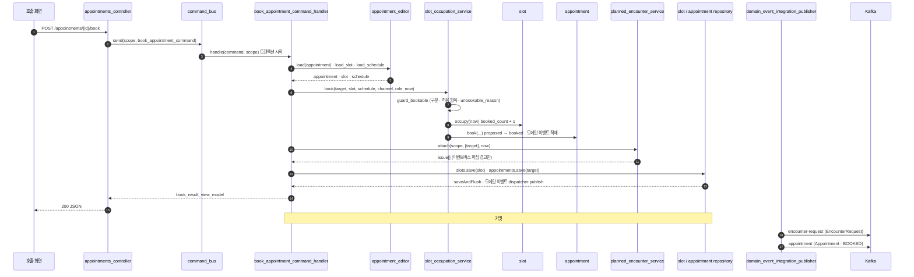
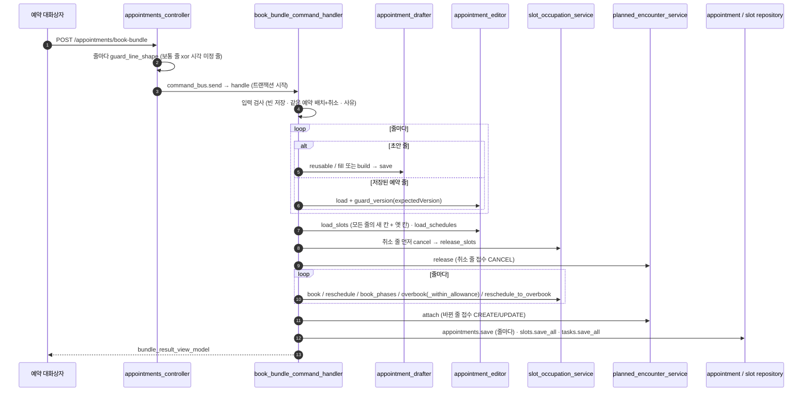
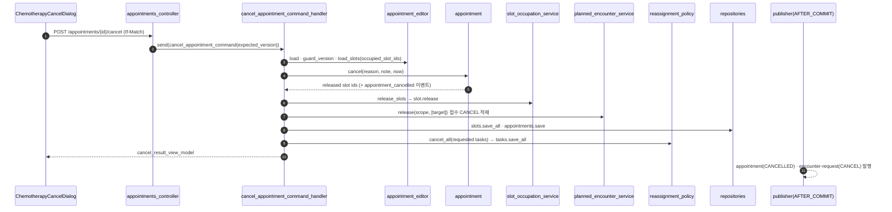
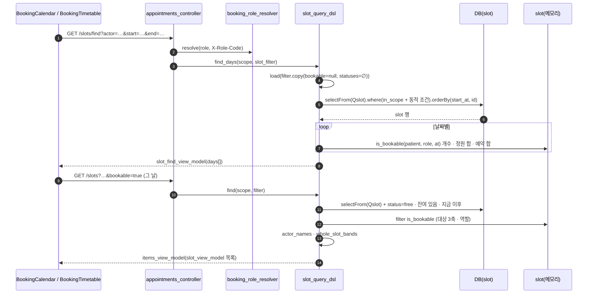
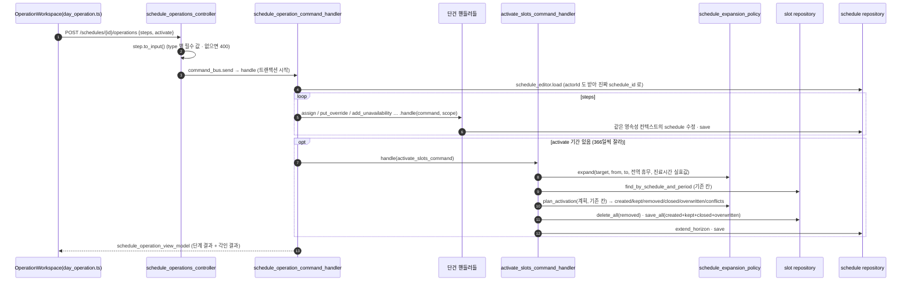
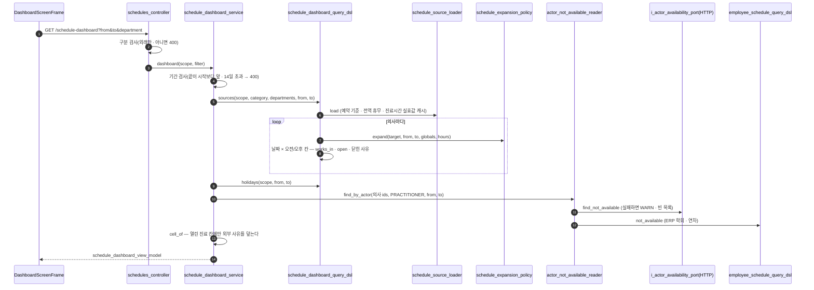
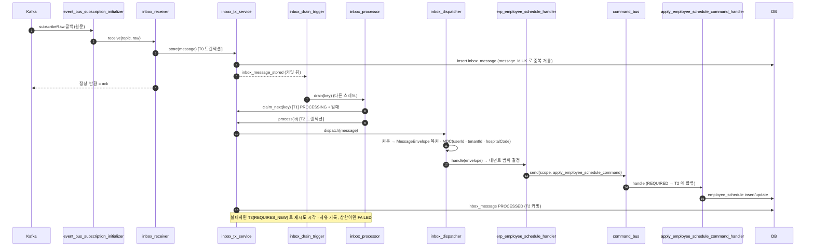

# patient-appointment API 호출 추적서

> 대상: BC `x-patient-appointment`(통합예약 · MicroService `patient-appointment` · 포트 5352 · API 접두 `/api/v1/patient-appointment`)
> 독자: 이 BC 에 처음 들어온 개발자
> 쓰는 법: 화면에서 어떤 API 가 불렸는지 알면 §2 총괄표에서 그 줄을 찾고, 핵심 API 면 §3 상세 카드로 내려간다.
> 「화면 기준」으로 찾고 싶으면 §6 역추적표부터 본다. 문제가 생겼으면 §7 디버깅 가이드.

## 목차

- [0. 이 문서를 읽는 법](#0-이-문서를-읽는-법)
  - [0.1 모든 API 가 지나는 공통 길](#01-모든-api-가-지나는-공통-길)
  - [0.2 표기 약속](#02-표기-약속)
- [1. 이 BC 가 하는 일](#1-이-bc-가-하는-일)
  - [1.1 다섯 줄 요약](#11-다섯-줄-요약)
  - [1.2 테이블 ↔ 엔티티 ↔ Aggregate](#12-테이블--엔티티--aggregate)
  - [1.3 shared 스키마에서 읽는 테이블](#13-shared-스키마에서-읽는-테이블)
- [2. 엔드포인트 총괄표 (113개)](#2-엔드포인트-총괄표-113개)
  - [2.1 appointments_controller (21)](#21-appointments_controller-21)
  - [2.2 mobile_appointments_controller (2)](#22-mobile_appointments_controller-2)
  - [2.3 schedules_controller (16)](#23-schedules_controller-16)
  - [2.4 patterns_controller (16)](#24-patterns_controller-16)
  - [2.5 schedule_operations_controller (17)](#25-schedule_operations_controller-17)
  - [2.6 clinic_hours_controller (9)](#26-clinic_hours_controller-9)
  - [2.7 booking_closures · overbook_allowances · period_comments (12)](#27-booking_closures--overbook_allowances--period_comments-12)
  - [2.8 patient_schedules · chemotherapy_registrations · medication_schedules (9)](#28-patient_schedules--chemotherapy_registrations--medication_schedules-9)
  - [2.9 inbox_messages_controller (11)](#29-inbox_messages_controller-11)
- [3. 엔드포인트별 상세 카드](#3-엔드포인트별-상세-카드)
  - [3.1 예약 등록 — POST /appointments/{appointmentId}/book](#31-예약-등록--post-appointmentsappointmentidbook)
  - [3.2 묶음 예약 등록 — POST /appointments/book-bundle](#32-묶음-예약-등록--post-appointmentsbook-bundle)
  - [3.3 예약 취소 — POST /appointments/{appointmentId}/cancel](#33-예약-취소--post-appointmentsappointmentidcancel)
  - [3.4 슬롯 검색 · 달력 — GET /slots · GET /slots/find](#34-슬롯-검색--달력--get-slots--get-slotsfind)
  - [3.5 예약 목록 — GET /appointments](#35-예약-목록--get-appointments)
  - [3.6 예약 환자 목록 — GET /appointment-patients](#36-예약-환자-목록--get-appointment-patients)
  - [3.7 슬롯 정의 저장 — PUT /patterns/{patternId}](#37-슬롯-정의-저장--put-patternspatternid)
  - [3.8 슬롯 운영 일괄 저장 — POST /schedules/{scheduleId}/operations](#38-슬롯-운영-일괄-저장--post-schedulesscheduleidoperations)
  - [3.9 진료시간 기준 — PUT /clinic-hours-policies/{policyId} · GET .../effective](#39-진료시간-기준--put-clinic-hours-policiespolicyid--get-effective)
  - [3.10 외래 진료 현황판 — GET /schedule-dashboard](#310-외래-진료-현황판--get-schedule-dashboard)
  - [3.11 나머지 엔드포인트 — 같은 패턴 묶음](#311-나머지-엔드포인트--같은-패턴-묶음)
- [4. Kafka 수신 · 발행 경로 추적](#4-kafka-수신--발행-경로-추적)
- [5. 외부 HTTP 호출(Port) 추적](#5-외부-http-호출port-추적)
- [6. 화면 → API 역추적표](#6-화면--api-역추적표)
- [7. 디버깅 가이드](#7-디버깅-가이드)
- [8. 스스로 확인 문제](#8-스스로-확인-문제)

---

## 0. 이 문서를 읽는 법

### 0.1 모든 API 가 지나는 공통 길

이 BC 의 API 는 쓰기(Command)와 읽기(Query)가 **다른 길**로 간다(CQRS). 한 번 익히면 113개가 전부 같은 모양이다.

```
[쓰기]  화면 appointmentApi.ts 함수
        → (HTTP) Controller 메서드        principal.to_tenant_scope() 로 테넌트 범위를 만든다
        → command_bus.send(scope, command) 명령 클래스 타입으로 핸들러를 찾는다
        → *_command_handler.handle()       @Transactional — 트랜잭션 경계는 여기 하나
           → *_editor.load()               로딩 + If-Match 검사(guard_version)
           → Aggregate 메서드 / 도메인 서비스  규칙 판정 · 상태 전이 · 도메인 이벤트 적재
           → i_*_repository.save()         JPA 어댑터가 saveAndFlush + 도메인 이벤트 꺼내 발행
        ← view_model (snake_case JSON)
        → (커밋 뒤) @TransactionalEventListener(AFTER_COMMIT) → Kafka 발행

[읽기]  화면 appointmentApi.ts 함수
        → (HTTP) Controller 메서드
        → i_*_queries (application 의 조회 IF)  또는  *_service (application/support — 애그리게잇 계산이 필요할 때)
        → *_query_dsl (infrastructure)      @Transactional(readOnly = true) · JPAQueryFactory · in_scope(테넌트 조건)
        ← view_model
```

알아 둘 공통 사실 다섯 가지.

1. **트랜잭션은 핸들러에만 있다.** 컨트롤러에는 `@Transactional` 이 없다. 쓰기 핸들러는 `@Transactional`, QueryDSL 구현과 일부 support 서비스는 `@Transactional(readOnly = true)` 다.
2. **테넌트 범위는 토큰에서만 나온다.** 모든 컨트롤러가 `@RequireAuth` 이고, 메서드마다 `@TokenPrincipal principal` 을 받아 `principal.to_tenant_scope()` 를 첫 인자로 넘긴다(예외: inbox 운영 API 는 범위 인자가 없다). QueryDSL 은 모두 `tenant_predicates.in_scope()` 로 `tenant_id` · `hospital_code` 조건을 건다.
3. **동시성 장치는 낙관적 잠금 하나다.** 행 락(`SELECT … FOR UPDATE`)이 없다. 화면이 받은 `version` 을 `If-Match` 헤더로 보내면 다를 때 `409 VERSION_CONFLICT`, 같은 순간 두 저장이 부딪히면 `@Version` 이 `409 OPTIMISTIC_LOCK_CONFLICT` 를 낸다.
4. **표기가 방향마다 다르다.** 요청 본문 · 쿼리 파라미터는 FHIR camelCase(`slotId` · `serviceCategory`), 응답 view_model 은 snake_case(`slot_id` · `booked_count`)다. 예외는 inbox 운영 API(요청도 snake_case).
5. **오류 응답은 `application/problem+json`** 이고 화면은 `issue[0].details.coding[0].code` 로 분기한다(§7 참조).

공통 진입 코드 두 개를 먼저 본다.

x-patient-appointment/backend/patient-appointment/src/main/kotlin/com/projectx/patientappointment/presentation/token_principal_scope.kt:1-12

```kotlin
package com.projectx.patientappointment.presentation

import com.projectx.common.jwt.dto.AuthPrincipal
import com.projectx.patientappointment.domain.seedwork.tenant_scope

// 토큰 주체 → 테넌트 범위. HTTP 요청의 tenant_id · hospital_code 는 이 파일에서만 나온다.
// AuthPrincipal 은 presentation 밖으로 내보내지 않는다 — application 이하에는 tenant_scope 만 넘긴다.
// 작업자(직원 id)는 넘기지 않는다 — 감사 컬럼은 audit_entity_listener 가 MDC userId(토큰 sub)로 채우고,
// 비고 이력의 작성자도 그 created_by 다.

// claim 이 비어 있으면 tenant_scope.of 가 INVALID_DATA 로 채운다(라이브러리가 필수 claim 을 검증하므로 정상 토큰에서는 생기지 않는다)
fun AuthPrincipal.to_tenant_scope(): tenant_scope = tenant_scope.of(tenantId, hospitalCode)
```

x-patient-appointment/backend/patient-appointment/src/main/kotlin/com/projectx/patientappointment/application/commands/command_bus.kt:13-32

```kotlin
@Component
class command_bus(
    handlers: List<command_handler<*, *>>,
    validators: List<command_validator<*>>,
) {
    private val handler_index: Map<Class<*>, command_handler<*, *>> =
        handlers.associateBy { resolve_generic(it.javaClass, command_handler::class.java) }

    private val validator_index: Map<Class<*>, List<command_validator<*>>> =
        validators.groupBy { resolve_generic(it.javaClass, command_validator::class.java) }

    /** [scope] 는 명령의 테넌트 범위 — 검증 뒤 핸들러에 그대로 넘긴다(command_handler 참고). */
    @Suppress("UNCHECKED_CAST")
    fun <TResult> send(scope: tenant_scope, command: command): TResult {
        val type = command.javaClass
        validator_index[type]?.forEach { (it as command_validator<command>).validate(command) }
        val handler = handler_index[type]
            ?: throw IllegalStateException("등록된 핸들러가 없습니다: ${type.name}")
        return (handler as command_handler<command, TResult>).handle(command, scope)
    }
```

`command_validator` 를 구현한 빈은 지금 없다. 입력 검사는 요청 DTO 의 `guard_shape()` · `require(...)`(→ 400)와 도메인 예외(→ 422)가 맡는다.

`If-Match` 헤더 값은 컨트롤러가 이 함수 하나로 숫자로 바꾼다. 헤더가 없으면 `null` 이고, `null` 이면 서버는 버전을 검사하지 않는다.

x-patient-appointment/backend/patient-appointment/src/main/kotlin/com/projectx/patientappointment/presentation/request_ids.kt:15-15

```kotlin
internal fun version_of(if_match: String?): Long? = if_match?.trim('"', ' ')?.toLongOrNull()
```

### 0.2 표기 약속

- 코드 인용 블록 위의 `x-patient-appointment/경로:시작줄-끝줄` 은 원본 파일과 줄 번호다.
- 총괄표 · 체인 안에서는 경로를 줄여 쓴다. 백엔드는 `com/projectx/patientappointment/` 아래 상대경로(예: `presentation/appointments_controller.kt`), 프런트는 `frontend/apps/patient-appointment/src/` 아래 상대경로다. `(:106)` 은 그 파일의 줄 번호다.
- 백엔드 소스 루트는 `x-patient-appointment/backend/patient-appointment/src/main/kotlin/com/projectx/patientappointment/` 다.
- 「FE 함수」 칸은 `src/shared/api/appointmentApi.ts` 의 함수 이름이다. `(없음)` 은 이 BC 의 화면이 부르지 않는 API(다른 시스템 · 내부용)다. `probe*` 는 「조회 API 안내」 화면(`schedule/api-reference`)의 시험 호출 함수 `probeReadApi` · `probeWriteApi` 가 경로를 받아 부르는 것이다.
- 요청 · 응답 JSON 은 전부 **request DTO · view_model 필드로 만든 예시**다. id · 이름 · 번호는 지어낸 값이다.
- Q타입은 QueryDSL 이 엔티티 클래스 이름으로 만든다(`slot` → `Qslot`). **테이블 이름과 클래스 이름이 다른 것이 둘 있다** — `pattern_detail` 클래스 = `schedule_pattern_detail` 테이블, `weekday_hours` 클래스 = `clinic_weekday_hours` 테이블.

---

## 1. 이 BC 가 하는 일

### 1.1 다섯 줄 요약

1. **슬롯 정의** — 예약 대상(검사실 · 주사실 · 투석실 · 재활치료사 · 교육장 · 외래 의사)마다 예약 기준(`schedule`)을 두고, 그 아래 반복 시간표(패턴 `schedule_pattern` + 행 `pattern_detail`)를 만든다. 행을 한꺼번에 찍어 내는 도구가 생성 규칙(`pattern_generation_rule`)이다.
2. **슬롯 운영** — 패턴을 기간에 반영(`pattern_assignment`)하고 휴무(`unavailability_rule`) · 일자 조정(`day_override`)을 얹은 뒤 「각인(activate)」해서 실제 예약 칸 `slot` 행을 만든다. 운영 화면의 한 동작은 `POST /schedules/{id}/operations` 한 번이다. 마감(`booking-closed`)은 새 예약만 막는 휴무 규칙의 한 종류다.
3. **예약 등록** — 처방 · 외래 진료 요청으로 생긴 예약(`appointment`, 상태 `proposed`)을 칸에 넣어 `booked` 로 만든다. 선점(hold) 단계 없이 한 번이다. 판정은 `slot.is_bookable()` 하나, 예약 전이 + 칸 점유는 `slot_occupation_service` 하나가 한다. 등록 · 이동 · 취소 뒤에는 원무에 접수를 Kafka 로 요청한다.
4. **외래** — 외래 의사는 진료과별 진료표(세션 줄)로 정의하고, **진료시간 기준**(`clinic_hours_policy` — 병원 공통 1행 + 진료과 예외)이 그 틀이 된다. 외래 진료 현황판(전광판) · 진료일정 현황 · 일자별 외래 현황이 같은 전개 계산을 읽는다.
5. **부가 정보** — 기간 비고(`period_comment` — 날짜 범위에 붙는 안내문) · 오버부킹 가능 범위(`overbook_allowance`) · 항암 대상 환자(`chemotherapy_registration`) · 환자별 메모(`patient_schedule_note`)는 바꿀 때마다 이력(revision) 행을 쌓는다. 외부에서 받은 메시지는 수신 inbox(`inbox_message`)를 거쳐 처리된다.

### 1.2 테이블 ↔ 엔티티 ↔ Aggregate

스키마는 `patient_appointment` 하나다(MS 1개 = 스키마 1개). `i_aggregate_root` 를 단 클래스가 Aggregate Root 다(8개). `slot` 은 개념상 `schedule` 안이지만 수천 건이라 따로 로딩 · 저장하려고 일부러 루트로 둔 예외다.

| 테이블 | 엔티티 클래스(파일) | 소속 Aggregate | 역할 |
|---|---|---|---|
| `schedule` | `schedule`(`domain/aggregatesmodel/schedule/schedule.kt`) | **schedule (Root)** | 예약 기준 — 무엇을(`service_category`) 어디서(`actor_*`) 받는가 · 정원 상한 · 칸 폭 · 슬롯 관리 여부 |
| `schedule_allowed_item` | (`@ElementCollection`) | schedule | 허용 처방 항목 화이트리스트 |
| `schedule_comment` | `schedule_comment` | schedule | 예약 주체 비고 이력 |
| `schedule_pattern` | `schedule_pattern` | schedule | 반복 시간표(주간 · N일 주기) |
| `schedule_pattern_detail` | `pattern_detail` | schedule | 시간표의 행(일차 × 시각 × 대상 → 정원). 반영되면 행 1개 = 슬롯 1건 |
| `pattern_generation_rule` | `pattern_generation_rule` | schedule | 행을 만드는 도구(구간 규칙) |
| `pattern_assignment` | `pattern_assignment` | schedule | 기간 반영 |
| `unavailability_rule` | `unavailability_rule` | schedule(전역은 `schedule_id = null`) | 휴무 · 진료불가 · 대진 · 마감 |
| `day_override` · `day_override_block` | `day_override`(+`@ElementCollection`) | schedule | 일자 조정 |
| `period_comment` · `period_comment_revision` | `period_comment` · `period_comment_revision` | schedule | 기간 비고 + 이력 |
| `overbook_allowance` · `overbook_allowance_revision` | `overbook_allowance` · `overbook_allowance_revision` | schedule | 오버부킹 가능 범위 + 이력 |
| `slot` | `slot`(`domain/aggregatesmodel/schedule/slot.kt`) | **slot (Root · schedule 하위 예외)** | 예약 경합의 최소 단위. 점유 수 `booked_count` · 낙관적 잠금 `version` |
| `appointment` | `appointment`(`domain/aggregatesmodel/appointment/appointment.kt`) | **appointment (Root)** | 예약. 스냅샷 VO 3벌(`order_*` · `patient_*` · `actor_*` 컬럼) |
| `appointment_phase` | `appointment_phase` | appointment | 연속 예약(다단계)의 단계 |
| `appointment_change` | `appointment_change` | appointment | 예약 이동 이력 |
| `reassignment_task` | `reassignment_task` | **reassignment_task (Root)** | 휴무 · 덮어쓰기로 칸을 잃은 예약의 재배정 작업 |
| `clinic_hours_policy` | `clinic_hours_policy` | **clinic_hours_policy (Root)** | 진료시간 기준(병원 공통 1행 + 진료과 예외) |
| `clinic_weekday_hours` | `weekday_hours` | clinic_hours_policy | 요일 7행 |
| `employee_schedule` | `employee_schedule` | **employee_schedule (Root)** | ERP 직원 일정(학회 · 연차) 수신 사본 — 태그만 단다 |
| `chemotherapy_registration` · `_revision` | `chemotherapy_registration` · `_revision` | **chemotherapy_registration (Root)** | 항암 대상 환자 + 이력 |
| `patient_schedule_note` · `_revision` | `patient_schedule_note` · `_revision` | **patient_schedule_note (Root)** | 환자별 메모 · 치료시작일 + 이력 |
| `inbox_message` · `inbox_message_action` | `inbox_message` · `inbox_message_action`(`infrastructure/inbox/`) | (도메인 아님 — 수신 장치) | 받은 Kafka 원문 · 운영 조작 이력. 테넌트 · 감사 컬럼 없음 |

모든 도메인 테이블은 「PK `<테이블명>_id` → `tenant_id` · `hospital_code` → 업무 컬럼 → `created_at` · `created_by` · `updated_at` · `updated_by`」 순서다. 감사 컬럼은 `audit_entity_listener`(`META-INF/orm.xml` 기본 리스너)가 MDC `userId` 로 채우므로 코드에서 넣지 않는다. id 는 이 BC 가 UUID v7 로 발급한다(옛 행은 ULID 26자가 섞여 있다).

### 1.3 shared 스키마에서 읽는 테이블

다른 스키마를 읽지 않는 규칙의 유일한 예외가 `shared` 다. 전부 `@Immutable` · `@Table(schema = "shared")` 읽기 전용이고, **쓰는 컬럼만** 매핑한다.

| shared 테이블 | 매핑 클래스(`infrastructure/shared/`) | 읽는 컬럼 | 쓰는 곳 |
|---|---|---|---|
| `shared.patient` | `shared_patient` | `patient_id` · `patient_number` · `patient_name` · `gender_code` · `birth_date` | 예약 응답의 `patient` · 검색어(환자명 · 환자번호) · 예약 환자 목록 · 발행 이벤트의 환자 이름 · 번호 |
| `shared.user_account` | `shared_user_account` | `user_account_id` · `user_account_name` · `employee_number` | 비고 · 기간 비고 · 진료시간 기준 · 오버부킹 범위의 작성자 · 저장자 이름(감사 컬럼 → 이름) |
| `shared.encounter` | `shared_encounter` | (접수 상태 판정용 컬럼) | 접수 재사용 전 무효 · 노쇼 확인(`shared_encounter_state_adapter` = `i_encounter_state_port`) |

읽는 방법은 **id 묶음 한 번**이다(`i_shared_directory_queries.patients(ids)` · `.staff(ids)`). 행 조인을 쓰지 않으므로 shared 쪽에 같은 id 가 겹쳐도 예약 줄이 늘지 않는다. 예외는 예약 검색어로, `patient_id in (shared.patient 서브쿼리)` 로 건다(§3.5).

---

## 2. 엔드포인트 총괄표 (113개)

컨트롤러 13개, 엔드포인트 113개다(원본 컨트롤러의 `@GetMapping` · `@PostMapping` · `@PutMapping` · `@PatchMapping` · `@DeleteMapping` 수). 경로는 모두 `/api/v1/patient-appointment` 뒤에 붙는다.

칸 설명: 「호출 체인」은 컨트롤러 다음부터다. 쓰기는 모두 `command_bus.send` 를 지나므로 생략하고 핸들러부터 적는다. 「데이터 출처」의 괄호는 Q타입 · 외부 호출이다. 응답 타입의 `items<T>` 는 `items_view_model<T>`(`{ "items": [...] }`)다.

### 2.1 appointments_controller (21)

파일: `presentation/appointments_controller.kt`. 핸들러는 전부 `application/commands/appointment/appointment_command_handlers.kt`.

| HTTP | 경로 | 컨트롤러.메서드 | 쓰기/읽기 | 호출 체인 | 데이터 출처 | 응답 타입 | FE 함수 |
|---|---|---|---|---|---|---|---|
| GET | `/slots` | `appointments_controller.slots` (:106) | 읽기 | `booking_role_resolver.resolve` → `i_slot_queries.find` → `slot_query_dsl.find`(:50) → `load`(:107) → `slot.is_bookable`(메모리, `bookable=true` 일 때) → `actor_names` · `whole_slot_bands` | `slot` · `schedule` · `schedule_pattern_detail` · `pattern_generation_rule` (`Qslot` · `Qschedule` · `Qpattern_detail` · `Qpattern_generation_rule`) | `items<slot_view_model>` | `findSlots` |
| GET | `/slots/{slotId}` | `.slot` (:141) | 읽기 | `slot_query_dsl.find_by_id`(:58) · 없으면 404 | `slot` · `schedule` (`Qslot`) | `slot_view_model` | (없음) |
| GET | `/slots/find` | `.find_slot_days` (:146) | 읽기 | `i_slot_queries.find_days` → `slot_query_dsl.find_days`(:78) → `load` → 날짜별 집계 | `slot` (`Qslot`) | `slot_find_view_model` | `findSlotDays` |
| GET | `/slots/available-times` | `.available_times` (:182) | 읽기 | `available_time_service.find`(:50) → `i_slot_queries.find` | `slot` · `schedule` | `available_times_view_model` | (없음 — 다른 모듈용) |
| GET | `/appointments` | `.appointments` (:220) | 읽기 | `i_appointment_queries.find` → `appointment_query_dsl.find`(:57) → `views`(:91) → `i_shared_directory_queries.patients` · `i_slot_queries.whole_session_bands` | `appointment` · `appointment_phase` · `shared.patient` (`Qappointment` · `Qshared_patient` 서브쿼리) | `items<appointment_view_model>` | `findAppointments` |
| GET | `/appointments/{appointmentId}` | `.appointment` (:265) | 읽기 | `appointment_query_dsl.find_by_id`(:148) · 없으면 404 | `appointment` · `appointment_phase` · `shared.patient` | `appointment_view_model` | `findAppointment` |
| GET | `/appointment-patients` | `.appointment_patients` (:274) | 읽기 | `appointment_query_dsl.find_patient_list`(:261) → `shared_directory.patients` | `appointment` · `shared.patient` (튜플 projection) | `items<appointment_patient_view_model>` | (없음 — 다른 시스템용) |
| POST | `/appointments` (201) | `.create_appointment` (:304) | 쓰기 | `create_appointment_command_handler`(:53) → `appointment_drafter` → `i_appointment_repository.save` | `appointment` | `appointment_view_model` | (없음) |
| POST | `/appointments/draft` | `.draft` (:316) | 읽기(저장 없음) | `appointment_draft_service.draft`(:25) → `appointment_drafter` → `appointment_view_assembler` | `appointment`(같은 처방의 살아 있는 예약) | `appointment_view_model`(`appointment_id = draft:…` 가능) | `draftAppointment` |
| POST | `/appointments/find-optimal-dates` | `.find_optimal_dates` (:324) | 읽기(부수효과 없음) | `recommendation_service.recommend`(:83) → `appointment_planner`(도메인 서비스) · `i_slot_queries` | `appointment` · `schedule` · `slot` | `recommendation_response_view_model` | `findOptimalDates` |
| POST | `/appointments/{appointmentId}/book` | `.book` (:334) | 쓰기 | `book_appointment_command_handler.handle`(:100) → `appointment_editor` → `slot_occupation_service.book` → `slot.occupy` · `appointment.book` → `planned_encounter_service.attach` → `save` | `appointment` · `slot` (`schedule` 읽기) | `book_result_view_model` | (없음 — 화면은 `bookBundle`) |
| PATCH | `/appointments/{appointmentId}/reschedule` | `.reschedule` (:355) | 쓰기 · If-Match | `reschedule_appointment_command_handler.handle`(:148) → `appointment_editor.guard_version` → `slot_occupation_service.reschedule`(또는 `overbook_slot_locator` → 시각 미정 칸) → `planned.attach` → `save` | `appointment` · `appointment_change` · `slot` | `reschedule_result_view_model` | `rescheduleAppointment` |
| GET | `/appointments/{appointmentId}/changes` | `.changes` (:380) | 읽기 | `appointment_query_dsl.find_changes`(:155) | `appointment_change` (`Qappointment_change`) | `items<appointment_change_view_model>` | `findAppointmentChanges` |
| GET | `/appointment-series/{seriesGroupId}/changes` | `.series_changes` (:385) | 읽기 | `appointment_query_dsl.find_series_changes`(:182) | `appointment` · `appointment_change` | `items<series_change_view_model>` | `findSeriesChanges` |
| GET | `/appointments/{appointmentId}/move-partners` | `.move_partners` (:398) | 읽기 | `move_partner_service.partners`(:46) → `move_together_policy` · `i_slot_queries` · `i_schedule_queries` | `appointment` · `schedule` · `slot` | `move_partners_view_model` | `findMovePartners` |
| POST | `/appointments/{appointmentId}/cancel` | `.cancel` (:412) | 쓰기 · If-Match | `cancel_appointment_command_handler.handle`(:256) → `appointment.cancel` → `slot_occupation_service.release_slots` → `planned.release` → `save_all` · `save` → `reassignment_policy.cancel_all` | `appointment` · `slot` · `reassignment_task` | `cancel_result_view_model` | `cancelAppointment` |
| POST | `/appointments/book-bundle` | `.book_bundle` (:431) | 쓰기 · 줄마다 `expectedVersion` | `book_bundle_command_handler.handle`(:316) → `appointment_drafter` / `appointment_editor` → 줄마다 `occupation.book` · `reschedule` · `book_phases` · `overbook*` → `planned.release` · `attach` → `save` | `appointment` · `appointment_phase` · `slot` · `reassignment_task` | `bundle_result_view_model` | `bookBundle` |
| POST | `/appointments/book-series` | `.book_series` (:469) | 쓰기(부분 성공 허용) | `book_series_command_handler.handle`(:573) → `series_slot_finder` → `occupation.book` | `appointment` · `slot` | `series_result_view_model` | (없음) |
| POST | `/internal/appointments/{appointmentId}/attach-encounter` | `.attach_encounter` (:494) | 쓰기 | `attach_encounter_command_handler`(:636) | `appointment` | `encounter_attach_result_view_model` | (없음 — 내부) |
| POST | `/internal/appointments/{appointmentId}/fulfill` | `.fulfill` (:503) | 쓰기 | `fulfill_appointment_command_handler`(:652) | `appointment` | `appointment_view_model` | (없음 — 내부) |
| POST | `/internal/appointments/{appointmentId}/no-show` | `.no_show` (:508) | 쓰기 | `no_show_appointment_command_handler`(:668) | `appointment` | `appointment_view_model` | (없음 — 내부) |

### 2.2 mobile_appointments_controller (2)

파일: `presentation/mobile_appointments_controller.kt`. 구분 `outpatient-clinic` · 경로 `mobile` · 역할 `patient-app` 이 고정이다.

| HTTP | 경로 | 컨트롤러.메서드 | 쓰기/읽기 | 호출 체인 | 데이터 출처 | 응답 타입 | FE 함수 |
|---|---|---|---|---|---|---|---|
| GET | `/mobile/available-times` | `mobile_appointments_controller.available_times` (:46) | 읽기 | `available_time_service.find`(:50) → `i_slot_queries.find` | `slot` · `schedule` | `available_times_view_model` | `probeReadApi`(API 안내) |
| POST | `/mobile/appointments` (201) | `.book` (:78) | 쓰기 | `book_mobile_appointment_command_handler`(`application/commands/appointment/mobile_appointment_command_handler.kt`:32) → 외래 `proposed` 찾기/만들기 → `slot_occupation_service.book` → `planned.attach` → `save` | `appointment` · `slot` | `mobile_booking_result_view_model` | `probeWriteApi`(API 안내) |

### 2.3 schedules_controller (16)

파일: `presentation/schedules_controller.kt`. 쓰기 핸들러는 `application/commands/schedule/schedule_command_handlers.kt` · `schedule_comment_command_handler.kt`.

| HTTP | 경로 | 컨트롤러.메서드 | 쓰기/읽기 | 호출 체인 | 데이터 출처 | 응답 타입 | FE 함수 |
|---|---|---|---|---|---|---|---|
| GET | `/value-sets/{valueSetId}/expand` | `schedules_controller.expand_value_set` (:98) | 읽기 | `value_set_service.expand`(:52) | 메모리 enum(DB 없음) | `value_set_view_model` | `expandValueSet` |
| GET | `/schedules` | `.schedules` (:114) | 읽기 | `i_schedule_queries.find` → `schedule_query_dsl` | `schedule` (`Qschedule`) | `items<schedule_view_model>` | `findSchedules` |
| GET | `/slot-targets` | `.slot_targets` (:144) | 읽기 | `slot_target_service.of`(:52) → `i_room_directory_port` · `i_therapist_directory_port` · `i_department_directory_port` · `i_physician_directory_port`(HTTP) + `i_schedule_queries` + `actor_availability_service` | `schedule` + 외부 원천(조직 · 사용자 계정 BC · x-ancillary-main) | `items<slot_target_view_model>` | `findSlotTargets` |
| GET | `/schedules/{scheduleId}` | `.schedule` (:152) | 읽기 | `schedule_query_dsl.find_by_id` · 없으면 404(`scheduleId` 자리에 `actorId` 도 받는다) | `schedule` | `schedule_view_model` | `findSchedule` |
| POST | `/schedules` (201) | `.create_schedule` (:157) | 쓰기 | `create_schedule_command_handler`(:27) → `i_schedule_repository.save` | `schedule` · `schedule_allowed_item` | `schedule_view_model` | `createSchedule` |
| PATCH | `/schedules/{scheduleId}` | `.patch_schedule` (:165) | 쓰기 · If-Match | `change_schedule_policy_command_handler`(:83) → `schedule_editor.load` · `guard_version` → `save` | `schedule` | `schedule_command_result` | `patchSchedule` |
| PUT | `/schedules/{scheduleId}/comment` | `.put_comment` (:178) | 쓰기 · If-Match | `change_schedule_comment_command_handler`(`schedule_comment_command_handler.kt`:20) | `schedule` · `schedule_comment` | `schedule_comment_result` | `putScheduleComment` |
| GET | `/schedules/{scheduleId}/comments` | `.comments` (:187) | 읽기 | `i_schedule_comment_queries.find` → `schedule_comment_query_dsl` | `schedule_comment` · `shared.user_account` | `items<schedule_comment_view_model>` | `findScheduleComments` |
| GET | `/schedule-overview` | `.schedule_overview` (:196) | 읽기 | `schedule_overview_service.overview`(:37) → `i_schedule_overview_queries`(`schedule_overview_query_dsl` → `schedule_source_loader` → `schedule_expansion_policy`) + `i_physician_directory_port` + `actor_not_available_reader` | `schedule`(+자식) · `unavailability_rule` · `clinic_hours_policy` · `employee_schedule` + 외부 가용 상태 | `schedule_overview_view_model` | `findScheduleOverview` · `probeReadApi` |
| GET | `/schedule-dashboard` | `.schedule_dashboard` (:229) | 읽기 | `schedule_dashboard_service.dashboard`(:37) → `schedule_dashboard_query_dsl.sources`(:41) · `.holidays`(:53) → `actor_not_available_reader.find_by_actor` | 위와 같음 | `schedule_dashboard_view_model` | `findScheduleDashboard` · `probeReadApi` |
| GET | `/schedule-daily-status` | `.schedule_daily_status` (:250) | 읽기 | `schedule_daily_status_service.daily`(:38) → `schedule_dashboard_service`(칸 상태) · `i_schedule_daily_queries`(`schedule_daily_query_dsl`) · `i_period_comment_queries` | `slot` · `schedule` · `unavailability_rule` · `period_comment` | `schedule_daily_status_view_model` | `findScheduleDailyStatus` · `probeReadApi` |
| GET | `/schedules/{scheduleId}/month-overview` | `.month_overview` (:274) | 읽기 | `month_overview_service.of_schedule`(:49) → `i_schedule_repository` · `i_slot_repository` · `i_reassignment_task_queries` · `schedule_expansion_policy` | `schedule` · `slot` · `reassignment_task` (JPA 로딩) | `month_overview_view_model` | (없음) |
| GET | `/departments/{departmentId}/schedules/summary` | `.department_summary` (:283) | 읽기 | `i_schedule_queries.summarize_department` → `schedule_query_dsl` | `schedule` | `items<schedule_summary_view_model>` | `findDepartmentSummaries` |
| GET | `/departments` | `.departments` (:298) | 읽기 | `department_directory_service.of`(:22) → `i_department_directory_port`(HTTP) | 외부(조직 BC) | `items<department_view_model>` | `findDepartments` |
| GET | `/departments/{departmentId}/physicians` | `.department_physicians` (:310) | 읽기 | `physician_directory_service.of`(:31) → `i_physician_directory_port`(HTTP) + `i_schedule_queries` + `actor_availability_service` | `schedule` + 외부(사용자 계정 BC) | `items<physician_directory_view_model>` | `findDepartmentPhysicians` |
| GET | `/departments/{departmentId}/schedules/month-overview` | `.department_month_overview` (:318) | 읽기 | `month_overview_service.of_department`(:107) | `schedule` · `slot` | `department_month_overview_view_model` | (없음) |

### 2.4 patterns_controller (16)

파일: `presentation/patterns_controller.kt`. 쓰기 핸들러는 `application/commands/schedule/pattern_command_handlers.kt`(비활성화 · 되살리기만 `schedule_command_handlers.kt`). 모든 쓰기가 `schedule_editor.load_by_pattern` / `load_by_generation_rule` 로 **루트 `schedule` 전체**를 읽고 `i_schedule_repository.save(schedule)` 로 저장한다. 조회는 `i_pattern_queries` = `pattern_query_dsl`(`infrastructure/queries/schedule_query_dsl.kt`:170).

| HTTP | 경로 | 컨트롤러.메서드 | 쓰기/읽기 | 호출 체인 | 데이터 출처 | 응답 타입 | FE 함수 |
|---|---|---|---|---|---|---|---|
| GET | `/schedules/{scheduleId}/patterns` | `patterns_controller.patterns` (:66) | 읽기 | `i_pattern_queries.find_summaries` | `schedule_pattern` · `schedule_pattern_detail` · `pattern_generation_rule` | `items<pattern_summary_view_model>` | `findPatterns` |
| POST | `/schedules/{scheduleId}/patterns` (201) | `.create_pattern` (:75) | 쓰기 | `create_pattern_command_handler`(:36) (`from` 이면 복제) | `schedule_pattern`(+행) | `pattern_view_model` | `createPattern` |
| GET | `/patterns/{patternId}` | `.pattern` (:94) | 읽기 | `i_pattern_queries.find_by_id` · 없으면 404 | 위 셋 | `pattern_view_model` | `findPattern` |
| PUT | `/patterns/{patternId}` | `.replace_pattern` (:99) | 쓰기 · If-Match | `replace_pattern_command_handler.handle`(:185) → `schedule_pattern.sync_details` → `schedule.guard_capacity` → `clinic_hours_guard.check_pattern` → `save` | `schedule_pattern` · `schedule_pattern_detail` | `pattern_view_model` | `replacePattern` |
| PATCH | `/patterns/{patternId}` | `.rename_pattern` (:118) | 쓰기 · If-Match | `rename_pattern_command_handler`(:207) | `schedule_pattern` | `pattern_view_model` | (없음) |
| POST | `/patterns/{patternId}/deactivate` | `.deactivate_pattern` (:134) | 쓰기 | `deactivate_pattern_command_handler`(`schedule_command_handlers.kt`:137) | `schedule_pattern` | `pattern_view_model` | `deactivatePattern` |
| POST | `/patterns/{patternId}/restore` | `.restore_pattern` (:141) | 쓰기 | `restore_pattern_command_handler`(`schedule_command_handlers.kt`:157) | `schedule_pattern` | `pattern_view_model` | `restorePattern` |
| PUT | `/patterns/{patternId}/details` | `.put_detail` (:148) | 쓰기 · If-Match | `put_pattern_detail_command_handler`(:225) | `schedule_pattern_detail` | `pattern_view_model` | (없음) |
| DELETE | `/patterns/{patternId}/details` | `.remove_detail` (:160) | 쓰기 · If-Match | `remove_pattern_detail_command_handler`(:247) | `schedule_pattern_detail` | `pattern_view_model` | (없음) |
| POST | `/patterns/{patternId}/copy-to` | `.copy_pattern` (:193) | 쓰기 | `copy_pattern_command_handler`(:278) | 대상 `schedule` 들의 `schedule_pattern` | `pattern_copy_view_model` | `copyPatternTo` |
| GET | `/patterns/{patternId}/generation-rules` | `.rules` (:214) | 읽기 | `i_pattern_queries.find_by_id` → `.rule` | `pattern_generation_rule` | `items<generation_rule_view_model>` | (없음 — 패턴 단건에 함께 온다) |
| POST | `/patterns/{patternId}/generation-rules` (201) | `.create_rule` (:221) | 쓰기 | `create_generation_rule_command_handler`(:347) (`applyNow` · `adopt`) | `pattern_generation_rule` · `schedule_pattern_detail` | `generation_apply_view_model` | `createGenerationRule` |
| PUT | `/generation-rules/{ruleId}` | `.update_rule` (:245) | 쓰기 · If-Match | `update_generation_rule_command_handler`(:405) | `pattern_generation_rule` | `generation_apply_view_model` | `updateGenerationRule` |
| POST | `/generation-rules/{ruleId}/apply` | `.apply_rule` (:266) | 쓰기 | `apply_generation_rule_command_handler`(:439) — 그 규칙이 만든 행만 갈아 낀다 | `schedule_pattern_detail` | `generation_apply_view_model` | (없음) |
| DELETE | `/generation-rules/{ruleId}` | `.delete_rule` (:273) | 쓰기 | `delete_generation_rule_command_handler`(:467) — 규칙의 행도 함께 지운다 | `pattern_generation_rule` · `schedule_pattern_detail` | `generation_rule_deleted_view_model` | `deleteGenerationRule` |
| PUT | `/patterns/{patternId}/generation-rules/order` | `.reorder_rules` (:280) | 쓰기 | `reorder_generation_rules_command_handler`(:488) | `pattern_generation_rule.sort_order` | `pattern_view_model` | `reorderGenerationRules` |

### 2.5 schedule_operations_controller (17)

파일: `presentation/schedule_operations_controller.kt`. 쓰기 핸들러는 `application/commands/schedule/operation_command_handlers.kt` · `day_override_command_handlers.kt` · `schedule_operation_command_handler.kt`, 재배정은 `application/commands/reassignment/reassignment_command_handlers.kt`. `dryRun=true` 는 같은 핸들러가 영향만 계산하고 저장하지 않는다.

| HTTP | 경로 | 컨트롤러.메서드 | 쓰기/읽기 | 호출 체인 | 데이터 출처 | 응답 타입 | FE 함수 |
|---|---|---|---|---|---|---|---|
| GET | `/schedules/{scheduleId}/pattern-assignments` | `schedule_operations_controller.assignments` (:87) | 읽기 | `schedule_day_service.assignments_of`(:57) → `i_schedule_repository` | `pattern_assignment` | `items<pattern_assignment_view_model>` | `findPatternAssignments` |
| POST | `/schedules/{scheduleId}/pattern-assignments/assign` | `.assign` (:95) | 쓰기(`dryRun`) | `assign_pattern_command_handler`(:55) → `schedule_expansion_policy` | `pattern_assignment` · `slot`(영향 계산) | `pattern_assignment_view_model` | `assignPattern` |
| PATCH | `/pattern-assignments/{assignmentId}` | `.change_assignment` (:116) | 쓰기 | `change_assignment_command_handler`(:135) | `pattern_assignment` | `pattern_assignment_view_model` | (없음) |
| DELETE | `/pattern-assignments/{assignmentId}` | `.unassign` (:132) | 쓰기 | `unassign_pattern_command_handler`(:152) | `pattern_assignment` | `assignment_removed_view_model` | `unassignPattern` |
| GET | `/schedules/{scheduleId}/unavailability-rules` | `.unavailability_rules` (:143) | 읽기 | `schedule_day_service.unavailability_of`(:64) | `unavailability_rule`(전역 + 대상 전용) | `items<unavailability_rule_view_model>` | `findUnavailabilityRules` |
| POST | `/schedules/{scheduleId}/unavailability-rules` (201) | `.create_unavailability` (:165) | 쓰기(`dryRun`) | `add_unavailability_command_handler`(:240) → 겹치는 `slot` 을 `busy-unavailable` 로 닫음 → 걸린 예약은 `reassignment_task` 로 보고(자동취소 없음) | `unavailability_rule` · `slot` · `reassignment_task` · `appointment`(보고) | `unavailability_rule_view_model` | `createUnavailabilityRule` |
| PATCH | `/unavailability-rules/{ruleId}` | `.change_unavailability` (:190) | 쓰기 | `change_unavailability_command_handler`(:306) | `unavailability_rule` · `slot` | `unavailability_rule_view_model` | `patchUnavailabilityRule` |
| DELETE | `/unavailability-rules/{ruleId}` | `.delete_unavailability` (:207) | 쓰기 | `remove_unavailability_command_handler`(:369) — `unavailable_by` 가 자기 id 인 칸만 되돌린다 | `unavailability_rule` · `slot` | `unavailability_rule_view_model` | `deleteUnavailabilityRule` |
| GET | `/schedules/{scheduleId}/schedule-days` | `.schedule_days` (:218) | 읽기(저장 없음) | `schedule_day_service.expand`(:40) → `schedule_expansion_policy.expand` + `i_slot_repository`(각인된 칸) + `clinic_hours_guard` | `schedule`(+자식) · `slot` · `unavailability_rule`(전역) · `clinic_hours_policy` | `schedule_days_view_model` | `findScheduleDays` |
| GET | `/schedules/{scheduleId}/day-overrides` | `.day_overrides` (:232) | 읽기 | `i_day_override_queries.find` → `day_override_query_dsl`(`override_reassignment_query_dsl.kt`:31) | `day_override` · `day_override_block` | `items<day_override_view_model>` | `findDayOverrides` |
| PUT | `/schedules/{scheduleId}/day-overrides/{date}` | `.put_day_override` (:243) | 쓰기(`dryRun`) | `put_day_override_command_handler`(`day_override_command_handlers.kt`:32) | `day_override` · `slot` | `day_override_view_model` | `putDayOverride` |
| GET | `/schedules/{scheduleId}/reassignment-tasks` | `.schedule_reassignment_tasks` (:274) | 읽기 | `i_reassignment_task_queries.find` → `reassignment_task_query_dsl`(`override_reassignment_query_dsl.kt`:65) + shared 환자 | `reassignment_task` · `shared.patient` | `items<reassignment_task_view_model>` | `findReassignmentTasks` |
| GET | `/reassignment-tasks` | `.reassignment_tasks` (:294) | 읽기 | 위와 같음(진료과 단위) | 위와 같음 | 위와 같음 | (없음) |
| POST | `/reassignment-tasks/{taskId}/complete` | `.complete_reassignment_task` (:304) | 쓰기 | `complete_reassignment_task_command_handler`(`reassignment_command_handlers.kt`:18) | `reassignment_task` | `reassignment_task_result_view_model` | `completeReassignmentTask` |
| POST | `/reassignment-tasks/{taskId}/cancel` | `.cancel_reassignment_task` (:313) | 쓰기 | `cancel_reassignment_task_command_handler`(:36) | `reassignment_task` | `reassignment_task_result_view_model` | `cancelReassignmentTask` |
| POST | `/schedules/{scheduleId}/activate` | `.activate` (:328) | 쓰기 | `activate_slots_command_handler.handle`(:463) → `schedule_expansion_policy.expand` · `plan_activation` → `i_slot_repository.delete_all` · `save_all` | `slot`(대량) · `schedule` · `reassignment_task` | `activation_view_model` | (없음 — 화면은 `operations` 의 `activate`) |
| POST | `/schedules/{scheduleId}/operations` | `.operations` (:350) | 쓰기 | `schedule_operation_command_handler.handle`(:44) → 단계마다 위 단건 핸들러를 **같은 트랜잭션**에서 호출 → 끝에 `activate_slots_command_handler` | 위 단건들의 합 | `schedule_operation_view_model` | `runScheduleOperation` |

### 2.6 clinic_hours_controller (9)

파일: `presentation/clinic_hours_controller.kt`. 핸들러는 `application/commands/clinichours/clinic_hours_command_handlers.kt` · `holiday_command_handlers.kt`, 조회는 `infrastructure/queries/clinic_hours_query_dsl.kt`.

| HTTP | 경로 | 컨트롤러.메서드 | 쓰기/읽기 | 호출 체인 | 데이터 출처 | 응답 타입 | FE 함수 |
|---|---|---|---|---|---|---|---|
| GET | `/clinic-hours-policies` | `clinic_hours_controller.policies` (:71) | 읽기 | `i_clinic_hours_queries.units` → `clinic_hours_query_dsl.units`(:44) → `shared_directory.staff` | `clinic_hours_policy` · `clinic_weekday_hours` · `shared.user_account` (`Qclinic_hours_policy`) | `items<clinic_hours_policy_view_model>` | `findClinicHoursPolicies` |
| GET | `/clinic-hours-policies/effective` | `.effective` (:75) | 읽기 | `clinic_hours_query_dsl.effective`(:57) → `merged(hospital)` | 위와 같음 | `clinic_hours_policy_view_model` | `findEffectiveClinicHours` |
| GET | `/clinic-hours-policies/{policyId}` | `.policy` (:82) | 읽기 | `clinic_hours_query_dsl.find`(:52) · 없으면 404 | 위와 같음 | `clinic_hours_policy_view_model` | (없음) |
| POST | `/clinic-hours-policies` (201) | `.create` (:87) | 쓰기 | `create_clinic_hours_policy_command_handler`(:64) → `clinic_hours_editor.load_hospital`(병원 공통 복사) | `clinic_hours_policy` · `clinic_weekday_hours` | `clinic_hours_policy_view_model` | `createClinicHoursPolicy` |
| PUT | `/clinic-hours-policies/{policyId}` | `.replace` (:99) | 쓰기 · If-Match | `replace_clinic_hours_policy_command_handler.handle`(:105) → `clinic_hours_editor.load` · `guard_version` → `clinic_hours_policy.replace` → `save` | 위와 같음 | `clinic_hours_policy_view_model` | `replaceClinicHoursPolicy` |
| DELETE | `/clinic-hours-policies/{policyId}` | `.delete` (:108) | 쓰기 | `delete_clinic_hours_policy_command_handler`(:181) — 병원 공통은 422 | 위와 같음 | `clinic_hours_policy_view_model` | `deleteClinicHoursPolicy` |
| GET | `/unavailability-rules` | `.global_rules` (:117) | 읽기 | `clinic_hours_query_dsl.global_rules`(:75) | `unavailability_rule`(`schedule_id IS NULL`) (`Qunavailability_rule`) | `items<unavailability_rule_view_model>` | `findGlobalUnavailabilityRules` |
| POST | `/unavailability-rules` (201) | `.create_global` (:129) | 쓰기 | `add_global_unavailability_command_handler`(`holiday_command_handlers.kt`:37) → `i_clinic_hours_queries.booked_count`(그 날 예약 수 알림) | `unavailability_rule` · `appointment`(센 수) | `unavailability_rule_view_model` | `createGlobalUnavailabilityRule` |
| POST | `/unavailability-rules/holidays/sync` | `.sync_holidays` (:147) | 쓰기 | `sync_holidays_command_handler`(`holiday_command_handlers.kt`:94) → `i_holiday_calendar_port`(stub/http) | `unavailability_rule` · `clinic_hours_policy` | `holiday_sync_view_model` | `syncHolidays` |

전역 휴무의 삭제는 따로 없다 — §2.5 의 `DELETE /unavailability-rules/{ruleId}` 가 함께 받는다(`deleteUnavailabilityRule`).

### 2.7 booking_closures · overbook_allowances · period_comments (12)

세 컨트롤러 모두 `schedule` 애그리게잇 안의 행을 바꾼다(`schedule_editor.load_by_*` → `i_schedule_repository.save`). 오버부킹 범위 · 기간 비고는 **그 행의** `version` 을 `If-Match` 로 받는다(스케줄 버전과 따로다).

| HTTP | 경로 | 컨트롤러.메서드 | 쓰기/읽기 | 호출 체인 | 데이터 출처 | 응답 타입 | FE 함수 |
|---|---|---|---|---|---|---|---|
| POST | `/booking-closures` (201) | `booking_closures_controller.close` (:39) | 쓰기 | `close_booking_command_handler`(`application/commands/schedule/booking_closure_commands.kt`:45) → 운영 명령(마감 단계 + 그 날 각인)으로 위임 | `unavailability_rule`(사유 `booking-closed`) · `slot` | `booking_closure_view_model` | `closeBooking` · `probeWriteApi` |
| DELETE | `/booking-closures/{ruleId}` | `.reopen` (:61) | 쓰기 | `reopen_booking_command_handler`(`booking_closure_commands.kt`:96) | 위와 같음 | `booking_closure_view_model` | `reopenBooking` · `probeWriteApi` |
| GET | `/schedules/{scheduleId}/overbook-allowances` | `overbook_allowances_controller.overbook_allowances` (:48) | 읽기 | `i_overbook_allowance_queries.find` → `overbook_allowance_query_dsl`(:23) | `overbook_allowance` | `items<overbook_allowance_view_model>` | `findOverbookAllowances` |
| POST | `/schedules/{scheduleId}/overbook-allowances` (201) | `.add` (:56) | 쓰기 | `add_overbook_allowance_command_handler`(`overbook_allowance_command_handlers.kt`:25) | `overbook_allowance` · `overbook_allowance_revision` | `overbook_allowance_result` | `addOverbookAllowance` |
| PUT | `/overbook-allowances/{overbookAllowanceId}` | `.change` (:76) | 쓰기 · If-Match | `change_overbook_allowance_command_handler`(:55) | 위와 같음 | `overbook_allowance_result` | `putOverbookAllowance` |
| POST | `/overbook-allowances/{overbookAllowanceId}/remove` | `.remove` (:97) | 쓰기 · If-Match | `remove_overbook_allowance_command_handler`(:88) — 행을 지우지 않고 `removed` | 위와 같음 | `overbook_allowance_result` | `removeOverbookAllowance` |
| GET | `/schedules/{scheduleId}/overbook-allowance-revisions` | `.revisions` (:111) | 읽기 | `i_overbook_allowance_queries.revisions` | `overbook_allowance_revision` · `shared.user_account` | `items<overbook_allowance_revision_view_model>` | `findOverbookAllowanceRevisions` |
| GET | `/period-comments` | `period_comments_controller.period_comments` (:48) | 읽기 | `i_period_comment_queries.find` → `period_comment_query_dsl`(:26) | `period_comment` · `shared.user_account` (`Qperiod_comment` · `Qshared_user_account`) | `items<period_comment_view_model>` | `findPeriodComments` |
| POST | `/schedules/{scheduleId}/period-comments` (201) | `.add` (:66) | 쓰기 | `add_period_comment_command_handler`(`period_comment_command_handlers.kt`:25) | `period_comment` · `period_comment_revision` | `period_comment_result` | `addPeriodComment` |
| PUT | `/period-comments/{periodCommentId}` | `.change` (:86) | 쓰기 · If-Match | `change_period_comment_command_handler`(:54) | 위와 같음 | `period_comment_result` | `putPeriodComment` |
| POST | `/period-comments/{periodCommentId}/remove` | `.remove` (:107) | 쓰기 · If-Match | `remove_period_comment_command_handler`(:88) — `removed` 로 내림 | 위와 같음 | `period_comment_result` | `removePeriodComment` |
| GET | `/schedules/{scheduleId}/period-comment-revisions` | `.revisions` (:121) | 읽기 | `i_period_comment_queries.revisions` | `period_comment_revision` · `shared.user_account` | `items<period_comment_revision_view_model>` | `findPeriodCommentRevisions` |

### 2.8 patient_schedules · chemotherapy_registrations · medication_schedules (9)

| HTTP | 경로 | 컨트롤러.메서드 | 쓰기/읽기 | 호출 체인 | 데이터 출처 | 응답 타입 | FE 함수 |
|---|---|---|---|---|---|---|---|
| GET | `/patient-schedules/{patientId}` | `patient_schedules_controller.schedule` (:43) | 읽기 | `patient_schedule_service.schedule`(:40) → `i_patient_schedule_note_queries` · `i_appointment_queries` · `patient_schedule_policy`(내원 묶음 · 약제 카운트 계산) | `patient_schedule_note` · `appointment` · `shared.patient` | `patient_schedule_view_model` | `findPatientSchedule` |
| GET | `/patient-schedule-notes/{patientId}/revisions` | `.revisions` (:59) | 읽기 | `i_patient_schedule_note_queries.revisions` → `patient_schedule_note_query_dsl`(:21) | `patient_schedule_note_revision` | `items<patient_schedule_note_revision_view_model>` | `findPatientScheduleNoteRevisions` |
| PUT | `/patient-schedule-notes/{patientId}` | `.save` (:67) | 쓰기 · If-Match | `save_patient_schedule_note_command_handler`(`application/commands/patientschedulenote/patient_schedule_note_commands.kt`:40) | `patient_schedule_note` · `_revision` | `patient_schedule_note_result` | `savePatientScheduleNote` |
| GET | `/chemotherapy-registrations` | `chemotherapy_registrations_controller.registrations` (:53) | 읽기 | `chemotherapy_registration_service.list`(:39) → `chemotherapy_registration_query_dsl`(:30) | `chemotherapy_registration` · `appointment`(진행 계산) | `items<chemotherapy_registration_view_model>` | `findChemotherapyRegistrations` |
| GET | `/chemotherapy-registrations/{registrationId}` | `.registration` (:73) | 읽기 | `chemotherapy_registration_service.detail`(:49) → `chemotherapy_cycle_plan`(계획 회차 계산) | 위와 같음 | `chemotherapy_registration_detail_view_model` | `findChemotherapyRegistration` |
| GET | `/chemotherapy-registrations/{registrationId}/revisions` | `.revisions` (:80) | 읽기 | `i_chemotherapy_registration_queries.revisions` | `chemotherapy_registration_revision` | `items<chemotherapy_registration_revision_view_model>` | `findChemotherapyRegistrationRevisions` |
| POST | `/chemotherapy-registrations` (201) | `.register` (:88) | 쓰기 | `register_chemotherapy_command_handler`(`application/commands/chemotherapyregistration/chemotherapy_registration_commands.kt`:88) — 예약을 만들지 않는다 | `chemotherapy_registration` · `_revision` | `chemotherapy_registration_result` | `registerChemotherapy` |
| PUT | `/chemotherapy-registrations/{registrationId}` | `.change` (:103) | 쓰기 · If-Match | `change_chemotherapy_registration_command_handler`(:111) | 위와 같음 | `chemotherapy_registration_result` | `changeChemotherapyRegistration` |
| GET | `/medication-schedules` | `medication_schedules_controller.medication_schedules` (:33) | 읽기 | `medication_schedule_service.of`(:19) → `i_medication_schedule_port`(HTTP) | 외부(저장 없음) | `items<medication_schedule_view_model>` | `findMedicationSchedules` |

### 2.9 inbox_messages_controller (11)

파일: `presentation/inbox_messages_controller.kt`. **범위 인자가 없다**(inbox 는 배포마다 따로라서). 오류 본문은 `inbox_error_advice` 가 `{ error, message }` 로 따로 낸다(다른 BC 의 inbox API 와 같은 contract). 조회는 `i_inbox_message_queries` = `infrastructure/queries/inbox_message_queries.kt`:37(내부에서 `inbox_message_query_dsl`), 조작은 `i_inbox_operation_port` = `infrastructure/inbox/inbox_operation_service.kt`. 이 BC 의 화면은 부르지 않고 **x-ancillary-main 「수신 메시지 관리」** 화면이 부른다.

| HTTP | 경로 | 컨트롤러.메서드 | 쓰기/읽기 | 호출 체인 | 데이터 출처 | 응답 타입 | FE 함수 |
|---|---|---|---|---|---|---|---|
| GET | `/inbox-summary` | `inbox_messages_controller.summary` (:43) | 읽기 | `i_inbox_message_queries.summary` | `inbox_message` | `inbox_summary_view` | (x-ancillary-main) |
| GET | `/inbox-messages` | `.find_messages` (:50) | 읽기 | `.find_messages(inbox_message_criteria)` | `inbox_message` | `inbox_message_page_view` | (x-ancillary-main) |
| GET | `/inbox-messages/{inbox_message_id}` | `.find_message` (:76) | 읽기 | `.find_message` · 없으면 404 `INBOX_MESSAGE_NOT_FOUND` | `inbox_message` · `inbox_message_action` · `shared.user_account` | `inbox_message_detail_view` | (x-ancillary-main) |
| GET | `/inbox-messages/{inbox_message_id}/sequence` | `.find_sequence` (:81) | 읽기 | `.find_sequence` | `inbox_message` | `inbox_sequence_view` | (x-ancillary-main) |
| GET | `/inbox-keys` | `.find_keys` (:89) | 읽기 | `.find_keys(inbox_key_criteria)` | `inbox_message` | `inbox_key_list_view` | (x-ancillary-main) |
| POST | `/inbox-messages/{inbox_message_id}/retry` | `.retry` (:102) | 쓰기 | `inbox_operation_service.retry` → `inbox_message_stored` 발행 → 커밋 뒤 `inbox_drain_trigger` | `inbox_message` · `inbox_message_action` | `inbox_operation_result` | (x-ancillary-main) |
| POST | `/inbox-message-retries` | `.retry_many` (:109) | 쓰기 | `.retry(ids)` (최대 200) | 위와 같음 | `inbox_operation_result` | (x-ancillary-main) |
| PUT | `/inbox-messages/{inbox_message_id}/payload` | `.edit_payload` (:114) | 쓰기 | `.edit_payload` | 위와 같음 | `inbox_operation_result` | (x-ancillary-main) |
| POST | `/inbox-messages/{inbox_message_id}/resend` | `.resend` (:121) | 쓰기 | `.resend` — 같은 키 맨 뒤 새 행(Kafka 재발행 아님) | 위와 같음 | `inbox_operation_result` | (x-ancillary-main) |
| POST | `/inbox-messages/{inbox_message_id}/terminate` | `.terminate` (:128) | 쓰기 | `.terminate` | 위와 같음 | `inbox_operation_result` | (x-ancillary-main) |
| POST | `/inbox-message-terminations` | `.terminate_many` (:135) | 쓰기 | `.terminate(ids)` (최대 200) | 위와 같음 | `inbox_operation_result` | (x-ancillary-main) |

---

## 3. 엔드포인트별 상세 카드

카드마다 순서가 같다: 무엇을 하나 → 요청 예시 → 호출 체인(단계마다 `경로:줄`) → 데이터 조회 방식 → 트랜잭션 경계 → 이벤트 → 응답 예시 → 예외와 HTTP 상태 → If-Match/낙관락.
요청 · 응답 JSON 은 request DTO · view_model 필드로 만든 **예시**다. id · 이름 · 번호는 모두 지어낸 값이다.

### 3.1 예약 등록 — POST /appointments/{appointmentId}/book

**하는 일**: 이미 있는 `proposed` 예약 1건을 칸(`slot`) 1개에 넣어 `booked` 로 만든다. 선점 단계가 없어서 이 한 번의 호출이 「판정 → 칸 점유 → 예약 전이 → 접수 요청 적재 → 저장」을 한 트랜잭션에서 끝낸다.
이 BC 의 화면은 이 API 를 직접 부르지 않고 같은 판정 경로를 타는 `book-bundle`(§3.2)을 쓴다. 단건 등록의 원형이라 가장 먼저 읽는다.

**요청 예시**

```http
POST /api/v1/patient-appointment/appointments/0192f1a0-1111-7000-8000-000000000001/book
Authorization: Bearer <토큰>
X-Role-Code: APPT_CENTER_ADMIN
Content-Type: application/json

{
  "slotId": "0192f1a0-2222-7000-8000-000000000001",
  "ext": { "bookingChannel": "central", "bookingRoute": "in-house" }
}
```

`X-Role-Code` 는 `booking_role_resolver` 가 예약 역할(`central` · `dept` · `exam-room` · `patient-app`)로 바꾼다(설정 `projectx.patient-appointment.booking-roles`, 매핑이 없으면 `dept`, 헤더가 없으면 역할 미상 = 역할 축을 보지 않음). `ext.bookingChannel` 이 없으면 `central` 이다.

**호출 체인**



| 단계 | 하는 일 | 위치 |
|---|---|---|
| 1 | 요청 DTO → `book_appointment_command`. `bookingChannel` · `bookingRoute` 코드를 enum 으로 바꾼다(모르는 코드면 400) | `presentation/appointments_controller.kt:334-349` · `:516-521` |
| 2 | 명령 클래스 정의 | `application/commands/appointment/appointment_commands.kt:123-130` |
| 3 | 명령 타입으로 핸들러를 찾아 부른다 | `application/commands/command_bus.kt:26-32` |
| 4 | 핸들러 — 트랜잭션 경계 | `application/commands/appointment/appointment_command_handlers.kt:99-124` |
| 5 | 예약 · 칸 · 예약 기준 로딩(행 락 없음) | `application/support/appointment_editor.kt:43-61` |
| 6 | 판정: 구분 일치 → 허용 항목 → `slot.unbookable_reason` | `domain/services/slot_occupation_service.kt:36-52` · `domain/aggregatesmodel/schedule/slot.kt:198-207` |
| 7 | 칸 점유(`booked_count + 1`) | `domain/aggregatesmodel/schedule/slot.kt:216-221` |
| 8 | 예약 전이 + `appointment_booked_domain_event` 적재 | `domain/aggregatesmodel/appointment/appointment.kt:290-322` |
| 9 | 접수 묶음을 만들고 접수 요청을 도메인 이벤트로 싣는다(없으면 422) | `application/support/planned_encounter_service.kt:62-91` → `infrastructure/eventbus/encounter_request_event_adapter.kt:30-36` |
| 10 | 저장 — 이벤트를 인자 인스턴스에서 먼저 꺼내고 `saveAndFlush` | `infrastructure/repositories/appointment_repositories.kt:61-71` · `:238-239` |
| 11 | 도메인 이벤트 → Spring `ApplicationEventPublisher` | `infrastructure/domain_event_dispatcher.kt:12-19` |
| 12 | 커밋 뒤 Kafka 발행(실패해도 예약은 남는다) | `infrastructure/eventbus/domain_event_integration_publisher.kt:59-61` · `:75-89` · `:95-110` |

핸들러 본문이 체인 전체를 보여 준다.

x-patient-appointment/backend/patient-appointment/src/main/kotlin/com/projectx/patientappointment/application/commands/appointment/appointment_command_handlers.kt:99-124

```kotlin
    @Transactional
    override fun handle(command: book_appointment_command, scope: tenant_scope): book_result_view_model {
        val target = editor.load(scope, command.appointment_id)
        val slot_row = editor.load_slot(scope, command.slot_id)
        val owning = editor.load_schedule(scope, slot_row.schedule_id)
        val now = clock.instant()
        // 경로는 예약 등록 직전에 남긴다 — 원내 · 콜센터는 기록만, 모바일 · 인터넷은 경로 축 판정에도 실린다(불변식 44).
        command.route?.takeIf { target.status == appointment_status.PROPOSED }?.let { target.enter_route(it, now) }
        // 역할 축(불변식 16) — `X-Role-Code` 에서 파생한 booking_role 을 slot.allowed_roles 와 대조한다.
        occupation.book(target, slot_row, owning, command.channel, roles.resolve(command.role_code), now)
        // 접수 요청 id 를 같은 트랜잭션에서 남긴다 — 요청은 커밋 뒤 발행되고 encounter_id 는 원무 회신이 붙인다(불변식 27).
        val issues = planned.attach(scope, listOf(target), now)
        slots.save(slot_row)
        val saved = appointments.save(target)
        log.info("예약을 등록했습니다 — appointment_id={} slot_id={}", saved.appointment_id, command.slot_id)
        return book_result_view_model(
            appointment_id = saved.appointment_id,
            status = saved.status.code,
            slot_id = saved.slot_id,
            start_at = saved.start_at,
            booked_at = saved.booked_at,
            version = saved.version,
            encounter_id = saved.encounter_id?.toString(),
            issue = issues,
        )
    }
```

예약 가능 판정의 정본은 `slot` 에 있다. 화면 · 추천 · 묶음 예약이 모두 이 한 곳을 쓴다.

x-patient-appointment/backend/patient-appointment/src/main/kotlin/com/projectx/patientappointment/domain/aggregatesmodel/schedule/slot.kt:185-221

```kotlin
    fun is_bookable(patient: eligibility, role: booking_role?, at: Instant): Boolean =
        !overbook &&
            status == slot_status.FREE &&
            booked_count < capacity &&
            target.allows(patient) &&
            allows_role(role) &&
            start_at.isAfter(at)

    /** 호출자 역할이 이 칸을 잡을 수 있는가 — 빈 집합은 전체 허용, 역할 미상도 통과(불변식 16). */
    fun allows_role(role: booking_role?): Boolean =
        allowed_role_codes.isBlank() || role == null || role in allowed_roles

    /** 왜 못 잡는가 — 오류 코드로 내려 화면이 사유를 말하게 한다. `null` 이면 예약 가능. */
    fun unbookable_reason(patient: eligibility, role: booking_role?, at: Instant): String? = when {
        overbook -> "SLOT_OVERBOOK"
        status.is_closed() -> "SLOT_CLOSED"
        !start_at.isAfter(at) -> "SLOT_IN_PAST"
        booked_count >= capacity -> "SLOT_FULL"
        !target.allows(patient) -> "SLOT_NOT_ELIGIBLE"
        !allows_role(role) -> "ROLE_NOT_ALLOWED"
        status != slot_status.FREE -> "SLOT_FULL"
        else -> null
    }

    /** 남은 여유 정원. */
    fun remaining(): Int = (capacity - booked_count).coerceAtLeast(0)

    /** 예약이 걸려 있는지 — `activate` · 휴무 등록이 「지워도 되는 칸」을 가르는 기준. */
    fun is_occupied(): Boolean = booked_count > 0

    /** 점유. 여유가 없으면 예외 — 호출자는 `slot_occupation_service` 하나다. */
    fun occupy(at: Instant) {
        if (status.is_closed()) throw bad_state_domain_exception("닫힌 슬롯은 예약할 수 없습니다", status.code)
        if (booked_count >= capacity) throw slot_full_domain_exception(id, capacity)
        booked_count += 1
        refresh_status(at, changed = true)
    }
```

**데이터 조회 방식**: 쓰기 경로라 QueryDSL 이 아니라 **Repository(JPA)** 로 읽는다. 예약은 `jpa.findById(id)` 뒤에 범위를 확인하고(`in_scope`), 칸은 Spring Data 인터페이스의 JPQL 로 범위 · id 를 함께 건다. 행 락은 없다.

x-patient-appointment/backend/patient-appointment/src/main/kotlin/com/projectx/patientappointment/infrastructure/appointment_context.kt:198-206

```kotlin
interface slot_jpa_repository : JpaRepository<slot, String> {

    /** 점유 · 반환 대상 슬롯 — 행 락은 없다(동시 점유는 `version` 낙관적 잠금이 막는다). */
    @Query("select s from slot s where s.tenant_id = :tenantId and s.hospital_code = :hospitalCode and s.id in :ids order by s.id asc")
    fun find_all_by_ids(
        @Param("tenantId") tenant_id: String,
        @Param("hospitalCode") hospital_code: String,
        @Param("ids") ids: Collection<String>,
    ): List<slot>
```

저장 쪽에서 도메인 이벤트를 꺼내는 규칙이 한 곳에 있다.

x-patient-appointment/backend/patient-appointment/src/main/kotlin/com/projectx/patientappointment/infrastructure/repositories/appointment_repositories.kt:61-71

```kotlin
private inline fun <T : entity> save_with_events(
    aggregate: T,
    dispatcher: domain_event_dispatcher,
    persist: (T) -> T,
): T {
    val events: List<domain_event> = aggregate.domain_events
    val saved = persist(aggregate)
    aggregate.clear_domain_events()
    events.forEach { dispatcher.publish(it) }
    return saved
}
```

`@Version` 이 있는 신규 엔티티는 Spring Data 가 `merge` 로 저장해 **다른 인스턴스**를 돌려주므로, 반환본이 아니라 인자에서 이벤트를 먼저 꺼낸다. 단건 저장이 `saveAndFlush` 인 것도 이유가 있다 — `save` 만 하면 `version` 이 커밋 때 올라가서 응답의 `version` 이 한 박자 뒤지고, 화면이 그 값을 다음 `If-Match` 로 보내면 매번 409 가 난다.

**트랜잭션 경계**: `book_appointment_command_handler.handle` 의 `@Transactional` 하나다. `appointment_editor.load` 의 `@Transactional(readOnly = true)` 는 이미 열린 트랜잭션에 합류한다. Kafka 발행은 커밋 **뒤**(AFTER_COMMIT)라 롤백된 예약은 밖에 알려지지 않는다.

**발행 이벤트**

| 도메인 이벤트(적재 위치) | AFTER_COMMIT 리스너 | Kafka 토픽(뒷마디) · messageType | 파티션 키 |
|---|---|---|---|
| `encounter_requested_domain_event`(`encounter_request_event_adapter.request` 가 `dispatcher.publish`) | `on_encounter_requested`(:95) | `encounter-request` · `EncounterRequest` | `patient_id` |
| `appointment_booked_domain_event`(`appointment.book`) | `on_booked`(:59) → `publish_appointment` — **커밋 뒤 예약을 `appointment_query_dsl.find_by_id` 로 다시 읽어** payload 를 만든다 | `appointment` · `Appointment`(`event_type = BOOKED`) | `appointment_id` |

**응답 예시** (`book_result_view_model`)

```json
{
  "appointment_id": "0192f1a0-1111-7000-8000-000000000001",
  "status": "booked",
  "slot_id": "0192f1a0-2222-7000-8000-000000000001",
  "start_at": "2026-11-05T00:30:00Z",
  "booked_at": "2026-10-29T01:12:44Z",
  "version": 2,
  "encounter_id": null,
  "issue": []
}
```

`encounter_id` 는 보통 비어 있다 — 접수는 원무가 회신(`appointment-request` 토픽)으로 붙인다. 이벤트버스가 꺼진 환경이면 `issue` 에 `ENCOUNTER_REQUEST_DISABLED` 경고 1건이 실린다.

**예외와 HTTP 상태**

| 상태 | 코드(`issue[0].details.coding[0].code`) | 원인 |
|---|---|---|
| 400 | `VALIDATION_ERROR` | 모르는 `bookingChannel` · `bookingRoute` 코드(`from_code` 의 `IllegalArgumentException`) |
| 404 | `APPOINTMENT_NOT_FOUND` · `SLOT_NOT_FOUND` · `NOT_FOUND` | 예약 · 칸 · 예약 기준이 없거나 다른 테넌트 범위 |
| 403 | `SERVICE_ITEM_NOT_ALLOWED` | 예약 기준의 허용 항목에 이 처방 코드가 없다 |
| 422 | `SERVICE_CATEGORY_MISMATCH` | 예약 구분 ≠ 칸의 예약 기준 구분 |
| 422 | `SLOT_FULL` · `SLOT_CLOSED` · `SLOT_IN_PAST` · `SLOT_NOT_ELIGIBLE` · `ROLE_NOT_ALLOWED` · `SLOT_OVERBOOK` | `slot.unbookable_reason` 의 사유 |
| 422 | `NOT_BOOKED` | 예약이 `proposed` 가 아니다(`bad_state_domain_exception`) |
| 422 | `ENCOUNTER_CONTEXT_REQUIRED` | 접수 묶음 키(처방일 · 처방 진료과 id · 처방의 id, 외래는 칸의 진료과 · 진료의)가 없거나 uuid 가 아니다 |
| 409 | `OPTIMISTIC_LOCK_CONFLICT` | 같은 칸을 같은 순간 다른 사람이 저장(`slot.version` 경합) |

**If-Match / 낙관락**: 이 API 는 `If-Match` 를 받지 않는다. 동시성은 `slot` 의 `@Version`(`slot.kt:153`)과 `appointment` 의 `@Version` 이 막는다. 409 를 받은 화면은 칸을 다시 읽고 다시 고른다.

### 3.2 묶음 예약 등록 — POST /appointments/book-bundle

**하는 일**: 검사 예약 대화상자 · 외래 예약 대화상자 · 항암 주사일정 이동이 쓰는 **예약 저장 본체**다. 한 번의 저장에 여러 줄을 싣고, 줄마다 예약 상태에 따라 「예약 등록 · 이동 · 그대로」가 갈린다. 취소 줄(`cancel[]`)도 같은 트랜잭션이다. **전체 성공 아니면 전체 실패**다.

줄 모양은 셋이다.
- **보통 줄** — `slotId`(칸 하나).
- **연속 예약 줄** — `phases[]`(단계마다 칸).
- **시각 미정 줄** — `scheduleId` + `overbookDate`(그 날 00:00 오버부킹 칸을 서버가 찾거나 만든다).

`draft` 가 있으면 **초안 줄**이다 — 예약 행이 아직 없는 처방이라 이 저장에서 예약 행을 만들고 바로 등록한다.

**요청 예시**

```http
POST /api/v1/patient-appointment/appointments/book-bundle
X-Role-Code: NM_EXAM_MANAGER
Content-Type: application/json

{
  "plan": [
    {
      "appointmentId": "draft:order-line-0001",
      "slotId": "0192f1a0-2222-7000-8000-000000000011",
      "draft": {
        "basedOnType": "diagnostic-imaging",
        "basedOnId": "0192f1a0-3333-7000-8000-000000000001",
        "patientId": "0192f1a0-4444-7000-8000-000000000001",
        "serviceCategory": "examination",
        "patientSnapshot": { "age": 52, "encounterClass": "outpatient", "visitType": "followup" },
        "orderSnapshot": {
          "code": "EXAM-0001", "display": "예시 검사", "durationMinutes": 30,
          "orderedDate": "2026-10-28",
          "departmentId": "0192f1a0-5555-7000-8000-000000000001",
          "requesterId": "0192f1a0-6666-7000-8000-000000000001",
          "requesterName": "예시의사", "departmentName": "예시진료과"
        }
      }
    },
    { "appointmentId": "0192f1a0-1111-7000-8000-000000000002", "slotId": "0192f1a0-2222-7000-8000-000000000012", "expectedVersion": 3 },
    { "appointmentId": "0192f1a0-1111-7000-8000-000000000003", "scheduleId": "0192f1a0-7777-7000-8000-000000000001", "overbookDate": "2026-11-05" }
  ],
  "cancel": [ { "appointmentId": "0192f1a0-1111-7000-8000-000000000004" } ],
  "changeReason": "pat",
  "changeNote": "환자 요청으로 변경",
  "ext": { "bookingChannel": "link", "bookingRoute": "in-house" }
}
```

FE 는 `bookBundle(plan, ext, cancel, change)` 하나로 보낸다(`frontend/apps/patient-appointment/src/shared/api/appointmentApi.ts:2678-2690`). 부르는 곳은 `widgets/appointment/AppointmentBookingDialog.tsx:605` · `widgets/appointment/OutpatientAppointmentDialog.tsx:392` · `:464` · `widgets/appointment/chemotherapy/ChemotherapyMoveDialog.tsx:120`.

x-patient-appointment/frontend/apps/patient-appointment/src/shared/api/appointmentApi.ts:2678-2690

```ts
export function bookBundle(
  plan: BundlePlanEntry[],
  /** `bookingRoute` 는 이 저장에서 **새로 예약 등록하는 줄**에만 남는다(이동 · 취소 줄은 등록 때 값 유지). */
  ext?: BookingExt,
  /** 같은 저장에서 취소할 예약 — [예약 초기화]로 비운 채 둔 예약된 처방(전체 성공 or 전체 실패에 함께 묶인다). */
  cancel: Array<{ appointmentId: string }> = [],
  /** 변경 · 취소 사유 — 한 저장에 하나. 취소가 있으면 필수, `oth` 면 메모 필수(api §6.6). */
  change?: { changeReason: CancellationReasonCode; changeNote?: string },
) {
  return request<BundleResultView>(() =>
    api.post(`${BASE}/appointments/book-bundle`, { plan, ext, cancel, ...change }),
  )
}
```

**호출 체인**



| 단계 | 하는 일 | 위치 |
|---|---|---|
| 1 | 줄 모양 검사(보통 줄 xor 시각 미정 줄, 아니면 400) · DTO → 명령 | `presentation/appointments_controller.kt:430-466` · `:749-759` |
| 2 | 핸들러 진입 · 입력 검사 | `application/commands/appointment/appointment_command_handlers.kt:315-341` |
| 3 | 줄마다 대상 예약 결정(초안이면 만들거나 재사용, 아니면 로딩 + 기대 버전 검사) | 같은 파일 `:344-356` |
| 4 | 새 칸 · 옛 칸 · 예약 기준을 한 번에 로딩 | 같은 파일 `:357-369` |
| 5 | 취소 줄 먼저 — 반환한 칸을 같은 저장의 다른 줄이 쓸 수 있다 | 같은 파일 `:380-386` |
| 6 | 줄마다 등록 · 이동 · 그대로 판정 | 같은 파일 `:388-495` |
| 7 | 바뀐 줄의 접수 요청 | 같은 파일 `:497-506` |
| 8 | 저장과 응답 조립 | 같은 파일 `:508-550` |

x-patient-appointment/backend/patient-appointment/src/main/kotlin/com/projectx/patientappointment/application/commands/appointment/appointment_command_handlers.kt:315-341

```kotlin
    @Transactional
    override fun handle(command: book_bundle_command, scope: tenant_scope): bundle_result_view_model {
        if (command.plan.isEmpty() && command.cancel_ids.isEmpty()) {
            throw appointment_validation_exception("plan 과 cancel 이 모두 비어 있습니다")
        }
        val planned_ids = command.plan.map { it.appointment_id }.toSet()
        command.cancel_ids.firstOrNull { it in planned_ids }?.let {
            throw appointment_validation_exception("한 예약을 같은 저장에서 배치하고 취소할 수 없습니다: $it")
        }
        val note = command.change_note?.trim()?.takeIf { it.isNotEmpty() }
        if (command.cancel_ids.isNotEmpty() && command.change_reason == null) {
            throw appointment_validation_exception("취소할 예약이 있으면 사유(changeReason)가 필요합니다")
        }
        if (command.change_reason == cancellation_reason.OTHER && note == null) {
            throw appointment_validation_exception("사유가 기타면 메모(changeNote)가 필요합니다")
        }
        command.plan.filter { it.is_overbook_line }.forEach { entry ->
            if (entry.schedule_id.isNullOrBlank() || entry.overbook_date == null) {
                throw appointment_validation_exception("시각 미정 줄에는 scheduleId 와 overbookDate 가 필요합니다: ${entry.appointment_id}")
            }
            // 연속 예약 단계는 시각 순서가 있어 시각 미정 칸에 넣지 않는다(불변식 55).
            if (entry.phases.isNotEmpty()) throw phase_slot_required_domain_exception(entry.appointment_id)
        }
        val now = clock.instant()
        val bundle_id = uuid7.next(now)
        val role = roles.resolve(command.role_code)
```

보통 줄 하나가 등록 · 이동 · 그대로로 갈리는 부분이다. 등록이면 §3.1 과 **같은** `occupation.book` 을 탄다.

x-patient-appointment/backend/patient-appointment/src/main/kotlin/com/projectx/patientappointment/application/commands/appointment/appointment_command_handlers.kt:467-506

```kotlin
            val slot_row = locked.getValue(requireNotNull(entry.slot_id))
            val owning = schedules[slot_row.schedule_id]
                ?: throw phase_chain_incomplete_domain_exception(changes.size, command.plan.size, "SCHEDULE_NOT_FOUND")
            val change = when {
                target.status != appointment_status.BOOKED -> {
                    command.route?.takeIf { target.status == appointment_status.PROPOSED }?.let { target.enter_route(it, now) }
                    occupation.book(target, slot_row, owning, command.channel, role, now)
                    new_count += 1
                    target.join_series(bundle_id, new_count, command.plan.size)
                    "booked"
                }
                slot_row.slot_id in target.occupied_slot_ids() -> "unchanged"
                else -> {
                    val old_ids = target.occupied_slot_ids()
                    occupation.reschedule(
                        target = target,
                        new_slot = slot_row,
                        owning_schedule = owning,
                        released_slots = locked.values.filter { it.slot_id in old_ids },
                        role = role,
                        at = now,
                        reason = command.change_reason,
                        note = note,
                    )
                    "rescheduled"
                }
            }
            changes[target.appointment_id] = change
        }

        // 예약 등록 · 이동한 줄(그대로 둔 줄은 요청 · 접수가 없을 때만)의 접수를 요청한다 — (처방일 · 진료과 · 진료의 · 예약일) 묶음마다
        // 1건이고, 요청은 커밋 뒤 발행이라 예약 등록을 막지 않는다(불변식 27 · 28 · classdiagram 1.28).
        val issues = planned.attach(
            scope,
            changes.entries
                .map { (id, change) -> targets.getValue(id) to (change != "unchanged") }
                .filter { (target, changed) -> planned.needs_encounter(target, changed) }
                .map { (target, _) -> target },
            now,
        )
```

**데이터 조회 방식**: §3.1 과 같다 — `i_appointment_repository.find_by_id` · `find_by_based_on`(초안 재사용), `i_slot_repository.find_all_by_ids`, `i_schedule_repository.find_all_by_ids`. 시각 미정 칸은 `overbook_slot_locator.locate` 가 찾거나 새로 만든다.

**트랜잭션 경계**: 핸들러 하나. 줄 하나라도 예외면 초안으로 만든 예약 행 · 다른 줄의 점유 · 취소까지 **전부 롤백**된다(수동 보상 코드 없음).

**발행 이벤트**: 줄마다 `appointment_booked` / `appointment_rescheduled` / `appointment_cancelled` 도메인 이벤트 → 커밋 뒤 `appointment` 토픽에 예약마다 1건(`BOOKED` · `RESCHEDULED` · `CANCELLED`). 접수 요청은 `encounter-request` 토픽에 **환자마다 1건**(요청 배열).

**응답 예시** (`bundle_result_view_model`)

```json
{
  "bundle_id": "0192f1a0-8888-7000-8000-000000000001",
  "booked": [
    {
      "appointment_id": "0192f1a0-1111-7000-8000-000000000005",
      "draft_id": "draft:order-line-0001",
      "slot_id": "0192f1a0-2222-7000-8000-000000000011",
      "status": "booked",
      "start_at": "2026-11-05T00:30:00Z",
      "change": "booked",
      "encounter_id": null,
      "encounter_status": "requested"
    },
    {
      "appointment_id": "0192f1a0-1111-7000-8000-000000000002",
      "draft_id": null,
      "slot_id": "0192f1a0-2222-7000-8000-000000000012",
      "status": "booked",
      "start_at": "2026-11-06T01:00:00Z",
      "change": "rescheduled",
      "encounter_id": "0192f1a0-9999-7000-8000-000000000001",
      "encounter_status": "planned"
    },
    {
      "appointment_id": "0192f1a0-1111-7000-8000-000000000004",
      "draft_id": null,
      "slot_id": "0192f1a0-2222-7000-8000-000000000013",
      "status": "cancelled",
      "start_at": "2026-11-04T02:00:00Z",
      "change": "cancelled",
      "encounter_id": null,
      "encounter_status": "requested"
    }
  ],
  "issue": []
}
```

화면은 `draft_id ?? appointment_id` 로 「어느 처방의 결과인가」를 맞춘다(`OutpatientAppointmentDialog.tsx` 의 `saved.booked.find(...)`).

**예외와 HTTP 상태**: §3.1 의 422 · 404 · 403 · 409 전부에 더해

| 상태 | 코드 | 원인 |
|---|---|---|
| 400 | `VALIDATION_ERROR` | 빈 저장 · 같은 예약을 배치하고 취소 · 취소인데 사유 없음 · `oth` 인데 메모 없음 · 줄 모양 오류 |
| 409 | `VERSION_CONFLICT` | 줄의 `expectedVersion` ≠ 예약의 현재 `version` |
| 422 | `ALREADY_CHECKED_IN` | 취소 · 이동하려는 예약이 이미 접수됨(`encounter_status ≥ arrived`) |
| 422 | `PHASE_CHAIN_INCOMPLETE` · `PHASE_SLOT_REQUIRED` | 연속 예약 단계 하나라도 못 잡음 · 시각 미정 줄에 단계가 있음 |
| 422 | `OVERBOOK_NOT_ALLOWED` · `OVERBOOK_LIMIT_EXCEEDED` | 슬롯 관리 방의 시각 미정 줄 — 그 날 오버부킹 가능 범위가 없거나 한도 초과 |

**If-Match / 낙관락**: 헤더 대신 **줄마다 `expectedVersion`** 을 받는다(`appointment_editor.guard_version`). 헤더 방식과 같은 `409 VERSION_CONFLICT` 이고 묶음 전체가 되돌아간다.

### 3.3 예약 취소 — POST /appointments/{appointmentId}/cancel

**하는 일**: 예약 1건을 `cancelled` 로 바꾸고, 잡고 있던 칸을 반환하고, 원무에 접수 취소(`CANCEL`)를 요청하고, 그 예약에 걸린 재배정 작업을 닫는다. 항암 주사일정의 취소 대화상자(`ChemotherapyCancelDialog`)가 부른다. 검사 · 외래 대화상자는 같은 일을 `book-bundle` 의 `cancel[]` 로 한다.

**요청 예시**

```http
POST /api/v1/patient-appointment/appointments/0192f1a0-1111-7000-8000-000000000002/cancel
If-Match: 4
Content-Type: application/json

{ "cancellationReason": "prov", "note": "장비 점검" }
```

FE: `cancelAppointment(id, reason, note, version)` — `widgets/appointment/chemotherapy/ChemotherapyCancelDialog.tsx:51` 가 `row.version` 을 그대로 실어 보낸다.

**호출 체인**



| 단계 | 하는 일 | 위치 |
|---|---|---|
| 1 | `If-Match` → `expected_version`, 사유 코드 변환 | `presentation/appointments_controller.kt:411-428` |
| 2 | 핸들러 | `application/commands/appointment/appointment_command_handlers.kt:255-281` |
| 3 | 버전 검사 | `application/support/appointment_editor.kt:66-70` |
| 4 | 예약 전이 — 끝난 예약 · 접수된 예약이면 예외 | `domain/aggregatesmodel/appointment/appointment.kt:444-467` · `:718-720` |
| 5 | 칸 반환(오버부킹 칸이면 정원도 1 내림) | `domain/services/slot_occupation_service.kt:352-354` · `domain/aggregatesmodel/schedule/slot.kt:249-257` |
| 6 | 접수 취소 요청(구분 무관 · `education` 제외 · `planned`/`requested` 만) | `application/support/planned_encounter_service.kt:172-200` |

x-patient-appointment/backend/patient-appointment/src/main/kotlin/com/projectx/patientappointment/application/commands/appointment/appointment_command_handlers.kt:255-281

```kotlin
    @Transactional
    override fun handle(command: cancel_appointment_command, scope: tenant_scope): cancel_result_view_model {
        val target = editor.load(scope, command.appointment_id)
        editor.guard_version(target.appointment_id, command.expected_version, target.version)
        val locked = editor.load_slots(scope, target.occupied_slot_ids())
        val now = clock.instant()
        val released = target.cancel(command.reason, command.note, now)
        occupation.release_slots(released, locked.values.toList(), now)
        // 그 예약의 접수 취소도 요청한다 — 구분과 관계없이(커밋 뒤 발행 · 부록 P74 · P123).
        planned.release(scope, listOf(target), now)
        slots.save_all(locked.values.toList())
        val saved = appointments.save(target)
        // 취소된 예약의 재배정 작업은 할 일이 아니다 — 서버가 닫는다(§4.6).
        val cancelled_tasks = reassignment.cancel_all(tasks.find_requested_by_appointment_ids(scope, listOf(saved.appointment_id)), now)
        tasks.save_all(cancelled_tasks)
        log.info(
            "예약을 취소했습니다 — appointment_id={} reason={} 닫은재배정작업={}",
            saved.appointment_id, command.reason.code, cancelled_tasks.size,
        )
        return cancel_result_view_model(
            appointment_id = saved.appointment_id,
            status = saved.status.code,
            released_slot_ids = released,
            cancelled_at = saved.cancelled_at,
            version = saved.version,
        )
    }
```

x-patient-appointment/backend/patient-appointment/src/main/kotlin/com/projectx/patientappointment/domain/aggregatesmodel/appointment/appointment.kt:444-467

```kotlin
    /** 취소 — 점유 중이었으면 반환할 슬롯 id 를 돌려준다. */
    fun cancel(reason: cancellation_reason, note: String?, at: Instant): List<String> {
        guard_not_terminal()
        guard_not_checked_in()
        val released = if (status.occupies_slot()) occupied_slot_ids() else emptyList()
        status = appointment_status.CANCELLED
        cancellation_reason_value = reason
        cancelled_at = at
        this.note = note ?: this.note
        touch(at)
        add_domain_event(
            appointment_cancelled_domain_event(
                appointment_id = id,
                patient_id = patient_id.toString(),
                based_on_type = based_on_type_value?.code,
                based_on_id = based_on_id,
                released_slot_ids = released,
                reason = reason.code,
                occurred_at = at,
                scope = tenant(),
            ),
        )
        return released
    }
```

**데이터 조회 방식**: 예약 `findById`, 칸 `slot_jpa_repository.find_all_by_ids`(§3.1), 재배정 작업 `i_reassignment_task_repository.find_requested_by_appointment_ids`. 연속 예약이면 `occupied_slot_ids()` 가 루트 칸과 단계 칸을 모두 돌려준다.

**트랜잭션 경계**: 핸들러 하나. 접수 취소 요청 · 예약 이벤트 발행은 커밋 뒤.

**발행 이벤트**: `appointment`(`CANCELLED`, `cancellation_reason` 포함) · `encounter-request`(항목 `event_type = CANCEL`, `appointments[]` = 그 예약 하나).

**응답 예시** (`cancel_result_view_model`)

```json
{
  "appointment_id": "0192f1a0-1111-7000-8000-000000000002",
  "status": "cancelled",
  "released_slot_ids": ["0192f1a0-2222-7000-8000-000000000012"],
  "cancelled_at": "2026-10-29T02:03:11Z",
  "version": 5
}
```

**예외와 HTTP 상태**

| 상태 | 코드 | 원인 |
|---|---|---|
| 400 | `VALIDATION_ERROR` | 모르는 `cancellationReason`(`pat` · `prov` · `oth` · `order-cancelled` · `rescheduled` 등이 아님) |
| 404 | `APPOINTMENT_NOT_FOUND` · `SLOT_NOT_FOUND` | 예약 없음 · 잡고 있던 칸이 사라짐 |
| 409 | `VERSION_CONFLICT` | `If-Match` ≠ 현재 `version` |
| 409 | `OPTIMISTIC_LOCK_CONFLICT` | 같은 순간 다른 저장 |
| 422 | `ALREADY_CHECKED_IN` | 이미 접수된 예약 |
| 422 | `NOT_BOOKED` 계열(`bad_state`) | 이미 끝난 예약(취소 · 시행 완료 등) |
| 422 | `ENCOUNTER_CONTEXT_REQUIRED` | 접수 취소에 필요한 진료과 · 진료의가 uuid 가 아니다 |

**If-Match / 낙관락**: `If-Match` 헤더(없으면 검사 생략). `appointment_editor.guard_version` 이 비교한다.

x-patient-appointment/backend/patient-appointment/src/main/kotlin/com/projectx/patientappointment/application/support/appointment_editor.kt:66-70

```kotlin
    fun guard_version(appointment_id: String, expected: Long?, actual: Long) {
        if (expected != null && expected != actual) {
            throw version_conflict_exception("Appointment", appointment_id, expected, actual)
        }
    }
```

### 3.4 슬롯 검색 · 달력 — GET /slots · GET /slots/find

**하는 일**: 예약 대화상자가 「어느 날에 자리가 있나」(달력, `/slots/find`)와 「그 날 어느 칸이 있나」(시간표, `/slots`)를 읽는다. 둘 다 같은 `load()` 로 후보를 좁히고, **예약 가능 판정은 SQL 이 아니라 메모리에서 `slot.is_bookable()`** 로 한다(판정 정본이 한 곳이어야 해서).

주의할 차이 두 가지.
- `GET /slots` 의 `bookable` 기본값은 **null(전 상태)** 이다. 예약 화면은 `bookable=true` 를 **명시**한다. 조회 기본 필터를 몰래 넣지 않는 것이 이 BC 의 규칙이다.
- `GET /slots/find` 는 컨트롤러가 `bookable = true` 로 넘기지만 `find_days` 는 **전 상태**를 읽어(휴무로 닫힌 날도 그려야 하므로) 날짜별로 센다.

**요청 예시**

```http
GET /api/v1/patient-appointment/slots/find?actor=ROOM-A01,ROOM-A02&start=2026-11-01&end=2026-11-30&ageGroup=adult&encounterClass=outpatient
X-Role-Code: NM_EXAM_MANAGER

GET /api/v1/patient-appointment/slots?actor=ROOM-A01,ROOM-A02&from=2026-11-05&to=2026-11-05&bookable=true&ageGroup=adult
```

FE: `findSlotDays` — `entities/appointment/model/booking_data.ts:188`, `findSlots` — 같은 파일 `:219` · `:225`, `entities/appointment/model/outpatient_booking_data.ts:221` · `:231`, `widgets/appointment/chemotherapy/ChemotherapyMoveDialog.tsx:90`.

**호출 체인**



| 단계 | 위치 |
|---|---|
| 컨트롤러 `slots` | `presentation/appointments_controller.kt:105-139` |
| 컨트롤러 `find_slot_days` | `presentation/appointments_controller.kt:145-173` |
| 필터 · Query IF | `application/queries/appointment_queries.kt`(`slot_filter` · `i_slot_queries`) |
| `find` | `infrastructure/queries/slot_query_dsl.kt:49-55` |
| `find_days` | `infrastructure/queries/slot_query_dsl.kt:77-105` |
| 동적 where | `infrastructure/queries/slot_query_dsl.kt:107-133` |
| 날짜 상태 판정 | `infrastructure/queries/slot_query_dsl.kt:234-240` |

**데이터 조회 방식 (QueryDSL)**

x-patient-appointment/backend/patient-appointment/src/main/kotlin/com/projectx/patientappointment/infrastructure/queries/slot_query_dsl.kt:107-133

```kotlin
    private fun load(scope: tenant_scope, filter: slot_filter): List<slot> {
        val at = filter.as_of ?: clock.instant()
        val where = BooleanBuilder(in_scope(q.tenant_id, q.hospital_code, scope))
        if (filter.schedule_ids.isNotEmpty()) where.and(q.schedule_id.`in`(filter.schedule_ids))
        if (filter.actor_ids.isNotEmpty()) where.and(q.actor_id.`in`(filter.actor_ids))
        if (filter.department_ids.isNotEmpty()) where.and(q.department_id.`in`(filter.department_ids))
        if (filter.categories.isNotEmpty()) where.and(q.category.`in`(filter.categories))
        if (filter.statuses.isNotEmpty()) where.and(q.status.`in`(filter.statuses))
        filter.from?.let { where.and(q.slot_date.goe(it)) }
        filter.to?.let { where.and(q.slot_date.loe(it)) }
        // `bookable=true` 는 SQL 로 크게 좁히고(자리 있음 · 미래) 3축만 메모리에서 본다.
        if (filter.bookable == true) {
            where.and(q.status.eq(slot_status.FREE))
            where.and(q.booked_count.lt(q.capacity))
            where.and(q.start_at.gt(at))
        }

        val rows = factory.selectFrom(q)
            .where(where)
            .orderBy(q.start_at.asc(), q.id.asc())
            .fetch()

        if (filter.bookable != true) return rows
        val patient = patient_of(filter)
        // 역할 축(불변식 16) — `slot.allowed_roles` 가 비어 있지 않고 그 역할이 없으면 예약 불가로 걸러진다.
        return rows.filter { it.is_bookable(patient, filter.role, at) }
    }
```

x-patient-appointment/backend/patient-appointment/src/main/kotlin/com/projectx/patientappointment/infrastructure/queries/slot_query_dsl.kt:77-105

```kotlin
    @Transactional(readOnly = true)
    override fun find_days(scope: tenant_scope, filter: slot_filter): slot_find_view_model {
        val at = filter.as_of ?: clock.instant()
        val patient = patient_of(filter)
        // 달력은 전 상태를 봐야 한다 — 휴무로 닫힌 날도 「장비 점검」으로 그려야 하기 때문이다.
        val rows = load(scope, filter.copy(bookable = null, statuses = emptySet()))

        val days = rows.groupBy { it.slot_date }.toSortedMap().map { (date, day_rows) ->
            val bookable = day_rows.count { it.is_bookable(patient, filter.role, at) }
            val capacity = day_rows.sumOf { it.capacity }
            val booked = day_rows.sumOf { it.booked_count }
            val closed = day_rows.filter { it.status == slot_status.BUSY_UNAVAILABLE }
            slot_find_day_view_model(
                date = date,
                state = state_of(day_rows, bookable, capacity, booked).code,
                bookable_count = bookable,
                total_capacity = capacity,
                booked_count = booked,
                earliest_start = day_rows.filter { it.is_bookable(patient, filter.role, at) }.minOfOrNull { it.start_at },
                unavailability = closed.firstOrNull()?.let {
                    coding_view_model(
                        code = it.unavailable_by ?: "unavailable",
                        display = it.unavailable_reason ?: "휴무",
                    )
                },
            )
        }
        return slot_find_view_model(days)
    }
```

날짜 상태(`state`)는 `busy-unavailable`(전부 닫힘) → `none`(정원 0) → `busy`(잡을 칸 0) → `few`(잔여 20% 이하) → `free` 순으로 정한다(`slot_query_dsl.kt:234-240`).

**환자 축이 비면?** `patient_of(filter)` 는 `ageGroup` · `encounterClass` · `visitType` · `bookingRoute` 로 환자 `eligibility` 를 만든다. 하나도 안 주면 「제약 없는 환자」라 **대상 전용 칸(예: 소아 전용)은 걸러진다**.

**트랜잭션 경계**: `@Transactional(readOnly = true)` — `find` · `find_days` 각각.

**발행 이벤트**: 없음(읽기).

**응답 예시** — `GET /slots/find` (`slot_find_view_model`)

```json
{
  "days": [
    {
      "date": "2026-11-05",
      "state": "few",
      "bookable_count": 2,
      "total_capacity": 20,
      "booked_count": 17,
      "earliest_start": "2026-11-05T05:00:00Z",
      "unavailability": null
    },
    {
      "date": "2026-11-06",
      "state": "busy-unavailable",
      "bookable_count": 0,
      "total_capacity": 20,
      "booked_count": 0,
      "earliest_start": null,
      "unavailability": { "code": "0192f1a0-aaaa-7000-8000-000000000001", "display": "장비 점검", "system": null }
    }
  ]
}
```

**응답 예시** — `GET /slots` (`items<slot_view_model>` 한 줄)

```json
{
  "items": [
    {
      "slot_id": "0192f1a0-2222-7000-8000-000000000011",
      "schedule_id": "0192f1a0-7777-7000-8000-000000000002",
      "actor_id": "ROOM-A01",
      "actor_name": "예시 검사실 1",
      "service_category": "examination",
      "department_id": "0192f1a0-5555-7000-8000-000000000002",
      "booking_channel": "central-open",
      "slot_date": "2026-11-05",
      "start_at": "2026-11-05T05:00:00Z",
      "end_at": "2026-11-05T05:30:00Z",
      "session": "pm",
      "status": "free",
      "capacity": 2,
      "booked_count": 1,
      "remaining": 1,
      "eligibility": { "age_groups": [], "encounter_classes": [], "visit_types": [], "booking_routes": [] },
      "allowed_roles": [],
      "source_detail_id": "0192f1a0-bbbb-7000-8000-000000000001",
      "source_override_id": null,
      "unavailable_reason": null,
      "version": 7,
      "overbook": false,
      "whole_session": false,
      "session_band": null
    }
  ]
}
```

`eligibility` 의 네 목록(`application/queries/schedule_view_models.kt:17-22`)이 모두 비면 「제약 없는 칸」이다. `booking_channel` 은 `allowed_roles` 에서 파생한다 — 비었거나 `central` 이 있으면 `central-open`, 아니면 `dept-only`.

**예외와 HTTP 상태**: `start` · `end`(달력) 누락이나 날짜 형식 오류 → 400 `VALIDATION_ERROR`, 모르는 `serviceCategory` · `status` · `ageGroup` 코드 → 400. 없는 칸은 빈 목록이다(404 아님). `GET /slots/{slotId}` 만 없으면 404 `SLOT_NOT_FOUND`.

**If-Match / 낙관락**: 해당 없음(읽기). 응답의 `version` 은 화면이 참고로 들고 있을 뿐, 예약 등록 API 는 칸 버전을 `If-Match` 로 받지 않는다.

### 3.5 예약 목록 — GET /appointments

**하는 일**: 예약 내역 조회 · 항암 주사일정 · 예약 대화상자(그 환자의 기존 예약) · 외래 대화상자(같은 접수의 예약)가 쓰는 범용 예약 검색이다. 필터는 전부 선택이고 쉼표로 여러 값을 준다.

**요청 예시**

```http
GET /api/v1/patient-appointment/appointments?serviceCategory=examination,injection&status=booked&from=2026-11-01&to=2026-11-30&dateBasis=visit&q=예시
```

| 파라미터 | 뜻 | 서버 조건 |
|---|---|---|
| `patient` | shared 환자 uuid | `patient_id = ?`(uuid 꼴이 아니면 빈 목록) |
| `schedule` · `encounter` · `basedOnType` · `basedOnId` · `seriesGroup` | 예약 기준 · 접수 · 근거 · 회차 묶음 | 같음 비교 |
| `status` · `serviceCategory` | 상태 · 구분(쉼표 여럿) | `in (...)` |
| `from` · `to` · `dateBasis` | 날짜 범위와 기준(`visit` 기본 · `requested` · `ordered` · `last-updated`) | `date_range()` 가 컬럼을 고른다 |
| `q` | 검색어 | 일곱 칸 OR(아래) |
| `itemType` · `itemType:not` | 처방 항목 분류(약물군) | `in` · `is null or not in` |

FE: `findAppointments(params)` — `views/appointment/AppointmentSearch.tsx:116` · `views/appointment/ChemotherapyPlan.tsx:114` · `:144` · `entities/appointment/model/booking_data.ts:141` · `entities/appointment/model/outpatient_booking_data.ts:102` · `:146`.

**호출 체인**

| 단계 | 하는 일 | 위치 |
|---|---|---|
| 1 | 파라미터 → `appointment_filter`(코드 변환 · 날짜 파싱 · `dateBasis` 기본 `visit`) | `presentation/appointments_controller.kt:219-262` |
| 2 | Query IF | `application/queries/appointment_queries.kt:125`(`appointment_filter`) · `:165`(`i_appointment_queries`) |
| 3 | QueryDSL 동적 where → 엔티티 읽기 | `infrastructure/queries/appointment_query_dsl.kt:56-88` |
| 4 | 날짜 기준별 컬럼 선택 | 같은 파일 `:105-126` |
| 5 | 검색어 — `shared.patient` 서브쿼리 + 스냅샷 칸 | 같은 파일 `:132-145` |
| 6 | 응답 조립 — 환자 신원 · 세션 한 칸 여부를 id 묶음 한 번으로 | 같은 파일 `:91-97` → `infrastructure/queries/shared_directory_query_dsl.kt:45-…` · `slot_query_dsl.kt:68-75` |

**데이터 조회 방식 (QueryDSL)**

x-patient-appointment/backend/patient-appointment/src/main/kotlin/com/projectx/patientappointment/infrastructure/queries/appointment_query_dsl.kt:56-88

```kotlin
    @Transactional(readOnly = true)
    override fun find(scope: tenant_scope, filter: appointment_filter): List<appointment_view_model> {
        val where = BooleanBuilder(in_scope(q.tenant_id, q.hospital_code, scope))
        filter.patient_id?.let { id ->
            // 환자 id 는 shared 의 uuid 다 — 꼴이 아니면 그 환자의 예약은 있을 수 없다(빈 목록).
            val patient_id = uuid_or_null(id) ?: return emptyList()
            where.and(q.patient_id.eq(patient_id))
        }
        if (filter.schedule_ids.isNotEmpty()) where.and(q.schedule_id.`in`(filter.schedule_ids))
        filter.encounter_id?.let { id ->
            val encounter_id = uuid_or_null(id) ?: return emptyList()
            where.and(q.encounter_id.eq(encounter_id))
        }
        filter.based_on_type?.let { where.and(q.based_on_type_value.eq(based_on_type.from_code(it))) }
        filter.based_on_id?.let { where.and(q.based_on_id.eq(it)) }
        filter.series_group_id?.let { where.and(q.series_group_id.eq(it)) }
        if (filter.statuses.isNotEmpty()) where.and(q.status.`in`(filter.statuses))
        where.and(date_range(filter))
        if (filter.categories.isNotEmpty()) where.and(q.category.`in`(filter.categories))
        filter.keyword?.let { where.and(keyword_matches(it)) }
        if (filter.item_types.isNotEmpty()) where.and(q.order_value.item_type_code.`in`(filter.item_types))
        // FHIR `:not` — 값이 다르거나 **없는** 예약(약물군을 싣지 않은 처방의 주사도 「항암 외」에 든다 · classdiagram 1.44).
        if (filter.excluded_item_types.isNotEmpty()) {
            where.and(q.order_value.item_type_code.isNull.or(q.order_value.item_type_code.notIn(filter.excluded_item_types)))
        }

        return factory.selectFrom(q)
            .where(where)
            // 미예약(`proposed`)은 `start_at` 이 없다 — 뒤가 아니라 **앞**에 와야 좌측 목록이 그것부터 보여 준다.
            .orderBy(q.start_at.asc().nullsFirst(), q.created_at.asc())
            .fetch()
            .let { views(scope, it) }
    }
```

x-patient-appointment/backend/patient-appointment/src/main/kotlin/com/projectx/patientappointment/infrastructure/queries/appointment_query_dsl.kt:90-97

```kotlin
    /** 예약 → 응답 — 환자 신원 · 세션 한 칸 칸 여부(1.48)는 id 묶음 한 번으로 읽는다. */
    private fun views(scope: tenant_scope, rows: List<appointment>): List<appointment_view_model> {
        if (rows.isEmpty()) return emptyList()
        val patients = shared_directory.patients(rows.map { it.patient_id })
        val bands = slots.whole_session_bands(scope, rows.mapNotNull { it.slot_id })
        val today = today()
        return rows.map { view_mappers.to_view(it, patients[it.patient_id], today, it.slot_id?.let(bands::get)) }
    }
```

x-patient-appointment/backend/patient-appointment/src/main/kotlin/com/projectx/patientappointment/infrastructure/queries/appointment_query_dsl.kt:132-145

```kotlin
    private fun keyword_matches(keyword: String): BooleanBuilder =
        BooleanBuilder()
            .or(
                q.patient_id.`in`(
                    JPAExpressions.select(p.patient_id).from(p)
                        .where(p.patient_name.containsIgnoreCase(keyword).or(p.patient_number.containsIgnoreCase(keyword))),
                ),
            )
            .or(q.actor_value.actor_name.containsIgnoreCase(keyword))
            .or(q.actor_value.department_name.containsIgnoreCase(keyword))
            .or(q.order_value.department_name.containsIgnoreCase(keyword))
            .or(q.order_value.display.containsIgnoreCase(keyword))
            // 처방 코드 — 항암 주사일정이 약제 코드로도 찾는다(classdiagram 1.24).
            .or(q.order_value.code.containsIgnoreCase(keyword))
```

왜 `Projections.constructor` 가 아니라 엔티티를 읽나? 예약 응답은 `phases[]` 컬렉션을 품는다. 중첩 컬렉션 projection 은 컬럼 순서 하나만 어긋나도 런타임에만 터지므로, 엔티티를 읽고 `view_mappers.to_view` 로 옮긴다(`appointment_phase` 는 EAGER 로 함께 온다).

**트랜잭션 경계**: `@Transactional(readOnly = true)`. `shared_directory.patients` 도 readOnly 이고 같은 트랜잭션에 합류한다.

**응답 예시** (`items<appointment_view_model>` 한 줄)

```json
{
  "items": [
    {
      "appointment_id": "0192f1a0-1111-7000-8000-000000000002",
      "status": "booked",
      "service_category": "examination",
      "based_on_type": "diagnostic-imaging",
      "based_on_id": "0192f1a0-3333-7000-8000-000000000002",
      "patient_id": "0192f1a0-4444-7000-8000-000000000001",
      "order_snapshot": {
        "code": "EXAM-0001", "display": "예시 검사", "requester_id": "0192f1a0-6666-7000-8000-000000000001",
        "requester_name": "예시의사", "due_date": null, "patient_instruction": null, "duration_minutes": 30,
        "ordered_date": "2026-10-28", "department_code": "DEPT01", "department_name": "예시진료과",
        "department_id": "0192f1a0-5555-7000-8000-000000000001", "item_type_code": null
      },
      "patient_snapshot": { "age_group": "adult", "encounter_class": "outpatient", "visit_type": "followup" },
      "patient": { "name": "테스트환자", "mrn": "P0000001", "sex": "F", "birth_date": "1974-03-02", "age": 52 },
      "schedule_id": "0192f1a0-7777-7000-8000-000000000002",
      "actor_snapshot": { "actor_type": "Location", "actor_id": "ROOM-A01", "actor_name": "예시 검사실 1", "department_id": "0192f1a0-5555-7000-8000-000000000002", "department_name": "예시검사과" },
      "slot_id": "0192f1a0-2222-7000-8000-000000000012",
      "start_at": "2026-11-06T01:00:00Z",
      "end_at": "2026-11-06T01:30:00Z",
      "visit_date": "2026-11-06",
      "preferred_date": null,
      "priority": null,
      "encounter_id": "0192f1a0-9999-7000-8000-000000000001",
      "encounter_status": "planned",
      "series_group_id": "0192f1a0-8888-7000-8000-000000000001",
      "series_seq": 1,
      "series_total": 2,
      "booking_channel": "link",
      "overbooked": false,
      "whole_session": false,
      "session_band": null,
      "booking_route": "in-house",
      "cancellation_reason": null,
      "cancelled_at": null,
      "note": null,
      "reschedule_reason": null,
      "reschedule_note": null,
      "rescheduled_at": null,
      "phases": [],
      "created_at": "2026-10-28T06:00:00Z",
      "booked_at": "2026-10-28T06:00:02Z",
      "updated_at": "2026-10-29T01:00:00Z",
      "version": 3,
      "allowed_actions": ["VIEW", "RESCHEDULE", "CANCEL"]
    }
  ]
}
```

`patient` 칸만 `shared.patient` 값이고(예약 테이블에 환자 신원 컬럼이 없다), `order_snapshot` · `actor_snapshot` 은 예약 행의 스냅샷 컬럼이다. `allowed_actions` 는 서버가 계산해 준다(`application/support/allowed_actions.kt:25-33` — `proposed` = `VIEW` · `BOOK` · `CANCEL`, 접수 전 `booked` = `VIEW` · `RESCHEDULE` · `CANCEL`, 접수된 예약과 끝난 예약 = `VIEW`). 화면이 상태 전이 규칙을 다시 구현하지 않게 하는 장치다. 위 값은 모양을 보이려는 예시다.

**예외와 HTTP 상태**: 모르는 `status` · `serviceCategory` · `dateBasis` 코드나 날짜 형식 오류 → 400 `VALIDATION_ERROR`. 결과가 없으면 빈 목록.

**If-Match / 낙관락**: 해당 없음. 응답 `version` 을 화면이 들고 있다가 `cancel` · `reschedule` 의 `If-Match`, `book-bundle` 줄의 `expectedVersion` 으로 되돌려 보낸다.

### 3.6 예약 환자 목록 — GET /appointment-patients

**하는 일**: 다른 시스템이 「이 기간 · 이 구분 · 이 예약실에 예약된 환자」를 한 줄씩 받아 가는 조회다. 활성 예약(`booked` · `fulfilled`) 한 건이 한 줄이다. 이 BC 의 화면은 부르지 않는다.

**요청 예시**

```http
GET /api/v1/patient-appointment/appointment-patients?from=2026-11-05&to=2026-11-05&serviceCategory=injection&actor=ROOM-INJ-01
```

`from` · `to` 는 필수다(컨트롤러가 `date_param` 으로 읽어 없으면 400, `from > to` 면 `require` 가 400).

**호출 체인**

| 단계 | 위치 |
|---|---|
| 컨트롤러 — 필수 날짜 · 순서 검사 · `appointment_patient_filter` | `presentation/appointments_controller.kt:273-297` |
| 필터 | `application/queries/appointment_queries.kt:157-163` |
| QueryDSL 튜플 projection | `infrastructure/queries/appointment_query_dsl.kt:260-…`(`find_patient_list`) |
| 환자 신원 id 묶음 조회(1,000개씩 나눠) | `infrastructure/queries/shared_directory_query_dsl.kt:45-…` |

**데이터 조회 방식 (QueryDSL — 튜플 projection)**: 이 조회는 phase 가 필요 없어서 `factory.select(컬럼…)` 으로 필요한 칸만 읽는다. 환자명은 shared 값이라 DB 정렬에 넣지 못하므로 메모리에서 「예약일시 → 예약실 이름 → 환자명」으로 정렬한다.

x-patient-appointment/backend/patient-appointment/src/main/kotlin/com/projectx/patientappointment/infrastructure/queries/appointment_query_dsl.kt:260-280

```kotlin
    @Transactional(readOnly = true)
    override fun find_patient_list(scope: tenant_scope, filter: appointment_patient_filter): List<appointment_patient_view_model> {
        val where = BooleanBuilder(in_scope(q.tenant_id, q.hospital_code, scope))
            .and(q.status.`in`(appointment_status.entries.filter { it.is_active() }))
            .and(q.visit_date.goe(filter.from))
            .and(q.visit_date.loe(filter.to))
        if (filter.categories.isNotEmpty()) where.and(q.category.`in`(filter.categories))
        if (filter.actor_ids.isNotEmpty()) where.and(q.actor_value.actor_id.`in`(filter.actor_ids))

        val rows = factory.select(
            q.id, q.category, q.schedule_id, q.actor_value.actor_id, q.actor_value.actor_name, q.start_at, q.visit_date,
            q.patient_id, q.order_value.code, q.order_value.display, q.booked_at,
        )
            .from(q)
            .where(where)
            .fetch()
        val patients = shared_directory.patients(rows.mapNotNull { it.get(q.patient_id) })
        return rows.map { row ->
            val patient_id = row.get(q.patient_id)!!
            val identity = patients[patient_id]
            val category = row.get(q.category)!!
```

x-patient-appointment/backend/patient-appointment/src/main/kotlin/com/projectx/patientappointment/infrastructure/queries/shared_directory_query_dsl.kt:45-62

```kotlin
    @Transactional(readOnly = true)
    override fun patients(ids: Collection<UUID>): Map<UUID, patient_identity_view> {
        val wanted = ids.distinct()
        if (wanted.isEmpty()) return emptyMap()
        // in 목록이 너무 길지 않게 나눠 읽는다 — 기간 목록은 환자 수천 명이 될 수 있다.
        return wanted.chunked(PATIENT_CHUNK).flatMap { chunk ->
            factory.select(patient.patient_id, patient.patient_name, patient.patient_number, patient.gender_code, patient.birth_date)
                .from(patient)
                .where(patient.patient_id.`in`(chunk))
                .fetch()
        }.mapNotNull { row ->
            val id = row.get(patient.patient_id) ?: return@mapNotNull null
            id to patient_identity_view(
                patient_id = id,
                name = row.get(patient.patient_name).blank_to_null(),
                patient_number = row.get(patient.patient_number).blank_to_null(),
                sex = patient_identity_view.sex_of(row.get(patient.gender_code)),
                birth_date = row.get(patient.birth_date),
```

shared 조회에는 **테넌트 조건을 걸지 않는다**(uuid 가 이미 유일하다). 범위는 이 BC 의 `appointment` 쪽에 이미 걸려 있다.

**트랜잭션 경계**: `@Transactional(readOnly = true)`.

**응답 예시** (`items<appointment_patient_view_model>`)

```json
{
  "items": [
    {
      "appointment_id": "0192f1a0-1111-7000-8000-000000000021",
      "service_category": "injection",
      "service_category_display": "주사",
      "schedule_id": "0192f1a0-7777-7000-8000-000000000021",
      "actor_id": "ROOM-INJ-01",
      "actor_name": "예시 주사실",
      "start_at": "2026-11-05T00:00:00Z",
      "visit_date": "2026-11-05",
      "patient_id": "0192f1a0-4444-7000-8000-000000000002",
      "patient_number": "P0000002",
      "patient_name": "테스트환자",
      "sex": "M",
      "birth_date": "1980-01-01",
      "order_code": "MED-0001",
      "order_display": "예시 주사",
      "booked_at": "2026-10-29T00:10:00Z"
    }
  ]
}
```

shared 에 그 환자 행이 없으면 `patient_number` · `patient_name` · `sex` · `birth_date` 가 `null` 이다(줄은 그대로 나온다).

**예외와 HTTP 상태**: `from` · `to` 누락 · 형식 오류 · 순서 역전 → 400 `VALIDATION_ERROR`. 모르는 구분 코드 → 400.

**If-Match / 낙관락**: 해당 없음.

### 3.7 슬롯 정의 저장 — PUT /patterns/{patternId}

**하는 일**: 정의 면(`schedule-pattern/*`)에서 시간표(패턴)의 **표 전체**를 저장한다. 행 목록을 통째로 지우고 다시 넣지 않고 **제자리 갱신**한다(키가 같은 행은 값만 갱신 · 없어진 행만 삭제 · 새 행만 추가). 저장 직전에 정원 상한과(외래면) 진료시간 기준을 검사한다.

**요청 예시**

```http
PUT /api/v1/patient-appointment/patterns/0192f1a0-cccc-7000-8000-000000000001
If-Match: 6
Content-Type: application/json

{
  "name": "예시 검사실 기본",
  "cycleType": "weekly",
  "cycleLength": 7,
  "detail": [
    { "dayIndex": 1, "startTime": "09:00", "endTime": "09:30", "capacity": 2, "ext": { "ageGroups": [] }, "lineOrder": 0, "ruleId": "0192f1a0-dddd-7000-8000-000000000001" },
    { "dayIndex": 1, "startTime": "09:30", "endTime": "10:00", "capacity": 2, "ext": {}, "lineOrder": 0, "ruleId": null }
  ]
}
```

`ruleId` 가 있으면 그 생성 규칙이 만든 행, `null` 이면 손으로 고친 행이다. 다른 패턴의 규칙을 가리키면 거절된다.

FE: `replacePattern(patternId, body, version)` — 모듈 store 의 `save_pattern` 이 「표의 유일한 출구」다(`frontend/apps/patient-appointment/src/entities/schedule/model/schedule_store.ts:611`). 버전은 store 의 `versions[pattern_id]` 에서 꺼낸다.

**호출 체인**

| 단계 | 하는 일 | 위치 |
|---|---|---|
| 1 | DTO → `replace_pattern_command`(`If-Match` → `expected_version`) | `presentation/patterns_controller.kt:98-115` |
| 2 | 핸들러 | `application/commands/schedule/pattern_command_handlers.kt:184-203` |
| 3 | 패턴 id 로 **루트 schedule 전체** 로딩 | `application/support/schedule_editor.kt:35-37` |
| 4 | 패턴 버전 검사 | `application/support/schedule_editor.kt:63-67` |
| 5 | 제자리 갱신 | `domain/aggregatesmodel/schedule/schedule_pattern.kt:156-177` |
| 6 | 정원 상한 검사 · 외래 진료시간 검사 | `domain/aggregatesmodel/schedule/schedule.kt:538` · `application/support/clinic_hours_guard.kt:96-109` |
| 7 | `i_schedule_repository.save(schedule)` | `infrastructure/repositories/appointment_repositories.kt`(schedule 어댑터) |

x-patient-appointment/backend/patient-appointment/src/main/kotlin/com/projectx/patientappointment/application/commands/schedule/pattern_command_handlers.kt:184-203

```kotlin
    @Transactional
    override fun handle(command: replace_pattern_command, scope: tenant_scope): pattern_view_model {
        val target = editor.load_by_pattern(scope, command.pattern_id)
        val pattern = target.find_pattern(command.pattern_id)
        editor.guard_version("SchedulePattern", pattern.pattern_id, command.expected_version, pattern.version)
        val now = clock.instant()

        command.pattern_name?.let { pattern.rename(it, now) }
        if (command.cycle_type != null && command.cycle_length != null) {
            pattern.change_cycle(command.cycle_type, command.cycle_length, now)
        }
        pattern.sync_details(command.details.map { to_row(it, now) }, now)
        target.guard_capacity(pattern)
        // 외래 진료표는 진료시간 기준 밖 세션을 저장하지 못한다(「예외 허용」이 꺼진 진료과 · 불변식 39).
        clinic_hours.check_pattern(target, pattern)

        val saved = repository.save(target)
        log.info("패턴 표를 저장했습니다 — pattern_id={} rows={}", pattern.pattern_id, command.details.size)
        return view_mappers.to_view(saved, saved.find_pattern(command.pattern_id))
    }
```

x-patient-appointment/backend/patient-appointment/src/main/kotlin/com/projectx/patientappointment/domain/aggregatesmodel/schedule/schedule_pattern.kt:156-177

```kotlin
    fun sync_details(rows: List<pattern_detail>, at: Instant) {
        rows.forEach { guard_day_index(it.day_index) }
        guard_rule_sources(rows)
        validate_rows(rows)

        val incoming = rows.associateBy { it.natural_key() }
        val existing = detail_values.associateBy { it.natural_key() }

        // 1) 없어진 행 삭제
        detail_values.removeIf { it.natural_key() !in incoming }
        // 2) 남은 행 제자리 갱신
        incoming.forEach { (key, row) ->
            val current = existing[key]
            if (current != null) {
                current.replace_values(row.end_time, row.capacity, row.line_order, row.rule_id, at)
            } else {
                row.attach(this)
                detail_values.add(row)
            }
        }
        updated_at = at
    }
```

왜 통째로 갈아끼우지 않나: `schedule_pattern_detail` 에 자연키 UNIQUE(패턴 · 일차 · 시작 시각 · 대상 축)가 있다. `clear()` 후 같은 키를 다시 넣으면 Hibernate 가 한 flush 에서 INSERT 를 DELETE 보다 먼저 내보내 인덱스를 때리고 409 `DETAIL_DUPLICATE` 가 난다.

**데이터 조회 방식**: Repository(JPA) — `i_schedule_repository.find_by_pattern_id` 가 루트를 읽고 자식 컬렉션은 지연 로딩된다. 응답은 저장된 루트를 `view_mappers.to_view` 로 옮긴다(조회용 QueryDSL 을 다시 타지 않는다).

**트랜잭션 경계**: 핸들러 하나.

**발행 이벤트**: 없음. **표 저장은 이미 만들어진 슬롯을 바꾸지 않는다** — 슬롯은 운영 면의 각인(§3.8)이 다시 만들 때 바뀐다.

**응답 예시** (`pattern_view_model`, 줄임)

```json
{
  "pattern_id": "0192f1a0-cccc-7000-8000-000000000001",
  "schedule_id": "0192f1a0-7777-7000-8000-000000000002",
  "actor_id": "ROOM-A01",
  "pattern_name": "예시 검사실 기본",
  "cycle_type": "weekly",
  "cycle_length": 7,
  "status": "active",
  "origin": "definition",
  "capacity_per_slot": 2,
  "slot_duration_minutes": 30,
  "detail": [
    { "detail_id": "0192f1a0-eeee-7000-8000-000000000001", "day_index": 1, "start_time": "09:00", "end_time": "09:30", "capacity": 2, "eligibility": { "age_groups": [], "encounter_classes": [], "visit_types": [], "booking_routes": [] }, "line_order": 0, "rule_id": "0192f1a0-dddd-7000-8000-000000000001" }
  ],
  "rule": [],
  "conflicts": [],
  "over_capacity": [],
  "assigned": true,
  "version": 7
}
```

**예외와 HTTP 상태**

| 상태 | 코드 | 원인 |
|---|---|---|
| 404 | `PATTERN_NOT_FOUND` | 패턴 없음 · 다른 범위 |
| 409 | `VERSION_CONFLICT` | `If-Match` ≠ 패턴 `version` |
| 409 | `DETAIL_DUPLICATE` | 자연키 중복(동시 저장 경합) |
| 422 | `CAPACITY_EXCEEDS_MAX` · `DETAIL_OVERLAP` · `INVALID_TIME_RANGE` · `TIME_NOT_ON_GRID` | 정원 상한 · 행 겹침 · 시각 오류 |
| 422 | `OUTSIDE_CLINIC_HOURS` | 외래 진료표가 진료시간 기준 밖(「예외 허용」이 꺼진 진료과) |
| 404 | `RULE_NOT_FOUND` | 행의 `ruleId` 가 이 패턴의 규칙이 아님 |

**If-Match / 낙관락**: **패턴 행의** `version`(`schedule_pattern.kt:123`)을 `If-Match` 로 받는다. 같은 순간의 저장은 루트 `schedule` 의 `@Version`(`schedule.kt:296`)이 409 `OPTIMISTIC_LOCK_CONFLICT` 로 돌린다.

### 3.8 슬롯 운영 일괄 저장 — POST /schedules/{scheduleId}/operations

**하는 일**: 운영 면(`schedule-slot/*`)의 한 동작(달력에서 날짜를 골라 [생성] · [휴무] · [일자 조정] · [마감] 등)을 **명령 한 번 = 트랜잭션 하나**로 적용한다. 단계(`steps[]`)를 차례로 적용하고, 끝에 `activate` 기간이 있으면 그 기간을 각인(슬롯 생성 · 삭제)한다. 한 단계라도 실패하면 전부 되돌아간다 — 화면은 보상 호출을 하지 않는다.

단계 `type` 은 여덟 가지다: `assign` · `unassign` · `put-override` · `add-unavailability` · `change-unavailability` · `remove-unavailability` · `assign-direct` · `deactivate-pattern`(`presentation/schedule_operations_controller.kt:489-543`).

**요청 예시**

```http
POST /api/v1/patient-appointment/schedules/0192f1a0-7777-7000-8000-000000000002/operations
Content-Type: application/json

{
  "steps": [
    {
      "type": "add-unavailability",
      "kind": "date",
      "during": { "start": "2026-11-12", "end": "2026-11-12" },
      "session": "am",
      "reasonCode": "equipment-check",
      "reasonNote": "장비 점검"
    },
    {
      "type": "put-override",
      "date": "2026-11-13",
      "kind": "edited",
      "blocks": [ { "start": "13:00", "end": "15:00", "capacity": 2 } ],
      "note": "오후만 운영"
    }
  ],
  "activate": { "start": "2026-11-12", "end": "2026-11-13" }
}
```

`kind` 는 `date` · `day-of-week` · `period`, `reasonCode` 는 `equipment-check` · `qc` · `breakdown` · `holiday` · `leave` · `conference` · `substitute` · `other` 등(`domain/common/appointment_enums.kt` 의 `unavailability_kind` · `unavailability_reason`), 일자 조정 `kind` 는 `edited` · `closed` · `pattern` 이다.

FE: `runScheduleOperation(scheduleId, body)` — 운영 동작 함수들(`run_day_overrides` · `run_create` · `run_block` · `run_booking_close` …)이 단계를 조립해 한 번 부른다(`frontend/apps/patient-appointment/src/entities/schedule/model/day_operation.ts:276`).

**호출 체인**



| 단계 | 하는 일 | 위치 |
|---|---|---|
| 1 | DTO → 단계 입력 | `presentation/schedule_operations_controller.kt:350-362` · `:489-543` |
| 2 | 일괄 핸들러 — 단계마다 **단건 핸들러를 그대로** 부른다 | `application/commands/schedule/schedule_operation_command_handler.kt:43-126` |
| 3 | 각인 | `application/commands/schedule/operation_command_handlers.kt:462-513` |
| 4 | 칸 일괄 저장(신규는 `persist`, 기존은 `merge`) | `infrastructure/repositories/appointment_repositories.kt:182-…` |

x-patient-appointment/backend/patient-appointment/src/main/kotlin/com/projectx/patientappointment/application/commands/schedule/schedule_operation_command_handler.kt:43-74

```kotlin
    @Transactional
    override fun handle(command: schedule_operation_command, scope: tenant_scope): schedule_operation_view_model {
        // 화면이 `scheduleId` 자리에 `actorId` 를 섞어 보내도 단계들은 진짜 `schedule_id` 로 간다.
        val schedule_id = editor.load(scope, command.schedule_id).schedule_id

        val results = command.steps.map { step -> apply(scope, schedule_id, step) }
        val activations = command.activate?.let { activate_in_chunks(scope, schedule_id, it) } ?: emptyList()

        log.info(
            "운영 일괄 명령을 적용했습니다 — schedule_id={} 단계={} 각인={}",
            schedule_id, results.map { it.type }, activations.map { "${it.during.start}~${it.during.end}" },
        )
        return schedule_operation_view_model(schedule_id, results, activations)
    }

    private fun apply(scope: tenant_scope, schedule_id: String, step: operation_step_input): operation_step_result_view_model = when (step) {
        is assign_step_input -> {
            val saved = assign.handle(
                assign_pattern_command(
                    schedule_id = schedule_id,
                    pattern_id = step.pattern_id,
                    during = step.during,
                    anchor_date = step.anchor_date,
                    policy = step.policy,
                    dry_run = false,
                    weekdays = step.weekdays,
                    session = step.session,
                ),
                scope,
            )
            operation_step_result_view_model(type = "assign", assignment_id = saved.assignment_id)
        }
```

x-patient-appointment/backend/patient-appointment/src/main/kotlin/com/projectx/patientappointment/application/commands/schedule/operation_command_handlers.kt:462-482

```kotlin
    @Transactional
    override fun handle(command: activate_slots_command, scope: tenant_scope): activation_view_model {
        val target = editor.load(scope, command.schedule_id)

        val days = ChronoUnit.DAYS.between(command.during.start, command.during.end) + 1
        if (days > max_horizon_days) throw horizon_too_long_domain_exception(days, max_horizon_days)

        val now = clock.instant()
        val globals = repository.find_global_unavailability_rules(scope, command.during.start, command.during.end)
        // 외래는 실효 진료시간의 열린 구간 밖 행을 각인하지 않는다(불변식 48) — 미리보기(`schedule-days`)와 같은 입력이다.
        val plans = expansion.expand(target, command.during.start, command.during.end, globals, clinic_hours.effective_for(target))
        val existing = slots.find_by_schedule_and_period(scope, target.schedule_id, command.during.start, command.during.end)
        val diff = expansion.plan_activation(target, plans, existing, now)

        slots.delete_all(diff.removed)
        slots.save_all(diff.created + diff.kept + diff.closed + diff.overwritten)
        target.extend_horizon(command.during.start, command.during.end, now)
        val saved = repository.save(target)

        // 덮어쓴 슬롯 위의 예약 → 재배정 작업(예약 하나에 requested 하나 — 불변식 15).
        val task_ids = request_reassignment(scope, plans, diff.overwritten, now)
```

이어지는 줄(`:484`)이 `appointments.find_occupying(...)` 로 충돌 칸에 걸린 예약을 읽어 응답의 `conflicts[]` 에 싣는다.

**전개(expand)의 순서**는 반영 → 행 → 휴무 · 진료시간(외래) → 일자 조정이고 **뒤가 앞을 이긴다**. 일자 조정이 있는 날은 휴무도 진료시간 기준도 보지 않는다. 미리보기(`GET /schedules/{id}/schedule-days`) · 각인 · 월 현황 · 현황판이 모두 같은 `schedule_expansion_policy` 에 같은 진료시간 실효값을 넘긴다 — 한쪽만 다르게 계산하면 「화면에 보인 칸 수」와 「만들어진 슬롯 수」가 갈린다.

**예약을 자동취소하지 않는다**: 점유된 칸(`booked_count > 0`)은 지우지 않는다. 새 계획에 없으면 `conflicts[]` 로 보고만 하고, 휴무로 닫히면 `busy-unavailable` 로 두며, 일자 조정이 덮어쓴 칸의 예약은 `reassignment_task` 를 만든다. `delete_all` 은 `booked_count = 0` 인 행만 지우고, 지운 수가 모자라면 그 사이 점유된 것이라 409 로 되돌린다.

**데이터 조회 방식**: Repository(JPA) — `i_schedule_repository.find_by_id_or_actor_id` · `find_global_unavailability_rules`, `i_slot_repository.find_by_schedule_and_period`(JPQL, `appointment_context.kt:208-…`). 충돌 보고만 QueryDSL(`appointment_query_dsl.find_occupying`, :236).

**트랜잭션 경계**: `schedule_operation_command_handler.handle` 하나. 단계 핸들러와 `activate_slots_command_handler` 의 `@Transactional`(REQUIRED)은 여기에 합류하므로 같은 영속성 컨텍스트 · 같은 `schedule` 인스턴스를 쓴다.

**발행 이벤트**: 슬롯 · 휴무 · 재배정 도메인 이벤트(`unavailability_registered` · `slot_marked_unavailable` · `reassignment_requested` …)는 커밋 뒤 리스너가 받지만 **아직 Kafka 로 나가지 않고 조립한 payload 를 로그로만 남긴다**(`domain_event_integration_publisher.kt:143-…`).

**응답 예시** (`schedule_operation_view_model`, 줄임)

```json
{
  "schedule_id": "0192f1a0-7777-7000-8000-000000000002",
  "steps": [
    { "type": "add-unavailability", "rule_id": "0192f1a0-ffff-7000-8000-000000000001" },
    { "type": "put-override", "override_id": "0192f1a0-ffff-7000-8000-000000000002", "date": "2026-11-13" }
  ],
  "activations": [
    {
      "schedule_id": "0192f1a0-7777-7000-8000-000000000002",
      "during": { "start": "2026-11-12", "end": "2026-11-13" },
      "created_count": 4, "kept_count": 6, "removed_count": 8, "unavailable_count": 6, "overwritten_count": 0,
      "reassignment_task_ids": [],
      "planning_horizon_start": "2026-01-01", "planning_horizon_end": "2026-12-31",
      "conflicts": []
    }
  ]
}
```

(필드는 `operation_step_result_view_model` · `activation_view_model` 그대로다. 단계 결과의 빈 칸 — `assignment_ids` · `pattern_id` · `skipped` 등 — 은 줄였다.)

**예외와 HTTP 상태**

| 상태 | 코드 | 원인 |
|---|---|---|
| 400 | `VALIDATION_ERROR` | 모르는 `type` · 단계에 필요한 값 없음(`need(...)`) · 날짜 · 시각 형식 |
| 404 | `NOT_FOUND` · `PATTERN_NOT_FOUND` · `RULE_NOT_FOUND` 등 | 예약 기준 · 패턴 · 휴무 규칙 없음 |
| 409 | `SLOT_DUPLICATE` | 같은 기간 각인이 동시에 돌아 같은 시각 · 대상 칸이 겹침(DB 제약 `ux_slot_schedule_start_audience`) |
| 409 | `OPTIMISTIC_LOCK_CONFLICT` | 같은 예약 기준을 같은 순간 다른 사람이 저장 · 지우려던 칸이 그 사이 점유됨 |
| 422 | `HORIZON_TOO_LONG` | 단건 `activate` 기간이 366일 초과(일괄 명령은 서버가 366일씩 자른다) |
| 422 | `PATTERN_INACTIVE` · `PATTERN_IN_USE` · `OVERRIDE_BLOCKS_REQUIRED` · `UNAVAILABILITY_REASON_NOT_ALLOWED` · `OUTSIDE_CLINIC_HOURS` 등 | 단계별 도메인 규칙 |

**If-Match / 낙관락**: 이 명령은 `If-Match` 를 받지 않는다. 동시성은 루트 `schedule` 과 각 `slot` 의 `@Version` 이 막는다.

### 3.9 진료시간 기준 — PUT /clinic-hours-policies/{policyId} · GET .../effective

**하는 일**: 진료시간 기준관리 화면(`configuration`)이 적용 단위 하나(병원 공통 또는 진료과 예외)를 **통째로 치환**한다. 저장 즉시 적용되고 이미 만든 슬롯은 고치지 않는다. 외래 진료표 저장 검사(`OUTSIDE_CLINIC_HOURS`)와 전개 · 각인의 외래 필터가 이 값을 읽는다.
`GET /clinic-hours-policies/effective?departmentId=` 는 「그 진료과에 실제로 적용되는 값」 — 진료과 예외가 있으면 그 빈 칸을 병원 공통으로 채운 **merged** 값, 없으면 병원 공통 — 을 준다.

**요청 예시**

```http
PUT /api/v1/patient-appointment/clinic-hours-policies/0192f1a0-1212-7000-8000-000000000001
If-Match: 9
Content-Type: application/json

{
  "excluded": false,
  "allowOverride": false,
  "lunchBookingBlocked": true,
  "nightMode": "pm-extension",
  "hours": [
    { "dayOfWeek": "mon", "closed": false, "amStart": "09:00", "amEnd": "12:00", "lunchStart": "12:00", "lunchEnd": "13:00", "pmStart": "13:00", "pmEnd": "17:30", "nightOn": false },
    { "dayOfWeek": "sun", "closed": true }
  ],
  "sessionDefaults": {
    "am": { "slotDuration": 10, "capacityPerSlot": 1, "sessionCapacity": 18 },
    "pm": { "slotDuration": 10, "capacityPerSlot": 1, "sessionCapacity": 27 },
    "nt": {}
  },
  "booking": { "slotDuration": 10, "maxLeadDays": 90, "sameDayBooking": true, "channels": { "inHouse": { "allowed": true } } }
}
```

`dayOfWeek` 는 `mon` ~ `sun`, `nightMode` 는 `pm-extension` · `separate-session` 이다(`domain/common/appointment_enums.kt` 의 `days_of_week` · `night_mode`).

FE: `replaceClinicHoursPolicy(policyId, body, version)` — `frontend/apps/patient-appointment/src/views/clinic-hours/ConfigurationScreen.tsx:131`(`useMutation`, 409 는 `is_version_conflict` 로 따로 안내). 실효 값은 `findEffectiveClinicHours` — `entities/clinic-hours/model/effective_clinic_hours.ts:46`(외래 진료표 편집기의 기본값).

**호출 체인**

| 단계 | 하는 일 | 위치 |
|---|---|---|
| 1 | DTO → `replace_clinic_hours_policy_command` | `presentation/clinic_hours_controller.kt:98-105` · `:309-…` |
| 2 | 핸들러 | `application/commands/clinichours/clinic_hours_command_handlers.kt:104-122` |
| 3 | 로딩 · 버전 검사 · 저장자 이름 붙이기 | 같은 파일 `:38-60`(`clinic_hours_editor`) |
| 4 | 실효 값 조회 | `infrastructure/queries/clinic_hours_query_dsl.kt:56-68` |

x-patient-appointment/backend/patient-appointment/src/main/kotlin/com/projectx/patientappointment/application/commands/clinichours/clinic_hours_command_handlers.kt:104-122

```kotlin
    @Transactional
    override fun handle(command: replace_clinic_hours_policy_command, scope: tenant_scope): clinic_hours_policy_view_model {
        val policy = editor.load(scope, command.policy_id)
        editor.guard_version(policy, command.expected_version)
        policy.replace(
            excluded = command.excluded,
            rules = command.rules?.let { clinic_hours_rules(it.allow_override, it.lunch_booking_blocked, it.night_mode) },
            holidays = command.holidays?.let { holiday_settings(it.holiday_auto, it.substitute_holiday, it.saturday_before_holiday) },
            hours = command.hours.map { hours_of(it) },
            am = session_of(command.am),
            pm = session_of(command.pm),
            nt = session_of(command.nt),
            booking = booking_policy.of(booking_of(command.booking)),
            at = clock.instant(),
        )
        val saved = repository.save(policy)
        log.info("진료시간 기준을 저장했습니다 — policy_id={} version={}", saved.policy_id, saved.version)
        return editor.view_of(saved)
    }
```

**데이터 조회 방식 (QueryDSL)**: 단위는 「단위 + 요일 7행 + 열 묶음」 모양이라 엔티티를 읽어 매퍼로 옮긴다. 실효 값은 루트의 `merged(hospital)` 한 메서드다 — 화면 · 진료표 검사가 같은 판정을 본다.

x-patient-appointment/backend/patient-appointment/src/main/kotlin/com/projectx/patientappointment/infrastructure/queries/clinic_hours_query_dsl.kt:56-68

```kotlin
    @Transactional(readOnly = true)
    override fun effective(scope: tenant_scope, department_id: String?): clinic_hours_policy_view_model {
        val hospital = factory.selectFrom(p).where(in_scope(p.tenant_id, p.hospital_code, scope), p.department_id.isNull).fetchOne()
            ?: throw hospital_policy_required_domain_exception(
                "병원 공통 진료시간 기준이 없습니다 — 이 병원의 기준 행(changelog 002)을 확인하십시오",
            )
        val key = department_id?.trim()?.takeIf { it.isNotEmpty() }
        val own = key?.let {
            factory.selectFrom(p).where(in_scope(p.tenant_id, p.hospital_code, scope), p.department_id.eq(it)).fetchOne()
        }
        val effective = (own ?: hospital).merged(hospital)
        return clinic_hours_view_mappers.to_view(effective, effective.updated_by?.let { id -> staff_names(listOf(id))[id] })
    }
```

「최종 수정자」는 따로 저장하지 않는다 — 감사 컬럼 `updated_by`(토큰 사용자 uuid)를 `shared.user_account` 에서 이름으로 바꿔 `updated_by_name` 에 싣는다.

**트랜잭션 경계**: 저장은 핸들러 하나, 조회는 `readOnly`.

**발행 이벤트**: 없음.

**응답 예시** (`clinic_hours_policy_view_model`, 줄임)

```json
{
  "policy_id": "0192f1a0-1212-7000-8000-000000000001",
  "scope": "hospital",
  "department_id": null,
  "department_name": null,
  "excluded": false,
  "allow_override": false,
  "lunch_booking_blocked": true,
  "night_mode": "pm-extension",
  "holiday_auto": true,
  "substitute_holiday": true,
  "saturday_before_holiday": false,
  "holidays_synced_at": "2026-10-01T00:00:00Z",
  "hours": [ { "day_of_week": "mon", "closed": false, "am_start": "09:00", "am_end": "12:00", "lunch_start": "12:00", "lunch_end": "13:00", "pm_start": "13:00", "pm_end": "17:30", "night_on": false, "night_start": null, "night_end": null } ],
  "session_defaults": { "am": { "slot_duration_minutes": 10, "capacity_per_slot": 1, "session_capacity": 18, "first_visit_ratio": null, "walk_in_reserve": null }, "pm": { "slot_duration_minutes": 10, "capacity_per_slot": 1, "session_capacity": 27, "first_visit_ratio": null, "walk_in_reserve": null }, "nt": { "slot_duration_minutes": null, "capacity_per_slot": null, "session_capacity": null, "first_visit_ratio": null, "walk_in_reserve": null } },
  "booking": { "slot_duration_minutes": 10, "max_lead_days": 90, "same_day_booking": true },
  "updated_at": "2026-10-29T01:30:00Z",
  "updated_by": "0192f1a0-1313-7000-8000-000000000001",
  "updated_by_name": "예시직원",
  "version": 10
}
```

**예외와 HTTP 상태**

| 상태 | 코드 | 원인 |
|---|---|---|
| 404 | `POLICY_NOT_FOUND` | 단위 없음 |
| 409 | `VERSION_CONFLICT` | `If-Match` ≠ `version` |
| 409 | `OPTIMISTIC_LOCK_CONFLICT` | 같은 순간 다른 저장 |
| 422 | `HOURS_INVALID` · `HOURS_OVERLAP` · `INVALID_POLICY_VALUE` | 요일 표 · 값 검사 |
| 422 | `HOSPITAL_POLICY_REQUIRED` | 이 테넌트 범위에 병원 공통 행이 없다(Liquibase 002 의 `seed_tenant_id` · `seed_hospital_code` 와 토큰 범위가 다름) |

**If-Match / 낙관락**: `If-Match` = 그 단위의 `version`(`clinic_hours_policy.kt:214`).

### 3.10 외래 진료 현황판 — GET /schedule-dashboard

**하는 일**: 대기실 전광판(이번 주 · 오늘 두 메뉴)이 진료과 × 의사 × 날짜 × 오전/오후 칸의 상태(`in-service` 진료 · `off-duty` 정규 비진료 · `closed` 휴진 · `conference` 학회 · `substitute` 대진 · `other` 기타)를 읽는다. **새 엔티티 없는 읽기 조합**이다 — 예약 기준(애그리게잇)을 읽어 운영 달력과 같은 전개를 돌리고, 외부 진료불가(ERP 학회 · 연차, 외부 가용 상태)를 **진료 칸에만** 덮는다.

**요청 예시**

```http
GET /api/v1/patient-appointment/schedule-dashboard?serviceCategory=outpatient-clinic&from=2026-11-02&to=2026-11-06&department=0192f1a0-5555-7000-8000-000000000001
```

`serviceCategory` 는 지금 `outpatient-clinic` 만 받는다(기본값도 그것). 기간은 최대 14일.

FE: `findScheduleDashboard({ serviceCategory, from, to })` — `frontend/apps/patient-appointment/src/widgets/schedule/dashboard/DashboardScreenFrame.tsx:43`. 주기 재조회는 `useBoardTimers` 가 한다.

**호출 체인**



| 단계 | 위치 |
|---|---|
| 컨트롤러 | `presentation/schedules_controller.kt:228-243` |
| 서비스(조합 · 외부 사유 덮기) | `application/support/schedule_dashboard_service.kt:36-99` |
| 칸 원천(애그리게잇 계산) | `infrastructure/queries/schedule_dashboard_query_dsl.kt:40-116` |
| 외부 가용 상태 + ERP 일정 | `application/support/actor_not_available_reader.kt:30-52` |

x-patient-appointment/backend/patient-appointment/src/main/kotlin/com/projectx/patientappointment/application/support/schedule_dashboard_service.kt:36-58

```kotlin
    @Transactional(readOnly = true)
    fun dashboard(scope: tenant_scope, filter: schedule_dashboard_filter): schedule_dashboard_view_model {

        if (filter.to.isBefore(filter.from)) throw appointment_validation_exception("조회 기간의 끝이 시작보다 앞입니다")
        val days = ChronoUnit.DAYS.between(filter.from, filter.to) + 1
        if (days > MAX_DAYS) throw appointment_validation_exception("현황판 조회 기간은 ${MAX_DAYS}일까지입니다", mapOf("days" to days))

        val sources = queries.sources(scope, filter.category, filter.department_ids, filter.from, filter.to)
        val holidays = queries.holidays(scope, filter.from, filter.to).associateBy { it.date }
        val external = not_available.find_by_actor(scope, sources.map { it.actor_id }, availability_subject_kind.PRACTITIONER, filter.from, filter.to)


        // 진료과를 골랐으면 고른 차례, 아니면 조회 차례(진료과 → 이름) 그대로 묶는다.
        val order = filter.department_ids.withIndex().associate { (index, id) -> id to index }
        val departments = sources.groupBy { it.department_id }.entries
            .sortedBy { order[it.key] ?: Int.MAX_VALUE }
            .map { (department_id, list) ->
                schedule_dashboard_department_view_model(
                    department_id = department_id,
                    department_name = list.firstNotNullOfOrNull { it.department_name } ?: department_id,
                    physicians = list.map { physician_of(it, external[it.actor_id].orEmpty()) },
                )
            }
```

**데이터 조회 방식**: projection 이 아니라 **애그리게잇을 읽는다** — 칸 계산식(전개)을 두 벌 두지 않기 위해서다. 칸 하나의 판정은 다음과 같다.

x-patient-appointment/backend/patient-appointment/src/main/kotlin/com/projectx/patientappointment/infrastructure/queries/schedule_dashboard_query_dsl.kt:87-116

```kotlin
    private fun cell_of(
        target: schedule,
        date: LocalDate,
        session: session_code,
        plan: day_slot_plan,
        globals: List<unavailability_rule>,
        hours: clinic_hours_effective?,
    ): dashboard_source_cell {
        val works = target.works_in(date, session, hours)
        val open = plan.open && plan.planned_slots.any { it.session() == session }
        if (!works || open) return dashboard_source_cell(date, session, works, open, null, null)

        if (plan.override_kind == day_override_kind.CLOSED) {
            return dashboard_source_cell(date, session, works = true, open = false, DAY_CLOSED_REASON_CODE, DAY_CLOSED_REASON_DISPLAY)
        }
        // 대상 전용 휴무가 전역(공휴일 등)보다 먼저다 — 그 의사에게 따로 건 사유가 더 구체적이다.
        val rule = target.unavailability_rules.firstOrNull { it.applies_to(date, session) }
            ?: globals.firstOrNull { it.applies_to(date, session) }
        return dashboard_source_cell(
            date,
            session,
            works = true,
            open = false,
            reason_code = rule?.reason_code?.code,
            reason_display = rule?.reason_code?.display,
            // 대진 의사 — 그 칸을 닫은 규칙의 값 그대로(classdiagram 1.40). 사유가 대진이 아니면 규칙이 비워 둔다(불변식 60).
            substitute_actor_id = rule?.substitute?.actor_id,
            substitute_actor_name = rule?.substitute?.actor_name,
        )
    }
```

정리하면 칸 상태는 「원래 진료하는 칸인가(`works_in`) → 전개가 그 세션에 계획 칸을 남겼는가(`open`) → 닫혔으면 사유(일자 조정 닫힘 → 대상 전용 휴무 → 전역 휴무) → 열렸으면 외부 사유가 있나」 순이다.

**외부 호출**: `i_actor_availability_port`(x-ancillary-main `GET /ancillary-not-available-times`, 실패하면 WARN 후 외부 사유 없이) + `employee_schedule`(ERP 학회 · 연차 사본, §4).

**트랜잭션 경계**: `schedule_dashboard_service.dashboard` 의 `@Transactional(readOnly = true)`(query 쪽도 readOnly 합류).

**응답 예시** (`schedule_dashboard_view_model`)

```json
{
  "from": "2026-11-02",
  "to": "2026-11-06",
  "days": [
    { "date": "2026-11-02", "holiday": false, "holiday_name": null },
    { "date": "2026-11-03", "holiday": true, "holiday_name": "예시 공휴일" }
  ],
  "departments": [
    {
      "department_id": "0192f1a0-5555-7000-8000-000000000001",
      "department_name": "예시진료과",
      "physicians": [
        {
          "physician_id": "0192f1a0-6666-7000-8000-000000000001",
          "physician_name": "예시의사",
          "schedule_id": "0192f1a0-7777-7000-8000-000000000031",
          "specialty": "예시 전문분야",
          "location_name": "본관 2층",
          "cells": [
            { "date": "2026-11-02", "session": "am", "state": "in-service", "reason_code": null, "reason_display": null, "substitute_actor_id": null, "substitute_actor_name": null },
            { "date": "2026-11-02", "session": "pm", "state": "off-duty", "reason_code": null, "reason_display": null, "substitute_actor_id": null, "substitute_actor_name": null },
            { "date": "2026-11-04", "session": "am", "state": "conference", "reason_code": "conference", "reason_display": "학회", "substitute_actor_id": null, "substitute_actor_name": null }
          ]
        }
      ]
    }
  ]
}
```

**예외와 HTTP 상태**: 구분이 외래가 아님 · 기간 역전 · 14일 초과 · 날짜 형식 오류 → 400 `VALIDATION_ERROR`. 외부 원천이 죽어도 오류가 아니라 외부 사유 없이 응답한다.

**If-Match / 낙관락**: 해당 없음.

### 3.11 나머지 엔드포인트 — 같은 패턴 묶음

나머지 90여 개는 아래 열두 가지 모양 중 하나다. 각 엔드포인트의 줄 번호 · 핸들러는 §2 총괄표에 있다.

#### 3.11-A 단건 조회 + 404

`GET /slots/{slotId}` · `/appointments/{appointmentId}` · `/schedules/{scheduleId}` · `/patterns/{patternId}` · `/clinic-hours-policies/{policyId}` · `/chemotherapy-registrations/{registrationId}` · `/inbox-messages/{inbox_message_id}`.
Query IF 의 `find_by_id(scope, id)` 가 `null` 을 돌려주면 **컨트롤러가** `*_not_found_exception` 을 던져 404 로 바뀐다. 다른 테넌트 범위의 행도 「없는 것」이다(`in_scope` 조건 때문).

x-patient-appointment/backend/patient-appointment/src/main/kotlin/com/projectx/patientappointment/presentation/schedules_controller.kt:151-154

```kotlin
    @Operation(summary = "스케줄 단건 — scheduleId 자리에 actorId 도 받는다")
    @GetMapping("/schedules/{scheduleId}")
    fun schedule(@TokenPrincipal principal: AuthPrincipal, @PathVariable("scheduleId") schedule_id: String): schedule_view_model =
        queries.find_by_id(principal.to_tenant_scope(), schedule_id) ?: throw schedule_not_found_exception(schedule_id)
```

#### 3.11-B 목록 조회(QueryDSL → items_view_model)

`GET /schedules` · `/schedules/{id}/patterns` · `/schedules/{id}/comments` · `/schedules/{id}/day-overrides` · `/schedules/{id}/reassignment-tasks` · `/reassignment-tasks` · `/schedules/{id}/overbook-allowances` · `/period-comments` · `/unavailability-rules`(전역) · `/clinic-hours-policies` · `/appointments/{id}/changes` · `/appointment-series/{id}/changes` · `/chemotherapy-registrations/{id}/revisions` · `/patient-schedule-notes/{id}/revisions` · `/departments/{id}/schedules/summary`.
모양: 컨트롤러가 쿼리 파라미터를 `*_filter` 로 바꾸고(쉼표 목록은 `csv_param`, 코드는 `from_code`) → `i_*_queries.find(scope, filter)` → `*_query_dsl` 이 `BooleanBuilder(in_scope(...))` 로 동적 조건을 쌓는다 → `items_view_model(list)` 로 감싸 `{ "items": [...] }`.
작성자 · 저장자 이름이 있는 목록(비고 · 기간 비고 · 오버부킹 범위 · 진료시간 기준)은 감사 컬럼 uuid 를 `shared.user_account` 에서 이름으로 바꾼다(QueryDSL 조인 또는 `i_shared_directory_queries.staff` 묶음 한 번).

```http
GET /api/v1/patient-appointment/schedules?serviceCategory=examination&active=true
GET /api/v1/patient-appointment/period-comments?schedule=0192f1a0-7777-7000-8000-000000000031&from=2026-11-01&to=2026-11-30
```

#### 3.11-C 예약 기준 쓰기(루트 저장)

`POST /schedules` · `PATCH /schedules/{id}` · `PUT /schedules/{id}/comment` · 패턴 쓰기 전부(§2.4) · 운영 단건(§2.5 의 assign · unassign · 휴무 · 일자 조정 · activate).
모양: 핸들러 → `schedule_editor.load*`(id 로 **루트 `schedule` 전체**를 읽는다 — 자식 id 로 들어와도 루트를 찾아 올라간다) → `guard_version`(If-Match 를 받는 것만) → 루트 · 자식 메서드 → `i_schedule_repository.save(schedule)`. 자식만 바뀌어도 루트를 dirty 로 만들어 루트 `@Version` 을 올리므로, 같은 예약 기준을 두 사람이 동시에 고치면 한쪽이 409 다.

```http
PATCH /api/v1/patient-appointment/schedules/0192f1a0-7777-7000-8000-000000000002
If-Match: 12
Content-Type: application/json

{ "ext": { "capacityPerSlot": 3, "allowedRoles": ["central", "exam-room"], "slotManaged": true } }
```

(`ext` 의 필드 목록은 `presentation/schedules_controller.kt:335-…` 의 `schedule_ext_request` · `patch_schedule_request` 를 본다. 외래는 슬롯 관리를 끌 수 없다 — 422 `SLOT_MANAGEMENT_REQUIRED`.)

#### 3.11-D 이력(revision)을 쌓는 부가 정보

기간 비고(`/period-comments`) · 오버부킹 가능 범위(`/overbook-allowances`) · 환자별 메모(`/patient-schedule-notes`) · 항암 대상 환자(`/chemotherapy-registrations`) · 예약 주체 비고(`/schedules/{id}/comment`).
공통 규칙 다섯 가지:
1. 등록 · 변경 · 지우기마다 `*_revision` 행이 하나 쌓인다(같은 값으로 저장하면 쌓지 않는다).
2. 지우기는 행을 없애지 않고 상태를 `removed` 로 내린다(그래서 `DELETE` 가 아니라 `POST …/remove`).
3. `If-Match` 는 **그 행의** `version` 이다(예약 기준 버전과 따로) — 다른 비고를 고치는 사람과는 부딪히지 않는다.
4. 작성자 · 저장자 칸이 따로 없다 — 감사 컬럼 `created_by` · `updated_by`(토큰 사용자 uuid)가 그 값이고, 응답은 `shared.user_account` 에서 이름을 읽어 싣는다. 그래서 요청 본문에 작성자를 보내지 않는다.
5. 슬롯 · 전개 · 예약 판정은 기간 비고를 읽지 않는다(안내문). 오버부킹 범위만 시각 미정 줄 · 원무 외 경로의 한도로 쓰인다.

```http
POST /api/v1/patient-appointment/schedules/0192f1a0-7777-7000-8000-000000000031/period-comments
Content-Type: application/json

{ "during": { "start": "2026-11-10", "end": "2026-11-14" }, "text": "11/10~11/14 오후 진료 지연 예정" }

PUT /api/v1/patient-appointment/period-comments/0192f1a0-1414-7000-8000-000000000001
If-Match: 2
Content-Type: application/json

{ "during": { "start": "2026-11-10", "end": "2026-11-13" }, "text": "11/10~11/13 오후 진료 지연 예정" }
```

#### 3.11-E dryRun(영향만 계산)

`POST /schedules/{id}/pattern-assignments/assign?dryRun=true` · `POST /schedules/{id}/unavailability-rules?dryRun=true` · `PUT /schedules/{id}/day-overrides/{date}?dryRun=true`.
같은 핸들러가 `dry_run` 이면 영향(닫히는 칸 수 · 걸린 예약 `impact.occupied_appointments`)만 계산해 돌려주고 저장하지 않는다. 화면은 확인 대화상자에 그 영향을 보여 준 뒤 실제 저장은 `operations`(§3.8)로 한 번에 한다.

#### 3.11-F 생성 규칙(도구)

`POST /patterns/{id}/generation-rules`(`applyNow` · `adopt`) · `PUT /generation-rules/{id}` · `POST /generation-rules/{id}/apply` · `DELETE /generation-rules/{id}` · `PUT /patterns/{id}/generation-rules/order`.
규칙은 「데이터가 아니라 도구」다 — 화면의 [저장] 버튼과 무관하게 즉시 저장되고, 표(행)가 바뀌는 것은 `apply`(또는 `applyNow`)뿐이다. 규칙을 고쳐도 기존 행은 그대로다. 규칙을 지우면 그 규칙이 만든 행(손으로 고친 칸 포함)도 함께 지워진다. 응답은 패턴 단건 뷰를 품은 `generation_apply_view_model` 이라 화면이 표를 다시 그린다.

```http
POST /api/v1/patient-appointment/patterns/0192f1a0-cccc-7000-8000-000000000001/generation-rules?applyNow=true
Content-Type: application/json

{ "dayIndexes": [1, 2, 3, 4, 5], "startTime": "09:00", "endTime": "12:00", "slotDuration": 30, "capacityPerSlot": 2, "ext": {} }
```

「월~금 09:00~12:00 · 30분 · 2명」 한 줄이 행 30개(5일 × 6칸)를 만든다.

#### 3.11-G 애그리게잇을 읽어 계산하는 조회(support 서비스)

`GET /schedules/{id}/schedule-days` · `/schedules/{id}/month-overview` · `/departments/{id}/schedules/month-overview` · `/schedule-overview` · `/schedule-daily-status` · `/patient-schedules/{patientId}` · `/chemotherapy-registrations`(+`/{id}`) · `/appointments/{id}/move-partners` · `POST /appointments/find-optimal-dates` · `POST /appointments/draft`.
presentation 은 애그리게잇을 만질 수 없으므로(ArchUnit `layer_isolation_test`) 애그리게잇을 읽어 계산해야 하는 조회는 `application/support/*_service` 가 view_model 까지 만들어 준다. 저장하지 않는다 — **GET 은 쓰지 않는다**(「없으면 만든다」 경로 없음).
- `schedule-days` 는 운영 달력의 정본이다 — 전개 계획(저장 안 함) + 이미 각인된 칸 현황을 날짜별로 준다(`findScheduleDays` → `entities/schedule/model/operation_days.ts`).
- `find-optimal-dates` 는 칸을 점유하지 않는다(부수효과 없음). 돌려받은 `plan` 을 화면이 그대로 `book-bundle` 에 싣는다. 요청의 `targets[].scheduleIds` 가 비면 그 처방의 후보는 없다(같은 구분 전체로 넓히지 않는다).
- `draft` 는 대화상자가 열릴 때 부른다 — 같은 처방의 살아 있는 예약이 있으면 그 예약, 없으면 `appointment_id = "draft:…"` 인 초안을 준다. 저장하지 않는다.

```http
POST /api/v1/patient-appointment/appointments/find-optimal-dates
Content-Type: application/json

{
  "patientId": "0192f1a0-4444-7000-8000-000000000001",
  "targets": [ { "appointmentId": "draft:order-line-0001", "scheduleIds": ["0192f1a0-7777-7000-8000-000000000002"], "draft": { "patientId": "0192f1a0-4444-7000-8000-000000000001", "serviceCategory": "examination" } } ],
  "window": { "start": "2026-11-01", "end": "2026-11-30" },
  "preferSameDay": true,
  "preferredSession": "am",
  "preferredWeekdays": [1, 3, 5]
}
```

#### 3.11-H 외부 원천 중계(저장 없음)

`GET /departments` · `/departments/{id}/physicians` · `/slot-targets` · `/medication-schedules`.
외부 HTTP 포트를 부르고 저장하지 않는다. 원천이 없거나 실패하면 **빈 목록 + WARN** 으로 물러선다(화면을 막지 않는다). 자세한 주소는 §5.

#### 3.11-I 예약 이동 — PATCH /appointments/{id}/reschedule

`book-bundle` 의 이동 줄과 같은 도메인 경로(`slot_occupation_service.reschedule` · `reschedule_to_overbook`)를 단건으로 탄다. 본문은 **보통 칸(`slotId`) 또는 시각 미정 칸(`scheduleId` + `overbookDate`) 중 정확히 하나**다(`reschedule_request.guard_shape`, `appointments_controller.kt:719-725`). 옛 칸을 반환하고 새 칸을 점유하고 `appointment_change` 이력 행을 남기고, 접수를 `UPDATE` 로 다시 요청한다(커밋 뒤). `If-Match` 를 받는다. 접수된 예약이면 422 `ALREADY_CHECKED_IN`.

```http
PATCH /api/v1/patient-appointment/appointments/0192f1a0-1111-7000-8000-000000000002/reschedule
If-Match: 3
Content-Type: application/json

{ "slotId": "0192f1a0-2222-7000-8000-000000000020", "changeReason": "pat", "changeNote": "환자 요청" }
```

FE: `rescheduleAppointment` — 항암 주사일정의 이동 대화상자(`widgets/appointment/chemotherapy/ChemotherapyMoveDialog.tsx`).

#### 3.11-J 마감 — POST /booking-closures · DELETE /booking-closures/{ruleId}

예약 기준 id 를 모르는 호출자(일자별 외래 현황 · 다른 모듈의 마감 팝업)가 의사(`actorId`) · 날짜 · 세션으로 부른다. 핸들러는 달력의 [마감] 과 같은 **운영 명령 한 번**(휴무 규칙 추가 단계 + 그 날 각인)으로 위임한다. 마감은 사유 `booking-closed` 인 `unavailability_rule` 이고 **새 예약만** 막는다 — 등록된 예약 · 진료는 그대로이고 재배정 작업도 만들지 않는다.

```http
POST /api/v1/patient-appointment/booking-closures
Content-Type: application/json

{ "actorId": "0192f1a0-6666-7000-8000-000000000001", "serviceCategory": "outpatient-clinic", "date": "2026-11-06", "session": "pm", "note": "오후 예약 마감" }
```

`note` 는 200자까지(넘으면 400). `serviceCategory` 가 없으면 외래, `session` 이 없으면 종일이다.

#### 3.11-K 모바일 · 내부 API

- `GET /mobile/available-times` · `POST /mobile/appointments` — 환자 앱 전용. 판정 · 점유 · 접수는 원내 예약 등록과 **같은 길**(`slot_occupation_service.book` · `planned_encounter_service.attach`)이고 구분 · 경로 · 역할만 고정이다. 모바일 등록 명령 하나가 「그 환자의 처방 없는 외래 `proposed` 찾기/만들기 → 경로 기록 → 점유 · 등록 → 접수 요청」을 한 트랜잭션으로 한다.
- `/internal/appointments/{id}/attach-encounter` · `/fulfill` · `/no-show` — 게이트웨이 밖으로 노출되지 않는 내부 호출이다. 각각 예약 1건의 상태만 바꾸는 짧은 핸들러다.

#### 3.11-L inbox 운영 API

`/inbox-summary` · `/inbox-messages` · `/inbox-keys` · `…/retry` · `…/payload` · `…/resend` · `…/terminate` 등 11개.
x-ancillary-main 「수신 메시지 관리」가 이 BC 와 x-diagnostic-result 의 inbox 를 **같은 contract** 로 부른다 — 그래서 파라미터 · 본문이 snake_case 이고(`inbox_message_ids` · `received_from`), 오류 본문도 `{ "error": "Conflict", "message": "…" }` 로 다르다(`presentation/inbox_error_advice.kt`). 처리 동작(재처리 · 원문 수정 후 재처리 · 재전송)은 행을 처리 대기로 되돌리고 `inbox_message_stored` 를 발행해 §4 의 즉시 처리 길에 다시 태운다.

```http
POST /api/v1/patient-appointment/inbox-message-retries
Content-Type: application/json

{ "inbox_message_ids": [1201, 1202], "reason": "원천 데이터 보정 뒤 재처리" }
```

---

## 4. Kafka 수신 · 발행 경로 추적

토픽 이름은 `{환경}.{테넌트id}.{이벤트명}` 이다. 앞 두 마디는 설정 `kafka_namespace`(로컬 `local.chabd` · dev `dev.chabd`)가 붙이고, 코드(`topic_registry`)에는 이벤트명만 적는다. 구독 · 발행은 `projectx.patient-appointment.event-bus.enabled`(env `EVENT_BUS_ENABLED`, 기본 켜짐) 하나로 켜고 끈다.

### 4.1 토픽 표

| 방향 | 이벤트명(토픽 뒷마디) | `@MessageType` | 보내는 쪽 / 받는 쪽 | payload 클래스(파일:줄) | 파티션 키 | payload 표기 | 처리 |
|---|---|---|---|---|---|---|---|
| 수신 | `employee-schedule` | `ErpEmployeeSchedule` | ERP → 이 BC | `erp_employee_schedule_integration_event`(`application/integrationevents/events/erp_employee_schedule_integration_event.kt:16-51`) | `employeeScheduleId` | camelCase(임시 contract) | `erp_employee_schedule_handler` → `apply_employee_schedule_command` |
| 수신 | `order-based-appointment-request` | `OrderBasedAppointmentRequest` | 진단검사 · 약제 · 투석 등 → 이 BC(공용 토픽, 보내는 쪽이 주인) | `order_based_appointment_request_integration_event`(`order_based_appointment_integration_events.kt:20-111`) | `patient_id` | snake_case | `order_based_appointment_handler` → `receive_order_command`(자동 예약 등록) |
| 수신 | `appointment-request` | `AppointmentRequest` | 원무 → 이 BC | `appointment_request_integration_event`(`encounter_request_integration_events.kt:136-155`) | `patient_id` | snake_case | `appointment_request_handler` → `apply_appointment_requests_command`(→ 회신 `apply_encounter_reply` · 원무 주도 외래 `apply_encounter_booking`) |
| 발행 | `appointment` | `Appointment` | 이 BC → 구독자 | `appointment_integration_event`(`appointment_integration_event.kt:23-97`) | `appointment_id` | snake_case | 예약 등록 · 이동 · 취소 커밋 뒤(`event_type` = `BOOKED` · `RESCHEDULED` · `CANCELLED`) |
| 발행 | `encounter-request` | `EncounterRequest` | 이 BC → 원무 | `encounter_request_integration_event`(`encounter_request_integration_events.kt:22-52`) | `patient_id` | snake_case | 예약 등록 · 이동 · 취소 커밋 뒤, 환자마다 1건(요청 배열 · 항목 `event_type` = `CREATE` · `UPDATE` · `CANCEL`) |
| 발행 | `order-based-appointment-booked` | `OrderBasedAppointmentBooked` | 이 BC → 자동 예약 요청한 쪽 | `order_based_appointment_booked_integration_event`(`order_based_appointment_integration_events.kt:148-172`) | `patient_id` | snake_case | 자동 예약 결과 회신(그 처방의 예약 전부를 다시 읽어) |

받는 토픽 목록은 `infrastructure/eventbus/received_event.kt:21-…`(`RECEIVED_EVENTS`) 한 곳이고 route 등록(`topic_registry`) · 구독 · inbox 분배가 모두 이 목록을 읽는다. 이 BC 가 주인인 발행 토픽은 파티션 3개로 KafkaAdmin 이 선언한다(`topic_registry.kt:91`).
슬롯 · 휴무 · 재배정 · 창구 접수 부착 이벤트는 payload 클래스만 있고(`outbound_integration_events.kt`) **아직 Kafka 로 나가지 않는다** — 커밋 뒤 조립한 payload 를 로그로만 남긴다.

### 4.2 수신 공통 길 — inbox

수신 메시지는 핸들러를 바로 부르지 않는다. **원문을 `inbox_message` 테이블에 적재만 하고 Kafka 에 ack** 한 뒤, 처리기가 따로 꺼내 처리한다. 그래서 처리가 실패해도 메시지가 DLT 로 사라지지 않고 inbox 행의 상태(PENDING → 재시도 → FAILED)로 남는다. 같은 `(토픽, 파티션 키)` — 이 BC 는 대개 같은 환자 — 의 뒤 메시지는 앞 메시지가 끝날 때까지 기다린다.



| 단계 | 위치 |
|---|---|
| 구독 등록(켜져 있을 때만 · 실패해도 부팅은 계속, ERROR 로그만) | `infrastructure/eventbus/event_bus_subscription_initializer.kt:42` |
| 적재 · 중복 거름 | `infrastructure/inbox/inbox_receiver.kt:30-43` → `inbox_tx_service.kt:36-42` |
| 커밋 뒤 즉시 처리 시작 | `infrastructure/inbox/inbox_drain_trigger.kt:21-24` |
| 키 하나를 차례로 흘리는 루프(T1 → T2 → 실패면 T3) | `infrastructure/inbox/inbox_processor.kt:26-37` |
| T1 집기 · T2 처리 | `infrastructure/inbox/inbox_tx_service.kt:48-56` · `:64-70` |
| 토픽 → 이벤트 클래스 · 핸들러 분배 | `infrastructure/inbox/inbox_dispatcher.kt:55-65` |
| 봉투 → 테넌트 범위 | `application/integrationevents/eventhandling/idempotent_integration_event_handler.kt:26-41` → `event_tenant_resolver.kt:27-…` |

x-patient-appointment/backend/patient-appointment/src/main/kotlin/com/projectx/patientappointment/infrastructure/inbox/inbox_tx_service.kt:64-70

```kotlin
    @Transactional(timeoutString = "\${projectx.patient-appointment.inbox.process-timeout-seconds:60}")
    fun process(inbox_message_id: Long) {
        val message = load(inbox_message_id)
        if (message.status in inbox_status.FINISHED) return // 임대 만료 회수 뒤 다른 파드가 먼저 끝냈다(또는 강제 종료됐다)
        dispatcher.dispatch(message)
        message.mark_processed(Instant.now())
    }
```

x-patient-appointment/backend/patient-appointment/src/main/kotlin/com/projectx/patientappointment/infrastructure/inbox/inbox_dispatcher.kt:55-65

```kotlin
    fun dispatch(message: inbox_message) {
        val route = requireNotNull(routes[message.topic]) {
            "받는 토픽이 아닙니다 — 분배할 이벤트 클래스가 없습니다: topic=${message.topic}"
        }
        val envelope_type = object_mapper.typeFactory.constructParametricType(MessageEnvelope::class.java, route.event_type.java)
        val envelope: MessageEnvelope<integration_event> = object_mapper.readValue(message.payload, envelope_type)
        @Suppress("UNCHECKED_CAST")
        val handler = handlers.getValue(route.event_type) as idempotent_integration_event_handler<integration_event>
        put_envelope_mdc(envelope)
        handler.handle(envelope)
    }
```

수신 테넌트는 토큰이 아니라 **봉투의 `tenantId` · `hospitalCode` 와 배포값(`TENANT_ID` · `HOSPITAL_CODES`)** 으로 정한다(`event_tenant_resolver`). 다르면 WARN 을 남기고 배포값을 쓴다. 감사 컬럼 · 발행 봉투의 `userId` 는 받은 봉투의 `userId` 를 MDC 에 넣어 이어 간다.

### 4.3 수신 1건 상세 — ERP 직원 일정(`employee-schedule`)

ERP 가 학회 · 연차를 보내면 `employee_schedule` 사본에 저장하고, 진료일정 현황 · 현황판 · 외부 가용 상태가 「학회」 · 「연차」 태그로 읽는다. **슬롯 · 휴무는 바꾸지 않는다**(태그만).

수신 원문 예시(봉투 + payload, 값은 예시)

```json
{
  "messageId": "0192f1a0-1515-7000-8000-000000000001",
  "messageType": "ErpEmployeeSchedule",
  "tenantId": "TENANT-EXAMPLE",
  "hospitalCode": "HOSP-EXAMPLE",
  "userId": "0192f1a0-1313-7000-8000-000000000002",
  "payload": {
    "employeeScheduleId": "ERP-SCH-0001",
    "eventType": "CREATED",
    "employeeId": "0192f1a0-6666-7000-8000-000000000001",
    "employeeNumber": "E0000001",
    "scheduleTypeCode": "CONFERENCE",
    "startDate": "2026-11-04",
    "endDate": "2026-11-05",
    "description": "예시 학회",
    "sourceEventVersion": 1
  }
}
```

(봉투 필드 이름은 공통 라이브러리 `MessageEnvelope` 의 것이고 위는 모양 예시다.)

체인: `inbox_dispatcher.dispatch` → `erp_employee_schedule_handler.handle_internal` → `command_bus.send(apply_employee_schedule_command)` → `apply_employee_schedule_command_handler.handle`(`@Transactional`, T2 에 합류) → `i_employee_schedule_repository.find_by_erp_schedule_id` · `save`.

x-patient-appointment/backend/patient-appointment/src/main/kotlin/com/projectx/patientappointment/application/integrationevents/eventhandling/erp_employee_schedule_handler.kt:27-51

```kotlin
    override fun handle_internal(event: erp_employee_schedule_integration_event, scope: tenant_scope) {
        require(event.employeeScheduleId.isNotBlank()) { "employeeScheduleId 가 비어 있습니다" }
        require(event.employeeId.isNotBlank()) { "employeeId 가 비어 있습니다" }
        if (!inbound_ids.is_uuid(event.employeeId)) {
            logger.warn(
                "직원 id 가 UUID 가 아니어서 ERP 직원 일정을 건너뜁니다 — employeeScheduleId={}",
                event.employeeScheduleId,
            )
            return
        }
        val result: employee_schedule_apply_result = bus.send(
            scope,
            apply_employee_schedule_command(
                erp_schedule_id = event.employeeScheduleId,
                event_type = employee_schedule_event_type.from(event.eventType),
                employee_id = inbound_ids.required(event.employeeId, "employeeId"),
                schedule_type_code = event.scheduleTypeCode,
                during_start = inbound_ids.date_of(event.startDate, "startDate"),
                during_end = inbound_ids.date_of(event.endDate, "endDate"),
                description = event.description,
                source_event_version = event.sourceEventVersion,
            ),
        )
        logger.info("ERP 직원 일정 이벤트 처리 — employeeScheduleId={} 결과={}", event.employeeScheduleId, result)
    }
```

x-patient-appointment/backend/patient-appointment/src/main/kotlin/com/projectx/patientappointment/application/commands/employeeschedule/employee_schedule_commands.kt:67-91

```kotlin
    @Transactional
    override fun handle(command: apply_employee_schedule_command, scope: tenant_scope): employee_schedule_apply_result {
        val now = clock.instant()
        val type = employee_schedule_type.from_erp_code(command.schedule_type_code)
        val existing = schedules.find_by_erp_schedule_id(scope, command.erp_schedule_id.trim())

        val result = when {
            existing == null && (type == null || command.event_type == employee_schedule_event_type.CANCELLED) ->
                employee_schedule_apply_result.IGNORED
            existing == null -> {
                schedules.save(
                    employee_schedule.of(
                        erp_schedule_id = command.erp_schedule_id,
                        employee_id = command.employee_id,
                        type = type!!,
                        during_start = command.during_start,
                        during_end = command.during_end,
                        description = command.description,
                        source_event_version = command.source_event_version,
                        at = now,
                        scope = scope,
                    ),
                )
                employee_schedule_apply_result.CREATED
            }
```

멱등은 도메인이 한다 — 자연키(ERP 일정 id, 테넌트 범위 안 UK)와 `sourceEventVersion`(같거나 낮으면 무시). `consumed_message` 같은 별도 테이블은 없다.

| 상황 | 결과 |
|---|---|
| `employeeId` 가 uuid 가 아님 | WARN 후 건너뜀(실패 아님 · inbox 행은 PROCESSED) |
| 날짜 형식 오류 · 빈 id · 모르는 `eventType` | 예외 → inbox 행 FAILED(영구 실패) |
| 학회 · 연차가 아닌 구분 | 새 일정이면 IGNORED, 있던 일정이면 CANCELLED 로 내림 |
| 같은 메시지 재전달 | `message_id` UK 로 적재 단계에서 거름 |

### 4.4 발행 1건 상세 — 예약 이벤트(`appointment`, BOOKED)

§3.1 의 예약 등록이 커밋되면 `appointment_booked_domain_event` 를 받은 리스너가 **예약을 다시 읽어** payload 를 만든다(같은 트랜잭션에서 붙인 접수 상태까지 담기 위해서).

체인: `appointment.book()` 이 이벤트 적재(`appointment.kt:309`) → `appointment_repository_adapter.save` 가 꺼내 `domain_event_dispatcher.publish` → (커밋) → `domain_event_integration_publisher.on_booked`(:59) → `publish_appointment`(:75) → `appointment_query_dsl.find_by_id` → `appointment_integration_event.of`(`appointment_integration_event.kt:68`) → `event_actor.publish` → `EventBus.publish(payload, aggregateId = appointment_id)`.

x-patient-appointment/backend/patient-appointment/src/main/kotlin/com/projectx/patientappointment/infrastructure/eventbus/domain_event_integration_publisher.kt:59-89

```kotlin
    @TransactionalEventListener(phase = TransactionPhase.AFTER_COMMIT)
    fun on_booked(event: appointment_booked_domain_event) =
        publish_appointment(appointment_event_type.BOOKED, event.scope, event.appointment_id)

    @TransactionalEventListener(phase = TransactionPhase.AFTER_COMMIT)
    fun on_rescheduled(event: appointment_rescheduled_domain_event) =
        publish_appointment(appointment_event_type.RESCHEDULED, event.scope, event.appointment_id)

    @TransactionalEventListener(phase = TransactionPhase.AFTER_COMMIT)
    fun on_cancelled(event: appointment_cancelled_domain_event) =
        publish_appointment(appointment_event_type.CANCELLED, event.scope, event.appointment_id)

    /**
     * 예약 1건 발행 — 커밋 뒤 예약을 다시 읽어(같은 트랜잭션에서 붙인 접수까지) payload 를 만든다.
     * 꺼져 있으면 로그만 남긴다. 실패는 WARN 만 — 커밋된 예약을 되돌리지 않는다.
     */
    private fun publish_appointment(type: appointment_event_type, scope: tenant_scope, appointment_id: String) {
        runCatching {
            val view = appointment_queries.find_by_id(scope, appointment_id)
                ?: return log.warn("발행할 예약을 찾지 못했습니다 — appointment_id={} event_type={}", appointment_id, type)
            val payload = appointment_integration_event.of(type, view)
            if (!enabled) {
                log.info("예약 이벤트 조립 완료(발행 꺼짐) — {}", payload)
                return
            }
            event_actor.publish("Appointment") { event_bus.getObject().publish(payload, aggregateId = payload.appointment_id) }
            log.info("예약 이벤트를 발행했습니다 — {}", payload)
        }.onFailure {
            log.warn("예약 이벤트 발행에 실패했습니다(예약은 저장됨 · 다시 보내지 않는다) — appointment_id={} event_type={} 사유={}", appointment_id, type, it.message)
        }
    }
```

발행 payload 예시(`appointment_integration_event` 필드, 값은 예시)

```json
{
  "event_type": "BOOKED",
  "appointment_id": "0192f1a0-1111-7000-8000-000000000001",
  "status": "booked",
  "service_category": "examination",
  "base_type": "diagnostic-imaging",
  "base_id": "0192f1a0-3333-7000-8000-000000000001",
  "patient_id": "0192f1a0-4444-7000-8000-000000000001",
  "patient_name": "테스트환자",
  "patient_number": "P0000001",
  "encounter_id": null,
  "encounter_date": "2026-11-05",
  "encounter_datetime": "2026-11-05T09:30:00+09:00",
  "encounter_department_id": "0192f1a0-5555-7000-8000-000000000001",
  "encounter_department_name": "예시진료과",
  "encounter_department_code": "DEPT01",
  "encounter_physician_id": "0192f1a0-6666-7000-8000-000000000001",
  "encounter_physician_name": "예시의사",
  "encounter_physician_number": null,
  "cancellation_reason": null
}
```

알아 둘 점:
- **best-effort · outbox 없음** — 발행이 실패해도 예약은 커밋된 상태이고 다시 보내지 않는다(WARN 로그만).
- **이벤트버스가 꺼져 있으면** 「예약 이벤트 조립 완료(발행 꺼짐)」 INFO 로그만 남는다.
- 처방이 있으면 진료과 · 진료의는 처방 값, 처방 없는 외래는 잡은 칸의 진료의다. 시각은 오프셋 포함 ISO-8601(병원 시간대)이다.
- 봉투의 `userId` 는 로그인한 사람(HTTP = 토큰 sub, 수신 처리 = 받은 봉투의 `userId`)이고 대체값을 만들지 않는다(`event_actor`).

### 4.5 나머지 두 수신 경로 요약

- **자동 예약 생성 요청(`order-based-appointment-request`)** — `order_based_appointment_handler`(`application/integrationevents/eventhandling/order_based_appointment_handler.kt:33`) → `receive_order_command_handler`(`application/commands/appointment/order_receive_commands.kt:125`, `@Transactional` :141). 보낸 처방을 **다시 거르지 않고 전부** 날짜마다 예약 등록한다. 방은 `room_id` → 조직 BC 방 마스터의 부서 · 모달리티 → 첫 활성 예약 기준 순으로 정하고(없으면 예약 기준을 만든다), 칸은 요청 시각을 품은 칸 → 요청 시간대(`session`)의 첫 칸 → 없으면 그 날 00:00 **오버부킹 칸**(`overbooked = true`)이다. 등록 · 변경은 접수 묶음 키(`ordered_date` · `department_id` · `physician_id`)가 필수라 없으면 FAILED. 결과는 커밋 뒤 `order-based-appointment-booked` 로 회신한다(`domain_event_integration_publisher.kt:117-140`).
- **원무 메시지(`appointment-request`)** — `appointment_request_handler`(`application/integrationevents/eventhandling/appointment_request_handler.kt:41`) 가 항목 배열 전부를 먼저 명령으로 바꾸고(하나라도 형식 오류면 아무것도 반영 안 함 · FAILED) `apply_appointment_requests_command`(`appointment_requests_commands.kt:35`, `@Transactional` :40) 1건을 보낸다 — **메시지 1건 = 트랜잭션 하나**. 항목 `event_type` 이 `REGISTERED` · `UPDATED` · `CANCELLED` · `REJECTED` 면 이 BC 가 보낸 접수 요청의 **회신**(`apply_encounter_reply`, 예약에 `encounter_id` · 접수 상태를 붙인다), `BOOK` · `RESCHEDULE` · `CANCEL` 이면 **원무 주도 외래 예약**(`apply_encounter_booking` — 판정 없이 `force_book` 으로 칸을 잡고, `slot_id` 가 없으면 그 날 오버부킹 칸에 한도와 무관하게 넣는다)이다.

---

## 5. 외부 HTTP 호출(Port) 추적

도메인은 `domain/ports/external_ports.kt` 의 인터페이스만 알고, 구현(어댑터)은 `infrastructure/ports/` 에 있다. 어댑터는 `RestClient.builder().baseUrl(...)` 로 직접 클라이언트를 만든다(Boot 4 는 web starter 만으로 `RestClient.Builder` 빈이 없다). **외부 포트는 선택적 의존성이다** — 주소가 비었거나 호출이 실패하면 빈 목록(+WARN) 또는 `null` 로 물러서고, 원천 때문에 화면 · 예약 등록이 통째로 막히지 않게 한다. 예외는 공휴일 가져오기(실패 = 502).

주소는 `application.yml` 의 `projectx.patient-appointment.ports.*`(`src/main/resources/application.yml:152-187`)다. `*_BASE_URL` env 는 **호스트:포트까지만** 넣는다 — API 접두(`/api/v1/<svc>`)는 yml 이 붙인다. env 에 접두까지 넣으면 두 번 붙어 404 가 나고 화면에는 「진료과가 없다」로 보인다. 타임아웃은 연결 3초 · 읽기 10초가 기본이다.

| 포트(IF) | 어댑터(파일:줄) | 원천 · 경로 | 설정 키 | 실패 시 | 쓰는 엔드포인트 |
|---|---|---|---|---|---|
| `i_department_directory_port` | `department_http_adapter`(`infrastructure/ports/directory_http_adapters.kt:25`) | 조직 BC `GET {base}/department-usage-purposes/{purpose}/departments?hospital_code=` | `organization-department-base-url` · `outpatient-department-purpose` | 빈 목록 + WARN | `GET /departments` · `/slot-targets`(외래) |
| `i_physician_directory_port` | `physician_http_adapter`(`directory_http_adapters.kt:83`) | 사용자 계정 BC `GET {base}/user-accounts/directory?hospital_code=&department_id=&job_type_code=100&status=ACTIVE` | `user-account-base-url` · `physician-job-type-code` | 빈 목록 + WARN(진료과 id 가 uuid 가 아니면 부르지도 않음) | `GET /departments/{id}/physicians` · `/slot-targets` · `/schedule-overview` · 원무 `BOOK` 의 예약 기준 생성 |
| `i_room_directory_port` | `room_http_adapter`(`directory_http_adapters.kt:158`) | 조직 BC `GET {base}/external/room-types/{LAB · INJECTION · DIALYSIS}/rooms?hospital_code=` | `organization-building-base-url` | 빈 목록 + WARN | `/slot-targets`(검사 · 주사 · 투석) · 처방 수신 자동 예약의 방 고르기 |
| `i_therapist_directory_port` | `therapist_http_adapter`(`infrastructure/ports/external_port_adapters.kt:99`) | x-ancillary-main(임시 원천) `GET {base}/ancillary-therapists?active_only=true` | `ancillary-base-url` | 빈 목록 + WARN | `/slot-targets`(재활) |
| `i_actor_availability_port` | `actor_availability_http_adapter`(`infrastructure/ports/actor_availability_http_adapter.kt:29`) · stub(`actor_availability_stub_adapter.kt:25`) | x-ancillary-main `GET {base}/ancillary-not-available-times` | `actor-availability`(`http` · `stub`) · `ancillary-base-url` | `actor_not_available_reader` 가 WARN 후 외부 사유 없이 | `/schedule-overview` · `/schedule-dashboard` · `/schedule-daily-status` · `/slot-targets` · `/departments/{id}/physicians` |
| `i_holiday_calendar_port` | `holiday_calendar_stub_adapter`(`infrastructure/ports/holiday_calendar_adapters.kt:25`) · `holiday_calendar_http_adapter`(:93) | `GET {base}/holidays?from=&to=`(http) · 고정 목록(stub, 기본) | `holiday-calendar` · `holiday-calendar-base-url` | `null` → **502** `HOLIDAY_SOURCE_UNAVAILABLE`(아무것도 바꾸지 않음) | `POST /unavailability-rules/holidays/sync` |
| `i_medication_schedule_port` | `medication_schedule_http_adapter`(`infrastructure/ports/medication_schedule_http_adapter.kt:17`) | x-ancillary-main 목업(임시) `GET {base}/medication-schedules?patient_id=&hospital_code=` | `medication-schedule-base-url` | 빈 목록 | `GET /medication-schedules` |
| `i_encounter_state_port` | `shared_encounter_state_adapter`(`infrastructure/queries/shared_directory_query_dsl.kt:78`) | **HTTP 아님** — `shared.encounter` 읽기 | — | — | 접수 재사용 판정(`planned_encounter_service`) |
| `i_encounter_request_port` | `encounter_request_event_adapter`(`infrastructure/eventbus/encounter_request_event_adapter.kt`) | **HTTP 아님** — 커밋 뒤 Kafka `encounter-request` | `event-bus.enabled` | 꺼져 있으면 `issue[] ENCOUNTER_REQUEST_DISABLED` | 예약 등록 · 이동 · 취소 전부 |

대표 어댑터 하나 — 실패를 빈 목록으로 바꾸고 0건도 WARN 으로 남긴다.

x-patient-appointment/backend/patient-appointment/src/main/kotlin/com/projectx/patientappointment/infrastructure/ports/directory_http_adapters.kt:109-143

```kotlin
    private fun directory(hospital_code: String?, department_id: String?): List<physician_view> {
        val client = this.client ?: return emptyList()
        val effective_hospital_code = hospital_code ?: properties.hospital_code
        return runCatching {
            client
                .get()
                .uri { builder ->
                    builder.path("/user-accounts/directory")
                        .queryParam("hospital_code", effective_hospital_code)
                        .apply { if (department_id != null) queryParam("department_id", department_id) }
                        .queryParam("job_type_code", properties.physician_job_type_code)
                        .queryParam("status", ACTIVE)
                        .build()
                }
                .retrieve()
                .body(user_directory_payload::class.java)
                ?.data
                .orEmpty()
                .mapNotNull { it.to_view() }
                .also { found ->
                    // 진료과와 같다 — 0건은 200 으로 오므로 병원 코드와 함께 남긴다.
                    if (found.isEmpty()) {
                        log.warn(
                            "진료의사 0건 — 주소={} 진료과={} hospital_code={} (토큰 병원 코드가 원천 표기와 같은지 확인)",
                            base_url, department_id ?: "(전체)", effective_hospital_code,
                        )
                    }
                }
        }.onFailure {
            log.warn(
                "진료의사 조회에 실패했습니다 — 주소={} 진료과={} hospital_code={} 사유={}",
                base_url, department_id ?: "(전체)", effective_hospital_code, it.message,
            )
        }.getOrDefault(emptyList())
    }
```

어댑터는 기동할 때 실효 주소를 INFO 로 남긴다(예: 「진료의사 원천 주소: …」). 「목록이 비었다」면 기동 로그의 이 줄부터 본다.

---

## 6. 화면 → API 역추적표

라우트는 `frontend/apps/patient-appointment/src/routes.tsx:54-99` 에 있고 host 메뉴 `/patient-appointment/<경로>` 아래에 붙는다. 슬롯 화면은 `<면>/<대상 구분>` 리터럴 경로로 펼쳐진다(`entities/schedule/model/schedule_menu.ts:257-264`의 `SCHEDULE_MENU_KEYS`). 조회 훅은 `useFreshQuery`(`shared/lib/query_cache.ts` — `staleTime 0` · `gcTime 0` 으로 화면을 열 때마다 새로 읽는다), 쓰기는 `useMutation` 또는 `async` 직접 호출이다. HTTP 함수는 전부 `shared/api/appointmentApi.ts` 한 파일이다.

| 화면(라우트) | view 컴포넌트 | 이 화면이 부르는 API(FE 함수 → HTTP) |
|---|---|---|
| `appointment/booking`(검사 예약 대화상자 호출측 하네스 · MF expose `./AppointmentBookingDialog`) | `views/appointment/AppointmentBooking.tsx` → `widgets/appointment/AppointmentBookingDialog.tsx` | `findAppointments` GET `/appointments` · `findSchedules` GET `/schedules` · `findAppointment` GET `/appointments/{id}` · `draftAppointment` POST `/appointments/draft` · `findSlotDays` GET `/slots/find` · `findSlots` GET `/slots` · `findOverbookAllowances` GET `/schedules/{id}/overbook-allowances` · `findOptimalDates` POST `/appointments/find-optimal-dates` · `findMovePartners` GET `/appointments/{id}/move-partners` · `bookBundle` POST `/appointments/book-bundle` |
| `appointment/outpatient`(외래 예약 대화상자 호출측 하네스 · MF expose `./OutpatientAppointmentDialog`) | `views/appointment/OutpatientAppointment.tsx` → `widgets/appointment/OutpatientAppointmentDialog.tsx` | `findSchedules` · `findAppointment` · `findAppointments` · `draftAppointment` · `findDepartmentSummaries` GET `/departments/{id}/schedules/summary` · `findMedicationSchedules` GET `/medication-schedules` · `findSlots` · `findOptimalDates` · `bookBundle` |
| `appointment/search`(예약 내역 조회) | `views/appointment/AppointmentSearch.tsx` | `findAppointments` · `findSchedules`(행 클릭 시 위 두 대화상자를 재사용) |
| `appointment/chemotherapy-plan`(항암 주사일정 관리) | `views/appointment/ChemotherapyPlan.tsx` | `findAppointments` · `findSchedules` · `findSlots` · `findMovePartners` · `rescheduleAppointment` PATCH `/appointments/{id}/reschedule` · `bookBundle` · `cancelAppointment` POST `/appointments/{id}/cancel` · `findSeriesChanges` GET `/appointment-series/{id}/changes` · `findAppointmentChanges` GET `/appointments/{id}/changes` · `findChemotherapyRegistrations` · `findChemotherapyRegistration` · `findChemotherapyRegistrationRevisions` · `registerChemotherapy` · `changeChemotherapyRegistration` · `expandValueSet` · `findDepartments` · `findDepartmentPhysicians` |
| `appointment/patient-schedule`(환자별 예약 스케줄) | `views/appointment/PatientSchedule.tsx` | `findPatientSchedule` GET `/patient-schedules/{patientId}` · `findChemotherapyRegistrations` · `savePatientScheduleNote` PUT `/patient-schedule-notes/{patientId}` · `findPatientScheduleNoteRevisions` · (다른 BC) x-ancillary-main `findIssuedOrders` |
| `schedule-pattern/{examination · injection · dialysis · rehabilitation · education · outpatient-clinic}`(슬롯 정의) | `views/schedule/SchedulePatternScreen.tsx` | `findSlotTargets` GET `/slot-targets` · `findSchedules` · `createSchedule` POST `/schedules` · `findPatterns` · `findPattern` · `createPattern` · `replacePattern` PUT `/patterns/{id}` · `deactivatePattern` · `restorePattern` · `copyPatternTo` · `createGenerationRule` · `updateGenerationRule` · `deleteGenerationRule` · `reorderGenerationRules` · `findEffectiveClinicHours`(외래) |
| `schedule-slot/{같은 6개}`(슬롯 운영) | `views/schedule/ScheduleSlotScreen.tsx` | `findScheduleDays` GET `/schedules/{id}/schedule-days` · `runScheduleOperation` POST `/schedules/{id}/operations` · `findPatternAssignments` · `assignPattern` · `unassignPattern` · `findUnavailabilityRules` · `createUnavailabilityRule` · `patchUnavailabilityRule` · `deleteUnavailabilityRule` · `findDayOverrides` · `putDayOverride` · `findReassignmentTasks` · `completeReassignmentTask` · `cancelReassignmentTask` · `findSchedule` · `patchSchedule` · `findScheduleComments` · `putScheduleComment` · `findPeriodComments` · `addPeriodComment` · `putPeriodComment` · `removePeriodComment` · `findPeriodCommentRevisions` · `findOverbookAllowances` · `addOverbookAllowance` · `putOverbookAllowance` · `removeOverbookAllowance` · `findOverbookAllowanceRevisions` · `findDepartments` · `findDepartmentPhysicians` · `findDepartmentSummaries` · `findSlotTargets` · `createSchedule` · `expandValueSet` · `findAppointment` · `findEffectiveClinicHours`(외래 세션 편집기) |
| `schedule-overview/outpatient-clinic`(진료일정 현황) | `views/schedule/ScheduleOverviewScreen.tsx` | `findScheduleOverview` GET `/schedule-overview` · `findDepartments` · `findDepartmentPhysicians` |
| `schedule-dashboard-week/outpatient-clinic` · `schedule-dashboard-today/outpatient-clinic`(외래 진료 현황판) | `views/schedule/ScheduleDashboardWeekScreen.tsx` · `ScheduleDashboardTodayScreen.tsx` | `findScheduleDashboard` GET `/schedule-dashboard`(주기 재조회) |
| `schedule-daily/outpatient-clinic`(일자별 외래 현황) | `views/schedule/ScheduleDailyScreen.tsx` | `findScheduleDailyStatus` GET `/schedule-daily-status` · `closeBooking` POST `/booking-closures` · `reopenBooking` DELETE `/booking-closures/{ruleId}` · `findDepartments` · `findDepartmentPhysicians` |
| `schedule/booking-closure`(슬롯 마감 팝업 호출측 하네스 · MF expose `./BookingClosureDialog`) | `views/schedule/BookingClosureHarness.tsx` | `findSchedules` · `closeBooking` · `reopenBooking` |
| `configuration`(진료시간 기준관리) | `views/clinic-hours/ConfigurationScreen.tsx` | `findClinicHoursPolicies` GET `/clinic-hours-policies` · `createClinicHoursPolicy` · `replaceClinicHoursPolicy` PUT `/clinic-hours-policies/{id}` · `deleteClinicHoursPolicy` · `findGlobalUnavailabilityRules` GET `/unavailability-rules` · `createGlobalUnavailabilityRule` POST `/unavailability-rules` · `deleteUnavailabilityRule` DELETE `/unavailability-rules/{id}` · `syncHolidays` POST `/unavailability-rules/holidays/sync` · `findDepartments` |
| `schedule/api-reference`(조회 API 안내 — 개발자용) | `views/schedule/ScheduleApiReferenceScreen.tsx` | `probeReadApi` · `probeWriteApi`(명세 표 `entities/schedule/model/schedule_api_catalog.ts` 의 경로 — `/schedule-overview` · `/schedule-dashboard` · `/schedule-daily-status` · `/booking-closures` · `/mobile/*` 등) · (다른 BC) x-ancillary-main `publishOutpatientBooking` · `findIssuedOrders` |

이 BC 의 화면이 **부르지 않는** API: `GET /slots/{slotId}` · `/slots/available-times` · `/appointment-patients` · `POST /appointments` · `/appointments/{id}/book` · `/appointments/book-series` · `/internal/**` · `/schedules/{id}/month-overview` · `/departments/{id}/schedules/month-overview` · `PATCH /patterns/{id}` · `PUT · DELETE /patterns/{id}/details` · `GET /patterns/{id}/generation-rules` · `POST /generation-rules/{id}/apply` · `PATCH /pattern-assignments/{id}` · `GET /reassignment-tasks` · `POST /schedules/{id}/activate` · `GET /clinic-hours-policies/{id}` · inbox 운영 11개(x-ancillary-main 이 부름). 다른 시스템 · 내부 호출 · API 안내용이다.

FE 오류 처리의 공통 길도 알아 둔다 — 모든 함수가 `request()` 로 감싸고, 실패하면 `ApiError(status, code, message, issues)` 로 바꾼다. `code` 는 `issue[0].details.coding[0].code` 다.

x-patient-appointment/frontend/apps/patient-appointment/src/shared/api/appointmentApi.ts:264-289

```ts
function to_api_error(error: unknown): ApiError {
  const response = (error as { response?: { status?: number; data?: ProblemBody } }).response
  const body = response?.data
  const first = body?.issue?.[0]
  return new ApiError(
    response?.status ?? 0,
    body?.code ?? issue_code(first) ?? 'UNKNOWN',
    body?.detail ?? body?.title ?? (error as Error).message ?? '요청을 처리하지 못했습니다',
    body?.issue ?? [],
    body?.details,
  )
}

async function request<T>(run: () => Promise<{ data: T }>): Promise<T> {
  try {
    const response = await run()
    return response.data
  } catch (error) {
    throw to_api_error(error)
  }
}

/** `If-Match` — 값이 없으면 헤더를 아예 보내지 않는다(서버가 검사하지 않는다). */
function if_match(version: number | null | undefined) {
  return version == null ? undefined : { headers: { 'If-Match': String(version) } }
}
```

---

## 7. 디버깅 가이드

먼저 오류 응답의 모양을 읽는다. 이 BC(inbox 운영 API 제외)의 오류는 전부 아래 모양이고, **화면 · 사람 모두 `issue[0].details.coding[0].code` 로 판단**한다(문구는 바뀔 수 있다). `traceId` 로 서버 로그를 찾는다.

```json
{
  "type": "about:blank",
  "title": "잔여 정원이 없습니다",
  "status": 422,
  "traceId": "4bf92f3577b34da6",
  "issue": [
    {
      "severity": "error",
      "code": "business-rule",
      "details": { "coding": [ { "code": "SLOT_FULL" } ] },
      "diagnostics": "잔여 정원이 없습니다",
      "expression": ["Slot/0192f1a0-2222-7000-8000-000000000011"]
    }
  ],
  "details": { "slotId": "0192f1a0-2222-7000-8000-000000000011" }
}
```

예외 → HTTP 매핑은 `infrastructure/config/global_exception_handler.kt` 한 곳이다: 404 `appointment_not_found_exception` · 400 `appointment_validation_exception` · `IllegalArgumentException`(:175) · 422 `appointment_domain_exception`(:84) · 409 `appointment_conflict_exception`(:95) · `OptimisticLockingFailureException`(:122) · `DataIntegrityViolationException`(:137, 제약 이름 → 코드) · 403 `appointment_forbidden_exception` · 502 `appointment_upstream_exception`(:114) · 401/403 인증 실패.

| 증상 | 먼저 볼 곳 | 그다음 |
|---|---|---|
| **예약 등록 버튼을 눌렀는데 422** | `issue[0]…code` 가 무엇인가. `SLOT_*` · `ROLE_NOT_ALLOWED` 면 `slot.unbookable_reason`(`slot.kt:198-207`) 사유 그대로다 | `SLOT_NOT_ELIGIBLE` 이면 요청의 환자 축(`patientSnapshot` 의 나이 · 내원 구분 · 초재진)과 칸의 `eligibility` 비교 · `ROLE_NOT_ALLOWED` 면 `X-Role-Code` 와 `booking-roles` 매핑 · 예약 기준의 `allowed_roles` |
| **예약이 안 잡힌다 — 422 `ENCOUNTER_CONTEXT_REQUIRED`** | `details.missing` 의 필드 이름 | 처방 예약이면 `orderSnapshot.orderedDate` · `departmentId` · `requesterId` 가 uuid 로 왔는지(호출 화면이 넘기는 값이다 — 이 BC 는 지어내지 않는다). 외래면 칸의 예약 기준에 진료과 · 진료의가 있는지 |
| **409 `VERSION_CONFLICT`** | 화면이 보낸 `If-Match`(또는 `expectedVersion`)와 `details.actualVersion` | 화면이 저장 뒤 받은 `version` 으로 갱신하지 않았는지. 같은 화면에서 연속 저장인데 매번 409 면 어댑터가 `saveAndFlush` 를 안 쓰는 경로인지 의심 |
| **409 `OPTIMISTIC_LOCK_CONFLICT`** | 같은 칸 · 같은 예약 기준을 동시에 저장했나 | 정상 동작이다 — 다시 읽고 다시 저장. 반복되면 같은 화면이 같은 요청을 두 번 보내지 않는지(더블 클릭) |
| **409 `SLOT_DUPLICATE` · `DETAIL_DUPLICATE`** | 각인 · 표 저장이 동시에 두 번 돌았나 | 표 저장 경로에서 행을 통째로 갈아끼우는 코드가 새로 생기지 않았는지(`sync_details` 의 제자리 갱신 규칙) |
| **달력에 칸이 안 보인다** | `GET /schedules/{id}/schedule-days` 의 날짜별 `closed_reason` · `planned_slot_count` · `activated_slot_count` | `planned > 0` 인데 `activated = 0` 이면 **각인(activate)을 안 했다**. `closed_reason = clinic-hours-closed` 면 외래 진료시간 기준 밖(그 요일 휴진 · 열린 구간 밖 행). 반영(`pattern_assignment`)이 그 기간을 덮는지, 패턴이 `inactive` 인지 |
| **예약 대화상자 달력이 전부 회색** | `GET /slots/find` 응답의 `state` 와 `total_capacity` | `none` 이면 칸 자체가 없다(위 줄). `busy` 면 칸은 있는데 `is_bookable` 이 다 거짓 — 환자 축을 안 보내 대상 전용 칸이 걸렸는지, 역할 축, 지난 시각 |
| **`GET /slots` 가 빈 목록** | 파라미터 — `schedule` · `actor` · `from` · `to` | `bookable=true` 를 줬나(안 주면 전 상태가 나온다 — 비면 필터 문제). 다른 테넌트 범위의 토큰이 아닌가(`hospitalCode`) |
| **진료과 · 의사 목록이 비었다** | 기동 로그의 「원천 주소」 INFO 와 「0건」 · 「실패」 WARN | `*_BASE_URL` env 에 접두까지 넣었는지(두 번 붙어 404) · 토큰 병원 코드와 원천 표기가 같은지 · 진료과 id 가 uuid 인지 |
| **현황판 칸 상태가 이상하다** | 그 날 · 그 세션의 전개(`schedule-days`)와 휴무 규칙 | `off-duty` 면 원래 진료하지 않는 칸(`works_in`), `closed` 면 사유 순서(일자 조정 닫힘 → 대상 휴무 → 전역 휴무). 학회가 안 뜨면 `employee_schedule` 수신(§4.3)과 외부 가용 상태 WARN |
| **진료시간 기준 저장이 422 `HOSPITAL_POLICY_REQUIRED`** | 토큰의 `tenantId` · `hospitalCode` | Liquibase 002 의 `seed_tenant_id` · `seed_hospital_code`(배포 `TENANT_ID` · `HOSPITAL_CODES`)와 같은지 — 다르면 그 범위의 병원 공통 행이 없다 |
| **예약은 됐는데 원무 접수가 안 생긴다** | 예약의 `encounter_status`(`requested` 로 남았나) · 응답 `issue[]` 의 `ENCOUNTER_REQUEST_DISABLED` | 서버 로그 「접수 요청을 발행했습니다」 · 「발행에 실패했습니다」 WARN · `EVENT_BUS_ENABLED` · `kafka_namespace` 가 원무와 같은 값인지. 원무 회신은 `appointment-request` inbox 행 상태 |
| **Kafka 메시지를 보냈는데 아무 일도 없다** | 기동 로그 「이벤트 구독을 등록했습니다(inbox 적재)」 또는 「이벤트 구독 등록 실패」 ERROR | inbox 행(`GET /inbox-messages?topic=…`)이 있나 → 상태가 `FAILED` 면 사유 · 같은 키의 뒤 행이 멈춰 있음(`/inbox-keys`) → 없으면 토픽 이름(`kafka_namespace` · `env-prefix-enabled: false`) 불일치 |
| **수신 처리 결과의 `updated_by` 가 비었다 · 발행 봉투 `userId` WARN** | 받은 봉투에 `userId` 가 있었나 | 보낸 쪽 contract 위반이다(이 BC 는 대체값을 만들지 않는다). MDC 를 T2 안에서 되돌리는 코드가 생기지 않았는지 |
| **부팅 실패 `changesets check sum`** | 적용된 changeSet 파일을 고쳤나 | 적용된 changeSet 은 주석 한 글자도 고치지 않는다 — 새 `00N-*.xml` 을 더한다 |
| **부팅 실패 `missing column`(Hibernate validate)** | 매핑한 컬럼이 DB 에 있나 | shared 매핑은 쓰는 컬럼만 둔다 · `@AttributeOverride` 의 PK 컬럼명 |

옛 KDoc 에 주의: `slot.kt:41` 의 「조회 시 행 락(`find_all_for_update`)」 설명은 낡았다 — 그런 메서드는 없고 행 락도 없다. 동시성은 `@Version` 하나다.

---

## 8. 스스로 확인 문제

**문제 1.** 검사 예약 대화상자에서 [저장]을 누르면 어떤 API 가 불리고, 그 안에서 「이 칸을 잡을 수 있나」를 판정하는 코드는 어느 클래스의 어느 메서드인가? 그 판정이 한 곳에만 있어야 하는 이유는?

<details>
<summary>정답</summary>

`POST /appointments/book-bundle`(FE `bookBundle`)이 불린다. 줄마다 `slot_occupation_service.book` → `guard_bookable` → `slot.unbookable_reason`(`slot.kt:198-207`)이 판정하고, 정본 판정은 `slot.is_bookable()`(`slot.kt:185-191`)이다. 슬롯 검색(`slot_query_dsl.load` 의 메모리 필터) · 달력(`find_days`) · 추천 · 묶음 예약이 모두 이 한 메서드를 쓴다 — 각자 판정하면 「달력엔 가능하다는데 저장하면 422」 같은 불일치가 생긴다.
</details>

**문제 2.** 두 사람이 같은 칸의 마지막 자리를 거의 동시에 저장했다. 행 락이 없는데 어떻게 한 명만 성공하나? 실패한 사람은 어떤 응답을 받나?

<details>
<summary>정답</summary>

`slot` 엔티티의 `@Version`(`slot.kt:153`) 낙관적 잠금이다. 둘 다 같은 `version` 의 칸을 읽어 `booked_count` 를 올리고 저장하는데, 먼저 커밋한 쪽이 `version` 을 올리므로 나중 쪽의 `UPDATE … where version = ?` 가 0행이 되어 `OptimisticLockingFailureException` → `global_exception_handler`(:122)가 **409 `OPTIMISTIC_LOCK_CONFLICT`** 로 바꾼다. (나중 쪽이 이미 꽉 찬 칸을 읽었다면 판정 단계에서 **422 `SLOT_FULL`** 이다.) 트랜잭션 전체가 롤백되므로 초안 예약 · 다른 줄의 점유도 함께 되돌아간다. 화면은 다시 읽고 다시 고른다.
</details>

**문제 3.** 예약 등록 API 의 응답에서 `encounter_id` 가 `null` 이다. 버그인가? 접수는 언제 · 어떤 길로 붙나?

<details>
<summary>정답</summary>

버그가 아니다. 예약 등록 트랜잭션 안에서 `planned_encounter_service.attach` 는 예약을 `requested` 로 두고 접수 요청을 **도메인 이벤트로 적재만** 한다. 커밋 뒤 `domain_event_integration_publisher.on_encounter_requested` 가 `encounter-request` 토픽으로 원무에 요청하고, 원무가 `appointment-request` 토픽으로 `REGISTERED` 회신을 보내면 inbox → `appointment_request_handler` → `apply_encounter_reply` 가 예약에 `encounter_id` 와 `planned` 를 붙인다. 이벤트버스가 꺼진 환경이면 응답 `issue[]` 에 `ENCOUNTER_REQUEST_DISABLED` 경고가 실린다.
</details>

**문제 4.** 운영 화면에서 「11/12 오전 휴무 + 11/13 일자 조정 + 그 기간 각인」을 한 번에 저장했는데, 두 번째 단계에서 422 가 났다. 첫 번째 단계(휴무 등록)는 DB 에 남아 있나? 이유는?

<details>
<summary>정답</summary>

남지 않는다. `POST /schedules/{id}/operations` 는 `schedule_operation_command_handler.handle`(`@Transactional`) 하나가 트랜잭션 경계이고, 단계마다 부르는 단건 핸들러의 `@Transactional`(REQUIRED)은 그 트랜잭션에 **합류**한다. 한 단계가 예외를 내면 전체가 롤백된다. 그래서 화면은 보상 호출(앞 단계 되돌리기)을 하지 않는다.
</details>

**문제 5.** `GET /appointments?q=테스트` 로 환자명을 검색한다. 이 BC 의 `appointment` 테이블에는 환자 이름 컬럼이 없는데 어떻게 찾나? 응답의 `patient.name` 은 어디서 오나? 왜 행 조인을 쓰지 않나?

<details>
<summary>정답</summary>

검색어는 `appointment_query_dsl.keyword_matches`(`:132-145`)가 `q.patient_id in (select p.patient_id from shared.patient p where 이름 · 환자번호 like …)` 서브쿼리(`JPAExpressions`)로 건다. 응답의 `patient` 는 결과 예약들의 `patient_id` 묶음을 `shared_directory_query_dsl.patients`(id 묶음 한 번 · 1,000개씩)로 읽어 붙인다(`views()`, `:91-97`). 행 조인을 쓰지 않는 이유는 shared 쪽에 같은 id 가 겹쳐 있으면(로컬 shared 처럼 PK 가 없는 경우) 예약 줄이 부풀기 때문이다. shared 조회에는 테넌트 조건을 걸지 않고(uuid 가 유일), 범위는 `appointment` 쪽에 이미 걸려 있다.
</details>
